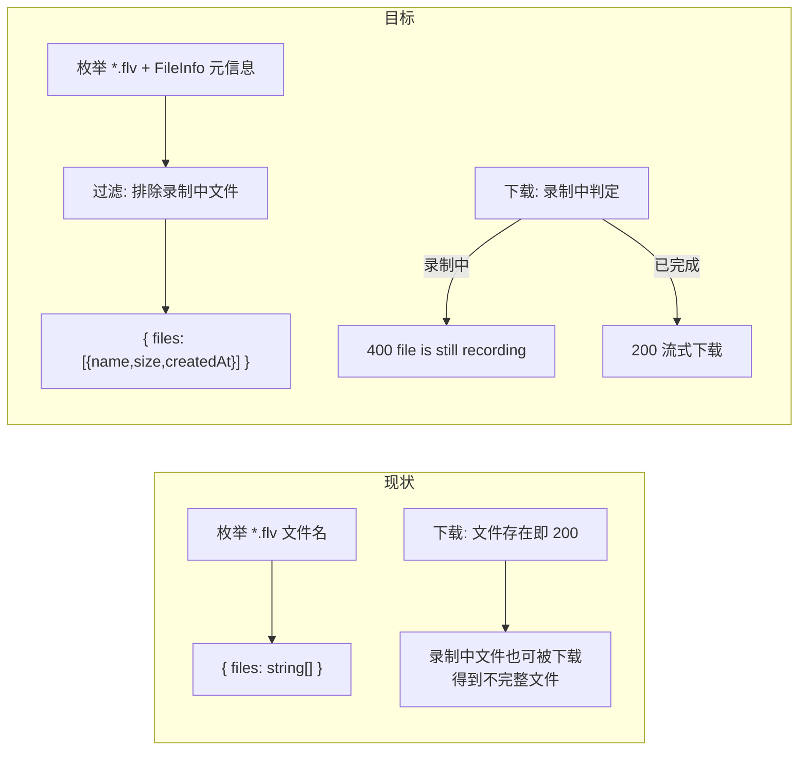
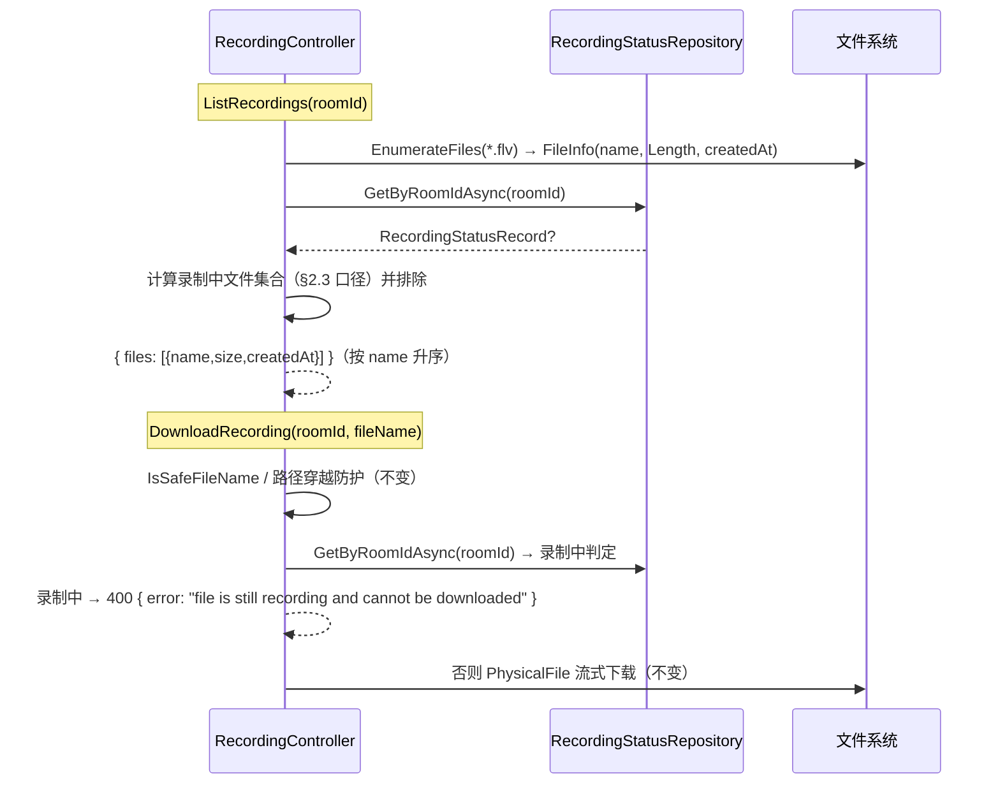

# 录播文件列表接口提供更多信息 - 技术提案

- 日期：2026-09-14
- 状态：待评审
- feat-branch：`feat/recording-file-list-metadata`
- 关联文档：[PRD](../product/draft/20260914-recording-file-list-metadata-prd.md)

## 1. 概述

### 1.1 背景

录播功能的文件列表/下载链路现状：

- **recording 服务** `RecordingController`（`servers/recording/Controllers/RecordingController.cs`）：
  - `ListRecordings`（:24-40）：枚举 `{StorageDir}/{roomId}/*.flv`，仅返回文件名数组 `{ files: string[] }`，按文件名升序；
  - `DownloadRecording`（:42-）：平文件名校验（`IsSafeFileName`）→ 路径穿越防护 → `PhysicalFile` 流式下载；不存在 404，非法文件名 400；
- **api 代理** `BilibiliLiveRecordingController`（`servers/api/Controllers/BilibiliLiveRecordingController.cs`）：列表接口原样透传上游 JSON；下载接口流式转发，但**仅对 404 特判**，其余非成功状态一律改写为 502；
- **录制状态**：`RecordingStatusRecord`（`servers/common/Persistence/Entities/RecordingStatusRecord.cs`）记录每房间 `State`（`not_live`/`recording`/`error`）、当前场次产出文件名列表 `Files` 与心跳 `UpdatedAt`；`RecordingStatusRepository.GetByRoomIdAsync`（`servers/common/Persistence/RecordingStatusRepository.cs:25`）提供单房间读取；`RecordingOptions.StaleStatusThresholdSeconds`（默认 180s）为状态过期阈值；
- **web**：`listRecordings`（`apps/web/src/api/client.ts:126-131`）返回 `string[]`，`RecordingStatusPage`（`apps/web/src/pages/recording/RecordingStatusPage.tsx`）按字符串渲染文件名与下载链接。

需求：列表返回 `{ files: Array<{ name, size, createdAt }> }`；录制中文件不进列表，下载录制中文件返回 400 并提示「文件正在录制中无法下载」。

### 1.2 目标

1. recording 列表接口返回文件元信息对象数组（`name`/`size`/`createdAt`），并排除录制中文件；
2. recording 下载接口对录制中文件返回 400 `{ "error": "file is still recording and cannot be downloaded" }`；
3. api 代理透传新列表结构（现状已满足，纯 JSON 透传）与下载 400 响应（需新增透传分支）；
4. 两份契约与 web 端同步适配。

### 1.3 范围

- **内**：`contracts/recording.openapi.yaml`、`contracts/bilibili-crawler.openapi.yaml` 契约更新；recording `RecordingController` 列表/下载改造；api 代理 400 透传；web client 与录制状态页适配；相应测试；
- **外**：录制流程本身（ffmpeg 输出、锁、状态上报语义）；`recording-status` 聚合接口（其 `files` 字段语义为「当前场次产出文件名」，维持 string 数组不变）；音频流接口。

## 2. 技术架构

### 2.1 现状与目标对比



### 2.2 技术栈与归属

| 项 | 归属 | 说明 |
|---|---|---|
| 「录制中」判定 | `servers/recording` | 复用 `RecordingStatusRepository`（common）+ `RecordingOptions.StaleStatusThresholdSeconds` |
| 文件元信息 | `servers/recording` | `FileInfo`（Length / CreationTimeUtc） |
| 代理透传 | `servers/api` | `DownloadRecording` 新增 400 分支 |
| 契约 | `contracts/` | 两份 OpenAPI 先行 |
| web 适配 | `apps/web` | codegen 类型 + client + 页面展示 |
| 测试 | `tests/Z.Vtuber.Tests` | 沿用 xUnit 既有录播测试设施 |

### 2.3 关键设计：「录制中文件」判定口径

判定函数（recording 内部，新增私有方法或纯函数）：

```
GetRecordingFiles(roomId):
    record = await statusRepository.GetByRoomIdAsync(roomId)
    若 record == null → 空集合
    若 record.State != "recording" → 空集合
    若 UtcNow - record.UpdatedAt > StaleStatusThresholdSeconds → 空集合（陈旧残留，与 recording-status 读侧退化口径一致）
    否则 → record.Files（当前场次产出文件名集合）
```

- 列表：枚举磁盘文件后排除该集合；
- 下载：`fileName ∈ 该集合` → 400。

该口径与 `RecordingStatusReporter` 的写入语义匹配：录制期间周期心跳刷新 `UpdatedAt` 且 `Files` 为当前场次 RAW/AV1 文件名；优雅停机/下播落 `not_live` 终态后文件自动「解禁」。多实例场景读共享 MongoDB 集合，任一实例录制中均生效。

## 3. API 设计

### 3.1 契约变更（先行）

**`contracts/recording.openapi.yaml`**：

- `RecordingFileList` schema（:135）：`files` items 由 `type: string` 改为 `$ref: RecordingFile`；
- 新增 schema：

```yaml
RecordingFile:
  type: object
  required: [name, size, createdAt]
  properties:
    name:
      type: string
      description: 录播文件名（平文件名）
    size:
      type: integer
      format: int64
      description: 文件大小（字节）
    createdAt:
      type: string
      format: date-time
      description: 文件创建时间（UTC）
```

- `GET /api/{roomId}/recordings/{fileName}` 追加 400 响应语义扩展：现仅「fileName 非法」，追加「文件正在录制中无法下载」；响应体 `application/json`：`{ "error": string }`。

**`contracts/bilibili-crawler.openapi.yaml`**：

- `RecordingFileList`（:775）同步上述对象化变更；
- `/api/b/live/{roomId}/recordings/{fileName}` 追加 `400` 响应（fileName 非法或文件正在录制中），`200`/`404`/`502` 语义不变；
- `/api/b/live/{roomId}/recordings` 的 `200` 描述更新为「录播文件列表（含大小与创建时间；不含录制中文件）」。

### 3.2 端点行为矩阵

| 场景 | recording | api（代理后） |
|---|---|---|
| 列表：无录播 | 200 `{files:[]}` | 200 透传 |
| 列表：有已完成文件 | 200 对象数组 | 200 透传 |
| 列表：含录制中文件 | 200，已排除 | 200 透传 |
| 下载：已完成文件 | 200 流式 | 200 流式透传 |
| 下载：录制中文件 | 400 `{error}` | **400 透传（本次新增分支）** |
| 下载：文件不存在 | 404 | 404（现状） |
| 下载：非法文件名 | 400 `{error:"invalid fileName"}` | 400 透传（同一分支顺带修复现状 400→502 的改写） |
| recording 不可达 | — | 502（现状） |

## 4. 数据模型

无持久化模型变更。`recording_status` 集合与 `RecordingStatusRecord` 实体不变——本需求只**消费**其 `State`/`Files`/`UpdatedAt`。

新增 DTO（recording 内部匿名类型或 record）：`RecordingFileDto { string Name; long Size; DateTime CreatedAt }`，仅用于接口响应，不入库。

## 5. 技术实现方案

### 5.1 核心流程



### 5.2 关键实现点

#### 实现点 1: 列表元信息（recording）

- `ListRecordings`：`Directory.EnumerateFiles(directory, "*.flv")` → `new FileInfo(path)` 取 `Length` 与创建时间；`createdAt` 取 `FileInfo.CreationTimeUtc`，不可用时（部分 Linux 文件系统不记录 birth time，返回 `DateTime.MinValue` 等价退化值）回退 `LastWriteTimeUtc`；
- 枚举与 `FileInfo` 构造之间文件被删除（外部清理）时 `FileInfo.Length` 访问会抛 `FileNotFoundException`：逐文件 try/catch 跳过该文件，不影响整体响应；
- 排除集合用 `HashSet<string>`（`StringComparer.Ordinal`），排除后按 `name` 升序输出（排序规则不变）。

#### 实现点 2: 下载 400（recording）

- `DownloadRecording` 在路径安全校验之后、文件存在性判断之前插入录制中判定：命中 → `BadRequest(new { error = "file is still recording and cannot be downloaded" })`；
- 判定置于此位置的理由：录制中文件物理上存在，若按现状顺序会直接 200，必须先于存在性检查；非法文件名的 400 语义保持不变且优先级最高。

#### 实现点 3: api 代理透传 400

- `BilibiliLiveRecordingController.DownloadRecording`：在 `NotFound` 特判旁新增 `BadRequest` 分支——读取上游响应体并以 400 原样返回（`Content(json, "application/json")`，与列表透传同模式）；
- 其余非成功状态仍归并为 502（现状不变）；
- 列表接口纯 JSON 透传，**无需改动**。

#### 实现点 4: web 适配

- codegen 重新生成 `schema.d.ts` / `schema-recording.d.ts`（既有 `npm run codegen` 串行命令，追加无新命令）；
- `client.ts` `listRecordings`：返回类型 `string[]` → `RecordingFile[]`（契约生成类型），`return data.files ?? []` 不变；
- `RecordingStatusPage`：`recordingsByRoom` 状态类型同步；文件行渲染 `file.name`，下载链接 `recordingDownloadUrl(roomId, file.name)`；新增格式化大小展示（如 `formatBytes` 小工具，`1.2 GB` 风格，与现有内联工具函数同风格）；`createdAt` 是否展示实现期按页面空间决定（PRD 3.4 不强制）；
- 页面现有测试（`RecordingStatusPage.test.tsx`、`client.test.ts`）同步更新 mock 结构。

### 5.3 不在本期的事项

- `recording-status` 聚合接口的 `files` 字段保持 string 数组（其语义为「当前场次产出文件名」，与下载清单不同），如需一并对象化另立需求；
- 录制中文件在页面上的「录制中」徽标展示：列表已不含录制中文件，用户经状态列已知悉录制中，不额外设计。

## 6. 技术决策

### 6.1 决策列表

1. **以 `recording_status` 集合判定录制中，而非文件锁/文件大小变化探测**：状态记录本就由录制链路维护（心跳 + 场次文件名），语义权威且多实例共享；探测文件是否仍在增长既不可靠（码率波动）又引入时序耦合。代价是状态过期窗口内（≤180s 心跳残留）文件会被「提前解禁」，与 recording-status 读侧退化口径一致，可接受。
2. **400 而非 409/423**：需求明确 400；且 400 与既有「非法 fileName」同码同构（`{error}` 体），契约与代理处理最简单。
3. **api 透传 400 而非自行判定**：判定权威在 recording（持有状态存储与文件系统）；api 仅修正「非 404 一律 502」的改写，顺带修复非法文件名 400 被吞为 502 的现状偏差。
4. **`createdAt` 用 `CreationTimeUtc` 回退 `LastWriteTimeUtc`**：文件由本服务创建后不再改写（ffmpeg `-y` 覆盖场景视为重新创建），创建时间语义清晰；回退保证无 birth time 的文件系统上字段仍可用。
5. **列表破坏性变更与 web 同需求交付**：消费方仅本仓库 web，无版本并存需求，不做双格式过渡。

### 6.2 依赖与约束

- 无新增 NuGet/npm 依赖；
- 契约先行：先提交契约变更，再改实现与 codegen；
- 不改录制流程与状态上报语义；不改 `recording-status` 接口结构。

## 7. 项目结构

```
contracts/（变更）
├── recording.openapi.yaml                 # RecordingFile schema + 列表对象化 + 下载 400
└── bilibili-crawler.openapi.yaml          # RecordingFileList 对象化 + 下载 400

servers/recording/（变更）
└── Controllers/RecordingController.cs     # 列表元信息 + 排除录制中；下载 400 判定

servers/api/（变更）
└── Controllers/BilibiliLiveRecordingController.cs  # 下载代理 400 透传

apps/web/（变更）
├── src/api/schema.d.ts / schema-recording.d.ts     # codegen 重新生成
├── src/api/client.ts                          # listRecordings 返回 RecordingFile[]
└── src/pages/recording/RecordingStatusPage.tsx     # 渲染 name + 格式化大小

tests/Z.Vtuber.Tests/（变更）
├── RecordingApiTests.cs                     # 列表新结构/排除录制中/下载 400
├── BilibiliLiveRecordingControllerTests.cs  # 代理 400 透传
└── （web 侧 RecordingStatusPage.test.tsx / client.test.ts 同步）
```

## 8. 测试策略

### 8.1 测试覆盖要求

核心逻辑覆盖率 ≥ 80%（common-rules）；TDD：先写失败测试再实现。

### 8.2 测试类型

- **recording 接口测试**（`RecordingApiTests`，既有设施）：
  - 列表：预置多文件 → 断言每元素 `name/size/createdAt` 正确、按 name 升序；
  - 排除：预置状态记录（`state=recording`、心跳新鲜、`Files` 含某文件）→ 该文件不在列表；状态过期（`UpdatedAt` 超阈值）→ 文件重新出现；
  - 下载：录制中文件 → 400 且 error 语义正确；同文件状态转 `not_live` 后 → 200；
  - 回归：非法文件名 400、不存在 404、无目录空数组；
- **api 代理测试**（`BilibiliLiveRecordingControllerTests`，既有 fake HttpClient 设施）：
  - 上游 400 → 代理返回 400 且响应体透传；上游 404/502 行为不回归；
- **web 测试**：`client.test.ts` 适配新返回类型；`RecordingStatusPage.test.tsx` 断言大小渲染与下载链接；
- **契约**：codegen 产物与契约一致性由构建保证（既有流程）。

## 9. 部署方案

- 随常规版本发布：recording、api、web 同一版本滚动更新；recording 先就绪与否均安全——新 api 透传逻辑对旧 recording（无 400 场景）行为不变，旧 web 对新列表结构不兼容，故 web 与 api/recording 需同版本发布（本仓库统一部署，天然满足）；
- 无数据迁移、无配置变更；回滚按整体版本回退即可。

## 10. 验收标准

- [ ] 列表接口返回 `{ files: [{ name, size, createdAt }] }`，大小与磁盘一致，排序不变，空目录空数组；
- [ ] 录制中文件不出现在列表；状态心跳过期后正常出现；
- [ ] 录制中文件下载经 api 代理返回 400，错误消息表达「文件正在录制中无法下载」；录制结束后可正常下载；
- [ ] 非法文件名 400、文件不存在 404、recording 不可达 502 行为不回归；
- [ ] web 录制状态页展示文件大小，类型经 codegen 生成，页面测试通过；
- [ ] 两份 OpenAPI 契约同步更新；单测/接口测试通过，核心逻辑覆盖率 ≥ 80%。

## 11. 相关文档

- PRD：`docs/product/draft/20260914-recording-file-list-metadata-prd.md`
- 录播功能技术提案：`docs/engineering/proposals/20260913-proposal-live-recording.md`
- 录播功能 Plan：`docs/engineering/plans/20260913-plan-live-recording.md`
