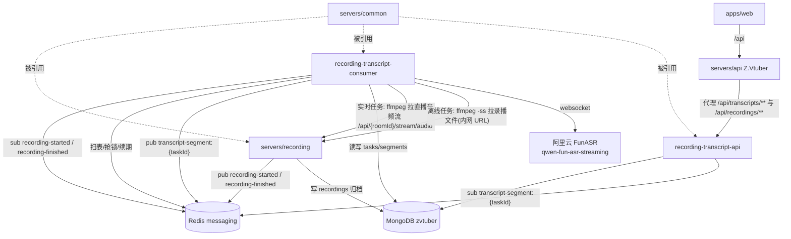
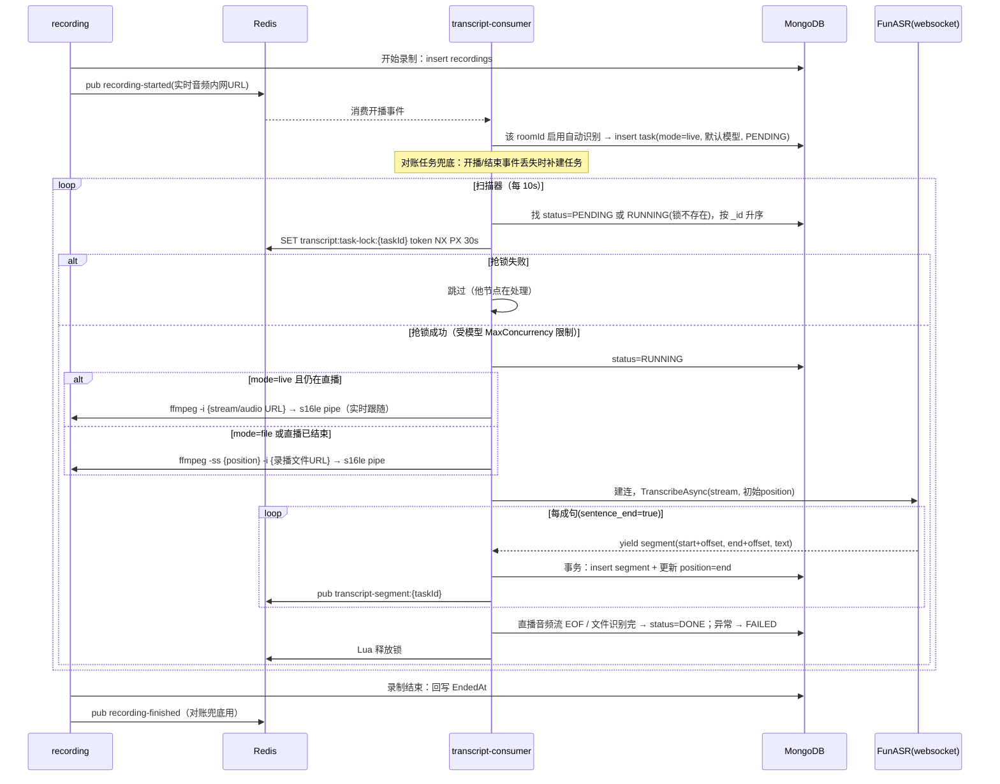

# 直播录播语音转写 - 技术提案

- 日期：2026-09-16
- 状态：待评审
- feat-branch：`feat/recording-transcript`
- 关联文档：[PRD](../product/draft/20260916-recording-transcript-prd.md)

## 1. 概述

### 1.1 背景

依据 PRD「直播录播语音转写」，在既有录播能力（`servers/recording`，ffmpeg 多输出落盘 flv + 实时音频流出口）之上增加语音转写链路：直播场次结构化归档、**开播即自动开始实时识别**（识别源为直播实时音频）、手动对录播文件离线识别、任务队列断点续跑、流式 ASR（qwen-fun-asr-streaming）识别、实时 Segments 推送与页面管理。

现状勘察结论（均经读码确认）：

- `recording_status` 是 RoomId 键的当前态 upsert，录播结束后 `Files` 被清空，**没有按场次的录播历史表**——需新增 `recordings` 集合；
- 跨进程协作先例是 Redis pub/sub fire-and-forget（`live-event:{roomId}`、`cookie-invalid`、`subscription-subscribed`，频道常量集中在 `servers/common/Live`），无持久化队列；
- 分布式锁有三套实现（common 仅契约 `IDistributedLockProvider`），其中 `servers/recording/Recording/RecordingLock.cs` 的「SET NX PX + 续期 + Lua 释放 + fencing」语义与转写任务锁需求一致，可仿写；
- 录播文件已有内网下载出口：`servers/recording` 的 `GET /api/{roomId}/recordings/{fileName}`（已支持 Range 透传），可直接作为离线识别音频源；
- **直播中的实时音频已有现成出口**：`servers/recording` 的 `GET /api/{roomId}/stream/audio`（`video/x-flv` chunked，ffmpeg stdout 泵 + `AudioStreamHub` 广播，无人收听零缓冲），是实时识别的音频源；
- web 端尚无 EventSource 用法，SSE 仅服务端有先例（`servers/api/Controllers/BilibiliLiveController.cs` 的 event/subscribe）。

### 1.2 目标

1. recording 服务：新增 `recordings` 场次归档（title/room_id/mid/files）；**录制开始发布 `recording-started` 事件**、录播结束发布 `recording-finished` 事件；存量录播一次性清洗归档；
2. 新增 `servers/recording-transcript-consumer`（Z.Vtuber.RecordingTranscript.Consumer）：消费开播/结束事件 + 对账补建任务；定时扫表抢锁处理任务——**实时任务接直播音频流即时识别**，离线任务按断点 seek 录播文件识别；经 websocket 调 FunASR 流式识别，segments 落库并 Redis pub；
3. 新增 `servers/recording-transcript-api`（Z.Vtuber.RecordingTranscript.Api）：enqueue、任务列表、segments、重试、SSE、自动识别设置、模型管理 API；
4. api 服务代理转写端点；web 新增「Transcripts」导航（任务列表 / 设置两个 Tab）。

### 1.3 范围

- **内**：recording 服务改造（recordings 归档、开始/结束事件、老数据清洗）；两个新服务全部能力（含实时音频消费链路）；common 新增实体/仓储/事件契约；`contracts/recording-transcript.openapi.yaml` 新契约与 codegen；api 代理端点；web Transcripts 页面；AppHost 编排、Dockerfile、镜像 CI；单测与集成测试。
- **外**：其他 ASR 提供商（仅 AliFunAsr）；转写结果的二次加工（翻译/摘要）；实时识别中断窗口的回溯补识别（见 §5.2 实现点 4 语义）；录播自动清理；crawler/notifier 零改动。

## 2. 技术架构

### 2.1 系统架构图



### 2.2 技术栈

| 层级 | 技术选型 | 说明 |
|------|---------|------|
| 新服务 | C# (.NET 10) ASP.NET Core（Kestrel `/health` + HostedService） | 与 crawler/recording 同构 |
| 音频转码 | ffmpeg 外部进程 | `-ss {position}` 断点 Seek + s16le 16kHz mono pipe |
| ASR | websocket 直连 FunASR realtime（`System.Net.WebSockets.ClientWebSocket`） | 仅 sentence_end=true 成句 yield |
| 任务队列 | Mongo 扫表 + Redis 任务锁（SET NX PX + 续期 + Lua 释放 + fencing） | 仿 `RecordingLock` 语义 |
| 分布式事件 | Redis pub/sub fire-and-forget + 对账补建 | 沿用既有先例，缺口由对账兜底 |
| 实时推送 | SSE（服务端 `text/event-stream`，web `EventSource`） | 服务端先例见 BilibiliLiveController |
| 契约 | OpenAPI `contracts/recording-transcript.openapi.yaml`（手写契约先行） | web openapi-typescript codegen |
| 前端 | React 19 + Vite（既有） | App.tsx `PageKey` + menuItems 模式 |

### 2.3 模块划分

| 模块 | 职责 | 关键技术点 |
|------|------|-----------|
| `servers/recording`（改造） | `recordings` 场次归档、录制开始/结束事件发布、老数据清洗 | RecordingSession 开始/结束钩子、一次性幂等迁移 |
| `servers/common`（变更） | 新实体/仓储/索引、事件频道常量与 record | `MongoCollectionNames` + `MongoDbInitializer` 登记 |
| `servers/recording-transcript-consumer`（新） | 开播/结束事件订阅 enqueue、对账补建、任务扫描执行、ASR 编排 | 任务锁续期/fencing、实时音频流/录播文件双音源 ffmpeg pipe、断点 offset |
| `servers/recording-transcript-api`（新） | 任务/segments/enqueue/retry/SSE/设置/模型 API | SSE  replay + 实时订阅 |
| `servers/api`（变更） | 代理 `/api/transcripts/**` 与 `/api/recordings/**` 至 transcript-api | named HttpClient 流式转发（同 recording 代理模式） |
| `apps/web`（变更） | Transcripts 导航与两个 Tab | codegen schema、EventSource |

## 3. API 设计

### 3.1 transcript-api 服务 API（本地端口 8084，建 `Properties/launchSettings.json`）

契约：`contracts/recording-transcript.openapi.yaml`（新增）。web 侧经 api 服务同路径代理访问（见 §3.2），代理端点追加至 `contracts/bilibili-crawler.openapi.yaml`。

路由分组约定：**与 roomId 无关**的转写端点挂在 `/api/transcripts` 下；**与 roomId 相关**的端点挂在 `/api/recordings/{roomId}/transcripts` 下。

#### GET /health

- 存活 + MongoDB 连通性（沿用 `MongoDbHealthCheck` 模式）。

#### GET /api/recordings

- 录播场次归档列表（供「识别设置」的场次选择器）。Query：`roomId?`、`limit?`(默认 50)、`before?`(分页游标，StartedAt 倒序)。
- 响应 200：`{ "items": [{ "id", "roomId", "mid", "title", "files": [...], "startedAt", "endedAt" }] }`。

#### POST /api/transcripts/enqueue

- 手动 enqueue（roomId 无关）。Body：`{ "recordingId": "...", "modelId": "..." }`。
- 200：`{ "taskId", "status": "PENDING" }`；404 录播或模型不存在/模型被禁用；409 同录播+同模型已存在任务（唯一索引冲突，返回已有 taskId）。

#### GET /api/transcripts/task

- 任务列表。Query：`recordingId?`、`roomId?`、`status?`、`limit?`。默认按创建时间倒序，进行中优先由 `status` 过滤支持。
- 响应：`{ "items": [{ "id", "recordingId", "roomId", "title", "file", "modelId", "modelName", "type", "mode", "source", "status", "position", "error", "createdAt", "updatedAt" }] }`（`mode` ∈ `live | file`）。

#### GET /api/transcripts/task/{taskId}

- 任务详情 + 全量 segments（按 startTime 升序）：`{ "task": {...}, "segments": [{ "start", "end", "text" }] }`。

#### POST /api/transcripts/task/{taskId}/retry

- 重试 FAILED 任务：仅 `FAILED` 可重试，将 `status` 置为 `RUNNING`（不持锁，由扫描器按「RUNNING 无锁」规则接管，从 `position` 断点续跑），清空 `error`。200 返回任务；409 状态不允许。

#### GET /api/transcripts/task/{taskId}/sse

- `text/event-stream`：先 replay 已入库 segments，再订阅 Redis `transcript-segment:{taskId}` 实时推送新 segment；15s 心跳；任务终态（DONE/FAILED）后推送 `done` 事件并关闭。实现参考 `BilibiliLiveController` 的 SSE 模式。

#### GET /api/transcripts/settings

- 自动识别设置全量列表（roomId 无关视角，供设置 Tab 展示全部主播开关）：`{ "items": [{ "roomId", "mid", "anchorName", "enabled" }] }`（关联主播资料补名称）。

#### POST /api/recordings/{roomId}/transcripts/settings

- 设置指定主播的自动识别开关（roomId 相关）。Body：`{ "enable": true }`。
- upsert `transcript_auto_enqueue`；200 返回 `{ "roomId", "enabled" }`。

#### GET /api/recordings/{roomId}/transcripts

- roomId 视角查询：该主播的录播场次及各场次的 transcript 任务（含当前自动识别开关状态）。响应 200：

```json
{
  "roomId": 123,
  "autoEnqueueEnabled": true,
  "items": [
    {
      "recordingId": "...",
      "title": "晚间歌回",
      "startedAt": "...",
      "endedAt": "...",
      "tasks": [{ "taskId": "...", "modelId": "...", "modelName": "qwen-fun-asr", "status": "RUNNING", "position": 123000, "source": "auto", "updatedAt": "..." }]
    }
  ]
}
```

- 供「识别设置」按主播查看某场直播的 transcript_tasks 并对 FAILED 任务重试（重试走 `/api/transcripts/task/{taskId}/retry`）。

#### GET /api/transcripts/models

- 模型列表：`{ "items": [{ "id", "name", "provider", "type", "enabled", "isDefault", "maxConcurrency", "createdAt" }] }`（**不回传 apiKey**）。

#### POST /api/transcripts/models

- 添加模型。Body：`{ "name", "provider": "ali-fun-asr", "type": "streaming", "apiKey", "enabled", "isDefault", "maxConcurrency" }`。`isDefault=true` 时原子清除其他模型默认位。

#### PUT /api/transcripts/models/{modelId}

- 更新启用/禁用、默认位、最大并发、API Key（可选，不传则不改）。被禁用模型进行中的任务继续跑完。

### 3.2 内部接口与事件

#### 事件：`recording-started`（Redis pub/sub，fire-and-forget）

- 频道常量与 record 定义放 `servers/common`（沿用 `LiveEventChannels` 模式）：`RecordingEventChannels.Started = "recording-started"`；
- 发布方：recording 服务，`RecordingSession` 开始录制（ffmpeg 启动、归档 insert 完成）时发布；
- 载荷：

```json
{
  "recordingId": "ObjectId",
  "roomId": 123,
  "mid": 456,
  "title": "晚间歌回",
  "liveAudioUrl": "http://recording/api/123/stream/audio",
  "startedAt": "2026-09-16T12:00:00Z"
}
```

- 消费方：transcript-consumer。该 roomId 启用自动识别时，按当前默认模型创建 **mode=live** 的 PENDING 任务（source=auto），开播即进入实时识别。

#### 事件：`recording-finished`（Redis pub/sub，fire-and-forget）

- 频道常量与 record 定义放 `servers/common`（沿用 `LiveEventChannels` 模式）：`RecordingEventChannels.Finished = "recording-finished"`；
- 发布方：recording 服务，`RecordingSession` 正常结束（ffmpeg exitCode==0，即下播落盘完成）时发布；
- 载荷：

```json
{
  "recordingId": "ObjectId",
  "roomId": 123,
  "mid": 456,
  "title": "晚间歌回",
  "files": ["[RAW][123][某主播] 2026-09-16-晚间歌回.flv", "[AV1][123][某主播] 2026-09-16-晚间歌回.flv"],
  "fileUrls": ["http://recording/api/123/recordings/%5BRAW%5D....flv", "..."],
  "endedAt": "2026-09-16T14:00:00Z"
}
```

- 消费方：transcript-consumer（BackgroundService + `ChannelMessageQueue.ReadAsync` 循环，仿 `servers/notifier/Events/CookieInvalidEventSubscriber.cs`）。`recording-started` 丢失的场景由本事件 + 对账兜底补建任务；live 任务的正常收尾由实时音频流 EOF 驱动，不依赖本事件。

#### 事件：`transcript-segment:{taskId}`（Redis pub/sub，fire-and-forget）

- consumer 在 segment 落库成功后发布，载荷即 segment JSON `{ "taskId", "start", "end", "text" }`；无人订阅则抛弃；transcript-api 的 SSE 端点订阅。

#### 服务间依赖

- transcript-api → Mongo（直读 `recordings`/`transcript_*`，共享库先例：api 直读 `recording_status`）；
- consumer → recording：离线任务 ffmpeg 以录播文件内网 URL 为输入（`RecordingService:BaseUrl` 配置兜底拼接）；实时任务以 `GET /api/{roomId}/stream/audio` 直播音频流为输入（URL 由 `recording-started` 事件携带）；
- api → transcript-api：HTTP 代理（`TranscriptService:BaseUrl`）。

## 4. 数据模型

库均为 MongoDB `zvtuber`；集合名登记入 `MongoCollectionNames`，索引登记入 `MongoDbInitializer.EnsureIndexesAsync()`，测试登记入 `MongoDbFixture`。

### 4.1 `recordings`（新增，写者：recording 服务）

| 字段 | 类型 | 说明 |
|------|------|------|
| `_id` | ObjectId | |
| `RoomId` | long | 索引 `RoomId_1_StartedAt_-1` |
| `Mid` | long | |
| `Title` | string | 场次名 |
| `Files` | string[] | 本场次全部产出文件（RAW + AV1） |
| `StartedAt` | DateTime(UTC) | 录制开始时间 |
| `EndedAt` | DateTime(UTC)? | 录制结束时间（结束事件发布前回写） |
| `CreatedAt` | DateTime(UTC) | |

开始录制时插入（title/room_id/mid/files 齐），结束时回写 `EndedAt` 并发布事件；清洗任务对存量补写。

### 4.2 `transcript_tasks`（新增）

| 字段 | 类型 | 说明 |
|------|------|------|
| `_id` | ObjectId | 插入顺序即排队顺序 |
| `RecordingId` | ObjectId | 关联 recordings |
| `RoomId` | long | 冗余便于过滤 |
| `File` | string | 识别所用录播文件（优先 RAW，缺失回退首个）；live 任务用于结束后/接管时补尾 |
| `ModelId` | ObjectId | |
| `Type` | string | 音源类型，固定 `recording`（预留扩展） |
| `Mode` | string | `live`（开播自动创建，实时音频流为源）/ `file`（手动发起，录播文件为源） |
| `Source` | string | `auto` / `manual` |
| `Position` | long(ms) | 断点，始终为句尾 |
| `Status` | string | `PENDING`/`RUNNING`/`DONE`/`FAILED` |
| `Error` | string? | FAILED 原因 |
| `CreatedAt`/`UpdatedAt` | DateTime(UTC) | |

索引：**唯一索引 `RecordingId_1_ModelId_1`**（「录播 + model 只有一个 transcript」的硬约束，enqueue 幂等）；`Status_1__id_1`（扫描器按插入序取 PENDING）。

### 4.3 `transcript_segments`（新增）

| 字段 | 类型 | 说明 |
|------|------|------|
| `_id` | ObjectId | |
| `TaskId` | ObjectId | 即 transcriptId |
| `StartTime` | long(ms) | 整场录播时间轴上的句首（含续跑 offset） |
| `EndTime` | long(ms) | 句尾 |
| `Text` | string | |

索引：`TaskId_1_StartTime_1`；**唯一索引 `TaskId_1_StartTime_1`**（续跑/重试幂等兜底，重复句尾写入冲突时忽略）。

### 4.4 `transcript_models`（新增）

| 字段 | 类型 | 说明 |
|------|------|------|
| `_id` | ObjectId | |
| `Name` | string | |
| `Provider` | string | 当前仅 `ali-fun-asr` |
| `Type` | string | 当前仅 `streaming` |
| `ApiKey` | string | 仅服务端使用，API 不回传 |
| `Enabled` | bool | |
| `IsDefault` | bool | 部分唯一索引保证至多一个默认 |
| `MaxConcurrency` | int | 该模型同时在跑的任务数上限 |
| `CreatedAt` | DateTime(UTC) | |

### 4.5 `transcript_auto_enqueue`（新增）

| 字段 | 类型 | 说明 |
|------|------|------|
| `_id` | ObjectId | |
| `RoomId` | long | 唯一索引 |
| `Mid` | long | |
| `Enabled` | bool | |
| `UpdatedAt` | DateTime(UTC) | |

### 4.6 Redis key

- 任务锁：`transcript:task-lock:{taskId}`，value 随机 token，TTL 30s，持有者每 10s 续期，Lua 比对 token 释放，处理循环每轮 `CheckOwnershipAsync` fencing；
- 频道：`recording-started`、`recording-finished`、`transcript-segment:{taskId}`（均无持久化，fire-and-forget）。

## 5. 技术实现方案

### 5.1 核心流程



### 5.2 关键实现点

#### 实现点 1: recordings 归档与开始/结束事件（recording 服务改造）

- `RecordingSession` 开始录制时 insert `recordings`（title/room_id/mid/files，files 为文件名模板渲染结果），随后发布 `recording-started`（携带实时音频内网 URL `/api/{roomId}/stream/audio`）；`RunLockedAsync` 尾部 exitCode==0 分支：回写 `EndedAt` 后发布 `recording-finished`（发布失败均仅记日志，由对账兜底）；
- 停机/fencingLost 分支不发布（未正常结束或已被接管，接管方新场次各自归档并各自发布 started）。

#### 实现点 2: 老数据清洗（一次性幂等迁移）

- 随 recording 服务启动执行的幂等迁移（沿用 `MongoDbInitializer` 迁移登记模式）：
  1. 遍历录播存储目录，按 `{roomId}/文件名` 枚举文件与创建时间；
  2. 按文件名模板解析出日期/场次名，以 `RoomId` + 文件创建时间落入 `bilibili_live_session` 的 `[StartDate, StopDate]` 窗口（无匹配时以 `bilibili_live_status` 时间兜底）匹配场次；
  3. 同场次多文件（RAW/AV1）聚合为一条 `recordings`；已存在（按 RoomId+StartedAt 幂等键）则跳过；
  4. 清洗结果统计记日志；不匹配的文件记 warning 不阻断。

#### 实现点 3: 任务队列扫描与接管

- 扫描器（HostedService，10s 周期 + 抖动）：`status=PENDING` 或（`status=RUNNING` 且 Redis 锁 key 不存在）的任务，按 `_id` 升序取；逐条尝试抢锁，抢锁成功且该模型在跑数 < `MaxConcurrency` 才执行；
- 「RUNNING 但无锁」即上一节点死亡（锁 TTL 30s 已过期），直接接管续跑；
- retry 端点将 FAILED 置 RUNNING，复用同一接管路径，无需单独调度。

#### 实现点 4: 双音源音频链路与断点续跑一致性

任务按 `Mode` 选择音源，输出统一为 16kHz mono s16le 流喂给 ASR：

- **实时任务（mode=live）**：`ffmpeg -hide_banner -loglevel warning -i "{liveAudioUrl}" -vn -ac 1 -ar 16000 -f s16le pipe:1`，输入为 recording 服务的 `GET /api/{roomId}/stream/audio`（flv 音频封装 chunked 流）。ffmpeg 跟随直播速度输出，stdout 按 1 秒缓冲（32000B）喂入 `TranscribeAsync` 的入参 Stream（`System.IO.Pipelines` 桥接）；下播后流 EOF → 任务 DONE；
- **离线任务（mode=file）**：`ffmpeg ... -ss {position/1000}s -i "{fileUrl}" -vn -ac 1 -ar 16000 -f s16le pipe:1`，输入为录播文件内网 URL（Range 支持使 `-ss` seek 高效）；文件读完 → 任务 DONE；
- **live 任务的接管/迟到兜底**：实时任务被扫描器接管（或排队到开播后才执行）时先探测实时音频端点——200 则接流继续识别（**中断窗口的直播内容不回溯**，position 语义退化为「已识别时长坐标」，新句时间以接管时刻的录制时长为 offset 起点，由 recording 状态/归档 `StartedAt` 推算）；404（直播已结束）则按 file 模式从 `position` seek 录播文件补齐剩余部分后 DONE，保证整场覆盖；
- `IStreamingAsrService` 抽象（consumer 内 `Asr/`）：

```csharp
public record StreamingAsrSegment(long Start, long End, string Text);

public interface IStreamingAsrService
{
    IAsyncEnumerable<StreamingAsrSegment> TranscribeAsync(Stream stream, CancellationToken ct = default);
}
```

- `AliFunAsrService`：构造传入**初始 position（offset）**；websocket 逐帧发送音频，仅在 `sentence_end=true` 时把该句 yield 出去，时间 = 返回时间 + offset；
- 每个 yield 立刻在一个 **Mongo 事务**中：insert segment + 更新 task.Position=segment.End——保证「片段入库」与「断点推进」原子一致；`(TaskId, StartTime)` 唯一索引兜底幂等；
- 事务要求 Mongo replica set，见 §9 部署变更。

#### 实现点 5: AliFunAsrService（FunASR realtime websocket）

- 单任务一条 websocket 连接（文档：<https://platform.qianwenai.com/docs/api-reference/speech-recognition/fun-asr-realtime/websocket-api.md>）；
- 握手带 API Key（服务端持有，不外泄）；按协议发送 run-task/音频帧/finish-task；
- 背压：识别慢于喂入时，1 秒缓冲队列有界（上限 60s 音频），满则暂停读 ffmpeg stdout（OS pipe 背压自然生效）。离线任务不丢音频；**实时任务**上背压会传导至 recording 的 `AudioStreamHub`（慢订阅者 DropOldest），表现为识别落后实时、极端情况丢段——以模型并发上限与监控兜底，见 §6.1；
- 连接中断：抛出异常使任务 FAILED（断点已落库，retry/接管后从句尾续跑重连）。

#### 实现点 6: SSE 实时推送

- transcript-api 端点：先查库 replay 全量 segments，再订阅 `transcript-segment:{taskId}` 转发；去重以 `(start)` 为键（replay 与实时可能交叠）；终态推 `done` 关闭；
- web 用原生 `EventSource`（项目首个前端 SSE 用法），断开自动重连由 EventSource 自带，重连后 replay 保证不丢。

#### 实现点 7: 对账补建（事件 fire-and-forget 的可靠性兜底）

- consumer 周期（5min）扫描，两类兜底：
  1. **开播中漏建**：`recording_status` 中 `state=recording` 且 roomId 启用自动识别，且不存在该 roomId 当前场次的任务 → 补建 mode=live 的 PENDING（source=auto，错过部分不回溯）；
  2. **结束后漏建**：`recordings.EndedAt != null` 且 roomId 启用自动识别，且不存在该 recording + 当前默认模型的任务 → 补建 mode=file 的 PENDING（source=auto）；
- 与唯一索引配合天然幂等；仅补「启用之后开播/结束」的场次（StartedAt/EndedAt >= 设置启用时间），历史录播不补。

## 6. 技术决策

### 6.1 决策列表

| 决策 | 选项 A | 选项 B | 最终选择 | 原因 |
|------|--------|--------|---------|------|
| 识别时机 | 下播后对录播文件离线识别 | 开播即接实时音频流识别 + 文件兜底 | B | 需求要求直播开始时就生成 transcript；直播中即可看实时文字；文件链路保留给手动/补尾 |
| 实时中断缺口 | 结束后从文件回溯补齐缺口 | 不回溯，仅从直播当前位置继续 | B | 缺口窗口界定复杂且收益低；PRD 明确不回溯；若接管时直播已结束则从断点补尾保证整场覆盖 |
| 队列载体 | 引入 Redis Stream/消息队列 | Mongo 扫表 + Redis 锁 | B | 需求明确扫表方案；避免引入新基础设施；`_id` 有序天然 FIFO |
| 事件可靠性 | 仅 pub/sub | pub/sub + 对账补建 | B | 既有 pub/sub 全为 fire-and-forget，对账以唯一索引幂等兜底不丢场次 |
| 任务锁 | 复用 common `IDistributedLockProvider` | 仿 `RecordingLock` 自实现 | B | 需要续期+fencing，common 契约无此语义；同 recording 决策 |
| 音频获取 | consumer 挂载录播卷直读文件 | 经 recording 内网 HTTP（实时流 + 文件 URL） | B | 实时音频已有 `/stream/audio` 出口零改动复用；无需共享卷；ffmpeg 支持 http+Range Seek |
| 断点一致性 | 顺序写两次 | Mongo 事务 + 唯一索引兜底 | B | 需求明确事务；单写者由锁保证，唯一索引兜幂等 |
| 模型配置 | 配置文件/appsettings | Mongo `transcript_models` + 页面管理 | B | 需求要求页面增删改、设默认、并发上限 |
| web 实时更新 | 轮询 | SSE (EventSource) | B | 需求明确 SSE 端点；服务端有先例 |
| web 访问路径 | nginx 新增 location 直连 | api 服务代理（同 recording） | B | 沿用 recording 先例，web 只认 `/api`，零 nginx 改动 |

### 6.2 依赖与约束

| 类型 | 内容 | 说明 |
|------|------|------|
| 依赖 | 部署镜像含 ffmpeg（consumer） | 与 recording 镜像同安装方式 |
| 依赖 | 阿里云 FunASR API Key 与外网访问 | qwen-fun-asr-streaming websocket |
| 依赖 | MongoDB replica set | 事务前置条件，见 §9 |
| 约束 | 同录播+同模型唯一任务（唯一索引硬约束） | enqueue 409 幂等 |
| 约束 | .NET 10、契约式开发、TDD、覆盖率 ≥80% | 项目既有规范 |

## 7. 项目结构

```
servers/common/（变更）
├── Live/RecordingEventChannels.cs              # recording-started / recording-finished 频道 + event record
├── Persistence/Entities/RecordingRecord.cs     # + TranscriptTaskRecord / TranscriptSegmentRecord / TranscriptModelRecord / TranscriptAutoEnqueueRecord
├── Persistence/RecordingRepository.cs          # + TranscriptTaskRepository / TranscriptSegmentRepository / TranscriptModelRepository / TranscriptAutoEnqueueRepository
└── Persistence/MongoDbInitializer.cs           # 新集合索引登记

servers/recording/（变更）
├── Recording/RecordingSession.cs               # 开始归档 + 发布 recording-started；结束回写 EndedAt + 发布 recording-finished
├── Recording/RecordingEventPublisher.cs        # Redis pub（started/finished）
└── Recording/RecordingBackfillMigration.cs     # 老数据清洗（幂等）

servers/recording-transcript-consumer/（新增 Z.Vtuber.RecordingTranscript.Consumer，本地 8085）
├── Program.cs                                  # /health + HostedService 挂载
├── Configuration/TranscriptConsumerOptions.cs  # 扫描间隔/锁TTL/缓冲上限/RecordingService:BaseUrl
├── Events/RecordingStartedSubscriber.cs        # 消费开播事件 → enqueue mode=live
├── Events/RecordingFinishedSubscriber.cs       # 消费结束事件 → 对账补建
├── Enqueue/TranscriptEnqueueService.cs         # 幂等建任务（consumer/api 共用逻辑，实体仓储在 common）
├── Reconcile/TranscriptReconciler.cs           # 对账补建（开播中漏建/结束后漏建）
├── Tasks/TranscriptTaskScanner.cs              # 扫表 + 并发上限
├── Tasks/TranscriptTaskLock.cs                 # Redis 锁（续期/Lua/fencing）
├── Tasks/TranscriptTaskRunner.cs               # 单任务编排：选音源→ffmpeg→ASR→落库→pub
├── Asr/IStreamingAsrService.cs                 # 抽象 + StreamingAsrSegment
├── Asr/AliFunAsrService.cs                     # FunASR websocket 实现
├── Audio/FfmpegAudioStream.cs                  # 实时流跟随 / 文件 -ss seek + s16le pipe + 1s 缓冲
└── Dockerfile                                  # aspnet 运行时 + ffmpeg

servers/recording-transcript-api/（新增 Z.Vtuber.RecordingTranscript.Api，本地 8084）
├── Program.cs
├── Controllers/RecordingsArchiveController.cs  # GET /api/recordings；GET /api/recordings/{roomId}/transcripts；POST .../settings
├── Controllers/TranscriptTasksController.cs    # /api/transcripts/task 列表/详情/retry/sse 与 enqueue
├── Controllers/TranscriptSettingsController.cs # GET /api/transcripts/settings（全量列表）
├── Controllers/TranscriptModelsController.cs   # /api/transcripts/models CRUD
├── Sse/TranscriptSegmentStream.cs              # replay + Redis 订阅 + 去重
└── Dockerfile                                  # 纯 aspnet 模式

servers/api/（变更）
├── Controllers/RecordingTranscriptProxyController.cs  # /api/transcripts/** 与 /api/recordings/** 代理
└── Program.cs                                          # TranscriptService:BaseUrl named client

apps/web/src/（变更）
├── api/schema-recording-transcript.d.ts        # codegen 生成（勿手改）
├── api/client.ts                               # + 转写相关方法
├── pages/transcripts/TranscriptsPage.tsx       # 导航页 + 两个 Tab
├── pages/transcripts/TaskListTab.tsx           # 任务列表 + SSE 实时 segments
├── pages/transcripts/SettingsTab.tsx           # 识别设置 + 模型设置
└── App.tsx                                     # menuItems + Transcripts

contracts/
├── recording-transcript.openapi.yaml           # 新增
└── bilibili-crawler.openapi.yaml               # + 代理端点

infra/apphost/AppHost.cs                        # + 两服务编排（mongo/messaging/recording 引用）
servers/Z.Vtuber.slnx                           # + 两项目
.github/workflows/                              # + build-recording-transcript-{api,consumer}-image.yml

tests/Z.Vtuber.Tests/（新增）
├── TranscriptTaskRepositoryTests.cs            # 唯一约束/扫描查询/状态机
├── TranscriptTaskLockTests.cs                  # Testcontainers Redis：互斥/续期/TTL接管/fencing
├── TranscriptEnqueueTests.cs                   # 幂等/409/默认模型快照/live 与 file 建任务
├── RecordingStartedSubscriberTests.cs          # 开播事件→live 任务/未启用不建/幂等
├── AliFunAsrOffsetTests.cs                     # offset 相加/sentence_end 过滤（假 websocket）
├── FfmpegAudioStreamTests.cs                   # lavfi 源 seek/pcm 格式/实时流跟随
├── TranscriptTaskRunnerTests.cs                # 断点续跑/事务一致/终态流转/live 接管补尾（404→file 模式）
├── TranscriptReconcilerTests.cs                # 开播中漏建/结束后漏建/历史不补/幂等
├── RecordingBackfillMigrationTests.cs          # 文件名↔场次匹配/幂等
└── TranscriptApiTests.cs                       # 端点/SSE/retry 409
```

## 8. 测试策略

### 8.1 测试覆盖要求

- 核心逻辑覆盖率 ≥ 80%（common-rules）；TDD：先写失败测试再实现。

### 8.2 测试类型

- **单元测试**：segment offset 计算；sentence_end 过滤；任务扫描查询构造；retry 状态机；文件名↔场次匹配纯函数；live 接管时 offset 起点推算；
- **集成测试（Testcontainers MongoDB + Redis）**：enqueue 唯一约束与 409；锁互斥/续期/TTL 接管；断点续跑（预置 position 与 segments，断言不重不漏）；segment+position 事务原子性；开播/结束事件消费建任务；对账补建幂等；SSE replay+实时；
- **ffmpeg 进程测试**：lavfi 生成测试音频，断言 `-ss` seek 后输出起点与 pcm 参数；以本地 chunked HTTP 流模拟 `/stream/audio`，断言实时跟随与 EOF 收尾；
- **ASR 契约测试**：以本地假 websocket server 模拟 FunASR 协议（run-task/句子结果/finish），断言 yield 时机与 offset；
- **web**：Vitest + RTL 覆盖两个 Tab 渲染、FAILED 重试交互、EventSource mock 的实时追加。

## 9. 部署方案

- AppHost 增加两服务：`WithReference(mongo/messaging)`、consumer 增 `RecordingService:BaseUrl`、api 增 `TranscriptService:BaseUrl`、健康检查 `/health`；
- **MongoDB 调整为单节点 replica set**（事务前置）：AppHost mongo 资源加 `--replSet rs0` 初始化；Testcontainers `MongoDbFixture` 同步改 replica set 模式；连接串对客户端透明（`directConnection=true`）；
- Dockerfile：transcript-api 照 api 纯净模式；consumer 照 recording 模式（装 ffmpeg）；各加镜像 CI workflow；
- 副本数：consumer 可多副本（锁保证单任务单节点）；transcript-api 无状态多副本；
- 配置：`TranscriptConsumer:ScanIntervalSeconds`(10)、`TranscriptConsumer:LockTtlSeconds`(30)、`TranscriptConsumer:AudioBufferSeconds`(60)、`TranscriptConsumer:ReconcileIntervalSeconds`(300)、`RecordingService:BaseUrl`、`TranscriptService:BaseUrl`。

## 10. 验收标准

- [ ] 技术方案评审通过；`contracts/recording-transcript.openapi.yaml` 评审通过
- [ ] 新录播自动归档 recordings；存量清洗可重入且匹配正确
- [ ] 录制开始/结束分别发布 recording-started / recording-finished 事件
- [ ] 启用自动识别的主播开播 1 分钟内出现 live 任务并开始实时产出 segments；下播后任务自动 DONE
- [ ] consumer 宕机期间的开播/结束经对账补建；live 任务接管时直播已结束则从断点补尾至 DONE
- [ ] 手动 enqueue 幂等（同录播同模型 409）；retry 后从断点续跑
- [ ] 多副本下同一任务仅一个节点执行；杀进程后任务被接管续跑，segments 不重复
- [ ] segment 与 position 事务一致；SSE 实时可见且不丢不重
- [ ] 模型页面管理（增/禁/默认/并发）生效，API Key 不回传
- [ ] 单测 + 集成测试通过，核心覆盖率 ≥ 80%

## 11. 相关文档

- PRD：`docs/product/draft/20260916-recording-transcript-prd.md`
- 关联提案：`docs/engineering/proposals/20260913-proposal-live-recording.md`
- 既有契约：`contracts/recording.openapi.yaml`、`contracts/bilibili-crawler.openapi.yaml`
- FunASR realtime websocket API：<https://platform.qianwenai.com/docs/api-reference/speech-recognition/fun-asr-realtime/websocket-api.md>
- 规范：`docs/engineering/common-rules.md`、`docs/engineering/backend-rules.md`、`docs/engineering/frontend-rules.md`
