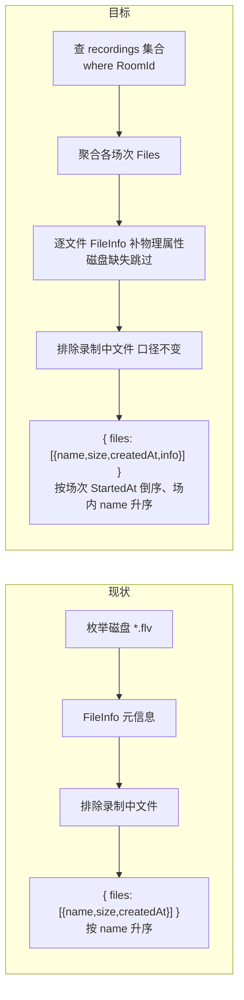
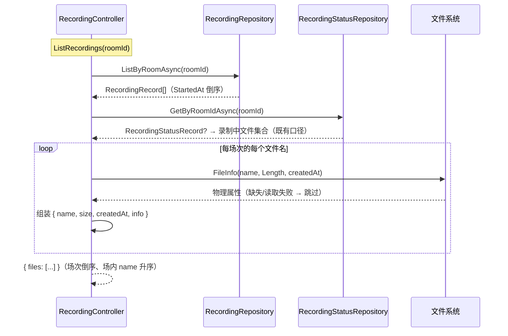

# 录播列表接口获取数据方式更新 - 技术提案

- 日期：2026-09-17
- 状态：待评审
- feat-branch：`feat/recording-list-info`
- 关联文档：[PRD](../product/draft/20260917-recording-list-info-prd.md)

## 1. 概述

### 1.1 背景

录播文件列表链路的现状：

- **recording 服务** `RecordingController.ListRecordings`（`servers/recording/Controllers/RecordingController.cs:24-68`）：枚举 `{StorageDir}/{roomId}/*.flv`，逐文件 `FileInfo` 取 `name/size/createdAt`，按文件名升序返回 `{ files: [{ name, size, createdAt }] }`；并以 `GetRecordingFilesAsync`（:143-157，基于 `recording_status` 心跳口径）排除录制中文件；
- **场次归档**：`RecordingSession` 开播时向 `recordings` 集合写入 `RecordingRecord`（`servers/common/Persistence/Entities/RecordingRecord.cs`：`Id`/`RoomId`/`Mid`/`Title`/`Files`/`StartedAt`/`EndedAt`/`CreatedAt`），结束时回写 `EndedAt`；`RecordingBackfillMigration` 已将存量磁盘文件按场次清洗归档；
- **读取设施**：`RecordingRepository`（`servers/common/Persistence/RecordingRepository.cs`）已有 `ListAsync(roomId, limit, before)`（按 `StartedAt` 倒序 + `Limit`）；`recordings` 集合已有 `RoomId_1_StartedAt_-1` 索引（`MongoDbInitializer.cs:943-949`）；转写服务 `TranscriptMapping.ToRecordingItem`（`servers/recording-transcript-api/Contracts/TranscriptMapping.cs:9-16`）提供了记录→DTO 的既有映射样例；
- **api 代理** `BilibiliLiveRecordingController.ListRecordings`（`servers/api/Controllers/BilibiliLiveRecordingController.cs:90-124`）：纯 JSON 透传；
- **web**：`listRecordings`（`apps/web/src/api/client.ts`）返回 `RecordingFile[]`，`RecordingStatusPage` 按 `name`/`size` 渲染。

需求：列表接口数据源切换为 `recordings` 集合（`where RoomId = {roomId}`），聚合各场次 `Files`，并为每个文件扩展所属场次的 `info` 信息。

### 1.2 目标

1. recording 列表接口改为查询 `recordings` 集合并聚合 `Files`，响应元素新增 `info` 字段（`recordingId`/`title`/`mid`/`startedAt`/`endedAt`）；
2. 文件的 `size`/`createdAt` 仍取自磁盘（物理属性），磁盘缺失的文件跳过；磁盘孤儿文件（无归档记录）不再列出；
3. 录制中文件排除语义（`recording_status` 心跳口径）与下载接口行为完全不变；
4. 两份契约与 web 端同步适配；api 代理纯透传无需改动。

### 1.3 范围

- **内**：`contracts/recording.openapi.yaml`、`contracts/bilibili-crawler.openapi.yaml` 契约更新；`servers/common` `RecordingRepository` 增加按房间全量查询方法；recording `RecordingController.ListRecordings` 改造；web client 与录制状态页适配；相应测试；
- **外**：录制流程本身（ffmpeg 输出、锁、状态上报、归档写入语义）；下载接口与音频流接口；转写服务既有 `recordings` 读取路径（`ListAsync` 保持原签名，新增方法不影响）。

## 2. 技术架构

### 2.1 现状与目标对比



### 2.2 技术栈与归属

| 项 | 归属 | 说明 |
|---|---|---|
| 场次查询 | `servers/common` | `RecordingRepository` 新增 `ListByRoomAsync(long roomId)`（无 limit，按 `StartedAt` 倒序） |
| 聚合与物理属性 | `servers/recording` | `RecordingController.ListRecordings` 改造；`FileInfo` 沿用 |
| 录制中排除 | `servers/recording` | 复用既有 `GetRecordingFilesAsync`，口径不变 |
| 契约 | `contracts/` | 两份 OpenAPI 先行 |
| web 适配 | `apps/web` | codegen 类型 + client + 页面展示场次信息 |
| 测试 | `tests/Z.Vtuber.Tests` | 沿用 xUnit 既有录播测试设施 |

### 2.3 关键设计：聚合与归属口径

```
ListRecordings(roomId):
    records = await recordingRepository.ListByRoomAsync(roomId)   // StartedAt 倒序
    recordingFiles = await GetRecordingFilesAsync(roomId)          // 既有：录制中文件名集合
    entries = []
    seen = HashSet<string>                                         // 同名去重兜底
    foreach record in records:                                     // 最新场次在前
        foreach name in record.Files（升序）:
            if name in seen 或 name in recordingFiles → 跳过
            path = {StorageDir}/{roomId}/{name}
            if 文件不存在 → 跳过（外部清理）
            info = FileInfo(path) → (size, createdAt)              // 读取失败跳过该文件
            entries.Add({ name, size, createdAt, info: 场次信息(record) })
            seen.Add(name)
    return { files: entries }
```

- **同名归属**：文件名由场次开播时间渲染（`RecordingFileName`），天然唯一；`RoomId+StartedAt` 唯一索引兜底。极端情况下同一文件名出现在多条记录时，按 StartedAt 倒序「先见先得」并去重；
- **磁盘孤儿文件**：不再枚举磁盘目录，未归档文件自然不再出现（PRD 3.5 已声明）；
- **录制中排除**：当前录制场次的记录 `EndedAt=null` 且文件正在写入，仍由 `recording_status` 心跳口径排除，与下载 400 判定共用同一集合，语义一致。

## 3. API 设计

### 3.1 契约变更（先行）

**`contracts/recording.openapi.yaml`**：

- `RecordingFile` schema（:199）追加 `info` 字段并列入 required：

```yaml
RecordingFile:
  type: object
  required: [name, size, createdAt, info]
  properties:
    name:        { type: string, description: 录播文件名（平文件名） }
    size:        { type: integer, format: int64, description: 文件大小（字节） }
    createdAt:   { type: string, format: date-time, description: 文件创建时间（UTC） }
    info:
      $ref: "#/components/schemas/RecordingSessionInfo"

RecordingSessionInfo:
  type: object
  required: [recordingId, title, mid, startedAt, endedAt]
  properties:
    recordingId:
      type: string
      description: 所属场次归档记录标识
    title:
      type: string
      description: 场次标题（直播标题）
    mid:
      type: integer
      format: int64
      description: 主播 mid
    startedAt:
      type: string
      format: date-time
      description: 场次开始（录制开始）时间（UTC）
    endedAt:
      type: string
      format: date-time
      nullable: true
      description: 场次结束时间（UTC）；未正常收尾为 null
```

- `GET /api/{roomId}/recordings` 的 `200` 描述更新为「录播文件列表（按场次归档聚合，含文件元信息与所属场次信息；不含录制中文件；无录播返回空数组）」。

**`contracts/bilibili-crawler.openapi.yaml`**：

- `RecordingFileList` 关联 schema 同步上述变更；`GET /api/b/live/{roomId}/recordings` 的 `200` 描述同步更新；`502` 语义不变。

### 3.2 端点行为矩阵

| 场景 | recording | api（代理后） |
|---|---|---|
| 列表：无场次记录 | 200 `{files:[]}` | 200 透传 |
| 列表：有归档场次 | 200，含 `info`，按场次 StartedAt 倒序 | 200 透传 |
| 归档文件磁盘缺失 | 跳过该文件 | 200 透传 |
| 磁盘孤儿文件 | 不出现 | 200 透传 |
| 含录制中文件 | 200，已排除（口径不变） | 200 透传 |
| 下载：全部场景 | 不变 | 不变 |
| recording 不可达 | — | 502（现状） |

## 4. 数据模型

无持久化模型变更。`recordings` 集合与 `RecordingRecord` 实体不变——本需求只**消费**其 `RoomId`/`Mid`/`Title`/`Files`/`StartedAt`/`EndedAt`/`Id`。

- **仓储新增**（`servers/common/Persistence/RecordingRepository.cs`）：

```csharp
/// <summary>查询指定房间全部场次，按 StartedAt 倒序（供录播文件列表聚合）。</summary>
public async Task<IReadOnlyList<RecordingRecord>> ListByRoomAsync(long roomId, CancellationToken ct = default)
```

既有 `ListAsync(roomId, limit, before)` 为转写服务分页所用，签名不动；新方法走既有 `RoomId_1_StartedAt_-1` 索引，无新增索引。

- **DTO**（recording 内部匿名类型或 record）：`RecordingSessionInfoDto { string RecordingId; string Title; long Mid; DateTime StartedAt; DateTime? EndedAt }`，仅用于接口响应，不入库。

## 5. 技术实现方案

### 5.1 核心流程



### 5.2 关键实现点

#### 实现点 1: 仓储方法（common）

- `RecordingRepository.ListByRoomAsync`：`Find(r => r.RoomId == roomId).SortByDescending(r => r.StartedAt).ToListAsync(ct)`；不加分页（单房间场次数量有限，与 PRD 性能预期一致）。

#### 实现点 2: 列表聚合（recording）

- `ListRecordings` 改造为 §2.3 口径：构造函数注入 `RecordingRepository`（`Program.cs` 已注册 common 仓储，无需新增注册）；
- `info` 映射：`recordingId = record.Id.ToString()`、`title = record.Title`、`mid = record.Mid`、`startedAt = record.StartedAt`、`endedAt = record.EndedAt`；
- `size`/`createdAt` 读取与容错逻辑沿用现状（`CreationTimeUtc` 回退 `LastWriteTimeUtc`；逐文件 try/catch 跳过；`IOException`/`UnauthorizedAccessException`），文件不存在同样跳过；
- 目录不存在不再是提前返回分支——改为「无场次记录即空数组」；目录存在与否不再影响响应形状。

#### 实现点 3: api 代理

- 纯 JSON 透传，**无需改动**（与上次列表结构变更相同结论）。

#### 实现点 4: web 适配

- codegen 重新生成 `schema.d.ts` / `schema-recording.d.ts`；
- `client.ts` `listRecordings` 返回类型随 codegen 更新，`return data.files ?? []` 不变；
- `RecordingStatusPage`：文件行追加场次标题展示（`file.info.title`），开播/结束时间按页面空间决定；页面测试 mock 结构同步更新。

### 5.3 不在本期的事项

- 列表分页：单房间场次数量有限，保持全量返回；如未来量级增长另立需求；
- 磁盘孤儿文件的重新归档/展示：数据源以归档为准，孤儿文件不再可见，如需兜底另立需求；
- `info` 追加转写状态等扩展字段：对象结构已预留扩展空间，另立需求。

## 6. 技术决策

### 6.1 决策列表

1. **以 `recordings` 集合为唯一列表数据源，不再枚举磁盘**：需求明确「查询方式变为查 recordings 表」；归档写入与清洗迁移已保证覆盖，磁盘孤儿文件视为不可见。代价是未归档文件从列表消失——这正是口径统一的目的，PRD 已声明。
2. **`size`/`createdAt` 仍实时读磁盘而非入库**：物理属性随文件系统真实状态变化（外部清理后不应再列出）；入库会引入一致性维护成本。逐文件 `stat` 开销与现状同量级。
3. **复用 `recording_status` 心跳口径排除录制中文件，而非 `EndedAt == null` 过滤**：孤儿未收尾场次（`EndedAt=null` 但无心跳）的文件应可列出下载；若按 `EndedAt` 过滤会把它们一并隐藏。心跳口径与下载 400 判定同源，语义一致。
4. **排序改为场次 StartedAt 倒序、场内 name 升序**：聚合后自然按场次分组，最新场次在前符合浏览预期；PRD 已声明此行为变化（破坏性变更与 web 同需求交付）。
5. **`info` 为必填对象而非 nullable**：数据源以归档为准后，每个列出的文件必有归属场次；nullable 只会把不存在的场景推给消费方判空。
6. **仓储新增 `ListByRoomAsync` 而非复用 `ListAsync` 传大 limit**：语义明确（全量、无游标），不污染转写分页路径；两者共用同一索引。

### 6.2 依赖与约束

| 类型 | 内容 | 说明 |
|------|------|------|
| 依赖 | `recordings` 集合归档完整性 | 场次编排开播即归档 + 存量清洗迁移已覆盖 |
| 依赖 | `RoomId_1_StartedAt_-1` 索引 | 既有，无新增 |
| 约束 | 无新增 NuGet/npm 依赖 | — |
| 约束 | 契约先行 | 先提交契约变更，再改实现与 codegen |
| 约束 | 不改录制流程与下载接口 | 状态上报、归档写入、下载/音频流语义不变 |

## 7. 项目结构

```
contracts/（变更）
├── recording.openapi.yaml                 # RecordingFile 增加 info + RecordingSessionInfo schema
└── bilibili-crawler.openapi.yaml          # 列表 schema 同步

servers/common/（变更）
└── Persistence/RecordingRepository.cs     # 新增 ListByRoomAsync

servers/recording/（变更）
└── Controllers/RecordingController.cs     # ListRecordings 改为场次聚合 + info

apps/web/（变更）
├── src/api/schema.d.ts / schema-recording.d.ts  # codegen 重新生成
├── src/api/client.ts                        # 类型随 codegen 更新
└── src/pages/recording/RecordingStatusPage.tsx  # 展示所属场次标题

tests/Z.Vtuber.Tests/（变更）
├── RecordingApiTests.cs                   # 列表新结构/聚合/排除/排序
└── （web 侧 RecordingStatusPage.test.tsx / client.test.ts 同步）
```

## 8. 测试策略

### 8.1 测试覆盖要求

核心逻辑覆盖率 ≥ 80%（common-rules）；TDD：先写失败测试再实现。

### 8.2 测试类型

- **recording 接口测试**（`RecordingApiTests`，既有 Testcontainers 设施）：
  - 聚合：预置两场次记录（各含 RAW/AV1 文件）与磁盘文件 → 断言每元素 `name/size/createdAt/info` 正确、`info` 与所属场次一致、同场次两文件 `info` 相同；
  - 排序：场次 StartedAt 倒序、场内 name 升序；
  - 跳过：归档文件磁盘缺失 → 不出现；磁盘孤儿文件（无记录）→ 不出现；无记录 → 空数组；
  - 排除：录制中文件（心跳新鲜）→ 不在列表；心跳过期 → 出现；`EndedAt=null` 无心跳的孤儿场次文件 → 出现且 `info.endedAt` 为 null；
  - 回归：下载接口全部场景（200/206/416/400/404）不回归；
- **api 代理测试**（`BilibiliLiveRecordingControllerTests`）：列表透传行为不回归；
- **web 测试**：`client.test.ts` 适配新类型；`RecordingStatusPage.test.tsx` 断言场次标题渲染；
- **契约**：codegen 产物与契约一致性由构建保证（既有流程）。

## 9. 部署方案

- 随常规版本发布：recording、api、web 同一版本滚动更新；api 为纯透传无顺序要求，web 与新列表结构需同版本发布（本仓库统一部署，天然满足）；
- 无数据迁移、无配置变更；回滚按整体版本回退即可。

## 10. 验收标准

- [ ] 列表接口返回 `{ files: [{ name, size, createdAt, info }] }`，`info` 与所属场次归档记录一致；
- [ ] 列表覆盖全部已归档场次文件；磁盘缺失文件跳过、磁盘孤儿文件不出现；空房间返回空数组；
- [ ] 排序为场次 StartedAt 倒序、场内 name 升序；
- [ ] 录制中文件不出现在列表；心跳过期与孤儿未收尾场次文件正常出现（后者 `info.endedAt` 为 null）；
- [ ] 下载接口（含录制中 400、Range 206/416）行为不回归；recording 不可达 502 不回归；
- [ ] web 录制状态页展示所属场次标题，类型经 codegen 生成，页面测试通过；
- [ ] 两份 OpenAPI 契约同步更新；单测/接口测试通过，核心逻辑覆盖率 ≥ 80%。

## 11. 相关文档

- PRD：`docs/product/draft/20260917-recording-list-info-prd.md`
- 录播功能技术提案：`docs/engineering/proposals/20260913-proposal-live-recording.md`
- 列表元信息技术提案：`docs/engineering/proposals/20260914-proposal-recording-file-list-metadata.md`
- 录播转写技术提案：`docs/engineering/proposals/20260916-proposal-recording-transcript.md`
