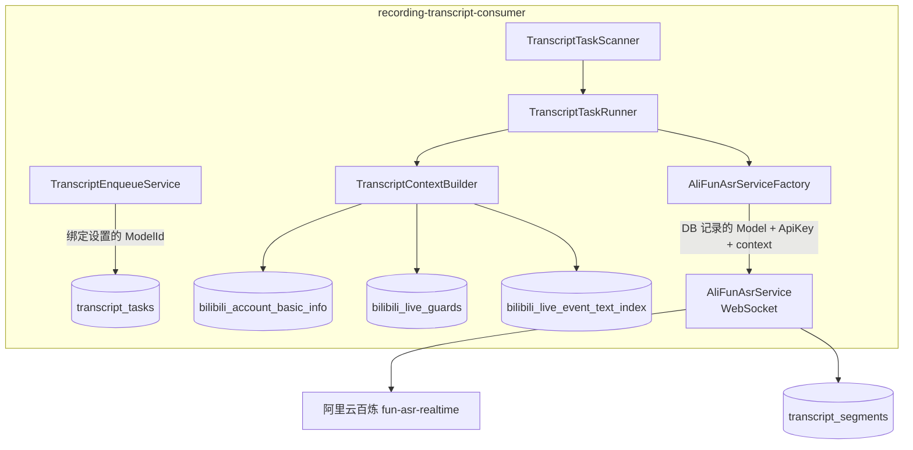
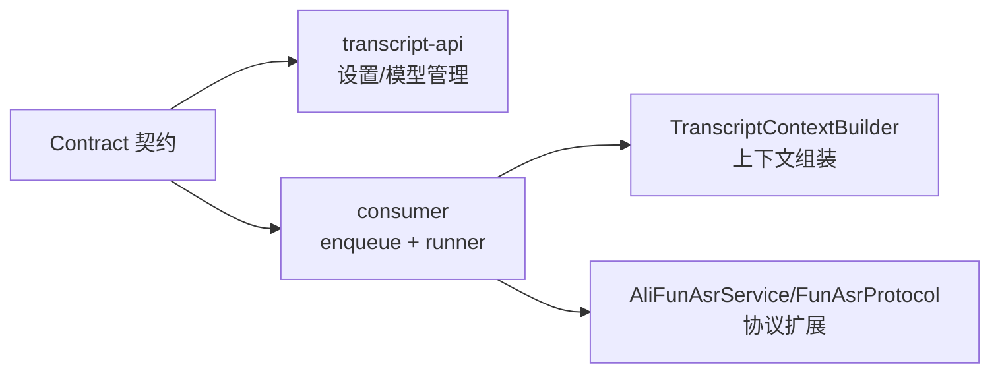
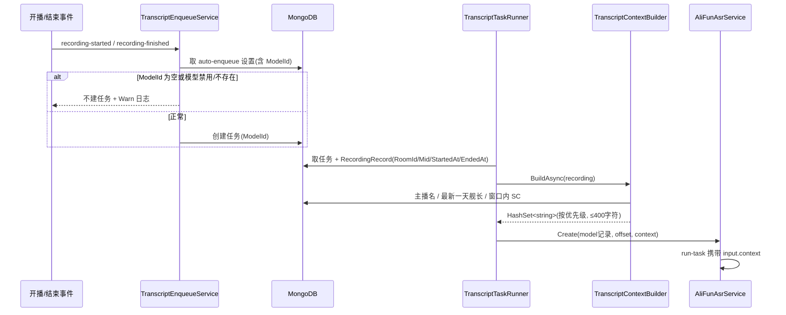

# Transcript 识别优化 - 技术提案

**功能名称**: Transcript 识别优化
**关联 PRD**: [[../../product/draft/20260917-transcript-model-context-prd]]
**技术提案版本**: v1.0
**创建日期**: 2026-09-17
**作者**: AI Agent
**feat-branch**: `prd/transcript-model-context`

## 1. 概述

### 1.1 背景

现状勘察（基于 `main` @ 0b98dbc）：

**默认模型兜底有两层**：

1. DB 层：`TranscriptModelRecord.IsDefault`（`servers/common/Persistence/Entities/TranscriptModelRecord.cs:21`），自动建任务在 `servers/recording-transcript-consumer/Enqueue/TranscriptEnqueueService.cs:39`（开播）与 `:79`（结束）调用 `TranscriptModelRepository.GetDefaultAsync()` 取默认模型；无默认模型则静默不建任务。
2. 配置层：`TranscriptConsumerOptions.AsrModel` 默认值 `"fun-asr-realtime"`（`servers/recording-transcript-consumer/Configuration/TranscriptConsumerOptions.cs:41-43`）。**实际发给 FunASR 的 `model` 参数来自该全局配置而非 DB 模型记录**——`AliFunAsrServiceFactory.Create(offset, apiKey)`（`servers/recording-transcript-consumer/Asr/AliFunAsrService.cs:18-25`）只从 DB 记录取 `ApiKey`，DB 里的模型名仅是展示名。这意味着即使 DB 中配置了多个模型，真正生效的永远是全局兜底值。

**识别上下文能力未使用**：`FunAsrProtocol.BuildRunTask`（`servers/recording-transcript-consumer/Asr/FunAsrProtocol.cs:23-39`）的 `parameters` 只传 `format`/`sample_rate`，`input` 为空对象。依据阿里云百炼文档，`fun-asr-realtime` 支持在 run-task 的 `input.context` 传入上下文消息（最多 5 轮，每轮文本 ≤400 字符，超出从末尾截断），也支持预编译热词 `parameters.vocabulary_id`（每账号最多 10 个词表，热词上限 2000/500 个）。

周边信息数据源均已存在（详见 §5.2），无需新增采集能力。

### 1.2 目标

1. 移除默认模型概念：自动转写设置（`transcript_auto_enqueue`）必须绑定显式 `ModelId`；实际发给 ASR 的模型名取自 DB 模型记录，删除全局配置兜底值。
2. 新增识别上下文组装：创建/启动转写任务时按优先级汇集周边信息为 `HashSet<string>`，以 `input.context` 传给 FunASR，超长按优先级截断。

### 1.3 范围

**做**：
- 契约与 DB：`transcript_models` 增加实际模型字段、移除 `IsDefault`；`transcript_auto_enqueue` 增加必填 `ModelId`。
- consumer：enqueue 逻辑、ASR 工厂与协议、上下文组装组件。
- web：转写设置页模型必填、模型管理页移除默认标记（随契约调整）。

**不做**：
- 预编译热词词表（`vocabulary_id`）的生命周期管理（见 §6.1 决策 2）。
- live 任务运行中通过 `continue-task` 增量更新上下文（后续增强，见 §5.2 风险点）。
- recording、crawler 等既有采集链路的改动。

## 2. 技术架构

### 2.1 系统架构图



### 2.2 技术栈

| 层级 | 技术选型 | 说明 |
|------|---------|------|
| 后端 | .NET 10 / ASP.NET Core | consumer 与 transcript-api，无新增框架 |
| 数据库 | MongoDB（`zvtuber` 库） | 两个集合字段变更，索引无需新增 |
| 缓存/消息 | Redis | 不涉及变更 |
| ASR | 阿里云百炼 FunASR Realtime（裸 WebSocket） | 扩展 `input.context` |

### 2.3 模块划分



| 模块 | 职责 | 关键技术点 |
|------|------|-----------|
| transcript-api 设置/模型端点 | 强制 modelId/模型字段必填，移除 isDefault | 契约校验 + 400 |
| TranscriptEnqueueService | 从 auto-enqueue 记录取 ModelId 建任务 | 无模型/模型禁用则拒绝并记日志 |
| TranscriptContextBuilder | 汇集周边信息为去重有序列表，按 400 字符截断 | 优先级、HashSet 去重 |
| FunAsrProtocol | run-task 携带 `input.context` | 阿里云协议约束 |

## 3. API 设计

### 3.1 API 契约

变更 `contracts/recording-transcript.openapi.yaml`：

#### 接口 1: 更新直播间转写设置 `PUT /api/recordings/{roomId}/transcripts/settings`

- `TranscriptSettingsUpdateRequest`：新增必填 `modelId`（string）。`enable=true` 时 `modelId` 必填且必须指向已启用模型，否则 400；`enable=false` 时可仅传 `enable`。
- `TranscriptSettingsItem`：新增 `modelId`、`modelName`（nullable；未绑定模型时为空，前端据此展示"待完善"）。

```json
{
  "enable": true,
  "modelId": "66f1..."
}
```

#### 接口 2: 模型管理 `POST /api/transcripts/models` / `PATCH /api/transcripts/models/{modelId}`

- `TranscriptModel`：新增 `model`（string，实际发给服务商的模型 ID，如 `fun-asr-realtime`）；**移除 `isDefault`**。
- `TranscriptModelCreateRequest`：`required` 由 `[name, provider, type, apiKey]` 变为 `[name, provider, type, apiKey, model]`，移除 `isDefault`。
- `TranscriptModelUpdateRequest`：新增可选 `model`；移除 `isDefault`。
- 创建成功响应描述中"isDefault=true 时原子清除其他模型默认位"（yaml:224）相应删除。

#### 接口 3: 手动 enqueue `POST /api/transcripts/enqueue`

不变（已强制 `modelId`，yaml:332-339）。

### 3.2 内部接口

- `AliFunAsrServiceFactory.Create` 签名由 `(TimeSpan offset, string apiKey)` 改为 `(TranscriptModelRecord model, TimeSpan offset, IReadOnlyList<string> context)`，内部使用 `model.Model` 与 `model.ApiKey`。
- `IStreamingAsrService` 接口不变（上下文在构造期注入）。

## 4. 数据模型

### 4.1 数据库设计

#### 集合: `transcript_models`

| 字段 | 类型 | 说明 |
|------|------|------|
| Model | string（新增，必填） | 实际发给服务商的模型 ID，如 `fun-asr-realtime` |
| IsDefault | bool（**移除**） | 默认模型概念废弃 |

迁移：存量记录补 `Model`（取升级时全局配置 `AsrModel` 的值）；`IsDefault` 字段随记录更新废弃，代码不再读取。

#### 集合: `transcript_auto_enqueue`

| 字段 | 类型 | 说明 |
|------|------|------|
| ModelId | string（新增） | 绑定的模型 ID；空值表示"待完善"，自动转写不生效 |

迁移：存量记录 `ModelId` 为空，自然进入待完善状态，无需数据改写。

#### 集合: `transcript_tasks`

不变。上下文不入库（每次运行按当时数据快照组装，见 §6.1 决策 3）。

### 4.2 缓存设计

不涉及。

## 5. 技术实现方案

### 5.1 核心流程



### 5.2 关键实现点

#### 实现点 1: 移除默认模型

- **描述**:
  - `TranscriptEnqueueService.EnqueueForStartedAsync`（:39）与 `EnqueueForFinishedAsync`（:79）改为从 `TranscriptAutoEnqueueRecord.ModelId` 取模型；`ModelId` 为空、模型不存在或未启用时，记录 Warn 日志并返回 null（不建任务）。`TranscriptReconciler` 沿用同一 enqueue 入口，行为一致。
  - 删除 `TranscriptModelRepository.GetDefaultAsync` 的调用与 `IsDefault` 相关读写。
  - 删除 `TranscriptConsumerOptions.AsrModel` 配置项（含默认值）；`AliFunAsrServiceFactory` 改用 `TranscriptModelRecord.Model`。
- **风险点**: 升级后存量 auto-enqueue 配置 `ModelId` 为空导致自动转写暂停——符合 PRD 功能点 2 预期，前端展示"待完善"引导补全。

#### 实现点 2: TranscriptContextBuilder（上下文组装）

- **描述**: 新增 consumer 内组件，输入 `RecordingRecord`，输出按优先级排列、去重、总量受限的字符串列表，伪代码：

```text
lines = new HashSet<string>(有序)
add(主播名)                                     // account_basic_info 最新记录 Data.uName
foreach (最新一天舰长快照) add(guard.UserName)     // live_guards 取该 roomId 最大 Date 的 Guards[]
foreach (窗口内 SC) { add(SenderName); add(SenderMedal) }  // live_event_text_index, Type=super_chat
foreach (窗口内 SC) add(Text)
结果 = 逐行拼接("\n")，累计长度将超 400 字符时停止追加（低优先级整段舍弃）
```

- **数据来源**:
  - 主播名：`AccountBasicInfoRepository` 按 `Mid` 取最新 `AccountBasicInfoRecord`，解析 `Data.uName`（解析先例 `servers/recording/Live/AnchorNameExtractor.cs`、`servers/recording-transcript-api/Contracts/TranscriptMapping.cs:49-69`）。
  - 舰长：`bilibili_live_guards` 按 `RoomId` 取 `Date`（北京时间 `yyyy-MM-dd`）最大的一条快照，取 `Guards[].UserName`（实体 `servers/common/Persistence/Entities/LiveGuardRecord.cs`；需新增一个"按 RoomId 取最新一天快照"的仓储方法）。
  - SC：`bilibili_live_event_text_index` 按 `RoomId + Type=super_chat + OccurredAt ∈ [StartedAt, EndedAt ?? now]` 查 `SenderName`/`SenderMedal`/`Text`（实体 `LiveEventTextIndexRecord`，无需解析原始 Payload）。
- **技术细节**:
  - 顺序：`HashSet<string>` 语义去重；遍历与输出顺序按优先级（主播名 → 舰长 → SC 用户名/粉丝牌交替一行一个 → SC 内容）。
  - 截断阈值 400 字符取自 FunASR `input.context` 单轮文本上限；拼接时预估累计长度，超限即停止追加当前及后续优先级的行。
  - 任一类数据查询失败或为空：跳过该类，不影响其余（Warn 日志）。
- **风险点**:
  - live 模式任务开播即启动，此时当场 SC 尚少，快照只含主播名与舰长——可接受；`continue-task` 增量更新留作后续增强。
  - 舰长名单量大（数百人）时会挤占 SC 配额——由优先级截断自然处理（舰长优先于 SC）。

#### 实现点 3: FunAsrProtocol 扩展

- **描述**: `BuildRunTask`（`FunAsrProtocol.cs:23-39`）在上下文非空时填充：

```json
"input": {
  "context": [
    { "role": "user", "content": [ { "type": "input_text", "text": "<按行拼接的上下文>" } ] }
  ]
}
```

- **技术细节**: 仅 1 条 user 消息（词表场景无需多轮）；上下文为空时维持现状空 `input`，行为不变。
- **风险点**: 服务商对字段的确切约束以联调为准；若 `input.context` 实际不生效，回退方案为预编译热词 `vocabulary_id`（见决策 2）。

## 6. 技术决策

### 6.1 决策列表

| 决策 | 选项 A | 选项 B | 最终选择 | 原因 |
|------|--------|--------|---------|------|
| 1. 自动转写模型来源 | 保留 DB 默认模型 | auto-enqueue 绑定显式 ModelId | B | PRD 要求杜绝兜底计费；绑定关系随设置可见可审 |
| 2. 上下文承载方式 | `input.context` 内联词表 | 预编译热词 `vocabulary_id` | A | 每任务动态生成、无需词表生命周期管理、不受每账号 10 词表限制；B 留作回退 |
| 3. 上下文生成时机 | 建任务时入库 | 任务启动时按快照组装 | B | 数据最新（结束补建任务可含全场 SC）；上下文非审计数据，无需持久化 |
| 4. 实际模型名字段 | 复用 `Name` 展示名 | 新增独立 `Model` 字段 | B | 展示名与服务商模型 ID 职责分离，避免改名影响计费模型 |
| 5. 超长上下文处理 | 按字符硬截断 | 按优先级整行舍弃 | B | 避免截断出半个名字污染识别；与 PRD"保留最优先内容"一致 |

### 6.2 依赖与约束

| 类型 | 内容 | 说明 |
|------|------|------|
| 依赖 | 阿里云百炼 fun-asr-realtime `input.context` | 上限：≤5 轮、每轮 ≤400 字符 |
| 依赖 | `bilibili_live_guards` / `bilibili_live_event_text_index` / `bilibili_account_basic_info` | 既有采集链路，无改动 |
| 约束 | 禁止默认模型 | 配置、DB、契约三层均移除兜底 |

## 7. 项目结构

改动文件集中在：

```
contracts/recording-transcript.openapi.yaml   # 契约变更
servers/common/Persistence/
  Entities/TranscriptModelRecord.cs           # +Model -IsDefault
  Entities/TranscriptAutoEnqueueRecord.cs     # +ModelId
  TranscriptModelRepository.cs                # -GetDefaultAsync
  LiveGuardRepository.cs                      # +按 RoomId 取最新一天快照
servers/recording-transcript-consumer/
  Configuration/TranscriptConsumerOptions.cs  # -AsrModel
  Enqueue/TranscriptEnqueueService.cs         # 改用设置的 ModelId
  Asr/AliFunAsrService.cs                     # 工厂签名改用模型记录
  Asr/FunAsrProtocol.cs                       # +input.context
  Context/TranscriptContextBuilder.cs         # 新增
  Tasks/TranscriptTaskRunner.cs               # 组装上下文并透传
servers/recording-transcript-api/Controllers/ # settings/models 端点校验调整
apps/web                                      # 设置页模型必填、移除默认标记
```

## 8. 测试策略

### 8.1 测试覆盖要求

- `TranscriptContextBuilder` 单测：四类信息汇集、HashSet 去重、优先级顺序、400 字符截断、单类数据缺失降级（基于 `tests/Z.Vtuber.Tests` Testcontainers MongoDB fixture）。
- enqueue 单测：无 ModelId / 模型禁用不建任务；正常绑定建任务。
- `FunAsrProtocol.BuildRunTask` 单测：上下文有无两种 payload 结构。

### 8.2 测试类型

| 类型 | 工具 | 覆盖范围 |
|------|------|---------|
| 单元/集成测试 | xUnit + Testcontainers | 上述组件与仓储 |
| API 测试 | z-test 流程 | settings 更新（modelId 必填 400 路径）、models CRUD（model 必填、无 isDefault） |

## 9. 部署方案

### 9.1 环境规划

随既有 Aspire 编排发布，无新增服务。

### 9.2 配置管理

- 删除 `TranscriptConsumer:AsrModel` 配置项；`AsrEndpoint` 保留。
- 升级后需在模型管理中为存量模型补填实际模型 ID，并为自动转写直播间补选模型（前端"待完善"引导）。

## 10. 验收标准

- [ ] 技术方案评审通过
- [ ] Contract 评审通过
- [ ] 代码实现完成
- [ ] 单元测试覆盖达标
- [ ] API 测试通过
- [ ] E2E 测试通过
- [ ] 自动转写全程无默认模型参与；含 SC/舰长场次上下文生效（联调确认 FunASR 请求 payload）

## 11. 相关文档

- [[../../product/draft/20260917-transcript-model-context-prd]]
- [[20260916-proposal-recording-transcript]]（转写功能初版提案）
- [阿里云百炼 fun-asr-realtime WebSocket API](https://platform.qianwenai.com/docs/api-reference/speech-recognition/fun-asr-realtime/websocket-api.md)
- [阿里云百炼：提升语音识别准确率](https://www.alibabacloud.com/help/zh/model-studio/improve-asr-accuracy)
- `contracts/recording-transcript.openapi.yaml`
