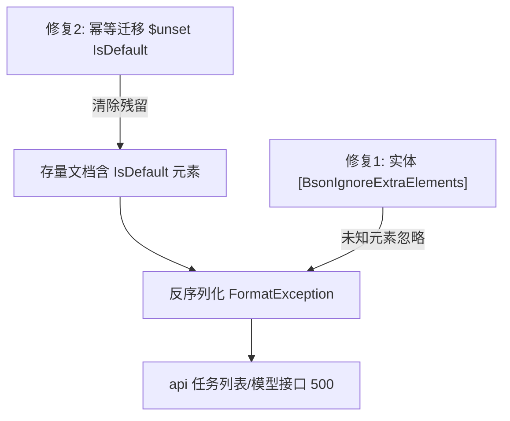
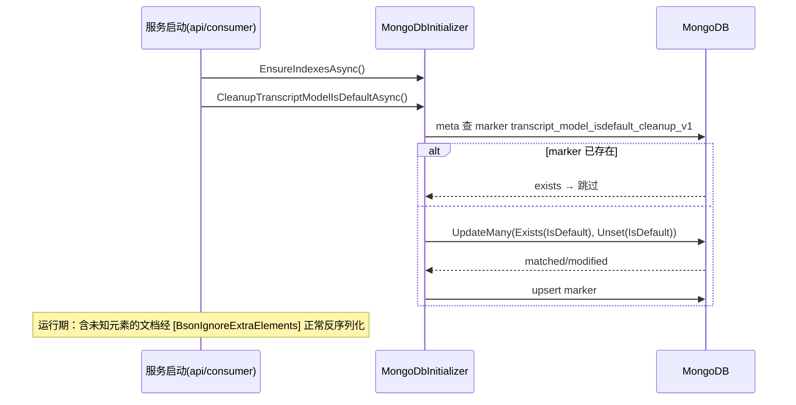

# Transcript 模型存量字段兼容修复 - 技术提案

- 日期：2026-09-17
- 状态：待评审
- feat-branch：`fix/transcript-model-isdefault`
- 关联文档：[PRD](../product/draft/20260917-transcript-model-isdefault-fix-prd.md)

## 1. 概述

### 1.1 背景

线上 recording-transcript-api 持续报错：

```
System.FormatException: Element 'IsDefault' does not match any field or property of class
Z.Vtuber.Common.Persistence.Entities.TranscriptModelRecord.
   at MongoDB.Bson.Serialization.BsonClassMapSerializer`1.DeserializeClass(...)
   at Z.Vtuber.Common.Persistence.TranscriptModelRepository.ListAsync(...)
   at Z.Vtuber.RecordingTranscript.Api.Controllers.TranscriptTasksController.MapTasksAsync(...TranscriptTasksController.cs:192)
   at Z.Vtuber.RecordingTranscript.Api.Controllers.TranscriptTasksController.ListTasks(...TranscriptTasksController.cs:112)
```

根因链：

1. 「Transcript 识别优化」需求删除了 `TranscriptModelRecord.IsDefault` 字段（实体现仅含 `Id/Name/Provider/Type/ApiKey/Model/Enabled/MaxConcurrency/CreatedAt`，`servers/common/Persistence/Entities/TranscriptModelRecord.cs`），并移除 `IsDefault_1` 索引与 `GetDefaultAsync`；
2. 线上 `transcript_models` 集合的存量文档由旧版本写入，仍携带 `IsDefault` 元素；
3. `TranscriptModelRecord` 未标注 `[BsonIgnoreExtraElements]`，MongoDB C# 驱动的 `BsonClassMapSerializer` 对未映射元素默认抛 `FormatException`；
4. 清理责任的真空：既有 `TranscriptModelMigration`（`servers/recording-transcript-consumer/Services/TranscriptModelMigration.cs`）只回填新增的 `Model` 字段，不清理已删除的 `IsDefault`；且它仅在 consumer 启动时执行（`servers/recording-transcript-consumer/Program.cs:85-86`），api 服务启动路径（`servers/recording-transcript-api/Program.cs:47-48`）只有 `EnsureIndexesAsync`，没有任何字段级迁移。

受影响链路：凡经 `TranscriptModelRepository.ListAsync`/`GetByIdAsync` 读取模型记录的路径全部 500——任务列表（`MapTasksAsync` 补 modelName）、模型管理、自动识别设置列表等。

### 1.2 目标

1. `TranscriptModelRecord` 反序列化对未映射元素容错，接口立即恢复（止血，不依赖部署顺序）；
2. 提供幂等迁移清理存量文档的 `IsDefault` 元素（清源）；
3. 测试固化两类行为，防止未来删字段再发同类故障。

### 1.3 范围

- **内**：`servers/common` 实体标注 + `MongoDbInitializer` 新增清理迁移；api/consumer 启动接线；`tests/Z.Vtuber.Tests` 测试；
- **外**：OpenAPI 契约（无任何契约变更）；web 前端；转写任务/segments/设置等其他集合；`TranscriptModelMigration` 的 `Model` 回填逻辑（保持不变）。

## 2. 技术架构

### 2.1 根因与修复分层



两层互补：修复 1 让任何含未知字段的文档可读（立即止血，且防未来同类问题）；修复 2 让数据库与实体定义恢复一致（清源）。两者无先后依赖——api 单独先发布即可恢复接口。

### 2.2 技术栈与归属

| 项 | 归属 | 说明 |
|---|---|---|
| 实体容错 | `servers/common` | `TranscriptModelRecord` 加 `[BsonIgnoreExtraElements]` |
| 清理迁移 | `servers/common` | `MongoDbInitializer` 新增 `CleanupTranscriptModelIsDefaultAsync`，沿用 meta marker 幂等模式 |
| 启动接线 | `servers/recording-transcript-api`、`servers/recording-transcript-consumer` | 启动时在 `EnsureIndexesAsync` 后调用清理迁移 |
| 测试 | `tests/Z.Vtuber.Tests` | 反序列化容错测试 + 迁移测试（Testcontainers MongoDB） |

### 2.3 迁移归属决策

清理迁移放入 `MongoDbInitializer`（common）而非扩展 consumer 的 `TranscriptModelMigration`：

- `TranscriptModelMigration` 只在 consumer 启动执行，api 无执行点；而本故障的暴露面正是 api；
- `MongoDbInitializer` 已被各服务在启动时调用（api `Program.cs:76-80`、crawler `Program.cs:129-134` 均成串调用 `EnsureIndexesAsync` + 各 backfill），把清理放这里，api 与 consumer 各自启动即可完成自愈，无跨服务时序依赖；
- 该迁移无需配置输入（不像 `Model` 回填需要 `TranscriptConsumer:AsrModel`），纯数据清理，与 initializer 内既有 backfill 同性质。

## 3. API 设计

无契约变更：`contracts/recording-transcript.openapi.yaml` 不动，所有端点的请求/响应结构、状态码语义不变。本修复只恢复既有契约的实际可用性。

## 4. 数据模型

### 4.1 实体标注（容错）

`servers/common/Persistence/Entities/TranscriptModelRecord.cs`：

```csharp
[BsonIgnoreExtraElements]
public sealed class TranscriptModelRecord
{
    // 字段不变
}
```

`[BsonIgnoreExtraElements]` 使 `BsonClassMapSerializer` 跳过未映射元素（含存量 `IsDefault` 及任何未来残留字段），反序列化不再抛 `FormatException`。

### 4.2 清理迁移（清源）

`MongoDbInitializer` 新增（与既有 backfill 同模式）：

```csharp
public const string TranscriptModelIsDefaultCleanupMigrationKey = "transcript_model_isdefault_cleanup_v1";

public async Task CleanupTranscriptModelIsDefaultAsync(CancellationToken ct = default)
```

逻辑：

```
marker 已存在 → 记录日志并跳过（幂等）
filter = Exists("IsDefault", true)            // 仅含该元素的文档
UpdateManyAsync(filter, Unset("IsDefault"))   // 批量清理
记录 matched/modified 日志
写入 zvtuber_meta marker（upsert）
```

- 使用 `BsonDocument` 级 filter/update（`Exists("IsDefault")` / `Unset("IsDefault")`），因为 `IsDefault` 已不在实体上映射，无法用强类型表达式引用；
- 幂等：marker 短路 + `Exists` filter 保证重复执行无副作用；迁移中断后重启可安全重跑（unset 本身幂等，marker 兜底）；
- 不含 `IsDefault` 的文档不匹配 filter，不被触碰。

### 4.3 启动接线

- `servers/recording-transcript-api/Program.cs:48` `EnsureIndexesAsync()` 后追加 `await initializer.CleanupTranscriptModelIsDefaultAsync();`
- `servers/recording-transcript-consumer/Program.cs:83` 同样追加（consumer 是写模型记录的读方之一，且启动顺序不保证，双边接线消除时序依赖）；
- 其他服务（api/crawler 等）不读 `transcript_models`，不接。

## 5. 技术实现方案

### 5.1 核心流程



### 5.2 关键实现点

#### 实现点 1: 实体标注

`TranscriptModelRecord` 类声明追加 `[BsonIgnoreExtraElements]`（`MongoDB.Bson.Serialization.Attributes` 已 using）。一行改动，无行为副作用：写入侧不受影响（实体序列化只写字段本身），仅反序列化容忍多余元素。

#### 实现点 2: 清理迁移

按 §4.2 伪码实现于 `MongoDbInitializer`，风格对齐既有 `BackfillGiftPriceAsync` 等（marker 常量、`MarkMigrationAppliedAsync`、日志）。filter/update 用 `Builders<BsonDocument>` 或 `new BsonDocument` 字面量，集合通过 `database.GetCollection<BsonDocument>(MongoCollectionNames.TranscriptModels)` 获取，避免对已删除字段的强类型依赖。

#### 实现点 3: 启动接线

两个服务各一行调用，置于 `EnsureIndexesAsync` 之后（清理与索引无依赖，顺序仅保持与既有调用串一致）。

### 5.3 不在本期的事项

- 其他实体的 `[BsonIgnoreExtraElements]` 普查：仅对 `TranscriptModelRecord` 定点修复；全量普查另立技术债事项；
- `IsDefault_1` 索引残留检查：代码侧已不建该索引，如线上仍有旧索引可在运维侧顺手 drop，不阻塞本修复；
- 实体字段删除的"代码-数据同步"流程规范：另立工程规范事项。

## 6. 技术决策

### 6.1 决策列表

1. **实体容错与数据清理双管齐下，而非只做其一**：只做迁移则 api 恢复依赖 consumer/迁移先执行（部署时序不可控，故障窗口拉长）；只做容错则脏数据永久残留。容错负责"立即恢复 + 防再发"，迁移负责"数据一致"。
2. **清理迁移放 `MongoDbInitializer`（common）而非扩展 consumer 的 `TranscriptModelMigration`**：后者仅 consumer 启动执行，而故障暴露面在 api；initializer 被两个服务共同调用，各自启动即自愈（见 §2.3）。
3. **迁移用 `BsonDocument` 级操作而非强类型**：`IsDefault` 已不在实体映射中，强类型 `Builders<TranscriptModelRecord>` 无法表达 `Unset("IsDefault")`；`BsonDocument` 直接面向存储层，语义准确。
4. **marker 键独立（`transcript_model_isdefault_cleanup_v1`）而非复用 `transcript_model_field_backfill_v1`**：两个迁移语义独立，独立 marker 保证各自幂等边界清晰，且存量环境 `backfill_v1` 已 applied 也不影响本次清理执行。
5. **不加配置开关**：迁移幂等且无副作用（只删已废弃字段），无需开关与回滚路径；代码回滚亦兼容（旧代码含 `IsDefault` 映射，字段不存在即默认值）。

### 6.2 依赖与约束

| 类型 | 内容 | 说明 |
|------|------|------|
| 依赖 | `MongoDbInitializer` 既有 meta marker 设施 | `zvtuber_meta` 集合 + `MarkMigrationAppliedAsync` |
| 约束 | 无契约变更、无新增依赖包 | 仅用 `MongoDB.Driver` 既有能力 |
| 约束 | 不改 `TranscriptModelMigration` 既有行为 | `Model` 回填逻辑保持不变 |

## 7. 项目结构

```
servers/common/（变更）
├── Persistence/Entities/TranscriptModelRecord.cs   # 加 [BsonIgnoreExtraElements]
└── Persistence/MongoDbInitializer.cs               # 新增 CleanupTranscriptModelIsDefaultAsync

servers/recording-transcript-api/（变更）
└── Program.cs                                      # 启动接线清理迁移

servers/recording-transcript-consumer/（变更）
└── Program.cs                                      # 启动接线清理迁移

tests/Z.Vtuber.Tests/（变更）
├── MongoDbInitializerTests.cs                      # 清理迁移：生效/幂等/不含字段不改动
└── TranscriptApiTests.cs                           # 存量含 IsDefault 文档 → 任务/模型接口 200

docs/（本节点产物）
├── product/draft/20260917-transcript-model-isdefault-fix-prd.md
└── engineering/proposals/20260917-proposal-transcript-model-isdefault-fix.md
```

## 8. 测试策略

### 8.1 测试覆盖要求

核心逻辑覆盖率 ≥ 80%（common-rules）；TDD：先写失败测试再实现。

### 8.2 测试类型

- **反序列化容错**（`TranscriptApiTests` 或独立用例，Testcontainers MongoDB）：用 `BsonDocument` 直接向 `transcript_models` 插入含 `IsDefault` 的存量形态文档 → `GET /api/transcripts/task`、`GET /api/transcripts/models` 返回 200 且字段映射正确；
- **清理迁移**（`MongoDbInitializerTests` 同文件既有模式）：
  - 预置含/不含 `IsDefault` 的文档各若干 → 执行迁移 → 含字段文档的 `IsDefault` 被移除、其余字段不变、不含字段文档未改动；
  - 重复执行第二次 → 无副作用、marker 存在；
  - marker 已存在时直接跳过（不再发起 update）；
- **回归**：转写任务/模型相关既有测试全部通过。

## 9. 部署方案

- 随常规版本发布：common/api/consumer 统一部署（本仓库统一构建）；
- 部署顺序无要求：api 先发布即由 `[BsonIgnoreExtraElements]` 恢复接口，自身启动迁移完成清理；consumer 先发布则迁移先行，api 发布后接口自然恢复；
- 回滚：整体版本回退即可；已清理的数据对旧代码兼容（旧实体含 `IsDefault` 映射，字段缺失按默认值处理，且旧代码本就写过该字段，无读取障碍）。

## 10. 验收标准

- [ ] 集合中存在含 `IsDefault` 的存量文档时，`GET /api/transcripts/task`、`GET /api/transcripts/models`、`GET /api/transcripts/settings` 均返回 200；
- [ ] 服务启动后 `transcript_models` 集合中不再存在 `IsDefault` 元素，其余字段不变；
- [ ] 迁移重复执行幂等无副作用，`zvtuber_meta` 存在 `transcript_model_isdefault_cleanup_v1` marker；
- [ ] api 与 consumer 任一服务单独启动均能完成清理，无跨服务时序依赖；
- [ ] 新增自动化测试覆盖"含未知字段可反序列化"与"清理迁移生效 + 幂等"，既有转写测试不回归；
- [ ] 无任何 OpenAPI 契约变更。

## 11. 相关文档

- PRD：`docs/product/draft/20260917-transcript-model-isdefault-fix-prd.md`
- 引入问题的技术背景：`docs/engineering/plans/20260917-plan-transcript-model-context.md`
- 转写功能技术提案：`docs/engineering/proposals/20260916-proposal-recording-transcript.md`
