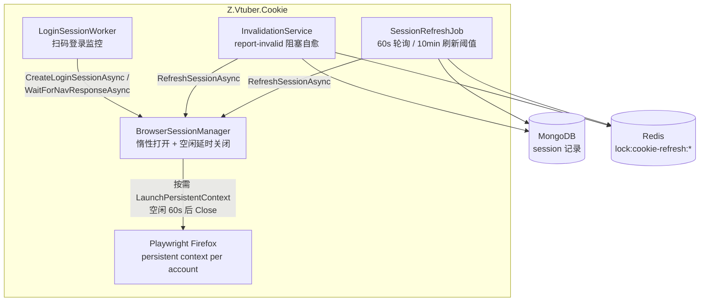
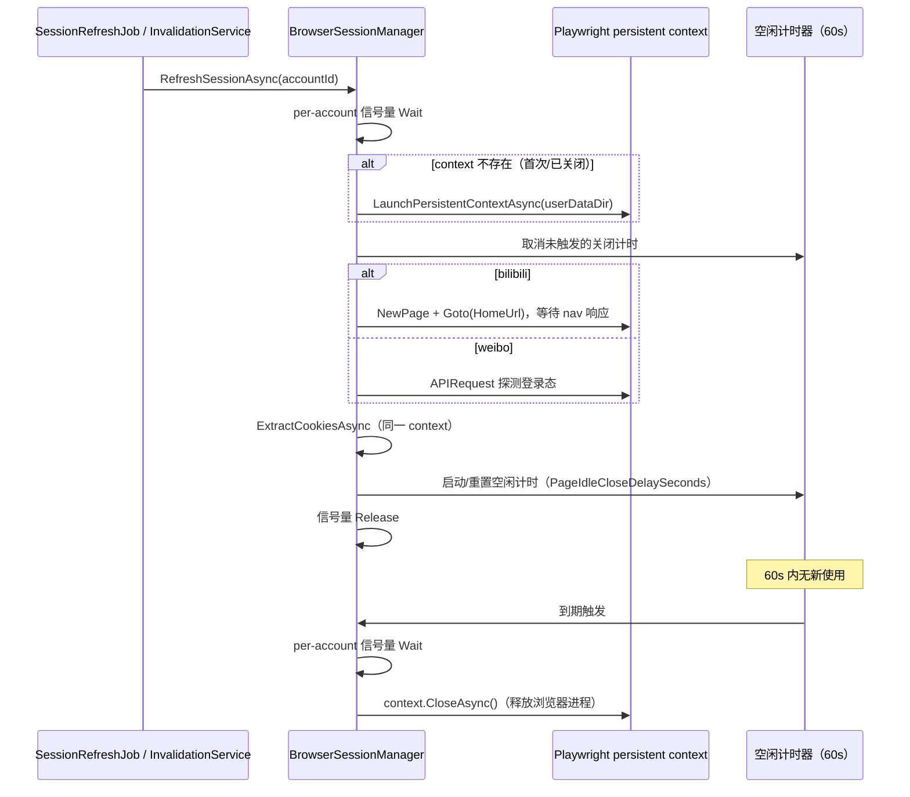

# 无头浏览器页面生命周期优化 - 技术提案

**功能名称**: 无头浏览器页面生命周期优化
**关联 PRD**: `docs/product/draft/20260918-cookie-page-lifecycle-prd.md`
**技术提案版本**: v1.0
**创建日期**: 2026-09-18
**作者**: Deliay
**feat-branch**: `feat/cookie-page-lifecycle`（需求总分支；实现分支另行切出）

## 1. 概述

### 1.1 背景

Cookie 服务（`servers/cookie`）当前为每个帐号经 `LaunchPersistentContextAsync` 启动一个独立的 Firefox 无头浏览器进程（`BrowserSessionManager._contexts`，`servers/cookie/Browser/BrowserSessionManager.cs:14`），登录成功后 context/page 常驻内存，仅在帐号删除、登录过期、失效判定（`DeleteSessionAsync`）或进程退出时关闭。而定时刷新节奏为每 10 分钟一次（`RefreshIntervalMinutes=10`），即页面 98% 以上的时间处于闲置状态，内存浪费严重。本提案将 context/page 的持有策略改为「按需惰性打开、用后空闲延时关闭」，对应 PRD 的三条逻辑：刷新完成 1 分钟后关闭、每 10 分钟定时刷新时重新打开、失效自愈刷新同样按需打开并延时关闭。

### 1.2 目标

- `BrowserSessionManager` 支持惰性打开：刷新/提取 Cookie 时若 context 不存在则冷启动（`LaunchPersistentContextAsync`，userDataDir 已持久化在磁盘，登录态随 cookie jar 保留，重开后无需重新扫码）；
- 每次使用完成后启动 per-account 空闲计时器（默认 60 秒，可配置），到期关闭 context 释放内存；计时期间再次被使用则顺延；
- 扫码登录（`pending_login`）阶段 context/page 保持打开，不参与空闲关闭；登录成功提取 Cookie 后转入空闲关闭管理；
- 双平台（bilibili / weibo）行为一致；对外 API、Redis 事件契约、数据库结构零变更。

### 1.3 范围

- **做**：`BrowserSessionManager` 惰性打开 + 空闲延时关闭改造；新增配置项 `PageIdleCloseDelaySeconds`；登录成功路径纳入空闲关闭；单元测试覆盖；`servers/cookie/AGENTS.md` 行为描述同步更新；
- **不做**：
  - 对外 API / 契约（`contracts/cookie.openapi.yaml`）变更——无；
  - 刷新节奏（`RefreshIntervalMinutes=10`）、失败计数与失效判定策略调整——保持现状；
  - 浏览器进程级池化/跨帐号共享浏览器——保持每帐号独立 persistent context 的现状，仅改变持有时长；
  - weibo 平台刷新路径的进一步瘦身（其探测仅需 `APIRequest` 不需要页面导航，本提案沿用既有 profile 差异，不额外抽象）。

## 2. 技术架构

### 2.1 系统架构图

改动集中于 cookie 服务内部的浏览器 session 管理层，上下游（SessionRefreshJob / InvalidationService / Controller）调用方式不变：



### 2.2 技术栈

| 层级 | 技术选型 | 说明 |
|------|---------|------|
| 后端 | C# / .NET 10，ASP.NET Core | 仅改 `servers/cookie`，技术栈不变 |
| 浏览器自动化 | Playwright（Firefox，headless） | `LaunchPersistentContextAsync` + `BrowserSessionDataDir/{accountId}` 持久化用户目录（既有） |
| 并发控制 | 进程内 per-account `SemaphoreSlim` + Redis 分布式锁（既有） | Redis 锁跨实例串行化刷新/自愈；进程内信号量串行化打开/使用/关闭 |
| 测试 | xUnit + 手写 fake（`tests/Z.Vtuber.Tests`） | 沿用 `Fakes.cs` 模式 |

### 2.3 模块划分

| 模块 | 职责 | 关键技术点 |
|------|------|-----------|
| `servers/cookie/Browser/BrowserSessionManager.cs`（改） | context/page 生命周期：惰性打开、空闲延时关闭、删除/退出时立即关闭 | per-account 状态条目（context + 信号量 + 空闲关闭 CTS）；平台差异仍走 `ICookiePlatformProfile` |
| `servers/cookie/Browser/IBrowserSessionManager.cs`（改） | 接口注释明确「按需打开」语义 | 方法签名尽量不变，避免调用方与 fake 大面积改动 |
| `servers/cookie/Configuration/CookieServiceOptions.cs`（改） | 新增 `PageIdleCloseDelaySeconds`（默认 60） | Program.cs 既有 `ValidateOnStart` 校验链扩展（取值 > 0） |
| `tests/Z.Vtuber.Tests`（改/增） | 空闲关闭调度逻辑的单测 | 将计时调度抽为可测组件（见 5.2 实现点 2），浏览器交互仍以 fake 屏蔽 |

`SessionRefreshJob`、`InvalidationService`、`LoginSessionWorker`、各 Controller 均**不改代码**（行为变化封装在 BrowserSessionManager 内部）。

## 3. API 设计

### 3.1 API 契约

无变更。`contracts/cookie.openapi.yaml` 不动，全部 REST 端点语义不变（`report-invalid` 仍为阻塞式自愈，超时预算不变）。

### 3.2 内部接口

`IBrowserSessionManager` 方法签名不变，语义升级：

| 方法 | 现状 | 改后 |
|------|------|------|
| `CreateLoginSessionAsync` | 打开 context + page 并常驻 | 不变（pending 阶段必须开着供扫码），不启动空闲计时 |
| `WaitForNavResponseAsync` / 探测 | 复用常驻 context | 不变（仅 pending 阶段调用，此时 context 必然存在） |
| `ExtractCookiesAsync` | 要求 context 已存在，否则抛 `InvalidOperationException` | 惰性打开 context（cookie jar 读取无需页面），使用后启动/重置空闲计时 |
| `RefreshSessionAsync` | 复用常驻 page 导航（bilibili）/ `APIRequest` 探测（weibo） | 惰性打开 context；bilibili 按需新建 page 导航，weibo 仍仅用 `APIRequest`；使用后启动/重置空闲计时 |
| `DeleteSessionAsync` | 关闭 context | 不变，另需取消该帐号未触发的空闲计时器 |

## 4. 数据模型

无数据库、缓存结构变更。浏览器用户数据目录（`BrowserSessionDataDir/{accountId}`）的磁盘持久化为既有能力——本提案依赖它保证 context 重开后登录态不丢，不新增持久化内容。

新增内存态（不进数据库）：per-account 的 `{ Context, SemaphoreSlim, IdleCloseCts }` 条目，随 `DeleteSessionAsync`/`DisposeAsync` 清理。

## 5. 技术实现方案

### 5.1 核心流程



### 5.2 关键实现点

#### 实现点 1: context 惰性打开

- **描述**: 将 `CreateLoginSessionAsync` 中的 `LaunchPersistentContextAsync` 启动逻辑提取为私有 `GetOrLaunchContextAsync(accountId)`：`ConcurrentDictionary` 命中则直接返回，未命中则冷启动。`RefreshSessionAsync` / `ExtractCookiesAsync` 改为经此方法获取 context，替代当前的 `_contexts` 预存 + 抛 `InvalidOperationException`（`BrowserSessionManager.cs:200/240/264` 附近）。
- **技术细节**:
  - 冷启动后 bilibili 刷新路径按需 `NewPageAsync` + `GotoAsync(HomeUrl)` + `page.Response` 临时监听 nav（沿用现有实现）；weibo 路径仅 `context.APIRequest`，**不创建页面**（profile `LoginStateProbeUrl` 非空即探测路径，既有判定不变）；
  - 登录态来源：persistent context 的 userDataDir 已在磁盘，cookie jar 随目录保留，重开后 bilibili nav / weibo `api/config` 探测结果即为当前登录态；若磁盘态确已失效，走既有刷新失败计数 → 失效判定路径，不新增处理；
  - `CreateLoginSessionAsync`（扫码登录）行为不变：立即打开 context + page 展示二维码，**不启动空闲计时**，由 `LoginSessionWorker` 监控至登录成功或过期。
- **风险点**: Firefox 冷启动 + userDataDir 加载耗时需实测（预期秒级）。`ReportInvalidTimeoutSeconds=60` / `RefreshLockTtlSeconds=90` 的预算需覆盖冷启动；若实测逼近预算，实现阶段再调大配置默认值（提案不改默认值）。

#### 实现点 2: 空闲延时关闭调度

- **描述**: 每次 context 使用完毕（刷新完成、Cookie 提取完成、登录成功首次提取完成）后，为该帐号启动/重置一个 60 秒（`PageIdleCloseDelaySeconds`）的延时关闭任务；到期关闭 context 并从 `_contexts` 移除。
- **技术细节**:
  - per-account 状态条目：`{ IBrowserContext Context, SemaphoreSlim Gate, CancellationTokenSource IdleCloseCts }`；「使用开始」= 持有 Gate 且取消 IdleCloseCts；「使用结束」= 新建 IdleCloseCts 并 `Task.Delay(delay, ct)` 后触发关闭；到期任务先抢 Gate 再关闭，**保证不关闭使用中的 context**（PRD 功能点 3 的顺延语义由此自然成立）；
  - 计时调度抽为独立的内部组件（如 `IdleCloseScheduler`，注入延时时长与关闭回调），便于单元测试用短延时 + fake 回调验证「到期关闭 / 使用顺延 / 取消关闭」三态，无需真实浏览器；
  - `DeleteSessionAsync`、失效判定路径（`SessionRefreshJob`/`InvalidationService` 的失败分支）、`DisposeAsync` 触发立即关闭时，先取消 IdleCloseCts 再关闭，避免二次关闭（`CloseAsync` 幂等兜底 + 移除字典条目）；
  - 服务重启后 `_contexts` 为空，所有帐号随首次刷新惰性打开——符合 PRD 边界预期。
- **风险点**: 进程退出时未触发的延时任务随进程消失，无泄漏；需确保延时任务异常（关闭失败）仅记日志不崩溃宿主。

#### 实现点 3: 并发与锁语义核对

- **描述**: 同一 accountId 可能被 `SessionRefreshJob` 与 `InvalidationService` 同时触及。跨实例仍由既有 Redis 锁 `lock:cookie-refresh:{prefix}{id}` 串行化；进程内由 per-account Gate 保证「打开/使用/关闭」互斥。
- **技术细节**: Gate 的持有范围严格限定在「获取 context → 完成本次操作」，空闲计时在 Gate 外等待；避免持锁等待 60 秒导致自愈请求被无谓阻塞（阻塞上限仍为 Redis 锁 TTL 与 `ReportInvalidTimeoutSeconds`）。
- **风险点**: 不改 Redis 锁 key 与 TTL，锁语义零变化。

#### 实现点 4: 配置项

- **描述**: `CookieServiceOptions` 新增 `PageIdleCloseDelaySeconds`（默认 60），注册链补 `Validate(o => o.PageIdleCloseDelaySeconds > 0)`；AppHost/部署配置无需改动（默认值即 PRD 要求的 1 分钟）。
- **技术细节**: 配置节仍为 `CookieService`，双平台共用同一延时（与既有选项一致）。

## 6. 技术决策

### 6.1 决策列表

| 决策 | 选项 A | 选项 B | 最终选择 | 原因 |
|------|--------|--------|---------|------|
| 关闭粒度 | 关闭整个 persistent context（进程级释放） | 仅关闭 page 保留 context | A | 每帐号一个独立 Firefox 进程，内存大头在进程本身；只关 page 无法达成 PRD 的内存目标 |
| 打开时机 | 用时惰性打开（lazy） | 预热/定时批量预打开 | A | 惰性最简单且精确匹配「下次刷新时再打开」；预热增加复杂度无对应收益 |
| 关闭触发 | 空闲延时计时器（60s，可顺延） | 用完立即关闭 | A | PRD 明确要求 1 分钟后关闭；立即关闭会让「刷新→提取 Cookie」两步之间反复开关，且失去连续刷新场景的缓冲 |
| 登录态保持 | 依赖 userDataDir 磁盘持久化 | 内存中另存 cookie 快照重注入 | A | persistent context 已持久化，重开即恢复；快照方案重复且有一致性风险 |
| weibo 刷新是否建页面 | 维持现状仅用 `APIRequest` | 统一建页面导航 | A | 既有 profile 抽象已区分探测/导航两种信号；「打开页面」对 weibo 即打开 context，不制造无用页面 |
| 接口签名 | `IBrowserSessionManager` 签名不变，语义改为按需打开 | 新增显式 Open/Close 方法由调用方管理 | A | 生命周期是 BrowserSessionManager 内部职责，调用方（Job/Invalidation）不该感知；签名不变则 `Fakes.cs` 与既有测试零改动 |

### 6.2 依赖与约束

| 类型 | 内容 | 说明 |
|------|------|------|
| 依赖 | Playwright persistent context 磁盘持久化 | context 重开后登录态恢复的前置条件（既有能力） |
| 约束 | 对外零变更 | API 契约、Redis 事件、Mongo 集合、Redis 锁 key 全部不变 |
| 约束 | 超时预算 | 冷启动耗时应包含在 `ReportInvalidTimeoutSeconds`(60s) / `RefreshLockTtlSeconds`(90s) 内，实现阶段实测验证 |
| 约束 | 双平台一致 | bilibili 非 keyed、weibo keyed 两个 `BrowserSessionManager` 实例共用同一套惰性/空闲逻辑 |

## 7. 项目结构

```
servers/cookie/
├── Browser/
│   ├── IBrowserSessionManager.cs        # 修改：注释明确按需打开/空闲关闭语义
│   ├── BrowserSessionManager.cs         # 修改：惰性打开 + per-account Gate + 空闲延时关闭
│   ├── IdleCloseScheduler.cs            # 新增：可单测的延时关闭调度组件
│   └── LoginSessionWorker.cs            # 不变（pending 阶段页面保持打开）
├── Refresh/
│   ├── SessionRefreshJob.cs             # 不变
│   └── InvalidationService.cs           # 不变（阻塞语义不变）
├── Configuration/
│   └── CookieServiceOptions.cs          # 修改：新增 PageIdleCloseDelaySeconds（默认 60）
├── Program.cs                           # 修改：options 校验链补新配置
└── AGENTS.md                            # 修改：Browser/ 模块描述同步「按需打开、空闲关闭」

tests/Z.Vtuber.Tests/
├── IdleCloseSchedulerTests.cs           # 新增：到期关闭/使用顺延/取消关闭
├── BrowserSessionManagerTests.cs        # 新增：惰性打开委托 fake 验证（可行范围内）
└── SessionRefreshJobTests.cs            # 不变（fake 接口签名不变则零改动）
```

## 8. 测试策略

### 8.1 测试覆盖要求

- 新增的 `IdleCloseScheduler` 与 `BrowserSessionManager` 生命周期改动为本次核心路径，随对应测试类覆盖率 ≥ 80%；
- 既有测试（`dotnet test tests/Z.Vtuber.Tests`）不得回归，特别是 `SessionRefreshJobTests`、`CookieReportInvalidTests`、`WeiboCookieReportInvalidTests`。

### 8.2 测试类型

| 类型 | 工具 | 覆盖范围 |
|------|------|---------|
| 单元测试 | xUnit + fake | `IdleCloseScheduler`：到期触发关闭、使用期间取消/顺延、立即关闭取消计时、关闭异常仅记日志；`BrowserSessionManager`（以 fake 浏览器工厂）：context 不存在时惰性打开、使用后启动空闲计时、DeleteSession 取消计时 |
| 集成/回归 | 既有测试套件 | `SessionRefreshJobTests` 等不经改动即通过（接口签名不变），验证刷新编排零回归 |
| 手工验证 | 本地 Aspire + 真实帐号 | 登录成功后 1 分钟观察 Firefox 进程退出；10 分钟后定时刷新自动拉起并完成；`report-invalid` 同步返回新 Cookie 且总耗时在 60s 预算内；`PageIdleCloseDelaySeconds` 改短后验证关闭节奏 |

## 9. 部署方案

### 9.1 环境规划

| 环境 | 用途 | 部署方式 |
|------|------|---------|
| 本地 | 开发验证 | Aspire 编排（cookie 服务既有形态，无新增资源） |
| 生产 | 正式运行 | 既有 `z-vtuber-cookie` 镜像流水线，滚动重启后全部 session 按需打开 |

### 9.2 配置管理

| 配置项 | 默认值 | 说明 |
|--------|--------|------|
| `CookieService:PageIdleCloseDelaySeconds` | 60 | 刷新/提取完成后关闭 context 前的空闲延时时长（秒），须 > 0 |

无数据迁移；既有配置项默认值全部不变。服务重启即生效，存量 session 的常驻 context 随进程退出消失，重启后按需打开。

## 10. 验收标准

- [ ] 技术方案评审通过
- [ ] 代码实现完成：惰性打开 + 空闲延时关闭 + 登录成功路径纳入管理，双平台行为一致
- [ ] 单元测试覆盖达标，既有测试无回归
- [ ] 手工验证通过：空闲 1 分钟后浏览器进程释放；定时刷新/失效自愈按需拉起；`report-invalid` 阻塞语义与超时预算不变
- [ ] `servers/cookie/AGENTS.md` 行为描述同步更新

## 11. 相关文档

- 关联 PRD: `docs/product/draft/20260918-cookie-page-lifecycle-prd.md`
- 关联 Contract: `contracts/cookie.openapi.yaml`（无变更）
- 参考实现: `servers/cookie/Browser/BrowserSessionManager.cs`、`servers/cookie/Refresh/SessionRefreshJob.cs`、`servers/cookie/Refresh/InvalidationService.cs`
- 开发规范: `docs/engineering/common-rules.md`、`docs/engineering/backend-rules.md`、`servers/cookie/AGENTS.md`
