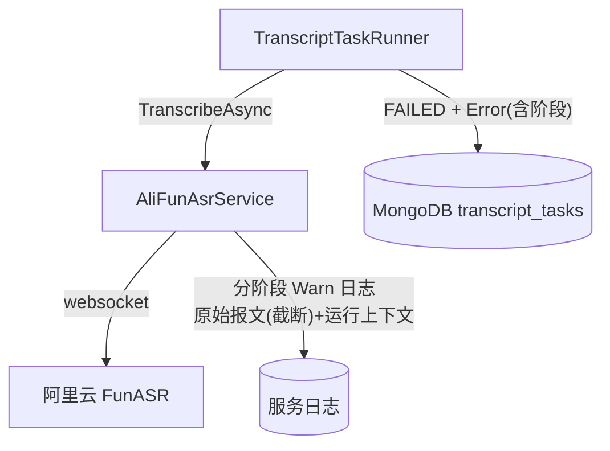
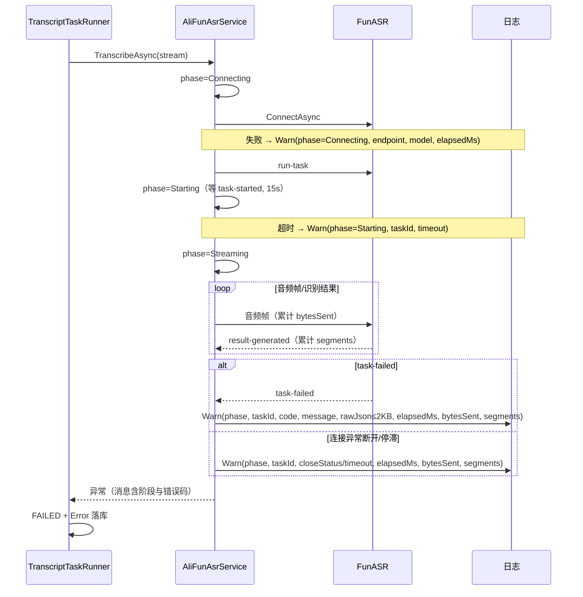

# 转写三方识别报错可观测性优化 - 技术提案

**功能名称**: 转写三方识别报错可观测性优化
**关联 PRD**: [[../../product/draft/20260918-transcript-asr-error-observability-prd]]
**技术提案版本**: v1.0
**创建日期**: 2026-09-18
**作者**: Z.Vtuber Workflow Agent
**feat-branch**: `prd/transcript-asr-error-observability`

## 1. 概述

### 1.1 背景

依据 PRD「转写三方识别报错可观测性优化」。线上 transcript 任务因三方识别服务（阿里云 FunASR）失败，日志仅有一行 `FunASR task failed (CLIENT_ERROR): request timeout after 23 seconds`，无法排查。现状勘察结论（均经读码确认）：

- **task-failed 原始报文丢失**：`AliFunAsrService.ReceiveLoopAsync` 收到 `task-failed` 后仅记录 `FunAsrProtocol.ParseErrorMessage(json)` 解析出的 `error_code`/`error_message`（`servers/recording-transcript-consumer/Asr/AliFunAsrService.cs:224-228`）；原始 JSON 报文（含 header 其余字段、payload）被直接丢弃，且 `ParseErrorMessage` 解析失败时只返回固定串 `FunASR task failed`（`FunAsrProtocol.cs:118-136`），错误细节全部丢失；
- **连接阶段失败无日志**：`socket.ConnectAsync`（`AliFunAsrService.cs:77`）抛异常直接向上传播，`TranscribeAsync` 无任何连接失败日志；
- **启动超时无日志**：`SendAudioLoopAsync` 中 `started.WaitAsync(StartTimeout)`（`AliFunAsrService.cs:275`）超时抛 `TimeoutException`，无日志且异常消息不含 taskId/超时值；
- **失败缺运行上下文**：所有失败日志均不含已运行时长、已发送音频字节数、已产出句数，无法判断失败与音频体量/时长的关系（`totalBytes` 仅在 send 循环局部，`segmentCount` 仅在主枚举局部）；
- **失败阶段不可区分**：连接失败、启动超时、识别中 task-failed、连接异常断开四类失败在日志层面没有统一的阶段标识；
- 任务落库的 `Error` 字段取 `ex.Message`（`TranscriptTaskRunner.cs:164`），task-failed 场景已含错误码与描述，但 idle timeout / 连接断开等场景的消息为通用文案，不含阶段信息。

### 1.2 目标

1. `task-failed` 时日志记录三方原始报文（截断上限 2KB）+ 解析出的错误码/描述 + taskId；
2. 识别链路划分阶段（Connecting → Starting → Streaming → Finishing），各阶段失败均有含阶段标识的 Warn 日志；
3. 所有失败日志携带运行上下文：taskId、model、已运行时长、已发送音频字节、已产出句数；
4. 连接失败与启动超时补齐日志，异常消息含 taskId 与关键参数；
5. 落库的任务 `Error` 消息含失败阶段标识，与日志信息一致。

### 1.3 范围

**做**：

- `servers/recording-transcript-consumer/Asr/AliFunAsrService.cs`：阶段跟踪、失败日志增强、运行上下文统计；
- `servers/recording-transcript-consumer/Asr/FunAsrProtocol.cs`：`task-failed` 解析增强（结构化返回 code/message，供日志与异常消息分别使用）；
- `tests/Z.Vtuber.Tests`：基于既有 `FakeFunAsrServer` 契约测试补充失败日志断言（捕获式 ILogger）。

**不做**：

- 不改变识别重试、任务状态流转、并发门控等任何既有行为（纯日志/消息增强）；
- 不涉及其他服务的三方调用（crawler 的 bilibili/weibo、notifier webhook 等，后续按需单独立项）；
- 不引入新的日志采集/告警基础设施；
- 无契约（OpenAPI）变更、无数据模型变更、无配置项变更。

## 2. 技术架构

### 2.1 系统架构图



### 2.2 技术栈

| 层级 | 技术选型 | 说明 |
|------|---------|------|
| 后端 | .NET 10 / `Microsoft.Extensions.Logging` | 无新增依赖 |
| 测试 | xUnit + 既有 `FakeFunAsrServer` | 捕获式 ILogger 断言日志内容 |

### 2.3 模块划分

| 模块 | 职责 | 关键技术点 |
|------|------|-----------|
| `AliFunAsrService` | 阶段跟踪、失败日志、运行统计 | 内部 `AsrPhase` 枚举 + 共享统计对象 |
| `FunAsrProtocol` | task-failed 结构化解析 | `TryParseTaskFailed(json, out code, out message)` |
| `tests`（AliFunAsrErrorLogTests） | 失败日志断言 | 假 websocket server + ListLogger |

## 3. API 设计

无对外 API 变更；无内部接口签名变更（`IStreamingAsrService` 不变）。`FunAsrProtocol` 为 `internal static`，新增纯函数：

```csharp
/// <summary>解析 task-failed 报文：返回 error_code 与 error_message；解析失败返回 false。</summary>
public static bool TryParseTaskFailed(string json, out string? errorCode, out string? errorMessage);
```

`ParseErrorMessage` 保留（行为兼容），内部改由 `TryParseTaskFailed` 实现，避免双份解析逻辑。

## 4. 数据模型

无集合、字段、索引变更。`transcript_tasks.Error` 仍存 `ex.Message`，仅消息文案增加阶段前缀（见 §5.2 实现点 4）。

## 5. 技术实现方案

### 5.1 核心流程



### 5.2 关键实现点

#### 实现点 1: 阶段跟踪与运行统计（AliFunAsrService）

- 私有枚举 `AsrPhase { Connecting, Starting, Streaming, Finishing }`；`TranscribeAsync` 在 connect 前、run-task 发送后、task-started 后、finish-task 发送后推进阶段；
- 私有 `sealed class RunStats`：`Stopwatch`（connect 起计时）、`long BytesSent`（send 循环累加，`Interlocked` 或 `Volatile` 读）、`int SegmentsYielded`（主枚举累加）——send/receive/主枚举三个任务共享只写各自字段、失败日志统一读取；
- 私有 `LogFailure(phase, taskId, stats, ...)` 辅助方法统一失败日志格式，避免多处拼装漂移。

#### 实现点 2: task-failed 原始报文记录

- `ReceiveLoopAsync` 的 `EventTaskFailed` 分支（`AliFunAsrService.cs:224-228`）改为：
  1. `FunAsrProtocol.TryParseTaskFailed(json, out code, out message)`；
  2. Warn 日志：`phase/taskId/errorCode/errorMessage/raw`（raw 为原始 JSON，超 2KB 截断并追加 `...(truncated)` 标记）；
  3. 异常消息沿用 `FunASR task failed ({code}): {message}` 格式（落库 Error 兼容）；
- 解析失败（非预期格式）时 `code=null`，raw 照常记录——错误信息不因解析失败而丢失。

#### 实现点 3: 连接失败与启动超时补日志

- `ConnectAsync` 包 try/catch：Warn（`phase=Connecting, endpoint, model, offset, elapsedMs`）后 rethrow，不改变异常传播；
- `SendAudioLoopAsync` 的 `started.WaitAsync(StartTimeout, ct)` 超时：捕获 `TimeoutException` → Warn（`phase=Starting, taskId, timeoutSeconds, bytesSent=0`）→ 抛带 taskId 与超时值的新 `TimeoutException`。

#### 实现点 4: 失败消息含阶段（落库 Error 可读性）

- ASR 侧抛出的异常消息统一加阶段前缀，如 `[Streaming] FunASR task failed (CLIENT_ERROR): ...`、`[Connecting] ...`、`[Starting] ...`；`TranscriptTaskRunner` 落库 `Error = ex.Message` 无需改动即获得阶段信息；
- idle timeout、连接异常断开两处既有 Warn 日志补 `phase` 与运行统计字段（消息体同步带阶段前缀）。

#### 实现点 5: 敏感信息红线

- 日志与异常消息**不**包含 `Authorization` 头 / API Key；raw 报文为服务端→客户端方向报文，协议上不含客户端凭据，无需脱敏；endpoint 为配置项非敏感。

## 6. 技术决策

### 6.1 决策列表

| 决策 | 选项 A | 选项 B | 最终选择 | 原因 |
|------|--------|--------|---------|------|
| 1. 原始报文记录方式 | 仅解析后字段 | 解析字段 + 原始报文截断 | B | 三方协议可能返回未知字段，原始报文是报障的完整依据；2KB 截断控制日志体积 |
| 2. 阶段表达 | 日志模板散写 | 内部枚举 + 统一 LogFailure | B | 四处失败点格式一致，可检索（按 phase 过滤），无外部依赖 |
| 3. 统计共享 | 各循环局部变量 | 共享 RunStats 对象 | B | 失败可能在 receive/send 任一任务触发，需跨任务读取彼此进度 |
| 4. Error 落库增强 | 改 Runner 拼消息 | ASR 异常消息自带阶段前缀 | B | Runner 不感知 ASR 内部阶段；改动面最小 |
| 5. 可观测性手段 | 引入 OpenTelemetry | 结构化日志增强 | B | 项目现状为日志驱动，无 OTel 基础设施；结构化字段已满足排查与检索 |

### 6.2 依赖与约束

| 类型 | 内容 | 说明 |
|------|------|------|
| 依赖 | FunASR websocket 协议 task-failed 报文约定 | 解析失败时降级为仅记 raw |
| 约束 | 不改变任何重试/状态流转行为 | 纯可观测性增强 |
| 约束 | TDD、核心覆盖率 ≥ 80% | 项目既有规范（common-rules） |
| 约束 | 日志不含密钥等敏感信息 | PRD 安全要求 |

## 7. 项目结构

```
servers/recording-transcript-consumer/Asr/
├── AliFunAsrService.cs    # 阶段跟踪、RunStats、LogFailure、连接/启动超时日志
└── FunAsrProtocol.cs      # + TryParseTaskFailed；ParseErrorMessage 复用其实现

tests/Z.Vtuber.Tests/
├── AliFunAsrOffsetTests.cs          # 既有（FakeFunAsrServer 所在文件）
└── AliFunAsrErrorLogTests.cs        # 新增：四类失败日志断言
```

## 8. 测试策略

### 8.1 测试覆盖要求

- TDD：先写失败测试再实现；核心逻辑覆盖率 ≥ 80%（common-rules）；
- 捕获式 `ILogger`（测试内 ListLogger，记录 level + message + 结构化字段）注入 `AliFunAsrService`（构造函数已有 logger 参数先例）。

### 8.2 测试类型

- **task-failed 日志**：假 server 返回 task-failed（含 error_code/message/额外字段）→ 断言 Warn 日志含 code、message、截断 raw、phase=Streaming、bytesSent/segments 统计；超长报文断言截断标记；
- **连接失败日志**：指向不可达端口 → 断言 phase=Connecting 的 Warn 日志存在且异常传播不变；
- **启动超时日志**：假 server 连接后不回 task-started → 断言 phase=Starting Warn + 异常消息含 taskId/超时值；
- **连接异常断开日志**：假 server 中途断开 → 断言 Warn 含 closeStatus 与运行统计（既有行为回归 + 新增字段）；
- **FunAsrProtocol 单测**：`TryParseTaskFailed` 正常/缺字段/非 JSON 三分支；`ParseErrorMessage` 行为兼容回归；
- 既有 `AliFunAsrOffsetTests` 全量回归（识别主流程不受影响）。

## 9. 部署方案

- 无新增服务、无配置项、无数据迁移；随 recording-transcript-consumer 常规镜像发布生效；
- 存量 FAILED 任务的 Error 文案不迁移（历史记录保持原样）。

## 10. 验收标准

- [ ] 技术方案评审通过
- [ ] task-failed 时 Warn 日志含错误码、错误描述、原始报文（≤2KB 截断带标记）、taskId
- [ ] 连接失败、启动超时、识别中失败、连接异常断开四类日志可互相区分（phase 标识）
- [ ] 失败日志含 elapsedMs、bytesSent、segmentsYielded
- [ ] 任务 Error 落库消息含阶段前缀；任何日志不含 API Key
- [ ] 新增测试全部通过，既有 ASR 测试回归通过，核心覆盖率 ≥ 80%

## 11. 相关文档

- PRD：`docs/product/draft/20260918-transcript-asr-error-observability-prd.md`
- 关联提案：`docs/engineering/proposals/20260916-proposal-recording-transcript.md`、`docs/engineering/proposals/20260918-proposal-transcript-fixes.md`
- 规范：`docs/engineering/common-rules.md`、`docs/engineering/backend-rules.md`
- 三方协议：https://platform.qianwenai.com/docs/api-reference/speech-recognition/fun-asr-realtime/websocket-api.md
