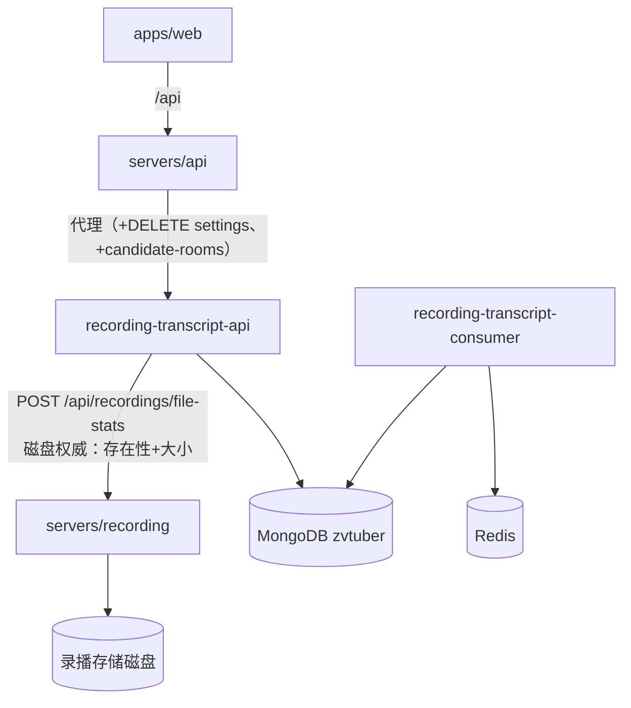
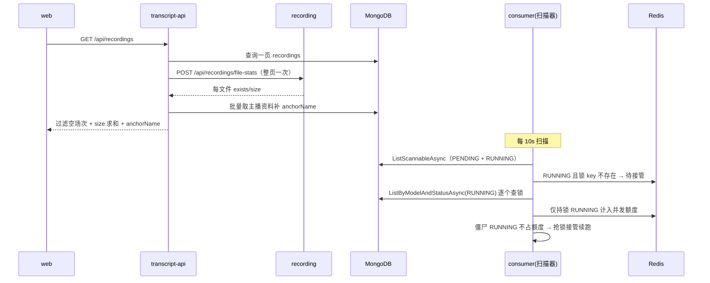

# 转写功能体验修复与任务恢复 - 技术提案

**功能名称**: 转写功能体验修复与任务恢复
**关联 PRD**: [[../../product/draft/20260918-transcript-fixes-prd]]
**技术提案版本**: v1.0
**创建日期**: 2026-09-18
**作者**: Z.Vtuber Workflow Agent
**feat-branch**: `prd/transcript-fixes`

## 1. 概述

### 1.1 背景

依据 PRD「转写功能体验修复与任务恢复」，修复转写功能的三类问题（Web 操作体验、空录播过滤、中断任务恢复）。现状勘察结论（均经读码确认）：

**Web 体验问题（Q1）**：

- 手动发起识别的场次选择器仅展示 `title`（`apps/web/src/pages/transcripts/TaskListTab.tsx:386-398`）；契约 `RecordingItem` 仅含 `id/roomId/mid/title/files/startedAt/endedAt`（`contracts/recording-transcript.openapi.yaml:493-517`），**无主播名、无文件大小**；
- 「按主播筛选」选择器 label 为纯 roomId 数字（`TaskListTab.tsx:425-437`，从 recordings 去重派生）；
- 自动识别设置的房间号为 `type="number"` 手工输入框（`apps/web/src/pages/transcripts/SettingsTab.tsx:309-317`）；
- 设置操作列仅有开启/关闭（`SettingsTab.tsx:290-297`）；契约无删除端点，前端 client 亦无删除方法——删除能力三层全缺；
- 任务详情为表格外平铺 `<ul>`（`TaskListTab.tsx:356-378`），无收起按钮（再点同一行变为「刷新」）、无 max-height/滚动容器；
- 主播名有现成来源：`AccountBasicInfoRepository.GetLatestByMidsAsync` + `TranscriptMapping.ExtractAnchorName`（settings 列表先例，`servers/recording-transcript-api/Controllers/TranscriptSettingsController.cs:27-29`）；文件大小来源：recording 服务 `GET /api/{roomId}/recordings` 枚举磁盘并附 `size`（`servers/recording/Controllers/RecordingController.cs:24-68`）。

**空录播问题（Q2）**：

- `recordings` 归档的 `Files` 为 ffmpeg 启动时**预渲染的计划文件名**（`servers/recording/Recording/RecordingSession.cs:134-143,177-185`），从不校验磁盘；网络异常导致「录制开始但无文件产出」时，归档 Files 非空而磁盘无文件；
- transcript-api 的 `GET /api/recordings` 仅查 Mongo、无任何磁盘校验（`servers/recording-transcript-api/Controllers/RecordingsArchiveController.cs:21-31`），且该服务无 StorageDir 配置、无磁盘访问能力——**磁盘权威在 recording 服务**。

**中断任务不恢复（Q3，根因已定位）**：

- 扫描查询正确：`TranscriptTaskRepository.ListScannableAsync` 返回 `Status IN (PENDING, RUNNING)`（`servers/common/Persistence/TranscriptTaskRepository.cs:52-61`）；
- 锁检查正确：`TranscriptTaskScanner.cs:59-64` 对 RUNNING 且锁 key 不存在（`transcript:task-lock:{taskId}`，TTL 30s 已过期）的任务进入接管路径；
- **根因在并发门控 `TryReserveConcurrencyAsync`（`TranscriptTaskScanner.cs:139-153`）**：`CountByModelAndStatusAsync(model.Id, RUNNING)` 把**待接管的僵尸 RUNNING 任务自身**计入该模型并发数。契约默认 `maxConcurrency=1`：running=1 ≥ 1 → 每轮扫描都返回 false → 任务永久停在 RUNNING，形成自我死锁。一般化：僵尸 RUNNING 数 ≥ MaxConcurrency 时死锁；未死锁时僵尸也永久占额度、饿死同模型 PENDING 任务；
- 同一 bug 阻塞手动重试：retry 置 RUNNING 不持锁（`servers/recording-transcript-api/Controllers/TranscriptTasksController.cs:156`），同样被并发门控挡回；
- 扫描器当前**无专项测试**（tests/ 下无 Scanner 测试文件）。

### 1.2 目标

1. `RecordingItem` 补 `anchorName` 与 `size`（磁盘实际存在文件总字节数），web 场次/主播选择器按 PRD 模板展示；
2. 录播查询（`/api/recordings`、`/api/recordings/{roomId}/transcripts`）以 recording 服务磁盘数据为准过滤「所有文件均不存在」的空场次；
3. 新增候选主播端点与自动识别设置删除端点，web 设置页改选择器并加删除；
4. 任务详情容器加收起按钮与限高滚动；
5. 修复扫描器并发计数口径：僵尸 RUNNING 不占并发额度，宕机重启后任务 1 分钟内被接管续跑；补扫描器专项测试。

### 1.3 范围

**做**：

- `contracts/recording.openapi.yaml`：recording 服务新增批量文件状态端点；
- `contracts/recording-transcript.openapi.yaml`：`RecordingItem` + anchorName/size、候选主播端点、设置删除端点；
- `servers/recording`：批量文件状态端点实现（磁盘枚举）；
- `servers/recording-transcript-api`：查询过滤 + anchorName/size 聚合、候选主播、删除设置；新增对 recording 服务的只读依赖；
- `servers/recording-transcript-consumer`：扫描器并发计数修复；
- `servers/api`：代理新增路由；
- `apps/web`：选择器文案、设置页选择器与删除、详情容器收起与限高滚动。

**不做**：

- 存量 `recordings.Files` 数据清洗（查询时过滤已覆盖展示面；任务运行时本就按运行时最新 Files 重新选文件）；
- enqueue 时的文件存在性前置校验（空场次被过滤后自然不可选）；
- 任务列表接口 `TranscriptTask` 补 anchorName（PRD 未要求）。

## 2. 技术架构

### 2.1 系统架构图



### 2.2 技术栈

| 层级 | 技术选型 | 说明 |
|------|---------|------|
| 后端 | .NET 10 / ASP.NET Core | 无新增框架 |
| 契约 | OpenAPI（手写契约先行） | recording + recording-transcript 两个契约变更 |
| 前端 | React 19 + Vite（既有） | codegen 更新 schema，勿手改 |

### 2.3 模块划分

| 模块 | 职责 | 关键技术点 |
|------|------|-----------|
| `servers/recording` | 批量文件状态端点 | `{StorageDir}/{roomId}/{file}` 存在性 + 长度 |
| `servers/recording-transcript-api` | 查询过滤与字段聚合、候选主播、删除设置 | 请求内批量调用 file-stats、anchorName 复用 settings 先例 |
| `servers/recording-transcript-consumer` | 扫描器并发计数修复 | 持锁 RUNNING 才占额度 |
| `servers/api` | 代理新路由 | 沿用既有转发模式 |
| `apps/web` | 选择器/删除/详情容器 | option 模板渲染、confirm、max-height 容器 |

## 3. API 设计

### 3.1 recording 服务 API（变更 `contracts/recording.openapi.yaml`）

#### POST /api/recordings/file-stats（新增）

- 批量查询录播文件的磁盘存在性与大小（磁盘权威）。Body：

```json
{ "items": [{ "roomId": 123, "files": ["[RAW][123]xxx.flv", "[AV1][123]xxx.flv"] }] }
```

- 响应 200：

```json
{ "items": [{ "roomId": 123, "files": [{ "name": "[RAW][123]xxx.flv", "exists": true, "size": 12345678 }, { "name": "...", "exists": false, "size": null }] }] }
```

- 实现：`{StorageDir}/{roomId}/{fileName}` 逐个 `File.Exists`/`FileInfo.Length`；沿用下载接口的路径穿越防护（文件名规范化后须仍落在 `{StorageDir}/{roomId}` 内，非法文件名按 `exists=false` 处理）。单次请求 `items` 总量上限（如 100 条），超限 400。

### 3.2 transcript-api 服务 API（变更 `contracts/recording-transcript.openapi.yaml`）

#### GET /api/recordings（变更）

- `RecordingItem` 新增字段：
  - `anchorName`（string, nullable）：关联主播资料补全（复用 settings 先例）；
  - `size`（int64, nullable）：该场次**磁盘实际存在文件**的总字节数；recording 服务不可达时为 null；
- 行为变更（写入端点 description）：`files` 中所有文件在磁盘上均不存在的场次**被过滤**，不出现在列表；返回的 `files` 收缩为实际存在的文件子集。

#### GET /api/recordings/{roomId}/transcripts（变更）

- 同样过滤空场次；`RoomTranscriptRecording` 不新增字段（PRD 未要求）。

#### GET /api/transcripts/candidate-rooms（新增）

- 候选主播列表（供自动识别设置的添加选择器）：`recordings` 聚合 distinct roomId/mid + anchorName 补全。

```json
{ "items": [{ "roomId": 123, "mid": 456, "anchorName": "某主播" }] }
```

#### DELETE /api/recordings/{roomId}/transcripts/settings（新增）

- 删除指定主播的自动识别设置（物理删除 `transcript_auto_enqueue` 记录）。
- 204：删除成功；404：设置不存在。
- 不影响该主播已存在的任务。

### 3.3 api 代理（变更 `contracts/bilibili-crawler.openapi.yaml` 代理端点 + `RecordingTranscriptProxyController`）

- 追加转发：`GET /api/transcripts/candidate-rooms`、`DELETE /api/recordings/{roomId}/transcripts/settings`；其余沿用既有转发。

### 3.4 内部接口

- transcript-api 新增 `RecordingFileStatsClient`（typed HttpClient，`RecordingService:BaseUrl` 配置，consumer 已有同款配置先例）：入参 `(roomId, files)[]`，出参每文件 `(exists, size)`；**单次请求聚合整页**，无逐房间循环；
- common `RecordingRepository` 新增 `DistinctRoomsAsync()`：聚合 distinct `RoomId` + 最新 `Mid`；
- common `TranscriptAutoEnqueueRepository` 新增 `DeleteByRoomIdAsync(roomId)`；
- common `TranscriptTaskRepository` 新增 `ListByModelAndStatusAsync(modelId, status)`（供扫描器判定持锁占用，见 §5.2 实现点 5）。

## 4. 数据模型

无新增集合、无索引变更、无存量数据迁移：

- `transcript_auto_enqueue`：删除即物理删除记录，字段不变；
- `recordings`/`transcript_tasks` 等：不变。

## 5. 技术实现方案

### 5.1 核心流程



### 5.2 关键实现点

#### 实现点 1: 录播查询过滤与字段聚合（transcript-api）

- `RecordingsArchiveController.ListRecordings` 与 `GetRoomTranscripts`：取一页结果后收集全部 `(roomId, files)`，**一次**调用 `RecordingFileStatsClient`；
- 过滤：`files` 与磁盘求交，交集为空 → 该场次从结果剔除；交集非空 → `files` 收缩为存在子集，`size` 为存在文件大小求和；
- `anchorName`：按本页 mid 集合批量 `AccountBasicInfoRepository.GetLatestByMidsAsync` + `ExtractAnchorName`（settings 先例）；
- **降级策略**：recording 服务不可达/调用失败时记 Warn 日志，返回未过滤原始列表（`size=null`）——可用性优先，绝不让列表接口 500。

#### 实现点 2: recording 批量文件状态端点

- `RecordingController` 新增 `POST /api/recordings/file-stats`：按 `{StorageDir}/{roomId}/{fileName}` 判定，逻辑复用下载接口的路径防护（`RecordingController.cs:70-99` 先例）；roomId 目录不存在时全部 `exists=false`。

#### 实现点 3: 候选主播端点（transcript-api）

- `GET /api/transcripts/candidate-rooms`：`DistinctRoomsAsync()` 取 distinct roomId/mid，批量补 anchorName，按 roomId 升序返回。

#### 实现点 4: 自动识别设置删除（全链路）

- 契约 + transcript-api `RecordingsArchiveController` 新增 DELETE 端点 → `TranscriptAutoEnqueueRepository.DeleteByRoomIdAsync`，存在删除返回 204，不存在 404；
- api 代理追加路由；web `client.ts` 新增 `deleteTranscriptSettings(roomId)`；
- `SettingsTab` 操作列加「删除」按钮，`window.confirm` 二次确认后调用并刷新列表。

#### 实现点 5: 扫描器并发计数修复（Q3 核心，consumer）

- `TranscriptTaskScanner.TryReserveConcurrencyAsync`（`TranscriptTaskScanner.cs:139-153`）计数口径由「该模型 RUNNING 总数」改为「该模型**持锁** RUNNING 数」：
  1. `ListByModelAndStatusAsync(modelId, RUNNING)` 取该模型 RUNNING 任务列表；
  2. 逐个 `TranscriptTaskLock.IsHeldAsync(taskId)`（Redis key 存在性；Redis 异常时按「持有」保守计数，与锁实现既有语义一致）；
  3. `activeCount + inFlight >= Math.Max(1, model.MaxConcurrency)` 才拒绝；
- 效果：僵尸 RUNNING（无锁）不占额度——候选僵尸任务自身不再把自己挡在门外（修复死锁），多个僵尸也不饿死同模型 PENDING；retry 置 RUNNING 的路径同样被解锁；
- 模型 MaxConcurrency 很小（默认 1），每轮多出的 Redis 存在性检查数量级可忽略；
- 扫描器此前无专项测试，按 TDD 先补 `TranscriptTaskScannerTests`（见 §8）。

#### 实现点 6: web 选择器与详情容器

- `TaskListTab` 场次选择器 option 文案按模板渲染：`[{anchorName ?? roomId}][{formatBytes(size)}] {title} - {yyyy-mm-dd-HH-mm} - {endedAt ? yyyy-mm-dd-HH-mm : '进行中'}`；`formatBytes` 先例在 `RecordingStatusPage.tsx:13-30`，就近实现或提取共用；
- 主播选择器 label 改为 `{anchorName}（{roomId}）`，anchorName 缺失兜底 roomId；
- `SettingsTab` 房间号输入框替换为 `<select>`（数据源 `candidate-rooms`），候选为空时禁用提交并提示；
- 详情区（`TaskListTab.tsx:356-378`）：标题栏加「收起」按钮（清空选中、关闭 EventSource）；segments 列表包一层 `maxHeight`（如 24rem）+ `overflowY: 'auto'` 容器；实时追加时若滚动位置在底部附近则自动滚到底部；
- 契约变更后执行 `npm run codegen` 更新 `schema-recording-transcript.d.ts`（勿手改），并同步 `apps/web/AGENTS.md` 中 Transcripts 页描述。

## 6. 技术决策

### 6.1 决策列表

| 决策 | 选项 A | 选项 B | 最终选择 | 原因 |
|------|--------|--------|---------|------|
| 1. 文件存在性/大小来源 | transcript-api 逐房间调 recording 现有文件列表端点 | recording 新增批量 file-stats 端点，transcript-api 单次调用 | B | 整页一次往返，无 N+1；语义明确；磁盘权威仍在 recording |
| 2. 空录播处理 | 存量数据清洗 + 写入时对账 | 查询时以磁盘为准过滤 | B | 磁盘状态随时间变化（文件可能被清理），查询时过滤始终准确；清洗留作后续可选优化 |
| 3. recording 不可达 | 列表接口报错 | 降级返回未过滤列表 | B | 查询服务可用性优先，过滤是增强而非硬依赖 |
| 4. 僵尸任务并发口径 | 接管时豁免候选自身计数 | 只统计持锁 RUNNING | B | 同时修复「候选自我死锁」与「多僵尸饿死 PENDING」两类问题；语义与「锁=在执行」一致 |
| 5. 候选主播数据源 | 复用 `GET /api/recordings` 前端派生 | 新增 candidate-rooms 端点 | B | recordings 列表分页且有过滤语义，派生不可靠；专用端点数据完整、职责单一 |
| 6. 删除设置语义 | 软删除（enabled=false） | 物理删除记录 | B | PRD 要求「删除」；禁用能力已由开关覆盖 |

### 6.2 依赖与约束

| 类型 | 内容 | 说明 |
|------|------|------|
| 依赖 | recording 服务可达（file-stats） | 不可达时查询降级不过滤 |
| 约束 | .NET 10、契约式开发、TDD、核心覆盖率 ≥80% | 项目既有规范 |
| 约束 | 契约先行，前端 schema 由 codegen 生成 | `apps/web/AGENTS.md` |

## 7. 项目结构

```
contracts/
├── recording.openapi.yaml                    # + POST /api/recordings/file-stats
├── recording-transcript.openapi.yaml         # RecordingItem +anchorName/size；+candidate-rooms；+DELETE settings
└── bilibili-crawler.openapi.yaml             # + 代理端点

servers/recording/
└── Controllers/RecordingController.cs        # + file-stats 端点

servers/common/Persistence/
├── RecordingRepository.cs                    # + DistinctRoomsAsync
├── TranscriptAutoEnqueueRepository.cs        # + DeleteByRoomIdAsync
└── TranscriptTaskRepository.cs               # + ListByModelAndStatusAsync

servers/recording-transcript-api/
├── Configuration/TranscriptApiOptions.cs     # + RecordingService:BaseUrl
├── Clients/RecordingFileStatsClient.cs       # 新增 typed HttpClient
└── Controllers/RecordingsArchiveController.cs# 过滤/聚合/candidate-rooms/DELETE settings

servers/recording-transcript-consumer/
└── Tasks/TranscriptTaskScanner.cs            # 并发计数改持锁口径

servers/api/Controllers/RecordingTranscriptProxyController.cs  # + 两条路由

apps/web/src/
├── api/client.ts                             # + candidate-rooms / deleteTranscriptSettings
├── pages/transcripts/TaskListTab.tsx         # 选项模板文案 + 详情容器收起/限高滚动
└── pages/transcripts/SettingsTab.tsx         # 主播选择器 + 删除按钮

tests/Z.Vtuber.Tests/
├── TranscriptTaskScannerTests.cs             # 新增：僵尸接管/不占额度/不饿死 PENDING/retry 解锁
├── RecordingsArchiveFilterTests.cs           # 新增：空场次过滤/size 求和/anchorName/降级
└── TranscriptSettingsDeleteTests.cs          # 新增：204/404

infra/apphost/AppHost.cs                      # transcript-api + RecordingService:BaseUrl
```

## 8. 测试策略

### 8.1 测试覆盖要求

- 核心逻辑覆盖率 ≥ 80%（common-rules）；TDD：先写失败测试再实现；扫描器为本次新增测试覆盖的重点。

### 8.2 测试类型

- **扫描器集成测试（Testcontainers MongoDB + Redis）**：预置 `maxConcurrency=1` 模型 + 僵尸 RUNNING（无锁）→ 断言被接管续跑；多僵尸 + PENDING → PENDING 不被饿死；持锁 RUNNING 仍占额度（他节点任务不被重复执行）；retry 后置 RUNNING 可被接管；
- **transcript-api 集成测试**：假 `RecordingFileStatsClient`（或假 HTTP handler）覆盖空场次过滤、部分文件存在时 files 收缩与 size 求和、recording 不可达降级；candidate-rooms 去重与 anchorName；DELETE settings 204/404；
- **recording 端点测试**：临时目录预置文件，断言 exists/size 与路径穿越防护；
- **web（Vitest + RTL）**：场次选项模板文案（含进行中兜底）、主播选择器名称兜底、删除二次确认交互、详情收起与限高容器。

## 9. 部署方案

- 无新增服务；transcript-api 新增配置 `RecordingService:BaseUrl`，AppHost 增加对 recording 的引用（consumer 同款先例）；
- 无数据迁移；上线后既有僵尸 RUNNING 任务随扫描器修复在锁 TTL 过期后自动被接管。

## 10. 验收标准

- [ ] 技术方案评审通过；契约变更评审通过
- [ ] 场次选项按 `[{主播名称}][{录播大小}] {title} - {开始时间} - {结束时间}` 展示，进行中场次显示「进行中」
- [ ] 主播选择器显示主播名称；自动识别设置从候选主播选择、可删除（二次确认）
- [ ] 任务详情可收起，内容限高滚动，实时追加时底部跟随
- [ ] 所有文件均不存在的场次被所有录播查询过滤；recording 不可达时列表降级可用
- [ ] 模拟 consumer 宕机重启后，RUNNING 任务 1 分钟内被接管，从断点续跑，segments 不重复
- [ ] 多僵尸 RUNNING 不饿死同模型 PENDING；retry 后任务正常恢复
- [ ] 单测 + 集成测试通过，核心覆盖率 ≥ 80%

## 11. 相关文档

- PRD：`docs/product/draft/20260918-transcript-fixes-prd.md`
- 关联提案：`docs/engineering/proposals/20260916-proposal-recording-transcript.md`、`docs/engineering/proposals/20260917-proposal-transcript-model-context.md`
- 契约：`contracts/recording-transcript.openapi.yaml`、`contracts/recording.openapi.yaml`
- 规范：`docs/engineering/common-rules.md`、`docs/engineering/backend-rules.md`、`docs/engineering/frontend-rules.md`
