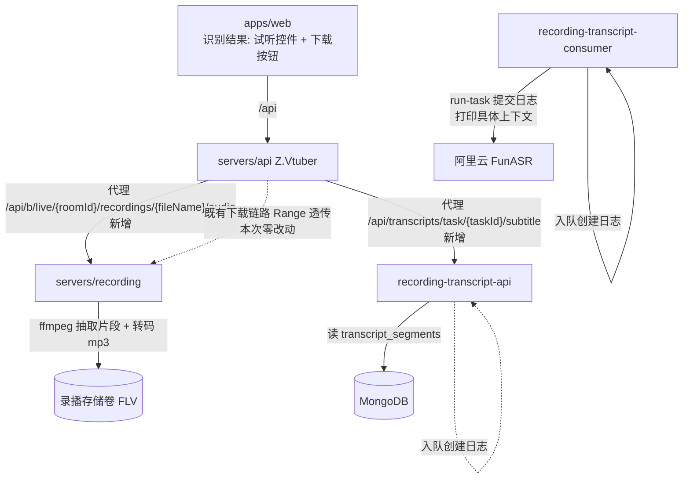
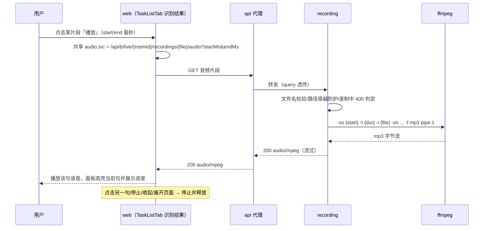
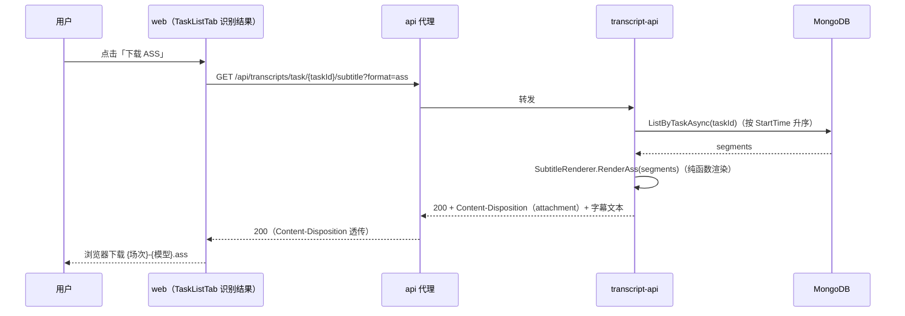
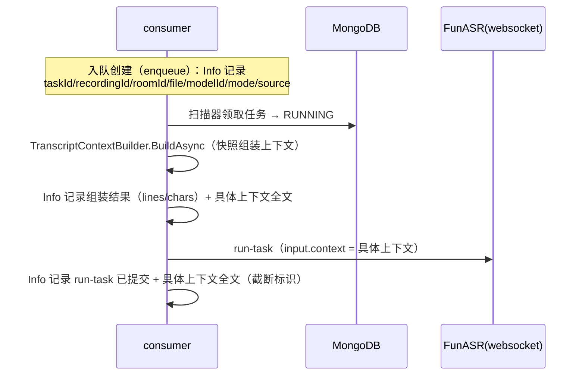

# Transcript 展示优化 - 技术提案

- 日期：2026-09-22
- 状态：待评审
- feat-branch：`feat/transcript-display-optimization`
- 关联文档：[PRD](../../product/draft/20260922-transcript-display-optimization-prd.md)

## 1. 概述

### 1.1 背景

依据 PRD「Transcript 展示优化」，为识别结果（Transcript）补齐三项能力：① 识别片段语音试听控件（播放该句对应时间的语音）；② Transcript 的 SRT/ASS 字幕下载端点与 web 下载按钮；③ 提交 transcript 任务时在日志中打印**具体**上下文。

现状勘察结论（均经读码确认）：

**① 试听：现有 API「支持 Range」属实，但不足以支撑浏览器播放。**

- 录播下载链路（web → api `/api/b/live/{roomId}/recordings/{fileName}` → recording `/api/{roomId}/recordings/{fileName}`）**已全链路支持 HTTP Range**：recording 侧 `servers/recording/Controllers/RecordingController.cs:144` `PhysicalFile(fullPath, ..., enableRangeProcessing: true)`（框架原生 200/206/416 + `Accept-Ranges`）；api 代理 `servers/api/Controllers/BilibiliLiveRecordingController.cs:126-222` 已透传 `Range`/`If-Range` 请求头与 200/206/416 状态码及 `Accept-Ranges`/`Content-Range`/`Content-Length` 响应头（20260914 需求交付，回归测试见 `tests/Z.Vtuber.Tests/RecordingApiTests.cs:323-371`）。**即需求方「现有 API 应该支持 range header」的判断成立。**
- 但 Range 只解决「按**字节**区间取数据」，解决不了「按**时间**播放某句语音」：
  1. 录播文件是 **FLV 容器**（`servers/recording/Recording/FfmpegProcessBuilder.cs` 多输出：RAW 流 `-c copy -f flv` + AV1 二压 `-f flv`），音频为 AAC。浏览器 `<audio>` 原生不支持 FLV 容器，MSE 亦需先解封装（flv.js 等）才能喂入；
  2. FLV **没有 seek 索引**，「整场录播时间轴（ms）→ 字节区间」无映射关系，仅凭 Range 无法把 `segment.start` 定位到字节偏移（需扫描 FLV tag 才能换算，且每条字节区间仍需解封装才能播放）；
  3. 实时音频流 `GET /api/{roomId}/stream/audio` 是直播边缘流（`video/x-flv` chunked、`Cache-Control: no-store`、未录制 404），不可 seek、不可回放，不能作为试听音源。
- 结论：**复用现有 Range 能力不足以直接实现试听**，需服务端提供「按时间区间输出浏览器可直接播放的音频」的片段端点；Range 能力继续服务文件下载场景，本次不改动。

**② 字幕：全新能力，数据已齐备。**

- 全仓库检索 `srt`/`vtt`/`ass`/`subtitle`/`字幕` 均无匹配（代码与文档），无任何字幕生成实现可复用；
- 数据源 `servers/common/Persistence/Entities/TranscriptSegmentRecord.cs`（`transcript_segments`：`StartTime`/`EndTime`（ms）/`Text`）已足够直接渲染 SRT/ASS；其时间轴为**整场录播时间轴（含续跑 offset）**（见 `contracts/recording-transcript.openapi.yaml:451-464`），与录播视频时间轴天然对齐，字幕可直接配视频；
- 当前 transcript-api（`servers/recording-transcript-api`）只有 JSON + SSE 出口，`servers/api/Controllers/RecordingTranscriptProxyController.cs` 的 `ForwardAsync`（:73-130）只透传 `Content-Type`/`Cache-Control`，**不透传 `Content-Disposition`**——文件下载类响应需补齐该头的透传。

**③ 上下文日志：内容从未落日志。**

- 识别上下文由 `servers/recording-transcript-consumer/Context/TranscriptContextBuilder.cs` 在**任务启动执行时**按数据快照组装（优先级：主播名 → 最新一天舰长名单 → 窗口内 SC 用户名/粉丝牌 → SC 内容；`HashSet` 去重 + `MaxContextChars = 400` 字符整行截断，`MaxScRecords = 500`）；
- 上下文经 `servers/recording-transcript-consumer/Asr/FunAsrProtocol.cs:23-62` `BuildRunTask` 填入 `input.context`（单条 user 消息）随 run-task 提交；
- 现状唯一相关日志是 `servers/recording-transcript-consumer/Asr/AliFunAsrService.cs:128-133`：
  ```csharp
  await SendTextAsync(socket, FunAsrProtocol.BuildRunTask(taskId, _model, _context), ct);
  _logger.LogInformation(
      "FunASR run-task sent: taskId={TaskId} model={Model} contextLines={ContextLines}",
      taskId, _model, _context.Count);
  ```
  **只打印条数（`_context.Count`），具体上下文内容从不落日志**；`TranscriptTaskRunner`（`servers/recording-transcript-consumer/Tasks/TranscriptTaskRunner.cs:97-111`）组装完上下文后亦无内容日志；
- 手动提交（`servers/recording-transcript-api/Controllers/TranscriptTasksController.cs:24-88` `Enqueue`）**无任何日志**（控制器未注入 `ILogger`）；自动提交（`TranscriptEnqueueService.EnsureTaskAsync`）仅有 Warn 级别的失败日志，任务创建本身无 Info 日志；
- 20260917 提案已决策「上下文非审计数据、不持久化」（`docs/engineering/proposals/20260917-proposal-transcript-model-context.md` 决策 3），故可观测手段只剩日志。

「提交 transcript 任务时打印具体上下文」在实现上有两个环节（均纳入本期，见 §5.2 实现点 6）：任务**入队创建**（enqueue：手动 `POST /api/transcripts/enqueue` 与自动建任务）此时上下文尚未组装，打印**提交信息**（场次/文件/模型/来源）；任务**启动执行向 ASR 提交 run-task** 此时上下文已组装，打印**具体上下文内容**（满足需求主语义）。

### 1.2 目标

1. recording 服务新增录播音频片段端点：按 `startMs`/`endMs` 从录播文件抽取音频片段并转码为浏览器可直接播放的格式流式返回；api 代理新增同路径镜像端点；
2. web 识别结果展示增加试听控件：每个片段可播放该句语音（区间与展示的起止时间一致），面板提供统一播放控件（当前句/进度/停止）；
3. transcript-api 新增字幕下载端点（`format=srt|ass`），SRT/ASS 渲染为纯函数；api 代理补齐 `Content-Disposition` 透传；web 识别结果展示增加「下载 SRT / 下载 ASS」按钮；
4. 提交 transcript 任务链路补齐日志：入队创建打印提交信息，run-task 提交打印具体上下文内容（含截断标识），全程不打印凭据；
5. 契约（3 份 OpenAPI）先行并同步 web codegen，TDD 补齐单测/接口测试/组件测试。

### 1.3 范围

- **内**：`servers/recording` 音频片段端点（含 ffmpeg 抽取封装）；`servers/api` 两处代理变更（audio 路由、`Content-Disposition` 透传）；`servers/recording-transcript-api` 字幕下载端点与 SRT/ASS 渲染器；`servers/recording-transcript-consumer` 上下文/入队日志；`apps/web` 试听控件与下载按钮；`contracts/` 三份 OpenAPI 与 web codegen；`tests/Z.Vtuber.Tests` 与 `apps/web` Vitest 测试。
- **外**：实时任务直播进行中的回放（录播文件未落盘，PRD 明确暂不支持）；跨句连续播放/字幕样式配置；字幕其他格式（vtt）；识别上下文的持久化存档；转写结果二次加工（翻译/摘要）；录播下载链路 Range 能力（现状已满足，零改动）；crawler/notifier/cookie 零改动。

## 2. 技术架构

### 2.1 系统架构图



### 2.2 技术栈

| 层级 | 技术选型 | 说明 |
|------|---------|------|
| 音频抽取 | recording 内 ffmpeg 外部进程（`RecordingOptions.FfmpegPath` 已有） | `-ss`/`-t` 定位 + `-vn` 抽音频 + libmp3lame 转 mp3 → `pipe:1` 流式返回 |
| 字幕生成 | transcript-api 纯 C# 字符串渲染（`SubtitleRenderer`，无新依赖） | SRT（SubRip）/ ASS（Advanced SubStation Alpha v4+）两格式 |
| 后端 | C# (.NET 10) ASP.NET Core（既有三服务改造） | 与既有端点同模式（控制器 + 纯函数 + HttpClient 代理） |
| 前端 | React 19 + Vite（既有），原生 `<audio>` 元素 | 共享单例播放器；不引入 flv.js 等新依赖 |
| 契约 | OpenAPI（`contracts/recording.openapi.yaml`、`bilibili-crawler.openapi.yaml`、`recording-transcript.openapi.yaml`） | 手写契约先行，web `openapi-typescript` codegen |
| 测试 | xUnit + Testcontainers（后端）、Vitest + RTL（前端） | 沿用既有设施（`FakeFunAsrServer`、lavfi 音频、fake HttpClient） |

### 2.3 模块划分

| 模块 | 职责 | 关键技术点 |
|------|------|-----------|
| `servers/recording`（变更） | 录播音频片段端点（按时间区间抽取音频） | 复用文件名校验/路径穿越防护/录制中 400 判定；ffmpeg `-ss`/`-t` + mp3 流式输出 |
| `servers/api`（变更） | audio 片段端点代理；`ForwardAsync` 补 `Content-Disposition` 透传 | 400 透传响应体/404/502 口径与下载代理一致 |
| `servers/recording-transcript-api`（变更） | 字幕下载端点 + SRT/ASS 渲染器 + 入队创建日志 | 渲染纯函数（时间格式化/转义/BOM）；文件名 sanitize + `filename*` |
| `servers/recording-transcript-consumer`（变更） | run-task 提交打印具体上下文 + 入队创建日志 | 复用 `TruncateRaw` 截断口径（推广为 `TruncateForLog`） |
| `apps/web`（变更） | 片段试听控件、统一播放控件、字幕下载按钮 | 共享 `<audio>` 单例、播放状态、错误态提示 |
| `contracts/`（变更） | 3 份 OpenAPI 同步 + web codegen | Range 语义不动；新增 2 个端点族 |

## 3. API 设计

### 3.1 API 契约

#### 接口 1: 录播音频片段（recording 服务，`contracts/recording.openapi.yaml`）

- **请求**
  - Method: GET
  - Path: `/api/{roomId}/recordings/{fileName}/audio`
  - Query:
    | 参数 | 类型 | 必填 | 说明 |
    |------|------|------|------|
    | `startMs` | integer(int64) | 是 | 片段起点（整场录播文件时间轴毫秒，≥ 0） |
    | `endMs` | integer(int64) | 是 | 片段终点（毫秒，> `startMs`；区间长度上限 `Recording:AudioClipMaxDurationMs`，默认 300000） |

- **响应**
  - Status: 200
  - Headers: `Content-Type: audio/mpeg`；`Cache-Control: no-store`（不承诺 Range：片段即最小播放单元）
  - Body: 该区间音频（mp3，单声道 44.1kHz 96kbps，流式输出）
  - Status: 400 `{"error": "..."}` — 文件名非法 / 区间参数非法（`endMs <= startMs`、`startMs < 0`）/ 区间超上限 / 文件正在录制中（与下载端点同文案口径）
  - Status: 404 — 文件不存在
  - Status: 500 `{"error": "audio clip failed"}` — ffmpeg 抽取失败（损坏文件等）

行为矩阵（与下载端点对齐）：

| 场景 | 行为 |
|---|---|
| 正常区间 | 200 `audio/mpeg`（长度 ≈ 区间时长） |
| `endMs` 超出文件实际长度 | 200，输出到文件实际结尾（不报错） |
| 文件正在录制中 | 400（与下载一致，`GetRecordingFilesAsync` 口径） |
| 文件不存在 / 路径穿越 / 文件名非法 | 404 / 400（复用 `IsSafeFileName` 与解析后前缀校验） |
| 区间非法 / 超上限 | 400 |
| 带 `Range` 请求头 | 忽略（不支持分段），返回 200 整片段 |

#### 接口 1 代理镜像（api 服务，`contracts/bilibili-crawler.openapi.yaml`）

- **请求** GET `/api/b/live/{roomId}/recordings/{fileName}/audio?startMs=&endMs=`（query 原样透传）
- **响应** 200/400/404 透传（400 透传响应体，与 `DownloadRecording` 同口径）；recording 不可达 502 `{"error": "recording service unavailable"}`。

#### 接口 2: 字幕下载（transcript-api 服务，`contracts/recording-transcript.openapi.yaml`）

- **请求**
  - Method: GET
  - Path: `/api/transcripts/task/{taskId}/subtitle`
  - Query: `format` — `srt`（默认）| `ass`，其他取值 400 `{"error": "unsupported format"}`

- **响应**
  - Status: 200
  - Headers:
    | 头 | 值 | 说明 |
    |----|----|------|
    | `Content-Type` | `application/x-subrip; charset=utf-8`（srt）/ `text/x-ass; charset=utf-8`（ass） | |
    | `Content-Disposition` | `attachment; filename="<ascii 兜底>.<ext>"; filename*=UTF-8''<百分号编码>` | 文件名见 §5.2 实现点 3 |
  - Body: UTF-8（带 BOM）字幕文本；无识别片段时为合法空字幕（ASS 含文件头，SRT 为空）
  - Status: 400 — `format` 不支持
  - Status: 404 `{"error": "task not found"}` — 任务不存在（对任意状态任务均可下载：DONE 返回完整字幕，RUNNING/PENDING/FAILED 返回**已入库片段**渲染的字幕）

#### 接口 2 代理镜像（api 服务，`contracts/bilibili-crawler.openapi.yaml`）

- **请求** GET `/api/transcripts/task/{taskId}/subtitle?format=`（query 原样透传）
- **响应** 200（含 `Content-Type`/`Content-Disposition` 透传）/ 400 / 404 / 502（现状口径）。

### 3.2 内部接口

- **字幕渲染纯函数**（transcript-api `Subtitles/SubtitleRenderer.cs`，无 IO、可单测）：

  ```csharp
  public static class SubtitleRenderer
  {
      /// <summary>SubRip：序号 + HH:MM:SS,mmm --> HH:MM:SS,mmm + 文本，条目间空行。</summary>
      public static string RenderSrt(IReadOnlyList<TranscriptSegmentDto> segments);

      /// <summary>ASS v4+：[Script Info]/[V4+ Styles]/[Events]，时间 H:MM:SS.cc。</summary>
      public static string RenderAss(IReadOnlyList<TranscriptSegmentDto> segments);

      /// <summary>时间格式化（毫秒 → SRT/ASS 串）。</summary>
      public static string FormatSrtTimestamp(long ms);
      public static string FormatAssTimestamp(long ms);
  }

  /// <summary>下载文件名：sanitize + 兜底。</summary>
  public static class SubtitleFileName
  {
      public static string Build(string? title, string? modelName, string taskId, string extension);
  }
  ```

- **音频抽取封装**（recording `Audio/AudioClipExtractor.cs`）：

  ```csharp
  public interface IAudioClipExtractor
  {
      /// <summary>从录播文件抽取 [startMs, endMs] 音频并转 mp3 写入输出流；ct 取消即 kill 进程。</summary>
      Task ExtractAsync(string fullPath, long startMs, long endMs, Stream output, CancellationToken ct);
  }
  ```

- **api → recording / api → transcript-api**：既有 named HttpClient（`RecordingService:BaseUrl`、`TranscriptService:BaseUrl`）流式转发复用，无新增配置项。

## 4. 数据模型

无持久化模型变更：字幕为 `transcript_segments` 的**纯派生产物**（每次下载现算，不落库、无缓存表）；试听音频为录播文件的**纯派生产物**（每次请求现算，不落盘）；上下文维持「仅日志、不持久化」的既有决策。无新增 DTO（字幕/音频均为非 JSON 响应）。

## 5. 技术实现方案

### 5.1 核心流程

#### 流程 1: 片段试听



#### 流程 2: 字幕下载



#### 流程 3: 提交上下文日志



### 5.2 关键实现点

#### 实现点 1: 录播音频片段端点（recording）

- 在 `servers/recording/Controllers/RecordingController.cs` 增加 `GET {roomId:long}/recordings/{fileName}/audio` action；文件解析逻辑抽私有方法（下载与片段两处共用）：`IsSafeFileName` 平文件名校验 → `Path.GetFullPath` 解析后前缀校验（防路径穿越）→ `GetRecordingFilesAsync` 录制中 400 判定 → `File.Exists` 404 判定，顺序与 `DownloadRecording`（:116-145）完全一致；
- 参数校验：`startMs >= 0`、`endMs > startMs`、`endMs - startMs <= Recording:AudioClipMaxDurationMs`（新增配置，默认 300000，`RecordingOptions` 增字段并保持 `ValidateOnStart` 语义），任一不满足 400 `{"error": ...}`；
- 抽取封装 `Audio/AudioClipExtractor`（`IAudioClipExtractor`，注册 DI，便于单测替换）：

  ```bash
  ffmpeg -hide_banner -loglevel error -ss {startSec} -t {durSec} -i {fullPath} \
      -vn -ac 1 -ar 44100 -b:a 96k -f mp3 pipe:1
  ```

  - `-ss`/`-t` 置于 `-i` 之前（输入 seek，小时级文件秒开；转码模式下 `-accurate_seek` 默认开启，定位精确到采样，满足「播放区间与展示起止时间一致」）；
  - 输出 `pipe:1` 直写 `Response.Body`（`Content-Type: audio/mpeg`，`Cache-Control: no-store`），不落盘、不整段缓冲；`ResponseAborted`/`ct` 取消时 kill 进程并回收（沿用 `RecordingProcess` 的进程回收口径）；
  - `endMs` 超出文件实际长度：ffmpeg 自然输出到文件结尾，**不报错**（与行为矩阵一致）；
  - stderr 泵丢弃（`-loglevel error`），进程 `exitCode != 0` 且未写出任何字节 → 500 `{"error": "audio clip failed"}`（已在响应开头写 200 时则中断连接，由客户端报播放失败）；
  - ffmpeg 路径取 `RecordingOptions.FfmpegPath`（既有配置），进程并发不设限（片段短、调用频率低），如需保护可后续加信号量，本期不做。

#### 实现点 2: api 代理（两处变更）

- `servers/api/Controllers/BilibiliLiveRecordingController.cs` 新增 `[HttpGet("{roomId:long}/recordings/{fileName}/audio")]` 代理 action：构造上游 `api/{roomId}/recordings/{Uri.EscapeDataString(fileName)}/audio` + `Request.QueryString` 透传，`ResponseHeadersRead` + `CopyToAsync` 流式转发；状态映射与 `DownloadRecording` 同口径（404 → 404、400 → 透传响应体 400、不可达/超时 → 502、成功 → 透传 `Content-Type` 与 `Cache-Control`）；
- `servers/api/Controllers/RecordingTranscriptProxyController.cs` `ForwardAsync`（:73-130）补 `Content-Disposition` 透传（`response.Content.Headers.ContentDisposition` 存在时写入 `Response.Headers.ContentDisposition`），供字幕下载得到正确文件名（对既有 JSON/SSE 端点无影响——它们不携带该头）。

#### 实现点 3: 字幕渲染与下载端点（transcript-api）

- `Subtitles/SubtitleRenderer` 纯函数渲染（格式细节即契约，测试用 golden 断言）：
  - **SRT**：条目 `序号\nHH:MM:SS,mmm --> HH:MM:SS,mmm\n文本\n\n`，序号从 1 起；小时两位起（超 99 小时自然进位）；`end <= start` 的异常片段按原值渲染（时长为 0），不抛错；文本内换行原样保留；
  - **ASS（v4+）**：`[Script Info]`（`ScriptType: v4.00+`、`PlayResX: 1920`、`PlayResY: 1080`、`WrapStyle: 2`、`ScaledBorderAndShadow: yes`）+ `[V4+ Styles]`（`Style: Default`：`Fontname: Microsoft YaHei`、`Fontsize: 64`、白字黑边（`PrimaryColour: &H00FFFFFF`、`OutlineColour: &H00000000`、`Outline: 2`）、底部居中 `Alignment: 2`、`MarginV: 60`）+ `[Events]`（`Dialogue: 0,0:MM:SS.cc,0:MM:SS.cc,Default,,0,0,0,,文本`）；时间 `H:MM:SS.cc`（厘秒**向下取整**）；文本转义：`{` → `\{`、`}` → `\}`、换行 → `\N`；
  - 编码统一 **UTF-8 with BOM**（规避部分播放器默认 GBK 判定导致中文乱码）；
- `GET /api/transcripts/task/{taskId}/subtitle?format=` 落 `Controllers/TranscriptSubtitleController.cs`（或并入 `TranscriptTasksController`，实现时择一并保持路由前缀约定「与 roomId 无关挂 `/api/transcripts` 下」）：
  - `format` 枚举校验（`srt` 默认 / `ass`，其他 400）→ `ObjectId.TryParse` 失败或任务不存在 404 → `segments.ListByTaskAsync(taskId)`（按 `StartTime` 升序，与任务详情同源）→ 渲染 → `File(Encoding.UTF8.GetPreamble() + Encoding.UTF8.GetBytes(text), contentType, fileDownloadName)`（`File` 重载自动生成 `Content-Disposition`，非 ASCII 文件名由框架生成 `filename*`）；
  - 文件名 `SubtitleFileName.Build(title, modelName, taskId, ext)`：`{sanitize(场次标题)}-{sanitize(模型名)}.{ext}`，sanitize 仅保留中英文/数字/`-`/`_` 并把其余折叠为 `_`，任一段为空则以 `transcript-{taskId 前 8 位}` 兜底（PRD 异常表「场次标题含特殊字符」）；
  - 任务任意状态均可下载（DONE 完整、RUNNING/PENDING/FAILED 为已入库片段），无片段返回合法空字幕（200）。

#### 实现点 4: web 试听控件（apps/web）

- `apps/web/src/api/client.ts` 新增 URL 构造器（与 `recordingDownloadUrl`（:145-151）同模式）：

  ```ts
  export function recordingAudioClipUrl(
    roomId: number,
    fileName: string,
    startMs: number,
    endMs: number,
  ): string {
    const query = new URLSearchParams({ startMs: String(startMs), endMs: String(endMs) })
    return `${BASE_URL}/b/live/${roomId}/recordings/${encodeURIComponent(fileName)}/audio?${query}`
  }

  export function transcriptSubtitleUrl(
    taskId: string,
    format: 'srt' | 'ass',
  ): string {
    return `${BASE_URL}/transcripts/task/${encodeURIComponent(taskId)}/subtitle?format=${format}`
  }
  ```

- `apps/web/src/pages/transcripts/TaskListTab.tsx` 识别结果面板改造（组件可抽 `SegmentAudioPlayer.tsx` 保持 Tab 文件体量）：
  - **统一播放控件**：识别结果标题行下固定一行 `<audio controls>`（或等价自绘控件）：展示当前播放句（起止时间 + 文字摘要）、播放进度、停止按钮；`<audio>` 为**单例**（`useRef<HTMLAudioElement>`），保证同一时刻只播一句；
  - **片段行播放控件**：每行片段（`formatPosition(segment.start)` + 文字）前增加「播放/停止」按钮；点击设置 `audio.src = recordingAudioClipUrl(task.roomId, task.file, segment.start, segment.end)` 并 `play()`，当前播放句高亮（以 `segment.start` 为键）；再次点击同一句 → 停止；点击其他句 → 切源播放；
  - **生命周期**：`ended`/`pause` 清除高亮；切换选中任务、点击「收起」、组件卸载时 `pause()` 并清空 `src`（PRD 异常表「离开页面不残留声音」）；
  - **错误态**：`audio` 的 `error` 事件或 `play()` 播放失败（对应代理 400「录制中」/404「文件不存在」）→ 展示「音频暂不可用」提示（不弹阻断式错误）；`task.file` 为空时播放按钮置灰 + 「音频暂不可用」提示；
  - 时间展示复用 `formatPosition`（ms → `m:ss`），不再新增格式化函数。

#### 实现点 5: web 字幕下载按钮（apps/web）

- 识别结果标题行（与「收起」并排）增加「下载 SRT」「下载 ASS」两个 `<a href={transcriptSubtitleUrl(...)} download>` 入口（同源 `download` 建议文件名与服务端 `Content-Disposition` 兜底一致）；
- `segments.length === 0` 时两按钮置灰（`aria-disabled` + title「暂无识别结果」，PRD 功能点 2 验收）；
- 类型来自 codegen（`schema-recording-transcript.d.ts` 重新生成），不手写接口类型。

#### 实现点 6: 提交上下文日志（consumer + transcript-api）

- **run-task 提交打印具体上下文**（`servers/recording-transcript-consumer/Asr/AliFunAsrService.cs:128-133`）：保留 `contextLines`，扩展 `contextChars` 与 `context=<具体上下文全文>`（`\n` 连接各上下文行）；截断复用 `TruncateRaw` 口径（`MaxRawLogLength = 2KB`，超长 `...(truncated)`），本例上下文总量上限为 `TranscriptContextBuilder.MaxContextChars = 400` 字符，实测不会触顶，截断仅作防御；`TruncateRaw` 重命名为 `TruncateForLog`（语义通用化，调用点同步）；
- **任务启动组装上下文日志**（`Tasks/TranscriptTaskRunner.cs:97-111`）：`BuildAsync` 返回后 Info 一条 `transcript context assembled: taskId={TaskId} lines={Lines} chars={Chars} context={Context}`（同一截断口径），使 ASR 连接失败（未走到 run-task）时上下文仍可核查；
- **入队创建提交信息日志**：
  - 手动：`TranscriptTasksController` 注入 `ILogger<TranscriptTasksController>`，`Enqueue` 成功建任务后 Info `transcript task enqueued: taskId=... recordingId=... roomId=... file=... modelId=... mode=file source=manual`，409 幂等命中记 Debug；消费「提交 transcript 任务时」的入队语义；
  - 自动：`Enqueue/TranscriptEnqueueService.cs` `EnsureTaskAsync` 建任务成功后同格式 Info（`mode=live|file`、`source=auto`），与手动日志同字段名便于检索对账；
- **脱敏红线**：所有新增日志只输出上下文文本与任务元信息（人名/场次/文件/模型 id），**绝不输出 `transcript_models.ApiKey`**（模型记录仅取 `Id`/`Name`/`Model`）；测试断言日志不含 apiKey 明文（见 §8.2）。

### 5.3 不在本期的事项

- 跨句连续播放 / 从某句播到结尾（片段端点已支持任意区间，前端交互后续增强）；
- 字幕样式配置（字体/字号/位置）与更多格式（WebVTT）；
- 片段音频与字幕的缓存/预生成（每次现算，量小；如有性能诉求另立需求）；
- 直播进行中场次的回放（录播文件未落盘，录制中文件服务端按既有口径拒绝访问）；
- 识别上下文的持久化与页面展示（维持 20260917「仅日志」决策）。

## 6. 技术决策

### 6.1 决策列表

| 决策 | 选项 A | 选项 B | 选项 C | 最终选择 | 原因 |
|------|--------|--------|--------|---------|------|
| 试听实现 | 前端 flv.js 解封装 + Range 拉取 | 服务端整文件转码 mp3 + `<audio>` seek | 服务端按时间区间抽取片段 | **C** | Range 已支持但 FLV 浏览器不可原生播放且无「时间→字节」索引（§1.1①）；A 引入 MSE/解封装依赖且对 AV1 二压文件兼容性差；B 长录播整文件转码成本高、首播慢、seek 精度受编码帧约束；C 精确到句、只传所需音频、实现最薄 |
| 片段音频格式 | MP3（libmp3lame） | ADTS AAC `-c:a copy` | WAV/PCM | **A** | 全浏览器可播、体积小；B 依赖源音频编码为 AAC 且 ADTS 在部分浏览器兼容性不一；C 无编码依赖但体积大（1 分钟 ≈ 5MB）。风险：镜像 ffmpeg 若缺 libmp3lame 则启动校验失败并降级 WAV（§9.2），接口语义不变 |
| 片段端点 Range | 沿用 Range 分段 | 不支持 Range | | **B** | 片段本身就是最小播放单元（秒级、体积小），分段无收益徒增状态；PRD 性能诉求由「只传所听片段」满足 |
| 字幕生成位置 | web 端 JS 现场生成 | transcript-api 服务端渲染 | 落库预生成文件 | **B** | 服务端渲染可被脚本/播放器直接下载（不限于 web）、逻辑可单测为纯函数、契约化；C 引入存储与失效问题（识别进行中字幕会增长），无必要 |
| ASS 样式 | 页面可配置样式 | 固定默认样式 | | **B** | PRD 未要求样式定制；固定白字黑边底部居中覆盖绝大多数场景，避免引入配置面 |
| 字幕编码 | UTF-8 with BOM | UTF-8 无 BOM | GBK | **A** | 无 BOM 时部分播放器按 GBK 判定致中文乱码（PRD 验收明确「中文不乱码」）；GBK 非通用且损失非中文字符 |
| 上下文日志落点 | 仅 run-task 提交处 | 仅任务入队处 | 三处（入队/组装完成/run-task 提交） | **C** | 「提交 transcript 任务」存在入队与提交识别两个语义（§1.1③）：入队处上下文尚未组装只能打提交信息，run-task 提交处才是上下文真正出口；组装完成日志覆盖 ASR 连接失败路径。三处字段统一便于检索 |
| 上下文日志形态 | 全文（截断上限内） | 仅条数/哈希 | | **A** | 需求明确「打印具体的上下文」；总量受 400 字符上限约束、无人工敏感数据与凭据，全文可直接用于核查 |
| 试听音频/字幕缓存 | CDN/服务端缓存 | 每次现算 | | **B** | 量小（每句秒级音频、每任务几十 KB 文本），缓存引入失效问题，收益不成比例 |

### 6.2 依赖与约束

| 类型 | 内容 | 说明 |
|------|------|------|
| 依赖 | recording 运行镜像含 ffmpeg（已有，`servers/recording/Dockerfile` `apt-get install ffmpeg`） | mp3 编码需 libmp3lame（Debian ffmpeg 包自带），启动校验见 §9.2 |
| 依赖 | `transcript_segments` / `transcript_tasks` 既有数据 | 字幕渲染唯一数据源 |
| 约束 | 契约先行 | 3 份 OpenAPI 先提交评审，再改实现（common-rules） |
| 约束 | 不改录播下载链路的 Range 语义 | 现状已满足需求，锁定既有回归测试不回退 |
| 约束 | 日志不得出现 `ApiKey` 等凭据 | 测试断言 |
| 约束 | 无新增 NuGet/npm 依赖 | 字幕渲染纯手写，前端用原生 `<audio>` |
| 约束 | .NET 10、TDD、核心逻辑覆盖率 ≥ 80% | 项目既有规范 |

## 7. 项目结构

```
contracts/（变更）
├── recording.openapi.yaml                 # + GET /api/{roomId}/recordings/{fileName}/audio
├── bilibili-crawler.openapi.yaml          # + 代理镜像两条（audio 片段 / 字幕下载）
└── recording-transcript.openapi.yaml      # + GET /api/transcripts/task/{taskId}/subtitle

servers/recording/（变更）
├── Controllers/RecordingController.cs     # + audio 片段 action；文件解析抽私有方法共用
├── Audio/AudioClipExtractor.cs            # + IAudioClipExtractor（ffmpeg -ss/-t → mp3 pipe:1）
└── Configuration/RecordingOptions.cs      # + AudioClipMaxDurationMs（默认 300000）

servers/api/（变更）
├── Controllers/BilibiliLiveRecordingController.cs   # + {roomId}/recordings/{fileName}/audio 代理
└── Controllers/RecordingTranscriptProxyController.cs # ForwardAsync + Content-Disposition 透传

servers/recording-transcript-api/（变更）
├── Controllers/TranscriptTasksController.cs   # + ILogger 入队 Info 日志（或拆 TranscriptSubtitleController）
├── Controllers/TranscriptSubtitleController.cs # + 字幕下载端点
└── Subtitles/
    ├── SubtitleRenderer.cs                # SRT/ASS 纯函数渲染 + 时间格式化
    └── SubtitleFileName.cs                # 文件名 sanitize + 兜底

servers/recording-transcript-consumer/（变更）
├── Asr/AliFunAsrService.cs                # run-task 日志 + 具体上下文全文；TruncateRaw → TruncateForLog
├── Tasks/TranscriptTaskRunner.cs          # 上下文组装完成 Info 日志
└── Enqueue/TranscriptEnqueueService.cs    # 入队创建 Info 日志

apps/web/src/（变更）
├── api/schema-recording-transcript.d.ts   # codegen 重新生成（勿手改）
├── api/client.ts                          # + recordingAudioClipUrl / transcriptSubtitleUrl
├── pages/transcripts/TaskListTab.tsx      # 识别结果面板 + 播放控件 + 下载按钮
├── pages/transcripts/SegmentAudioPlayer.tsx # （可选抽离）共享 <audio> 单例播放控件
└── pages/transcripts/*.test.tsx           # 补交互测试

tests/Z.Vtuber.Tests/（变更）
├── RecordingAudioClipTests.cs             # 片段端点：格式/参数/400/404/录制中（lavfi 音频，无 ffmpeg 环境 Skip）
├── BilibiliLiveRecordingControllerTests.cs # 代理：audio 路由 200/400/404/502
├── RecordingTranscriptProxyControllerTests.cs # Content-Disposition 透传 + 字幕代理
├── SubtitleRendererTests.cs               # SRT/ASS golden：时间格式/转义/BOM/空字幕/异常片段
├── TranscriptSubtitleApiTests.cs          # 下载端点：200 头与内容、format 400、task 404
├── TranscriptSubmitLogTests.cs            # 入队 Info 日志字段断言 + 不含 apiKey 断言
└── AliFunAsrContextLogTests.cs            # run-task 具体上下文日志断言（FakeFunAsrServer）

apps/web/src/pages/transcripts/（变更测试）
├── TaskListTab.test.tsx                   # 播放按钮切源/停止/错误态、下载按钮 href 与置灰
└── SegmentAudioPlayer.test.tsx            # （如抽离）单例播放生命周期
```

## 8. 测试策略

### 8.1 测试覆盖要求

- 核心逻辑（字幕渲染、音频参数构造、文件名 sanitize、日志格式化）覆盖率 ≥ 80%（common-rules）；
- TDD：先写失败测试再实现（契约先行后按红-绿推进）。

### 8.2 测试类型

| 类型 | 工具 | 覆盖范围 |
|------|------|---------|
| 单元测试 | xUnit | `SubtitleRenderer`（golden 断言）、`SubtitleFileName`（sanitize/兜底）、音频参数校验、`TruncateForLog` |
| 接口测试 | xUnit + Testcontainers（Mongo/Redis）+ WebApplicationFactory | 字幕下载端点、音频片段端点、api 两处代理 |
| 进程测试 | xUnit + ffmpeg（lavfi 生成音频，无 ffmpeg 环境 Skip） | 音频片段抽取的时长/格式/定位正确性 |
| ASR 契约测试 | xUnit + `FakeFunAsrServer`（既有） | run-task 提交日志含具体上下文、截断标识、无凭据 |
| 前端组件测试 | Vitest + RTL + jsdom | 播放控件交互、下载按钮、错误态 |

关键用例清单：

- **音频片段端点**（`RecordingAudioClipTests`）：lavfi 生成 5s 正弦音频文件 → `startMs=1000&endMs=2500` 返回 200 `audio/mpeg` 且输出时长 ≈ 1.5s（ffprobe 断言）；`endMs` 超文件长度 → 200 输出到结尾；`endMs <= startMs` / 超上限 → 400；文件不存在 → 404；录制中 → 400；非法文件名/路径穿越 → 400/404；
- **api 代理 audio**（`BilibiliLiveRecordingControllerTests`）：query 透传、200 流式透传 `Content-Type`、400 透传响应体、404、不可达 502；
- **字幕下载端点**（`TranscriptSubtitleApiTests`）：预置多片段任务（含毫秒级非整秒时间）→ SRT/ASS 各断言 golden 文本（时间格式 `HH:MM:SS,mmm` / `H:MM:SS.cc` 厘秒取整、ASS 转义 `\{`/`\N`、UTF-8 BOM）；`format=ssa` → 400；任务不存在/非法 taskId → 404；无片段任务 → 200 空字幕；RUNNING 任务 → 已入库片段渲染；`Content-Disposition` 含 `filename*`（中文标题场景）；
- **代理 Content-Disposition**（`RecordingTranscriptProxyControllerTests`）：上游带 `Content-Disposition` → 透传；不带 → 不设置；既有 JSON/SSE 端点行为不回归；
- **上下文日志**（`AliFunAsrContextLogTests` + `TranscriptSubmitLogTests`）：构造含 3 条上下文的任务执行 → 捕获日志断言 run-task 提交日志含每条上下文原文与 `contextLines=3`；上下文为空 → 明确「空上下文」记录；超长上下文 → 截断标识 `...(truncated)`；入队日志字段齐全（taskId/recordingId/roomId/file/modelId/mode/source）；**所有日志断言不含模型 apiKey 明文**（回归 20260918 可观测性日志断言基线不回退）；
- **web**（Vitest + RTL）：片段行点击播放 → `HTMLAudioElement.src` 为带 `startMs/endMs` 的片段 URL 并 `play()`（mock audio）；点击另一句切源；再点同一句停止；`error` 事件 → 「音频暂不可用」；`task.file` 为空 → 按钮置灰；切换任务/收起/卸载 → `pause()`；「下载 SRT/ASS」href 正确、无片段置灰。

## 9. 部署方案

### 9.1 环境规划

| 环境 | 用途 | 部署方式 |
|------|------|---------|
| AppHost（Aspire）本地编排 | 开发联调 | recording 复用既有 ffmpeg 依赖，无新增编排项 |
| 生产 | 随常规版本发布 | recording → api → transcript-api → consumer → web 顺序滚动（新端点向下兼容，旧 web 无感知） |

### 9.2 配置管理

| 配置项 | 服务 | 默认值 | 说明 |
|--------|------|--------|------|
| `Recording:AudioClipMaxDurationMs` | recording | `300000` | 单次片段时长上限，超限 400 |
| `Recording:FfmpegPath` | recording | `ffmpeg` | 既有配置，音频抽取复用 |

- **mp3 编码可用性校验**：recording 启动时执行 `ffmpeg -hide_banner -encoders` 探测 libmp3lame，缺失则记 Warn 并降级输出 WAV（`audio/wav`，`-f wav`，接口语义与参数不变，仅 Content-Type 与体积变化）；镜像流水线（`build-recording-image.yml`）增加 `ffmpeg -encoders | grep mp3` 断言，构建期即暴露问题；
- 无数据迁移、无索引变更；回滚按整体版本回退即可（新端点/web 元素随版本消失，无残留状态）。

## 10. 验收标准

- [ ] 技术方案评审通过；3 份 OpenAPI 契约评审通过
- [ ] web 识别结果每个片段可播放该句语音，播放区间与展示起止时间一致；播放中可切换/停止，切换任务与收起后无残留声音
- [ ] 音频片段端点对非法参数 400、文件不存在 404、录制中 400、超出文件结尾正常输出到结尾；代理链路（api → recording）状态码与响应体口径与下载代理一致
- [ ] 「下载 SRT / 下载 ASS」可下载完整字幕：条目/时间/文字与页面一致，中文不乱码，常见播放器加载录播视频后字幕时刻对齐；文件名含场次标题与模型（含兜底）
- [ ] 任意状态任务可下载（DONE 完整 / RUNNING 为已入库部分 / 无片段为空字幕）；`format` 非法 400、任务不存在 404；代理透传 `Content-Disposition`
- [ ] run-task 提交日志含**具体**上下文内容（非仅条数）；上下文为空/超长有明确记录与截断标识；入队创建日志含关键提交信息；全部新增日志不含 apiKey 明文
- [ ] 既有回归不回退：录播下载 Range 206/416 测试、ASR 分阶段失败日志断言、SSE/任务链路测试全绿
- [ ] 契约 codegen 一致；单测/接口测试通过，核心逻辑覆盖率 ≥ 80%

## 11. 相关文档

- PRD：`docs/product/draft/20260922-transcript-display-optimization-prd.md`
- 直播录播语音转写技术提案：`docs/engineering/proposals/20260916-proposal-recording-transcript.md`
- 录播下载 Range 技术提案：`docs/engineering/proposals/20260914-proposal-recording-download-range.md`
- 识别上下文技术提案：`docs/engineering/proposals/20260917-proposal-transcript-model-context.md`
- ASR 可观测性技术提案：`docs/engineering/proposals/20260918-proposal-transcript-asr-error-observability.md`
- 既有契约：`contracts/recording.openapi.yaml`、`contracts/recording-transcript.openapi.yaml`、`contracts/bilibili-crawler.openapi.yaml`
- 规范：`docs/engineering/common-rules.md`、`docs/engineering/backend-rules.md`、`docs/engineering/frontend-rules.md`
