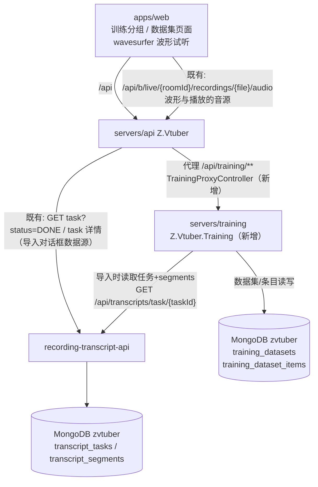
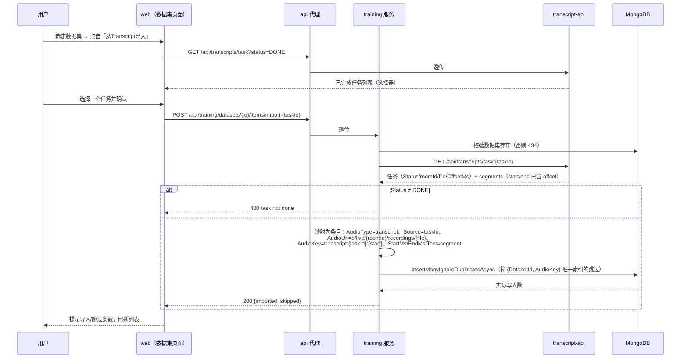

# AI 训练 - 音频数据集（第一期） - 技术提案

- 日期：2026-09-27
- 状态：待评审
- feat-branch：`feat/training-dataset`
- 关联文档：[PRD](../../product/draft/20260927-training-audio-dataset-prd.md)

## 1. 概述

### 1.1 背景

依据 PRD「AI 训练 - 音频数据集（第一期）」：Web 端新增「训练」分组与「数据集」入口，支持音频数据集的新建/重命名/删除、从识别完成的 Transcript 导入识别片段为音频数据、音频数据列表（七字段、四项可编辑、多选删除、按来源/类型分组）与波形试听校对。

现状勘察结论（均经读码确认）：

**① 识别数据齐备，「识别完成」与片段时间口径明确。**

- 任务实体 `servers/common/Persistence/Entities/TranscriptTaskRecord.cs:31-65`（集合 `transcript_tasks`）：`Status` 为 `PENDING/RUNNING/DONE/FAILED`（常量类 :6-12），**「识别完成」即 `Status == "DONE"`**；`OffsetMs` 为任务播放偏移（毫秒）；
- 片段实体 `servers/common/Persistence/Entities/TranscriptSegmentRecord.cs:6-20`（集合 `transcript_segments`）：`TaskId`/`StartTime`/`EndTime`（long，ms）/`Text`，唯一索引 `(TaskId, StartTime)`（`servers/common/Persistence/MongoDbInitializer.cs:972-979`）——**segment 无独立对外 id**，`(TaskId, StartTime)` 即其唯一标识依据；
- `GET /api/transcripts/task?status=DONE` 列已完成任务（`contracts/recording-transcript.openapi.yaml:87`）；`GET /api/transcripts/task/{taskId}` 返回任务 + 全量 segments，且 **segments 的 start/end 已叠加任务 OffsetMs**（`servers/recording-transcript-api/Contracts/TranscriptMapping.cs` `ToSegmentDto`）——导入直接消费该口径即天然「尊重 offset 设置」；
- 任务 DTO 携带 `roomId` 与 `file`（识别所用录播文件），是拼接音频地址的全部要素。

**② 音频试听能力已存在，区间切片端点可直接复用。**

- 音频片段端点 `GET /api/b/live/{roomId}/recordings/{fileName}/audio?startMs=&endMs=`（api 代理 `servers/api/Controllers/BilibiliLiveRecordingController.cs:224-280` → recording `servers/recording/Controllers/RecordingController.cs:129-178`）：ffmpeg 现切 `audio/mpeg`，**区间 ≤ 5 分钟硬约束**（`servers/recording/Configuration/RecordingOptions.cs:57` `AudioClipMaxDurationMs` 默认 300000），前端构造器 `apps/web/src/api/client.ts:153-161` `recordingAudioClipUrl`；
- 即「音频地址」可落为录播文件 uri `b/live/{roomId}/recordings/{fileName}`，试听 = 该 uri + `/audio?startMs&endMs`。

**③ 前端无路由库、无 UI 库、无波形库，导航为扁平菜单。**

- `apps/web/src/App.tsx:9-23`：`PageKey` 联合类型 + 扁平 `menuItems: {key, label, component}[]` + `useState` 切换，**无分组概念**——PRD 的「训练 label 分组」需要对菜单结构做最小扩展；
- 播放组件 `apps/web/src/pages/transcripts/SegmentAudioPlayer.tsx`（共享单例 `<audio>`）可复用思路，但**全仓库无波形库**，波形需新增依赖或自研（见 §6.1 决策 3）；
- API 调用为手写 `src/api/client.ts` + openapi-typescript codegen（`apps/web/package.json` `codegen` script 串联 6 个契约）。

**④ 持久层为 MongoDB（非 EF），新集合有固定做法。**

- 集合常量 `servers/common/Persistence/MongoDbInitializer.cs:8-33` + `Entities/XxxRecord` + `XxxRepository` + `EnsureIndexesAsync` 幂等建索引（参考 `EnsureTranscriptIndexesAsync` :934-989）；单库 `zvtuber`；
- 项目按领域拆服务（recording-transcript / cookie / notifier 各有独立服务 + 契约 + api 代理镜像 + AppHost 编排），api 网关代理模式见 `servers/api/Controllers/RecordingTranscriptProxyController.cs:13-147`。

### 1.2 目标

1. 新增独立 **training 服务**（`servers/training`，Z.Vtuber.Training）与契约 `contracts/training.openapi.yaml`：音频数据集的 CRUD、音频数据条目的查询/更新/批量删除、从 Transcript 导入；
2. MongoDB 新增 `training_datasets` 与 `training_dataset_items` 两个集合，音频标识 `AudioKey` 数据集内唯一，条目结构为后续情感识别/二次 ASR 预留扩展字段；
3. `servers/api` 增加 `/api/training/**` 代理镜像路由；`infra/apphost` 编排新服务；
4. `apps/web` 新增「训练」分组与「数据集」页面：Tab、数据集下拉管理、导入对话框、分组/多选列表、wavesurfer.js 波形试听；
5. 契约先行 + codegen，TDD 补齐后端接口测试与前端组件测试。

### 1.3 范围

- **内**：`servers/training`（新建）；`servers/common`（新实体/仓储/索引）；`contracts/training.openapi.yaml`（新建）+ `contracts/bilibili-crawler.openapi.yaml`（代理镜像）；`servers/api`（代理控制器）；`infra/apphost`（编排注册）；`apps/web`（菜单分组、数据集页面、codegen）；`tests/Z.Vtuber.Tests` 与 `apps/web` Vitest。
- **外**：识别过程（consumer/ASR）零改动；recording 服务音频片段端点零改动（5 分钟上限不变）；情感识别/二次 ASR 加工能力（仅预留扩展字段）；模型训练本身；更多 Tab 与音频类型的实际实现（仅结构预留）。

## 2. 技术架构

### 2.1 系统架构图



### 2.2 技术栈

| 层级 | 技术选型 | 说明 |
|------|---------|------|
| 后端 | C# (.NET 10) ASP.NET Core Controllers（新服务） | 与 recording-transcript-api 同模式（控制器 + 仓储 + DTO 映射） |
| 数据库 | MongoDB（`zvtuber` 库新增 2 集合） | 幂等建索引，无迁移 |
| 服务编排 | .NET Aspire（`infra/apphost`） | 注册 training 项目，注入 mongo 连接与 transcript-api 地址 |
| 前端 | React 19 + Vite + **wavesurfer.js**（新增依赖） | 波形绘制与播放；其余内联样式手写，无 UI 库 |
| 契约 | OpenAPI（`contracts/training.openapi.yaml`） | 手写契约先行，web `openapi-typescript` codegen |
| 测试 | xUnit + Testcontainers（后端）、Vitest + RTL（前端） | 沿用既有设施 |

### 2.3 模块划分

| 模块 | 职责 | 关键技术点 |
|------|------|-----------|
| `servers/training`（新建） | 数据集 CRUD、条目查询/更新/批量删除、Transcript 导入 | 控制器 + 仓储；导入时 HTTP 调 transcript-api |
| `servers/common`（变更） | `TrainingDatasetRecord` / `TrainingDatasetItemRecord` 实体、两个 Repository、索引 | `(DatasetId, AudioKey)` 唯一索引支撑导入去重 |
| `servers/api`（变更） | `/api/training/**` 代理镜像 | 复用 `ForwardAsync` 透传模式 |
| `infra/apphost`（变更） | 编排 training 服务 | mongo 连接 + `TranscriptService:BaseUrl` 注入 |
| `apps/web`（变更） | 菜单分组扩展、数据集页面、波形试听 | 菜单结构支持分组 label；wavesurfer.js |
| `contracts/`（变更） | training 契约 + api 镜像 + codegen | 契约先行 |

## 3. API 设计

### 3.1 API 契约（`contracts/training.openapi.yaml`，新建）

#### 接口 1: 数据集列表

- **请求** GET `/api/training/datasets?type=audio`
  | 参数 | 位置 | 必填 | 说明 |
  |------|------|------|------|
  | `type` | query | 是 | 数据集类型，本期固定 `audio`（预留其他模态 Tab） |
- **响应** 200 `TrainingDataset[]`（按 `CreatedAt` 升序）

#### 接口 2: 新建数据集

- **请求** POST `/api/training/datasets`
  ```json
  { "name": "示例数据集", "type": "audio" }
  ```
  | 字段 | 类型 | 必填 | 说明 |
  |------|------|------|------|
  | `name` | string | 是 | 数据集名字（trim 后非空，长度 ≤ 128） |
  | `type` | string | 是 | 本期固定 `audio` |
- **响应** 201 `TrainingDataset`；400 `{"error": "name is required"}`；409 `{"error": "dataset name exists"}`

#### 接口 3: 重命名数据集

- **请求** PUT `/api/training/datasets/{datasetId}`，Body `{ "name": "新名字" }`
- **响应** 200 `TrainingDataset`；400 名字非法；404 `{"error": "dataset not found"}`；409 重名

#### 接口 4: 删除数据集

- **请求** DELETE `/api/training/datasets/{datasetId}`
- **响应** 204；404。**级联删除该数据集全部条目**。

#### 接口 5: 条目列表

- **请求** GET `/api/training/datasets/{datasetId}/items?audioType=&source=`
  | 参数 | 位置 | 必填 | 说明 |
  |------|------|------|------|
  | `audioType` | query | 否 | 按音频类型过滤（如 `transcript`），支撑「按类型分组」 |
  | `source` | query | 否 | 按音频来源过滤（如某 transcript taskId），支撑「按来源分组」 |
- **响应** 200 `TrainingDatasetItem[]`（按 `CreatedAt`/`AudioKey` 升序；本期不分页，数据集量级为千级，见 §6.1 决策 6）

#### 接口 6: 从 Transcript 导入

- **请求** POST `/api/training/datasets/{datasetId}/items/import`
  ```json
  { "taskId": "66d8..." }
  ```
- **响应** 200 `{"imported": 123, "skipped": 4}`；
  400 `{"error": "task not done"}`（任务存在但 Status ≠ DONE）；
  404 `{"error": "dataset not found"}` / `{"error": "task not found"}`；
  502 `{"error": "transcript service unavailable"}`

#### 接口 7: 更新条目

- **请求** PUT `/api/training/datasets/{datasetId}/items/{itemId}`
  ```json
  { "audioUri": "b/live/123/recordings/a.flv", "text": "修订文本", "startMs": 1200, "endMs": null }
  ```
  | 字段 | 类型 | 必填 | 说明 |
  |------|------|------|------|
  | `audioUri` | string | 否 | 音频地址（transcript 类型为录播文件 uri），可修改 |
  | `text` | string | 否 | 文本 |
  | `startMs` | integer(int64) | 否 | 开始时间（毫秒，≥ 0） |
  | `endMs` | integer(int64) \| null | 否 | 结束时间；`null` 表示置空（到音频末尾） |
  未提供的字段保持不变；`endMs` 非空时须 `> startMs`（startMs 取提交值或现值）。
- **响应** 200 `TrainingDatasetItem`；400 `{"error": "invalid time range"}` 等；404

#### 接口 8: 批量删除条目

- **请求** POST `/api/training/datasets/{datasetId}/items/batch-delete`
  ```json
  { "itemIds": ["66d8...", "66d9..."] }
  ```
- **响应** 200 `{"deleted": 2}`；404 dataset 不存在

#### schema 定义

```yaml
TrainingDataset:
  properties:
    id: { type: string }
    name: { type: string }
    type: { type: string, description: 数据集类型，本期固定 audio }
    createdAt: { type: string, format: date-time }
    updatedAt: { type: string, format: date-time }

TrainingDatasetItem:
  properties:
    id: { type: string }
    datasetId: { type: string }
    audioType: { type: string, description: 音频类型，本期支持 transcript }
    source: { type: string, description: 音频来源（transcript 类型 = 识别任务 id） }
    audioUri: { type: string, description: 音频地址；transcript 类型为录播文件 uri（b/live/{roomId}/recordings/{fileName}） }
    audioKey: { type: string, description: 数据集内唯一的音频标识，带类型前缀：transcript:{taskId}:{startMs} }
    startMs: { type: integer, format: int64, description: 基于音频地址的开始时间（毫秒），默认 0 }
    endMs: { type: integer, format: int64, nullable: true, description: 基于音频地址的结束时间（毫秒），null = 到音频末尾 }
    text: { type: string }
    extensions: { type: object, additionalProperties: true, nullable: true, description: 扩展信息承载（预留：情感识别/二次 ASR 等加工结果） }
    createdAt: { type: string, format: date-time }
    updatedAt: { type: string, format: date-time }
```

#### 代理镜像（api 服务，`contracts/bilibili-crawler.openapi.yaml`）

- `/api/training/**` 全量镜像（与 transcript 代理同口径，参考 `20260927-proposal-transcript-playback-offset` §3.1）：上述 8 个端点逐个镜像，body/状态码透传，上游不可达 502 `{"error": "training service unavailable"}`。

### 3.2 内部接口

- **仓储**（`servers/common/Persistence/`）：

  ```csharp
  // TrainingDatasetRepository
  Task<List<TrainingDatasetRecord>> ListAsync(string type, CancellationToken ct = default);
  Task<TrainingDatasetRecord> InsertAsync(TrainingDatasetRecord record, CancellationToken ct = default); // 重名抛 DuplicateKey → 409
  Task<bool> RenameAsync(ObjectId id, string name, CancellationToken ct = default);
  Task<bool> DeleteAsync(ObjectId id, CancellationToken ct = default);

  // TrainingDatasetItemRepository
  Task<List<TrainingDatasetItemRecord>> ListAsync(ObjectId datasetId, string? audioType = null, string? source = null, CancellationToken ct = default);
  Task InsertManyIgnoreDuplicatesAsync(IEnumerable<TrainingDatasetItemRecord> items, CancellationToken ct = default); // 导入：按 (DatasetId, AudioKey) 唯一索引跳过重复
  Task<TrainingDatasetItemRecord?> UpdateAsync(ObjectId datasetId, ObjectId itemId, UpdateDefinition<TrainingDatasetItemRecord> update, CancellationToken ct = default);
  Task<long> DeleteManyAsync(ObjectId datasetId, IEnumerable<ObjectId> itemIds, CancellationToken ct = default);
  Task<long> DeleteByDatasetAsync(ObjectId datasetId, CancellationToken ct = default); // 级联删除
  ```

- **transcript-api 客户端**（`servers/training/Clients/TranscriptApiClient.cs`）：`GetTaskDetailAsync(taskId)` → 任务 + segments（参考 `servers/recording-transcript-api/Clients/RecordingFileStatsClient.cs` 的 HttpClient 封装模式）；BaseUrl 配置 `TranscriptService:BaseUrl`，默认 `http://recording-transcript-api`。

## 4. 数据模型

### 4.1 数据库设计

#### 集合: `training_datasets`（新增）

| 字段 | 类型 | 说明 |
|------|------|------|
| `Id` | ObjectId | 主键 |
| `Name` | string | 数据集名字 |
| `Type` | string | 数据集类型，本期固定 `audio` |
| `CreatedAt` / `UpdatedAt` | DateTime(UTC) | |

索引：`(Type, Name)` 唯一（重名天然 409）；按 `_id` 主键。

#### 集合: `training_dataset_items`（新增）

| 字段 | 类型 | 说明 |
|------|------|------|
| `Id` | ObjectId | 主键 |
| `DatasetId` | ObjectId | 所属数据集 |
| `AudioType` | string | 音频类型，本期支持 `transcript`（开放枚举，新类型加新值） |
| `Source` | string | 音频来源（transcript 类型 = 识别任务 id） |
| `AudioUri` | string | 音频地址；transcript 类型 = `b/live/{roomId}/recordings/{fileName}`，可修改 |
| `AudioKey` | string | **音频标识，数据集内唯一**，格式 `{type}:{sourceSegmentId}`；transcript = `transcript:{taskId}:{startMs}`（segment 无对外 id，以 `(TaskId, StartTime)` 唯一索引为标识依据，见 §1.1①） |
| `StartMs` | long | 开始时间（毫秒），默认 0 |
| `EndMs` | long? | 结束时间（毫秒），`null` = 到音频末尾 |
| `Text` | string | 文本 |
| `Extensions` | BsonDocument? | **扩展字段（预留）**：未来情感识别、二次 ASR 等加工结果按键名挂接（如 `{"emotion": {...}}`），无需改表结构 |
| `CreatedAt` / `UpdatedAt` | DateTime(UTC) | |

索引：`(DatasetId, AudioKey)` **唯一**（导入去重与标识唯一性的实现基础）；`(DatasetId, AudioType)`、`(DatasetId, Source)`（分组/过滤查询）。

- 新集合按既有模式落地：`MongoCollectionNames` 加常量 + `MongoDbInitializer.EnsureTrainingIndexesAsync` 幂等建索引；无存量数据迁移。

### 4.2 缓存设计

无缓存：数据集与条目均为低频管理操作，每次现读。

## 5. 技术实现方案

### 5.1 核心流程

#### 流程 1: 从 Transcript 导入



注：segments 的 start/end 为「落库时间 + OffsetMs」（§1.1①），导入即尊重 offset；`file` 为空时 AudioUri 置空串，条目照常导入、试听提示不可用（PRD 边界情况）。

#### 流程 2: 波形试听

```mermaid
flowchart LR
    L[点击列表条目] --> P[解析 AudioUri + StartMs/EndMs]
    P --> C{EndMs 为空?}
    C -->|否| U1[clip url: /audio?startMs=StartMs&endMs=EndMs]
    C -->|是| U2[clip url: startMs=StartMs<br/>endMs=StartMs+5min 预览上限]
    U1 --> WS[wavesurfer.js 加载音频<br/>绘制波形]
    U2 --> WS
    WS --> PLAY[波形上播放/暂停/ seek]
```

### 5.2 关键实现点

#### 实现点 1: training 服务骨架（servers/training）

- 新建 `servers/training/Z.Vtuber.Training.csproj` + `Program.cs`（top-level hosting + `app.MapControllers()`，参考 `servers/api/Program.cs:1-92`）：`builder.AddMongoDBClient("mongo")` + `IMongoDatabase` 单例 + 两个 Repository 单例 + `TranscriptApiClient`（`TranscriptService:BaseUrl`，默认 `http://recording-transcript-api`）；启动跑 `MongoDbInitializer.EnsureTrainingIndexesAsync`；`/health` 端点；本地端口 8086；
- `Controllers/TrainingDatasetsController.cs`：接口 1-4；`Controllers/TrainingDatasetItemsController.cs`：接口 5-8；`Contracts/Dtos.cs` + `Contracts/TrainingMapping.cs`（record ↔ DTO）；
- 解决方案注册：`servers/Z.Vtuber.slnx` 增加项目；`tests/Z.Vtuber.Tests` 增加引用。

#### 实现点 2: 数据层（servers/common）

- `MongoCollectionNames` 增加 `TrainingDatasets` / `TrainingDatasetItems`；`Entities/TrainingDatasetRecord.cs`、`Entities/TrainingDatasetItemRecord.cs`；两个 Repository；`MongoDbInitializer` 增加 `EnsureTrainingIndexesAsync`（三个索引，幂等 `CreateOneAsync`）；
- 导入去重实现：`InsertManyAsync(..., new InsertManyOptions { IsOrdered = false })` 捕获 `MongoBulkWriteException`，按成功写入数得 `imported`，`skipped = 提交数 - imported`（与既有 Mongo 用法一致，避免逐条 upsert）。

#### 实现点 3: 导入逻辑（TrainingDatasetItemsController）

- 数据集不存在 → 404 `dataset not found`；`ObjectId.TryParse(taskId)` 失败或任务不存在 → 404 `task not found`；`Status != DONE` → 400 `task not done`；transcript-api 不可达 → 502；
- 映射见流程 1；`AudioKey = $"transcript:{taskId}:{segment.Start}"`（segment.Start 为偏移后值？——**取原始唯一性口径**：由于同任务内平移是单射，偏移后与原始一一对应，用偏移后 start 仍唯一且与展示口径一致，此处统一用返回的 start；详见 §6.1 决策 4）；
- Info 日志：`training dataset import: datasetId={} taskId={} imported={} skipped={}`。

#### 实现点 4: api 代理镜像（servers/api）

- 新增 `Controllers/TrainingProxyController.cs`（参照 `RecordingTranscriptProxyController.cs:13-147`）：`/api/training/**` 各端点镜像，`ForwardAsync` 透传；`Program.cs` 增加 `TrainingService:BaseUrl`（默认 `http://training`）HttpClient 注册。

#### 实现点 5: AppHost 编排（infra/apphost）

- `infra/apphost/AppHost.cs`：`AddProject<Projects.Z_Vtuber_Training>("training")`，`.WithReference(mongo)`，`.WithEnvironment("TranscriptService__BaseUrl", ...)` 指向 transcript-api 端点；aspire 项目引用与 `Z.Vtuber.slnx` 同步。

#### 实现点 6: web 菜单分组（apps/web）

- `apps/web/src/App.tsx`：`menuItems` 由扁平数组扩展为「分组」结构（`{ group?: string, items: {key, label, component}[] }`），既有菜单项归入默认区（渲染不变），新增分组 `训练` → 项 `数据集`；`PageKey` 增加 `training-datasets`；同步 `App.test.tsx` 与 `apps/web/AGENTS.md` 目录说明。

#### 实现点 7: 数据集页面（apps/web）

- `src/pages/training/DatasetsPage.tsx`：Tab 栏（`role="tablist"`，参考 `TranscriptsPage.tsx:5-44`），本期仅「音频数据集」Tab；
- `src/pages/training/DatasetSelector.tsx`：下拉框 + 新建（prompt 输入名字）/重命名/删除（confirm 二次确认）；
- `src/pages/training/TranscriptImportDialog.tsx`：拉取 `status=DONE` 任务列表选择，确认后调 import，展示 `{imported, skipped}` 反馈；
- `src/pages/training/DatasetItemList.tsx`：七字段表格；勾选多选 + 批量删除（confirm）；分组切换（不分组/按来源/按类型），分组头勾选该组全部（客户端按 `source`/`audioType` 聚合，数据一次拉全）；
- `src/pages/training/DatasetItemWaveform.tsx`：选中条目后挂载 wavesurfer.js，url 用 `recordingAudioClipUrl` 思路由 `audioUri` + `startMs/endMs` 拼接（`endMs` 为空取 `startMs + 300000` 预览上限，见 §6.1 决策 5）；加载失败提示「音频不可用」不阻断；
- `src/api/client.ts` 增加 training 各端点封装；`package.json` codegen script 追加 `training` 契约；编辑控件复用内联样式模式，时间输入为 `m:ss` 文本框 + 毫秒互转（复用 `src/utils/format.ts` `formatPosition` 思路）。

### 5.3 不在本期的事项

- 情感识别、二次 ASR 等加工能力（`Extensions` 字段仅预留）；
- 更多数据集 Tab（其他模态）与更多音频类型的实际实现；
- 条目分页/虚拟滚动（本期千级数据量全量返回，见 §6.1 决策 6）；
- recording 音频片段端点 5 分钟上限的调整；
- 数据集导出/训练任务对接。

## 6. 技术决策

### 6.1 决策列表

| 决策 | 选项 A | 选项 B | 选项 C | 最终选择 | 原因 |
|------|--------|--------|--------|---------|------|
| 模块归属 | 新建独立 `servers/training` 服务 | 直接写进 `servers/api` | 塞进 recording-transcript-api | **A** | 项目按领域拆服务是既有惯例（cookie/notifier/recording-transcript 均独立 + 契约 + 代理 + AppHost）；训练域后续要长（情感识别、二次 ASR、训练任务），独立服务边界清晰；api 保持纯网关 |
| 音频标识（AudioKey）设计 | `{type}:{sourceSegmentId}` 字符串，唯一索引 `(DatasetId, AudioKey)` | ObjectId 作标识 | 复合唯一索引 `(DatasetId, Type, Source, StartMs)` | **A** | PRD 明确要求「带前缀、数据集内唯一」的可见标识；字符串前缀天然支撑未来新类型；segment 无对外 id，以 `transcript:{taskId}:{startMs}` 承接 `(TaskId, StartTime)` 唯一性 |
| 波形实现 | 引入 wavesurfer.js | 手写 Web Audio API decode + canvas | 不画波形只播放 | **A** | 自研波形（解码、绘制、seek 交互）成本高且易出边界 bug；wavesurfer.js 是该场景事实标准、体积小；C 不满足 PRD「展示波形」 |
| AudioKey 中 segment 时间口径 | 偏移后 start（返回值口径） | 原始落库 start | | **A** | 平移是单射，两口径唯一性等价；返回值口径与试听/展示一致，排查问题更直观；且导入端无需感知 OffsetMs 细节 |
| EndMs 为空的试听处理 | 预览截取 `startMs + 5min` | 拉整文件自行截 | 拒绝播放 | **A** | 片段端点 5 分钟是硬约束（`AudioClipMaxDurationMs`）；「空=到末尾」的完整语义待导出/加工场景再解，本期试听以预览上限兜底并在界面标注 |
| 条目列表分页 | 全量返回 + 前端分组 | 服务端分页 | | **A** | 单数据集量级为千级（整场识别片段数百到数千），全量返回实现最简且分组/多选/全选在前端零成本；超出量级再加分页（契约预留 query 扩展位） |
| 数据集删除 | 级联删除条目 | 仅删数据集留孤儿条目 | 软删除 | **A** | PRD 明确「删除后数据一并清除」；无回收站需求，二次确认即可 |
| 批量删除端点形式 | POST `items/batch-delete` | DELETE with body | | **A** | DELETE 带 body 在代理/网关链路兼容性差；POST 动作端点与既有代理透传模式零摩擦 |

### 6.2 依赖与约束

| 类型 | 内容 | 说明 |
|------|------|------|
| 依赖 | recording-transcript-api 的任务列表/详情端点 | 导入数据源；segments 时间已含 OffsetMs |
| 依赖 | recording 服务音频片段端点 | 波形与试听的音源；5 分钟上限为既有约束 |
| 约束 | 契约先行 | 先写 `contracts/training.openapi.yaml`（+ api 镜像契约），再改实现（common-rules） |
| 约束 | 不改 consumer/ASR 链路与 transcript 既有端点 | 训练模块只读 transcript 数据 |
| 约束 | 新增 1 个 npm 依赖（wavesurfer.js）；无新增 NuGet 依赖 | |
| 约束 | .NET 10、TDD、核心逻辑覆盖率 ≥ 80% | 项目既有规范 |

## 7. 项目结构

```
contracts/（变更）
├── training.openapi.yaml                     # 新增：数据集/条目/导入 8 端点 + schema
└── bilibili-crawler.openapi.yaml             # + /api/training/** 代理镜像端点

servers/training/（新建，Z.Vtuber.Training）
├── Z.Vtuber.Training.csproj
├── Program.cs                                # mongo/仓储/TranscriptApiClient 注册，/health
├── Controllers/TrainingDatasetsController.cs # 接口 1-4（CRUD + 级联删除）
├── Controllers/TrainingDatasetItemsController.cs # 接口 5-8（列表/导入/更新/批量删除）
├── Clients/TranscriptApiClient.cs            # GET task 详情（校验 DONE + 取 segments）
├── Contracts/Dtos.cs / TrainingMapping.cs
└── Configuration/TrainingOptions.cs          # TranscriptService:BaseUrl 等

servers/common/（变更）
├── Persistence/MongoDbInitializer.cs         # + 集合常量 + EnsureTrainingIndexesAsync
├── Persistence/Entities/TrainingDatasetRecord.cs
├── Persistence/Entities/TrainingDatasetItemRecord.cs
├── Persistence/TrainingDatasetRepository.cs
└── Persistence/TrainingDatasetItemRepository.cs

servers/api/（变更）
└── Controllers/TrainingProxyController.cs    # /api/training/** 镜像转发

infra/apphost/（变更）
└── AppHost.cs                                # 注册 training（mongo + transcript-api 地址注入）

apps/web/src/（变更）
├── api/schema-training.d.ts                  # codegen 生成（勿手改）
├── api/client.ts                             # + training 端点封装
├── App.tsx                                   # 菜单分组结构 + 训练/数据集入口
└── pages/training/
    ├── DatasetsPage.tsx                      # Tab 容器
    ├── DatasetSelector.tsx                   # 下拉 + 新建/重命名/删除
    ├── TranscriptImportDialog.tsx            # 选 DONE 任务导入 + 结果反馈
    ├── DatasetItemList.tsx                   # 七字段列表、多选、批量删除、分组
    └── DatasetItemWaveform.tsx               # wavesurfer 波形 + 播放

tests/Z.Vtuber.Tests/（变更）
├── TrainingDatasetsApiTests.cs               # CRUD、重名 409、级联删除
├── TrainingDatasetItemsApiTests.cs           # 列表过滤、更新校验、批量删除
├── TrainingImportApiTests.cs                 # 导入成功/去重/非 DONE 400/404/502
└── TrainingProxyControllerTests.cs           # 镜像路由透传

apps/web/src/pages/training/（新增测试）
├── DatasetsPage.test.tsx
├── DatasetItemList.test.tsx                  # 多选/分组/批量删除
└── DatasetItemWaveform.test.tsx              # url 拼接（含 endMs 空兜底）
```

## 8. 测试策略

### 8.1 测试覆盖要求

- 核心逻辑（导入映射与去重、时间校验、AudioKey 生成、试听 url 拼接）覆盖率 ≥ 80%（common-rules）；
- TDD：契约先行后按红-绿推进。

### 8.2 测试类型

| 类型 | 工具 | 覆盖范围 |
|------|------|---------|
| 单元测试 | xUnit | 映射（record↔DTO）、AudioKey 生成、时间范围校验 |
| 接口测试 | xUnit + Testcontainers（Mongo）+ WebApplicationFactory | 8 个端点全链路；导入去重（唯一索引）；级联删除 |
| 契约测试 | 既有契约检查模式 | training 契约与实现一致；镜像契约一致 |
| 前端组件测试 | Vitest + RTL + jsdom | 菜单分组渲染、数据集管理交互、导入反馈、列表多选/分组、波形 url 拼接 |

关键用例清单：

- **数据集 CRUD**：新建 201、重名 409、重命名 200/409、删除 204 且条目级联清空、type 过滤；
- **导入**：DONE 任务 → 条目字段逐项正确（含 AudioUri/AudioKey/起止/文本）、offset ≠ 0 任务导入时间为偏移后口径；重复导入 `imported=0, skipped=N`；PENDING/RUNNING/FAILED 任务 → 400；taskId 非法/不存在 → 404；transcript-api 不可达 → 502；`file` 为空条目照常导入；
- **条目更新**：四字段单独/组合更新、`endMs=null` 置空、`endMs <= startMs` → 400、负 startMs → 400、未提供字段不变；
- **批量删除**：部分 id 不存在仍删其余、返回 deleted 数；
- **代理**：training 镜像路由 200/400/404/502 透传；
- **web**：「训练」分组出现且含「数据集」；新建/重命名/删除交互；导入对话框仅列 DONE 任务且反馈数量；列表按来源/类型分组与分组全选；多选批量删除；波形 url（`endMs` 空 → `startMs+300000`）；音频加载失败提示不阻断。

## 9. 部署方案

### 9.1 环境规划

| 环境 | 用途 | 部署方式 |
|------|------|---------|
| AppHost（Aspire）本地编排 | 开发联调 | 新增 training 编排项（mongo + transcript-api 地址） |
| 生产 | 随常规版本发布 | 先部署 training 服务，再 api 代理，最后 web；均为纯新增面，旧版本无感知 |

### 9.2 配置管理

- 新增配置：`TranscriptService:BaseUrl`（training 服务，默认 `http://recording-transcript-api`）、`TrainingService:BaseUrl`（api 服务，默认 `http://training`）；沿用 `ConnectionStrings:mongo`；
- 数据初始化：启动幂等建 3 个索引，无迁移；
- 回滚：按整体版本回退；`training_*` 集合残留无害（无外键侵入既有集合）。

## 10. 验收标准

- [ ] 技术方案评审通过；契约评审通过
- [ ] 导航出现「训练」label 分组与「数据集」入口，数据集页面仅「音频数据集」Tab
- [ ] 音频数据集可新建（仅名字）/重命名/删除，重名 409，删除级联清条目
- [ ] 选定数据集后可从识别完成（DONE）的 Transcript 导入；导入条目字段正确且尊重 offset；重复导入去重并反馈 imported/skipped
- [ ] 条目七字段正确展示；audioUri/text/startMs/endMs 可编辑（含 endMs 置空），非法时间 400
- [ ] 点击条目展示波形并可按起止区间播放；音频不可用有提示
- [ ] 列表支持多选批量删除与按来源/按类型分组（分组可全选）
- [ ] `(DatasetId, AudioKey)` 唯一约束生效；既有 transcript/试听功能回归不回退
- [ ] 契约 codegen 一致；单测/接口测试通过，核心逻辑覆盖率 ≥ 80%

## 11. 相关文档

- PRD：`docs/product/draft/20260927-training-audio-dataset-prd.md`
- 直播录播语音转写技术提案：`docs/engineering/proposals/20260916-proposal-recording-transcript.md`
- 识别结果播放偏移技术提案：`docs/engineering/proposals/20260927-proposal-transcript-playback-offset.md`
- 既有契约：`contracts/recording-transcript.openapi.yaml`、`contracts/bilibili-crawler.openapi.yaml`
- 规范：`docs/engineering/common-rules.md`、`docs/engineering/backend-rules.md`、`docs/engineering/frontend-rules.md`
