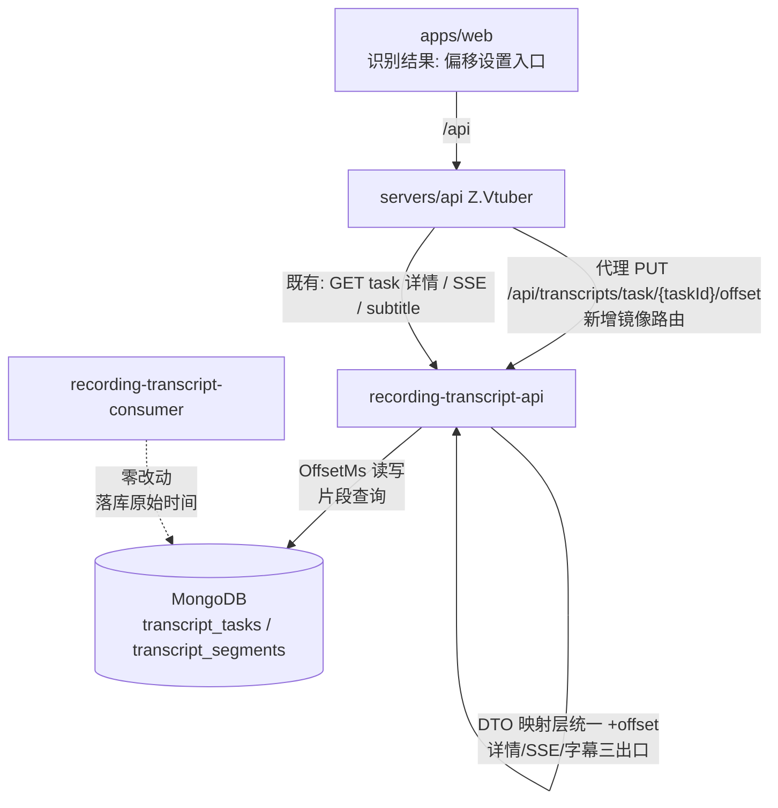
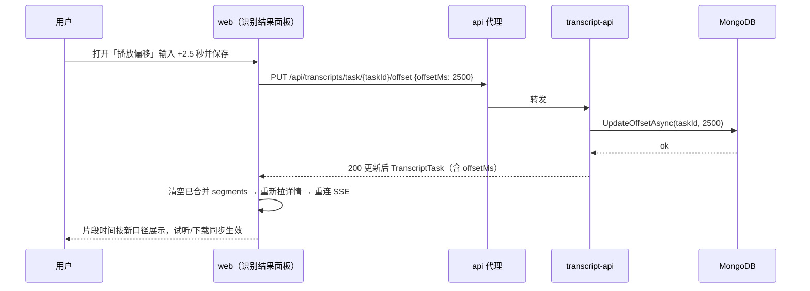
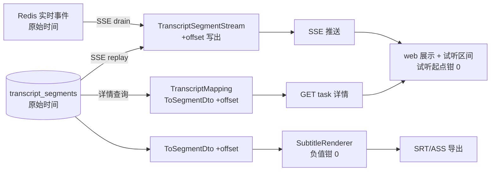

# 识别结果播放偏移（Offset） - 技术提案

- 日期：2026-09-27
- 状态：待评审
- feat-branch：`feat/transcript-playback-offset`
- 关联文档：[PRD](../../product/draft/20260927-transcript-playback-offset-prd.md)

## 1. 概述

### 1.1 背景

依据 PRD「识别结果播放偏移」：识别结果的时间轴可能与录播实际内容存在系统性固定偏差（识别音频源与录播文件之间的时间差），需要支持**针对单场识别任务**设置可正可负的播放偏移，统一作用于 web 识别结果的展示时间、语音试听区间与 SRT/ASS 字幕导出时间轴。

现状勘察结论（均经读码确认）：

**① 片段落库时间为「整场录播时间轴」，不含展示偏移概念。**

- 片段实体 `servers/common/Persistence/Entities/TranscriptSegmentRecord.cs`（集合 `transcript_segments`）：`StartTime`/`EndTime`（long，ms）/ `Text`，唯一索引 `(TaskId, StartTime)`（`servers/common/Persistence/MongoDbInitializer.cs:972-979`），查询按 `StartTime` 升序（`servers/common/Persistence/TranscriptSegmentRepository.cs:19-23`）；
- 全仓库检索 `offset` 仅有 consumer 侧**断点续跑 offset**（ASR 输入偏移：`servers/recording-transcript-consumer/Asr/AliFunAsrService.cs:13,20-24`、`servers/recording-transcript-consumer/Asr/FunAsrProtocol.cs:154-182` 落库时间 = ASR 返回时间 + 起始 offset），**不存在任何「播放/展示偏移」概念**；
- 任务实体 `servers/common/Persistence/Entities/TranscriptTaskRecord.cs:31-62`（集合 `transcript_tasks`）无 offset 相关字段。

**② offset 的三个作用点共用同一份 DTO 映射，单点注入即可全覆盖。**

- 任务详情查询：`servers/recording-transcript-api/Controllers/TranscriptTasksController.cs:159` `segmentList.Select(TranscriptMapping.ToSegmentDto)`；
- 字幕导出：`servers/recording-transcript-api/Controllers/TranscriptSubtitleController.cs:63` 同样经 `TranscriptMapping.ToSegmentDto`（`servers/recording-transcript-api/Contracts/TranscriptMapping.cs:42-43`）→ `SubtitleRenderer` 渲染（负值已钳 0，`Subtitles/SubtitleRenderer.cs` `FormatSrtTimestamp`）；
- SSE 实时推送：`servers/recording-transcript-api/Sse/TranscriptSegmentStream.cs` 直接写出原始 `segment.StartTime/EndTime`（replay，:67）与 `evt.Start/evt.End`（实时事件，:140），不经过 `TranscriptMapping`；
- web 试听播放区间直接取展示用 `segment.start/end` 作为录播文件毫秒区间（`apps/web/src/pages/transcripts/SegmentAudioPlayer.tsx:101` → `recordingAudioClipUrl`，`apps/web/src/api/client.ts:153-161`）——**展示时间与播放区间同口径**，偏移作用于返回值后，播放自动跟随。

**③ offset 变更与「以 start 为键去重」链路的相互影响需要显式处理。**

- 后端 SSE 去重键为原始 `StartTime`（`TranscriptSegmentStream.cs:33,135`）；web 端 `mergeSegments` 以 `segment.start` 为 Map key 去重（`apps/web/src/pages/transcripts/TaskListTab.tsx:63-75`）。若 offset 变更后不重置前端已合并的片段缓存，旧口径与新口径片段会并存重复。

### 1.2 目标

1. `transcript_tasks` 增加任务级播放偏移字段 `OffsetMs`（long，毫秒，可正可负，默认 0），提供按任务设置/修改偏移的 API；
2. 任务详情查询、SSE 实时推送、SRT/ASS 字幕导出三个出口统一应用偏移：对外返回的片段时间 = 落库时间 + OffsetMs；
3. web 识别结果面板提供播放偏移设置入口，保存后即时刷新（展示/试听/重新下载字幕均为新口径）；
4. 契约（`contracts/recording-transcript.openapi.yaml`）先行并同步 web codegen，TDD 补齐单测/接口测试/组件测试。

### 1.3 范围

- **内**：`servers/common` 任务实体与仓储（OffsetMs 字段 + 更新方法）；`servers/recording-transcript-api` 偏移设置端点、三出口偏移应用；`servers/api` 代理镜像路由；`apps/web` 偏移设置交互与偏移生效刷新；`contracts/recording-transcript.openapi.yaml` 与 web codegen；`tests/Z.Vtuber.Tests` 与 `apps/web` Vitest 测试。
- **外**：识别过程（consumer/ASR 链路）零改动——偏移不改变落库数据与断点续跑语义；片段级偏移、非线性时间轴校正；其他服务（crawler/notifier/cookie/recording）零改动。

## 2. 技术架构

### 2.1 系统架构图



### 2.2 技术栈

| 层级 | 技术选型 | 说明 |
|------|---------|------|
| 后端 | C# (.NET 10) ASP.NET Core（既有服务改造） | 与既有端点同模式（控制器 + 仓储 + 纯函数映射） |
| 数据库 | MongoDB（既有 `transcript_tasks` 集合加字段） | 无新集合、无索引变更、无迁移 |
| 前端 | React 19 + Vite（既有） | 内联样式手写控件，不新增依赖 |
| 契约 | OpenAPI（`contracts/recording-transcript.openapi.yaml`） | 手写契约先行，web `openapi-typescript` codegen |
| 测试 | xUnit + Testcontainers（后端）、Vitest + RTL（前端） | 沿用既有设施 |

### 2.3 模块划分

| 模块 | 职责 | 关键技术点 |
|------|------|-----------|
| `servers/common`（变更） | `TranscriptTaskRecord.OffsetMs` 字段 + 仓储更新方法 | Mongo 旧文档缺字段反序列化为 0（天然兼容） |
| `servers/recording-transcript-api`（变更） | PUT offset 端点；详情/SSE/字幕三出口应用偏移 | DTO 映射层注入；SSE 流内读取任务偏移 |
| `servers/api`（变更） | PUT offset 代理镜像路由 | 复用 `ForwardAsync`（PUT 已支持 body 透传） |
| `apps/web`（变更） | 偏移设置入口、保存后重置刷新、试听负值钳制 | offset 变更后清空已合并 segments 并重连 SSE |
| `contracts/`（变更） | 契约 + codegen | 新增端点 + schema 字段 + 语义注释更新 |

## 3. API 设计

### 3.1 API 契约

#### 接口 1: 设置识别任务播放偏移（transcript-api，`contracts/recording-transcript.openapi.yaml`）

- **请求**
  - Method: PUT
  - Path: `/api/transcripts/task/{taskId}/offset`
  - Body（`UpdateTranscriptTaskOffsetRequest`）：
    ```json
    {
      "offsetMs": 2500
    }
    ```
    | 字段 | 类型 | 必填 | 说明 |
    |------|------|------|------|
    | `offsetMs` | integer(int64) | 是 | 播放偏移（毫秒，可正可负）：正值=识别结果整体提前需后移；取值范围 ±86400000（24 小时），超出 400 |

- **响应**
  - Status: 200 — Body 为更新后的 `TranscriptTask`（含 `offsetMs`）
  - Status: 400 `{"error": "offsetMs out of range"}` — 超出范围或 body 非法
  - Status: 404 `{"error": "task not found"}` — taskId 非法或任务不存在

#### 接口 1 代理镜像（api 服务，`contracts/bilibili-crawler.openapi.yaml`）

- **请求** PUT `/api/transcripts/task/{taskId}/offset`（body 原样透传）
- **响应** 200 / 400 / 404 透传；上游不可达 502 `{"error": "transcript service unavailable"}`（现状口径）。

#### 既有 schema 变更（`contracts/recording-transcript.openapi.yaml`）

- `TranscriptTask` 增加字段：
  ```yaml
  offsetMs:
    type: integer
    format: int64
    description: 播放偏移（毫秒，可正可负，默认 0）；segments 的 start/end、SSE 与字幕导出均为「落库时间 + offsetMs」
  ```
- `TranscriptSegment.start/end` 的 description 更新为「含任务播放偏移的展示时间（毫秒）= 整场录播时间轴（含续跑 offset）+ 任务播放偏移」，**数值语义从「原始时间」变为「偏移后展示时间」**（见 §6.1 决策 2）。

### 3.2 内部接口

- **仓储**（`servers/common/Persistence/TranscriptTaskRepository.cs`）：

  ```csharp
  /// <summary>更新任务播放偏移并刷新 UpdatedAt；任务不存在返回 false。</summary>
  Task<bool> UpdateOffsetAsync(ObjectId taskId, long offsetMs, CancellationToken ct = default);
  ```

- **映射**（`servers/recording-transcript-api/Contracts/TranscriptMapping.cs`）：

  ```csharp
  // ToTaskDto 增加 offsetMs 输出
  // ToSegmentDto 增加 offset 参数（默认 0，调用方显式传入任务偏移）
  public static TranscriptSegmentDto ToSegmentDto(TranscriptSegmentRecord segment, long offsetMs = 0) =>
      new(segment.StartTime + offsetMs, segment.EndTime + offsetMs, segment.Text);
  ```

  **映射层不钳制负值**（平移是单射，保持 `start` 唯一性不被破坏）；钳制由消费侧负责：字幕渲染（既有负值钳 0）、web 试听起点（钳 0）。

## 4. 数据模型

### 4.1 数据库设计

#### 集合: `transcript_tasks`（变更）

| 字段 | 类型 | 说明 |
|------|------|------|
| `OffsetMs` | long | **新增**。播放偏移（毫秒，可正可负）；缺省/旧文档为 0，行为与现状一致 |

- 无新集合、无索引变更、无数据迁移：MongoDB 反序列化旧文档时缺字段取 C# 默认值 0；
- `transcript_segments` **零改动**：偏移不落库到片段，`(TaskId, StartTime)` 唯一索引与 consumer 写入、断点续跑（`Position`）语义全部不受影响。

### 4.2 缓存设计

无缓存：偏移为任务级持久字段，每次查询现读；SSE 流在建立时读取一次任务偏移（见 §5.2 实现点 3）。

## 5. 技术实现方案

### 5.1 核心流程

#### 流程 1: 设置偏移



#### 流程 2: 偏移作用于三出口



### 5.2 关键实现点

#### 实现点 1: 任务实体与仓储（servers/common）

- `TranscriptTaskRecord` 增加 `public long OffsetMs { get; set; }`（默认 0）；
- `TranscriptTaskRepository` 增加 `UpdateOffsetAsync`：`UpdateOneAsync` Set `OffsetMs` + `UpdatedAt = DateTime.UtcNow`，按 `MatchedCount` 返回是否存在；
- 创建任务处（`TranscriptTasksController.Enqueue`、`TranscriptEnqueueService.EnsureTaskAsync`）不显式赋值，走默认值 0。

#### 实现点 2: PUT offset 端点（recording-transcript-api）

- `TranscriptTasksController` 增加 `[HttpPut("api/transcripts/task/{taskId}/offset")]`：
  - `ObjectId.TryParse` 失败 → 404（与既有端点同口径）；
  - `offsetMs` 超出 ±86400000 → 400 `{"error": "offsetMs out of range"}`；
  - `UpdateOffsetAsync` 返回 false → 404；
  - 成功 → 重读任务返回 `ToTaskDto`（含 `offsetMs`），Info 日志 `transcript task offset updated: taskId={TaskId} offsetMs={OffsetMs}`。

#### 实现点 3: 三出口应用偏移（recording-transcript-api）

- **任务详情**：`TranscriptTasksController` 详情 action（:159）传入 `task.OffsetMs` 到 `ToSegmentDto`；
- **字幕导出**：`TranscriptSubtitleController`（:63）同样传入任务 `OffsetMs`；`SubtitleRenderer` 负值钳 0 为既有行为，不变；
- **SSE**：`TranscriptSegmentStream.StreamAsync` 在订阅建立后读取一次任务 `OffsetMs`（复用 `taskRepository.GetByIdAsync`），replay（:67）与实时事件（:140）写出时分别 `+ offset`；`seen` 去重键保持**原始** `StartTime`/`evt.Start`（与 Redis 事件口径一致，平移不影响唯一性）。流存续期间 offset 变更不重读——web 在 offset 保存成功后主动重连 SSE（见实现点 5）。

#### 实现点 4: api 代理镜像（servers/api）

- `servers/api/Controllers/RecordingTranscriptProxyController.cs` 增加：
  ```csharp
  [HttpPut("transcripts/task/{taskId}/offset")]
  public Task<IActionResult> UpdateTranscriptTaskOffset(string taskId, CancellationToken ct) =>
      ForwardAsync(HttpMethod.Put, $"api/transcripts/task/{Uri.EscapeDataString(taskId)}/offset", ct);
  ```
  `ForwardAsync`（:85-92）已支持 PUT body 透传，零改动。

#### 实现点 5: web 偏移设置与刷新（apps/web）

- `apps/web/src/api/client.ts` 增加 `updateTranscriptTaskOffset(taskId, offsetMs)`（PUT，返回 `TranscriptTask`，类型来自 codegen）；
- `apps/web/src/pages/transcripts/TaskListTab.tsx` 识别结果标题行（与「下载 SRT/ASS」并排）增加「播放偏移」入口：内联输入框（单位秒，step 0.1，允许负值，placeholder 展示当前生效值），旁注「正值=识别提前需后移」；保存时 `Math.round(seconds * 1000)` 调 PUT；
- **保存成功后刷新**：以响应更新当前 task → 清空 `mergeSegments` 的 Map 与列表 → 重新 `getTranscriptTask` 拉全量 → 关闭并重建 `openTranscriptStream` 连接（避免旧口径片段残留，见 §1.1③）；
- **试听钳制**：`SegmentAudioPlayer` 播放前 `start = Math.max(0, segment.start)`、`end = Math.max(start, segment.end)`；`segment.end <= 0`（整场前移出界）时该句播放按钮置灰 + 「音频暂不可用」；非法输入（非数字/超范围被 400 拒绝）提示「偏移无效」并保持原值。

### 5.3 不在本期的事项

- 片段级/区间级偏移与非线性时间轴校正；
- 偏移的自动探测（音频对齐算法）；
- 录制（recording）服务音频片段端点参数语义变更（试听钳制在前端完成，端点 `startMs >= 0` 校验不变）。

## 6. 技术决策

### 6.1 决策列表

| 决策 | 选项 A | 选项 B | 选项 C | 最终选择 | 原因 |
|------|--------|--------|--------|---------|------|
| 偏移存哪 | 任务落库字段 `OffsetMs` | 每次请求查询参数 | localStorage 仅前端 | **A** | PRD 要求按任务持久生效；详情/SSE/导出三出口需同一口径，查询参数会让导出 `<a download>` 链接与 SSE 连接复杂化；C 换设备即失效 |
| 偏移应用位置 | 服务端 DTO 映射层统一加 | 前端展示时加 | 落库时改写片段 | **A** | 导出在服务端渲染必须做；详情/SSE/导出同源注入单点全覆盖；C 会撞 `(TaskId, StartTime)` 唯一索引、破坏续跑语义且不可逆 |
| 返回值语义 | segment.start/end 直接返回偏移后值 | 保留原值 + 新增 playStart/playEnd | | **A** | 唯一消费方是 web 展示/试听与字幕导出，全部需要偏移后值；原始值可由 `offsetMs` 反推；避免字段膨胀与双口径混淆 |
| 负值钳制位置 | DTO 映射层钳 0 | 消费侧各自钳制 | | **B** | 映射层钳 0 会破坏 `start` 唯一性（多句同钳到 0，web `mergeSegments` 以 start 为键互相覆盖）；字幕渲染钳 0 为既有行为，试听前端钳 0 |
| SSE 偏移读取时机 | 每条事件重读任务 | 流建立时读一次 | | **B** | offset 低频变更；重读引入每事件一次 Mongo 查询不值得；web 在保存成功后主动重连 SSE 保证新口径 |
| 偏移单位与范围 | 毫秒，±24h | 秒，不限范围 | | **A** | 存储与链路均为毫秒，避免换算误差；±24h 覆盖一切真实场景且防御误输入 |

### 6.2 依赖与约束

| 类型 | 内容 | 说明 |
|------|------|------|
| 依赖 | `transcript_tasks` / `transcript_segments` 既有数据 | 旧任务 OffsetMs 缺省为 0，无迁移 |
| 依赖 | 既有试听（音频片段端点）与字幕导出链路 | 偏移的作用对象 |
| 约束 | 契约先行 | 先改 `contracts/recording-transcript.openapi.yaml`（+ api 镜像契约），再改实现（common-rules） |
| 约束 | 不改 consumer/ASR 链路与 `transcript_segments` 写入 | 偏移纯展示层概念 |
| 约束 | 无新增 NuGet/npm 依赖 | |
| 约束 | .NET 10、TDD、核心逻辑覆盖率 ≥ 80% | 项目既有规范 |

## 7. 项目结构

```
contracts/（变更）
├── recording-transcript.openapi.yaml      # + PUT /api/transcripts/task/{taskId}/offset
│                                          # + TranscriptTask.offsetMs；TranscriptSegment 语义注释更新
└── bilibili-crawler.openapi.yaml          # + 代理镜像 PUT /api/transcripts/task/{taskId}/offset

servers/common/（变更）
├── Persistence/Entities/TranscriptTaskRecord.cs    # + OffsetMs
└── Persistence/TranscriptTaskRepository.cs         # + UpdateOffsetAsync

servers/recording-transcript-api/（变更）
├── Controllers/TranscriptTasksController.cs        # + PUT offset action；详情查询传入 OffsetMs
├── Controllers/TranscriptSubtitleController.cs     # 字幕导出传入 OffsetMs
├── Contracts/TranscriptMapping.cs                  # ToTaskDto +offsetMs；ToSegmentDto +offset 参数
└── Sse/TranscriptSegmentStream.cs                  # 流建立时读 OffsetMs，replay/实时事件 +offset 写出

servers/api/（变更）
└── Controllers/RecordingTranscriptProxyController.cs # + PUT offset 镜像路由

apps/web/src/（变更）
├── api/schema-recording-transcript.d.ts            # codegen 重新生成（勿手改）
├── api/client.ts                                   # + updateTranscriptTaskOffset
├── pages/transcripts/TaskListTab.tsx               # 偏移设置入口 + 保存后重置刷新
└── pages/transcripts/SegmentAudioPlayer.tsx        # 试听起点/终点钳 ≥0，整场出界置灰

tests/Z.Vtuber.Tests/（变更）
├── TranscriptTaskOffsetApiTests.cs                 # PUT offset 200/400/404；详情/SSE/字幕含偏移
├── TranscriptMappingTests.cs                       # ToSegmentDto 偏移（含负值不钳制）
└── RecordingTranscriptProxyControllerTests.cs      # PUT offset 镜像路由 200/400/404/502

apps/web/src/pages/transcripts/（变更测试）
└── TaskListTab.test.tsx                            # 偏移输入/保存/刷新；试听 URL 偏移后时间与钳制
```

## 8. 测试策略

### 8.1 测试覆盖要求

- 核心逻辑（映射偏移、范围校验、试听钳制）覆盖率 ≥ 80%（common-rules）；
- TDD：契约先行后按红-绿推进。

### 8.2 测试类型

| 类型 | 工具 | 覆盖范围 |
|------|------|---------|
| 单元测试 | xUnit | `ToSegmentDto` 偏移（正/负/零）、offset 范围校验 |
| 接口测试 | xUnit + Testcontainers（Mongo/Redis）+ WebApplicationFactory | PUT offset 端点、详情/字幕偏移生效、代理镜像 |
| SSE 测试 | xUnit（既有 TranscriptSegmentStream 测试模式） | replay 与实时事件均为偏移后时间 |
| 前端组件测试 | Vitest + RTL + jsdom | 偏移输入交互、保存后刷新、试听钳制 |

关键用例清单：

- **PUT offset**（`TranscriptTaskOffsetApiTests`）：合法正/负/零值 → 200 且响应 `offsetMs` 正确、详情 segments 时间 = 原始 + offset；`±86400001` → 400；非法 taskId / 不存在 → 404；字幕导出（SRT/ASS golden）条目时间含偏移、负值钳 0；RUNNING 任务可设置且即时生效；
- **SSE**：预置任务 offset=2500，连接 SSE → replay 与后续实时事件的 `start/end` 均为原始值 +2500；去重不受偏移影响；
- **代理**：PUT 镜像路由 body 透传、200/400/404 透传、上游不可达 502；
- **兼容性**：无 OffsetMs 字段的旧任务文档 → 详情/字幕/行为与现状一致（offset=0）；
- **web**：输入 2.5 保存 → PUT body `offsetMs=2500`；保存成功后重新拉详情并重建 SSE；试听 URL `startMs/endMs` 为偏移后值且起点钳 0；`end<=0` 片段播放置灰；非法输入提示且不发起请求；400 响应提示「偏移无效」。

## 9. 部署方案

### 9.1 环境规划

| 环境 | 用途 | 部署方式 |
|------|------|---------|
| AppHost（Aspire）本地编排 | 开发联调 | 无新增编排项 |
| 生产 | 随常规版本发布 | transcript-api → api → web 顺序滚动（新端点与字段向下兼容，旧 web 无感知） |

### 9.2 配置管理

无新增配置项；无数据迁移、无索引变更；回滚按整体版本回退即可（OffsetMs 字段残留无害，默认为 0）。

## 10. 验收标准

- [ ] 技术方案评审通过；契约评审通过
- [ ] 每个识别任务可独立设置/修改/清零播放偏移（±24h，毫秒精度），非法输入 400、任务不存在 404
- [ ] 设置偏移后：详情展示、SSE 实时片段、SRT/ASS 导出三处时间轴一致为「落库时间 + 偏移」；试听播放区间与展示一致
- [ ] 偏移修改即时生效，无需重新识别；web 保存后无旧口径片段残留
- [ ] 负向偏移场景：字幕条目时间钳 0、试听起点钳 0、整场出界片段播放置灰
- [ ] 历史任务（无 OffsetMs 字段）行为与现状完全一致
- [ ] 既有回归不回退：任务链路/SSE/字幕导出/试听测试全绿
- [ ] 契约 codegen 一致；单测/接口测试通过，核心逻辑覆盖率 ≥ 80%

## 11. 相关文档

- PRD：`docs/product/draft/20260927-transcript-playback-offset-prd.md`
- Transcript 展示优化技术提案：`docs/engineering/proposals/20260922-proposal-transcript-display-optimization.md`
- 直播录播语音转写技术提案：`docs/engineering/proposals/20260916-proposal-recording-transcript.md`
- 既有契约：`contracts/recording-transcript.openapi.yaml`、`contracts/bilibili-crawler.openapi.yaml`
- 规范：`docs/engineering/common-rules.md`、`docs/engineering/backend-rules.md`、`docs/engineering/frontend-rules.md`
