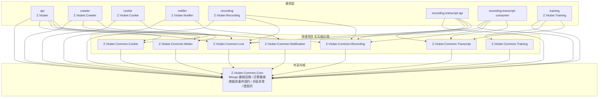
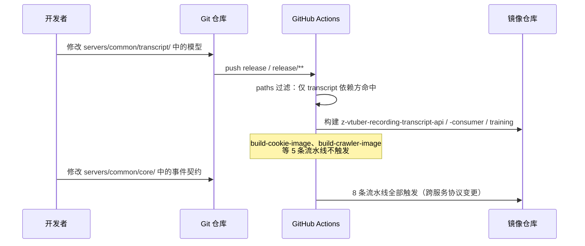

# Common 公共模型按领域拆分 - 技术提案

- 日期：2026-09-28
- 状态：待评审
- feat-branch：`feat/common-split`
- 关联文档：[PRD](../../product/draft/20260928-common-split-prd.md)

## 1. 概述

### 1.1 背景

依据 PRD「Common 公共模型按领域拆分」：`servers/common`（`Z.Vtuber.Common.csproj`）是全部后端服务共享的公共类型单一来源，但已经横跨 B 站直播、Cookie、微博、录播、转写、训练、通知等多个业务领域；而镜像流水线以「公共工程目录」为粒度监听变更——**9 条镜像流水线中 8 条的 `paths` 都含 `servers/common/**`**（`.github/workflows/build-api-image.yml:9-11`、`build-cookie-image.yml:9-11`、`build-crawler-image.yml:9-11`、`build-notifier-image.yml:9-11`、`build-recording-image.yml:9-11`、`build-recording-transcript-api-image.yml:9-12`、`build-recording-transcript-consumer-image.yml:9-12`、`build-training-image.yml:9-12`），于是「只改 Transcript 相关模型」也会把 Cookie、Crawler 等无关服务重新构建一遍。

现状勘察结论（均经读码确认）：

**① 公共工程已经是「一个 csproj 装下 7 个领域」。**

- `servers/common/Z.Vtuber.Common.csproj` 单类库（net10.0 + `FrameworkReference Microsoft.AspNetCore.App` + `MongoDB.Driver 3.9.0`），被 8 个服务 + `tests/Z.Vtuber.Tests` 引用（`servers/*/Z.Vtuber*.csproj`、`tests/Z.Vtuber.Tests/Z.Vtuber.Tests.csproj:27-35`）；
- 目录上已有领域痕迹但不彻底：实体全部堆在 `Persistence/Entities/`（23 个文件，22 个 Record + `SubscriptionType` 枚举），仓储堆在 `Persistence/`，跨进程事件堆在 `Live/`（其中 `Live/RecordingEventChannels.cs` 装的是录播/转写事件，`Live/CookieInvalidEvent.cs`、`Live/CookieEventChannels.cs` 装的是 Cookie/通知事件，**目录与归属不符**）；
- 命名空间未按领域划分：`Z.Vtuber.Common.Persistence`（仓储 + Mongo 基础设施混放）、`Z.Vtuber.Common.Persistence.Entities`（全部实体）、`Z.Vtuber.Common.Live`、`Z.Vtuber.Common.Services`、`Z.Vtuber.Common.Locking`。

**② 耦合全部集中在 `MongoDbInitializer`，拆掉它领域之间就没有任何编译期引用。**

- `servers/common/Persistence/MongoDbInitializer.cs`（1161 行）一个文件装了：`MongoCollectionNames`（25 个集合名常量，:8-35）、`MongoDbInitializer`（索引初始化 + 回填 + 迁移，:37-1144）、`MetaRecord`（迁移 marker 文档，:1146）；
- `EnsureIndexesAsync`（:41-63）是全领域编排器，串起 19 个私有 `Ensure*`：Cookie 3 组、Live 8 组、Weibo 3 组、Notification 1 组、Recording 1 组、Transcript 4 集合、Training 2 集合；
- 各 `Ensure*`/`Backfill*`/`Migrate*` **彼此互不调用**，唯一共同依赖是私有 `MarkMigrationAppliedAsync`（:661）与 `MetaRecord`（`zvtuber_meta`）；
- 因此 `MongoDbInitializer`（Core 候选）→ 各领域实体与 Live 提取器（`PubTsExtractor` :346、`GiftPriceExtractor` :376、`LiveEventTextExtractor`/`LiveEventTextTypes` :446/:554）、`LiveEventTextIndexRepository.SearchIndexName`（:190），而 `LiveEventRecord` 又引用 `StringTolerantBsonDocumentSerializer`（`Persistence/Entities/LiveEventRecord.cs:18`）→ **Core ↔ Live 成环**。不拆 `MongoDbInitializer` 就无法形成有向无环的项目依赖。

**③ 除 `MongoDbInitializer` 外，领域类型之间零编译期引用。**

- 逐文件扫描 `servers/common` 全部类型后确认：Transcript 域不引用 Live/Recording 域类型（`RecordingRecord` 字段全为基元/ObjectId），Recording 域不引用 Live 域类型，Cookie/Weibo/Training/Notification 域互不引用；
- 唯一的「跨域复用文档模型」是微博 cookie 集合 `weibo_cookies`/`weibo_cookie_sessions` 复用 `CookieRecord`/`CookieSessionRecord`（`MongoDbInitializer.cs:1036-1063` `EnsureWeiboCookieIndexesAsync`、`CookiePoolService` 构造参数化集合名），而这两个集合由 `servers/cookie` 管理（`servers/cookie/Controllers/WeiboCookieDispatchController.cs`）。

**④ 服务层的真实使用面决定了「按域引用」的收益上限。**逐类型统计各服务对 common 的使用（详见 §2.3 引用矩阵）：

- `servers/crawler` 只用到 Live 域、Weibo 域与 Core（`BsonConvert`、`MetaRecord`、`Locking`），**对 Cookie 域的唯一使用是捕获 `NoAvailableCookieException`**（`servers/crawler/Services/CookieServiceClient.cs:36` 等 7 处）；
- `servers/notifier` 只用 Notification 域 + Cookie 失效事件（`CookieInvalidEvent`，`servers/notifier/.../CookieInvalidEventSubscriber`）；
- `servers/training` 只用 Training 域 + 转写任务状态常量 `TranscriptTaskStatus`（导入时判定「识别完成」）。

**⑤ 启动期初始化面比实际需要大得多。**8 个服务的 `Program.cs` 都 `AddSingleton<MongoDbInitializer>()` 并调用 `EnsureIndexesAsync()`（`servers/api/Program.cs:33,81`、`servers/cookie/Program.cs:39,161`、`servers/crawler/Program.cs:49,129`、`servers/notifier/Program.cs:31,55`、`servers/recording/Program.cs:30,83`、`servers/recording-transcript-api/Program.cs:44,60`、`servers/recording-transcript-consumer/Program.cs:42,83`、`servers/training/Program.cs:26,37`），即**每个服务启动时都会初始化全部 7 个领域的集合索引**——这既是耦合的体现，也是「改一处动全身」的运行期镜像。

### 1.2 目标

1. 把 `Z.Vtuber.Common` 拆为 **1 个共享内核 + 7 个领域项目**：`Z.Vtuber.Common.Core`、`.Live`、`.Cookie`、`.Weibo`、`.Recording`、`.Transcript`、`.Training`、`.Notification`；领域项目之间**不互相引用**（星型依赖 Core，有向无环）；
2. 服务只引用自己实际使用的领域项目（§2.3 引用矩阵），多余引用清零；
3. `MongoDbInitializer`、`MongoCollectionNames` 与各服务启动初始化按域切分，各服务只初始化自己引用的领域；
4. 镜像流水线 `paths` 与服务真实依赖对齐：**修改 Transcript 领域模型只触发 `build-recording-transcript-api-image` / `build-recording-transcript-consumer-image` / `build-training-image` 3 条流水线，Cookie、Crawler 流水线不被触发**；
5. 对外行为完全不变：API 契约、MongoDB 集合/索引/文档结构、既有数据零迁移，前端与 `contracts/` 无任何改动。

### 1.3 范围

- **内**：`servers/common`（拆为 8 个项目）；8 个服务的 `Program.cs` 初始化调用面与 `*.csproj` 项目引用；`servers/*/Dockerfile` 的 csproj 拷贝行；`.github/workflows/build-*-image.yml` 的 `paths`；`servers/Z.Vtuber.slnx`；`tests/Z.Vtuber.Tests`（引用与按域测试）；`servers/common/AGENTS.md`、`docs/engineering/backend-rules.md` 等文档同步。
- **外**：任何业务功能与对外契约（`contracts/*.yaml` 零改动）；`apps/web`（零改动）；`infra/apphost`（零改动，服务项目引用关系未变）；MongoDB 集合/索引/数据（零迁移）；命名空间全量对齐、`BackfillLiveEventTextIndexAsync` 与 `BackfillLiveEventSenderAsync` 近重复代码合并（见 §5.3）。

## 2. 技术架构

### 2.1 系统架构图



> 领域项目之间**没有边**：跨域使用一律发生在服务层（服务按需引用多个领域项目）。唯一看似跨域的「微博 cookie 集合复用 Cookie 文档模型」通过把 `weibo_cookies`/`weibo_cookie_sessions` 的索引初始化放进 **Cookie 域**处理（见 §6.1 决策 9），从而保持 Weibo → Core 单向。

### 2.2 技术栈

| 层级 | 技术选型 | 说明 |
|------|---------|------|
| 公共类库 | C# (.NET 10) `Microsoft.NET.Sdk` 类库 × 8 | 与现有 `Z.Vtuber.Common.csproj` 同配置（`FrameworkReference Microsoft.AspNetCore.App` + `MongoDB.Driver 3.9.0`） |
| 数据库 | MongoDB（单库 `zvtuber`） | 集合/索引/文档结构零变化，初始化方法按域平移 |
| 服务 | ASP.NET Core / Worker（8 个，零改动） | 仅调整 `Program.cs` 初始化调用面与 csproj 引用 |
| 构建 | Docker 多阶段 + GitHub Actions | Dockerfile 调整 csproj 拷贝行；workflow `paths` 按域收窄 |
| 测试 | xUnit + Testcontainers MongoDB | 既有 `MongoDbFixture`/`RedisFixture` 沿用，测试按域拆分 |

### 2.3 模块划分

**项目依赖**：`{Live, Cookie, Weibo, Recording, Transcript, Training, Notification} → Core`，无其他边。

| 项目 | 职责 | 关键类型（现文件位置 → 拆分后归属） |
|------|------|-----------|
| `Z.Vtuber.Common.Core` | 共享内核：Mongo 基础设施、迁移基座、跨服务协议 | `MongoDbInitializer`（基座：`DatabaseName`、`DropIndexIfExistsAsync`、`MigrationMarker`/`MigrationLock`）、`MetaRecord`、`BsonConvert`、`StringTolerantBsonDocumentSerializer`、`LiveEventPayloadParser`、`Locking/IDistributedLockProvider.cs`（2 接口）、事件契约 `CookieInvalidEvent`/`CookieEventChannels`/`RecordingEventChannels`/`RecordingStartedEvent`/`RecordingFinishedEvent`/`TranscriptSegmentEvent`/`SubscriptionEvent`/`SubscriptionEventChannels`/`LiveEventChannels`、`SubscriptionType`、`NoAvailableCookieException`、`CoreCollectionNames.Meta` |
| `Z.Vtuber.Common.Live` | B 站直播域 | 实体 `LiveEventRecord`/`LiveEventTextIndexRecord`/`LiveStatusRecord`/`LiveSessionRecord`/`SpaceTimelineRecord`/`AccountBasicInfoRecord`/`LiveGuardRecord`(+`LiveGuardEntry`)/`SubscriptionRecord`；仓储 `LiveEventRepository`/`LiveEventTextIndexRepository`（含 `SearchIndexName`）/`LiveStatusRepository`/`LiveSessionRepository`/`SpaceTimelineRepository`/`AccountBasicInfoRepository`/`LiveGuardRepository`；服务 `SubscriptionService`(+`ISubscriptionService`)/`LiveSessionTracker`(+`ILiveSessionTracker`)/`LiveStatusStateMachine`(+`SessionTransition`)/`PubTsExtractor`/`SpaceTimelinePaging`；模型与工具 `LiveEvent`/`LiveEventTextExtractor`(+`LiveEventTextTypes`/`LiveEventTextExtraction`)/`GiftPriceExtractor` |
| `Z.Vtuber.Common.Cookie` | Cookie 域（含跨平台 Cookie 池） | `CookieRecord`(+`CookieStatus`)/`CookieSessionRecord`/`CookieAccountInfoRecord`、`ICookieSessionRepository`/`ICookieAccountInfoRepository`(+`CookieAccountInfoRepository`)、`ICookiePoolService`(+`CookiePoolService`)、`BackstageDataAggregationExtensions`、`CookieCollectionNames`、`CookieMongoSetup`（含微博 cookie 两集合索引） |
| `Z.Vtuber.Common.Weibo` | 微博域 | `WeiboSubscriptionRecord`/`WeiboTimelineRecord`、`WeiboSubscriptionRepository`/`WeiboTimelineRepository`、`WeiboSubscriptionService`(+`IWeiboSubscriptionService`)、`WeiboCollectionNames`、`WeiboMongoSetup` |
| `Z.Vtuber.Common.Recording` | 录播域（含场次归档） | `RecordingStatusRecord`/`RecordingStatusRepository`、`RecordingRecord`/`RecordingRepository`（**场次归档，现位于 `Persistence/Entities/RecordingRecord.cs`，名字带 Recording 但 AGENTS.md 将其记在转写集合下，本提案归录播域**，理由见 §6.1 决策 8）、`RecordingCollectionNames`、`RecordingMongoSetup` |
| `Z.Vtuber.Common.Transcript` | 转写域 | `TranscriptTaskRecord`(+`TranscriptTaskStatus/Modes/Sources/Types`)、`TranscriptSegmentRecord`、`TranscriptModelRecord`、`TranscriptAutoEnqueueRecord`、`TranscriptTaskRepository`/`TranscriptSegmentRepository`/`TranscriptModelRepository`/`TranscriptAutoEnqueueRepository`、`TranscriptCollectionNames`、`TranscriptMongoSetup`（含 `CleanupTranscriptModelIsDefaultAsync`） |
| `Z.Vtuber.Common.Training` | 训练域 | `TrainingDatasetRecord`/`TrainingDatasetItemRecord`、`TrainingDatasetRepository`/`TrainingDatasetItemRepository`、`TrainingCollectionNames`、`TrainingMongoSetup` |
| `Z.Vtuber.Common.Notification` | 通知域 | `NotificationSubscriptionRecord`、`INotificationSubscriptionRepository`(+`NotificationSubscriptionRepository`)、`NotificationCollectionNames`、`NotificationMongoSetup`（含 `MigrateCookieInvalidEventTypeSplitAsync`） |

**服务 → 领域项目引用矩阵**（✓ = 有真实类型使用，逐类型核对所得）：

| 服务 | Core | Live | Cookie | Weibo | Recording | Transcript | Training | Notification |
|------|:---:|:---:|:---:|:---:|:---:|:---:|:---:|:---:|
| api | ✓ | ✓ | ✓ | ✓ | ✓ | | | |
| crawler | ✓ | ✓ | | ✓ | | | | |
| cookie | ✓ | | ✓ | | | | | |
| notifier | ✓ | | | | | | | ✓ |
| recording | ✓ | ✓ | | | ✓ | | | |
| recording-transcript-api | ✓ | ✓ | | | ✓ | ✓ | | |
| recording-transcript-consumer | ✓ | ✓ | | | ✓ | ✓ | | |
| training | ✓ | | | | | ✓ | ✓ | |

对应流水线 `paths` 收窄结果（现状 8 条全中 → 拆分后）：

| 变更位置 | 触发流水线（现状） | 触发流水线（拆分后） |
|------|------|------|
| `servers/common/transcript/**`（转写模型） | 全部 8 条 | **3 条**：transcript-api / transcript-consumer / training |
| `servers/common/cookie/**` | 全部 8 条 | 2 条：api / cookie |
| `servers/common/training/**` | 全部 8 条 | 1 条：training |
| `servers/common/notification/**` | 全部 8 条 | 1 条：notifier |
| `servers/common/recording/**` | 全部 8 条 | 4 条：api / recording / transcript-api / transcript-consumer |
| `servers/common/live/**` | 全部 8 条 | 5 条：api / crawler / recording / transcript-api / transcript-consumer |
| `servers/common/weibo/**` | 全部 8 条 | 2 条：api / crawler |
| `servers/common/core/**`（共享内核） | 全部 8 条 | 全部 8 条（合理：跨服务协议与基础设施） |

## 3. API 设计

### 3.1 API 契约

**本期零对外契约变更**：`contracts/*.yaml` 不修改，全部接口请求/响应/状态码保持原样；`servers/api` 代理路由、SSE 事件与推送 payload 不变。验收以「全量接口行为回归通过」为准（§8）。

### 3.2 内部接口

新增的内部初始化入口（服务启动期调用，替代原 `MongoDbInitializer.EnsureIndexesAsync()` 单一编排）：

| 类型 | 方法 | 迁移自 |
|------|------|--------|
| `CookieMongoSetup` | `EnsureIndexesAsync()`（cookies / cookie_sessions / cookie_account_info / weibo_cookies / weibo_cookie_sessions） | `EnsureCookiesIndexesAsync`、`EnsureCookieSessionIndexesAsync`、`EnsureCookieAccountInfoIndexesAsync`、`EnsureWeiboCookieIndexesAsync` |
| `LiveMongoSetup` | `EnsureIndexesAsync()`（subscriptions / account_basic_info / live_status / live_event / space_timeline / live_session / live_event_text_index / live_guards） | 8 个 `Ensure*` |
| | `MigrateAsync()`：`DropOldSubscriptionIndexAsync` → `MigrateSubscriptionTypeSplitAsync` → `EnsureSubscriptionCompositeIndexAsync` | 同名公开方法（保持原调用顺序） |
| | `BackfillAsync()`：`BackfillSpaceTimelinePubTsAsync` / `BackfillGiftPriceAsync` / `BackfillLiveEventTextIndexAsync` / `BackfillLiveEventSenderAsync` / `BackfillLiveEventPayloadObjectAsync` | 同名公开方法（**逐个保留，不做合并**） |
| `WeiboMongoSetup` | `EnsureIndexesAsync()`（weibo_subscriptions / weibo_user_timeline） | `EnsureWeiboSubscriptionIndexesAsync`、`EnsureWeiboTimelineIndexesAsync` |
| `RecordingMongoSetup` | `EnsureIndexesAsync()`（recording_status / recordings） | `EnsureRecordingStatusIndexesAsync` + 从 `EnsureTranscriptIndexesAsync` 拆出的 `recordings` 段 |
| `TranscriptMongoSetup` | `EnsureIndexesAsync()`（transcript_tasks / transcript_segments / transcript_models / transcript_auto_enqueue） | `EnsureTranscriptIndexesAsync` 的其余部分 |
| | `CleanupAsync()`：`CleanupTranscriptModelIsDefaultAsync` | 同名公开方法 |
| `TrainingMongoSetup` | `EnsureIndexesAsync()`（training_datasets / training_dataset_items） | `EnsureTrainingIndexesAsync` |
| `NotificationMongoSetup` | `EnsureIndexesAsync()`（notification_subscriptions） | `EnsureNotificationSubscriptionIndexesAsync` |
| | `MigrateAsync()`：`MigrateCookieInvalidEventTypeSplitAsync` | 同名公开方法 |
| `MongoDbInitializer`（Core，基座） | `DatabaseName` 常量、`MigrationMarker.IsAppliedAsync/MarkAppliedAsync`、`MigrationLock`（`BackfillLiveEventPayloadObjectAsync` 的 running/applied 抢占语义泛化，可选）、`DropIndexIfExistsAsync` | `MongoDbInitializer.cs:39,235,661,752` |

各服务 `Program.cs` 启动序列（**保持原方法顺序**，只换成按域调用）：

| 服务 | 现调用（`Program.cs` 行号） | 拆分后调用 |
|------|------|------|
| api | `DropOldSubscriptionIndexAsync → MigrateSubscriptionTypeSplitAsync → EnsureSubscriptionCompositeIndexAsync → EnsureIndexesAsync → BackfillSpaceTimelinePubTs → BackfillGiftPrice → BackfillLiveEventTextIndex → BackfillLiveEventSender`（:72-85） | `LiveMongoSetup.MigrateAsync → Live/Cookie/Weibo.EnsureIndexesAsync → LiveMongoSetup.BackfillAsync`（4 个） |
| crawler | 同上 + `BackfillLiveEventPayloadObjectAsync`（:126-134） | `LiveMongoSetup.MigrateAsync → Live/Weibo.EnsureIndexesAsync → LiveMongoSetup.BackfillAsync`（5 个） |
| cookie | `EnsureIndexesAsync`（:161） | `CookieMongoSetup.EnsureIndexesAsync` |
| notifier | `EnsureIndexesAsync → MigrateCookieInvalidEventTypeSplitAsync`（:55-57） | `NotificationMongoSetup.EnsureIndexesAsync → NotificationMongoSetup.MigrateAsync` |
| recording | `EnsureIndexesAsync`（:83） | `LiveMongoSetup.EnsureIndexesAsync + RecordingMongoSetup.EnsureIndexesAsync` |
| recording-transcript-api | `EnsureIndexesAsync → CleanupTranscriptModelIsDefaultAsync`（:60-61） | `Recording/Transcript/Live.EnsureIndexesAsync → TranscriptMongoSetup.CleanupAsync` |
| recording-transcript-consumer | 同上（:83-84） | 同上 |
| training | `EnsureIndexesAsync`（:37） | `TrainingMongoSetup.EnsureIndexesAsync + TranscriptMongoSetup.EnsureIndexesAsync` |

## 4. 数据模型

### 4.1 数据库设计

**集合、索引、文档结构零变化，既有数据零迁移。**唯一变化是「索引初始化/迁移的执行方」按域归属（现为任一服务启动即初始化全部领域）：

| 集合 | 领域 | 索引初始化执行方（拆分后） |
|------|------|------|
| `bilibili_cookies` / `bilibili_cookie_sessions` / `bilibili_cookie_account_info` / `weibo_cookies` / `weibo_cookie_sessions` | Cookie | cookie |
| `bilibili_subscriptions` / `bilibili_account_basic_info` / `bilibili_live_status` / `bilibili_live_event` / `bilibili_user_space_timeline` / `bilibili_live_session` / `bilibili_live_event_text_index` / `bilibili_live_guards` | Live | api、crawler、recording、transcript-api、transcript-consumer（任一启动即建，幂等） |
| `weibo_subscriptions` / `weibo_user_timeline` | Weibo | api、crawler |
| `recording_status` / `recordings` | Recording | recording、transcript-api、transcript-consumer、api |
| `transcript_tasks` / `transcript_segments` / `transcript_models` / `transcript_auto_enqueue` | Transcript | transcript-api、transcript-consumer、training |
| `training_datasets` / `training_dataset_items` | Training | training |
| `notification_subscriptions` | Notification | notifier |
| `zvtuber_meta`（迁移 marker） | Core | 各域 `MongoSetup` 经 `MigrationMarker` 读写 |

> 该差异已在 §5.2 实现点 3 展开风险分析：所有初始化方法均为幂等 `CreateOneAsync`/`$unset`/`SetOnInsert`，由「使用该领域的服务」执行即可，部署顺序无关。

### 4.2 缓存设计

不涉及（本期无 Redis/缓存语义变更）。

## 5. 技术实现方案

### 5.1 核心流程



### 5.2 关键实现点

#### 实现点 1: 拆分 `servers/common` 为 8 个项目（纯搬运）

- **描述**: 新建 `servers/common/{core,live,cookie,weibo,recording,transcript,training,notification}/Z.Vtuber.Common.<域>.csproj`（net10.0 + `FrameworkReference Microsoft.AspNetCore.App` + `MongoDB.Driver 3.9.0`，与现 `Z.Vtuber.Common.csproj` 同配置），按 §2.3 归属表搬运类型；删除 `servers/common/Z.Vtuber.Common.csproj`。
- **技术细节**:
  - **命名空间整体保持 `Z.Vtuber.Common.*` 不变**（纯程序集拆分，消费方零 `using` 改动），**唯一例外**：搬入 Core 的跨服务协议类型（`CookieInvalidEvent`、`CookieEventChannels`、`RecordingEventChannels`、`RecordingStartedEvent`、`RecordingFinishedEvent`、`TranscriptSegmentEvent`、`SubscriptionEvent`、`SubscriptionEventChannels`、`LiveEventChannels`、`NoAvailableCookieException`）统一为新命名空间 `Z.Vtuber.Common.Contracts`，同步修正约 10 处消费方 `using`（`servers/recording`、`servers/recording-transcript-consumer`、`servers/recording-transcript-api`、`servers/notifier`、`servers/cookie`、`servers/crawler`）。理由：这批类型原本挂在 `Z.Vtuber.Common.Live`/`.Services` 下与归属不符（`Live/RecordingEventChannels.cs` 装的是录播/转写事件）。
  - `SubscriptionType`（枚举）上移 Core：它被 `SubscriptionEvent`（Core）引用，且被 recording（`servers/recording/Live/LiveStatusPoller.cs:69`）与 api（`servers/api/Controllers/BilibiliLiveRecordingController.cs:26`）使用，属跨域词汇；`SubscriptionRecord` 仍留 Live。
  - `RecordingRecord`/`RecordingRepository` 归 **Recording**（详见 §6.1 决策 8）。
  - 每个项目复制 `AssemblyInfo.cs`（`[assembly: InternalsVisibleTo("Z.Vtuber.Tests")]`，现 `servers/common/AssemblyInfo.cs`）与 `GlobalUsings.cs`（5 条 `Microsoft.Extensions.*`，现 `servers/common/GlobalUsings.cs`）；`servers/Z.Vtuber.slnx` 的 `/servers/` 目录下 `common/` 一行换成 8 个项目条目。
- **风险点**: 类型被拆到两个程序集而同名（如 `MongoCollectionNames`）会造成 CS0433 歧义——本方案已为集合名常量改成按域命名（§5.2 实现点 2）；`tests/Z.Vtuber.Tests/GlobalUsings.cs` 中对 `CookieSessionRecord`/`ICookieSessionRepository` 的类型别名需随命名空间例外一并核对（这两个类型不在例外清单内，命名空间不变则安全）。

#### 实现点 2: `MongoCollectionNames` 按域切分为 `<域>CollectionNames`

- **描述**: 25 个集合名常量按 §4.1 归属表拆入各域的 `XxxCollectionNames` 静态类（如 `TranscriptCollectionNames.Tasks = "transcript_tasks"`）；Core 只保留 `CoreCollectionNames.Meta = "zvtuber_meta"`。
- **技术细节**: 常量**值**保持逐字节一致（`bilibili_*`/`weibo_*`/`recording_status`/`recordings`/`transcript_*`/`training_*`/`notification_subscriptions`/`zvtuber_meta`）；引用点机械替换（各域仓储构造函数默认参数、`servers/cookie` 等服务侧 6 处、`tests/Z.Vtuber.Tests/MongoDbFixture.cs` 的清理清单）。`LiveEventTextIndexRepository.SearchIndexName` 常量随 Live 域移动，`LiveMongoSetup` 直接引用，消除现 `MongoDbInitializer.cs:190` 的反向引用。
- **风险点**: 集合名字面量一旦改错即「连错库」，需用单测断言每个常量值与拆分前一致（§8.2 守护测试）。

#### 实现点 3: `MongoDbInitializer` 拆分为 Core 基座 + 按域 `XxxMongoSetup`

- **描述**: 按 §3.2 内部接口表平移方法；`MetaRecord`、迁移 marker 助手（`MarkMigrationAppliedAsync` → 公开 `MigrationMarker`）、`DropIndexIfExistsAsync`、`DatabaseName` 留 Core；`BackfillLiveEventPayloadObjectAsync` 的 running/applied 抢占语义可泛化为 Core 的 `MigrationLock`（`MongoDbInitializer.cs:752-830`），也可原样随 Live 域平移（推荐后者，见 §6.1 决策 5）。
- **技术细节**:
  - 19 个 `Ensure*` 与 5 个 `Backfill*`、3 个 `Migrate*`、1 个 `Cleanup*`、2 个订阅索引遗留方法**逐字搬运**，方法体不改写、不合并（`BackfillLiveEventTextIndexAsync` 与 `BackfillLiveEventSenderAsync` 的近重复暂保留）；
  - 各服务启动只装订自己引用的领域（§3.2 调用表），保持原顺序；api/crawler 的 Live 域序列 `DropOldSubscriptionIndex → MigrateSubscriptionTypeSplit → EnsureSubscriptionCompositeIndex → EnsureIndexes → Backfill*` 原样保留。
- **风险点（本期唯一的行为差异）**: 拆分前「任一服务启动即初始化全部领域的索引与迁移」，拆分后「各服务只初始化自己引用的领域」。分析：① 全部初始化方法都是幂等（`CreateOneAsync` / `SetOnInsert` / marker 判定 / `$unset`），② 每个领域都有自己的常驻服务（transcript 索引由 transcript-api/consumer 建、training 索引由 training 建、notification 索引由 notifier 建……），③ 部署顺序无关。**不改变**集合结构与数据，因此对外行为不变。缓解：在 `tests/Z.Vtuber.Tests` 为每个 `XxxMongoSetup` 建立按域测试（沿用 `MongoDbFixture`），断言索引集合与拆分前一致（§8）。

#### 实现点 4: 服务引用与启动面改造

- **描述**: 8 个服务的 `*.csproj` 把 `ProjectReference` 换成 §2.3 矩阵中的领域项目；`Program.cs` 把 `AddSingleton<MongoDbInitializer>()` 换为对应 `XxxMongoSetup` 注册（`MongoDbInitializer` 基座仍需注册以提供 `DatabaseName`/`MigrationMarker`），启动序列按 §3.2 表替换。
- **技术细节**: `tests/Z.Vtuber.Tests/Z.Vtuber.Tests.csproj` 显式补上 8 个领域项目引用（SDK 项目传递引用本已生效，显式化便于读码）；`infra/apphost` 与 `apps/web` 零改动。
- **风险点**: 漏改某服务的引用会在编译期直接暴露（类型不可见），风险低；真正需要小心的是 `Program.cs` 初始化顺序（api/crawler 的迁移顺序不可乱）。

#### 实现点 5: Dockerfile 与镜像流水线路径过滤收窄

- **描述**: 8 个服务 `Dockerfile` 的 csproj 拷贝行改为「只拷贝自己引用的领域项目」（restore 层缓存更精细）；`.github/workflows/build-*-image.yml` 的 `paths` 按 §2.3 收窄。
- **技术细节**:
  - Dockerfile（以 `servers/cookie/Dockerfile` 为例）：
    ```dockerfile
    COPY servers/common/core/Z.Vtuber.Common.Core.csproj servers/common/core/
    COPY servers/common/cookie/Z.Vtuber.Common.Cookie.csproj servers/common/cookie/
    COPY servers/cookie/Z.Vtuber.Cookie.csproj servers/cookie/
    RUN dotnet restore servers/cookie/Z.Vtuber.Cookie.csproj
    COPY servers/common/ servers/common/
    COPY servers/cookie/ servers/cookie/
    ```
    （`COPY` 多源到单目录会拍平，故逐项目保留路径；源码 `COPY servers/common/ servers/common/` 保持不变即可，未引用项目不会参与 publish。）
  - workflow `paths` 模板：`build-training-image.yml` 由 `servers/training/**` + `servers/common/**` + 自身文件 → `servers/training/**` + `servers/common/core/**` + `servers/common/training/**` + `servers/common/transcript/**` + 自身文件；其余 7 条同法（清单见 §9.2）。
- **风险点**: Dockerfile 拷贝路径与 csproj 的 `ProjectReference` 相对路径不一致会导致 restore 失败，需逐服务 `docker build` 验证；`paths` 清单漏掉某域会导致「改了却没重建」，用 §8.2 守护测试兜底。

#### 实现点 6: 文档与 AGENTS.md 同步

- **描述**: 重写 `servers/common/AGENTS.md`（模块结构改为 8 个项目 + 各自归属清单；修正已过期描述：`ICookieNavProbeService`/`CookieProbeOutcome` 与 `CookiePoolService.NextAsync` 在代码中已不存在，见 `docs/engineering/plans/20260911-plan-cookie-service.md` 任务 2.1④）；同步 `docs/engineering/backend-rules.md` 的项目结构图与「归属约定」；`servers/*/AGENTS.md` 中引用 `servers/common/Persistence/...` 的路径按新目录修正。
- **技术细节**: 文档内路径一律指向新目录（如 `servers/common/transcript/Persistence/TranscriptTaskRecord.cs`）。
- **风险点**: 文档漂移会误导后续 agent 开发，需在验收清单中逐条核对。

### 5.3 不在本期的事项

- 命名空间全量对齐项目名（`Z.Vtuber.Common.<域>.*`）——本期仅对搬入 Core 的跨服务协议类型改命名空间，全量对齐留作独立小改动；
- `BackfillLiveEventTextIndexAsync` 与 `BackfillLiveEventSenderAsync` 近重复代码合并；
- `MongoDbInitializerTests`（约 800 行跨域巨测）彻底肢解为按域测试（本期只做「按域补齐 + 行为等价断言」）；
- 把 Training/Notification 等单使用方领域下沉到服务内部（§6.1 决策 7）；
- 任何索引优化、集合结构调整、业务功能变更。

## 6. 技术决策

### 6.1 决策列表

| # | 决策 | 选项 A | 选项 B | 最终选择 | 原因 |
|---|------|--------|--------|---------|------|
| 1 | 拆分粒度 | 8 个项目（Core + 7 领域） | 3~4 个大块（如 Core/数据访问/服务） | **A** | 与业务领域和服务边界一一对应，CI 收益最大；粗粒度方案无法让「改 Transcript 不动 Cookie/Crawler」成立 |
| 2 | 命名空间 | 保持 `Z.Vtuber.Common.*` 不变（纯程序集拆分） | 全量重命名为 `Z.Vtuber.Common.<域>.*` | **A**（协议类型例外入 `Z.Vtuber.Common.Contracts`） | 消费方零 `using` 改动、diff 最小、易评审易回滚；全量重命名会波及 8 个服务上百文件，掩盖真正的结构变更 |
| 3 | 跨服务事件/异常归属 | 集中到 Core「协议层」 | 随领域项目走（如 Cookie 事件留 Cookie 项目） | **A** | 选 B 会让 notifier 依赖整个 Cookie 项目（改 Cookie 实体就重建 notifier），且 `NoAvailableCookieException` 被 crawler/recording 消费却与 Cookie 实体无关；协议层独立后「改领域模型只影响读写该领域数据的服务」才成立。代价（改事件协议触发全量重建）合理：事件本就是跨服务协议 |
| 4 | 集合名常量 | 按域拆 `<域>CollectionNames` | 整类留 Core | **A** | 新增/改名集合是常见变更，留 Core 会让「加一个 transcript 集合」触发 8 条流水线，与本需求目标直接矛盾；B 仅改动量更小 |
| 5 | `BackfillLiveEventPayloadObjectAsync` 抢占逻辑 | 原样随 Live 域平移 | 泛化为 Core `MigrationLock` | **A** | 纯搬运原则，避免在拆分 PR 里改写并发语义；泛化留作后续 |
| 6 | 各服务初始化范围 | 按域初始化（本方案） | 保持全量初始化 | **A** | B 要求每个服务引用全部领域项目，直接摧毁目标；风险见 §5.2 实现点 3 分析（幂等 + 领域有常驻服务 + 部署顺序无关） |
| 7 | 单使用方领域（Training/Notification） | 留在 common 作为领域项目 | 下沉到 `servers/training`、`servers/notifier` 内部 | **A** | CI 收益相同（仅其服务触发）；下沉会扩大代码搬运面并打破「公共类型单一来源」约定，且两域后续可能被多方使用 |
| 8 | `RecordingRecord`/`RecordingRepository` 归属 | Recording 域 | Transcript 域（AGENTS.md 现记述） | **A** | 该数据由 recording 服务写入（场次归档）、转写服务读取，生产方在录播；归 Recording 后「改 Transcript 模型」不影响 recording 服务，更贴合目标。**与 `servers/common/AGENTS.md` 现描述不一致，需在文档同步中修正** |
| 9 | 微博 cookie 集合（`weibo_cookies`/`weibo_cookie_sessions`）初始化归属 | Cookie 域（文档模型即 `CookieRecord`/`CookieSessionRecord`，由 `servers/cookie` 管理） | Weibo 域 | **A** | 选 B 会让 Weibo 项目引用 Cookie 项目（域间出现边），且微博 cookie 的管理面在 cookie 服务（`WeiboCookieDispatchController`）；A 保持星型依赖 |
| 10 | 聚合项目 `Z.Vtuber.Common`（引用全部域） | 保留聚合包方便一次性引用 | 不做 | **B** | 聚合包会重新引入「一改全动」，与目标背道而驰；测试项目显式引用 8 个领域项目即可 |
| 11 | 流水线触发清单维护方式 | 手工维护 + 守护测试校验 | 集中在一份 YAML 由脚本生成 | **A** | 服务数量小（8 个），先用守护测试保证一致；生成式方案留作后续 |

### 6.2 依赖与约束

| 类型 | 内容 | 说明 |
|------|------|------|
| 依赖 | 8 个服务、`tests/Z.Vtuber.Tests`、`servers/Z.Vtuber.slnx`、8 个 Dockerfile、8 条镜像 workflow | 均需随拆分同步调整，改动面见 §1.3 |
| 依赖 | MongoDB 单库 `zvtuber` 既有集合与索引 | 零迁移，仅初始化执行方变化 |
| 约束 | 纯结构性拆分 | 不改任何类型成员、方法体、集合名常量值、索引定义 |
| 约束 | 领域项目之间不得互相引用 | 由守护测试断言（§8.2），防止后续演进出环 |
| 约束 | `paths` 清单与 ProjectReference 引用闭包必须一致 | 由守护测试断言；新增领域或调整引用时同步改 workflow |
| 约束 | 主干随时可构建、测试全绿 | 拆分按「搬运→编译→测试」小步提交 |

## 7. 项目结构

```
servers/
├── Z.Vtuber.slnx                     # /servers/ 下 8 个 common 领域项目 + 8 个服务
├── common/
│   ├── AGENTS.md                     # 重写：8 项目归属清单 + 归属约定（修正过期描述）
│   ├── core/Z.Vtuber.Common.Core.csproj
│   │   ├── Contracts/                # CookieInvalidEvent / CookieEventChannels / RecordingEventChannels
│   │   │                           # RecordingStartedEvent / RecordingFinishedEvent / TranscriptSegmentEvent
│   │   │                           # SubscriptionEvent / SubscriptionEventChannels / LiveEventChannels
│   │   │                           # NoAvailableCookieException（命名空间 Z.Vtuber.Common.Contracts）
│   │   ├── Locking/                  # IDistributedLockProvider / IDistributedLockHandle
│   │   ├── Persistence/              # MongoDbInitializer（基座）/ MetaRecord / MigrationMarker
│   │   │                           # BsonConvert / StringTolerantBsonDocumentSerializer / LiveEventPayloadParser
│   │   │                           # CoreCollectionNames（Meta）
│   │   ├── Entities/SubscriptionType.cs
│   │   ├── AssemblyInfo.cs / GlobalUsings.cs
│   │   └── Z.Vtuber.Common.Core.csproj
│   ├── live/Z.Vtuber.Common.Live.csproj
│   │   ├── Entities/                 # LiveEventRecord / LiveEventTextIndexRecord / LiveStatusRecord
│   │   │                           # LiveSessionRecord / SpaceTimelineRecord / AccountBasicInfoRecord
│   │   │                           # LiveGuardRecord(+LiveGuardEntry) / SubscriptionRecord
│   │   ├── Persistence/              # 7 仓储（含 LiveEventTextIndexRepository.SearchIndexName）
│   │   ├── Services/                 # SubscriptionService / LiveSessionTracker / LiveStatusStateMachine
│   │   │                           # PubTsExtractor / SpaceTimelinePaging
│   │   ├── Live/                     # LiveEvent / LiveEventTextExtractor / GiftPriceExtractor
│   │   ├── Mongo/LiveMongoSetup.cs + LiveCollectionNames.cs
│   │   └── ...
│   ├── cookie/    # Entities(CookieRecord/CookieStatus, CookieSessionRecord, CookieAccountInfoRecord)
│   │              # Persistence(ICookieSessionRepository, ICookieAccountInfoRepository+实现)
│   │              # Services(ICookiePoolService+CookiePoolService) + BackstageDataAggregationExtensions
│   │              # Mongo/CookieMongoSetup.cs（含 weibo_cookies / weibo_cookie_sessions 索引）+ CookieCollectionNames.cs
│   ├── weibo/     # Entities(WeiboSubscriptionRecord, WeiboTimelineRecord) + 2 仓储
│   │              # Services(WeiboSubscriptionService) + WeiboMongoSetup + WeiboCollectionNames
│   ├── recording/ # Entities(RecordingStatusRecord, RecordingRecord) + 2 仓储
│   │              # RecordingMongoSetup（recording_status + recordings）+ RecordingCollectionNames
│   ├── transcript/# Entities(TranscriptTaskRecord(+4 常量类), TranscriptSegmentRecord,
│   │              #        TranscriptModelRecord, TranscriptAutoEnqueueRecord) + 4 仓储
│   │              # TranscriptMongoSetup（含 CleanupTranscriptModelIsDefaultAsync）+ TranscriptCollectionNames
│   ├── training/  # Entities(TrainingDatasetRecord, TrainingDatasetItemRecord) + 2 仓储
│   │              # TrainingMongoSetup + TrainingCollectionNames
│   └── notification/ # Entities(NotificationSubscriptionRecord) + 仓储
│                  # NotificationMongoSetup（含 MigrateCookieInvalidEventTypeSplitAsync）+ NotificationCollectionNames
├── api/ ... 8 个服务（仅改 csproj 引用 + Program.cs 初始化调用面 + Dockerfile）
tests/Z.Vtuber.Tests/                  # csproj 显式引用 8 个领域项目；MongoDbFixture 清理清单改用各域常量
                                       # 新增 XxxMongoSetupTests（按域）+ 边界守护测试
```

## 8. 测试策略

### 8.1 测试覆盖要求

- 既有单元测试全量通过（`dotnet test tests/Z.Vtuber.Tests`），核心逻辑覆盖率不低于 80%（`docs/engineering/common-rules.md`）；
- 新增守护测试必须覆盖「领域边界」与「流水线触发范围」两类不变量；
- 集合名常量值、索引定义与拆分前逐项等价断言。

### 8.2 测试类型

| 类型 | 工具 | 覆盖范围 |
|------|------|---------|
| 既有回归 | xUnit + Testcontainers MongoDB | 仓储、服务、控制器、迁移/回填（`MongoDbInitializerTests`、`CookiePoolServiceTests`、`TranscriptTaskRepositoryTests` 等全部保留） |
| 按域初始化测试 | xUnit + `MongoDbFixture` | `XxxMongoSetupTests`：断言各域集合索引集合与拆分前一致（对照 `MongoDbInitializer.cs` 现有断言） |
| 常量等价测试 | xUnit | `XxxCollectionNames` 各常量值 = 拆分前 `MongoCollectionNames` 对应值（硬编码期望字符串） |
| **边界守护测试** | xUnit | ① 读各服务 csproj 的 `ProjectReference` 闭包，断言等于 §2.3 矩阵；② 断言 7 个领域项目的 `ProjectReference` 只指向 Core（无域间引用、无环） |
| **流水线守护测试** | xUnit | 读 `.github/workflows/build-*-image.yml` 的 `paths`，断言与「该服务引用的领域项目目录 + 服务自身目录」一一对应，防止 `paths` 漏改 |
| 验收演练 | 手工 + `gh run list` | 在 `release` 分支演练一次 `transcript` 域改动（如给 `TranscriptTaskRecord` 加字段），确认仅 3 条流水线触发、cookie/crawler 不触发 |

## 9. 部署方案

### 9.1 环境规划

| 环境 | 用途 | 部署方式 |
|------|------|---------|
| 本地/Aspire | 开发联调 | `infra/apphost` 编排不变（服务项目引用关系未变） |
| 内网 | 实际使用 | 8 个镜像、命名与 tag 规则完全不变（`zero-tools/z-vtuber-*:{sha}` / `:latest`） |

### 9.2 配置管理

- 各服务 `appsettings`、`ConnectionStrings:mongo`/`messaging` 与环境变量**零变更**；
- 镜像流水线 `paths` 清单（拆分后）：

| workflow | paths |
|------|------|
| `build-api-image.yml` | `servers/api/**`、`servers/common/core/**`、`servers/common/live/**`、`servers/common/cookie/**`、`servers/common/weibo/**`、`servers/common/recording/**` |
| `build-crawler-image.yml` | `servers/crawler/**`、`servers/common/core/**`、`servers/common/live/**`、`servers/common/weibo/**` |
| `build-cookie-image.yml` | `servers/cookie/**`、`servers/common/core/**`、`servers/common/cookie/**` |
| `build-notifier-image.yml` | `servers/notifier/**`、`servers/common/core/**`、`servers/common/notification/**` |
| `build-recording-image.yml` | `servers/recording/**`、`servers/common/core/**`、`servers/common/live/**`、`servers/common/recording/**` |
| `build-recording-transcript-api-image.yml` | `servers/recording-transcript-api/**`、`servers/common/core/**`、`servers/common/live/**`、`servers/common/recording/**`、`servers/common/transcript/**`、自身文件 |
| `build-recording-transcript-consumer-image.yml` | `servers/recording-transcript-consumer/**`、`servers/common/core/**`、`servers/common/live/**`、`servers/common/recording/**`、`servers/common/transcript/**`、自身文件 |
| `build-training-image.yml` | `servers/training/**`、`servers/common/core/**`、`servers/common/training/**`、`servers/common/transcript/**`、自身文件 |

- `build-web-image.yml` 保持不变（`apps/web/**`）。

## 10. 验收标准

- [ ] `Z.Vtuber.Common` 已拆为 `Core` + 7 个领域项目，7 个领域项目仅引用 Core，无域间引用（守护测试通过）
- [ ] 8 个服务的项目引用与 §2.3 矩阵一致，无多余引用（守护测试通过）
- [ ] 集合名常量值、索引定义与拆分前逐项一致（常量等价测试 + 按域初始化测试通过）
- [ ] 8 个服务 `Program.cs` 启动序列与拆分前同序，`dotnet build` / `dotnet test` 全绿
- [ ] 8 个服务镜像均可正常构建（逐服务 `docker build` 通过）
- [ ] **验收演练**：修改 `servers/common/transcript/**` 仅触发 transcript-api / transcript-consumer / training 3 条流水线，`build-cookie-image`、`build-crawler-image` 等 5 条不触发
- [ ] 流水线 `paths` 清单与引用闭包一致（守护测试通过）
- [ ] 对外 API 契约、行为、MongoDB 数据零变化（全量接口回归通过）
- [ ] `servers/common/AGENTS.md`、`docs/engineering/backend-rules.md` 及相关文档已同步（含 `RecordingRecord` 归属与过期契约描述修正）

## 11. 相关文档

- [关联 PRD](../../product/draft/20260928-common-split-prd.md)
- 规范：`docs/engineering/common-rules.md`、`docs/engineering/backend-rules.md`
- 参考提案：`docs/engineering/proposals/20260901-proposal-api-crawler-split.md`（服务拆分先例）、`docs/engineering/proposals/20260927-proposal-training-audio-dataset.md`
- 现有契约：`contracts/*.yaml`（本期不变更）
