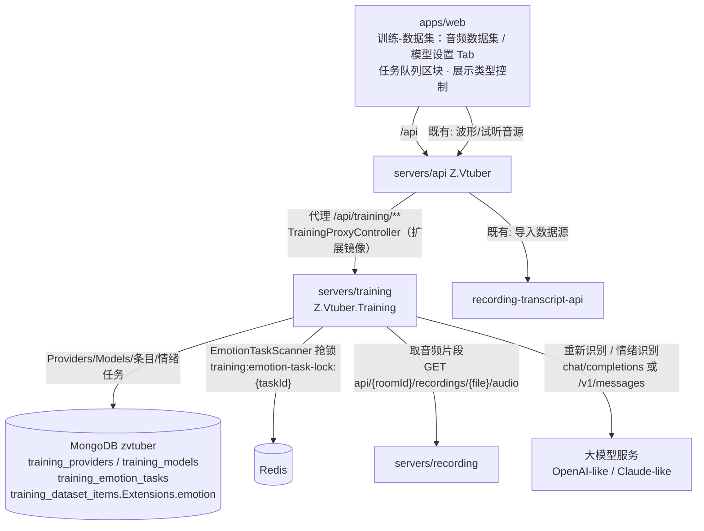
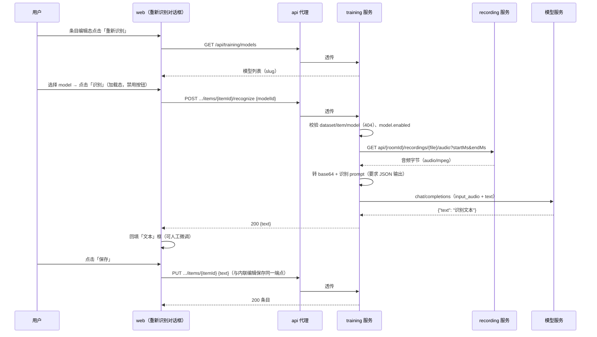
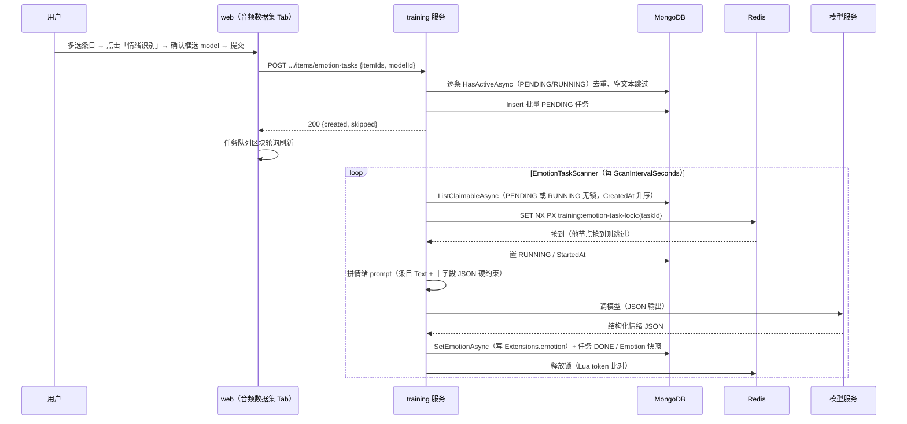

# AI 训练 - 数据集工具优化（模型设置 / 重新识别 / 情绪识别 / 列表展示） - 技术提案

- 日期：2026-09-28
- 状态：待评审
- feat-branch：`feat/training-dataset-emotion`
- 关联文档：[PRD](../../product/draft/20260928-training-dataset-emotion-prd.md)

> v1.1 返工说明（2026-09-29，PR #146 代码 Review 打回 4 项 P2）：① 重新识别「保存」改为携带行内联草稿一并提交（`audioUri/startMs/endMs`），消除未保存修改被静默丢弃；② 情绪识别链路补 `model.Enabled` 校验（提交 400 `model disabled`、执行置 FAILED），与单条重新识别同口径；③ 情绪任务状态机并发原子化——活跃任务 `ItemId_1_Active` 部分唯一索引 + 幂等插入、retry `Id+Status==FAILED` 原子 CAS、Runner 写库带 `Id+Status==RUNNING+Attempts` 条件（fencing 落到写操作）；④ 锁续期 `RenewAsync` 捕获 Redis 异常置 `Lost` 且续期循环单轮异常不终止。另随返工处理 P3/P4：错误码口径统一与队列错误文案中文化、失败原因不透传 `ex.Message`、条目缺失改标 FAILED、识别/添加/内联保存防重复提交、队列轮询请求序号防覆盖、LLM Endpoint 禁用自动重定向（SSRF）。详见 §6.1 决策与 §6.2 约束新增行。

## 1. 概述

### 1.1 背景

依据 PRD「AI 训练 - 数据集工具优化」：训练模块需要 (1) 统一的模型接入管理（Providers / Models，OpenAI-like 与 Claude-like）；(2) 单条数据「重新识别」（选模型 → 音频送模型识别 → 回填文本 → 保存）；(3) 批量「情绪识别」（多选提交 → 后台任务队列执行 → 每条数据产出一组结构化情绪数据）；(4) 数据集列表「展示类型」显隐控制（音频信息默认隐藏 / 情绪信息默认展示）。

现状勘察结论（均经读码确认）：

**① 训练服务与数据条目已就位，情绪结果有现成承载位。**

- `servers/training`（Z.Vtuber.Training，本地 8086）已提供数据集/条目 8 端点（`Controllers/TrainingDatasetsController.cs`、`Controllers/TrainingDatasetItemsController.cs`），契约 `contracts/training.openapi.yaml`（438 行），对外统一经 `servers/api/Controllers/TrainingProxyController.cs` 代理（named client `TrainingService`）；
- 条目实体 `servers/common/training/Entities/TrainingDatasetItemRecord.cs` 含 **`Extensions`（`BsonDocument?`）预留字段**，注释即「情感识别、二次 ASR 等加工结果按键名挂接」——情绪结果落 `Extensions.emotion` **无需改表结构**；
- 集合常量与索引初始化已按域拆分（`servers/common/training/Mongo/TrainingCollectionNames.cs`、`TrainingMongoSetup.cs`），新增集合沿用同一模式即可（`CollectionNamesEquivalenceTests`、`ProjectReferenceGuardTests` 守护领域边界）。

**② 「周期扫描 + Redis 抢锁」的后台任务模式有可直接仿写的实现。**

- `servers/recording-transcript-consumer/Tasks/TranscriptTaskScanner.cs`（HostedService 周期扫 PENDING/RUNNING 无锁任务，按 `_id` 升序抢锁接管，僵尸 RUNNING 不饿死 PENDING）与 `Tasks/TranscriptTaskLock.cs`（`RedisTranscriptTaskLockProvider`：key `transcript:task-lock:{taskId}`，SET NX PX + 周期续期 + Lua token 比对释放 + `CheckOwnershipAsync` fencing）是成熟的任务锁范式；
- Core 已有通用锁契约 `servers/common/core/Locking/IDistributedLockProvider.cs`（crawler/cookie 各自实现 `RedisDistributedLockProvider`），但其为「短临界区」语义（`LockTakeAsync` + 释放，**无续期、无失锁判定**），不足以覆盖耗时数秒到数十秒的 LLM 调用（见 §6.1 决策 4）。

**③ 项目内无任何 LLM 客户端，需新建统一抽象。**

- 全仓库检索 `anthropic/openai/chat/completions/claude` 无命中：OpenAI-like 与 Claude-like 两类协议均无现成封装，需在 training 服务内新建 `Ai/` 抽象与两个适配器；
- 「模型不回显 apiKey、模型记录存 DB 而非配置」已是既有惯例（`transcript_models` + `/api/transcripts/models`，见 `contracts/recording-transcript.openapi.yaml:327-430`），Providers/Models 沿用该口径。

**④ 音频取数可复用录播片段端点，`audioUri` 解析口径已有唯一实现。**

- 音频片段端点 `GET api/{roomId:long}/recordings/{fileName}/audio?startMs=&endMs=`（`servers/recording/Controllers/RecordingController.cs:129`，api 代理 `/api/b/live/{roomId}/recordings/{file}/audio`）：ffmpeg 现切 `audio/mpeg`，区间 ≤ 5 分钟硬约束（`RecordingOptions.AudioClipMaxDurationMs` 默认 300000）；
- `audioUri` 形如 `b/live/{roomId}/recordings/{file}`，解析规则当前只在前端 `apps/web/src/api/client.ts` 的 `trainingAudioClipUrl` 存在——「重新识别/情绪识别」需要**服务端取音频**，需把该解析规则在 `servers/common/training` 落一份纯函数（见 §5.2 实现点 4）。

**⑤ 前端训练页为单 Tab 结构，列表组件已承载列宽/编辑/多选基础设施。**

- `apps/web/src/pages/training/DatasetsPage.tsx`：`TABS = [{key:'audio', label:'音频数据集'}]`（`TabKey` 联合类型 + `role="tablist"`），扩展 Tab 是最小改动；
- `DatasetItemList.tsx`：`table-layout:fixed` + `colgroup` 列宽策略、内联编辑（保存/取消）、勾选多选、分组切换（不分组/按来源/按类型）、行展开波形——本期「重新识别」按钮挂在编辑态、「情绪识别」按钮挂在工具栏、「展示类型」勾选挂在分组切换之前，均在既有骨架上扩展；
- 训练契约已接入 codegen（`apps/web/package.json` `codegen` 串联 7 个契约），新增端点只需补 `contracts/training.openapi.yaml` 并重新生成。

### 1.2 目标

1. training 服务新增 **Providers / Models 管理**（Mongo 两集合 + 10 个端点）：接入 OpenAI-like 与 Claude-like 模型服务，支持从 Endpoint 同步模型列表与手动添加，模型以 `{provider}/{model}` slug 暴露；
2. 新增**单条重新识别**端点与对话框：服务端取音频转 base64 → 携识别 prompt 调模型 → 要求 JSON 输出 → 解析回填文本，保存复用既有条目更新端点；
3. 新增**情绪识别任务**能力：多选提交建任务，training 服务内后台扫描 + Redis 抢锁消费（**不新建服务**），产出十字段结构化情绪数据写入条目 `Extensions.emotion`，任务队列端点支撑前端进度展示与失败重试；
4. 数据集条目列表响应补充情绪数据（`emotion` 字段），前端提供「展示类型」列显隐控制（音频信息默认隐藏 / 情绪信息默认展示）；
5. 契约先行 + codegen；补齐后端接口测试（Testcontainers Mongo + Redis）与前端组件测试。

### 1.3 范围

- **内**：`servers/training`（Providers/Models/重新识别/情绪任务控制器、Ai 客户端、情绪任务扫描与执行、音频取数客户端）；`servers/common/training`（3 个新实体/仓储 + `TrainingMongoSetup` 索引 + `Extensions.emotion` 映射 + `audioUri` 解析纯函数）；`contracts/training.openapi.yaml`（新增 14 端点）+ `contracts/bilibili-crawler.openapi.yaml`（`/api/training/**` 镜像）；`servers/api/Controllers/TrainingProxyController.cs`（镜像路由）；`infra/apphost/AppHost.cs`（training 增加 Redis 与 recording 地址）；`apps/web`（Tab 扩展、模型设置/任务队列/重新识别对话框、列表展示控制、codegen）；`tests/Z.Vtuber.Tests` 与 `apps/web` Vitest。
- **外**：转写链路（consumer/ASR/transcript 既有端点）零改动；recording 音频片段端点零改动（5 分钟上限不变）；模型训练/导出能力；情绪维度结构的扩展（本期固定十字段）；任务队列的调度公平性/优先级（本期按创建时间 FIFO）；Provider 计费/用量统计。

## 2. 技术架构

### 2.1 系统架构图



### 2.2 技术栈

| 层级 | 技术选型 | 说明 |
|------|---------|------|
| 后端 | C# (.NET 10) ASP.NET Core Controllers（training 服务内扩展） | 不新建服务（PRD 约束）；沿用控制器 + 仓储 + DTO 映射模式 |
| 数据库 | MongoDB（`zvtuber` 库新增 3 集合 + 条目 `Extensions`） | 幂等建索引，无迁移 |
| 分布式锁 | Redis（`Aspire.StackExchange.Redis`） | 任务锁 SET NX PX + 续期 + Lua 释放 + fencing，仿 `TranscriptTaskLock` |
| AI 接入 | 自研 `IChatModelClient`（OpenAI-like / Claude-like 两个适配器） | 仓库内无 LLM SDK 依赖，手写 HTTP 适配器，零新增 NuGet 包 |
| 服务编排 | .NET Aspire（`infra/apphost`） | training 增加 `messaging`(Redis) 与 recording 地址注入 |
| 前端 | React 19 + Vite（无 UI 库、内联样式） | 新增 `ModelSettingsTab`/`EmotionTaskQueue`/`ReRecognizeDialog` 组件 |
| 契约 | OpenAPI（`contracts/training.openapi.yaml`） | 手写契约先行，web `openapi-typescript` codegen |
| 测试 | xUnit + Testcontainers（Mongo + Redis）、Vitest + RTL | 沿用既有设施；LLM/音频以假 HTTP server 契约测试 |

### 2.3 模块划分

| 模块 | 职责 | 关键技术点 |
|------|------|-----------|
| `servers/common/training`（变更） | `TrainingProviderRecord`/`TrainingModelRecord`/`TrainingEmotionTaskRecord` 实体 + 3 仓储 + 索引 + `Extensions` 情绪映射 + `audioUri` 解析 | `(Name)`、`(ProviderId, Model)`、`(Status, CreatedAt)` 索引；`TrainingMapping.ParseAudioUri` 纯函数 |
| `servers/training/Ai`（新增） | `IChatModelClient` 抽象 + OpenAI-like / Claude-like 适配器 + JSON 输出解析 + 识别/情绪 prompt | 音频 base64 入参；能力差异显式建模（见 §6.1 决策 5） |
| `servers/training/Emotion`（新增） | 情绪识别任务扫描器、执行器、任务锁 | 周期扫描 + Redis 抢锁 + 续期/fencing + 并发门控 |
| `servers/training/Clients`（变更） | `RecordingAudioClient`（取音频片段字节） | 复用 recording 片段端点；不可达 → 502 |
| `servers/training/Controllers`（变更） | Providers/Models/重新识别/情绪任务 4 组控制器 | 错误体统一 `{"error":"..."}`，口径同既有控制器 |
| `servers/api`（变更） | `/api/training/**` 新端点代理镜像 | 复用 `ForwardAsync` 透传 |
| `infra/apphost`（变更） | training 增加 Redis 依赖与 recording 地址 | `.WithReference(messaging)` + `RecordingService__BaseUrl` |
| `apps/web`（变更） | 模型设置 Tab、任务队列区块、重新识别对话框、情绪识别提交、展示类型控制 | slug 展示、轮询刷新、既有列宽策略复用 |

## 3. API 设计

### 3.1 API 契约（`contracts/training.openapi.yaml`，扩展）

新增 14 个端点，命名/错误体/状态码口径与既有 8 个端点保持一致（错误体统一 `{"error":"..."}`，`*Id` 非法 ObjectId 一律按「不存在」→ 404）。

#### 接口 1: Provider 列表

- **请求** GET `/api/training/providers`
- **响应** 200 `TrainingProviderList`（`CreatedAt` 升序；**apiKey 不回传**，仅返回 `apiKeySet: boolean`）

#### 接口 2: 新建 Provider

- **请求** POST `/api/training/providers`
  ```json
  { "name": "openai-prod", "type": "openai", "endpoint": "https://api.openai.com/v1", "apiKey": "sk-..." }
  ```
  | 字段 | 类型 | 必填 | 说明 |
  |------|------|------|------|
  | `name` | string | 是 | 名称（trim 后非空 ≤ 64，**全局唯一**） |
  | `type` | string | 是 | 模型类型：`openai` / `claude`（开放枚举） |
  | `endpoint` | string | 是 | 服务地址（http/https，trim 后非空 ≤ 512，去尾部 `/` 归一） |
  | `apiKey` | string | 是 | API key（写入后不回显） |
- **响应** 201 `TrainingProvider`；400 `{"error":"name is required"}` / `{"error":"unsupported provider type"}` / `{"error":"endpoint is required"}` / `{"error":"api key is required"}`；409 `{"error":"provider name exists"}`

#### 接口 3: 更新 Provider

- **请求** PUT `/api/training/providers/{providerId}`，Body `{ "name"?, "type"?, "endpoint"?, "apiKey"? }`（缺失字段不改；`apiKey` 传空串视为不改）
- **响应** 200 `TrainingProvider`；400；404 `{"error":"provider not found"}`；409 重名

#### 接口 4: 删除 Provider

- **请求** DELETE `/api/training/providers/{providerId}`
- **响应** 204；404。**级联删除其下全部 Models**（已入队任务仍保留 `modelSlug` 快照，任务队列可读）。

#### 接口 5: 从 Endpoint 同步模型列表

- **请求** GET `/api/training/providers/{providerId}/models/discover`
- **响应** 200 `{"models": [{"model": "gpt-4o-audio-preview"}, ...]}`（服务端按 provider `type` 调 `GET {endpoint}/models`（OpenAI-like）或 `GET {endpoint}/v1/models`（Claude-like）去重排序）；
  404 provider 不存在；502 `{"error":"provider service unavailable"}`（Endpoint 不可达/超时/非 2xx）；502 `{"error":"invalid provider response"}`（响应无法解析）

#### 接口 6: 批量导入模型

- **请求** POST `/api/training/providers/{providerId}/models/import`，Body `{ "models": ["gpt-4o-audio-preview", "gpt-4o"] }`
- **响应** 200 `{"imported": 1, "skipped": 1}`（与 `(ProviderId, Model)` 唯一索引冲突的计 skipped）；400 `{"error":"models is required"}`；404 provider

#### 接口 7: 模型列表

- **请求** GET `/api/training/models?enabled=true`
  | 参数 | 位置 | 必填 | 说明 |
  |------|------|------|------|
  | `enabled` | query | 否 | 过滤启用状态 |
- **响应** 200 `TrainingModelList`，每项含 `slug`（= `{provider.name}/{model}`，服务端拼好返回，前端只管展示）

#### 接口 8: 手动添加模型

- **请求** POST `/api/training/models`
  ```json
  { "providerId": "66d8...", "model": "gpt-4o-audio-preview" }
  ```
  | 字段 | 类型 | 必填 | 说明 |
  |------|------|------|------|
  | `providerId` | string | 是 | **所属 Provider（前端下拉选择已有 Providers）** |
  | `model` | string | 是 | 实际发给服务商的模型 ID（trim 后非空 ≤ 128） |
- **响应** 201 `TrainingModel`；400 `{"error":"model is required"}`；404 `{"error":"provider not found"}`；409 `{"error":"model exists"}`

#### 接口 9: 更新模型

- **请求** PUT `/api/training/models/{modelId}`，Body `{ "model"?, "enabled"? }`
- **响应** 200；400；404 `{"error":"model not found"}`；409 `{"error":"model exists"}`

#### 接口 10: 删除模型

- **请求** DELETE `/api/training/models/{modelId}`
- **响应** 204；404

#### 接口 11: 单条重新识别

- **请求** POST `/api/training/datasets/{datasetId}/items/{itemId}/recognize`
  ```json
  { "modelId": "66d8..." }
  ```
- **响应** 200 `{"text": "识别出的文本"}`（**仅返回文本，不写库**；写库由前端「保存」走既有 `PUT .../items/{itemId}`）；
  400 `{"error":"model does not support audio input"}`（该模型类型不支持音频模态）；400 `{"error":"audio uri is empty"}`；
  404 `{"error":"dataset not found"}` / `{"error":"item not found"}` / `{"error":"model not found"}`；
  502 `{"error":"audio unavailable"}`（音频取数失败）、`{"error":"model service unavailable"}`（模型调用失败/超时）、`{"error":"invalid model output"}`（输出非预期 JSON）

#### 接口 12: 提交情绪识别任务

- **请求** POST `/api/training/datasets/{datasetId}/items/emotion-tasks`
  ```json
  { "itemIds": ["66d8...", "66d9..."], "modelId": "66d0..." }
  ```
- **响应** 200 `{"created": 2, "skipped": 1}`；
  `skipped` 口径：条目已有 `PENDING`/`RUNNING` 任务（重复提交幂等）、或条目 `text` 为空（无情绪判定依据，记 skipped 并 Info 日志）；
  400 `{"error":"itemIds is required"}`；404 dataset / model 不存在

#### 接口 13: 情绪识别任务队列

- **请求** GET `/api/training/emotion-tasks?datasetId=&status=&limit=`
  | 参数 | 位置 | 必填 | 说明 |
  |------|------|------|------|
  | `datasetId` | query | 否 | 按数据集过滤 |
  | `status` | query | 否 | `pending` / `running` / `done` / `failed` |
  | `limit` | query | 否 | 默认 100，最大 500（`CreatedAt` 降序） |
- **响应** 200
  ```json
  {
    "items": [ { "id": "...", "datasetId": "...", "itemId": "...", "audioKey": "transcript:...", "modelId": "...",
                 "modelSlug": "openai-prod/gpt-4o-audio-preview", "status": "running", "attempts": 1,
                 "error": null, "emotion": null, "createdAt": "...", "startedAt": "...", "finishedAt": null } ],
    "counts": { "pending": 3, "running": 1, "done": 12, "failed": 1 }
  }
  ```

#### 接口 14: 重试失败任务

- **请求** POST `/api/training/emotion-tasks/{taskId}/retry`
- **响应** 200 `TrainingEmotionTask`（`status` 置回 `pending`、`attempts` 保留、`error` 清空）；400 `{"error":"task not failed"}`；404 `{"error":"task not found"}`

#### schema 定义（增量）

```yaml
TrainingProvider:
  properties:
    id: { type: string }
    name: { type: string }
    type: { type: string, description: "openai | claude（开放枚举）" }
    endpoint: { type: string }
    apiKeySet: { type: boolean, description: 是否已配置 API key（明文永不回传） }
    createdAt: { type: string, format: date-time }
    updatedAt: { type: string, format: date-time }

TrainingModel:
  properties:
    id: { type: string }
    providerId: { type: string }
    providerName: { type: string }
    model: { type: string, description: 实际发给服务商的模型 ID }
    slug: { type: string, description: "{providerName}/{model}，展示用" }
    enabled: { type: boolean, description: 默认 true }
    createdAt: { type: string, format: date-time }
    updatedAt: { type: string, format: date-time }

EmotionResult:
  description: 结构化情绪数据（十字段，PRD 固定结构）
  properties:
    emotionControlWeight: { type: number, description: "情绪控制权重（Emotion control weight，0~10；越界钳制）" }
    emotionDescription: { type: string, description: 情绪描述（Emotion description） }
    happy: { type: number, description: 开心（Happy，0~1） }
    angry: { type: number, description: 愤怒（Angry，0~1） }
    sad: { type: number, description: 悲伤（Sad，0~1） }
    afraid: { type: number, description: 恐惧（Afraid，0~1） }
    disgusted: { type: number, description: 厌恶（Disgusted，0~1） }
    melancholic: { type: number, description: 忧郁（Melancholic，0~1） }
    surprised: { type: number, description: 惊讶（Surprised，0~1） }
    calm: { type: number, description: 平静（Calm，0~1） }

TrainingEmotionTask:
  properties:
    id: { type: string }
    datasetId: { type: string }
    itemId: { type: string }
    audioKey: { type: string, description: 条目音频标识快照（任务可读性） }
    modelId: { type: string }
    modelSlug: { type: string, description: slug 快照（模型删除后任务仍可读） }
    status: { type: string, description: "pending | running | done | failed" }
    attempts: { type: integer }
    error: { type: string, nullable: true }
    emotion: { $ref: "#/components/schemas/EmotionResult", nullable: true }
    createdAt: { type: string, format: date-time }
    startedAt: { type: string, format: date-time, nullable: true }
    finishedAt: { type: string, format: date-time, nullable: true }
```

`TrainingDatasetItem` 增量：`emotion: EmotionResult | null`（由 `Extensions.emotion` 映射，缺失即 `null`）。

#### 代理镜像（api 服务，`contracts/bilibili-crawler.openapi.yaml`）

`/api/training/**` 上述 14 个端点逐个镜像（与既有 8 个同口径：query/body/状态码/`Content-Disposition` 透传，上游不可达 502 `{"error":"training service unavailable"}`），`TrainingProxyController` 增加对应 action。

### 3.2 内部接口

- **仓储**（`servers/common/training/Persistence/`，新增 3 个 + 扩展 1 个）：

  ```csharp
  // TrainingProviderRepository
  Task<List<TrainingProviderRecord>> ListAsync(CancellationToken ct = default);
  Task<TrainingProviderRecord> InsertAsync(TrainingProviderRecord record, CancellationToken ct = default);   // 重名 DuplicateKey → 409
  Task<TrainingProviderRecord?> UpdateAsync(ObjectId id, UpdateDefinition<TrainingProviderRecord> update, CancellationToken ct = default);
  Task<bool> DeleteAsync(ObjectId id, CancellationToken ct = default);
  Task<TrainingProviderRecord?> GetByIdAsync(ObjectId id, CancellationToken ct = default);

  // TrainingModelRepository
  Task<List<TrainingModelRecord>> ListAsync(bool? enabled = null, CancellationToken ct = default);
  Task<TrainingModelRecord?> GetByIdAsync(ObjectId id, CancellationToken ct = default);
  Task<TrainingModelRecord> InsertAsync(TrainingModelRecord record, CancellationToken ct = default);          // (ProviderId, Model) 冲突 → 409
  Task<(long Imported, long Skipped)> InsertManyIgnoreDuplicatesAsync(IEnumerable<TrainingModelRecord> items, CancellationToken ct = default);
  Task<TrainingModelRecord?> UpdateAsync(ObjectId id, UpdateDefinition<TrainingModelRecord> update, CancellationToken ct = default);
  Task<bool> DeleteAsync(ObjectId id, CancellationToken ct = default);
  Task<long> DeleteByProviderAsync(ObjectId providerId, CancellationToken ct = default);                      // 级联

  // TrainingEmotionTaskRepository
  Task<List<TrainingEmotionTaskRecord>> ListAsync(ObjectId? datasetId, string? status, int limit, CancellationToken ct = default);
  Task<Dictionary<string, long>> CountByStatusAsync(ObjectId? datasetId, CancellationToken ct = default);
  Task<TrainingEmotionTaskRecord?> GetByIdAsync(ObjectId id, CancellationToken ct = default);
  Task<TrainingEmotionTaskRecord> InsertAsync(TrainingEmotionTaskRecord record, CancellationToken ct = default);
  Task<bool> HasActiveAsync(ObjectId itemId, CancellationToken ct = default);                                  // 已有 PENDING/RUNNING → skipped
  Task<List<TrainingEmotionTaskRecord>> ListClaimableAsync(int batchSize, CancellationToken ct = default);     // PENDING 或 RUNNING（无锁接管判定由扫描器做）
  Task<TrainingEmotionTaskRecord?> UpdateAsync(ObjectId id, UpdateDefinition<TrainingEmotionTaskRecord> update, CancellationToken ct = default);

  // TrainingDatasetItemRepository（扩展）
  Task<TrainingDatasetItemRecord?> SetEmotionAsync(ObjectId datasetId, ObjectId itemId, BsonDocument emotion, CancellationToken ct = default);
  ```

- **AI 客户端**（`servers/training/Ai/`）：

  ```csharp
  public sealed record ChatAudio(string Base64, string MimeType);        // audio/mpeg 等
  public sealed record ChatPrompt(string System, string User, ChatAudio? Audio);

  public interface IChatModelClient
  {
      /// <summary>调用模型并要求 JSON 输出，返回原始文本（由 ModelJsonParser 解析）。</summary>
      Task<string> CompleteJsonAsync(TrainingProviderRecord provider, TrainingModelRecord model,
          ChatPrompt prompt, CancellationToken ct = default);
  }

  public interface IChatModelClientFactory
  {
      /// <summary>按 provider.Type 派发（openai → OpenAiLikeChatClient / claude → ClaudeLikeChatClient）；未知类型抛 ProviderTypeException。</summary>
      IChatModelClient Create(string providerType);
  }
  ```

  - `OpenAiLikeChatClient`：`POST {endpoint}/chat/completions`，`Authorization: Bearer {apiKey}`；user 内容为 `{"type":"text"}` + 可选 `{"type":"input_audio","input_audio":{"data":"<base64>","format":"mp3"}}` 两段；要求 `response_format: {"type":"json_object"}`（服务端不支持该字段时按 400 降级为纯 prompt 约束重试一次）；
  - `ClaudeLikeChatClient`：`POST {endpoint}/v1/messages`，`x-api-key: {apiKey}` + `anthropic-version: 2023-06-01`；内容块仅 `text`；**`prompt.Audio != null` 直接抛 `ModelAudioNotSupportedException`**（映射 400 `model does not support audio input`）；
  - `ModelJsonParser.Parse<T>(string raw)`：剥 ```` ```json ```` 围栏 → 取首个平衡 `{...}` → `JsonSerializer.Deserialize<T>`（`PropertyNameCaseInsensitive`）→ 数值范围校验/钳制（0~1，`emotionControlWeight` 允许 >1 的上限 10，超界记 Warn 并钳制）；解析失败抛 `ModelOutputException`（映射 502 `invalid model output`）；
  - `Prompts/RecognizePromptBuilder`、`Prompts/EmotionPromptBuilder`：prompt 常量与组装（含「只输出 JSON、字段固定十项、数值 0~1、描述 ≤ 200 字」的硬约束），测试锁定 prompt 关键约束存在。

- **音频取数**（`servers/training/Clients/RecordingAudioClient.cs`）：`GetClipAsync(string audioUri, long startMs, long? endMs, CancellationToken ct)` → `(byte[] Bytes, string ContentType)`；`TrainingMapping.ParseAudioUri` 解析 `b/live/{roomId}/recordings/{file}` → 调 `{RecordingService:BaseUrl}/api/{roomId}/recordings/{file}/audio?startMs=&endMs=`（`endMs` 空则不传，交由 recording 侧口径）；404/非 2xx/超时 → `AudioUnavailableException`（映射 502 `audio unavailable`）；字节数超 `Ai:MaxAudioBytes` → 400 `audio too large`。

## 4. 数据模型

### 4.1 数据库设计

#### 集合: `training_providers`（新增）

| 字段 | 类型 | 说明 |
|------|------|------|
| `Id` | ObjectId | 主键 |
| `Name` | string | 名称，全局唯一 |
| `Type` | string | `openai` / `claude`（开放枚举） |
| `Endpoint` | string | 服务地址（去尾部 `/`） |
| `ApiKey` | string | **明文入库（与 `transcript_models.ApiKey` 同口径），任何接口不回传** |
| `CreatedAt` / `UpdatedAt` | DateTime(UTC) | |

索引：`Name` **唯一**。

#### 集合: `training_models`（新增）

| 字段 | 类型 | 说明 |
|------|------|------|
| `Id` | ObjectId | 主键 |
| `ProviderId` | ObjectId | 所属 Provider |
| `Model` | string | 实际发给服务商的模型 ID |
| `Enabled` | bool | 默认 `true`；识别类端点仅允许启用模型 |
| `CreatedAt` / `UpdatedAt` | DateTime(UTC) | |

索引：`(ProviderId, Model)` **唯一**；`ProviderId`（级联删除）。`slug` 为派生字段，不落库。

#### 集合: `training_emotion_tasks`（新增）

| 字段 | 类型 | 说明 |
|------|------|------|
| `Id` | ObjectId | 主键 |
| `DatasetId` / `ItemId` | ObjectId | 目标条目 |
| `AudioKey` | string | 条目音频标识快照 |
| `ModelId` | ObjectId | 识别模型 |
| `ModelSlug` | string | slug 快照（模型删除后任务仍可读） |
| `Status` | string | `PENDING` / `RUNNING` / `DONE` / `FAILED` |
| `Attempts` | int | 执行次数（重试累加） |
| `Error` | string? | 失败原因（可读中文/错误码） |
| `Emotion` | BsonDocument? | 识别结果快照（`DONE` 时写入，结构同 `EmotionResult`） |
| `CreatedAt` / `StartedAt` / `FinishedAt` | DateTime(UTC) | |

索引：`(Status, CreatedAt)`（扫描领取）、`(DatasetId, CreatedAt)`（队列查询）、`ItemId`（重复提交判定）。

- 新集合沿用 `TrainingCollectionNames` + `TrainingMongoSetup.EnsureIndexesAsync` 幂等建立；无存量数据迁移。

#### 条目扩展（`training_dataset_items.Extensions`，不改表结构）

```json
{ "emotion": {
    "emotionControlWeight": 0.6, "emotionDescription": "克制的失落，语调低缓",
    "happy": 0.05, "angry": 0.0, "sad": 0.7, "afraid": 0.05,
    "disgusted": 0.0, "melancholic": 0.8, "surprised": 0.1, "calm": 0.4 } }
```

- 写入方式：`SetEmotionAsync` 仅 `$set: {"Extensions.emotion": ...}`（不动 `Extensions` 下其他键，兼容未来二次 ASR）；同一数据重复识别**以最新结果覆盖**；
- 读取方式：`TrainingDatasetItem.Emotion`（DTO 映射取 `Extensions["emotion"]`，缺失/格式不符 → `null`，不抛错）。

### 4.2 缓存设计

无缓存：Provider/Model 为低频管理数据，每次现读；情绪任务队列由前端轮询（10s）现读。Redis 仅承担任务锁（key `training:emotion-task-lock:{taskId}`，TTL `EmotionTask:LockTtlSeconds` 默认 30s、续期间隔 10s）。

## 5. 技术实现方案

### 5.1 核心流程

#### 流程 1: 单条重新识别



注：识别**不写库**，只有「保存」落库（PRD：保存与内联编辑一致、取消不产生任何修改）；模型不支持音频时 400，对话框提示且原文本不动。

#### 流程 2: 批量情绪识别（后台任务）



注：单条失败（模型异常/输出非法）置 `FAILED` + `Error`，**不影响同批其他任务**；`FAILED` 任务可经接口 14 重试（`attempts` 累加）；重复识别同一数据以最新结果覆盖。

#### 流程 3: Provider 模型同步

```mermaid
flowchart LR
    A[新建/编辑 Provider<br/>name/type/endpoint/apiKey] --> B[「获取模型」按钮]
    B --> C[GET providers/{id}/models/discover]
    C --> D{Endpoint 可达?}
    D -->|否| E[502 提示模型服务不可用]
    D -->|是| F[列出可导入模型 id<br/>勾选 → 导入]
    F --> G[POST providers/{id}/models/import<br/>撞唯一索引计 skipped]
    G --> H[Models 列表以 slug 展示]
```

### 5.2 关键实现点

#### 实现点 1: 数据层（servers/common/training）

- `Entities/TrainingProviderRecord.cs`、`TrainingModelRecord.cs`、`TrainingEmotionTaskRecord.cs`（`[BsonIgnoreExtraElements]`，时间字段 `[BsonDateTimeOptions(Kind = Utc)]`，与既有 Record 风格一致）；
- `TrainingCollectionNames` 增 `TrainingProviders` / `TrainingModels` / `TrainingEmotionTasks`；`TrainingMongoSetup.EnsureIndexesAsync` 增三个集合索引（幂等 `CreateOneAsync`）；
- `TrainingMapping` 增：`ParseAudioUri(string audioUri)`（→ `roomId`/`file`，非法返回 null，与前端 `trainingAudioClipUrl` 同口径）、`BuildModelSlug(providerName, model)`、`ToEmotionDocument`/`FromEmotionDocument`（`EmotionResult` ↔ `BsonDocument`，字段名小驼峰）。

#### 实现点 2: Providers / Models 控制器（servers/training）

- `Controllers/TrainingProvidersController.cs`（接口 1-6）、`Controllers/TrainingModelsController.cs`（接口 7-10）；DTO 复用 `Contracts/Dtos.cs` 风格（record + JSON 小驼峰）；
- 校验口径：`name`/`model` trim 非空 + 长度上限，`type` 白名单 `openai|claude`，`endpoint` 仅 http/https 且去尾 `/`；重名/重复 → 409（依赖唯一索引捕获 `DuplicateKey`）；
- **apiKey 只进不出**：响应 DTO 一律不含 `apiKey`，用 `apiKeySet` 表示是否已配置（沿用 transcript 模型「不回显」惯例）；
- discover：按 `type` 选模型列表协议（OpenAI-like `GET {endpoint}/models`、Claude-like `GET {endpoint}/v1/models`），超时用 `Ai:RequestTimeoutSeconds`；日志只打 endpoint 与条数，**绝不打 apiKey**。

#### 实现点 3: AI 客户端（servers/training/Ai）

- `IChatModelClient`/`IChatModelClientFactory` + `OpenAiLikeChatClient`/`ClaudeLikeChatClient`（`HttpClient` named client `AiModel`，无 BaseAddress，逐请求拼 endpoint）；
- 异常分类：`ModelAudioNotSupportedException`（400）、`ModelOutputException`（502 `invalid model output`）、其余传输/非 2xx → `HttpRequestException`（502 `model service unavailable`）；
- JSON 输出解析 `ModelJsonParser`（围栏剥离 + 首个平衡对象 + 反序列化 + 数值钳制），解析器为纯函数单测重点；
- prompt：`RecognizePromptBuilder`（「你是语音转写校对助手…只输出 JSON：{"text": "..."}」+ 音频）、`EmotionPromptBuilder`（「依据给定台词判断说话人情绪…只输出 JSON，字段固定 emotionControlWeight/emotionDescription/happy/angry/sad/afraid/disgusted/melancholic/surprised/calm，数值 0~1…」）。

#### 实现点 4: 音频取数（servers/training/Clients/RecordingAudioClient.cs）

- 复用 recording 片段端点（`servers/recording/Controllers/RecordingController.cs:129`）；`RecordingService:BaseUrl`（默认 `http://recording`）；
- `audioUri` 解析失败或空 → 400 `audio uri is empty`；取数失败/超时/非 2xx → 502 `audio unavailable`；响应字节超 `Ai:MaxAudioBytes`（默认 8 MiB）→ 400 `audio too large`；
- 片段区间仍受 recording 侧 5 分钟上限约束（条目区间本就为秒级，无需改动 recording）。

#### 实现点 5: 重新识别端点（servers/training）

- `Controllers/TrainingItemToolsController.cs` 承载接口 11-12（`POST .../items/{itemId}/recognize`、`POST .../items/emotion-tasks`）；
- 顺序：dataset → item → model（含 `enabled`）校验 → 取音频 → 转 base64 → 调模型 → 解析 → 返回 `{text}`；
- Info 日志 `training item recognize: datasetId={} itemId={} modelId={} bytes={} elapsedMs={}`，Warn 记失败分类，**不打音频内容与 apiKey**。

#### 实现点 6: 情绪任务扫描与执行（servers/training/Emotion）

- `EmotionTaskLock.cs`：`IEmotionTaskLockProvider`（`TryAcquireAsync`/`IsHeldAsync`）+ `RedisEmotionTaskLock`，key `training:emotion-task-lock:{taskId}`；SET NX PX + 周期续期（`LockRenewIntervalSeconds`）+ Lua token 比对释放 + `CheckOwnershipAsync` fencing；语义**逐条仿** `servers/recording-transcript-consumer/Tasks/TranscriptTaskLock.cs`（含 Redis 抖动时「保守按持有/失锁」的降级口径）；
- `EmotionTaskScanner.cs`（HostedService）：`ScanIntervalSeconds` 周期 + 启动抖动；`ListClaimableAsync(ScanBatchSize)` 取 `PENDING` 或 `RUNNING`（`IsHeldAsync == false` 的僵尸任务按 `attempts` 上限 `MaxAttempts` 保护，超限置 FAILED），按 `CreatedAt` 升序逐个 `TryAcquireAsync`；`MaxConcurrentTasks` 门控（信号量），Redis 异常本轮跳过并 Warn；
- `EmotionTaskRunner.cs`：单任务编排（置 RUNNING → 读条目 → 空文本 FAILED → 拼 prompt → 调模型 → 解析校验 → `SetEmotionAsync` → 任务 DONE + `Emotion` 快照 + `FinishedAt`）；`finally` 释放锁；逐阶段 fencing 校验（失锁则放弃写入并 Warn，交他节点接管）；
- 任务状态机：`PENDING → RUNNING → DONE | FAILED`，`retry` 仅 `FAILED → PENDING`。

#### 实现点 7: api 代理镜像（servers/api）

- `TrainingProxyController` 增 14 个 action（含 `/api/training/models`、`/api/training/emotion-tasks`、`/api/training/providers/{id}/models/discover|import` 等），全部走既有 `ForwardAsync`；契约镜像同步补 `contracts/bilibili-crawler.openapi.yaml`。

#### 实现点 8: 编排与配置（infra/apphost + servers/training）

- `infra/apphost/AppHost.cs`：training 增 `.WithReference(messaging).WaitFor(messaging)`，并 `.WithEnvironment("RecordingService__BaseUrl", recording.GetEndpoint("http"))`；
- `TrainingOptions` 扩展：节 `RecordingService`（`BaseUrl`）、`Ai`（`RequestTimeoutSeconds=120`、`MaxAudioBytes=8388608`）、`EmotionTask`（`ScanIntervalSeconds=10`、`ScanBatchSize=10`、`LockTtlSeconds=30`、`LockRenewIntervalSeconds=10`、`MaxConcurrentTasks=2`、`MaxAttempts=3`），均 `ValidateOnStart`；
- `Program.cs`：注册 `Aspire.StackExchange.Redis`（`ConnectionStrings:messaging`）+ `RecordingAudioClient` + `IChatModelClientFactory` + `EmotionTaskScanner`（HostedService）；启动 `EnsureIndexesAsync` 已含新集合。

#### 实现点 9: web 模型设置 Tab（apps/web）

- `DatasetsPage.tsx`：`TabKey = 'audio' | 'models'`，`TABS = [音频数据集, 模型设置]`（沿用 `role="tablist"` 与既有样式）；
- `pages/training/ModelSettingsTab.tsx`：Providers 表格（名称/模型类型/Endpoint/API key 状态/操作）+ 新增/编辑弹窗（`ProviderDialog.tsx`：名称、类型下拉 OpenAI/Claude、Endpoint、API key；编辑时 key 留空即不改并提示「不回显」）+ 「获取模型」入口 + 删除（confirm 二次确认，提示「其下 N 个模型将一并删除」）；
- Models 表格（slug / 所属 Provider / 启用开关 / 操作）+ 手动添加（**Provider 下拉选择已有 Providers** + 模型名）+ 从 Endpoint 导入（discover 结果勾选导入，反馈 imported/skipped）；
- slug 一律用接口返回的 `model.slug` 展示（`{provider}/{model}`）。

#### 实现点 10: web 重新识别与情绪识别（apps/web）

- `DatasetItemList.tsx` 编辑态按钮组增「重新识别」→ `ReRecognizeDialog.tsx`（`aria-modal` 半透明遮罩 + 居中面板，复用 `TranscriptImportDialog` 结构）：model 下拉（slug，空则提示「请先在模型设置中配置」）、「文本」`textarea`（初始当前文本）、「识别」（loading + 禁用防重复提交，成功回填、失败提示且不动原文）、「保存」（与内联编辑保存同一 `updateTrainingDatasetItem` 调用并关闭）、「取消」；
- 工具栏「情绪识别」：未多选 `disabled`（`aria-disabled`），多选可用；点击弹出确认框（model 必选下拉 + 提交/取消），提交调 `createEmotionTasks` 并提示 `{created, skipped}`；
- `EmotionTaskQueue.tsx`：任务队列区块（状态统计 chips + 任务表格：条目/模型 slug/状态/次数/错误/时间 + FAILED「重试」按钮 + `setInterval` 10s 轮询 + 卸载清理）。

#### 实现点 11: web 列表展示控制（apps/web）

- `DatasetItemList.tsx` 工具栏在**分组切换控件之前**增加「展示类型」勾选组：「音频信息」（默认**不勾选**）控制音频类型/音频来源/音频地址/音频标识/开始时间/结束时间六列；「情绪信息」（默认**勾选**）控制情绪控制权重/情绪描述/开心/愤怒/悲伤/恐惧/厌恶/忧郁/惊讶/平静十列；文本列与操作列恒展示；
- 列显隐以条件渲染 `<col>/<th>/<td>` 实现（保持 `table-layout:fixed` + `colgroup` 列数一致，展开行 `colSpan` 随可见列数动态计算）；情绪数值列限窄宽、情绪描述列沿用「限宽截断 + `title` 悬浮完整值」；无情绪数据的行展示「-」；
- `api/client.ts` 增补 14 个端点封装（错误统一走 `apiErrorMessage`）；`npm run codegen` 重新生成 `schema-training.d.ts`。

### 5.3 不在本期的事项

- 情绪维度结构扩展（本期固定十字段）与人工情绪标注/编辑；
- 任务优先级、定时调度、配额与限流策略（本期 FIFO + 低并发）；
- Provider/Model 的用量统计、计费、多租户与权限隔离；
- 重新识别回填起止时间/音频地址（本期只回填「文本」）；
- 录播音频片段端点 5 分钟上限调整；模型训练与数据导出。

## 6. 技术决策

### 6.1 决策列表

| 决策 | 选项 A | 选项 B | 最终选择 | 原因 |
|------|--------|--------|---------|------|
| 能力归属 | 全部放 training 服务 | 新建独立「AI 网关」服务 | **A** | PRD 明确「直接在 training 服务实现不要再新建服务」；模型设置/识别/情绪均围绕数据集条目，域内内聚 |
| Provider 与 Model 建模 | 两张集合（`training_providers` + `training_models`） | 单张集合平铺 | **A** | 一个 Provider 下多 Model（同步导入、手动添加、级联删除）；Model 轻量增删；slug 由两表派生 |
| 重新识别写库时机 | 对话框「保存」时写（识别只返回文本） | 识别成功即写库 | **A** | PRD 明确「取消不产生任何修改」「保存与内联编辑一致」；识别结果需人工微调后落库 |
| 情绪任务锁 | 仿 `TranscriptTaskLock`（SET NX PX + 续期 + fencing + `IsHeldAsync`） | 复用 Core `IDistributedLockProvider`（crawler/cookie 版） | **A** | 通用锁无续期、无失锁判定，LLM 调用常超 TTL，会造成双跑/误判；任务语义需要「僵尸 RUNNING 接管」，与转写任务同构 |
| 情绪任务执行位置 | training 服务内 `BackgroundService` | 复用 transcript-consumer 进程 | **A** | PRD 明确在 training 服务实现；任务数据与条目同库同服务，写 `Extensions.emotion` 无需跨服务 |
| Claude-like 音频输入 | 按能力显式建模：Claude 适配器拒绝音频并 400 | 强行把 base64 音频塞进 Claude 请求体 | **A** | Anthropic Messages 协议无音频模态；显式能力差异 + 明确错误码，避免静默错配。情绪识别只用文本，两类模型均可用；重新识别需音频，前端下拉不屏蔽但失败提示清晰（见 §10） |
| 情绪结果落库位置 | 条目 `Extensions.emotion` | 新集合 `training_item_emotions` | **A** | `Extensions` 即为「情感识别等加工结果」预留（`TrainingDatasetItemRecord.cs` 注释），零表结构变更；与条目同读同写，列表一次查询即可展示 |
| 情绪数值口径 | 八维强度 0~1 + 控制权重 0~1（超界钳制） | 自由数值 | **A** | prompt 硬约束 + 服务端钳制双保险，便于训练侧直接消费；`emotionControlWeight` 允许上限 10 以兼容权重型用法 |
| 任务队列展示范围 | 跟随当前数据集（区块位于音频数据集 Tab） | 全局独立 Tab | **A** | PRD 定位为「数据集 Page 的任务队列区块」，与多选提交就近反馈；队列按 `datasetId` 过滤，接口预留全局查询（`datasetId` 可空） |
| 展示类型显隐持久化 | 本地组件状态（刷新重置为需求默认值） | localStorage 持久化 | **A** | 需求明确「默认隐藏/默认显示」，本地状态即满足；避免跨版本状态迁移与额外测试面 |
| 模型 slug 生成 | 服务端拼好返回 | 前端用 providerName + model 自行拼 | **A** | 单一来源，避免前后端拼接口径漂移；任务记录同时存 `modelSlug` 快照保证模型删除后可读 |
| LLM 依赖 | 手写 HTTP 适配器 | 引入 OpenAI/Anthropic SDK | **A** | 两类协议面窄（chat/completions、/v1/messages），仓库零新增 NuGet 依赖，可控且易做假服务契约测试 |
| model 启用语义 | 提交与执行均校验 `Enabled`（停用拒提交/拒执行） | 仅提交校验、在途任务继续 | **A** | 与单条「重新识别」同口径（停用即不可用），避免「停用只对重新识别生效」的语义缺口；已入队未执行任务在 Runner 执行时同样校验并置 FAILED `model disabled` |
| 重复提交/重试并发 | 活跃任务部分唯一索引 + 幂等插入 + retry 原子 CAS | 纯 check-then-act | **A** | 并发双击/双副本可绕过预检双建任务；retry 先读后写可把 RUNNING/DONE 重置为 PENDING。改为 `ItemId_1_Active` 部分唯一索引兜底 + `RetryFailedAsync`（filter `Id+Status==FAILED`），并在 Runner 写库带 `Id+Status==RUNNING+Attempts` 条件闭合 TOCTOU |
| LLM Endpoint 重定向 | `AllowAutoRedirect=false` | 默认跟随重定向 | **A** | Endpoint 为用户可配任意 http(s)，默认跟随会把存储的 API key 带到 3xx 目标主机；禁用重定向（内网自用口径，另见 §6.2 安全约束） |

### 6.2 依赖与约束

| 类型 | 内容 | 说明 |
|------|------|------|
| 依赖 | recording 服务音频片段端点 | 重新识别/情绪识别的音频来源；5 分钟上限为既有约束 |
| 依赖 | 外部大模型服务（OpenAI-like / Claude-like） | 需支持 JSON 结构化输出；重新识别另需音频输入能力 |
| 依赖 | Redis（`ConnectionStrings:messaging`） | 情绪任务锁；training 服务本期首次引入 Redis |
| 约束 | 契约先行 | 先补 `contracts/training.openapi.yaml` + api 镜像契约，再改实现（common-rules） |
| 约束 | 不新建服务、不改转写链路 | PRD 明确；transcript/ASR 零改动 |
| 约束 | 领域边界 | 新实体/仓储归 `Z.Vtuber.Common.Training`，领域项目零引用（`ProjectReferenceGuardTests`） |
| 约束 | apiKey 不回显、日志不含密钥与音频内容 | 沿用 `transcript_models` 口径 |
| 安全约束 | LLM Endpoint 为任意 http(s)（内网自用无鉴权口径） | SSRF 面：已禁用 HTTP 自动重定向（`SocketsHttpHandler.AllowAutoRedirect=false`）避免 API key 被 3xx 带到其他主机；仍属内网可信部署假设，跨网暴露需另加 Endpoint 白名单/网络策略 |
| 约束 | .NET 10、TDD、核心逻辑覆盖率 ≥ 80% | 项目既有规范 |

## 7. 项目结构

```
contracts/（变更）
├── training.openapi.yaml                     # + 14 端点（providers/models/recognize/emotion-tasks）+ 4 schema
└── bilibili-crawler.openapi.yaml             # + /api/training/** 新端点镜像

servers/common/training/（变更）
├── Entities/TrainingProviderRecord.cs        # 新增
├── Entities/TrainingModelRecord.cs           # 新增
├── Entities/TrainingEmotionTaskRecord.cs     # 新增
├── Persistence/TrainingProviderRepository.cs # 新增
├── Persistence/TrainingModelRepository.cs    # 新增
├── Persistence/TrainingEmotionTaskRepository.cs # 新增
├── Persistence/TrainingDatasetItemRepository.cs # + SetEmotionAsync
├── Mongo/TrainingCollectionNames.cs          # + 3 集合常量
├── Mongo/TrainingMongoSetup.cs               # + 3 组索引（幂等）
└── (Contracts/TrainingMapping.cs 归属见下)   # + ParseAudioUri / BuildModelSlug / 情绪 Bson 映射

servers/training/（变更）
├── Controllers/TrainingProvidersController.cs   # 接口 1-6
├── Controllers/TrainingModelsController.cs      # 接口 7-10
├── Controllers/TrainingItemToolsController.cs   # 接口 11-14
├── Ai/IChatModelClient.cs / IChatModelClientFactory.cs
├── Ai/OpenAiLikeChatClient.cs / ClaudeLikeChatClient.cs
├── Ai/ModelJsonParser.cs / ModelExceptions.cs
├── Ai/Prompts/RecognizePromptBuilder.cs / EmotionPromptBuilder.cs
├── Emotion/EmotionTaskLock.cs                 # Redis 任务锁（仿 TranscriptTaskLock）
├── Emotion/EmotionTaskScanner.cs              # HostedService：扫描 + 抢锁 + 并发门控
├── Emotion/EmotionTaskRunner.cs               # 单任务编排
├── Clients/RecordingAudioClient.cs            # 取音频片段（RecordingService:BaseUrl）
├── Contracts/Dtos.cs                          # + Provider/Model/Emotion/Task DTO
├── Configuration/TrainingOptions.cs           # + RecordingService / Ai / EmotionTask 节
└── Program.cs                                 # + Redis / 扫描器 / 新仓储与客户端注册

servers/api/（变更）
└── Controllers/TrainingProxyController.cs     # + 14 个镜像 action

infra/apphost/（变更）
└── AppHost.cs                                 # training + messaging(Redis) + RecordingService__BaseUrl

apps/web/src/（变更）
├── api/schema-training.d.ts                   # codegen 重新生成（勿手改）
├── api/client.ts                              # + 14 个端点封装
└── pages/training/
    ├── DatasetsPage.tsx                       # Tab 扩为 音频数据集 / 模型设置
    ├── ModelSettingsTab.tsx                   # Providers + Models 双表（新增）
    ├── ModelSettingsTab.test.tsx              # 新增
    ├── ProviderDialog.tsx                     # Provider 新增/编辑弹窗（新增）
    ├── ReRecognizeDialog.tsx                  # 重新识别对话框（新增）
    ├── ReRecognizeDialog.test.tsx             # 新增
    ├── EmotionTaskQueue.tsx                   # 任务队列区块（新增）
    ├── EmotionTaskQueue.test.tsx              # 新增
    ├── EmotionSubmitDialog.tsx                # 情绪识别确认框（新增）
    ├── DatasetItemList.tsx                    # + 重新识别入口 / 情绪识别 / 展示类型控制 / 情绪列
    ├── DatasetItemList.test.tsx               # + 列显隐与默认值用例
    └── DatasetsPage.test.tsx                  # + Tab 切换用例

tests/Z.Vtuber.Tests/（变更）
├── TrainingProviderApiTests.cs                # CRUD / 重名 409 / apiKey 不回显 / 级联删除
├── TrainingModelApiTests.cs                   # 手动添加（providerId 下拉口径）/ slug / 启停 / 去重
├── TrainingModelDiscoverTests.cs              # 假模型服务：同步列表 / 导入去重 / 502
├── TrainingRecognizeTests.cs                  # 假音频 + 假模型：base64 传递 / JSON 解析 / 400/404/502
├── EmotionTaskApiTests.cs                     # 提交 created/skipped / 队列查询 / 重试状态机
├── EmotionTaskScannerTests.cs                 # Redis 抢锁不双跑 / 僵尸接管 / 失败可重试 / Extensions.emotion 写入
├── TrainingItemEmotionMappingTests.cs         # Extensions.emotion 读写与容错
└── TrainingProxyControllerTests.cs            # + 新镜像路由透传
```

## 8. 测试策略

### 8.1 测试覆盖要求

- 核心逻辑（JSON 输出解析与数值钳制、情绪 Bson 映射、`audioUri` 解析、slug 生成、任务状态机与去重判定）覆盖率 ≥ 80%（common-rules）；
- TDD：契约先行后按红-绿推进；LLM 与模型服务一律用本地假 HTTP server（沿用 `FakeFunAsrServer` 的做法），不打真实外网。

### 8.2 测试类型

| 类型 | 工具 | 覆盖范围 |
|------|------|---------|
| 单元测试 | xUnit | `ModelJsonParser`（围栏/脏输出/越界钳制）、prompt 组装、`ParseAudioUri`、slug、`EmotionResult` ↔ Bson、任务状态机 |
| 接口测试 | xUnit + Testcontainers（Mongo + Redis）+ WebApplicationFactory | 14 个新端点全链路、唯一索引 409、级联删除、created/skipped 口径、错误码映射 |
| 并发/锁测试 | Testcontainers Redis | 双实例同时扫描同一任务只执行一次；锁 TTL 过期后他节点接管；失锁后不写结果 |
| 契约测试 | 既有契约检查模式 | training 契约与实现一致；api 镜像契约一致 |
| 前端组件测试 | Vitest + RTL + jsdom | Tab 切换、Provider/Model 管理交互、slug 展示、重新识别对话框全流程、情绪识别按钮态与提交、任务队列轮询/重试、展示类型默认值与列显隐 |

关键用例清单：

- **Provider/Model**：新建 201/400/409、编辑部分字段、`apiKeySet` 恒不泄露明文、删除级联模型、discover 成功/Endpoint 不可达 502/响应非法 502、导入 imported/skipped、手动添加 `providerId` 不存在 404、`slug == "{provider}/{model}"`；
- **重新识别**：正常回填 `text`；模型不支持音频 400；`audioUri` 空 400；音频 404/超时 502；模型输出非 JSON 502；dataset/item/model 不存在 404；识别不写库（保存前条目 `text` 不变）；
- **情绪任务**：多选提交 created/skipped（重复提交、空文本）；队列 counts 正确；扫描执行后 `Extensions.emotion` 十字段齐全且 0~1；单条失败不影响其他；FAILED 重试回到 pending 且 attempts 累加；重复识别覆盖旧值；
- **锁**：两实例抢同一任务仅一执行；TTL 过期接管续跑；释放后他节点可抢；
- **web**：「模型设置」Tab 与「音频数据集」Tab 并列；Provider 类型下拉仅 OpenAI/Claude；模型下拉 slug 展示且 Provider 为下拉选择；重新识别对话框 loading/回填/失败不破坏原文/取消不请求；「情绪识别」未多选置灰、确认框 model 必选；任务队列自动刷新与重试；「音频信息」默认隐藏、「情绪信息」默认展示、勾选即时生效；既有编辑/多选/分组/波形回归不回退。

## 9. 部署方案

### 9.1 环境规划

| 环境 | 用途 | 部署方式 |
|------|------|---------|
| AppHost（Aspire）本地编排 | 开发联调 | training 增加 `messaging`(Redis) 引用与 `RecordingService__BaseUrl` |
| 生产 | 随常规版本发布 | 先发 training（含新集合与后台扫描），再 api 代理，最后 web；纯新增面，旧版本无感知 |

### 9.2 配置管理

- 新增配置：`RecordingService:BaseUrl`（training，默认 `http://recording`）、`Ai:RequestTimeoutSeconds`（120）、`Ai:MaxAudioBytes`（8388608）、`EmotionTask` 节（`ScanIntervalSeconds=10`、`ScanBatchSize=10`、`LockTtlSeconds=30`、`LockRenewIntervalSeconds=10`、`MaxConcurrentTasks=2`、`MaxAttempts=3`）；
- training 服务**新增 Redis 依赖**（`ConnectionStrings:messaging`），裸部署需同步提供连接串，否则服务启动校验失败（`ValidateOnStart`）；
- 数据初始化：启动幂等建 3 个集合索引，无迁移；
- 回滚：按整体版本回退；`training_providers/models/emotion_tasks` 残留无害；条目 `Extensions.emotion` 旧版本读取忽略（`BsonIgnoreExtraElements`）；
- 镜像流水线 `.github/workflows/build-training-image.yml` 触发范围已含 `servers/training/**` 与 `servers/common/training/**`，无需调整。

## 10. 验收标准

- [ ] 技术方案评审通过；契约评审通过（含 api 镜像契约）
- [ ] 「模型设置」Tab 与「音频数据集」Tab 并列；Providers 可增删改（名称/模型类型/Endpoint/API key），API key 不回显
- [ ] 添加 Provider 后可从 Endpoint 获取模型列表并导入；可手动添加 Model（Provider 下拉选择）；模型以 `{provider}/{model}` slug 展示
- [ ] 条目编辑态出现「重新识别」：选择 model → 识别（音频 base64 + prompt + JSON 输出）→ 文本回填 → 保存与内联编辑一致；取消无任何修改
- [ ] 未多选时「情绪识别」不可点击；确认框 model 必选；提交后生成任务并在任务队列立即可见
- [ ] 情绪任务由 training 服务后台「扫描 + Redis 抢锁」消费（多副本不双跑、宕机可接管），完成后条目携带十字段情绪数据（中文：情绪控制权重/情绪描述/开心/愤怒/悲伤/恐惧/厌恶/忧郁/惊讶/平静）
- [ ] 任务队列展示状态/次数/所用模型/时间与成功失败数，失败可重试；单条失败不影响其他数据
- [ ] 「展示类型」控制位于分组切换之前：「音频信息」六列默认隐藏、「情绪信息」十列默认展示，勾选即时生效，无情绪数据展示空态
- [ ] 重复识别同一数据以最新结果覆盖；`(ProviderId, Model)`、`Name` 唯一约束生效
- [ ] 契约 codegen 一致；单测/接口测试通过，核心逻辑覆盖率 ≥ 80%；既有数据集/导入/编辑/波形功能回归不回退

## 11. 相关文档

- PRD：`docs/product/draft/20260928-training-dataset-emotion-prd.md`
- AI 训练 - 音频数据集（第一期）技术提案：`docs/engineering/proposals/20260927-proposal-training-audio-dataset.md`
- 录播转写技术提案（任务锁/扫描器范式）：`docs/engineering/proposals/20260916-proposal-recording-transcript.md`
- 既有契约：`contracts/training.openapi.yaml`、`contracts/bilibili-crawler.openapi.yaml`
- 规范：`docs/engineering/common-rules.md`、`docs/engineering/backend-rules.md`、`docs/engineering/frontend-rules.md`
