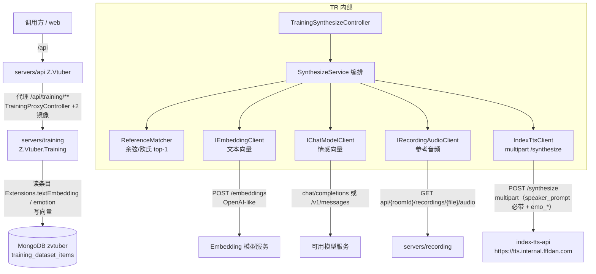
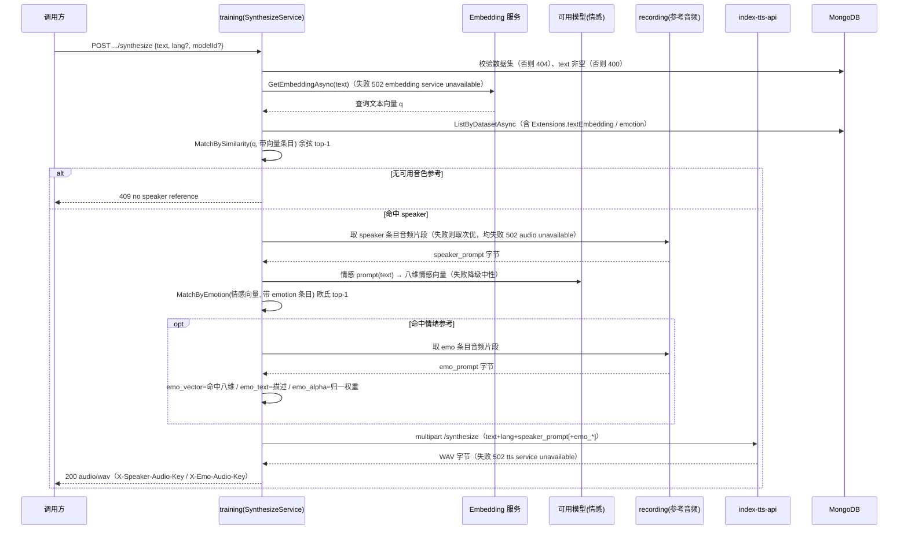
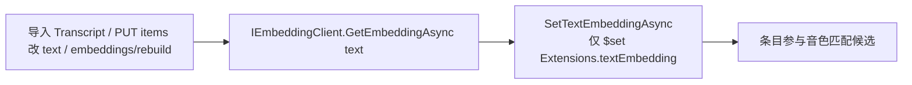

# AI 训练 - 音频生成（数据集语音合成） - 技术提案

- 日期：2026-09-29
- 状态：待评审
- feat-branch：`feat/training-audio-synthesize`
- 关联文档：[PRD](../../product/draft/20260929-training-audio-synthesize-prd.md)

## 1. 概述

### 1.1 背景

依据 PRD「AI 训练 - 音频生成（数据集语音合成）」：training 提供 `POST /api/training/datasets/{id}/synthesize`，输入 `{ text }`，以该数据集为参考池，按文本向量相似匹配音色参考（`speaker_prompt`）、按情感向量匹配情绪参考（`emo_prompt`/`emo_vector`），调用内网 index-tts-api 合成并返回音频。

现状勘察结论（均经读码 / 上游 README 确认）：

**① 上游 index-tts-api `/synthesize` 契约明确，字段与训练侧情绪结构天然对应。**

- `POST {Tts:BaseUrl}/synthesize`（`https://tts.internal.fffdan.com`），**`multipart/form-data`**，返回 **mono 16-bit PCM WAV @22.05kHz**（`Deliay/index-tts-api` README）；
- 关键字段：`text`（必填）、`lang`（必填，`ZH/EN/JA/ES/AR`）、**`speaker_prompt`（file，必填）**、`emo_prompt`（file，可选）、`emo_alpha`（0~1，可选）、**`emo_vector`（八个逗号分隔强度 `happy,angry,sad,afraid,disgusted,melancholic,surprised,calm`）**、`emo_text`（情绪描述）等；
- **`emo_vector` 八维顺序与训练侧 `EmotionResult` 八维完全一致**（`servers/training/Contracts/Dtos.cs:137` `happy/angry/sad/afraid/disgusted/melancholic/surprised/calm`），`emo_text`↔`emotionDescription`、`emo_alpha`↔`emotionControlWeight`（0~10，需归一）——情绪匹配成果可直接喂给上游。

**② 训练侧参考素材与情绪标注已就绪。**

- 条目实体 `servers/common/training/Entities/TrainingDatasetItemRecord.cs`（集合 `training_dataset_items`）：`AudioUri`/`StartMs`/`EndMs`/`Text`/`Extensions`（BsonDocument，**预留加工结果**）；
- 情绪标注落于 `Extensions.emotion`（`servers/training/Contracts/TrainingMapping.cs:156-166` `ToEmotionDocument`，八维 0~1 + `emotionControlWeight` 0~10 + 描述），由情绪识别产出（见 [[20260928-proposal-training-dataset-emotion]]）——**情绪匹配候选 = 带 `Extensions.emotion` 的条目**；
- 参考音频取数：`servers/training/Clients/IRecordingAudioClient.cs` `GetClipAsync(audioUri, startMs, endMs)` → `AudioClip(Bytes, ContentType)`，复用 recording 片段端点——`speaker_prompt`/`emo_prompt` 的音频字节来源。

**③ 可用模型基建可直接复用生成情感向量。**

- 模型管理（Providers/Models，`training_providers`/`training_models`）与 `IChatModelClient`（OpenAI-like `/chat/completions`、Claude-like `/v1/messages`，`servers/training/Ai/`）已上线；
- 情绪 prompt `EmotionPromptBuilder`（`servers/training/Ai/Prompts/EmotionPromptBuilder.cs`）**由文本产出结构化情绪**（十字段 JSON），`ModelJsonParser.ParseEmotion` 解析并钳制——「用可用模型为输入文本生成情感向量」可直接复用该链路。

**④ 文本向量（embedding）为本需求新增能力，仓库内暂无。**

- 全仓库检索 `embedding|vector|cosine|similarity` **无命中**（`servers/`）；音色「按文本向量相似匹配」需新增文本向量化 + 相似度召回；
- 数据集为**千级**量级（既有决策「千级数据全量返回」），内存暴力余弦即可，无需向量库；
- 持久层 MongoDB（`training_dataset_items.Extensions`），新向量可按键名挂接，**零表结构变更**（与 `Extensions.emotion` 同模式）。

### 1.2 目标

1. training 新增 `POST /api/training/datasets/{datasetId}/synthesize`：输入 `{ text }`（可选 `lang`/`modelId`），返回 `audio/wav`；`servers/api` `/api/training/**` 代理镜像暴露（与既有数据集 API 同口径）；
2. 新增文本向量能力（OpenAI-like `/embeddings`，复用 Provider 的 endpoint+apiKey）：条目文本向量存 `Extensions.textEmbedding`，音色匹配 = 数据集内**余弦相似 top-1**；配套 `POST .../embeddings/rebuild` 回填存量向量；
3. 情绪参考匹配：用可用模型（复用 `EmotionPromptBuilder`+`IChatModelClient`）为输入文本生成情感向量，与 `Extensions.emotion` 八维做**欧氏距离 top-1**，用匹配条目作 `emo_prompt`（音频）与 `emo_vector`（八维）；
4. 手写 multipart 客户端调用上游 `/synthesize`（`speaker_prompt` 必带、`emo_*` 按匹配），返回 WAV；契约先行 + codegen，TDD 补齐单测/接口测试。

### 1.3 范围

- **内**：`servers/training`（Synthesize 控制器、`Synthesis/` 匹配与编排、`Clients/IndexTtsClient`、`Ai/Embedding` 文本向量客户端、配置节）；`servers/common/training`（`TrainingDatasetItemRepository` 增向量写入/查询）；`contracts/training.openapi.yaml`（+2 端点）+ `contracts/bilibili-crawler.openapi.yaml`（镜像）；`servers/api/Controllers/TrainingProxyController.cs`（+2 镜像 action）；`infra/apphost/AppHost.cs`（注入 `Tts:BaseUrl`）；`tests/Z.Vtuber.Tests`。
- **外**：数据集/导入/编辑/情绪识别/波形试听**零改动语义**；recording 片段端点零改动；上游 index-tts-api 零改动；合成结果**不入库/不缓存**（本期）；Web 合成界面、批量合成、模型训练、向量库/ANN 检索（本期不做）。

## 2. 技术架构

### 2.1 系统架构图



### 2.2 技术栈

| 层级 | 技术选型 | 说明 |
|------|---------|------|
| 后端 | C# (.NET 10) ASP.NET Core Controllers（training 服务内扩展） | 不新建服务；沿用控制器 + 编排 + DTO 映射模式 |
| 文本向量 | OpenAI-like `POST /embeddings`（手写 `HttpClient` 适配器） | 复用 `training_providers` 的 endpoint+apiKey（key 不回显）；零新增 NuGet |
| 情感向量 | 复用 `IChatModelClient` + `EmotionPromptBuilder` | 用可用模型为输入文本生成八维情感向量 |
| TTS 上游 | 手写 multipart `HttpClient`（`IndexTtsClient`） | 契约面窄，仓库零新增 NuGet 依赖 |
| 数据库 | MongoDB（`training_dataset_items.Extensions` 新键 `textEmbedding`） | 零表结构变更，与 `Extensions.emotion` 同模式 |
| 服务编排 | .NET Aspire（`infra/apphost`） | training 注入 `Tts:BaseUrl` |
| 测试 | xUnit + Testcontainers（Mongo）+ 假 HTTP 服务 | embedding/TTS/recording 用假服务契约测试，不打外网 |

### 2.3 模块划分

| 模块 | 职责 | 关键技术点 |
|------|------|-----------|
| `servers/training/Ai/Embedding`（新增） | 文本向量化 `IEmbeddingClient`/`OpenAiLikeEmbeddingClient` | 按 `Embedding:ProviderId` 取 endpoint+apiKey，`POST /embeddings`，取 `data[0].embedding` |
| `servers/training/Synthesis`（新增） | 匹配纯函数 + 合成编排 | `ReferenceMatcher`（余弦/欧氏 top-1，确定性）、`SynthesizeService`、`EmotionVector` 八维助手 |
| `servers/training/Clients/IndexTtsClient`（新增） | 上游 `/synthesize` multipart 调用 | `speaker_prompt` 必带 file，`emo_*` 按匹配；超时/非 2xx → `TtsUnavailableException` |
| `servers/training/Controllers`（变更） | `TrainingSynthesizeController` | `POST .../synthesize`（返回 `audio/wav`）+ `POST .../embeddings/rebuild` |
| `servers/common/training/Persistence`（变更） | `TrainingDatasetItemRepository` 扩展 | `SetTextEmbeddingAsync`（`$set Extensions.textEmbedding`）、按数据集读条目 |
| `servers/api`（变更） | `/api/training/**` +2 镜像 action | `audio/wav` 二进制透传（同 recording 音频代理口径） |
| `contracts/`（变更） | training 契约 +2 端点 + api 镜像 | 契约先行，web codegen |

## 3. API 设计

### 3.1 API 契约（`contracts/training.openapi.yaml`，扩展）

新增 2 个端点，命名/错误体/状态码口径与既有端点一致（错误体统一 `{"error":"..."}`，非法 ObjectId 按「不存在」→ 404）。

#### 接口 1: 音频生成（synthesize）

- **请求** POST `/api/training/datasets/{datasetId}/synthesize`
  ```json
  { "text": "要合成的文本", "lang": "ZH", "modelId": "66d8..." }
  ```
  | 字段 | 类型 | 必填 | 说明 |
  |------|------|------|------|
  | `text` | string | 是 | 待合成文本（trim 后非空） |
  | `lang` | string | 否 | 语种 `ZH/EN/JA/ES/AR`，缺省 `Tts:DefaultLang`（默认 `ZH`） |
  | `modelId` | string | 否 | 生成情感向量所用模型（缺省 `Synthesize:DefaultEmotionModelId`，再缺省首个启用模型） |

- **响应**
  - `200 audio/wav`：合成音频（上游 mono 16-bit PCM WAV @22.05kHz 透传）；
  - 可选响应头（可观测命中参考，便于排查）：`X-Speaker-Audio-Key`、`X-Emo-Audio-Key`；
  - `400 {"error":"text is required"}`；`404 {"error":"dataset not found"}`；`409 {"error":"no speaker reference"}`（数据集无可用音色参考）；
  - `502 {"error":"embedding service unavailable"}` / `{"error":"tts service unavailable"}` / `{"error":"audio unavailable"}`。

#### 接口 2: 文本向量回填（embeddings/rebuild）

- **请求** POST `/api/training/datasets/{datasetId}/embeddings/rebuild`
- **响应** 200 `{"updated": 123}`（补齐/刷新该数据集条目 `Extensions.textEmbedding` 的条数）；404 dataset；502 embedding 不可用。
- 用途：升级后回填存量条目向量（PRD 约束），或向量模型变更后重建；新条目在导入/编辑时已写向量（见 §5.2 实现点 2）。

#### schema 定义（增量）

```yaml
TrainingSynthesizeRequest:
  properties:
    text: { type: string, description: 待合成文本（必填） }
    lang: { type: string, nullable: true, description: "语种 ZH/EN/JA/ES/AR，缺省 Tts:DefaultLang（默认 ZH）" }
    modelId: { type: string, nullable: true, description: 生成情感向量所用模型 id，缺省默认/首个启用模型 }

# 成功响应为 audio/wav 二进制（非 JSON），以 X-Speaker-Audio-Key / X-Emo-Audio-Key 头标注命中参考
```

#### 代理镜像（api 服务，`contracts/bilibili-crawler.openapi.yaml`）

`/api/training/datasets/{datasetId}/synthesize`、`/api/training/datasets/{datasetId}/embeddings/rebuild` 逐个镜像（与既有 22 个端点同口径：query/body/状态码/**`audio/wav` Content-Type 与二进制体透传**，参考 recording 音频代理；上游不可达 502 `{"error":"training service unavailable"}`）。

### 3.2 内部接口

- **文本向量客户端**（`servers/training/Ai/Embedding/`）：

  ```csharp
  public interface IEmbeddingClient
  {
      /// <summary>按 Embedding:ProviderId 取 endpoint+apiKey，POST {endpoint}/embeddings，返回 data[0].embedding。</summary>
      Task<float[]> GetEmbeddingAsync(string text, CancellationToken ct = default);
  }
  ```
  - `OpenAiLikeEmbeddingClient`：body `{"input": text, "model": Embedding:Model}`，`Authorization: Bearer {apiKey}`；解析 `data[0].embedding`（float[]）；不可达/非 2xx → `EmbeddingUnavailableException`（映射 502）；响应非法 → 同上。

- **TTS 客户端**（`servers/training/Clients/IndexTtsClient.cs`）：

  ```csharp
  public sealed record TtsSynthesizeRequest(
      string Text, string Lang, AudioClip SpeakerPrompt,
      AudioClip? EmoPrompt, string? EmoVector, double? EmoAlpha, string? EmoText,
      double DurationFactor, bool TextNormalization, int MaxTextTokensPerSegment, int IntervalSilenceMs);

  public interface ITtsClient
  {
      /// <summary>multipart/form-data 调 {Tts:BaseUrl}/synthesize，返回 WAV 字节；超时/非 2xx 抛 TtsUnavailableException（映射 502）。</summary>
      Task<byte[]> SynthesizeAsync(TtsSynthesizeRequest request, CancellationToken ct = default);
  }
  ```
  - multipart 字段：`text`、`lang`、`speaker_prompt`（file，必带）、`emo_prompt`（file，可选）、`emo_vector`、`emo_alpha`、`emo_text`、`use_emo_text=false`、`use_random=false`、`duration_factor`、`text_normalization`、`max_text_tokens_per_segment`、`interval_silence`；`SocketsHttpHandler.AllowAutoRedirect=false`。

- **匹配纯函数**（`servers/training/Synthesis/ReferenceMatcher.cs`，单测重点）：

  ```csharp
  // 余弦相似 top-1（音色）；相似度相等时按 AudioKey 升序取首，保证确定性
  TrainingDatasetItemRecord? MatchBySimilarity(
      float[] query, IReadOnlyList<(TrainingDatasetItemRecord Item, float[] Embedding)> candidates);

  // 欧氏距离 top-1（情绪）；距离相等时按 AudioKey 升序取首
  TrainingDatasetItemRecord? MatchByEmotion(
      EmotionVector query, IReadOnlyList<(TrainingDatasetItemRecord Item, EmotionVector Emotion)> candidates);
  ```

- **合成编排**（`servers/training/Synthesis/SynthesizeService.cs`）：

  ```csharp
  public sealed record SynthesizeResult(byte[] Audio, string? SpeakerAudioKey, string? EmoAudioKey);

  public interface ISynthesizeService
  {
      Task<SynthesizeResult> SynthesizeAsync(
          ObjectId datasetId, string text, string? lang, ObjectId? modelId, CancellationToken ct = default);
  }
  ```

- **仓储**（`servers/common/training/Persistence/TrainingDatasetItemRepository.cs` 扩展）：

  ```csharp
  Task<bool> SetTextEmbeddingAsync(ObjectId datasetId, ObjectId itemId, double[] embedding, CancellationToken ct = default);
  // 仅 $set {"Extensions.textEmbedding": [...]}，不动 Extensions 其他键（兼容 emotion），同步刷新 UpdatedAt
  Task<List<TrainingDatasetItemRecord>> ListByDatasetAsync(ObjectId datasetId, CancellationToken ct = default); // 匹配取全量（千级）
  ```

- **向量映射**（`TrainingMapping` 增）：`ToEmbeddingDocument(double[])` / `FromEmbeddingDocument(BsonDocument?)`（`Extensions.textEmbedding` ↔ `float[]`，缺失/格式不符 → `null`，仿 `FromEmotionDocument` 容错）；`BuildEmotionVector(EmotionResult)`（八维 → `EmotionVector`）；`FormatEmoVector(EmotionVector)`（→ `h,a,s,af,d,m,sa,c` 逗号串）；`NormalizeEmoAlpha(double? controlWeight)`（`clamp(w/10, 0, 1)`，缺省 `Tts:DefaultEmoAlpha`）。

## 4. 数据模型

### 4.1 数据库设计

#### 条目扩展（`training_dataset_items.Extensions.textEmbedding`，不改表结构）

```json
{ "textEmbedding": [0.0123, -0.0456, "... (维度由 Embedding:Model 决定，如 1024/1536)"] }
```

- 写入：`SetTextEmbeddingAsync` 仅 `$set: {"Extensions.textEmbedding": [...]}`（不动 `Extensions.emotion` 等其他键）；导入时、`PUT items/{id}` 修改 `text` 时、`embeddings/rebuild` 时写入/刷新；
- 读取：匹配时取 `Extensions.textEmbedding`（`FromEmbeddingDocument`，缺失/格式不符 → null，**不参与音色匹配候选**）；
- 与 `Extensions.emotion`（情绪匹配候选键）对称：**音色匹配看 `textEmbedding`，情绪匹配看 `emotion`**。

#### 集合：无新增

无新集合、无迁移；`training_dataset_items` 仅新增一个 `Extensions` 子键（`BsonDocument` 天然容纳，旧版本 `BsonIgnoreExtraElements` 忽略）。

### 4.2 缓存设计

无缓存：合成结果本期不缓存/不入库（见 §6.1 决策 14）；匹配在单数据集内内存计算（千级），条目一次 `ListByDatasetAsync` 载入；向量持久化于条目 `Extensions.textEmbedding`，避免重复向量化。

## 5. 技术实现方案

### 5.1 核心流程

#### 流程 1: 音频生成（synthesize）



注：情绪生成/匹配为**best-effort**——无 `Extensions.emotion` 候选、模型不可用或输出非法时，省略 `emo_*` 字段走中性合成（PRD 边界）；`speaker_prompt` 上游必填，故音色匹配为硬前置。

#### 流程 2: 文本向量写入（导入 / 编辑 / 回填）



### 5.2 关键实现点

#### 实现点 1: 文本向量客户端（`servers/training/Ai/Embedding`）

- `OpenAiLikeEmbeddingClient`（named client `EmbeddingModel`，`AllowAutoRedirect=false`）：按 `Embedding:ProviderId` 读 `TrainingProviderRepository` 取 `Endpoint`+`ApiKey`（**key 只进不出**），`POST {endpoint}/embeddings` body `{"input": text, "model": Embedding:Model}`；解析 `data[0].embedding`（`float[]`）；
- 异常分类：`EmbeddingUnavailableException`（不可达/超时/非 2xx/响应非法 → 502 `embedding service unavailable`）；日志打 endpoint 与维度，**不打 apiKey**；
- 复用 `ModelSessionHeaderHandler` 同款请求头（若需 agent 标识），与既有模型调用一致。

#### 实现点 2: 向量写入时机（导入 / 编辑 / 回填）

- **导入**（`TrainingDatasetItemsController` 导入路径）：新增条目在写库后批量 `GetEmbeddingAsync` 并 `SetTextEmbeddingAsync`（逐条或批量 embeddings input）；embedding 不可用时**导入照常落库**、仅跳过向量（Warn），待 `rebuild` 补齐（导入不被 embedding 阻断）；
- **编辑**（`PUT items/{id}`）：提交含 `text` 且变更时，重算并 `SetTextEmbeddingAsync`（失败仅 Warn，不阻断保存）；
- **回填**（`POST .../embeddings/rebuild`）：`ListByDatasetAsync` 过滤 `Extensions.textEmbedding` 缺失或 `--force`，批量补算写入，返回 `{updated}`。

#### 实现点 3: 匹配纯函数（`Synthesis/ReferenceMatcher.cs`）

- `MatchBySimilarity`：余弦相似 `dot(q,c)/(|q||c|)`，取 max；**相似度并列按 `AudioKey` 升序取首**（确定性，PRD「可复现」）；空候选/全缺向量 → null；
- `MatchByEmotion`：八维 `EmotionVector` 欧氏距离 `sqrt(Σ(qi-ci)^2)`，取 min；并列按 `AudioKey` 升序取首；
- 纯函数无 IO，单测覆盖（并列/空/单元素/维度不符容错）。

#### 实现点 4: 情感向量生成（复用既有）

- `SynthesizeService` 调 `EmotionPromptBuilder`（输入文本 → 十字段 JSON）+ `IChatModelClient.CompleteJsonAsync`（`modelId` 或默认模型，须 `Enabled`）→ `ModelJsonParser.ParseEmotion` → `EmotionResult` → `BuildEmotionVector`（八维）；
- 生成失败/模型停用/输出非法 → **降级中性**（省略 `emo_*`），记 Warn，不 502（情绪是增强项）。

#### 实现点 5: 上游 TTS 客户端（`Clients/IndexTtsClient.cs`）

- `MultipartFormDataContent`：`text`/`lang` 文本字段；`speaker_prompt`/`emo_prompt` 用 `ByteArrayContent`（`audio/mpeg`，文件名 `speaker_prompt.mp3`/`emo_prompt.mp3`，源自 `AudioClip.ContentType`）；`emo_vector`（`FormatEmoVector`）/`emo_alpha`（`NormalizeEmoAlpha`）/`emo_text`/`duration_factor`/`text_normalization`/`max_text_tokens_per_segment`/`interval_silence`；`use_emo_text=false`、`use_random=false`（情绪由匹配显式给定）；
- 超时 `Tts:RequestTimeoutSeconds`（默认 120s）；非 2xx/超时 → `TtsUnavailableException`（502 `tts service unavailable`）；返回体即 WAV 字节透传。

#### 实现点 6: 合成编排（`Synthesis/SynthesizeService.cs`）

- 顺序：dataset（404）→ text（400）→ embed query（502）→ `ListByDatasetAsync` → `MatchBySimilarity`（409 若无）→ 取 speaker 音频（**按相似度降序尝试，取数失败取次优**，均失败 502 `audio unavailable`）→ 情感生成（best-effort）→ `MatchByEmotion` + 取 emo 音频（best-effort）→ `ITtsClient.SynthesizeAsync`（502）→ 返回 `SynthesizeResult`；
- Info 日志：`training synthesize: datasetId={} speakerKey={} emoKey={} lang={} elapsedMs={}`，**不打文本内容与音频字节**。

#### 实现点 7: 控制器与代理（`TrainingSynthesizeController` + `TrainingProxyController`）

- `TrainingSynthesizeController` `[Route("api/training/datasets/{datasetId}")]`：`POST synthesize`（`File(result.Audio, "audio/wav")` + `Response.Headers["X-Speaker-Audio-Key"]`/`X-Emo-Audio-Key`）、`POST embeddings/rebuild`（`{updated}`）；
- `TrainingProxyController` +2 action，`ForwardAsync` 透传；**synthesize 镜像须保留 `audio/wav` Content-Type 与二进制体**（复用 recording 音频代理的透传口径）；契约镜像同步补 `contracts/bilibili-crawler.openapi.yaml`。

#### 实现点 8: 配置与编排（`Configuration` + `infra/apphost`）

- `EmbeddingOptions`（节 `Embedding`，`ValidateOnStart`）：`ProviderId`（指向某 `training_provider`，取 endpoint+apiKey，须 `openai` 类型）、`Model`、`RequestTimeoutSeconds`(30)、`Dimensions?`；
- `TtsOptions`（节 `Tts`，`ValidateOnStart`）：`BaseUrl`(默认 `https://tts.internal.fffdan.com`)、`RequestTimeoutSeconds`(120)、`DefaultLang`(`ZH`)、`DefaultEmoAlpha`(1.0)、`DurationFactor`(1.0)、`MaxTextTokensPerSegment`(120)、`IntervalSilenceMs`(200)、`TextNormalization`(true)；
- `SynthesizeOptions`（节 `Synthesize`）：`DefaultEmotionModelId?`、`MaxReferenceDurationMs?`（参考片段时长上限，默认复用 `Ai:AudioClipDefaultDurationMs`）；
- `Program.cs` 注册 `IEmbeddingClient`/`ITtsClient`/`IReferenceMatcher`/`ISynthesizeService` + named clients；`infra/apphost/AppHost.cs`：training `.WithEnvironment("Tts__BaseUrl", ...)`（内网 TTS 地址）。

### 5.3 不在本期的事项

- 合成结果入库/缓存/合成记录（本期仅合成返回音频）；
- 批量合成、定时合成、Web 合成界面（本期纯 API）；
- 向量库 / ANN 近似检索（本期千级内存暴力余弦）；
- 语言自动检测（本期 `lang` 缺省 ZH，可选覆盖）；
- 自动音色/情绪标注回填 UI、模型训练、上游 index-tts-api 改造。

## 6. 技术决策

### 6.1 决策列表

| 决策 | 选项 A | 选项 B | 最终选择 | 原因 |
|------|--------|--------|---------|------|
| 文本向量来源 | OpenAI-like `/embeddings`（复用 Provider endpoint+apiKey） | 本地句向量模型 / 用 LLM 取向量 | **A** | 复用既有 Provider 基建与 key 安全面；易做假服务契约测试；LLM 不产标准句向量，本地模型引入新运行时依赖 |
| 向量存储位置 | `Extensions.textEmbedding` | 顶层 `TextEmbedding` 字段 / 独立向量集合/向量库 | **A** | 与 `Extensions.emotion` 对称、零表结构变更；`Extensions` 本就「预留加工结果按键挂接」 |
| 召回方式 | 内存暴力余弦（千级全量） | Mongo 向量检索 / 向量库（ANN） | **A** | 单数据集千级，全量载入余弦最简、可复现；量级增大再引 ANN/向量库 |
| 向量回填时机 | 写时计算（导入/编辑）+ `embeddings/rebuild` 端点 | 匹配时惰性计算并缓存 | **A** | 匹配/synth 路径可预测（不被隐藏 embedding 调用拖慢）；`rebuild` 覆盖存量升级与模型变更 |
| 音色匹配口径 | 文本向量相似 top-1（按需求） | 固定单一音色 / 按 source 分组 | **A** | 需求明确「按文本向量相似匹配，返回最接近 1 条作 speaker_prompt」 |
| 情感向量来源 | 用可用模型为输入文本生成（复用 `EmotionPromptBuilder`+`IChatModelClient`） | 规则/词典 / 直接复用某条目情绪 | **A** | 需求「使用可用的模型，使用 prompt 生成文本的情感向量」；复用既有能力零重建 |
| emo_prompt/emo_vector 取值 | 用**匹配条目**的情绪向量+音频 | 用**生成**的情感向量直接当 emo_vector | **A** | 需求「匹配…的数据作为 emo_prompt 和 emo_vector」；匹配条目向量≈生成向量，且与其 emo_prompt 音频自洽 |
| 情绪距离度量 | 欧氏距离（八维 0~1 强度） | 余弦 | **A** | 八维是强度幅值非方向向量，欧氏更贴合「最相近」语义 |
| emo_alpha 映射 | `clamp(emotionControlWeight/10, 0, 1)` | 固定 1.0 / 仅配置 | **A** | 把 0~10 控制权重归一到上游 0~1 强度；缺省用 `Tts:DefaultEmoAlpha`(1.0) |
| 情绪匹配失败/无标注 | 降级中性合成（省略 `emo_*`） | 直接失败 | **A** | 情绪是增强项、上游 `emo_*` 均可选；`speaker_prompt` 才必填，情绪不应阻断合成 |
| 参考音频形态 | 复用 recording 片段（mp3 clip） | 预生成 wav 音源 | **A** | 复用 `IRecordingAudioClient` 零新增音源；条目段落天然秒级，适合参考 |
| TTS 上游接入 | 手写 multipart `HttpClient` | 引入 SDK | **A** | 契约面窄，仓库零新增 NuGet；仿既有手写客户端，易做假服务测试 |
| lang 处理 | 请求可选 `lang`（缺省 `Tts:DefaultLang`=ZH） | 语言自动检测 | **A** | 需求输入仅文本，缺省中文；保留可选覆盖，检测留待后续 |
| 合成结果缓存/入库 | 本期不缓存 | 按 (dataset,text,params) 缓存 | **B** | 本期仅合成返回；缓存引入一致性/失效复杂度，收益待观察后追加 |
| 响应形态 | `audio/wav` 二进制 + `X-*` 命中头 | base64 JSON 包裹 | **A** | 「返回音频数据」；二进制最直接、代理透传 Content-Type；`X-*` 头可观测命中参考 |

### 6.2 依赖与约束

| 类型 | 内容 | 说明 |
|------|------|------|
| 依赖 | 内网 index-tts-api `/synthesize`（`Tts:BaseUrl`） | 上游合成；`speaker_prompt` 必填 |
| 依赖 | Embedding 模型服务（OpenAI-like `/embeddings`） | 文本向量；经 `Embedding:ProviderId` 复用 Provider endpoint+apiKey |
| 依赖 | 可用模型（既有 Models，`IChatModelClient`） | 为输入文本生成情感向量 |
| 依赖 | recording 片段端点（`IRecordingAudioClient`） | `speaker_prompt`/`emo_prompt` 参考音频字节 |
| 依赖 | 数据集条目（文本+音频+情绪标注 `Extensions.emotion`） | 匹配候选 |
| 约束 | 契约先行 | 先补 `contracts/training.openapi.yaml` + api 镜像契约，再改实现（common-rules） |
| 约束 | 不改数据集/导入/情绪识别/波形既有语义 | 合成纯新增；向量走 `Extensions.textEmbedding` 零表结构变更 |
| 约束 | apiKey 不回显、日志不含密钥/文本/音频 | 沿用既有口径 |
| 约束 | 手写 HTTP、零新增 NuGet 依赖 | embedding/TTS 适配器 |
| 约束 | .NET 10、TDD、核心逻辑覆盖率 ≥ 80% | 项目既有规范 |

## 7. 项目结构

```
contracts/（变更）
├── training.openapi.yaml                     # + synthesize + embeddings/rebuild + TrainingSynthesizeRequest
└── bilibili-crawler.openapi.yaml             # + 2 个 /api/training/** 镜像（含 audio/wav 透传）

servers/common/training/（变更）
└── Persistence/TrainingDatasetItemRepository.cs  # + SetTextEmbeddingAsync / ListByDatasetAsync

servers/training/（变更）
├── Ai/Embedding/IEmbeddingClient.cs          # 新增：文本向量抽象
├── Ai/Embedding/OpenAiLikeEmbeddingClient.cs # 新增：POST /embeddings（复用 Provider endpoint+apiKey）
├── Ai/Embedding/EmbeddingExceptions.cs       # 新增：EmbeddingUnavailableException
├── Synthesis/EmotionVector.cs                # 新增：八维向量 + FormatEmoVector/NormalizeEmoAlpha
├── Synthesis/ReferenceMatcher.cs             # 新增：余弦/欧氏 top-1 纯函数（确定性）
├── Synthesis/SynthesizeService.cs            # 新增：合成编排（匹配→取音频→情感→TTS）
├── Clients/IndexTtsClient.cs                 # 新增：multipart /synthesize（speaker_prompt 必带 + emo_*）
├── Clients/IRecordingAudioClient.cs          # 复用（参考音频取数）
├── Controllers/TrainingSynthesizeController.cs # 新增：synthesize + embeddings/rebuild
├── Contracts/TrainingMapping.cs              # + ToEmbeddingDocument/FromEmbeddingDocument/BuildEmotionVector 等
├── Configuration/EmbeddingOptions.cs         # 新增：节 Embedding
├── Configuration/TtsOptions.cs               # 新增：节 Tts
├── Configuration/SynthesizeOptions.cs        # 新增：节 Synthesize
└── Program.cs                                # + 注册 embedding/tts/编排 + named clients

servers/api/（变更）
└── Controllers/TrainingProxyController.cs    # + 2 个镜像 action（synthesize 二进制透传）

infra/apphost/（变更）
└── AppHost.cs                                # training + Tts__BaseUrl

tests/Z.Vtuber.Tests/（变更）
├── ReferenceMatcherTests.cs                  # 余弦/欧氏 top-1、并列确定性、空/容错
├── EmbeddingMappingTests.cs                  # Extensions.textEmbedding 读写与容错
├── EmotionVectorTests.cs                     # FormatEmoVector / NormalizeEmoAlpha / BuildEmotionVector
├── TrainingSynthesizeApiTests.cs             # 成功/409/400/404/502、multipart 字段、命中头、降级中性
├── TrainingEmbeddingsRebuildTests.cs         # rebuild 回填 updated 数
├── IndexTtsClientTests.cs                    # 假 TTS：multipart 字段组装 / 超时 502
└── TrainingProxyControllerTests.cs           # + synthesize/rebuild 镜像透传（audio/wav）
```

## 8. 测试策略

### 8.1 测试覆盖要求

- 核心逻辑（余弦/欧氏匹配、确定性并列、向量 Bson 映射、`FormatEmoVector`/`NormalizeEmoAlpha`、情感向量构建、multipart 字段组装）覆盖率 ≥ 80%（common-rules）；
- TDD：契约先行后按红-绿推进；embedding/TTS/recording 一律用本地假 HTTP server（沿用 `FakeFunAsrServer` 做法），不打真实外网。

### 8.2 测试类型

| 类型 | 工具 | 覆盖范围 |
|------|------|---------|
| 单元测试 | xUnit | `ReferenceMatcher`（余弦/欧氏/并列/空/维度容错）、`EmotionVector`（格式化/归一/构建）、`TrainingMapping` 向量 Bson 映射 |
| 接口测试 | xUnit + Testcontainers(Mongo) + WebApplicationFactory | synthesize 全链路（假 embedding+假模型+假 recording+假 TTS）、错误码映射、降级中性、命中头 |
| 契约测试 | 既有契约检查模式 | training 契约与实现一致；api 镜像一致（含 `audio/wav`） |
| 客户端测试 | 假 HTTP server | `IndexTtsClient` multipart 字段、`OpenAiLikeEmbeddingClient` 请求/解析、超时/非 2xx |

关键用例清单：

- **匹配**：音色余弦 top-1 命中预期条目；相似度并列按 `AudioKey` 升序稳定；情绪欧氏 top-1；空候选/全缺向量 → null；
- **synthesize 成功**：200 `audio/wav`；TTS 收到 `text`/`lang`(默认 ZH)/`speaker_prompt`(file) 与（有情绪候选时）`emo_prompt`/`emo_vector`/`emo_text`/`emo_alpha`；响应头 `X-Speaker-Audio-Key`/`X-Emo-Audio-Key` 与命中一致；
- **确定性**：同一 dataset+text 两次调用命中同一参考（头一致）；
- **降级中性**：无 `Extensions.emotion` 候选 / 情感生成失败 → TTS 收到**无 `emo_*`** 且仍 200；
- **错误码**：text 空 400；数据集不存在 404；无可用音色参考（空集/无向量）409；embedding 不可用 502；speaker 音频取数失败→次优→均失败 502 `audio unavailable`；TTS 不可用/超时 502；
- **embeddings/rebuild**：补齐缺失向量返回 `updated`；导入/编辑写向量（embedding 不可用仅 Warn 不阻断）；
- **代理**：synthesize 镜像 `audio/wav` 二进制 + 状态码透传；rebuild 透传；
- **回归**：既有数据集/导入/情绪识别/波形功能不回退。

## 9. 部署方案

### 9.1 环境规划

| 环境 | 用途 | 部署方式 |
|------|------|---------|
| AppHost（Aspire）本地编排 | 开发联调 | training 注入 `Tts__BaseUrl`（内网 TTS） |
| 生产 | 随常规版本发布 | 先发 training（新端点 + 向量写入），再 api 代理；纯新增面，旧版本无感知 |

### 9.2 配置管理

- 新增配置：`Embedding` 节（`ProviderId`/`Model`/`RequestTimeoutSeconds`/`Dimensions?`）、`Tts` 节（`BaseUrl` 默认 `https://tts.internal.fffdan.com`/`RequestTimeoutSeconds`/`DefaultLang`/`DefaultEmoAlpha`/`DurationFactor`/`MaxTextTokensPerSegment`/`IntervalSilenceMs`/`TextNormalization`）、`Synthesize` 节（`DefaultEmotionModelId?`/`MaxReferenceDurationMs?`）；均 `ValidateOnStart`；
- **前置数据**：`Embedding:ProviderId` 须指向一个 `openai` 类型 Provider（提供 endpoint+apiKey）；音色匹配须先对存量条目执行 `POST .../embeddings/rebuild` 回填文本向量（否则存量条目不参与音色匹配）；
- 需可访：index-tts-api（`Tts:BaseUrl`）、Embedding 模型端点、情绪模型端点、recording（参考音频）；
- 数据初始化：无新集合/无迁移；`Extensions.textEmbedding` 为新子键，旧版本 `BsonIgnoreExtraElements` 忽略；
- 回滚：按整体版本回退；纯新增端点与 `Extensions.textEmbedding` 残留无害；
- 镜像流水线 `.github/workflows/build-training-image.yml` 触发范围已含 `servers/training/**` 与 `servers/common/training/**`，无需调整。

## 10. 验收标准

- [ ] 技术方案评审通过；契约评审通过（含 api 镜像契约）
- [ ] `POST /api/training/datasets/{id}/synthesize` 传 `text` 返回 `audio/wav`；经 z-vtuber `/api/training/**` 代理同口径可访问
- [ ] 音色参考 = 数据集内文本向量**余弦相似 top-1**（`X-Speaker-Audio-Key` 可观测）；同 dataset+text 确定性命中同一参考
- [ ] 情绪参考 = 用可用模型为文本生成情感向量后**欧氏距离 top-1**（`X-Emo-Audio-Key`）；`emo_vector` 八维顺序与 `Extensions.emotion` 一致；无标注降级中性仍返回
- [ ] 上游 multipart 字段符合 index-tts-api 契约（`speaker_prompt` 必带、`emo_*` 按匹配、`use_emo_text=false`）
- [ ] 错误码：400 text 空 / 404 数据集 / 409 无音色参考 / 502 embedding·tts·audio 不可用
- [ ] `POST .../embeddings/rebuild` 回填存量文本向量并返回 `updated`；导入/编辑写向量不阻断主流程
- [ ] 匹配/映射/格式化单测覆盖；接口测试覆盖成功/降级/各错误码；核心逻辑覆盖率 ≥ 80%
- [ ] 既有数据集/导入/编辑/情绪识别/波形功能回归不回退

## 11. 相关文档

- PRD：`docs/product/draft/20260929-training-audio-synthesize-prd.md`
- AI 训练 - 音频数据集（第一期）技术提案：`docs/engineering/proposals/20260927-proposal-training-audio-dataset.md`
- AI 训练 - 数据集工具优化（情绪识别）技术提案：`docs/engineering/proposals/20260928-proposal-training-dataset-emotion.md`
- 上游项目：[`Deliay/index-tts-api`](https://github.com/Deliay/index-tts-api)（IndexTTS-2.5 `POST /synthesize`）
- 既有契约：`contracts/training.openapi.yaml`、`contracts/bilibili-crawler.openapi.yaml`
- 规范：`docs/engineering/common-rules.md`、`docs/engineering/backend-rules.md`
