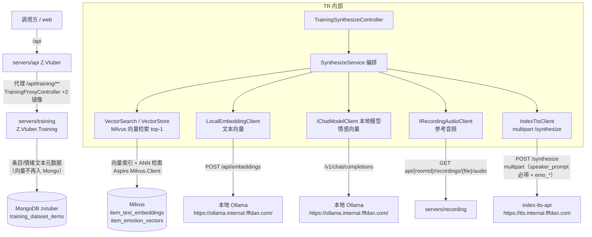
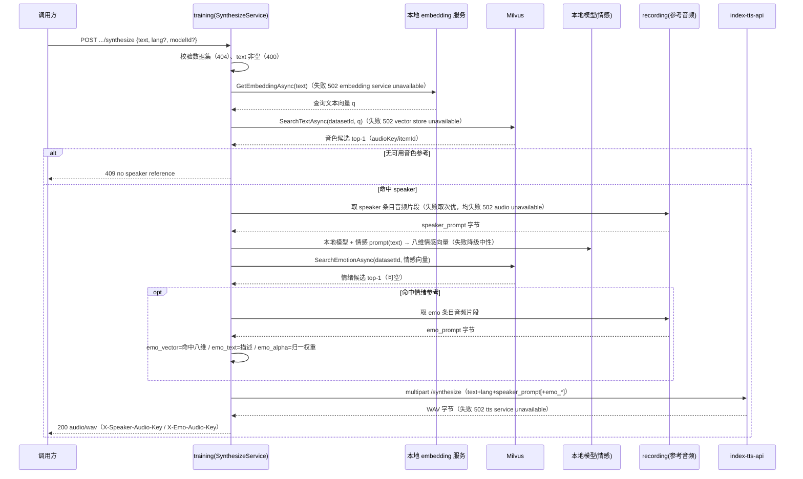
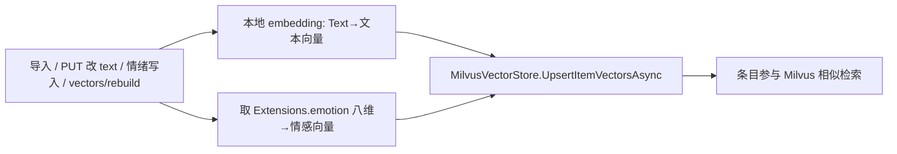

# AI 训练 - 音频生成（数据集语音合成） - 技术提案

- 日期：2026-09-29（修订：2026-09-30，改用 Milvus + 本地向量服务）
- 状态：待评审（返工修订）
- feat-branch：`feat/training-audio-synthesize`
- 关联文档：[PRD](../../product/draft/20260929-training-audio-synthesize-prd.md)

> **返工修订说明**：按下游评审意见调整——① 向量来源改用**本地服务**，不依赖三方 LLM API；② 放弃以 MongoDB 承载向量，改用 **Milvus**（调研结论：MongoDB 7 自建版无 `$vectorSearch`，见 §1.1④）。

## 1. 概述

### 1.1 背景

依据 PRD「AI 训练 - 音频生成（数据集语音合成）」：training 提供 `POST /api/training/datasets/{id}/synthesize`，输入 `{ text }`，以该数据集为参考池，按文本向量相似匹配音色参考（`speaker_prompt`）、按情感向量匹配情绪参考（`emo_prompt`/`emo_vector`），调用内网 index-tts-api 合成并返回音频。

现状勘察结论（均经读码 / 上游 README / 官方文档确认）：

**① 上游 index-tts-api `/synthesize` 契约明确，字段与训练侧情绪结构天然对应。**

- `POST {Tts:BaseUrl}/synthesize`（`https://tts.internal.fffdan.com`），**`multipart/form-data`**，返回 **mono 16-bit PCM WAV @22.05kHz**（`Deliay/index-tts-api` README）；
- 关键字段：`text`（必填）、`lang`（必填，`ZH/EN/JA/ES/AR`）、**`speaker_prompt`（file，必填）**、`emo_prompt`（file，可选）、`emo_alpha`（0~1，可选）、**`emo_vector`（八个逗号分隔强度 `happy,angry,sad,afraid,disgusted,melancholic,surprised,calm`）**、`emo_text`（情绪描述）等；
- **`emo_vector` 八维顺序与训练侧 `EmotionResult` 八维完全一致**（`servers/training/Contracts/Dtos.cs:137`），`emo_text`↔`emotionDescription`、`emo_alpha`↔`emotionControlWeight`（0~10，需归一）。

**② 训练侧参考素材与情绪标注已就绪。**

- 条目实体 `servers/common/training/Entities/TrainingDatasetItemRecord.cs`（集合 `training_dataset_items`）：`AudioUri`/`StartMs`/`EndMs`/`Text`/`Extensions`（BsonDocument）；
- 情绪标注落于 `Extensions.emotion`（八维 0~1 + `emotionControlWeight` 0~10 + 描述）；参考音频取数复用 `servers/training/Clients/IRecordingAudioClient.cs` `GetClipAsync` → `AudioClip(Bytes, ContentType)`。

**③ 可用模型基建可复用生成情感向量，但模型须本地化。**

- 模型管理（Providers/Models）与 `IChatModelClient`、情绪 prompt `EmotionPromptBuilder`（文本 → 十字段情绪 JSON）、`ModelJsonParser.ParseEmotion` 已上线；
- **按「不依赖三方 LLM API」约束**：本需求的情感向量由**本地 Ollama**「`https://ollama.internal.fffdan.com/`」的本地模型生成（经 Models 注册其本地 endpoint `/v1`，或独立本地模型配置），不调用 api.openai.com / Anthropic 等三方接口。

**④ 向量须本地生成；MongoDB 7 自建版无向量检索能力，改用 Milvus（调研结论）。**

- **向量来源 = 本地 Ollama（已搭建）**：上游已搭建本地 **Ollama**「`https://ollama.internal.fffdan.com/`」——文本向量由其 `/api/embeddings`（或 OpenAI 兼容 `/v1/embeddings`）生成，情感向量由其本地模型 + prompt 生成，**均不依赖三方 LLM API**；
- **MongoDB 向量检索能力调研**：`$vectorSearch`（官方文档 [vectorSearch](https://www.mongodb.com/docs/manual/reference/operator/aggregation/vectorSearch/)）仅在 **MongoDB Atlas（6.0.11+）**、**MongoDB Enterprise 8.2+（K8s Operator）**、**MongoDB Community 8.2+** 可用；本项目为**自建 MongoDB 7.0**（`MongoDB.Driver` 3.9.0 + `Aspire.MongoDB.Driver`，测试用 Testcontainers 自建），**不在 `$vectorSearch` 支持范围内**，无法在 Mongo 内建向量索引/检索；
- **故向量存储与相似检索改用 Milvus**（开源向量库，专为向量相似度检索）：经 **Aspire Milvus 集成**接入（托管 `milvusdb/milvus` 容器 + `Aspire.Milvus.Client`，见 [aspire.dev Milvus](https://aspire.dev/integrations/databases/milvus/milvus-get-started/)）；MongoDB 继续承载条目/情绪文本等**元数据**，向量索引作为**可重建的派生数据**存于 Milvus（FLAT 索引，千级数据精确检索且结果确定）。

### 1.2 目标

1. training 新增 `POST /api/training/datasets/{datasetId}/synthesize`：输入 `{ text }`（可选 `lang`/`modelId`），返回 `audio/wav`；`servers/api` `/api/training/**` 代理镜像暴露；
2. **向量本地生成**：文本向量与情感向量均由本地 Ollama「`https://ollama.internal.fffdan.com/`」产出，**不依赖三方 LLM API**；
3. **向量存储/检索用 Milvus**：条目文本向量 + 八维情感向量入 Milvus（Aspire Milvus 集成），音色匹配 = 文本向量检索 top-1、情绪匹配 = 情感向量检索 top-1；配套 `POST .../vectors/rebuild` 从 MongoDB（条目文本/情绪）重建 Milvus 向量索引；
4. 手写 multipart 客户端调用上游 `/synthesize`（`speaker_prompt` 必带、`emo_*` 按匹配），返回 WAV；契约先行 + codegen，TDD 补齐测试（Testcontainers Milvus）。

### 1.3 范围

- **内**：`servers/training`（Synthesize 控制器、`Synthesis/` 匹配与编排、`Clients/IndexTtsClient`、`Vectors/`（本地 embedding 客户端 + Milvus 向量仓储 + 检索）、配置节）；`contracts/training.openapi.yaml`（+2 端点）+ `contracts/bilibili-crawler.openapi.yaml`（镜像）；`servers/api/Controllers/TrainingProxyController.cs`（+2 action）；`infra/apphost/AppHost.cs`（**+ Milvus 资源 + 本地 embedding/model 服务**）；`tests/Z.Vtuber.Tests`（Testcontainers Milvus）。
- **外**：数据集/导入/编辑/情绪识别/波形试听**零改动语义**；recording 片段端点零改动；上游 index-tts-api 零改动；合成结果不入库/不缓存（本期）；Web 合成界面、批量合成、模型训练（本期不做）；Milvus 仅作向量索引（元数据仍在 MongoDB）。

## 2. 技术架构

### 2.1 系统架构图



### 2.2 技术栈

| 层级 | 技术选型 | 说明 |
|------|---------|------|
| 后端 | C# (.NET 10) ASP.NET Core Controllers（training 服务内扩展） | 不新建服务；沿用控制器 + 编排 + DTO 映射模式 |
| 文本向量 | **本地 Ollama**（`https://ollama.internal.fffdan.com/`，`/api/embeddings`，手写 `HttpClient`） | **上游已搭建 Ollama**，不依赖三方 LLM API |
| 情感向量 | 复用 `EmotionPromptBuilder` + `IChatModelClient`（指向**本地 Ollama** `/v1/chat/completions`） | 本地 Ollama 模型 + prompt 生成八维情感向量 |
| 向量库 | **Milvus**（`Aspire.Milvus.Client` + `Milvus.Client`） | 向量索引 + ANN 检索（FLAT，千级精确）；替代 MongoDB 承载向量 |
| 服务编排 | .NET Aspire（`infra/apphost`） | **托管 Milvus（`milvusdb/milvus`）** + 本地 embedding/model 服务 + training |
| TTS 上游 | 手写 multipart `HttpClient`（`IndexTtsClient`） | 契约面窄，仓库零新增 NuGet；`AllowAutoRedirect=false` |
| 数据库 | MongoDB（元数据：条目/情绪文本）+ Milvus（向量索引，派生） | Mongo 7 无 `$vectorSearch`（见 §1.1④），向量走 Milvus |
| 测试 | xUnit + Testcontainers（Mongo + **Milvus**）+ 假 HTTP 服务 | 本地 embedding/TTS/recording 用假服务契约测试 |

### 2.3 模块划分

| 模块 | 职责 | 关键技术点 |
|------|------|-----------|
| `servers/training/Vectors`（新增） | 本地向量生成 + Milvus 向量仓储/检索 | `LocalEmbeddingClient`（本地 embedding）、`MilvusVectorStore`（写入/检索 top-1）、`VectorSyncService`（Mongo→Milvus 重建） |
| `servers/training/Synthesis`（新增） | 匹配与合成编排 | `SynthesizeService`：文本向量检索 top-1（音色）+ 情感向量检索 top-1（情绪）→ 上游合成 |
| `servers/training/Clients/IndexTtsClient`（新增） | 上游 `/synthesize` multipart 调用 | `speaker_prompt` 必带 file，`emo_*` 按匹配；超时/非 2xx → `TtsUnavailableException` |
| `servers/training/Controllers`（变更） | `TrainingSynthesizeController` | `POST .../synthesize`（返回 `audio/wav`）+ `POST .../vectors/rebuild` |
| `servers/api`（变更） | `/api/training/**` +2 镜像 action | `audio/wav` 二进制透传 |
| `contracts/`（变更） | training 契约 +2 端点 + api 镜像 | 契约先行，web codegen |
| `infra/apphost`（变更） | **+ Milvus 资源** + 本地 embedding/model 服务 + `Tts:BaseUrl` | Aspire Milvus 托管 + 连接注入 |

## 3. API 设计

### 3.1 API 契约（`contracts/training.openapi.yaml`，扩展）

新增 2 个端点，命名/错误体/状态码口径与既有端点一致。

#### 接口 1: 音频生成（synthesize）

- **请求** POST `/api/training/datasets/{datasetId}/synthesize`
  ```json
  { "text": "要合成的文本", "lang": "ZH", "modelId": "66d8..." }
  ```
  | 字段 | 类型 | 必填 | 说明 |
  |------|------|------|------|
  | `text` | string | 是 | 待合成文本（trim 后非空） |
  | `lang` | string | 否 | 语种 `ZH/EN/JA/ES/AR`，缺省 `Tts:DefaultLang`（默认 `ZH`） |
  | `modelId` | string | 否 | 生成情感向量所用**本地**模型（缺省 `Synthesize:DefaultEmotionModelId`，再缺省首个启用模型） |

- **响应**
  - `200 audio/wav`：合成音频（上游 WAV 透传）；
  - 可选响应头：`X-Speaker-Audio-Key`、`X-Emo-Audio-Key`（可观测命中参考）；
  - `400 {"error":"text is required"}`；`404 {"error":"dataset not found"}`；`409 {"error":"no speaker reference"}`（数据集无可用音色参考）；
  - `502 {"error":"embedding service unavailable"}` / `{"error":"vector store unavailable"}` / `{"error":"tts service unavailable"}` / `{"error":"audio unavailable"}`。

#### 接口 2: 向量索引重建（vectors/rebuild）

- **请求** POST `/api/training/datasets/{datasetId}/vectors/rebuild`
- **响应** 200 `{"updated": 123}`（为该数据集条目重建 Milvus 向量索引的条数：文本向量由本地 embedding 服务从 `Text` 生成、情感向量取 `Extensions.emotion` 八维）；404 dataset；502 embedding/vector-store 不可用。
- 用途：升级后回填存量条目向量、向量模型变更后重建、Mongo→Milvus 失步兜底。

#### schema 定义（增量）

```yaml
TrainingSynthesizeRequest:
  properties:
    text: { type: string, description: 待合成文本（必填） }
    lang: { type: string, nullable: true, description: "语种 ZH/EN/JA/ES/AR，缺省 Tts:DefaultLang（默认 ZH）" }
    modelId: { type: string, nullable: true, description: 生成情感向量所用本地模型 id }

# 成功响应为 audio/wav 二进制，X-Speaker-Audio-Key / X-Emo-Audio-Key 标注命中参考
```

#### 代理镜像（api 服务，`contracts/bilibili-crawler.openapi.yaml`）

`/api/training/datasets/{datasetId}/synthesize`、`/api/training/datasets/{datasetId}/vectors/rebuild` 逐个镜像（`audio/wav` Content-Type 与二进制体透传；上游不可达 502 `{"error":"training service unavailable"}`）。

### 3.2 内部接口

- **本地向量生成**（`servers/training/Vectors/`）：

  ```csharp
  public interface IEmbeddingClient
  {
      /// <summary>调本地 Ollama（https://ollama.internal.fffdan.com/，/api/embeddings）得文本向量；不可达/超时/非 2xx 抛 EmbeddingUnavailableException（映射 502）。</summary>
      Task<float[]> GetEmbeddingAsync(string text, CancellationToken ct = default);
  }
  ```
  - `LocalEmbeddingClient`（named client `EmbeddingService`，`Embedding:BaseUrl` = `https://ollama.internal.fffdan.com/`）：`POST {BaseUrl}/api/embeddings`（Ollama）或 `/v1/embeddings`（OpenAI 兼容），返回向量；**本地 Ollama，不走三方**。

- **Milvus 向量仓储/检索**（`servers/training/Vectors/MilvusVectorStore.cs`）：

  ```csharp
  public sealed record VectorMatch(string AudioKey, ObjectId ItemId, float Score);

  public interface IVectorStore
  {
      // 音色：文本向量在 item_text_embeddings 内按 datasetId 过滤检索 top-1（cosine/FLAT）
      Task<VectorMatch?> SearchTextAsync(ObjectId datasetId, float[] query, CancellationToken ct = default);
      // 情绪：情感向量在 item_emotion_vectors 内按 datasetId 过滤检索 top-1（L2/FLAT）
      Task<VectorMatch?> SearchEmotionAsync(ObjectId datasetId, float[] query, CancellationToken ct = default);
      // 写入/更新一条条目的向量（textEmbedding + emotionVector）
      Task UpsertItemVectorsAsync(ObjectId datasetId, ObjectId itemId, string audioKey, float[]? textEmbedding, float[]? emotionVector, CancellationToken ct = default);
      Task<bool> DeleteDatasetVectorsAsync(ObjectId datasetId, CancellationToken ct = default); // 级联/重建
  }
  ```
  - 实现基于 `Aspire.Milvus.Client`（底层 `Milvus.Client`）：两个 collection（`item_text_embeddings` dim=向量维度、`item_emotion_vectors` dim=8），字段含 `datasetId`（标量过滤）、`itemId`、`audioKey`、`vector`；**FLAT 索引**（千级精确检索、结果确定，见 §6.1）。

- **向量同步**（`servers/training/Vectors/VectorSyncService.cs`）：从 MongoDB `ListByDatasetAsync` 取条目 → 文本向量（本地 embedding 从 `Text` 现算）、情感向量（`Extensions.emotion` 八维）→ `UpsertItemVectorsAsync`；供导入/编辑/情绪写入后增量同步 + `vectors/rebuild` 全量重建。

- **TTS 客户端**（`servers/training/Clients/IndexTtsClient.cs`）：`ITtsClient.SynthesizeAsync(TtsSynthesizeRequest)` → WAV 字节（multipart 字段见 §5.2，`speaker_prompt` 必带、`emo_*` 按匹配、`use_emo_text=false`/`use_random=false`）；非 2xx/超时 → `TtsUnavailableException`（502）。

- **合成编排**（`servers/training/Synthesis/SynthesizeService.cs`）：`SynthesizeAsync(datasetId, text, lang, modelId)` → `SynthesizeResult(byte[] Audio, string? SpeakerAudioKey, string? EmoAudioKey)`。

## 4. 数据模型

### 4.1 数据模型

#### Milvus 向量集合（新增，向量索引=派生数据）

| 集合 | 向量维度 | 字段 | 检索 |
|------|---------|------|------|
| `item_text_embeddings` | `Embedding:Dimensions`（如 1024/768） | `datasetId`(标量)、`itemId`、`audioKey`、`vector` | 按 `datasetId` 过滤 + cosine top-1（FLAT） |
| `item_emotion_vectors` | 8 | `datasetId`(标量)、`itemId`、`audioKey`、`vector` | 按 `datasetId` 过滤 + L2 top-1（FLAT） |

- `item_emotion_vectors.vector` = `Extensions.emotion` 八维（`happy,angry,sad,afraid,disgusted,melancholic,surprised,calm`）；`item_text_embeddings.vector` = 本地 embedding 服务对 `Text` 的向量；
- 向量均可由 MongoDB 条目（`Text` + `Extensions.emotion`）**重建**（`vectors/rebuild`），Milvus 仅作相似检索索引；
- 由 `MilvusVectorStore` 建集合/索引（幂等，FLAT + COSINE/L2）。

#### MongoDB（不变，仅元数据）

- `training_dataset_items`：`Text`/`Extensions.emotion` 等照旧；**不再存向量**（原 `Extensions.textEmbedding` 方案作废，向量入 Milvus）；
- 数据集/条目/情绪文本等元数据仍以 MongoDB 为**唯一事实源**，Milvus 向量为可重建派生索引。

### 4.2 缓存设计

无应用层缓存：向量检索由 Milvus 承担（FLAT 精确、千级）；合成结果本期不缓存；条目元数据现读 Mongo。

## 5. 技术实现方案

### 5.1 核心流程

#### 流程 1: 音频生成（synthesize）



注：情绪生成/匹配为 best-effort（无候选/本地模型失败 → 省略 `emo_*` 中性合成）；`speaker_prompt` 上游必填，故音色匹配为硬前置。

#### 流程 2: 向量索引同步（导入 / 编辑 / 情绪写入 / 重建）



### 5.2 关键实现点

#### 实现点 1: 本地向量生成（`Vectors/LocalEmbeddingClient.cs`）

- `LocalEmbeddingClient`（named client `EmbeddingService`，`AllowAutoRedirect=false`）：`POST {Embedding:BaseUrl}/api/embeddings`（Ollama）或 `/v1/embeddings`（OpenAI 兼容），`Embedding:BaseUrl` 默认 `https://ollama.internal.fffdan.com/`（**上游已搭建 Ollama**）body `{"prompt"/"input": text, "model": Embedding:Model}`；解析向量（`float[]`）；
- **本地服务、不依赖三方 LLM API**；异常 `EmbeddingUnavailableException`（→ 502 `embedding service unavailable`）；日志打 endpoint 与维度，不打内容。

#### 实现点 2: Milvus 向量仓储（`Vectors/MilvusVectorStore.cs`）

- 基于 `Aspire.Milvus.Client`（`Milvus.Client`）：`EnsureCollectionsAsync`（幂等建 `item_text_embeddings`/`item_emotion_vectors` + FLAT 索引 + 标量 `datasetId`）；
- `UpsertItemVectorsAsync`（按 `itemId` upsert 向量行）、`SearchTextAsync`/`SearchEmotionAsync`（`datasetId` 标量过滤 + top-1，FLAT 精确）；连接信息来自 Aspire 注入（`ConnectionStrings:milvus` 或 `Milvus:Endpoint`）；
- 连接失败/异常 → `VectorStoreUnavailableException`（→ 502 `vector store unavailable`）。

#### 实现点 3: 向量同步（`Vectors/VectorSyncService.cs`）

- `RebuildAsync(datasetId)`：`ListByDatasetAsync` → 逐条（或批量）本地 embedding 算文本向量 + 取 `Extensions.emotion` 八维 → `UpsertItemVectorsAsync`，返回 `{updated}`；
- 增量：导入/编辑 text 后、情绪识别写入 `SetEmotionAsync` 后**同步 Milvus**（失败仅 Warn，主流程不阻断，待 `vectors/rebuild` 兜底）。

#### 实现点 4: 情感向量生成（复用，模型本地化）

- `SynthesizeService` 调 `EmotionPromptBuilder`（输入文本 → 十字段 JSON）+ `IChatModelClient.CompleteJsonAsync`（`modelId`/默认模型，**指向本地 Ollama** `https://ollama.internal.fffdan.com/v1`，OpenAI 兼容 `/v1/chat/completions`）→ `ModelJsonParser.ParseEmotion` → 八维 `EmotionVector`；
- 生成失败/模型不可用/输出非法 → 降级中性（省略 `emo_*`），记 Warn，不 502。

#### 实现点 5: 上游 TTS 客户端（`Clients/IndexTtsClient.cs`）

- `MultipartFormDataContent`：`text`/`lang`；`speaker_prompt`/`emo_prompt`（`ByteArrayContent`，源自 `AudioClip.ContentType`）；`emo_vector`（`FormatEmoVector`）/`emo_alpha`（`NormalizeEmoAlpha`）/`emo_text`/`duration_factor`/`text_normalization`/`max_text_tokens_per_segment`/`interval_silence`；`use_emo_text=false`、`use_random=false`；
- 超时 `Tts:RequestTimeoutSeconds`（120s）；非 2xx/超时 → `TtsUnavailableException`（502）。

#### 实现点 6: 合成编排（`Synthesis/SynthesizeService.cs`）

- 顺序：dataset（404）→ text（400）→ embed query（502）→ `SearchTextAsync`（502/409）→ 取 speaker 音频（失败取次优，均失败 502）→ 情感生成（best-effort）→ `SearchEmotionAsync` + 取 emo 音频（best-effort）→ `ITtsClient`（502）→ 返回；
- Info 日志：`training synthesize: datasetId={} speakerKey={} emoKey={} lang={} elapsedMs={}`，不打文本/音频内容。

#### 实现点 7: 控制器与代理

- `TrainingSynthesizeController` `[Route("api/training/datasets/{datasetId}")]`：`POST synthesize`（`File(result.Audio, "audio/wav")` + `X-*` 头）、`POST vectors/rebuild`（`{updated}`）；
- `TrainingProxyController` +2 action，`ForwardAsync` 透传（synthesize 保留 `audio/wav` 二进制）；契约镜像同步补。

#### 实现点 8: 编排与配置（`infra/apphost` + `Configuration`）

- `infra/apphost/AppHost.cs`：**新增 Milvus 资源**（Aspire Milvus 托管 `milvusdb/milvus` + 可选 Attu）+ **本地 embedding/model 服务**（Ollama/本地推理容器）+ `Tts__BaseUrl`；training `.WithReference(milvus)`；
- `EmbeddingOptions`（节 `Embedding`）：`BaseUrl`（本地 Ollama，默认 `https://ollama.internal.fffdan.com/`）、`Model`（如 `bge-m3`/`nomic-embed-text`）、`Dimensions?`、`RequestTimeoutSeconds`；
- `MilvusOptions`（节 `Milvus`/连接串）：`Endpoint`/`Database`（Aspire 注入）；
- `TtsOptions`（节 `Tts`）：`BaseUrl`（默认 `https://tts.internal.fffdan.com`）、`RequestTimeoutSeconds`、`DefaultLang`、`DefaultEmoAlpha`、`DurationFactor` 等；
- `SynthesizeOptions`（节 `Synthesize`）：`DefaultEmotionModelId?`（指向本地 Ollama 的模型）、`MaxReferenceDurationMs?`。

### 5.3 不在本期的事项

- 合成结果入库/缓存/合成记录；批量合成、Web 合成界面；
- 向量量化/ANN 近似（本期 FLAT 精确，量级增大再切 IVF/HNSW）；
- 语言自动检测（本期 `lang` 缺省 ZH）；
- 模型训练、上游 index-tts-api 改造、Milvus 多租户/备份策略。

## 6. 技术决策

### 6.1 决策列表

| 决策 | 选项 A | 选项 B | 最终选择 | 原因 |
|------|--------|--------|---------|------|
| 向量来源 | **本地 Ollama**（`https://ollama.internal.fffdan.com/`，文本向量 + 情感向量） | 三方 LLM API（OpenAI/Claude `/embeddings`/chat） | **A** | 评审明确「向量来源用本地服务、不依赖三方 LLM API」；上游已搭建 Ollama，本地可控、内网自足 |
| 向量存储/检索 | **Milvus**（开源向量库） | MongoDB 承载向量 | **A** | MongoDB 7 自建版无 `$vectorSearch`（仅 Atlas / 8.2+，见 §1.1④）；Milvus 专为向量检索，Aspire 有成熟集成 |
| Mongo 与向量关系 | Mongo 管元数据、Milvus 存向量（派生、可重建） | 向量塞 Mongo `Extensions` | **A** | Mongo 7 无向量索引；向量可由 `Text`/`Extensions.emotion` 重建，Milvus 作纯索引最清晰 |
| Milvus 接入 | **Aspire Milvus 集成**（`Aspire.Milvus.Client` + 托管） | 手工 docker + 连接串 | **A** | 人工指定参考 aspire.dev Milvus；零配置本地开发 + 健康检查 + dashboard |
| 向量检索索引 | FLAT（精确） | IVF/HNSW（近似） | **A** | 千级数据量，FLAT 精确且确定性（可复现）；规模增长再切 ANN |
| 情感向量来源 | 本地 Ollama 模型 + prompt（复用 `EmotionPromptBuilder`） | 三方 LLM / 规则词典 | **A** | 需求「使用可用的模型，使用 prompt 生成情感向量」+ 评审「本地、不依赖三方」→ 用本地 Ollama 模型 |
| emo_prompt/emo_vector 取值 | 用**匹配条目**的情绪向量+音频 | 用**生成**的情感向量当 emo_vector | **A** | 需求「匹配…的数据作为 emo_prompt 和 emo_vector」；与 emo_prompt 音频自洽 |
| 情绪距离度量 | L2（八维 0~1 强度） | 余弦 | **A** | 八维是强度幅值非方向向量，L2 更贴合「最相近」 |
| emo_alpha 映射 | `clamp(emotionControlWeight/10, 0, 1)` | 固定 1.0 | **A** | 把 0~10 控制权重归一到上游 0~1；缺省 `Tts:DefaultEmoAlpha`(1.0) |
| 情绪匹配失败/无标注 | 降级中性合成（省略 `emo_*`） | 直接失败 | **A** | 情绪是增强项、上游 `emo_*` 均可选；`speaker_prompt` 才必填 |
| 参考音频形态 | 复用 recording 片段（mp3 clip） | 预生成 wav | **A** | 复用 `IRecordingAudioClient` 零新增音源 |
| TTS 上游接入 | 手写 multipart `HttpClient` | 引入 SDK | **A** | 契约面窄、零新增 NuGet |
| lang 处理 | 请求可选 `lang`（缺省 ZH） | 语言自动检测 | **A** | 需求输入仅文本；检测留待后续 |
| 合成结果缓存 | 本期不缓存 | 按 (dataset,text,params) 缓存 | **B** | 避免一致性/失效复杂度 |
| 响应形态 | `audio/wav` 二进制 + `X-*` 命中头 | base64 JSON | **A** | 「返回音频数据」最直接；`X-*` 可观测命中 |

### 6.2 依赖与约束

| 类型 | 内容 | 说明 |
|------|------|------|
| 依赖 | 内网 index-tts-api `/synthesize`（`Tts:BaseUrl`） | 上游合成；`speaker_prompt` 必填 |
| 依赖 | **本地 Ollama**（`https://ollama.internal.fffdan.com/`，`Embedding:BaseUrl`） | 文本向量（`/api/embeddings`）；**本地**，不依赖三方 LLM API |
| 依赖 | **本地 Ollama**（`https://ollama.internal.fffdan.com/`） | 情感向量生成（`EmotionPromptBuilder` + `/v1/chat/completions`）；**本地** |
| 依赖 | **Milvus**（Aspire Milvus 集成，`Aspire.Milvus.Client`） | 向量索引 + 相似检索；替代 MongoDB 承载向量 |
| 依赖 | recording 片段端点（`IRecordingAudioClient`） | 参考音频字节 |
| 依赖 | MongoDB（条目/情绪文本元数据，唯一事实源） | 向量可由此重建 |
| 约束 | **向量来源必须本地**（embedding + 情感模型），不依赖三方 LLM API | 评审明确 |
| 约束 | **向量检索用 Milvus**，MongoDB 仅存元数据 | Mongo 7 无 `$vectorSearch`（§1.1④） |
| 约束 | 契约先行、不改既有语义、apiKey/日志不泄露、零新增重量级 NuGet、.NET 10 TDD 覆盖率≥80% | 项目既有规范 |

## 7. 项目结构

```
contracts/（变更）
├── training.openapi.yaml                     # + synthesize + vectors/rebuild + TrainingSynthesizeRequest
└── bilibili-crawler.openapi.yaml             # + 2 个镜像（含 audio/wav 透传）

servers/training/（变更）
├── Vectors/IEmbeddingClient.cs               # 新增：文本向量抽象
├── Vectors/LocalEmbeddingClient.cs           # 新增：本地 embedding 服务调用（不依赖三方）
├── Vectors/IVectorStore.cs / MilvusVectorStore.cs  # 新增：Milvus 向量仓储 + 检索 top-1
├── Vectors/VectorSyncService.cs              # 新增：Mongo→Milvus 向量同步/重建
├── Vectors/VectorExceptions.cs               # 新增：Embedding/VectorStoreUnavailableException
├── Synthesis/EmotionVector.cs                # 新增：八维向量 + FormatEmoVector/NormalizeEmoAlpha
├── Synthesis/SynthesizeService.cs            # 新增：合成编排
├── Clients/IndexTtsClient.cs                 # 新增：multipart /synthesize
├── Controllers/TrainingSynthesizeController.cs # 新增：synthesize + vectors/rebuild
├── Contracts/TrainingMapping.cs              # + EmotionVector 构建/格式化
├── Configuration/EmbeddingOptions.cs         # 新增：节 Embedding（本地服务）
├── Configuration/MilvusOptions.cs            # 新增：节 Milvus（Aspire 注入）
├── Configuration/TtsOptions.cs               # 新增：节 Tts
├── Configuration/SynthesizeOptions.cs        # 新增：节 Synthesize
└── Program.cs                                # + Milvus/本地 embedding/编排注册

infra/apphost/（变更）
└── AppHost.cs                                # + Milvus 资源 + 本地 embedding/model 服务 + Tts__BaseUrl

servers/api/（变更）
└── Controllers/TrainingProxyController.cs    # + 2 个镜像 action

tests/Z.Vtuber.Tests/（变更）
├── MilvusVectorStoreTests.cs                 # Testcontainers Milvus：写入/检索 top-1/FLAT 确定性
├── VectorSyncServiceTests.cs                 # Mongo→Milvus 同步/重建 updated
├── EmotionVectorTests.cs                     # FormatEmoVector / NormalizeEmoAlpha / 构建
├── TrainingSynthesizeApiTests.cs             # 成功/409/400/404/502、multipart 字段、命中头、降级中性
├── IndexTtsClientTests.cs                    # 假 TTS：multipart 组装/超时 502
└── TrainingProxyControllerTests.cs           # + 镜像透传（audio/wav）
```

## 8. 测试策略

### 8.1 测试覆盖要求

- 核心逻辑（Milvus 检索 top-1 与确定性、向量同步/重建、`FormatEmoVector`/`NormalizeEmoAlpha`、情感向量构建、multipart 字段组装）覆盖率 ≥ 80%；
- TDD：契约先行后红-绿推进；本地 embedding/TTS/recording 用假 HTTP server；Milvus 用 **Testcontainers Milvus**。

### 8.2 测试类型

| 类型 | 工具 | 覆盖范围 |
|------|------|---------|
| 单元测试 | xUnit | `EmotionVector`（格式化/归一/构建）、`TrainingMapping` |
| 接口测试 | xUnit + Testcontainers(Mongo+**Milvus**) + WebApplicationFactory | synthesize 全链路（假 embedding+假模型+假 recording+假 TTS+真 Milvus）、错误码、降级中性、命中头 |
| 向量检索测试 | Testcontainers Milvus | 写入/按 datasetId 过滤检索 top-1、FLAT 确定性、`vectors/rebuild` 重建 |
| 契约/客户端测试 | 假 HTTP server | training 契约一致、api 镜像（audio/wav）、`IndexTtsClient`/`LocalEmbeddingClient` |

关键用例清单：

- **匹配**：音色文本向量检索 top-1 命中预期条目；情绪情感向量检索 top-1；FLAT 确定性（同 dataset+text 同命中）；空候选 → 409；
- **synthesize 成功**：200 `audio/wav`；TTS 收到 `text`/`lang`/`speaker_prompt`(file) 与（有情绪候选时）`emo_prompt`/`emo_vector`/`emo_text`/`emo_alpha`；`X-Speaker-Audio-Key`/`X-Emo-Audio-Key` 与命中一致；
- **降级中性**：无情绪候选 / 本地情感模型失败 → TTS 无 `emo_*` 且仍 200；
- **错误码**：text 空 400；数据集 404；无音色参考 409；本地 embedding 不可用 502；Milvus 不可用 502；speaker 音频取数失败→次优→均失败 502；TTS 不可用 502；
- **向量同步**：`vectors/rebuild` 返回 `updated` 并重建 Milvus；导入/编辑/情绪写入增量同步（失败 Warn 不阻断）；
- **代理**：synthesize `audio/wav` 二进制 + 状态码透传；
- **回归**：既有数据集/导入/情绪识别/波形不回退。

## 9. 部署方案

### 9.1 环境规划

| 环境 | 用途 | 部署方式 |
|------|------|---------|
| AppHost（Aspire）本地编排 | 开发联调 | **托管 Milvus（`milvusdb/milvus`）** + 本地 embedding/model 服务 + training（`Tts__BaseUrl`） |
| 生产 | 随常规版本发布 | 先发 Milvus + 本地向量服务，再 training，再 api 代理；向量索引可由 `vectors/rebuild` 重建 |

### 9.2 配置管理

- 新增配置：`Embedding` 节（`BaseUrl` 本地服务/`Model`/`Dimensions?`/`RequestTimeoutSeconds`）、`Milvus`（Aspire 注入 endpoint/db）、`Tts` 节、`Synthesize` 节（`DefaultEmotionModelId?` 须本地模型/`MaxReferenceDurationMs?`）；均 `ValidateOnStart`；
- **前置**：Milvus 服务就绪、本地 Ollama（`https://ollama.internal.fffdan.com/`）可访；升级后对存量条目执行 `POST .../vectors/rebuild` 建向量索引（否则不参与匹配）；
- 需可访：index-tts-api（`Tts:BaseUrl`）、本地 Ollama（`https://ollama.internal.fffdan.com/`）、recording（参考音频）、Milvus；
- 数据初始化：MongoDB 无迁移（仅元数据）；Milvus 集合/索引启动幂等建立；
- 回滚：training 旧版本不依赖 Milvus 可回退；Milvus 向量为派生索引，可随时 `vectors/rebuild` 重建，无一致性风险；
- 镜像流水线 `build-training-image.yml` 触发范围已含 `servers/training/**`，无需调整（Milvus/本地向量服务为独立容器）。

## 10. 验收标准

- [ ] 技术方案评审通过；契约评审通过（含 api 镜像）
- [ ] `POST /api/training/datasets/{id}/synthesize` 传 `text` 返回 `audio/wav`；经 z-vtuber 代理同口径可访问
- [ ] **向量由本地服务生成**（本地 embedding + 本地情感模型），**不依赖三方 LLM API**
- [ ] **向量存储/检索用 Milvus**（Aspire Milvus 集成）：音色=文本向量检索 top-1、情绪=情感向量检索 top-1（`X-*` 头可观测、FLAT 确定）
- [ ] 情绪参考 `emo_vector` 八维与 `Extensions.emotion` 一致；无标注降级中性仍返回
- [ ] 上游 multipart 字段符合 index-tts-api 契约（`speaker_prompt` 必带、`emo_*` 按匹配、`use_emo_text=false`）
- [ ] 错误码：400 text 空 / 404 数据集 / 409 无音色参考 / 502 embedding·vector-store·tts·audio 不可用
- [ ] `POST .../vectors/rebuild` 重建 Milvus 向量索引返回 `updated`；Mongo→Milvus 增量同步不阻断主流程
- [ ] 匹配/向量同步/格式化测试覆盖（Testcontainers Milvus）；核心逻辑覆盖率 ≥ 80%
- [ ] 既有数据集/导入/情绪识别/波形回归不回退

## 11. 相关文档

- PRD：`docs/product/draft/20260929-training-audio-synthesize-prd.md`
- 本地 Ollama（向量/情感模型，已搭建）：https://ollama.internal.fffdan.com/
- Aspire Milvus 集成（人工指定参考）：https://aspire.dev/integrations/databases/milvus/milvus-get-started/
- MongoDB `$vectorSearch` 兼容性（自建 7 不支持，仅 Atlas/8.2+）：https://www.mongodb.com/docs/manual/reference/operator/aggregation/vectorSearch/
- Milvus 文档：https://milvus.io/docs
- 上游项目：[`Deliay/index-tts-api`](https://github.com/Deliay/index-tts-api)
- 既有提案：`docs/engineering/proposals/20260927-proposal-training-audio-dataset.md`、`20260928-proposal-training-dataset-emotion.md`
- 规范：`docs/engineering/common-rules.md`、`docs/engineering/backend-rules.md`
