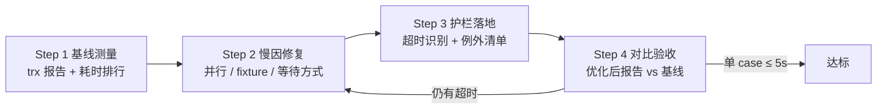
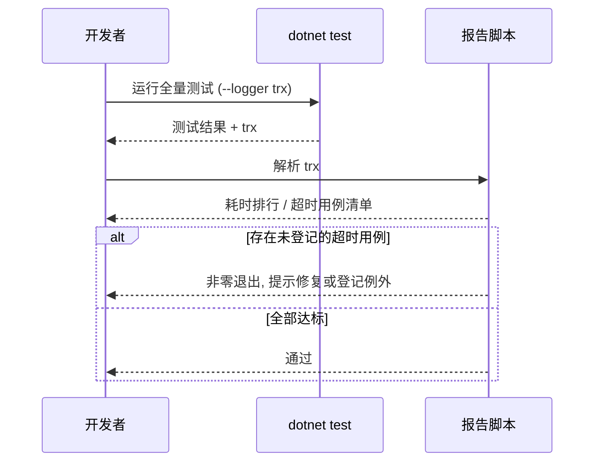

# 测试运行性能优化 - 技术提案

- 日期：2026-09-30
- 状态：待评审
- feat-branch：`feat/test-perf-optimization`
- 关联文档：[PRD](../../product/draft/20260930-test-perf-optimization-prd.md)

## 1. 概述

### 1.1 背景

依据 PRD「测试运行性能优化」：`tests/Z.Vtuber.Tests` 单测试工程已积累 171 个测试文件，一次全量运行非常慢。本提案基于对测试工程现状的读码勘察，定位慢因并给出修复方案。

现状勘察结论（均经读码确认）：

**① 测试集合间并行被整体禁用，全部用例串行执行。**

- `tests/Z.Vtuber.Tests/xunit.runner.json:3` 设置 `"parallelizeTestCollections": false`，xUnit 默认的集合级并行被关闭，几百个用例只能逐个排队执行——这通常是套件总时长最大的单一放大器。

**② Mongo 集成测试按「测试类」重建测试数据库，固定开销随类数线性增长。**

- 90 个测试类使用 `IClassFixture<MongoDbFixture>`（`grep -l "IClassFixture<MongoDbFixture>"` 统计）；
- 每个类的 `MongoDbFixture.InitializeAsync()`（`tests/Z.Vtuber.Tests/MongoDbFixture.cs:20-27`）都会创建独立数据库并调用 `ResetAsync()`：先 `DropCollectionAsync` 28 个集合（:31-61），再依次执行 7 个领域的 `EnsureIndexesAsync`（:68-82，Live/Cookie/Weibo/Recording/Transcript/Training/Notification）；
- 即每个测试类固定付出「建库 + 28 次 DropCollection + 7 域索引初始化」的开销，且其中大量集合/索引与该测试类完全无关。容器本身已是静态共享（:11-13），瓶颈不在容器启动而在逐类重建。

**③ 大量用例依赖 `Task.Delay` / `Thread.Sleep` 硬等待。**

- 全测试工程共 63 处 `Task.Delay`/`Thread.Sleep`（`grep -c` 统计），集中在 `TranscriptApiTests`（8 处）、`CookieInvalidEventSubscriberTests`（6 处）、`CookieCallGateTests`（5 处）、`LiveGuardJobTests`（4 处）、`IdleCloseSchedulerTests`（4 处）等；
- 硬等待既直接累加耗时（每处至少等待一个固定时长），也是间歇性失败的主要来源——等少了会 flaky，等多了会慢。

**④ 目前没有任何用例级耗时可见性与超时约束。**

- 测试运行不产出逐用例耗时报告，慢用例无法被发现；xUnit 的 `[Fact]` 默认无超时机制，5 秒基线缺乏执行手段。

### 1.2 目标

1. 建立可复现的逐用例耗时基线报告，量化慢因分布；
2. 修复上述三类慢因，使**单用例执行耗时 ≤ 5 秒**（例外清单除外），全量套件总时长显著下降；
3. 建立自动化护栏：超时用例可被自动识别，例外用例显式登记；
4. 不改变任何业务代码的对外行为，不削弱任何既有断言的验证力度。

### 1.3 范围

- **内**：`tests/Z.Vtuber.Tests`（fixture 结构、xunit 配置、慢用例改写、护栏机制）；如测量显示被测实现本身导致慢（如轮询间隔硬编码过大），允许对 `servers/` 做**测试友好性**微调（如将等待间隔改为可注入配置）。
- **外**：任何业务功能与对外契约（`contracts/*.yaml` 零改动）；`apps/web`、`infra/apphost` 零改动；CI 工作流仅在不破坏现有流水线的前提下追加报告产物。

## 2. 技术架构

### 2.1 优化工作流



### 2.2 技术栈

| 层级 | 技术选型 | 说明 |
|------|---------|------|
| 测试框架 | xUnit 2.9.3 + Microsoft.NET.Test.Sdk 18.8.1 | 现状沿用，不更换 |
| 耗时报告 | trx logger + 报告脚本 | `dotnet test --logger trx` 天然携带逐用例 `duration`，无需新增依赖 |
| 容器 | Testcontainers MongoDB/Redis 4.13.0 | 现状沿用，调整共享粒度 |
| 护栏 | 自定义超时判定（报告校验脚本或 xUnit 扩展） | 见 §6.1 决策 |

### 2.3 模块划分

| 模块 | 职责 | 关键技术点 |
|------|------|-----------|
| 基线报告 | 逐用例耗时采集与排序输出 | trx XML 解析 |
| fixture 改造 | 降低 Mongo 测试库重建频率与成本 | xUnit Collection Fixture |
| 等待方式改造 | 消除硬等待 | 轮询断言 / 事件通知 |
| 超时护栏 | 识别并拦截 >5s 用例 | 报告校验 / 例外清单文件 |

## 3. 技术实现方案

> 本提案无对外 API 与数据模型变更，模板中的 API 设计与数据模型章节不适用。

### 3.1 Step 1：基线测量

- 以 `dotnet test tests/Z.Vtuber.Tests --logger "trx;LogFileName=baseline.trx"` 采集逐用例耗时；
- 新增一个轻量报告脚本（如 `tests/report-slow-tests.sh` 或等价的 dotnet 小工具），解析 trx 输出按耗时排序的用例清单，标注 >5s 用例；
- 产出物：基线报告（写入 PR 描述，不落库代码），确认三大慢因各自的耗时占比，必要时修正修复优先级。

### 3.2 Step 2：慢因修复

#### 修复点 1：恢复测试集合并行

- **描述**: 将 `xunit.runner.json` 的 `parallelizeTestCollections` 恢复为 `true`（或删除该键使用默认值）。
- **技术细节**: 开启并行前必须消除共享状态冲突——Mongo fixture 已按类建独立库（库名含 Guid），天然隔离；Redis 侧现状为 `RedisCollection` 集合 fixture（`RedisFixture.cs:28-29`），需确认其内用例无跨类键冲突（必要时改用独立 DB index 或 key 前缀隔离）。
- **风险点**: 个别隐式共享状态的用例在并行下暴露 flaky，需逐个修复隔离而非回退并行。

#### 修复点 2：Mongo fixture 降本

- **描述**: 将「每类一次全量重建」改为「按需、按域、最小化」的初始化。
- **技术细节**（按收益排序，实施时以基线报告为准）：
  1. **按集合 fixture 共享数据库**：为同一领域的测试类定义 Collection Fixture，领域级共享一个测试库，类数不再放大重建次数；
  2. **按域裁剪初始化面**：`ResetAsync` 目前无条件 drop 28 集合 + 建 7 域索引（`MongoDbFixture.cs:31-82`），改造为按该集合实际涉及的领域只 drop / 建相关集合；
  3. **索引初始化只跑一次**：索引是库级不变量，同库内用例间无需重复 `EnsureIndexesAsync`，数据清理用 `DeleteManyAsync({})` 替代 `DropCollectionAsync` + 重建索引。
- **风险点**: 共享库引入跨类数据污染风险——用例必须自清理或使用唯一键前缀；改造时需保证每个测试类的隔离语义不弱于现状。

#### 修复点 3：消除硬等待

- **描述**: 将 63 处 `Task.Delay`/`Thread.Sleep` 按场景改写。
- **技术细节**:
  1. **等待异步副作用**（如等待订阅者处理事件）：改为轮询断言（短间隔、带总超时的 `WaitUntilAsync` 工具方法）或事件/信号量通知；
  2. **等待定时器/调度器触发**（如 `IdleCloseSchedulerTests`、`LiveGuardJobTests`）：优先把调度间隔抽象为可注入配置，测试注入极小间隔 + 轮询断言，而非拉长真实等待；
  3. 少量确属「验证超时行为本身」的用例（如锁租约过期），保留必要等待，登记例外清单。
- **风险点**: 轮询断言若总超时设置过紧会引入新的 flaky，统一约定轮询参数（如 50ms 间隔、5s 总超时）。

### 3.3 Step 3：超时护栏与例外清单

- **护栏机制**：复用 Step 1 的报告脚本，校验最近一次 trx 中所有用例耗时，>5s 且不在例外清单的用例以非零退出码报错；在本地跑测说明与 CI 测试步骤中启用；
- **例外清单**：在 `tests/Z.Vtuber.Tests/` 下维护一个例外清单文件（用例全名 + 理由），脚本读取比对；新增例外随 PR 评审。

### 3.4 Step 4：对比验收

- 用同一测量方式产出优化后报告，与基线对比：单用例 ≤5s（例外除外）、总时长下降幅度写入需求总 PR 描述。

## 4. 核心流程



## 5. 技术决策

### 5.1 决策列表

| 决策 | 选项 A | 选项 B | 最终选择 | 原因 |
|------|--------|--------|---------|------|
| 耗时采集 | trx logger + 脚本解析 | 自定义 xUnit reporter | A | 零新增依赖，trx 自带逐用例 duration |
| 超时强制方式 | 报告脚本校验 | 逐用例 `[Fact(Timeout=)]` 扩展 | A（脚本校验） | xUnit 2.x 无内建超时，自定义超时属性会在超时后留下悬挂任务，语义更重；脚本校验覆盖面全且能输出排行 |
| Mongo 隔离粒度 | 类级独立库（现状） | 集合级共享库 + 用例自清理 | B | 消除逐类重建的线性开销；隔离用唯一前缀/自清理保证 |
| 并行恢复 | 直接开全局并行 | 先修隔离再开并行 | B | 避免把既有隐式共享变成 flaky 风暴 |

### 5.2 依赖与约束

| 类型 | 内容 | 说明 |
|------|------|------|
| 依赖 | 本地/CI 具备 Docker（Testcontainers 需要） | 现状已具备 |
| 约束 | 不得删除或弱化既有断言 | 优化前后验证语义等价 |
| 约束 | 例外清单最小化 | 每条例外附理由，随 PR 评审 |

## 6. 项目结构

仅 `tests/Z.Vtuber.Tests` 内变更：

```
tests/Z.Vtuber.Tests/
├── xunit.runner.json              # 恢复并行
├── MongoDbFixture.cs              # 按域初始化 / 共享粒度改造
├── RedisFixture.cs                # 并行隔离确认
├── TimeoutExceptions.(md|json)    # 例外清单（用例全名 + 理由）
└── （按需新增）WaitUntil 轮询断言工具、按域 Collection Fixture
```

## 7. 测试策略

本需求即测试体系自身的优化，验证方式为：

| 类型 | 工具 | 覆盖范围 |
|------|------|---------|
| 全量回归 | `dotnet test` | 优化后全部用例通过，无新增 flaky（连续运行 3 次验证） |
| 性能验收 | trx 报告对比 | 单用例 ≤5s（例外除外）；总时长相对基线显著下降 |
| 护栏自验 | 报告脚本 | 人为构造一个 >5s 用例可被识别（验证后移除） |

## 8. 部署方案

无部署变更；护栏脚本接入 CI 测试步骤（既有流水线追加一步报告校验，不影响现有阶段划分）。

## 9. 验收标准

- [ ] 技术方案评审通过
- [ ] 基线耗时报告产出，慢因占比量化
- [ ] 全量测试通过（连续 3 次无新增间歇失败）
- [ ] 单用例耗时 ≤ 5 秒（例外清单除外）
- [ ] 例外清单显式登记且最小化
- [ ] 超时护栏生效（构造超时可被识别）
- [ ] 优化前后报告对比写入需求总 PR

## 10. 相关文档

- [关联 PRD](../../product/draft/20260930-test-perf-optimization-prd.md)
- 开发规范：`docs/engineering/common-rules.md`
- 后端规范：`docs/engineering/backend-rules.md`
