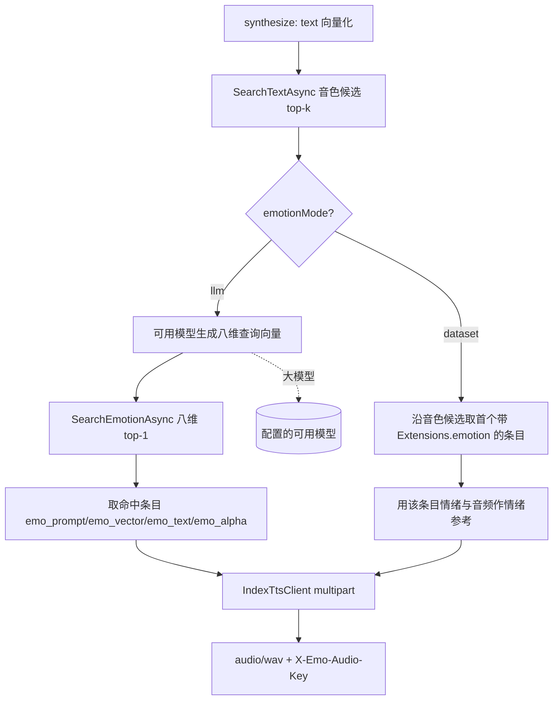
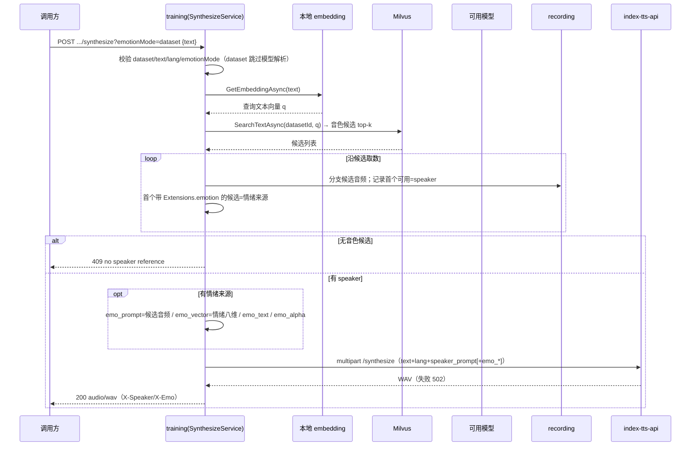

# AI 训练 - 音频生成情绪参考来源可选（emotionMode） - 技术提案

- 日期：2026-09-30
- 状态：待评审
- feat-branch：`feat/training-synthesize-emotion-mode`
- 关联 PRD：[20260929-training-audio-synthesize-prd.md](../../product/draft/20260929-training-audio-synthesize-prd.md)
- 关联提案：[20260929-proposal-training-audio-synthesize.md](20260929-proposal-training-audio-synthesize.md)

## 1. 概述

### 1.1 背景

既有 `POST /api/training/datasets/{datasetId}/synthesize`（见前序提案与 `servers/training/AGENTS.md`）的情绪参考固定走「大模型链路」：用配置的可用模型（Models 管理，OpenAI-like / Claude-like）对输入文本做情绪识别，得到八维查询向量，再在 Milvus `item_emotion_vectors` 中检索 top-1，命中条目的 `Extensions.emotion` 与音频作为 `emo_prompt`/`emo_vector`/`emo_text`/`emo_alpha`。

该链路依赖大模型可用性与调用延迟，且当调用方已明确希望「跟随数据集内最相近条目自带的情绪标注」时，多一次大模型调用没有必要。本次为 `synthesize` 增加情绪来源开关。

### 1.2 目标

1. 在 `synthesize` 上新增 query 参数 `emotionMode`，取值 `llm`（默认，行为不变）/ `dataset`；
2. `dataset` 模式下**跳过大模型生成环节**，直接使用文本向量 top-1 命中（音色参考所对应的条目）自身的 `Extensions.emotion` 作为情绪参考：`emo_vector` = 该情绪八维、`emo_text` = `emotionDescription`、`emo_alpha` = `clamp(emotionControlWeight/10,0,1)`、`emo_prompt` = 同一候选条目的音频片段；
3. `dataset` 模式下命中条目无情绪标注时，**继续沿音色候选（文本向量 top-k）向下找**首个「音频可取且带情绪标注」的候选；全部无标注则降级中性（省略 `emo_*`，仍返回音频）；
4. `dataset` 模式下**完全跳过 `modelId`/模型解析**（不校验、不查模型库）；
5. 契约先行：双 OpenAPI（training 主契约 + bilibili-crawler 网关镜像）同步，`servers/api` 代理天然透传 query，web codegen 再生成。

### 1.3 范围

- **内**：`servers/training`（`TrainingSynthesizeController` 解析 query、`SynthesizeService` 增 `EmotionMode` 分支、新增 `Synthesis/EmotionMode.cs`）；`contracts/training.openapi.yaml`（+ query 参数与 400 口径）、`contracts/bilibili-crawler.openapi.yaml`（镜像 + query 参数）；`apps/web/src/api/schema*.d.ts`（codegen 产物）；`tests/Z.Vtuber.Tests`（控制器/服务/代理用例）。
- **外**：`llm` 模式语义**零改动**；向量层、Milvus 检索、`IndexTtsClient`、`ir` 数据模型、`vectors/rebuild`、既有 22 端点语义均不动；不新增端点、不新增配置节、不新增依赖；`servers/api` 代理实现无需改动（`ForwardAsync` 已原样透传 query）。

## 2. 技术架构

### 2.1 分支流程（emotionMode=dataset 与 llm 的差异）



### 2.2 技术栈

| 层级 | 技术选型 | 说明 |
|------|---------|------|
| 后端 | C# (.NET 10) ASP.NET Core Controllers（training 内扩展） | 仅控制器/编排层加分支，无新依赖 |
| 情绪来源（llm） | 既有 `EmotionPromptBuilder` + `IChatModelClient` + Milvus 八维检索 | 行为不变 |
| 情绪来源（dataset） | 条目 `Extensions.emotion`（情绪识别任务产物） | 跳过大模型与情绪向量检索 |
| 契约 | OpenAPI（training 主 + bilibili-crawler 镜像）+ codegen | 契约先行 |

### 2.3 模块划分

| 模块 | 职责 | 关键技术点 |
|------|------|-----------|
| `Synthesis/EmotionMode.cs`（新增） | 情绪来源枚举 | `Llm` / `Dataset` |
| `Synthesis/SynthesizeService.cs`（变更） | 编排分支 | dataset 模式单轮扫描候选同时选 speaker 与情绪来源；llm 模式原样 |
| `Controllers/TrainingSynthesizeController.cs`（变更） | 解析 `emotionMode` query | 白名单 `llm`/`dataset`，非法 400；dataset 跳过模型解析 |
| `contracts/*`（变更） | 契约 | + query 参数、400 口径 |
| `servers/api`（零改动） | 代理 | `ForwardAsync` 原样透传 query |

## 3. API 设计

### 3.1 API 契约（`contracts/training.openapi.yaml`，扩展）

#### 接口: 音频生成（synthesize）— 新增 query

- **请求** `POST /api/training/datasets/{datasetId}/synthesize?emotionMode=llm|dataset`

  | 参数 | in | 类型 | 必填 | 默认 | 说明 |
  |------|----|------|------|------|------|
  | `datasetId` | path | string | 是 | - | 数据集 id |
  | `emotionMode` | query | enum `llm`/`dataset`（大小写不敏感） | 否 | `llm` | `llm`＝大模型生成情感向量后检索；`dataset`＝直接用音频命中条目自身 `Extensions.emotion`，跳过大模型 |

  body 不变（`TrainingSynthesizeRequest`：`text` 必填、`lang?`、`modelId?`）。

- **行为差异**

  | 场景 | `llm`（默认） | `dataset` |
  |------|--------------|-----------|
  | `modelId` / 模型解析 | 校验（404/400），缺省配置默认模型 | **完全跳过**（不校验、不查库） |
  | 情绪查询向量 | 可用模型生成 | 无 |
  | 情绪来源 | `item_emotion_vectors` top-1 的条目情绪 | 文本向量命中条目自身 `Extensions.emotion`；为空沿音色候选向下找 |
  | 全部无情绪标注 | 降级中性 | 降级中性（省略 `emo_*`，仍 200） |
  | `X-Emo-Audio-Key` | 情绪命中条目 | 取到情绪的候选条目（无则缺省） |

- **响应**：不变（200 `audio/wav` + `X-Speaker-Audio-Key`/`X-Emo-Audio-Key`；400/404/409/502）。
- **400 新增错误码**：`{"error":"invalid emotion mode"}`（`emotionMode` 非 `llm`/`dataset`）。

#### 网关镜像（`contracts/bilibili-crawler.openapi.yaml`）

`/api/training/datasets/{datasetId}/synthesize` 镜像同样声明 `emotionMode` query；`servers/api` 既有 `ForwardAsync` 已原样透传 `Request.QueryString`，**实现零改动**。

## 4. 数据模型

无变更。情绪来自既有条目 `training_dataset_items.Extensions.emotion`（`EmotionResult` 十字段），`dataset` 模式不写库、不产生新集合/索引。

## 5. 技术实现方案

### 5.1 核心流程



### 5.2 关键实现点

#### 实现点 1: 枚举与编排分支（`Synthesis/EmotionMode.cs`、`Synthesize/SynthesizeService.cs`）

- 新增 `enum EmotionMode { Llm, Dataset }`；`SynthesizeAsync(..., TrainingModelRecord? emotionModel, EmotionMode emotionMode = EmotionMode.Llm, CancellationToken ct = default)`（默认 `llm` 保持既有调用方/测试零改动）。
- 保持既有前序步骤不变（dataset 404 → text 400 → lang 400 在控制器；embedding → `SearchTextAsync` → 409）。
- 将原 `FetchFirstAvailableAsync` 泛化为 `ScanCandidatesAsync(datasetId, candidates, captureDatasetEmotion, ct)`：单轮遍历候选取数，首个可用音频为 speaker；`captureDatasetEmotion` 为真时同轮记录首个 `ReadEmotion(item) != null` 的候选为情绪来源；当 speaker 与情绪来源都就绪（或 llm 模式仅需 speaker）即提前退出，避免重复取数。
- `dataset` 模式：情绪参考由命中候选（`ReferenceMatch`）经 `BuildDatasetEmotionReference` 组装；无候选 → null → 中性。**不再调用** `TryBuildEmotionReferenceAsync`（大模型 + 八维检索）。
- `llm` 模式：`ScanCandidatesAsync(captureDatasetEmotion: false)` + 既有 `TryBuildEmotionReferenceAsync`，语义零改动。
- Info 日志追加 `emotionMode` 字段（不打文本/音频）。

#### 实现点 2: 控制器解析与跳过模型（`Controllers/TrainingSynthesizeController.cs`）

- 动作签名追加 `[FromQuery] string? emotionMode = null`；`null/空` 视为 `llm`，`llm`/`dataset` 大小写不敏感，其他 → 400 `invalid emotion mode`（校验顺序：dataset → text → lang → emotionMode）。
- `dataset` 时**不调用** `ResolveEmotionModelAsync`（`model = null`），把 mode 传给 service；`llm` 时保留既有 `modelId` 校验（404 `model not found` / 400 `model disabled`）。

#### 实现点 3: 代理与契约

- `servers/api/TrainingProxyController.SynthesizeDataset` 增加 `[FromQuery] string? emotionMode` 形参（便于文档/可读性），转发仍走既有 `ForwardAsync` 的 `Request.QueryString`，行为不变。
- 双契约补 `emotionMode` query 参数与 `invalid emotion mode` 400 口径；`npm run codegen` 再生成 `schema.d.ts`/`schema-training.d.ts`。

### 5.3 不在本期的事项

- `dataset` 模式下「按情绪向量检索 + 用该条目情绪」的二次检索组合；自定义候选顺序/权重；`emotionMode` 进入请求 body；批量合成与 Web 界面；大模型情感链路的重试/缓存。

## 6. 技术决策

### 6.1 决策列表

| 决策 | 选项 A | 选项 B | 最终选择 | 原因 |
|------|--------|--------|---------|------|
| 开关载体 | query 参数 `emotionMode` | body 字段 | **A** | 需求明确「增加 query」；与 `type`/`enabled` 等 query 风格一致 |
| 参数命名 | `emotionMode`（camelCase） | `emotion_mode` | **A** | 仓库现有 query 全为 camelCase，OpenAPI/codegen 统一 |
| 默认值 | `llm`（行为不变） | 必填 | **A** | 向后兼容，既有调用方零感知 |
| dataset 情绪来源 | 文本向量命中（音色）条目自身 `Extensions.emotion` | 用命中音色条目情绪再检索八维 | **A** | 需求「直接使用向量匹配的数据对应的 emotion 数据」；跳过大模型后无需二次检索 |
| 命中条目无情绪 | 沿音色候选向下找，全无则降级中性 | 立即中性 / 报错 | **A** | 用户确认；与既有 best-effort 口径一致，不阻断合成 |
| dataset 的 modelId | 完全跳过模型解析 | 仍校验 | **A** | 用户确认；该模式不使用大模型 |
| 非法 emotionMode | 400 `invalid emotion mode` | 静默按 llm | **A** | 显式失败避免误用；与 `invalid lang` 同口径 |
| 服务签名 | `EmotionMode` 可选参数默认 `Llm` | 必填 | **A** | 既有 9 处调用/测试零改动，默认即旧行为 |

### 6.2 依赖与约束

| 类型 | 内容 | 说明 |
|------|------|------|
| 约束 | 契约先行（双 OpenAPI + codegen 一致） | 仓库规范 |
| 约束 | TDD、核心逻辑覆盖率 ≥ 80%、单用例 ≤ 5s | `docs/engineering/common-rules.md` |
| 约束 | `llm` 模式与既有端点语义零改动 | 向后兼容 |
| 依赖 | 无新增依赖、无新增配置、无数据迁移 | 纯编排分支 |

## 7. 项目结构

```
contracts/
├── training.openapi.yaml                     # + emotionMode query + invalid emotion mode 400
└── bilibili-crawler.openapi.yaml             # 镜像 + emotionMode query

servers/training/
├── Synthesis/EmotionMode.cs                  # 新增：Llm / Dataset
├── Synthesis/SynthesizeService.cs            # 变更：mode 分支 + 候选扫描
└── Controllers/TrainingSynthesizeController.cs # 变更：解析 query + dataset 跳过模型

servers/api/
└── Controllers/TrainingProxyController.cs    # 变更：动作声明 emotionMode（转发不变）

apps/web/src/api/
├── schema.d.ts                               # codegen 再生成
└── schema-training.d.ts                      # codegen 再生成

tests/Z.Vtuber.Tests/
├── TrainingSynthesizeApiTests.cs             # + dataset 模式 / invalid emotion mode
├── SynthesizeServiceTests.cs                 # + dataset 分支（来自命中条目、向下找、降级中性）
└── TrainingSynthesizeProxyTests.cs           # + emotionMode query 透传
```

## 8. 测试策略

### 8.1 测试覆盖要求

- 核心逻辑（`EmotionMode` 分支选择、dataset 情绪取自命中条目/向下找/降级中性、控制器解析与跳过模型）覆盖率 ≥ 80%；
- TDD：先红后绿；沿用控制器直测 + Mongo 夹具 + 既有 fakes，不打外网、不新增慢用例。

### 8.2 测试类型

| 类型 | 工具 | 覆盖范围 |
|------|------|---------|
| 编排/接口测试 | xUnit + MongoDbFixture + 内存向量库/假音频/假 TTS/假模型 | dataset 成功（无 chat 调用）、命中无情绪向下找、全无情绪降级中性、llm 回归 |
| 控制器测试 | xUnit（控制器直测） | `emotionMode=dataset` 跳过模型解析（非法 modelId 不 404）、非法 mode 400、默认 llm |
| 代理测试 | xUnit + `StubHandler` | `emotionMode` query 原样透传 |

关键用例清单：

- **dataset 成功**：不调用大模型（chat.Calls==0）；`X-Emo-Audio-Key` = 命中条目；TTS 收到 `emo_vector`/`emo_text`/`emo_alpha` 与该条目 `Extensions.emotion` 一致；
- **向下找**：文本 top-1 无情绪、次优有情绪 → 情绪取次优（speaker 仍为 top-1 可用音频）；
- **降级中性**：候选全无情绪 → 200 且无 `emo_*`；
- **跳过模型**：`dataset` + 非法/停用 modelId → 不返回 404/400，正常合成；
- **非法 mode**：`emotionMode=bogus` → 400 `invalid emotion mode`；
- **回归**：不传 `emotionMode` → 等价 `llm`（既有用例全绿）。

## 9. 部署方案

- 无新增配置/依赖/迁移：随常规版本发布即可；`llm` 为默认值，旧调用方行为不变。
- 回滚：删除 query 支持即回到旧行为，无数据影响。

## 10. 验收标准

- [ ] 技术方案/契约评审通过
- [ ] `synthesize` 支持 `emotionMode=llm|dataset`，缺省 `llm`
- [ ] `dataset` 跳过大模型，情绪参考取自文本向量命中条目自身 `Extensions.emotion`，无则沿音色候选向下找，全无则降级中性
- [ ] `dataset` 完全跳过 `modelId`/模型解析
- [ ] 非法 `emotionMode` → 400 `invalid emotion mode`
- [ ] 双契约与 codegen 一致；`llm` 模式与既有端点零回退
- [ ] 核心逻辑覆盖率 ≥ 80%

## 11. 相关文档

- PRD：`docs/product/draft/20260929-training-audio-synthesize-prd.md`
- 前序提案/Plan：`20260929-proposal-training-audio-synthesize.md`、`20260929-plan-training-audio-synthesize.md`
- 模块规范：`servers/training/AGENTS.md`、`servers/api/AGENTS.md`
- 规范：`docs/engineering/common-rules.md`、`docs/engineering/backend-rules.md`
