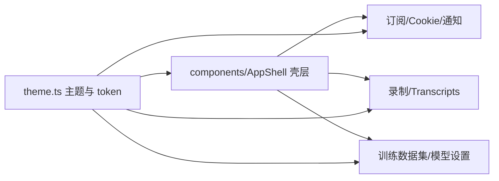
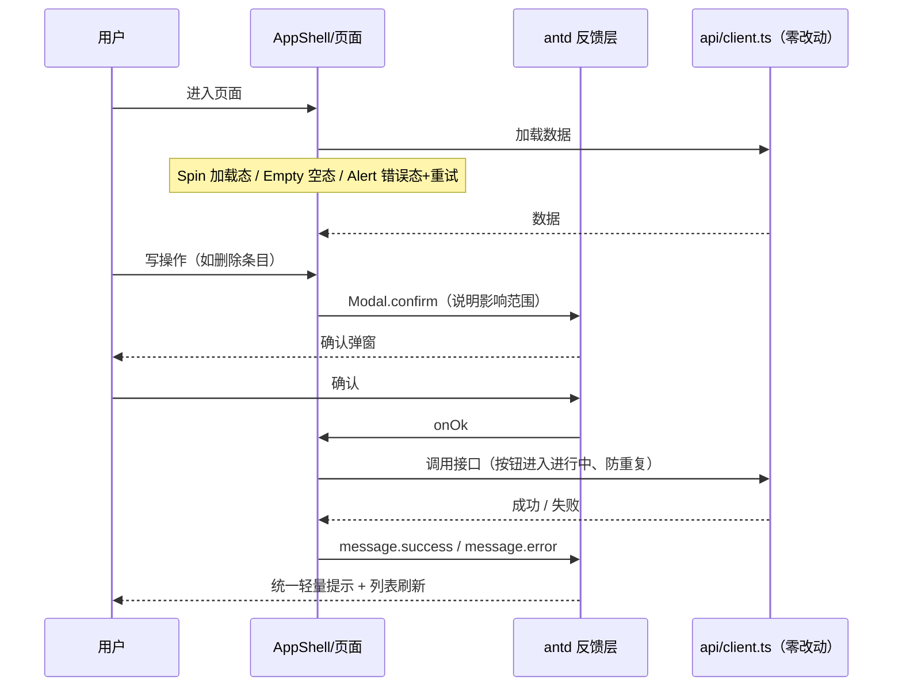

# 管理后台 UI 重设计 - 技术提案

- 日期：2026-10-01
- 状态：待评审
- feat-branch：`feat/admin-console-ui-redesign`
- 关联 PRD：[20261001-admin-console-ui-redesign-prd.md](../../product/draft/20261001-admin-console-ui-redesign-prd.md)

## 1. 概述

### 1.1 背景

PRD「管理后台 UI 重设计」要求在功能、接口、文案零变更的前提下，按统一设计语言重做 `apps/web` 全部六个模块页面。本提案基于对 `apps/web` 现状的读码勘察，给出组件库选型与实施技术方案。

现状勘察结论（均经读码确认）：

**① 无任何样式体系，靠两个全局 CSS 文件 + 海量内联样式撑起全站。**

- `apps/web/src/index.css` 仅 7 行（`color-scheme: dark` + 全局 `box-sizing`），无任何设计 token / CSS 变量；
- `apps/web/src/App.css` 73 行只覆盖外壳布局，色值为硬编码 slate 系（背景 `#0f172a`、侧栏 `#1e293b`、强调 `#38bdf8` 等）；
- 全站 `style={{...}}` 共 **268 处、分布在 17 个页面组件**（`pages/` 下 17/19 个文件），重灾区 `CookiePage.tsx`（约 35 处）、`transcripts/SettingsTab.tsx`（约 35 处）、`TaskListTab.tsx`（约 35 处）；
- 共享样式靠 JS 常量在文件间复制：`inputStyle` 在 6 个文件重复定义（`training/EmotionSubmitDialog.tsx:24`、`training/ProviderDialog.tsx:19`、`training/ModelSettingsTab.tsx:19`、`training/ReRecognizeDialog.tsx:39`、`transcripts/SettingsTab.tsx:17`、`transcripts/TaskListTab.tsx:45`），另有 `cellStyle`/`overlayStyle`/`panelStyle`/`TRUNCATED_CELL_STYLE` 等同类重复；
- `className` 仅约 24 处且多为无对应 CSS 规则的语义钩子（如 `emotion-submit-overlay`），实际样式全靠内联。

**② UI 原语全部手工实现，且各页面各写一套。**

- 按钮/表格/表单/下拉/弹窗/Tab/空态/加载态均为原生 HTML + 内联样式：表格每格 `padding` 逐个贴、弹窗为手写 `position:fixed` 遮罩 + 居中面板（两种风格并存）、Tab 为手写按钮列切换内联色；
- **没有 Toast**：成功/失败是散落的彩色 `<p>`（`#22c55e`/`#f87171`）；加载态是「加载中...」纯文本，无 spinner/skeleton；
- 确认交互三种并存：`window.confirm` 5 处（`training/ModelSettingsTab.tsx:111,169`、`training/DatasetItemList.tsx:260`、`training/DatasetSelector.tsx:108`、`transcripts/SettingsTab.tsx:132`）+ 行内两步确认 2 处（`NotificationPage.tsx:160-196`、`SubscriptionPage.tsx:244-284`）+ 手写弹窗；
- 弹窗无焦点管理、无 Esc 关闭；chips 仅 `training/EmotionTaskQueue.tsx:84-89` 一处裸 `<span>`；无分页组件；滚动容器为内联 `maxHeight+overflowY`。

**③ 页面规模大但逻辑与 UI 耦合。** 19 个非测试组件共约 5050 行，最大 `transcripts/TaskListTab.tsx` 635 行、`training/DatasetItemList.tsx` 571 行；复杂交互（SSE 实时追加、共享 `<audio>` 单例试听、wavesurfer 波形、扫码 QR 轮询）与手工样式交织。

**④ 测试迁移友好度高。** 约 20 个 `*.test.tsx` 全部以 RTL role/text 查询（`getByRole('button', ...)`、`getByLabelText('文本')`、`getByText('暂无订阅')`），0 处 class 断言；风险集中在 `training/DatasetItemList.test.tsx:155-196,367-404` 对 `closest('tr')`/`colgroup col`/`colspan` 的表格 DOM 结构断言，以及依赖 `window.confirm` mock 的用例。

**⑤ 引入组件库无样式体系冲突。** `apps/web/package.json` 仅 `react@19`、`react-dom@19`、`wavesurfer.js@8` 三个依赖，无 CSS 预处理器、无 Tailwind、无其他 UI 库；`docs/engineering/frontend-rules.md` 也未约束样式方案。

### 1.2 目标

1. 引入成熟组件库 **Ant Design v6**（`antd@^6.6` + `@ant-design/icons`），替换全部手工 UI 原语；
2. 建立集中式主题：以 antd Design Token（暗色算法）承载 PRD 的设计语言，删除 268 处内联样式与重复 JS 样式常量；
3. 六大模块页面按新设计语言重做，**功能、接口、数据口径、文案零变更**；
4. 统一反馈与确认体系：`message` 统一操作反馈、`Modal.confirm` 统一危险操作确认（替换 `window.confirm` 与行内两步确认）、`Spin`/`Empty`/`Alert` 统一三态；
5. 既有自动化测试保持通过（仅做组件库 DOM 适配性调整），`npm run lint` / `npm run test` / `npm run build` 全绿。

### 1.3 范围

- **内**：`apps/web` 全部 UI 层——`src/App.tsx`、`src/App.css`、`src/index.css`、`src/pages/**`（19 个组件）、新增 `src/theme.ts` 与 `src/components/`（壳层与共享原语）；`apps/web/package.json`（+2 依赖）；测试文件同步适配；`apps/web/AGENTS.md` 与 `docs/engineering/frontend-rules.md` 补 UI 规范条目。
- **外**：`contracts/*.yaml` 零改动；`servers/**` 零改动；`src/api/client.ts` 的封装签名与错误文案逻辑零改动；不做 URL 路由化、登录鉴权、移动端适配、明暗主题切换；`tests/Z.Vtuber.Tests`（dotnet）零改动。

## 2. 技术架构

### 2.1 系统架构图

```mermaid
graph TD
    subgraph apps/web（前端内部分层）
        THEME[theme.ts<br/>Design Token 暗色主题] --> SHELL[AppShell 壳层<br/>Layout + Menu + PageHeader]
        SHELL --> PAGES[六大模块页面<br/>订阅/录制/Transcripts/Cookie/通知/训练]
        PAGES --> PRIM[共享 UI 原语层<br/>antd Table/Form/Modal/Tabs/Empty/Spin/Tag/message]
    end
    PAGES -->|"/api 既有 client.ts 零改动"| GW[servers/api 网关]
    GW --> SVC[各后端服务<br/>零改动]
```

### 2.2 技术栈

| 层级 | 技术选型 | 说明 |
|------|---------|------|
| 前端框架 | React 19 + Vite 8 + TypeScript 5.9 | 现状沿用，不更换 |
| 组件库 | **Ant Design v6**（`antd@^6.6`，peer `react>=18`，兼容 React 19）+ `@ant-design/icons@^6` | 本次唯一新增依赖，见 §6.1 选型决策 |
| 主题 | antd Design Token（`theme.darkAlgorithm` + 少量 Seed Token 定制） | 承载 PRD 设计语言，集中于 `theme.ts` |
| 反馈 | antd `App` 组件 + `useApp()`（`message`/`modal`） | 保证主题与 context 生效，见 §6.1 |
| 测试 | Vitest 4 + React Testing Library（现状沿用） | 查询仍以 role/text 为主 |
| 样式方案 | antd css-in-js（默认运行时） | 无需 CSS 预处理器；`zeroRuntime` 作为后续体积优化选项 |

### 2.3 模块划分



| 模块 | 职责 | 关键技术点 |
|------|------|-----------|
| `src/theme.ts`（新增） | 全站主题：暗色算法 + 品牌/圆角/字号 token | `ConfigProvider` `theme` + `locale={zhCN}` |
| `src/components/AppShell.tsx`（新增） | 布局骨架：Sider 分组菜单 + 内容区 + 页头 | antd `Layout`/`Menu`，承载既有 `menuGroups` 结构 |
| `src/components/PageHeader.tsx`（新增） | 页面统一「标题 + 说明 + 主操作区」 | `Typography` + `Space`，供各页面复用 |
| `src/pages/**`（变更） | 六大模块页面 | 手工原语 → antd 组件，删除内联样式；**业务逻辑与 client 调用零改动** |
| 复杂交互组件（变更，仅外观） | `SegmentAudioPlayer`、`DatasetItemWaveform`、扫码 QR 弹窗、SSE 跟随 | 逻辑（单例 audio、wavesurfer loader、EventSource 重连）保持不变 |

## 3. API 设计

**无任何接口变更。** 本次为纯前端 UI 层改造：

- `contracts/*.yaml` 零改动，`npm run codegen` 产物不变；
- `src/api/client.ts` 各封装签名、URL 构造器、`apiErrorMessage`/`apiErrorCodeText` 错误文案映射全部保持不变，页面仅替换调用点周边的表现层；
- 页面数据口径、操作路径与成功/失败文案语义不变（既有测试的中文文案断言即回归基准）。

## 4. 数据模型

无变更。前端无本地持久化，数据模型完全由既有后端契约决定。

## 5. 技术实现方案

### 5.1 核心流程



### 5.2 关键实现点

#### 实现点 1: 主题与 ConfigProvider（设计语言落地点）

- **描述**: 新增 `src/theme.ts`：`algorithm: theme.darkAlgorithm`（可按需叠加 `compactAlgorithm` 提升信息密度），Seed Token 定制品牌主色（承接现有品牌青 `#38bdf8` 系并保证深色下对比度）、`borderRadius`、`fontSize`、`controlHeight` 等；`ConfigProvider` 统一 `locale={zhCN}`、`theme`。
- **技术细节**: 顶层以 antd `App` 包裹，业务侧一律 `const { message, modal } = App.useApp()`——静态 `message.xxx`/`Modal.confirm` 不吃 ConfigProvider context（官方文档明示），必须走 `useApp()` 以保证主题/中文文案生效。
- **风险点**: token 取值需人工校验深色对比度（PRD 要求正文 ≥4.5:1）；`theme` 对象保持稳定引用，避免触发组件 remount。

#### 实现点 2: 布局骨架（AppShell）

- **描述**: 用 antd `Layout` + `Layout.Sider` + `Menu` 重写 `App.tsx` 外壳：保留既有 `menuGroups` 数据结构与 `PageKey` 切换逻辑（纯表现层替换，页面组件选择逻辑不动）；`Menu` 以 `items`/`label` 分组渲染「训练」分组与默认组；内容区统一 `PageHeader`（标题 + 一句话说明 + 主操作区）+ 内容容器。
- **技术细节**: `App.css` 手工布局规则删除，仅保留最小全局 reset；`aria-current` 语义由 Menu 选中态提供。
- **风险点**: `App.test.tsx` 用 `data-testid` mock 页面组件，需保持菜单项文案与切换语义断言不变。

#### 实现点 3: UI 原语替换映射

| 现状（手工） | 替换为 | 涉及面 |
|---|---|---|
| 原生 `<button>` + 内联色 | `Button`（`type`/`danger`/`loading` 表达三级按钮层级与进行中） | 全部页面 |
| 原生 `<table>` + 逐格内联 padding / `colgroup` | `Table`（`columns` `width`+`ellipsis`+`render`、`rowSelection`、`expandable`、`loading`、`locale.emptyText`） | 6 个表格重灾页面 |
| `inputStyle` 常量 + 原生 `<input>/<textarea>` | `Input`/`Input.TextArea`/`InputNumber`（统一校验态 `status`） | 全部表单 |
| 原生 `<select>` | `Select`（`options`、`placeholder`） | 订阅/通知/Transcripts/训练各表单 |
| 手写 fixed 遮罩 + 面板弹窗（两风格） | `Modal`（`open`/`confirmLoading`/`onCancel`、`aria-modal` 语义内置） | Cookie 扫码、通知绑定、训练 4 个弹窗、播放偏移等 |
| `window.confirm` ×5、行内两步确认 ×2 | `Modal.confirm`（标题 + 影响范围说明 + 危险 `okButtonProps: { danger: true }`） | 全部危险操作 |
| 手写 Tab 按钮列 | `Tabs`（`items`、`activeKey`） | `TranscriptsPage`、`DatasetsPage` |
| 成功/失败彩色 `<p>` | `message.success` / `message.error`（`useApp()`） | 全部写操作 |
| 「加载中...」文本 | `Spin`（区块级）/ `Table loading` | 全部列表与区块 |
| `<p>暂无xxx</p>` | `Empty`（`description` + 行动引导按钮） | 全部空态 |
| 状态彩色小字 / 裸 span chips | `Tag`/`Badge`（状态语义色）、`Progress`（任务进度） | 录制三态、Cookie/Session 状态、任务状态统计 |
| 内联 `maxHeight+overflowY` 滚动容器 | 保留行为，样式收敛到类或 antd `Flex` | SSE 结果区、试听列表 |

- **描述**: 按上表将手工原语逐一替换；`inputStyle`/`cellStyle`/`overlayStyle` 等重复 JS 常量全部删除。
- **技术细节**: 按钮/文案的可访问名（`aria-label`、中文 label）保持不变，保证 RTL 测试断言稳定。
- **风险点**: 表格 DOM 从手写结构变为 antd 结构，见实现点 4。

#### 实现点 4: 表格改造（本次最大工作量）

- **描述**: `DatasetItemList`（571 行）、`TaskListTab`（635 行）、`SettingsTab`（505 行）、`ModelSettingsTab`（437 行）、`CookiePage`（447 行）等表格迁移到 antd `Table`：
  - 列宽/截断：`colgroup`+`table-layout:fixed` 策略 → `columns[].width` + `ellipsis: { showTitle }`（悬浮全文即 PRD「长文本截断悬浮可见」）；
  - 多选批量删除：手写 checkbox 列 + 全选联动 → `rowSelection`（含跨分组 `onSelectAll` 语义对齐）；
  - 展开行（波形/历史录播/识别结果）：手写「行下插入 `colSpan` 行」→ `expandable.expandedRowRender`，`DatasetItemWaveform` 作为展开内容渲染（同一时刻仅展开一行用 `expandedRowKeys` 受控）；
  - 列显隐「展示类型」：`columns` 数组动态过滤（列数一致由组件保证）；
  - 分组切换（不分组/按来源/按类型）：以「分组标题行 + 条目行」的受控 `dataSource`/自定义行渲染实现，分组头全选联动复用 `rowSelection`；
  - 内联编辑：保留「行内草稿 + 保存/取消」行为（`EditableRow` 模式或单元格内受控输入），保存 payload 与现状完全一致（含 `endMs: null` 显式序列化）。
- **技术细节**: 行为函数（校验、payload 拼装、`window.confirm` → `Modal.confirm`）不动，只换渲染层。
- **风险点**: `DatasetItemList.test.tsx` 的 `closest('tr')`/`colgroup`/`colspan` 断言需按 antd Table DOM 适配（antd Table 仍输出真实 `<table>/<thead>/<th>`，`getByRole('columnheader')` 可保留）；展开行列数断言改为对 `expandedRowRender` 容器的断言。

#### 实现点 5: 反馈与确认体系统一

- **描述**: 顶层 `App` 组件包裹 antd `App`；所有写操作成功/失败改走 `message`；5 处 `window.confirm` 与 2 处行内两步确认统一改为 `Modal.confirm` 并补影响范围文案（如「删除后其下 N 个模型将一并删除」）；列表三态统一 `loading`/`Empty`/`Alert`+重试；提交中统一 `Button loading` + 防重复。
- **技术细节**: 测试中对 `window.confirm` 的 mock 移除，改为对确认弹窗按钮（「确定」）的 `fireEvent` 点击断言。
- **风险点**: `Modal.confirm` 挂载于 `useApp()` 的 `modal` 实例，须保证调用处在 `App` 包裹之下（页面组件天然满足）。

#### 实现点 6: 复杂交互仅换壳、逻辑零改动

- **描述**: `SegmentAudioPlayer`（共享单例 `<audio>`、切源/停止/高亮/降级）、`DatasetItemWaveform`（`waveformLoader.ts` 抽象、destroy 不串播、失败降级）、Transcripts SSE（`EventSource` 追加 + 断开重连 + 底部跟随）、Cookie 扫码 QR 轮询、`RecordingStatusPage` 轮询刷新——业务逻辑与降级路径保持不变，仅把周边按钮/容器/提示换成 antd 外观。
- **风险点**: `data-testid="waveform-container"` 等测试钩子保留；`aria-disabled` 置灰语义改由 antd `Button disabled` + Tooltip 表达时，同步适配断言。

#### 实现点 7: 清理与规范同步

- **描述**: 删除 268 处内联 style、`App.css` 手工规则、`inputStyle` 等重复常量；`index.css` 收敛为最小全局样式；同步更新 `apps/web/AGENTS.md`（目录结构 + UI 规范：统一 antd、禁止内联 style、主题入口 `theme.ts`）与 `docs/engineering/frontend-rules.md`（补 UI/样式规范章节）。

### 5.3 实施阶段与子分支拆分

| 阶段 | 子分支（自需求总分支切出） | 内容 | 退出条件 |
|---|---|---|---|
| P1 基建 | `feat/admin-ui-redesign-foundation` | 依赖引入、`theme.ts`、ConfigProvider/App 包裹、AppShell 布局骨架 | lint/test/build 全绿，壳层切换可用 |
| P2 反馈体系 | `feat/admin-ui-redesign-feedback` | `Modal.confirm`/`message`/`Spin`/`Empty`/`Alert` 统一，替换 `window.confirm` | 全站无原生 confirm，写操作均有反馈 |
| P3 页面迁移 | `feat/admin-ui-redesign-pages`（可再按页面拆分） | 六大模块页面逐一迁移（表格/表单/弹窗/Tab） | 每页迁移后该页测试全绿 |
| P4 收尾 | `feat/admin-ui-redesign-cleanup` | 内联样式清理、可访问性打磨、AGENTS.md/frontend-rules 更新、视觉走查 | PRD 验收标准逐条勾验 |

各子分支向需求总分支 `feat/admin-console-ui-redesign` 提 PR，验收后由需求总 PR 合入 `main`。

## 6. 技术决策

### 6.1 决策列表

| 决策 | 选项 A | 选项 B | 最终选择 | 原因 |
|------|--------|--------|---------|------|
| 组件库选型 | **Ant Design v6** | Mantine 9 | A | 本后台以重表格 + 表单 + 弹窗为主：antd 的 Table（列宽/ellipsis/多选/展开行/受控展开）、Form 校验、Modal/confirm、Tabs、Empty、Spin、Tag 开箱即用且 TS 完备、中文 locale 与 a11y 成熟、React 19 兼容（peer `react>=18`）；Mantine 视觉现代但表格能力弱（无固定列/ellipsis/多选原生支持），重做 6 张复杂表格需大量手写 |
| 组件库选型 | Ant Design v6 | shadcn/ui + Tailwind | A | shadcn 需引入 Tailwind 工具链 + 逐组件拷贝自维护，与「无样式体系」现状相比引入与维护成本更高，且一致性需自行保证；本需求要的是「统一设计体系」而非「完全自由的皮肤」 |
| 组件库选型 | Ant Design v6 | Arco Design | A | 两者风格均可，但 antd 生态/维护活跃度/文档与迁移资料更完善，`docs/for-agents`、迁移指南齐备，长期维护风险更低 |
| 主题策略 | 暗色算法 + 少量 Seed Token 定制 | 全量手工覆写 token | A | `darkAlgorithm` 自动生成一致的深色梯度（PRD 设计语言的「层级靠明度」即由此承载），只需定制品牌色/圆角/字号；全量覆写易破坏梯度一致性 |
| 反馈调用方式 | antd `App` + `useApp()` | 静态 `message.xxx`/`Modal.confirm` | A | 静态方法不吃 ConfigProvider context（主题/中文不生效，官方文档明示），`useApp()` 是唯一保证主题一致的路径 |
| 危险操作确认 | `Modal.confirm` | 自研 ConfirmDialog / 保留行内两步确认 | A | PRD 要求全站单一确认模式；`Modal.confirm` 声明式、自带焦点管理与 Esc/遮罩关闭，替代成本最低 |
| 表格方案 | antd `Table` | 保留手写表格仅换样式 | A | 列宽/ellipsis/多选/展开行/加载/空态全是 PRD 硬要求，antd Table 全部现成；继续手写意味着长期维护 571 行级别的表格组件 |
| 样式运行时 | antd 默认 css-in-js | `zeroRuntime` 静态样式 | A（默认） | 默认模式零构建配置（无需 less/css 提取），Vite 直接可用；内网后台对首包不敏感，体积优化留作后续选项（antd 6 已支持 `zeroRuntime`） |
| 迁移策略 | 分批（P1→P4，每批测试全绿） | 一次性全量替换 | A | 5050 行 UI 层一次性替换风险不可控；分批保证任意时刻主干可运行、测试可回归 |

### 6.2 依赖与约束

| 类型 | 内容 | 说明 |
|------|------|------|
| 依赖 | `antd@^6.6`、`@ant-design/icons@^6` | 本次仅有的新增 npm 依赖（antd peer `react>=18`，兼容 React 19） |
| 依赖 | 既有 `api/client.ts` 与 OpenAPI 契约 | 零改动，作为行为回归基准 |
| 约束 | 功能/接口/文案零变更 | 既有测试中文文案断言即回归基准 |
| 约束 | 单测覆盖率 ≥ 80%（核心逻辑） | 见 `docs/engineering/common-rules.md` |
| 约束 | 不引入 CSS 预处理器/样式方案之争 | 样式统一走 antd token，禁止新增内联 style |
| 风险 | antd 大版本升级面 | 锁定 `^6.6`，升级需走依赖评审 |
| 风险 | 表格 DOM 变化影响测试 | P3 每页迁移同步适配测试，禁止一次性跳红 |

## 7. 项目结构

```
apps/web/src/
├── theme.ts                  # （新增）antd Design Token 暗色主题定制
├── components/
│   ├── AppShell.tsx          # （新增）布局骨架：Sider 菜单 + 内容区
│   └── PageHeader.tsx        # （新增）页面统一「标题 + 说明 + 主操作区」
├── api/                      # 零改动
├── pages/
│   ├── subscription/         # 迁移：Table/Form/Button/Modal.confirm
│   ├── cookie/               # 迁移：Table + 扫码 Modal
│   ├── notification/         # 迁移：Table + 绑定 Modal + Modal.confirm
│   ├── recording/            # 迁移：状态 Tag + 展开区
│   ├── transcripts/          # 迁移：Tabs + Table + 试听/SSE 换壳
│   └── training/             # 迁移：Table(可编辑/多选/展开行) + 弹窗群
├── utils/                    # 零改动
├── App.tsx                   # 变更：ConfigProvider + App 包裹 + AppShell
├── App.css                   # 收敛为最小/删除
└── index.css                 # 收敛为最小全局样式
```

## 8. 测试策略

### 8.1 测试覆盖要求

- 单元测试覆盖率：核心逻辑（`utils/`、`api/client.ts`）≥ 80%（现状基线保持）；
- 既有约 20 个 `*.test.tsx` 全部保持通过（语义断言不削弱），UI 层迁移期同步做 DOM 适配。

### 8.2 测试类型

| 类型 | 工具 | 覆盖范围 |
|------|------|---------|
| 单元测试 | Vitest | `utils/format.ts`、`api/client.ts`、`waveformLoader.ts` |
| 组件测试 | Vitest + RTL | 全部页面：查询保持 role/text（`getByRole`/`getByText`/`getByLabelText`），新增 AppShell 菜单切换、确认弹窗、三态（加载/空/错误）、消息反馈用例 |
| 回归验证 | `npm run lint` / `npm run test` / `npm run build` | 每个子分支合入前必过 |
| 视觉走查 | 人工 | 对照 PRD 功能点 1–7 逐页验收（对比度、层级、截断、焦点态） |

### 8.3 测试迁移注意点

- 弹窗经 portal 渲染，RTL 默认查询 `document.body` 可覆盖，`getByRole('dialog', { name })` 保留；
- `window.confirm` mock 用例改为点击确认弹窗按钮断言；
- `DatasetItemList.test.tsx` 的 `closest('tr')`/`colgroup`/`colspan` 结构断言按 antd Table DOM 适配，行为断言（内联编辑 payload、批量删除、分组全选）保持不削弱；
- `aria-disabled` 置灰语义改为 antd `disabled` 时同步断言（或以 Tooltip 文案断言替代）；
- 每个用例仍须 ≤ 5 秒（`docs/engineering/common-rules.md` 护栏口径为 dotnet 侧，前端沿用「无真实等待」原则）。

## 9. 部署方案

### 9.1 环境规划

| 环境 | 用途 | 部署方式 |
|------|------|---------|
| 本地开发 | 开发调试 | `npm run dev`，`/api` 代理不变 |
| 内网生产 | 运营/管理员使用 | `npm run build` 静态产物，部署方式与现状一致 |

### 9.2 配置管理

- `VITE_API_URL` 等既有配置不变；新增依赖随 `package.json` 锁定，无运行时服务/配置项变更；无后端、契约、编排变更。

## 10. 验收标准

- [ ] 技术方案评审通过（本提案）
- [ ] 组件库与主题落地：全站经 antd 渲染，`theme.ts` 为唯一设计语言入口，无新增内联样式
- [ ] PRD 功能点 1–7 验收标准逐条通过（视觉一致、布局骨架、表格/表单统一、反馈确认统一、六页面重做、可访问性）
- [ ] 功能回归：既有全部功能与文案行为不变，`contracts/*.yaml` 与 `servers/**` 零改动
- [ ] `npm run lint` / `npm run test` / `npm run build` 全绿，既有测试断言不削弱
- [ ] 全站无 `window.confirm` 与行内两步确认，危险操作均带影响范围说明
- [ ] `apps/web/AGENTS.md` 与 `docs/engineering/frontend-rules.md` 同步 UI 规范

## 11. 相关文档

- 关联 PRD：[20261001-admin-console-ui-redesign-prd.md](../../product/draft/20261001-admin-console-ui-redesign-prd.md)
- 开发规范：[common-rules.md](../common-rules.md)、[frontend-rules.md](../frontend-rules.md)、`apps/web/AGENTS.md`
- 参考：[Ant Design v6 文档](https://ant.design/docs/react/introduce-cn)（主题定制、从 v5 到 v6 迁移指南、`App` 组件）
- 相关提案：[20260822-proposal-admin-console.md](20260822-proposal-admin-console.md)（管理后台初版）
