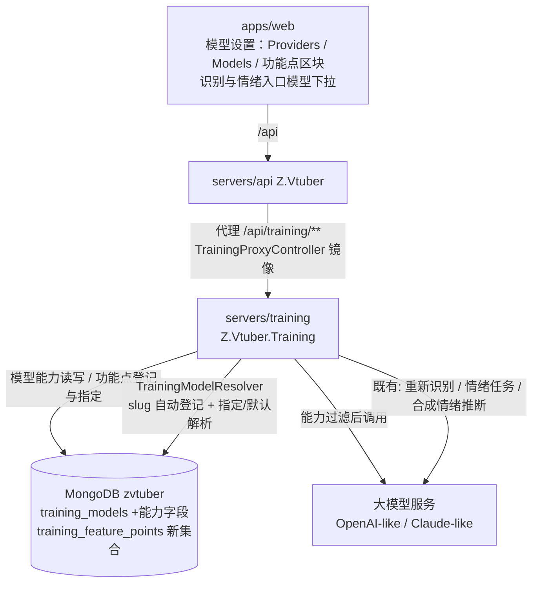
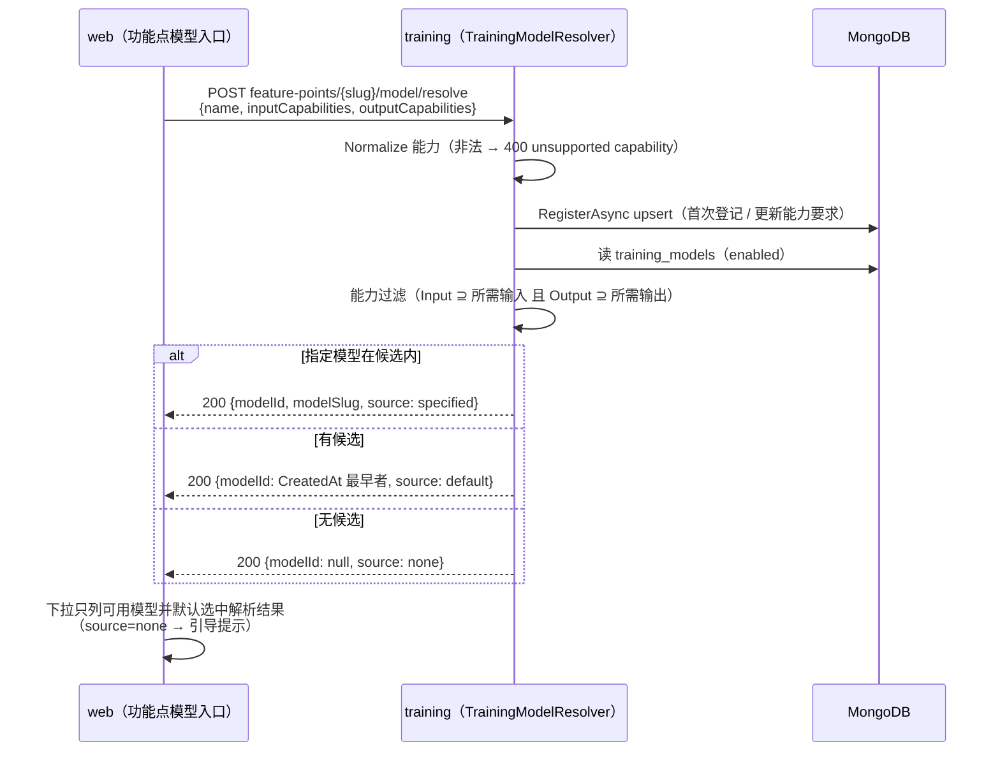
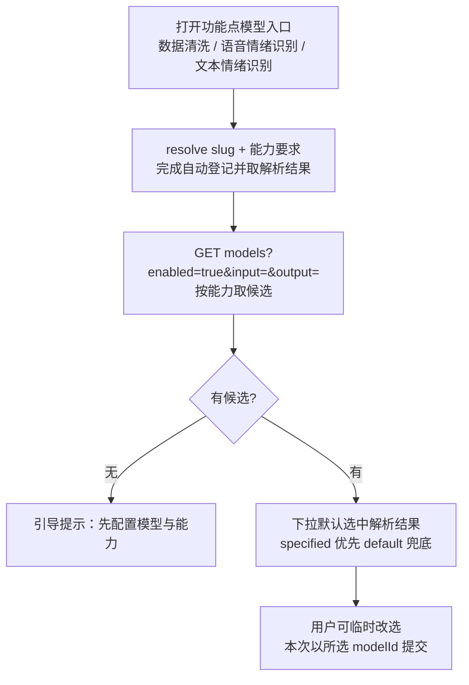

# AI 训练 - 数据集模型设置支持模型能力 - 技术提案

- 日期：2026-10-01
- 状态：待评审
- feat-branch：`feat/dataset-model-capability`
- 关联文档：[PRD](../../product/draft/20261001-dataset-model-capability-prd.md)

## 1. 概述

### 1.1 背景

依据 PRD「AI 训练 - 数据集模型设置支持模型能力」：(1) 模型设置中的模型支持手动配置输入/输出能力（语音、视频、文本、图片），存量模型一次性清洗为「输入：语音、文本；输出：文本」；(2) 既有功能点「输入语音识别情绪」（输入语音、文本 → 输出文本）、「输入文本识别情绪」（输入文本 → 输出文本）按能力查询可用模型；(3) 提供功能点维度的模型设置——功能点请求模型时携带 slug 自动登记，可指定模型（优先返回）并可取消指定恢复默认（默认为未设置）。

现状勘察结论（均经读码确认）：

**① 模型记录只有「启用」开关，无任何能力/形态概念。**

- `servers/common/training/Entities/TrainingModelRecord.cs`：`Id/ProviderId/Model/Enabled/CreatedAt/UpdatedAt`，唯一索引 `(ProviderId, Model)`，`slug = {providerName}/{model}` 为派生字段不落库；**全仓库检索 `capabilit|modality|功能点` 在代码中零命中**，能力模型为全新增量；
- 模型的「不支持某种形态」当前只以运行期异常暴露：`ClaudeLikeChatClient` 遇音频抛 `ModelAudioNotSupportedException` → 400 `model does not support audio input`（`servers/training/Controllers/TrainingItemToolsController.cs`），即「选错模型要到调用才失败」，与 PRD 痛点一致。

**② 三条模型消费链路的选模口径各不相同，且都不感知能力。**

- 数据清洗（单条「重新识别」，音频 + 提示文本 → 文本）：`TrainingItemToolsController` `POST .../items/{itemId}/recognize`，显式 `modelId`，`ReRecognizeDialog.tsx` 下拉取「全部启用模型」；
- 输入语音识别情绪（数据集批量「情绪识别」，条目音频 + 台词 → 情绪文本）：`TrainingItemToolsController` `POST .../items/emotion-tasks` 建任务（`ModelId`/`ModelSlug` 快照），`EmotionTaskRunner` 执行时按 `Enabled` 校验，`EmotionSubmitDialog.tsx` 下拉取「全部启用模型」；
- 输入文本识别情绪（合成情绪推断，纯文本 → 情绪文本）：`TrainingSynthesizeController.ResolveEmotionModelAsync`（`Servers/training/Controllers/TrainingSynthesizeController.cs:164`）三级回退「显式 `modelId` → `Synthesize:DefaultEmotionModelId` → 首个启用模型 → null（情绪降级中性）」，`EmotionPromptBuilder` 明确「情绪识别只用文本」。

**③ 「默认选择」已有事实口径，可直接固化为产品语义。**

- `TrainingModelRepository.ListAsync` 按 `CreatedAt` 升序返回，「首个启用模型」即**添加时间最早的启用模型**——PRD「恢复之前默认选择的模型」可精确落为「可用模型中 `CreatedAt` 最早者」，存量清洗后默认选择不变（见 §6.1 决策 7）。

**④ 存量数据一次性清洗有成熟的幂等迁移范式。**

- `zvtuber_meta` marker 模式先例：`servers/common/transcript/Mongo/TranscriptMongoSetup.cs:48-82` `CleanupAsync`（marker `transcript_model_isdefault_cleanup_v1`，`BsonDocument` 级 `Filter.Exists(...)` + `$unset`）、`servers/recording/Recording/RecordingBackfillMigration.cs`；实体均带 `[BsonIgnoreExtraElements]`，新增字段对旧版本读取无感（向后兼容）。

**⑤ 契约与代理镜像、web codegen 链路齐备，扩端点是惯性改动。**

- `contracts/training.openapi.yaml`（24 个 operationId）逐端点镜像到 `contracts/bilibili-crawler.openapi.yaml`，`servers/api/Controllers/TrainingProxyController.cs` 24 个 action 走 `ForwardAsync` 透传；`apps/web/package.json` `codegen` 生成 `schema-training.d.ts`；
- `apps/web/src/pages/training/ModelSettingsTab.tsx` 已是 Providers + Models 双表（slug 展示、启停、discover/import），新增「功能点」区块与能力列在既有骨架上扩展即可。

### 1.2 目标

1. `training_models` 增补输入/输出能力（`audio|video|text|image` 四值常量，服务端白名单校验），模型列表支持按能力过滤；存量模型 marker 幂等清洗为「输入：`["audio","text"]`；输出：`["text"]`」；
2. 新增 `training_feature_points` 集合与功能点模型解析器：功能点携带 `slug` + 能力要求请求模型时**自动登记**（upsert），返回优先级「指定模型 → 默认模型 → 无」，并支持指定/取消指定；
3. 三条模型消费链路接入功能点口径：数据清洗 `dataset-clean`、输入语音识别情绪 `emotion-from-audio`、输入文本识别情绪 `emotion-from-text`，其模型候选一律按能力过滤、默认选中解析结果；
4. 契约先行 + codegen：`contracts/training.openapi.yaml` 扩展（3 个端点变更 + 4 个新端点 + 4 个 schema）与 `contracts/bilibili-crawler.openapi.yaml` 镜像、`TrainingProxyController` 镜像 action、web `FeaturePointPanel` 与能力勾选；
5. 补齐后端接口/迁移测试与前端组件测试，核心逻辑覆盖率 ≥ 80%。

### 1.3 范围

- **内**：`servers/common/training`（`TrainingModelRecord` 能力字段、新实体 `TrainingFeaturePointRecord` + 仓储 + 集合/索引、能力常量与纯函数、存量能力清洗迁移）；`servers/training`（`TrainingModelsController` 能力过滤与读写、新 `TrainingFeaturePointsController`、`TrainingModelResolver`、合成情绪模型解析改走功能点）；`contracts/training.openapi.yaml` + `contracts/bilibili-crawler.openapi.yaml`；`servers/api/TrainingProxyController` 镜像；`apps/web`（模型能力列与勾选、功能点区块、三条入口的模型下拉按能力过滤、codegen）；`tests/Z.Vtuber.Tests` 与 `apps/web` Vitest。
- **外**：各功能点的识别/合成加工逻辑本身（prompt、JSON 解析、任务状态机、`Extensions.emotion` 结构）零改动；Provider/Model 的 discover/import、启用语义、`{provider}/{model}` slug 口径零改动；能力的自动推断（模型能力由人工设置，存量一次性清洗除外）；自定义能力扩展；模型用量统计与计费。

## 2. 技术架构

### 2.1 系统架构图



### 2.2 技术栈

| 层级 | 技术选型 | 说明 |
|------|---------|------|
| 后端 | C# (.NET 10) ASP.NET Core Controllers（training 服务内扩展） | 不新建服务；沿用控制器 + 仓储 + DTO 映射模式 |
| 数据库 | MongoDB（`training_models` 扩字段 + 新集合 `training_feature_points`） | 幂等建索引 + marker 幂等存量清洗，无迁移脚本 |
| AI 接入 | 既有 `IChatModelClient`（OpenAI-like / Claude-like） | 零改动，仅选模口径变化 |
| 服务编排 | .NET Aspire（`infra/apphost`） | 无新增引用与环境变量 |
| 前端 | React 19 + Vite（无 UI 库、内联样式） | `ModelSettingsTab` 扩能力列 + 新组件 `FeaturePointPanel` |
| 契约 | OpenAPI（`contracts/training.openapi.yaml`） | 手写契约先行，web `openapi-typescript` codegen |
| 测试 | xUnit + Testcontainers（Mongo）、Vitest + RTL | 沿用既有设施 |

### 2.3 模块划分

| 模块 | 职责 | 关键技术点 |
|------|------|-----------|
| `servers/common/training`（变更） | 能力常量与纯函数、`TrainingModelRecord` 能力字段、`TrainingFeaturePointRecord`/仓储、存量能力清洗 | `TrainingModelCapabilities.Normalize/Matches`；`Slug` 唯一索引；marker `training_model_capabilities_backfill_v1` |
| `servers/training/FeaturePoints`（新增） | `TrainingModelResolver`：功能点登记 + 指定/默认解析 | upsert 登记、`CreatedAt` 升序取默认、指定失效回退并标注 |
| `servers/training/Controllers`（变更） | `TrainingModelsController` 能力过滤/读写、新 `TrainingFeaturePointsController` | 错误体统一 `{"error":"..."}`，口径同既有控制器 |
| `servers/training/Synthesis`（变更） | 合成情绪推断模型解析改走功能点 `emotion-from-text` | 显式 → 功能点指定 → 功能点默认 → 降级中性 |
| `servers/api`（变更） | `/api/training/feature-points/**` 镜像 | 复用 `ForwardAsync` 透传 |
| `apps/web`（变更） | 模型能力列/勾选、功能点区块、三条入口下拉按能力过滤 | 能力标签展示、slug 展示、恢复默认交互 |

## 3. API 设计

### 3.1 API 契约（`contracts/training.openapi.yaml`，扩展）

能力取值统一为 `TrainingModelCapability`：`audio`（语音）/ `video`（视频）/ `text`（文本）/ `image`（图片）；请求侧非法值一律 400 `unsupported capability`（服务端 `Normalize` 白名单校验，trim + 小写 + 去重）。错误体统一 `{"error":"..."}`，`*Id` 非法 ObjectId 按「不存在」→ 404，与既有 24 个端点同口径。

#### 接口 1: 模型列表（变更：按能力过滤）

- **请求** GET `/api/training/models?enabled=true&input=audio,text&output=text`
  | 参数 | 位置 | 必填 | 说明 |
  |------|------|------|------|
  | `enabled` | query | 否 | 过滤启用状态（既有） |
  | `input` | query | 否 | 逗号分隔所需输入能力（如 `audio,text`）；模型输入能力须**覆盖**该集合 |
  | `output` | query | 否 | 逗号分隔所需输出能力；模型输出能力须覆盖该集合 |
- **响应** 200 `TrainingModelList`（`CreatedAt` 升序，slug 仍服务端拼好；能力不匹配的模型不返回；`input`/`output` 均缺省时行为与现状一致）

#### 接口 2: 手动添加模型（变更：带能力）

- **请求** POST `/api/training/models`
  ```json
  { "providerId": "66d8...", "model": "gpt-4o-audio-preview",
    "inputCapabilities": ["audio", "text"], "outputCapabilities": ["text"] }
  ```
  `inputCapabilities`/`outputCapabilities` 可选（缺省空数组 = 未声明能力；未声明能力的模型不进入任何功能点的可用模型）。
- **响应** 201 `TrainingModel`；400 `model is required` / `unsupported capability`；404 `provider not found`；409 `model exists`

#### 接口 3: 更新模型（变更：带能力）

- **请求** PUT `/api/training/models/{modelId}`，Body `{ "model"?, "enabled"?, "inputCapabilities"?, "outputCapabilities"? }`（缺失字段不改，传空数组即「清空能力」）
- **响应** 200 `TrainingModel`；400；404 `model not found`；409 `model exists`

#### 接口 4: 功能点列表（新增）

- **请求** GET `/api/training/feature-points`
- **响应** 200 `TrainingFeaturePointList`（`Slug` 升序）
  ```json
  { "items": [ {
      "slug": "emotion-from-audio", "name": "输入语音识别情绪",
      "inputCapabilities": ["audio", "text"], "outputCapabilities": ["text"],
      "specifiedModelId": null, "specifiedModelSlug": null, "specifiedModelAvailable": false,
      "defaultModelId": "66d8...", "defaultModelSlug": "openai-prod/gpt-4o-audio-preview",
      "registeredAt": "...", "updatedAt": "..." } ] }
  ```
  `specifiedModelAvailable`：已指定但指定模型不可用（被删除/停用/能力不匹配）时为 `false`，前端据此标注「指定模型不可用」。

#### 接口 5: 功能点请求模型（新增，自动登记）

- **请求** POST `/api/training/feature-points/{slug}/model/resolve`
  ```json
  { "name": "输入语音识别情绪", "inputCapabilities": ["audio", "text"], "outputCapabilities": ["text"] }
  ```
  | 字段 | 类型 | 必填 | 说明 |
  |------|------|------|------|
  | `name` | string | 否 | 功能点名称（缺省以 slug 展示） |
  | `inputCapabilities` | string[] | 是 | 功能点所需输入能力 |
  | `outputCapabilities` | string[] | 是 | 功能点所需输出能力 |
- **行为**：以 `slug` upsert 登记（首次插入 `registeredAt`；再次请求以最新 `name`/能力要求更新 `updatedAt`）→ 解析模型返回；
- **响应** 200
  ```json
  { "slug": "emotion-from-audio", "modelId": "66d8...", "modelSlug": "openai-prod/gpt-4o-audio-preview",
    "source": "specified" }
  ```
  `source`：`specified`（指定模型可用）/ `default`（回退默认选择；指定存在但不可用时同样返回 `default`，列表端点负责标注）/ `none`（无可用模型，`modelId`/`modelSlug` 为 `null`）；
  400 `unsupported capability` / `feature point slug is required`

#### 接口 6: 指定功能点模型（新增）

- **请求** PUT `/api/training/feature-points/{slug}/model`，Body `{ "modelId": "66d8..." }`
- **校验**：功能点已登记（404 `feature point not found`）；模型存在（404 `model not found`）且为该功能点可用模型（启用 + 能力匹配，否则 400 `model not qualified`）
- **响应** 200 `TrainingFeaturePoint`（同列表项结构）

#### 接口 7: 取消指定（新增，恢复未设置）

- **请求** DELETE `/api/training/feature-points/{slug}/model`
- **响应** 200 `TrainingFeaturePoint`（`specifiedModelId` 置空，恢复默认选择口径）；404 `feature point not found`

#### schema 定义（增量）

```yaml
TrainingModelCapability:
  type: string
  enum: [audio, video, text, image]
  description: 模型能力（语音/视频/文本/图片）

TrainingModel:            # 增量
  inputCapabilities:  { type: array, items: { $ref: TrainingModelCapability } }
  outputCapabilities: { type: array, items: { $ref: TrainingModelCapability } }

TrainingModelCreateRequest / TrainingModelUpdateRequest:   # 增量
  inputCapabilities:  { type: array, items: { $ref: TrainingModelCapability }, nullable: true }
  outputCapabilities: { type: array, items: { $ref: TrainingModelCapability }, nullable: true }

TrainingFeaturePoint:
  properties:
    slug:                    { type: string }
    name:                    { type: string }
    inputCapabilities:       { type: array, items: { $ref: TrainingModelCapability } }
    outputCapabilities:      { type: array, items: { $ref: TrainingModelCapability } }
    specifiedModelId:        { type: string, nullable: true }
    specifiedModelSlug:      { type: string, nullable: true }
    specifiedModelAvailable: { type: boolean }
    defaultModelId:          { type: string, nullable: true }
    defaultModelSlug:        { type: string, nullable: true }
    registeredAt:            { type: string, format: date-time }
    updatedAt:               { type: string, format: date-time }

TrainingFeaturePointList:
  items: { type: array, items: { $ref: TrainingFeaturePoint } }

TrainingFeaturePointModel:
  properties:
    slug:      { type: string }
    modelId:   { type: string, nullable: true }
    modelSlug: { type: string, nullable: true }
    source:    { type: string, description: "specified | default | none" }

TrainingFeaturePointResolveRequest:
  properties:
    name:               { type: string, nullable: true }
    inputCapabilities:  { type: array, items: { $ref: TrainingModelCapability } }
    outputCapabilities: { type: array, items: { $ref: TrainingModelCapability } }

TrainingFeaturePointSetModelRequest:
  properties:
    modelId: { type: string }
```

#### 代理镜像（api 服务，`contracts/bilibili-crawler.openapi.yaml`）

`/api/training/feature-points/**` 4 个新端点逐个镜像（与既有 24 个同口径：query/body/状态码透传，上游不可达 502 `{"error":"training service unavailable"}`），`TrainingProxyController` 增加对应 action。

### 3.2 内部接口

- **能力纯函数**（`servers/common/training/Contracts/TrainingModelCapabilities.cs`，新增）：

  ```csharp
  public static class TrainingModelCapabilities
  {
      public const string Audio = "audio";   // 语音
      public const string Video = "video";   // 视频
      public const string Text  = "text";    // 文本
      public const string Image = "image";   // 图片

      /// <summary>trim + 小写 + 去重 + 白名单校验；空集合合法；未知值抛 CapabilityException（400 unsupported capability）。</summary>
      public static IReadOnlyList<string> Normalize(IEnumerable<string>? raw);

      /// <summary>required ⊆ model 的判定（输入、输出分别调用）；两侧均满足即「可用模型」。</summary>
      public static bool Matches(IReadOnlyList<string> modelCapabilities, IReadOnlyList<string> required);
  }
  ```

- **仓储**（`servers/common/training/Persistence/`）：

  ```csharp
  // TrainingModelRepository（扩展）
  Task<List<TrainingModelRecord>> ListAsync(bool? enabled = null, IReadOnlyList<string>? input = null,
      IReadOnlyList<string>? output = null, CancellationToken ct = default);   // 能力过滤：Normalize 后内存判定（模型量级数十条）

  // TrainingFeaturePointRepository（新增）
  Task<List<TrainingFeaturePointRecord>> ListAsync(CancellationToken ct = default);                    // Slug 升序
  Task<TrainingFeaturePointRecord?> GetBySlugAsync(string slug, CancellationToken ct = default);
  Task<TrainingFeaturePointRecord> RegisterAsync(TrainingFeaturePointRecord record, CancellationToken ct = default); // 按 Slug upsert：首次插 CreatedAt，已存在仅更新 Name/能力要求/UpdatedAt
  Task<TrainingFeaturePointRecord?> SetModelAsync(string slug, ObjectId? modelId, CancellationToken ct = default);   // 指定 / 置空（恢复未设置）
  ```

- **功能点模型解析**（`servers/training/FeaturePoints/TrainingModelResolver.cs`，新增）：

  ```csharp
  public sealed record ModelResolution(string Slug, ObjectId? ModelId, string? ModelSlug, string Source);

  public interface ITrainingModelResolver
  {
      /// <summary>自动登记（upsert slug + 能力要求）后解析：指定模型可用 → specified；
      /// 否则默认选择（可用模型中 CreatedAt 最早者）→ default（指定存在但不可用同样回 default）；无候选 → none。</summary>
      Task<ModelResolution> ResolveAsync(string slug, string? name,
          IReadOnlyList<string> input, IReadOnlyList<string> output, CancellationToken ct = default);

      /// <summary>功能点当前可用模型集合（Enabled + 能力匹配，CreatedAt 升序），供指定校验与列表标注复用。</summary>
      Task<List<TrainingModelRecord>> ListCandidatesAsync(IReadOnlyList<string> input,
          IReadOnlyList<string> output, CancellationToken ct = default);
  }
  ```

## 4. 数据模型

### 4.1 数据库设计

#### 集合: `training_models`（变更：增补能力字段）

| 字段 | 类型 | 说明 |
|------|------|------|
| `InputCapabilities` | string[] | 输入能力（`audio`/`video`/`text`/`image` 子集；**缺省/空 = 未声明**，不进入任何功能点可用模型） |
| `OutputCapabilities` | string[] | 输出能力（同上） |

- 其余字段、`(ProviderId, Model)` 唯一索引、`ProviderId` 索引不变；`slug` 仍为派生字段；
- 存量清洗（一次性、幂等）：`training_models` 中 `InputCapabilities` 或 `OutputCapabilities` **字段缺失**的文档 → `$set` `InputCapabilities=["audio","text"]`、`OutputCapabilities=["text"]`（PRD：现存数据清洗为输入「语音、文本」、输出「文本」）；
  - 实现：`BsonDocument` 级 `Filter.Or(Exists("InputCapabilities", false), Exists("OutputCapabilities", false))`（同 `TranscriptMongoSetup.CleanupAsync` 手法），marker `training_model_capabilities_backfill_v1` 落 `zvtuber_meta`，随 training 服务启动执行、重复执行零副作用、**不覆盖**用户已手动设置的能力（只命中字段缺失的文档）。

#### 集合: `training_feature_points`（新增）

| 字段 | 类型 | 说明 |
|------|------|------|
| `Id` | ObjectId | 主键 |
| `Slug` | string | 功能点标识（功能点自行声明，唯一；trim 非空 ≤128） |
| `Name` | string | 功能点名称（请求未传则回落 slug） |
| `InputCapabilities` | string[] | 功能点所需输入能力 |
| `OutputCapabilities` | string[] | 功能点所需输出能力 |
| `ModelId` | ObjectId? | **指定模型**；`null` = 未设置（默认） |
| `CreatedAt` / `UpdatedAt` | DateTime(UTC) | 登记时间 / 最近一次登记或指定变更时间 |

- 索引：`Slug` **唯一**；登记（resolve）按 `Slug` upsert，能力要求以最新声明为准；
- 指定模型不做外键级联：模型被删除后 `ModelId` 保留，读取时解析为「指定模型不可用」（PRD：指定不清除、恢复可用后自动回优先）。

- 新集合沿用 `TrainingCollectionNames` + `TrainingMongoSetup.EnsureIndexesAsync` 幂等建立（`CollectionNamesEquivalenceTests`、`MongoDbFixture.ResetAsync` 名单同步登记）。

### 4.2 缓存设计

无缓存：模型与功能点为低频管理数据，每次现读；能力过滤与解析均为内存判定（模型量级数十条）。Redis 无新增用途。

## 5. 技术实现方案

### 5.1 核心流程

#### 流程 1: 功能点请求模型（自动登记 + 指定/默认解析）



#### 流程 2: 指定 / 取消指定

```mermaid
flowchart LR
    A[功能点列表<br/>读 specified/default/available] --> B{操作}
    B -->|指定模型| C[PUT feature-points/{slug}/model<br/>校验：已登记 + 模型存在 + 是可用模型]
    C -->|通过| D[落库 ModelId<br/>此后 resolve 返回 specified]
    C -->|不合格| E[400 model not qualified]
    B -->|恢复默认| F[DELETE feature-points/{slug}/model]
    F --> G[ModelId 置空<br/>resolve 回到默认选择]
```

注：`defaultModelId` 与 `specifiedModelAvailable` 在列表/详情读取时实时计算（不落库），模型增删改后立即反映。

#### 流程 3: 三条链路的模型候选与默认选中（变更点）



### 5.2 关键实现点

#### 实现点 1: 能力常量与纯函数（servers/common/training）

- `Contracts/TrainingModelCapabilities.cs`：四值常量 + `Normalize`（trim/小写/去重/白名单，未知值抛 `CapabilityException`）+ `Matches`（集合包含判定）；纯函数单测重点（含空集合语义：模型能力为空不匹配任何非空要求）；
- `TrainingMapping`：`ToModelDto` 增 `inputCapabilities`/`outputCapabilities`；新增 `ToFeaturePointDto(record, specifiedSlug, specifiedAvailable, defaultId, defaultSlug)`；`TrainingModelRecord` 增 `[BsonIgnoreExtraElements]` 兼容字段（既有标注已覆盖）。

#### 实现点 2: 模型能力读写与过滤（servers/training）

- `TrainingModelsController`：create/update 接受能力数组（`Normalize` 校验，非法 400 `unsupported capability`；update 传空数组 = 清空、缺省 = 不改，沿用 `JsonElement?` 缺失/显式 null 区分口径）；`GET /api/training/models` 增 `input`/`output` query（逗号分隔 → `Normalize` → 过滤）；
- 过滤在仓储 `ListAsync` 加载后内存判定（决策 6）；日志不涉及能力以外的新敏感面。

#### 实现点 3: 功能点登记与解析（servers/training/FeaturePoints）

- `TrainingFeaturePointRecord` + `TrainingFeaturePointRepository`（`Slug` 唯一索引；`RegisterAsync` upsert 用 `Slug` 过滤 + `SetOnInsert CreatedAt`）；
- `TrainingModelResolver.ResolveAsync` 顺序：Normalize → `RegisterAsync`（登记/更新能力要求）→ `ListCandidatesAsync`（`Enabled` + 能力匹配，`CreatedAt` 升序）→ 指定命中则 `specified`，否则取首候选 `default`，无候选 `none`；
- `TrainingFeaturePointsController`（`[Route("api/training/feature-points")]`）4 端点：列表（实时计算 `specifiedModelAvailable`/`defaultModelSlug`）、resolve、指定（校验「是可用模型」→ 400 `model not qualified`）、取消指定；错误体与状态码口径同既有控制器。

#### 实现点 4: 三条链路接入（servers/training）

- 数据清洗（`TrainingItemToolsController` `POST .../items/{itemId}/recognize`）与输入语音识别情绪（`POST .../items/emotion-tasks`）：请求体 `modelId` 语义不变（显式所选、最高优先），能力校验发生在前端候选与 resolve 阶段；任务执行沿用「`ModelId`/`ModelSlug` 快照 + `Enabled` 校验」状态机（决策 10）；
- 输入文本识别情绪（`TrainingSynthesizeController.ResolveEmotionModelAsync`）：三级回退改为「显式 `modelId` → `TrainingModelResolver`（slug `emotion-from-text`，能力 输入 `text` / 输出 `text`）→ null（情绪降级中性）」；`Synthesize:DefaultEmotionModelId` 配置项本期移除（决策 11，若仍配置则忽略并 Warn，不影响启动）；
- 功能点 slug 与能力要求固化为常量（`servers/training/FeaturePoints/FeaturePointIds.cs`）：`dataset-clean`（输入 `audio,text` / 输出 `text`）、`emotion-from-audio`（输入 `audio,text` / 输出 `text`）、`emotion-from-text`（输入 `text` / 输出 `text`），与 PRD §3.2 能力表一一对应；resolve 请求统一携带 `name`（中文名）便于功能点列表可读。

#### 实现点 5: 存量能力清洗（servers/common/training）

- `TrainingMongoSetup`（或独立 `TrainingModelCapabilityBackfill`）：启动时按 marker `training_model_capabilities_backfill_v1` 幂等执行一次 `UpdateMany`（`Exists` 判定字段缺失的文档 → `$set` 输入 `["audio","text"]`、输出 `["text"]`）；沿用 `MongoDbInitializer` 的 `zvtuber_meta` marker 手法（先例 `TranscriptMongoSetup.CleanupAsync`）；
- 幂等口径：marker 已存在即跳过；marker 写入在更新成功后；中断重跑安全（重复 `$set` 相同值无副作用，且只命中字段缺失文档）。

#### 实现点 6: 契约与代理镜像

- `contracts/training.openapi.yaml`：3 个端点变更（models 列表/create/update）+ 4 个新端点（feature-points）+ 4 个 schema（`TrainingModelCapability`/`TrainingFeaturePoint`/`TrainingFeaturePointList`/`TrainingFeaturePointModel` 及两个 request）；
- `contracts/bilibili-crawler.openapi.yaml` 镜像 + `TrainingProxyController` 增 4 个 action（走既有 `ForwardAsync`）；`TrainingProxyTimeoutConsistencyTests` 口径不变；
- `apps/web` `npm run codegen` 重新生成 `schema-training.d.ts`（勿手改）。

#### 实现点 7: web 模型设置与功能点区块（apps/web）

- `ModelSettingsTab.tsx`：Models 表格增「输入能力」「输出能力」两列（能力标签，空能力显示「未设置」提示补全）；新增/编辑模型对话框增能力勾选组（语音/视频/文本/图片 × 输入/输出，默认无勾选）；
- 新增 `FeaturePointPanel.tsx`（+ 测试）：功能点列表（名称/标识/所需能力/当前模型：未设置 或 指定模型 slug，指定不可用标注「指定模型不可用」，未设置时展示默认模型 slug）、「指定模型」下拉（候选来自 `listTrainingModels({enabled:true, input, output})`，按该功能点能力过滤）、「恢复默认」按钮（已指定时出现）；
- `ReRecognizeDialog.tsx` / `EmotionSubmitDialog.tsx` / 合成情绪模型选择：加载时调用 resolve（完成自动登记并取解析结果）→ 候选按能力过滤（数据清洗与语音情绪识别 `input=audio,text&output=text`；文本情绪识别 `input=text&output=text`）→ 默认选中解析结果 → 无候选展示引导提示；
- `api/client.ts`：`listTrainingModels` 增能力参数；新增 `listTrainingFeaturePoints`/`resolveFeaturePointModel`/`setFeaturePointModel`/`clearFeaturePointModel`（错误统一走 `apiErrorMessage`，`model not qualified`/`unsupported capability` 补中文文案）。

## 6. 技术决策

### 6.1 决策列表

| 决策 | 选项 A | 选项 B | 最终选择 | 原因 |
|------|--------|--------|---------|------|
| 能力承载 | `training_models` 增数组字段 | 独立「模型能力」集合 | **A** | 能力与模型同生命周期、同时读写；模型量级数十条，无需拆表 |
| 能力取值 | 固定四值常量 + 白名单 | 开放字符串 | **A** | 需求明确「语音、视频、文本、图片」；白名单可挡拼写漂移，非法值 400 显式暴露 |
| 新增模型能力缺省 | 空数组（未声明） | 缺省「输入语音、文本 / 输出文本」 | **A** | 能力应显式声明，避免「看似可用实则未确认」；存量口径由一次性清洗补齐（需求原文），前端空态提示补全 |
| 功能点登记 | 请求即自动 upsert | 人工在设置里登记 | **A** | 需求明确「自动注册」；避免新功能点漏登记，登记信息（能力要求）由功能点自己声明不易失真 |
| 功能点数据存放 | Mongo 集合 `training_feature_points` | 配置文件 | **A** | 登记是运行期动态行为，指定/取消需持久化；配置文件需改码发布 |
| 能力过滤位置 | 仓储加载后内存判定 | Mongo 数组包含查询 + 多键索引 | **A** | 模型数十条量级，内存判定简单可靠；数组包含查询的索引收益低且口径复杂 |
| 默认选择规则 | 可用模型中 `CreatedAt` 最早者 | 全局配置默认模型 | **A** | 需求「恢复之前默认选择的模型」要求默认确定且与现状一致；现状「首个启用模型」即 `CreatedAt` 升序首个，存量清洗后默认不变 |
| 指定模型失效 | 保留指定 + 运行时回退默认 + 列表标注 | 失效即清除指定 | **A** | 不破坏用户意图（模型临时停用/调能力后能自动恢复优先），PRD 明确「指定本身不被清除」 |
| resolve 传输形态 | POST body（携带能力要求） | GET query | **A** | 自动登记是写副作用，POST 语义更准；能力集合走 body 更自然 |
| 任务执行期能力校验 | 仅校验 `Enabled`（现状） | 执行期再校验能力 | **A** | 任务带 `ModelId`/`ModelSlug` 快照语义不变；能力是「选择期」约束，避免已入队任务因调能力大面积失败 |
| `Synthesize:DefaultEmotionModelId` | 移除，由功能点「指定模型」承接 | 保留为最终兜底 | **A** | 双口径并存会让「默认到底是哪个」不可解释；功能点指定即其替代（可指定到同一模型），保留配置则忽略并 Warn 一版便于回滚 |
| 手动选择与指定并存 | 入口默认选中解析结果、允许临时改选 | 强制使用指定模型 | **A** | 与既有「手动选模型」交互兼容；「优先返回」是解析口径而非禁选（PRD 边界明确本次以所选为准） |

### 6.2 依赖与约束

| 类型 | 内容 | 说明 |
|------|------|------|
| 依赖 | 既有模型设置（Providers/Models）与三条模型消费链路 | 数据清洗（重新识别）、批量情绪识别、合成情绪推断 |
| 依赖 | MongoDB（`training_models` + 新集合 `training_feature_points`） | 幂等建索引 + marker 幂等清洗 |
| 约束 | 契约先行 | 先补 `contracts/training.openapi.yaml` 与 api 镜像契约，再改实现（common-rules） |
| 约束 | 加工逻辑零改动 | prompt、JSON 解析、任务状态机、`Extensions.emotion` 结构不因本期变更 |
| 约束 | 领域边界 | 新实体/仓储归 `Z.Vtuber.Common.Training`，领域项目零引用（`ProjectReferenceGuardTests`） |
| 约束 | 能力取值固定四值、人工设置 | 无自动推断；存量一次性清洗除外 |
| 约束 | .NET 10、TDD、核心逻辑覆盖率 ≥ 80% | 项目既有规范 |

## 7. 项目结构

```
contracts/（变更）
├── training.openapi.yaml                        # 3 端点变更 + 4 新端点 + 6 schema
└── bilibili-crawler.openapi.yaml                # + /api/training/feature-points/** 镜像

servers/common/training/（变更）
├── Contracts/TrainingModelCapabilities.cs       # 新增：能力常量 + Normalize/Matches
├── Entities/TrainingModelRecord.cs              # + InputCapabilities / OutputCapabilities
├── Entities/TrainingFeaturePointRecord.cs       # 新增
├── Persistence/TrainingModelRepository.cs       # ListAsync 能力过滤
├── Persistence/TrainingFeaturePointRepository.cs# 新增：List/GetBySlug/Register(upsert)/SetModel
├── Mongo/TrainingCollectionNames.cs             # + training_feature_points
├── Mongo/TrainingMongoSetup.cs                  # + Slug 唯一索引 + 存量能力清洗（marker 幂等）
└── (TrainingMapping 归属见既有约定)             # + 能力/功能点 DTO 映射

servers/training/（变更）
├── FeaturePoints/FeaturePointIds.cs             # 新增：slug 与能力要求常量（dataset-clean 等 3 个）
├── FeaturePoints/TrainingModelResolver.cs       # 新增：自动登记 + 指定/默认解析
├── Controllers/TrainingFeaturePointsController.cs # 新增：接口 4-7
├── Controllers/TrainingModelsController.cs      # 能力读写 + 按能力过滤
├── Controllers/TrainingSynthesizeController.cs  # 情绪模型解析改走功能点（移除 DefaultEmotionModelId 回退）
├── Contracts/Dtos.cs                            # + FeaturePoint/能力 DTO
└── Program.cs                                   # + Resolver / FeaturePointRepository 注册

servers/api/（变更）
└── Controllers/TrainingProxyController.cs       # + 4 个镜像 action

apps/web/src/（变更）
├── api/schema-training.d.ts                     # codegen 重新生成（勿手改）
├── api/client.ts                                # listTrainingModels 扩参 + 4 个功能点封装
└── pages/training/
    ├── ModelSettingsTab.tsx                     # + 能力列 / 能力勾选 / 功能点区块
    ├── ModelSettingsTab.test.tsx                # + 能力与功能点用例
    ├── FeaturePointPanel.tsx                    # 新增：功能点列表 + 指定/恢复默认
    ├── FeaturePointPanel.test.tsx               # 新增
    ├── ReRecognizeDialog.tsx / .test.tsx        # 候选按能力过滤 + 默认选中解析结果
    └── EmotionSubmitDialog.tsx / .test.tsx      # 同上（emotion-from-audio）

tests/Z.Vtuber.Tests/（变更）
├── TrainingModelCapabilitiesTests.cs            # 新增：Normalize/Matches/非法值
├── TrainingModelCapabilityApiTests.cs           # 新增：能力读写、按能力过滤、400 口径
├── TrainingFeaturePointApiTests.cs              # 新增：resolve 自动登记/指定/取消/失效标注
├── TrainingModelResolverTests.cs                # 新增：指定优先/默认取最早/回退/无候选
├── TrainingModelCapabilityBackfillTests.cs      # 新增：存量清洗幂等 + 不覆盖已设置
└── TrainingProxyControllerTests.cs              # + 新镜像路由透传
```

## 8. 测试策略

### 8.1 测试覆盖要求

- 核心逻辑（能力 `Normalize`/`Matches`、解析优先级与默认选择、功能点 upsert 登记、存量清洗幂等判定、DTO 映射）覆盖率 ≥ 80%（common-rules）；
- TDD：契约先行后按红-绿推进；沿用 `MongoDbFixture`（Testcontainers Mongo），无真实外网调用。

### 8.2 测试类型

| 类型 | 工具 | 覆盖范围 |
|------|------|---------|
| 单元测试 | xUnit | `TrainingModelCapabilities`（大小写/去重/非法值/空集合语义）、`TrainingModelResolver`（指定优先/默认取 `CreatedAt` 最早/指定失效回 default/无候选 none）、清洗条件判定 |
| 接口测试 | xUnit + Testcontainers Mongo + WebApplicationFactory | models 能力读写与过滤（含 400 `unsupported capability`、404/409 回归）、feature-points 4 端点全链路、resolve 自动登记与能力要求更新、指定校验 400 `model not qualified` |
| 迁移测试 | Testcontainers Mongo | 存量文档补齐 `["audio","text"]`/`["text"]`；已设置能力不被覆盖；marker 幂等（重复执行零副作用） |
| 契约测试 | 既有契约检查模式 | training 契约与实现一致；api 镜像契约一致；proxy 超时口径不回退 |
| 前端组件测试 | Vitest + RTL + jsdom | 能力勾选与列展示（空能力空态）、功能点区块（指定/恢复默认/失效标注）、三条入口下拉按能力过滤与默认选中、无可用模型引导 |

关键用例清单：

- **能力**：create/update 带能力 201/200；非法能力 400；update 缺省不改、传空数组清空；过滤 `input=audio,text&output=text` 只回覆盖集合的模型；空能力模型不进任何候选；
- **功能点**：resolve 首次登记（含 `name`/能力要求）与再次请求更新能力要求；指定可用模型后 resolve 返回 `specified`；取消指定后返回与指定前一致的 `default`；指定后改能力使不匹配 → resolve 回 `default` 且列表 `specifiedModelAvailable=false`；停用/删除指定模型同口径，恢复后回 `specified`；指定非可用模型 400；未登记功能点指定 404；
- **清洗**：存量两字段缺失 → 补齐为 `["audio","text"]`/`["text"]`；已设置的不覆盖；marker 幂等；
- **回归**：`TrainingModelApiTests`/`TrainingRecognizeTests`/`EmotionTaskApiTests`/`EmotionTaskRunnerTests`/`TrainingSynthesizeApiTests`/`SynthesizeServiceTests` 现有用例不回退（合成情绪缺省解析行为经功能点口径后结果与现状一致）；
- **web**：能力标签列与勾选保存；功能点列表含未设置/指定/不可用三态；恢复默认按钮仅在已指定时出现；三条入口候选过滤与默认选中；无可用模型引导提示。

## 9. 部署方案

### 9.1 环境规划

| 环境 | 用途 | 部署方式 |
|------|------|---------|
| AppHost（Aspire）本地编排 | 开发联调 | 无新增引用与环境变量 |
| 生产 | 随常规版本发布 | 先发 training（含新集合、索引与存量清洗），再 api 代理，最后 web；纯增量面，旧版本无感知 |

### 9.2 配置管理

- 无新增配置；`Synthesize:DefaultEmotionModelId` 本期移除（仍配置则忽略并 Warn，不影响启动）；
- 数据初始化：启动幂等建 `training_feature_points` 索引 + 一次性存量能力清洗（marker `training_model_capabilities_backfill_v1`），无迁移脚本；
- 回滚：按整体版本回退；新增字段与 `training_feature_points` 对旧版本无害（`[BsonIgnoreExtraElements]`），已清洗的能力数据保留、回滚后行为不受影响；
- 镜像流水线 `.github/workflows/build-training-image.yml` 触发范围已含 `servers/training/**` 与 `servers/common/training/**`，无需调整。

## 10. 验收标准

- [ ] 技术方案评审通过；契约评审通过（含 api 镜像契约）
- [ ] 模型可手动设置输入/输出能力（语音、视频、文本、图片多选），列表可见；非法能力 400
- [ ] 存量模型一次性清洗为「输入：语音、文本；输出：文本」，幂等且不覆盖用户已设置能力
- [ ] 模型列表支持按能力过滤；数据清洗 / 输入语音识别情绪 / 输入文本识别情绪的模型候选只含能力匹配的启用模型，无候选有引导提示
- [ ] 功能点携带 slug 请求模型即自动登记（含能力要求，可随声明更新），功能点列表可见名称/标识/能力要求/当前模型
- [ ] 可为功能点指定模型（仅可选可用模型），指定后优先返回指定模型；可取消指定，取消后返回默认选择的模型（与指定前一致）；默认为未设置
- [ ] 指定模型删除/停用/能力不匹配时回退默认并在列表标注，恢复后重新优先返回
- [ ] 合成情绪推断模型解析改走功能点口径后，显式 modelId 优先级不变、无可用模型仍降级中性
- [ ] 契约 codegen 一致；单测/接口测试/迁移测试通过，核心逻辑覆盖率 ≥ 80%；既有模型设置、重新识别、情绪任务、合成功能回归不回退

## 11. 相关文档

- PRD：`docs/product/draft/20261001-dataset-model-capability-prd.md`
- 数据集工具优化（模型设置/情绪识别）技术提案：`docs/engineering/proposals/20260928-proposal-training-dataset-emotion.md`
- 音频数据集技术提案：`docs/engineering/proposals/20260927-proposal-training-audio-dataset.md`
- 存量清洗先例：`docs/engineering/plans/20260917-plan-transcript-model-isdefault-fix.md`（marker 幂等清洗）
- 既有契约：`contracts/training.openapi.yaml`、`contracts/bilibili-crawler.openapi.yaml`
- 规范：`docs/engineering/common-rules.md`、`docs/engineering/backend-rules.md`、`docs/engineering/frontend-rules.md`
