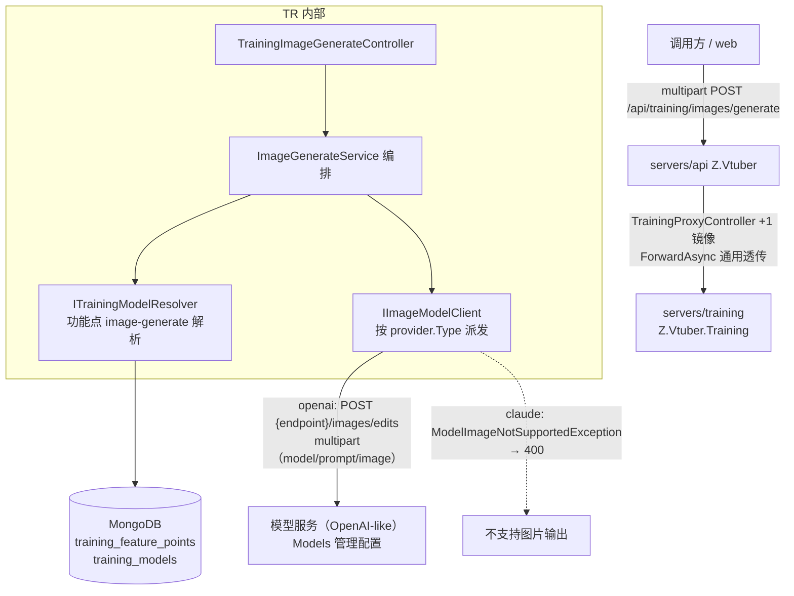
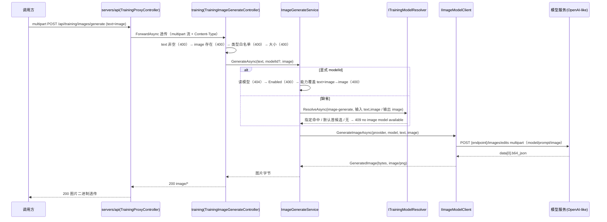

# AI 训练 - 对外提供绘图接口 - 技术提案

- 日期：2026-10-01
- 状态：待评审
- feat-branch：`prd/training-image-generate`（需求总分支；实现分支另切 `feat/training-image-generate`）
- 关联文档：[PRD](../../product/draft/20261001-training-image-generate-prd.md)

## 1. 概述

### 1.1 背景

依据 PRD「AI 训练 - 对外提供绘图接口」：training 提供 `POST /api/training/images/generate`，multipart 输入「文本 + 图片」，调用「输入 文本+图片 / 输出 图片」的可用模型生成图片并返回；生成失败返回明确报错信息；API 由 training 服务提供，api 代理出去。

现状勘察结论（均经读码确认）：

**① 能力白名单已含 `image`，模型/功能点基建零改动可复用。**

- 能力白名单固定四值 `audio`/`video`/`text`/`image`（`servers/common/training/Contracts/TrainingModelCapabilities.cs`），模型可标注「输入 文本+图片 / 输出 图片」；
- 功能点解析 `ITrainingModelResolver.ResolveAsync`（指定优先 → 默认 → none）已上线（`servers/training/FeaturePoints/`），新功能点仅需在 `FeaturePointIds` 增加常量定义，登记 upsert 由 Resolver 自动完成；
- 显式模型校验口径可仿 `TrainingItemToolsController` recognize（404 `model not found` / 400 `model disabled` / 400 `model does not support audio input`）。

**② Ai 客户端按 Provider 类型派发，图片生成可平行扩展。**

- 既有 `IChatModelClient`/`IChatModelClientFactory` 按 `provider.Type`（`openai`/`claude`）派发（`servers/training/Ai/`），named client `AiModel` 挂 `ModelSessionHeaderHandler`（固定携带 `x-opencode-session` 头）；
- 图片生成新增 `IImageModelClient`/`ImageModelClientFactory` 同构派发：OpenAI-like 走 `POST {endpoint}/images/edits`（multipart：`model`/`prompt`/`image` 文件），Claude-like 无图片输出能力，直接抛 `ModelImageNotSupportedException`（映射 400）；
- 复用 named client `AiModel`（超时/重定向策略/`x-opencode-session` 头一致）。

**③ api 代理为通用透传，multipart 与图片响应天然支持。**

- `servers/api/Controllers/TrainingProxyController.cs` 的 `ForwardAsync` 对 POST/PUT 透传请求体流与 `Content-Type`（multipart boundary 原样保留），响应透传状态码/Content-Type/二进制体（`ResponseHeadersRead` + `CopyToAsync`）；
- 新增端点仅需 +1 镜像 action，无需任何透传逻辑改动；代理默认超时 180s 高于模型调用预算（120s），口径一致。

**④ training 尚无 inbound multipart 消费点，按 ASP.NET 标准 `[FromForm]` 接入。**

- 现有 multipart 仅为 outbound（`IndexTtsClient` 手写 multipart 调上游 TTS）；inbound 用 `[Consumes("multipart/form-data")]` + `[FromForm] IFormFile` 标准接入，契约用 `multipart/form-data` requestBody 描述。

### 1.2 目标

1. training 新增 `POST /api/training/images/generate`：`multipart/form-data` 输入 `text`（必填）+ `image`（文件，必填）+ `modelId`（可选），成功 `200` 返回图片二进制（`image/*`）；`servers/api` `/api/training/**` 代理镜像暴露；
2. 模型选择：显式 `modelId`（404/400/能力校验）优先，缺省按新功能点 `image-generate`（输入 `text,image` / 输出 `image`）解析，无可用模型 409 `no image model available`；
3. 新增 `IImageModelClient`（OpenAI-like `/images/edits` multipart → `b64_json` 解析；Claude-like 抛不支持），错误统一 `{"error": "..."}`；
4. 契约先行（training 契约 + api 镜像），TDD 补齐测试（上游模型以假 `HttpMessageHandler` 契约测试，不打外网）。

### 1.3 范围

- **内**：`servers/training`（`TrainingImageGenerateController`、`Ai/IImageModelClient`+`ImageModelClientFactory`+`OpenAiLikeImageClient`、`ImageGenerateService` 编排、`Configuration/ImageOptions`、`FeaturePoints/FeaturePointIds` +1 常量）；`contracts/training.openapi.yaml`（+1 端点）+ `contracts/bilibili-crawler.openapi.yaml`（镜像）；`servers/api/Controllers/TrainingProxyController.cs`（+1 action）；`tests/Z.Vtuber.Tests`（控制器/客户端/代理测试）。
- **外**：数据集/情绪识别/音频生成/模型管理**零改动语义**；上游模型服务零改动；生成结果入库/缓存、批量生成、Web 绘图界面（本期不做）；Claude-like 图片输出（上游不支持）。

## 2. 技术架构

### 2.1 系统架构图



### 2.2 技术栈

| 层级 | 技术选型 | 说明 |
|------|---------|------|
| 后端 | C# (.NET 10) ASP.NET Core Controllers（training 服务内扩展） | 不新建服务；沿用控制器 + 编排 + DTO 映射模式 |
| inbound multipart | `[Consumes("multipart/form-data")]` + `[FromForm] IFormFile` | ASP.NET 标准；training 首个 inbound multipart 端点 |
| 模型调用 | `IImageModelClient` 按 `provider.Type` 派发；OpenAI-like 手写 multipart `POST /images/edits` | 复用 named client `AiModel`（含 `x-opencode-session` 头）；零新增 NuGet |
| 模型选择 | `ITrainingModelResolver` + 功能点 `image-generate` | 与既有功能点机制同口径；登记 upsert 自动完成 |
| 服务编排 | .NET Aspire（`infra/apphost`） | 无新增资源；仅配置节注入 |
| 代理 | `servers/api` `TrainingProxyController.ForwardAsync` 通用透传 | multipart 请求体流 + `Content-Type` 原样透传；图片响应二进制透传 |
| 测试 | xUnit + Testcontainers（Mongo）+ 假 HTTP 服务 | 上游模型用假 `HttpMessageHandler` 契约测试，不打外网 |

### 2.3 模块划分

| 模块 | 职责 | 关键技术点 |
|------|------|-----------|
| `servers/training/Controllers/TrainingImageGenerateController`（新增） | 绘图端点 | multipart 接入、校验顺序、错误映射、图片二进制返回 |
| `servers/training/ImageGeneration/ImageGenerateService`（新增） | 生成编排 | 模型解析（显式/功能点）→ 读图片字节 → 调 `IImageModelClient` → 结果 |
| `servers/training/Ai/IImageModelClient.cs`（新增） | 图片生成客户端抽象 + 工厂 | `GenerateImageAsync(provider, model, prompt, image)`；`ImageModelClientFactory` 按 `provider.Type` 派发 |
| `servers/training/Ai/OpenAiLikeImageClient.cs`（新增） | OpenAI-like `/images/edits` | multipart `model`/`prompt`/`image`；解析 `data[0].b64_json`；失败 `HttpRequestException`/`ModelOutputException` |
| `servers/training/FeaturePoints/FeaturePointIds.cs`（变更） | +`image-generate` 功能点定义 | 输入 `text,image` / 输出 `image`，中文名「绘图生成」 |
| `servers/training/Configuration/ImageOptions.cs`（新增） | 节 `Image` | `MaxImageBytes`/`RequestTimeoutSeconds`，`ValidateOnStart` |
| `servers/api/Controllers/TrainingProxyController.cs`（变更） | +1 镜像 action | 复用通用 `ForwardAsync` |
| `contracts/`（变更） | training 契约 +1 端点 + api 镜像 | 契约先行 |

## 3. API 设计

### 3.1 API 契约（`contracts/training.openapi.yaml`，扩展）

新增 1 个端点，错误体/状态码口径与既有端点一致。

#### 接口 1: 绘图生成（images/generate）

- **请求** POST `/api/training/images/generate`，`Content-Type: multipart/form-data`

  | 字段 | 类型 | 必填 | 说明 |
  |------|------|------|------|
  | `text` | string | 是 | 绘图提示文本（trim 后非空，否则 400 `text is required`） |
  | `image` | file | 是 | 参考图片（`image/png`/`image/jpeg`/`image/webp`，≤ `Image:MaxImageBytes` 默认 10MB） |
  | `modelId` | string | 否 | 指定模型 id（Models 管理）；缺省按功能点 `image-generate` 解析 |

- **响应**
  - `200 image/*`：生成图片二进制（Content-Type 缺省 `image/png`，随上游结果）；
  - `400 {"error":"text is required"}` / `{"error":"image is required"}` / `{"error":"unsupported image type"}` / `{"error":"image too large"}` / `{"error":"model disabled"}` / `{"error":"model does not support image input"}` / `{"error":"model does not support image output"}`；
  - `404 {"error":"model not found"}`（显式 `modelId` 非法/不存在）；
  - `409 {"error":"no image model available"}`（缺省解析无任何可用模型）；
  - `502 {"error":"model service unavailable"}` / `{"error":"invalid model output"}`。

#### schema 定义（增量）

```yaml
# 请求体：multipart/form-data
TrainingImageGenerateRequest:
  type: object
  required: [text, image]
  properties:
    text: { type: string, description: 绘图提示文本（必填） }
    image: { type: string, format: binary, description: 参考图片（png/jpeg/webp，≤10MB） }
    modelId: { type: string, nullable: true, description: 指定模型 id；缺省按功能点 image-generate 解析 }

# 成功响应为图片二进制（image/*）；错误响应沿用 ErrorResponse {"error": "..."}
```

#### 代理镜像（api 服务，`contracts/bilibili-crawler.openapi.yaml`）

`/api/training/images/generate` 逐个镜像（multipart 请求体与 `image/*` 二进制响应透传；上游不可达/超时 502 `{"error":"training service unavailable"}`）。

### 3.2 内部接口

- **图片生成客户端**（`servers/training/Ai/IImageModelClient.cs`）：

  ```csharp
  /// <summary>图片输入（字节 + mime + 文件名，源自 multipart 上传）。</summary>
  public sealed record GenerateImageInput(byte[] Bytes, string MimeType, string FileName);

  /// <summary>图片生成结果（字节 + mime，缺省 image/png）。</summary>
  public sealed record GeneratedImage(byte[] Bytes, string MimeType);

  public interface IImageModelClient
  {
      /// <summary>调用模型生成图片；传输失败/超时/非 2xx 抛 HttpRequestException（映射 502 model service unavailable）；
      /// 输出无法解析出图片抛 ModelOutputException（映射 502 invalid model output）；
      /// Provider 不支持图片输出抛 ModelImageNotSupportedException（映射 400）。</summary>
      Task<GeneratedImage> GenerateImageAsync(
          TrainingProviderRecord provider, TrainingModelRecord model,
          string prompt, GenerateImageInput image, CancellationToken ct = default);
  }

  /// <summary>按 provider.Type 派发（openai → OpenAI-like /images/edits）；claude 等其他类型抛 ModelImageNotSupportedException。</summary>
  public interface IImageModelClientFactory
  {
      IImageModelClient Create(string providerType);
  }
  ```

- **生成编排**（`servers/training/ImageGeneration/ImageGenerateService.cs`）：`GenerateAsync(text, modelId?, image, ct)` → `GeneratedImage`；内部完成模型解析（显式 `modelId` 404/400/能力校验，缺省功能点 `image-generate` 解析，无可用 `NoImageModelAvailableException` → 409）。

## 4. 数据模型

### 4.1 数据模型

**无新增集合/字段**。功能点 `image-generate` 沿用 `training_feature_points`（`ResolveAsync` 首次调用自动登记 upsert：`Slug=image-generate`、`Name=绘图生成`、输入 `text,image`、输出 `image`）；模型能力标注沿用 `training_models.InputCapabilities`/`OutputCapabilities`（`image` 已在白名单内，无需迁移）。

### 4.2 缓存设计

无应用层缓存：生成结果本期不入库/不缓存；模型/功能点现读 Mongo。

## 5. 技术实现方案

### 5.1 核心流程

#### 流程 1: 绘图生成（images/generate）



失败分支：模型服务不可达/超时/非 2xx → 502 `model service unavailable`；响应无 `b64_json` → 502 `invalid model output`；Claude-like → 400 `model does not support image output`。

### 5.2 关键实现点

#### 实现点 1: 控制器（`Controllers/TrainingImageGenerateController.cs`）

- `[Route("api/training/images")]`，`[HttpPost("generate")]` + `[Consumes("multipart/form-data")]`；签名 `Generate([FromForm] string? text, [FromForm] IFormFile? image, [FromForm] string? modelId, CancellationToken ct)`；
- 校验顺序：text（400 `text is required`）→ image 存在（400 `image is required`）→ 类型白名单 `image/png|jpeg|webp`（400 `unsupported image type`）→ 大小 ≤ `Image:MaxImageBytes`（400 `image too large`）；
- 读取 `IFormFile` 字节（超限前置拦截）→ `ImageGenerateService` → `File(result.Bytes, result.MimeType)`；
- 异常映射：`NoImageModelAvailableException` → 409 `no image model available`；`ModelImageNotSupportedException` → 400 `model does not support image output`；`ModelOutputException` → 502 `invalid model output`；`HttpRequestException`/`TaskCanceledException`（非客户端取消）→ 502 `model service unavailable`。

#### 实现点 2: 生成编排（`ImageGeneration/ImageGenerateService.cs`）

- 显式 `modelId`：`ObjectId.TryParse` + `GetByIdAsync`（404 `model not found`）→ `Enabled`（400 `model disabled`）→ 能力覆盖校验（输入须覆盖 `text,image`，否则 400 `model does not support image input`；输出须含 `image`，否则 400 `model does not support image output`）；
- 缺省：`FeaturePointIds.ImageGenerateDefinition` → `ITrainingModelResolver.ResolveAsync`（指定优先 → 默认首候选）→ 无 → `NoImageModelAvailableException`（409）；
- 读 Provider → `IImageModelClientFactory.Create(provider.Type)` → `GenerateImageAsync`；
- Info 日志：`training image-generate: modelSlug={} imageBytes={} elapsedMs={}`，不打文本/图片内容/apiKey。

#### 实现点 3: OpenAI-like 图片客户端（`Ai/OpenAiLikeImageClient.cs`）

- `POST {provider.Endpoint}/images/edits`（Bearer 鉴权），`MultipartFormDataContent`：`model`、`prompt`（=text）、`image`（`ByteArrayContent`，带原始文件名与 Content-Type）；
- 解析响应 `data[0].b64_json` → base64 解码字节；缺失/解码失败 → `ModelOutputException`（502 `invalid model output`）；非 2xx/超时/传输失败 → `HttpRequestException`（502 `model service unavailable`）；
- 复用 named client `AiModel`：`AllowAutoRedirect=false`（避免携带 API key 跟随重定向）、`ModelSessionHeaderHandler` 的 `x-opencode-session` 头一致；超时 `Image:RequestTimeoutSeconds`（默认 120s，客户端实例级设置）；
- `url` 形式响应本期不支持（→ `invalid model output`），见 §6.1 决策。

#### 实现点 4: 功能点定义（`FeaturePoints/FeaturePointIds.cs`）

- 新增 `public const string ImageGenerate = "image-generate";` 与 `ImageGenerateDefinition = new(ImageGenerate, "绘图生成", [Text, Image], [Image])`；与 PRD §3.2 功能点 2 能力表一一对应。

#### 实现点 5: 配置（`Configuration/ImageOptions.cs`）

- 节 `Image`（`ValidateOnStart`）：`MaxImageBytes`（默认 10485760=10MB）、`RequestTimeoutSeconds`（默认 120）；代理默认超时 180s 已高于该预算，无需调整。

#### 实现点 6: 代理镜像（`servers/api/Controllers/TrainingProxyController.cs`）

- +1 action：`[HttpPost("training/images/generate")] ForwardAsync(HttpMethod.Post, "api/training/images/generate", ct)`；通用 `ForwardAsync` 已透传 multipart 请求体流与 `Content-Type`（boundary 保留）及图片二进制响应，零透传逻辑改动。

### 5.3 不在本期的事项

- 生成结果入库/缓存/生成记录；批量生成、Web 绘图界面；
- `url` 形式生成结果回拉（本期仅 `b64_json`）；多图输入（`image[]`）；尺寸/数量等上游参数透传；
- Claude-like 图片输出（上游不支持）；绘图后台任务化（同步等待，超时兜底）。

## 6. 技术决策

### 6.1 决策列表

| 决策 | 选项 A | 选项 B | 最终选择 | 原因 |
|------|--------|--------|---------|------|
| 端点归属 | training 提供 + api 代理 | api 直接实现 | **A** | 需求明确「API由training服务提供，api代理出去」；与 synthesize 同链路 |
| 请求形态 | `multipart/form-data`（text + image 文件） | JSON base64 | **A** | 需求明确「API使用multipart输入文件和文本」；二进制文件天然 multipart |
| 上游调用契约 | OpenAI-like `POST /images/edits`（multipart） | chat/completions 扩展 modalities | **A** | 图像编辑标准契约、入参形态（文本+图片文件）与需求一致；Providers 已承载 OpenAI-like endpoint/key |
| 生成结果取回 | 仅 `b64_json` | 支持 `url` 回拉 | **A** | `b64_json` 一次请求拿全量、无二次出网；`url` 形态留待后续（本期 `invalid model output`） |
| 模型选择 | 显式 `modelId` + 功能点 `image-generate` 缺省解析 | 固定配置默认模型 id | **A** | 复用既有功能点机制（指定/默认/管理面可调），与 synthesize 情绪模型同口径 |
| 无可用模型 | 409 `no image model available` | 400 | **A** | 与 synthesize「无音色参考 409」同口径：服务侧资源缺失非请求格式错误 |
| Claude-like 派发 | 抛 `ModelImageNotSupportedException` → 400 | 尝试 chat 接口 | **A** | 与 `ClaudeLikeChatClient` 音频不支持同模式；能力白名单本就应拦下，派发层兜底 |
| 图片大小上限 | 配置 `Image:MaxImageBytes`（默认 10MB） | 复用 `Ai:MaxAudioBytes` | **A** | 语义独立、可单独调；默认 10MB 覆盖常见参考图 |
| 成功响应 | 图片二进制透传（`image/*`） | base64 JSON | **A** | 「返回图片」最直接；与 synthesize `audio/wav` 透传同口径 |
| 结果持久化 | 本期不入库/不缓存 | 生成记录落库 | **A** | 避免一致性/失效复杂度；需求未要求 |

### 6.2 依赖与约束

| 类型 | 内容 | 说明 |
|------|------|------|
| 依赖 | 模型管理（Providers/Models）+ `ITrainingModelResolver` | 模型选择与功能点解析，既有基建 |
| 依赖 | OpenAI-like 模型服务 `POST {endpoint}/images/edits` | 图片生成上游；Models 管理配置 |
| 依赖 | `servers/api` `TrainingProxyController.ForwardAsync` | 通用透传已支持 multipart 与二进制响应 |
| 约束 | 能力白名单四值（`image` 已含）零改动；功能点登记由 Resolver upsert 自动完成 | 无 DB 迁移 |
| 约束 | 契约先行、apiKey 不回显、日志不打密钥与图片/文本内容、零新增重量级 NuGet、.NET 10 TDD 覆盖率≥80% | 项目既有规范 |

## 7. 项目结构

```
contracts/（变更）
├── training.openapi.yaml                     # + POST /api/training/images/generate（multipart）
└── bilibili-crawler.openapi.yaml             # + 镜像（multipart 透传 + image/* 响应）

servers/training/（变更）
├── Controllers/TrainingImageGenerateController.cs  # 新增：multipart 端点 + 校验 + 错误映射
├── ImageGeneration/ImageGenerateService.cs         # 新增：模型解析 + 生成编排
├── ImageGeneration/NoImageModelAvailableException.cs # 新增（409）
├── Ai/IImageModelClient.cs                     # 新增：抽象 + 工厂接口 + GenerateImageInput/GeneratedImage
├── Ai/ImageModelClientFactory.cs               # 新增：按 provider.Type 派发
├── Ai/OpenAiLikeImageClient.cs                 # 新增：multipart /images/edits + b64_json 解析
├── Ai/ModelExceptions.cs                       # + ModelImageNotSupportedException
├── FeaturePoints/FeaturePointIds.cs            # + image-generate 定义
├── Configuration/ImageOptions.cs               # 新增：节 Image（MaxImageBytes/RequestTimeoutSeconds）
└── Program.cs                                  # + ImageOptions/IImageModelClientFactory/ImageGenerateService 注册

servers/api/（变更）
└── Controllers/TrainingProxyController.cs      # + 1 个镜像 action（复用 ForwardAsync）

tests/Z.Vtuber.Tests/（变更）
├── TrainingImageGenerateApiTests.cs            # 成功/400/404/409/502、multipart 字段、能力校验
├── OpenAiLikeImageClientTests.cs               # 假模型服务：multipart 组装/b64_json 解析/异常映射
└── TrainingProxyControllerTests.cs             # + 镜像透传（multipart 请求 + image/* 响应）
```

## 8. 测试策略

### 8.1 测试覆盖要求

- 核心逻辑（模型解析与能力校验、multipart 组装、`b64_json` 解析、错误映射）覆盖率 ≥ 80%；
- TDD：契约先行后红-绿推进；上游模型服务用假 `HttpMessageHandler`/假 HTTP server，不打外网；Mongo 用 Testcontainers。

### 8.2 测试类型

| 类型 | 工具 | 覆盖范围 |
|------|------|---------|
| 单元测试 | xUnit | 能力覆盖校验、类型/大小白名单判定、异常映射 |
| 接口测试 | xUnit + Testcontainers(Mongo) + WebApplicationFactory | images/generate 全链路（假模型服务）、错误码、功能点缺省解析 |
| 契约/客户端测试 | 假 HTTP server | training 契约一致、`OpenAiLikeImageClient` multipart/b64_json、api 镜像透传 |

关键用例清单：

- **成功**：multipart text+image → 上游收到 `model`/`prompt`/`image` 字段 → 200 图片二进制（Content-Type 正确）；
- **校验**：text 空 400；image 缺 400；`image/gif` 400 `unsupported image type`；超限 400 `image too large`（且不发起上游调用）；
- **模型选择**：显式 modelId 非法 404 / 停用 400 / 缺输出 image 能力 400 `model does not support image output` / 缺输入能力 400 `model does not support image input`；缺省命中功能点指定模型 → 默认模型 → 无 409；
- **失败**：上游 500/超时 502 `model service unavailable`；响应无 `b64_json` 502 `invalid model output`；claude Provider 400 `model does not support image output`；
- **代理**：multipart 请求体（含 boundary）与图片响应透传；training 不可达 502 `training service unavailable`；
- **回归**：既有数据集/情绪识别/音频生成/模型管理不回退。

## 9. 部署方案

### 9.1 环境规划

| 环境 | 用途 | 部署方式 |
|------|------|---------|
| AppHost（Aspire）本地编排 | 开发联调 | training + api 现状即可；模型服务经 Models 管理配置接入（不托管） |
| 生产 | 随常规版本发布 | 先发 training，再 api 代理；无 DB 迁移 |

### 9.2 配置管理

- 新增配置：`Image` 节（`MaxImageBytes` 默认 10485760、`RequestTimeoutSeconds` 默认 120），`ValidateOnStart`；
- 前置：Models 管理配置具备「输入 文本+图片 / 输出 图片」能力的可用模型（或功能点 `image-generate` 指定模型）；
- 数据初始化：无迁移（功能点 `image-generate` 首次调用自动登记）；
- 回滚：纯新增端点与客户端，回滚旧版本即摘除能力，无残留风险；
- 镜像流水线 `build-training-image.yml` 触发范围已含 `servers/training/**` + `servers/common/**`，无需调整。

## 10. 验收标准

- [x] 技术方案评审通过；契约评审通过（含 api 镜像）
- [x] `POST /api/training/images/generate` multipart 传 `text` + `image` 返回图片二进制；经 z-vtuber 代理同口径可访问
- [x] 模型选择：显式 `modelId` 404/400/能力校验；缺省按功能点 `image-generate` 指定→默认解析；无可用模型 409
- [x] 输入校验：text 空 / image 缺 / 类型非白名单 / 超限分别 400，且不发起上游调用
- [x] 失败返回明确报错：上游不可用 502 `model service unavailable`、输出非法 502 `invalid model output`、Claude-like 400 `model does not support image output`
- [x] 客户端/控制器/代理测试覆盖（假模型服务契约测试）；核心逻辑覆盖率 ≥ 80%
- [x] 既有功能回归不回退

## 11. 相关文档

- PRD：`docs/product/draft/20261001-training-image-generate-prd.md`
- 既有提案：`docs/engineering/proposals/20261001-proposal-dataset-model-capability.md`（能力标注与功能点）、`20260929-proposal-training-audio-synthesize.md`（生成接口 + 代理链路）
- 规范：`docs/engineering/common-rules.md`、`docs/engineering/backend-rules.md`
- 契约：`contracts/training.openapi.yaml`、`contracts/bilibili-crawler.openapi.yaml`
