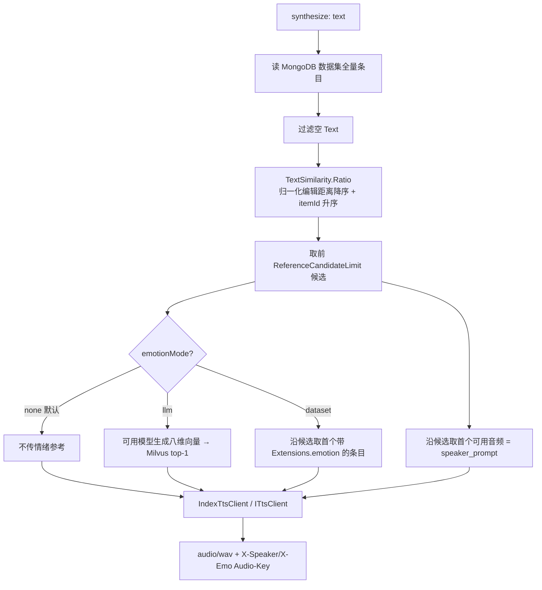
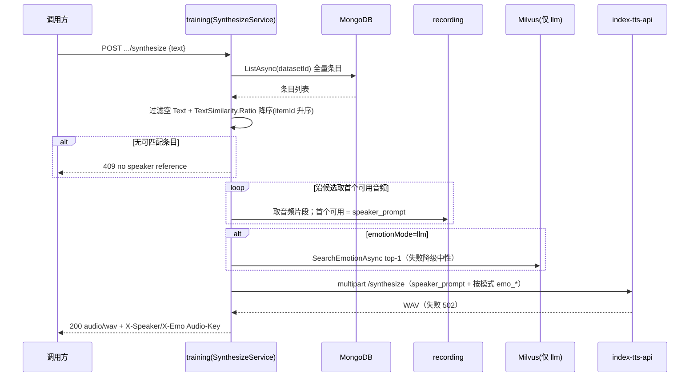

# AI 训练 - 音频生成音色参考字符相似匹配 - 技术提案

- 日期：2026-10-01
- 状态：待评审
- feat-branch：`feat/training-synthesize-char-match`
- 关联 PRD：[20260929-training-audio-synthesize-prd.md](../../product/draft/20260929-training-audio-synthesize-prd.md)
- 关联提案：[20260929-proposal-training-audio-synthesize.md](20260929-proposal-training-audio-synthesize.md)、[20260930-proposal-training-synthesize-emotion-mode.md](20260930-proposal-training-synthesize-emotion-mode.md)、[20261001-proposal-training-synthesize-emotion-none.md](20261001-proposal-training-synthesize-emotion-none.md)

## 1. 概述

### 1.1 背景

`POST /api/training/datasets/{datasetId}/synthesize` 的音色参考（`speaker_prompt`）原实现为：把输入文本经本地 Ollama **embedding** 转向量，在 Milvus `item_text_embeddings` 上做 COSINE top-1 检索，命中条目的音频作为克隆参考（见 [20260929-proposal-training-audio-synthesize.md](20260929-proposal-training-audio-synthesize.md)）。

实际使用中，音色参考的命中**时常偏离预期**：对中文短句/稀有词，文本 embedding 更偏向语义泛化，反而容易命中「语义相近但字面无关」的条目；而调用方对音色参考的直觉预期是「**文本越像越好**」。用户确认：音色参考应改为**按输入字符最相似**匹配，从**内容**与**长度**两方面衡量。

### 1.2 目标

1. 音色参考匹配口径改为**输入文本与条目 `Text` 的字符相似度**：归一化编辑距离
   `Ratio(a,b) = 1 - Levenshtein(a,b) / max(len(a), len(b))`，取值 `[0,1]`，分母取较长串长度，使分数同时反映**内容差异**（编辑操作数）与**长度差异**（长度比）；
2. 匹配池改为**直接读 MongoDB 数据集全量条目**（过滤空 `Text`），不再经 embedding / Milvus 文本集合；
3. 稳定确定性：相似度降序，**同分按 `itemId` 升序** tie-break；同一数据集 + 同一文本 → 同一命中；
4. 情绪参考（`emo_prompt`/`emo_vector`）**语义零改动**：`llm` 仍走 Milvus 八维向量检索、`dataset` 仍取命中条目自身 `Extensions.emotion`、`none` 仍不传；
5. 契约先行：双 OpenAPI（training 主契约 + bilibili-crawler 网关镜像）同步描述与 502 错误集，web codegen 再生成；
6. 依赖面收敛但不做大规模拆除：文本 embedding / `item_text_embeddings` / `vectors/rebuild` 保留（`rebuild` 继续维护），仅音色匹配不再消费。

### 1.3 范围

- **内**：`servers/training`（新增 `Synthesis/TextSimilarity.cs`；`Synthesis/SynthesizeService.cs` 音色候选与 `ReferenceMatch` 重构、移除 `IEmbeddingClient` 依赖；`TrainingSynthesizeController` 注释）；`contracts/training.openapi.yaml`、`contracts/bilibili-crawler.openapi.yaml`；`apps/web/src/api/schema*.d.ts`（codegen 产物）；`tests/Z.Vtuber.Tests`（新增字符相似单测、服务/控制器用例调整）；`servers/training/AGENTS.md`、PRD。
- **外**：情绪来源（`llm`/`dataset`/`none`）语义、`EmotionVector`、Milvus 情感集合、`IndexTtsClient`/上游契约、数据模型、`vectors/rebuild`、`servers/api` 代理实现（`ForwardAsync` 原样透传）均不动；不新增端点/配置节/依赖；不删除文本 embedding 与文本集合。

## 2. 技术架构

### 2.1 匹配流程（改动后）



### 2.2 技术栈

| 层级 | 技术选型 | 说明 |
|------|---------|------|
| 后端 | C# (.NET 10) ASP.NET Core Controllers（training 内改造） | 音色匹配改内存计算，无新依赖 |
| 音色匹配 | 归一化编辑距离（Levenshtein ratio），逐 UTF-16 字符 | 内容 + 长度兼顾，确定性 |
| 音色候选数据源 | MongoDB `training_dataset_items`（`Text`） | 事实源直读 |
| 情绪匹配 | 沿用 Milvus 八维向量 + 可用模型 | 语义不变 |
| 契约 | OpenAPI（training 主 + bilibili-crawler 镜像）+ codegen | 契约先行 |

### 2.3 模块划分

| 模块 | 职责 | 关键技术点 |
|------|------|-----------|
| `Synthesis/TextSimilarity.cs`（新增） | 字符相似度 | `Ratio` + 两行滚动数组 Levenshtein（空间 O(min(m,n))） |
| `Synthesis/SynthesizeService.cs`（变更） | 音色候选排序与编排 | 读 Mongo 全量条目、排序 tie-break、移除 embedding 依赖；`ReferenceMatch` 去掉 `VectorMatch` |
| `Controllers/TrainingSynthesizeController.cs`（注释） | 文档口径 | 与实现一致 |
| `contracts/*`（变更） | 契约描述/错误集 | 描述改字符匹配；502 收敛 |
| `servers/api`（零改动） | 代理 | `ForwardAsync` 原样透传 |

## 3. API 设计

### 3.1 API 契约（`contracts/training.openapi.yaml`）

接口路径/方法/请求体/响应体/状态码**结构性不变**（`POST /api/training/datasets/{datasetId}/synthesize`），仅描述与 502 错误集调整：

| 项 | 改动 |
|----|------|
| `description` | 「输入文本向量化后匹配音色参考」→「按输入文本与条目文本的字符相似度（归一化编辑距离，兼顾内容与长度）匹配音色参考」；`dataset` 模式措辞由「文本向量命中条目」改「音色命中候选条目」 |
| `409` | 语义收敛为「数据集内无任何带非空文本的条目」 |
| `502` | 由 `embedding`/`vector store`/`audio`/`tts` 收敛为 `audio unavailable`/`tts service unavailable`（音色不再依赖 embedding/向量库；情绪向量不可用降级中性，不 502） |

#### 网关镜像（`contracts/bilibili-crawler.openapi.yaml`）

同步 synthesize 502 描述；`servers/api` 既有 `ForwardAsync` 原样透传，**实现零改动**。

## 4. 数据模型

无变更。候选来源仍是既有 `training_dataset_items.Text`；不新增集合/索引/配置。

## 5. 技术实现方案

### 5.1 核心流程



### 5.2 关键实现点

#### 实现点 1: 字符相似度（`Synthesis/TextSimilarity.cs`）

- `Ratio(a,b) = 1 - Levenshtein(a,b) / max(len(a),len(b))`；空串口径：均空 → 1、一方空 → 0；相等短路 → 1。
- Levenshtein 用两行滚动数组，插入/删除/替换代价均 1，空间 O(min(m,n))、时间 O(m·n)。
- 确定性、对称；中文按字符计。

#### 实现点 2: 音色候选与编排（`Synthesis/SynthesizeService.cs`）

- 新增 `RankSpeakerCandidatesAsync`：`items.ListAsync(datasetId)` → 过滤 `IsNullOrWhiteSpace(Text)` → `TextSimilarity.Ratio(text, Text.Trim())` 降序 + `Record.Id` 升序 → `Take(ReferenceCandidateLimit)`。
- `ScanCandidatesAsync` 改为接收 `IReadOnlyList<TrainingDatasetItemRecord>`（不再按 `VectorMatch` 回读），逐候选取音频，首个可用为 speaker；`dataset` 模式同轮捕获首个带情绪标注候选。
- `ReferenceMatch` 收敛为 `(Item, Clip)`；`llm` 情绪链路：8 维检索命中后回 Mongo 取条目再扫描音频。
- 构造函数移除 `IEmbeddingClient`；`llm` 情绪链路保持不变；`none`/`dataset` 不变。
- 日志、命中头、错误语义不变。

#### 实现点 3: 契约与代理

- 双契约同步描述与 502；`npm run codegen` 再生成 `schema.d.ts`/`schema-training.d.ts`（勿手改）。
- `servers/api/TrainingProxyController` 零改动。

### 5.3 不在本期的事项

- 彻底移除文本 embedding / `item_text_embeddings` 与 `VectorSyncService` 文本侧（本次按用户选择保留，仅不再参与音色匹配）。
- 相似度阈值/加权参数化、拼音/分词/大小写归一、Web 合成界面、批量合成。

## 6. 技术决策

### 6.1 决策列表

| 决策 | 选项 A | 选项 B | 最终选择 | 原因 |
|------|--------|--------|---------|------|
| 适用范围 | 仅音色参考改字符相似 | 音色 + 情绪都改 | **A** | 用户确认；情绪本质是八维语义匹配，字符相似不适用 |
| 候选来源 | 直接读 Mongo 全量条目 | 仍先 Milvus 召回再字符重排 | **A** | 字符最优条目未必在向量 top-k，重排无法兜底 |
| 相似度口径 | 归一化编辑距离（Levenshtein ratio） | bigram Dice / 内容×长度加权 | **A** | 用户确认；单一公式天然兼顾内容与长度、可解释、确定 |
| 依赖去留 | 保留 Milvus/文本集合，仅音色不消费 | 彻底拆除文本 embedding/Milvus | **A** | 控制改动面；情绪仍需 Milvus；避免大规模拆依赖 |
| 候选上限 | 保留 `ReferenceCandidateLimit`（默认 16）作用于字符排序 | 全量逐条扫描音频 | **A** | 与既有 top-k 兜底口径一致，约束音频取数次数 |

### 6.2 依赖与约束

| 类型 | 内容 | 说明 |
|------|------|------|
| 约束 | 契约先行（双 OpenAPI + codegen 一致） | 仓库规范 |
| 约束 | TDD、核心逻辑覆盖率 ≥ 80%、单用例 ≤ 5s | `docs/engineering/common-rules.md` |
| 影响 | synthesize 不再抛 `embedding service unavailable`/`vector store unavailable` | 音色匹配不再经 embedding/文本库；情绪向量不可用降级中性 |
| 影响 | 音色匹配结果随文本字面变化 | 语义相近但字面不同的条目不再命中，符合「越像越好」预期 |
| 依赖 | 无新增依赖、无新增配置、无数据迁移 | Mongo 现有字段直读 |

## 7. 项目结构

```
contracts/
├── training.openapi.yaml                        # 描述 + 502 收敛
└── bilibili-crawler.openapi.yaml                # 镜像同步

servers/training/
├── Synthesis/TextSimilarity.cs                  # 新增：归一化编辑距离
├── Synthesis/SynthesizeService.cs               # 变更：音色候选人 Mongo 字符匹配（移除 embedding）
└── Controllers/TrainingSynthesizeController.cs  # 注释口径

apps/web/src/api/
├── schema.d.ts                                  # codegen 再生成
└── schema-training.d.ts                         # codegen 再生成

tests/Z.Vtuber.Tests/
├── TextSimilarityTests.cs                       # 新增：相似度单测
├── SynthesizeServiceTests.cs                    # 音色候选改字符匹配 + 情绪 vector 降级
└── TrainingSynthesizeApiTests.cs                # 控制器：最相似命中
```

## 8. 测试策略

### 8.1 测试覆盖要求

- 核心逻辑（`TextSimilarity`、音色候选排序/兜底、情绪降级）覆盖率 ≥ 80%；
- TDD：先红后绿；沿用既有 `MongoDbFixture` + fakes，不打外网、单用例 ≤ 5s。

### 8.2 测试类型

| 类型 | 工具 | 覆盖范围 |
|------|------|---------|
| 相似度单测 | xUnit | 相等/空串/替换/长度惩罚/对称/排序性 |
| 编排测试 | xUnit + MongoDbFixture + 假音频/假 TTS/假模型 + 内存向量库 | 最相似命中、空文本跳过、次优兜底、全失败 502、情绪 vector 失败降级 |
| 控制器测试 | xUnit（控制器直测） | 最相似命中；409/502 矩阵回归 |
| 集成测试 | Testcontainers Milvus（真） | `rebuild` + synthesize 字符命中 |

关键用例清单：

- **最相似命中**：字面最接近的条目被选为 `X-Speaker-Audio-Key`；
- **内容 + 长度**：`今天天气真好` 命中 `今天天气很好`，`abc` 对 `abcdef` 得 0.5；
- **空文本跳过**：`Text` 为空白条目不参与匹配、不取音频；
- **稳定 tie-break**：同分按 `itemId` 升序；
- **情绪零回退**：`llm`/`dataset`/`none` 既有用例全绿。

## 9. 部署方案

- 无新增配置/依赖/迁移：随常规版本发布即可。
- **行为变更**：音色参考匹配口径由向量相似改为字符相似；不再依赖 Ollama/Milvus 文本检索。
- 升级后无需 `vectors/rebuild` 即可获得音色匹配（直接读 Mongo）；`rebuild` 仍建议执行以维护情绪向量。
- 回滚：还原 `SynthesizeService` 与契约即可回到向量匹配，无数据影响。

## 10. 验收标准

- [ ] 技术方案/契约评审通过
- [ ] 音色参考按输入文本与条目 `Text` 的归一化编辑距离匹配（内容 + 长度），同分 itemId 升序
- [ ] 音色候选直接读 Mongo，不再经 embedding/Milvus 文本检索
- [ ] 情绪参考 `llm`/`dataset`/`none` 语义零回退
- [ ] 空文本条目不参与匹配；无候选 → 409；候选音频全失败 → 502
- [ ] 双契约与 codegen 一致
- [ ] 核心逻辑覆盖率 ≥ 80%，TDD 用例与 podman 容器 UT 全绿

## 11. 相关文档

- PRD：`docs/product/draft/20260929-training-audio-synthesize-prd.md`
- 前序提案/Plan：`20260929-proposal-training-audio-synthesize.md`、`20260930-proposal-training-synthesize-emotion-mode.md`、`20261001-proposal-training-synthesize-emotion-none.md`
- 模块规范：`servers/training/AGENTS.md`、`servers/api/AGENTS.md`
- 规范：`docs/engineering/common-rules.md`、`docs/engineering/backend-rules.md`
