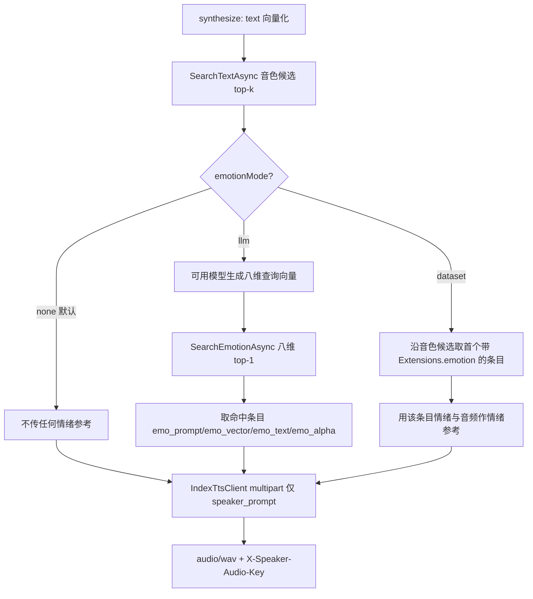
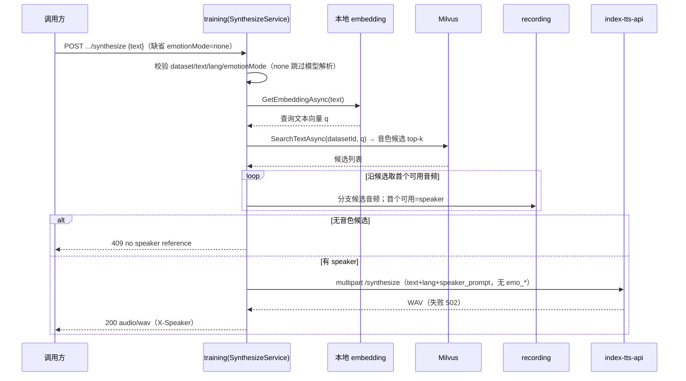

# AI 训练 - 音频生成情绪参考关闭（emotionMode=none） - 技术提案

- 日期：2026-10-01
- 状态：待评审
- feat-branch：`feat/training-synthesize-emotion-none`
- 关联 PRD：[20260929-training-audio-synthesize-prd.md](../../product/draft/20260929-training-audio-synthesize-prd.md)
- 关联提案：[20260930-proposal-training-synthesize-emotion-mode.md](20260930-proposal-training-synthesize-emotion-mode.md)

## 1. 概述

### 1.1 背景

前序提案为 `POST /api/training/datasets/{datasetId}/synthesize` 增加了 `emotionMode`（`llm`（默认）/`dataset`）情绪来源开关（见 [20260930-proposal-training-synthesize-emotion-mode.md](20260930-proposal-training-synthesize-emotion-mode.md)）。两种取值都会向 index-tts-api 传递情绪参考（`emo_prompt`/`emo_vector`/`emo_text`/`emo_alpha`）。

实际使用中，调用方常希望**先得到「无情绪参考」的基线合成结果**，再按需叠加情绪：例如对比同一文本在不同情绪参考下的效果、或仅需纯净音色克隆。既有默认 `llm` 会在每次调用都触发一次大模型情绪识别，既非调用方所需，也增加延迟与依赖。本次新增「不传情绪参考」模式，并把缺省值收敛为它。

### 1.2 目标

1. `emotionMode` 新增取值 `none`：**不传递任何情绪参考**，直接以文本向量命中的 `speaker_prompt` 调用 index-tts-api（`emo_*` 全部省略）；
2. `emotionMode` 缺省值由 `llm` 调整为 `none`（不传 query 即不叠加情绪）；`llm`/`dataset` 需显式指定；
3. `none` 与 `dataset` 一样**完全跳过 `modelId`/模型解析**（不校验、不查模型库）；
4. 契约先行：双 OpenAPI（training 主契约 + bilibili-crawler 网关镜像）同步，`servers/api` 代理天然透传 query，web codegen 再生成；
5. `llm`/`dataset` 既有语义零改动。

### 1.3 范围

- **内**：`servers/training`（`Synthesis/EmotionMode.cs` 增 `None`、`SynthesizeService` 默认值与 none 分支、`TrainingSynthesizeController` 解析 query 与默认值）；`contracts/training.openapi.yaml`、`contracts/bilibili-crawler.openapi.yaml`；`apps/web/src/api/schema*.d.ts`（codegen 产物）；`tests/Z.Vtuber.Tests`（服务/控制器用例）；`servers/training/AGENTS.md`、`servers/api/AGENTS.md`。
- **外**：向量层、Milvus 检索、`IndexTtsClient`、数据模型、`vectors/rebuild`、`servers/api` 代理实现（`ForwardAsync` 已原样透传 query）均不动；不新增端点/配置节/依赖。

## 2. 技术架构

### 2.1 分支流程（emotionMode=none / llm / dataset）



### 2.2 技术栈

| 层级 | 技术选型 | 说明 |
|------|---------|------|
| 后端 | C# (.NET 10) ASP.NET Core Controllers（training 内扩展） | 仅控制器/编排层加分支，无新依赖 |
| 情绪来源（none） | 无（不传 `emo_*`） | 默认行为 |
| 情绪来源（llm/dataset） | 沿用前序提案 | 语义不变 |
| 契约 | OpenAPI（training 主 + bilibili-crawler 镜像）+ codegen | 契约先行 |

### 2.3 模块划分

| 模块 | 职责 | 关键技术点 |
|------|------|-----------|
| `Synthesis/EmotionMode.cs`（变更） | 情绪来源枚举 | 增 `None = 2` |
| `Synthesis/SynthesizeService.cs`（变更） | 编排分支 | `None` 直接返回无情绪参考；默认参数改 `None` |
| `Controllers/TrainingSynthesizeController.cs`（变更） | 解析 `emotionMode` query | 白名单 `llm`/`dataset`/`none`，缺省 `none`；非 `llm` 跳过模型解析 |
| `contracts/*`（变更） | 契约 | enum + 默认值 + 描述 |
| `servers/api`（零改动） | 代理 | `ForwardAsync` 原样透传 query |

## 3. API 设计

### 3.1 API 契约（`contracts/training.openapi.yaml`，扩展）

#### 接口: 音频生成（synthesize）— emotionMode 扩展

- **请求** `POST /api/training/datasets/{datasetId}/synthesize?emotionMode=none|llm|dataset`

  | 参数 | in | 类型 | 必填 | 默认 | 说明 |
  |------|----|------|------|------|------|
  | `datasetId` | path | string | 是 | - | 数据集 id |
  | `emotionMode` | query | enum `llm`/`dataset`/`none`（大小写不敏感） | 否 | `none` | `none`＝不传任何情绪参考；`llm`＝大模型生成情感向量后检索；`dataset`＝直接用音频命中条目自身 `Extensions.emotion` |

  body 不变（`TrainingSynthesizeRequest`：`text` 必填、`lang?`、`modelId?`）。

- **行为差异**

  | 场景 | `none`（默认） | `llm` | `dataset` |
  |------|--------------|-------|-----------|
  | `modelId` / 模型解析 | **完全跳过** | 校验（404/400），缺省配置默认模型 | **完全跳过** |
  | 情绪查询向量 | 无 | 可用模型生成 | 无 |
  | 情绪来源 | 无（**不传 `emo_*`**） | `item_emotion_vectors` top-1 的条目情绪 | 文本向量命中条目自身 `Extensions.emotion`；为空沿音色候选向下找 |
  | `X-Emo-Audio-Key` | 缺省 | 情绪命中条目 | 取到情绪的候选条目（无则缺省） |

- **响应**：不变（200 `audio/wav` + `X-Speaker-Audio-Key`/`X-Emo-Audio-Key`；400/404/409/502）。
- **400 错误码**：`{"error":"invalid emotion mode"}` 保持（`emotionMode` 非 `llm`/`dataset`/`none`）。

#### 网关镜像（`contracts/bilibili-crawler.openapi.yaml`）

`/api/training/datasets/{datasetId}/synthesize` 镜像同步 `emotionMode` 的 enum/默认值/描述；`servers/api` 既有 `ForwardAsync` 已原样透传 `Request.QueryString`，**实现零改动**。

## 4. 数据模型

无变更。`none` 模式不读库、不写库、不产生新集合/索引。

## 5. 技术实现方案

### 5.1 核心流程



### 5.2 关键实现点

#### 实现点 1: 枚举与编排分支（`Synthesis/EmotionMode.cs`、`Synthesis/SynthesizeService.cs`）

- `enum EmotionMode { Llm, Dataset, None }`；`SynthesizeAsync(..., EmotionMode emotionMode = EmotionMode.None, CancellationToken ct = default)`（默认 `none`）。
- `none` 分支：不进入 `BuildDatasetEmotionReference` / `TryBuildEmotionReferenceAsync`，情绪参考为 `null`，`TtsSynthesizeRequest.Emotion` 省略。
- `llm`：`ScanCandidatesAsync(captureDatasetEmotion: false)` + 既有 `TryBuildEmotionReferenceAsync`，语义零改动。
- `dataset`：单轮扫描捕获情绪来源 + `BuildDatasetEmotionReference`，语义零改动。
- Info 日志 `emotionMode` 字段照记（不打文本/音频）。

#### 实现点 2: 控制器解析与跳过模型（`Controllers/TrainingSynthesizeController.cs`）

- `TryParseEmotionMode`：`null/空` → `None`；大小写不敏感匹配 `llm`/`dataset`/`none`；其他 → 400 `invalid emotion mode`。
- 仅 `EmotionMode.Llm` 调用 `ResolveEmotionModelAsync`；`dataset`/`none` 均 `model = null`。

#### 实现点 3: 代理与契约

- `servers/api/TrainingProxyController.SynthesizeDataset` 形参与透传不变。
- 双契约同步 `emotionMode` enum/默认值/描述；`npm run codegen` 再生成 `schema.d.ts`/`schema-training.d.ts`。

### 5.3 不在本期的事项

- Web 合成界面、批量合成、情绪强度参数化；大模型情感链路的重试/缓存；`emotionMode` 进入请求 body。

## 6. 技术决策

### 6.1 决策列表

| 决策 | 选项 A | 选项 B | 最终选择 | 原因 |
|------|--------|--------|---------|------|
| 是否新增 none | 新增 `none` 不传情绪参考 | 仅靠不传 modelId 降级中性 | **A** | 语义显式、可观测；降级中性仍会走一次大模型链路，none 彻底跳过 |
| 默认值 | `none`（不叠加情绪） | `llm`（前序默认，行为不变） | **A** | 用户确认：缺省应产出无情绪参考的基线；避免每次调用强制大模型 |
| none 的模型解析 | 完全跳过 | 仍校验 modelId | **A** | 与 dataset 同口径；该模式不使用大模型 |
| 非法 emotionMode | 400 `invalid emotion mode` | 静默按 none | **A** | 显式失败避免误用；与 `invalid lang` 同口径 |

### 6.2 依赖与约束

| 类型 | 内容 | 说明 |
|------|------|------|
| 约束 | 契约先行（双 OpenAPI + codegen 一致） | 仓库规范 |
| 约束 | TDD、核心逻辑覆盖率 ≥ 80%、单用例 ≤ 5s | `docs/engineering/common-rules.md` |
| 影响 | **默认值变更**：缺省不再等价 `llm` | 依赖缺省 `llm` 的调用方需显式传 `emotionMode=llm` |
| 依赖 | 无新增依赖、无新增配置、无数据迁移 | 纯编排分支 |

## 7. 项目结构

```
contracts/
├── training.openapi.yaml                     # emotionMode enum + 默认 none + 描述
└── bilibili-crawler.openapi.yaml             # 镜像同步

servers/training/
├── Synthesis/EmotionMode.cs                  # 变更：Llm / Dataset / None
├── Synthesis/SynthesizeService.cs            # 变更：默认 None + none 分支
└── Controllers/TrainingSynthesizeController.cs # 变更：解析 query + 默认 none + 跳过模型

apps/web/src/api/
├── schema.d.ts                               # codegen 再生成
└── schema-training.d.ts                      # codegen 再生成

tests/Z.Vtuber.Tests/
├── TrainingSynthesizeApiTests.cs             # + 默认 none / 显式 none / llm 回归
└── SynthesizeServiceTests.cs                 # + 默认 none / llm 回归
```

## 8. 测试策略

### 8.1 测试覆盖要求

- 核心逻辑（`EmotionMode` 分支、默认值、控制器解析与跳过模型）覆盖率 ≥ 80%；
- TDD：先红后绿；沿用控制器直测 + Mongo 夹具 + 既有 fakes，不打外网、不新增慢用例。

### 8.2 测试类型

| 类型 | 工具 | 覆盖范围 |
|------|------|---------|
| 编排测试 | xUnit + MongoDbFixture + 内存向量库/假音频/假 TTS/假模型 | 默认 none 不调用大模型且不传情绪；显式 llm 回归 |
| 控制器测试 | xUnit（控制器直测） | 默认 none / 显式 none 跳过模型解析（非法 modelId 不 404）；llm 仍 404/400；非法 mode 400 |

关键用例清单：

- **默认 none**：不传 `emotionMode` → 不调用大模型、`emo_*` 省略、非法 modelId 不 404；
- **显式 none**：`emotionMode=none` → 同上；
- **llm 回归**：`emotionMode=llm` → 大模型命中情绪、`X-Emo-Audio-Key` 正常；
- **非法 mode**：`emotionMode=bogus` → 400 `invalid emotion mode`。

## 9. 部署方案

- 无新增配置/依赖/迁移：随常规版本发布即可。
- **行为变更**：缺省由 `llm` 改为 `none`，依赖缺省 `llm` 的调用方需显式传 `emotionMode=llm`。
- 回滚：删除 `none` 支持并将默认值改回 `llm` 即回到旧行为，无数据影响。

## 10. 验收标准

- [ ] 技术方案/契约评审通过
- [ ] `synthesize` 支持 `emotionMode=none|llm|dataset`，缺省 `none`
- [ ] `none` 不传任何情绪参考（`emo_*` 全部省略）
- [ ] `none` 与 `dataset` 完全跳过 `modelId`/模型解析
- [ ] 非法 `emotionMode` → 400 `invalid emotion mode`
- [ ] 双契约与 codegen 一致；`llm`/`dataset` 模式零回退
- [ ] 核心逻辑覆盖率 ≥ 80%

## 11. 相关文档

- PRD：`docs/product/draft/20260929-training-audio-synthesize-prd.md`
- 前序提案/Plan：`20260930-proposal-training-synthesize-emotion-mode.md`、`20260930-plan-training-synthesize-emotion-mode.md`
- 模块规范：`servers/training/AGENTS.md`、`servers/api/AGENTS.md`
- 规范：`docs/engineering/common-rules.md`、`docs/engineering/backend-rules.md`
