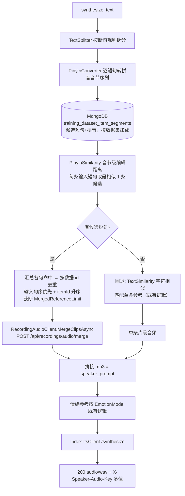
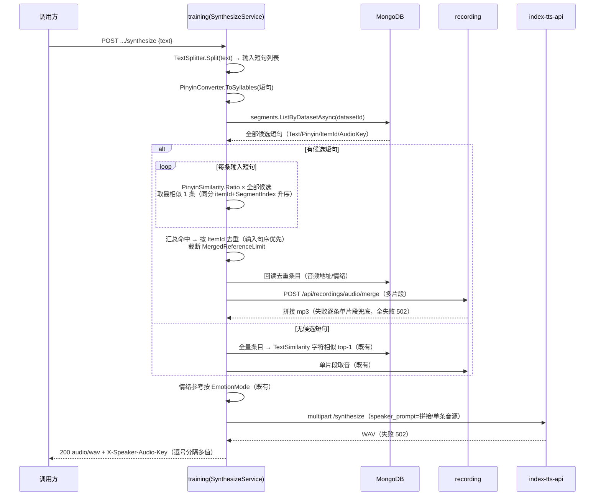
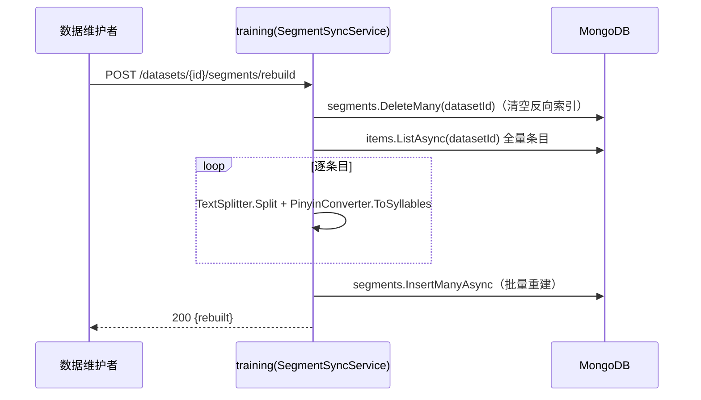

# AI 训练 - 音频生成拼音匹配与断句拼接参考音源 - 技术提案

- 日期：2026-10-01
- 状态：待评审（v1.1，按评审意见将匹配口径由「拼音键精确等值」修订为「拼音相似度（音节级编辑距离），每条输入短句取最相似候选」）
- feat-branch：`feat/training-synthesize-pinyin-match`
- 关联 PRD：[20261001-training-synthesize-pinyin-match-prd.md](../../product/draft/20261001-training-synthesize-pinyin-match-prd.md)
- 关联提案：[20260929-proposal-training-audio-synthesize.md](20260929-proposal-training-audio-synthesize.md)、[20261001-proposal-training-synthesize-char-match.md](20261001-proposal-training-synthesize-char-match.md)

## 1. 概述

### 1.1 背景

`POST /api/training/datasets/{datasetId}/synthesize` 的音色参考当前为「整段输入文本与数据集条目 `Text` 的归一化编辑距离匹配，取最相似 1 条」（见 [20261001-proposal-training-synthesize-char-match.md](20261001-proposal-training-synthesize-char-match.md)）。该口径存在两个短板：

1. **字符相似 ≠ 发音相似**：字面不同但同音/近音的内容无法互相命中，而克隆参考的关键是发音内容覆盖；
2. **单条参考对长文本覆盖不足**：整段长文本只命中 1 条参考，大部分句子没有对应发音的参考内容。

本期将匹配方式升级为**断句 + 拼音相似度匹配 + 多音频拼接**：数据集条目与输入文本统一按 `[，。,.\s]` 断句；候选短句转**拼音**（无声调音节序列）后存入**反向索引**（新 MongoDB 集合）；匹配时**每条输入短句分别**与候选短句计算**拼音相似度**（音节级归一化编辑距离）并取最相似 1 条——断句的目的是**获得更多符合的短句**，拼音距离让同音/近音也能命中；命中按**数据 id 去重**后调用 recordings 新增的**多片段合并接口**得到一段拼接 mp3，作为上游合成的 `speaker_prompt`。

> 评审修订说明：初版曾按字面把「反向索引表」设计为拼音键**精确等值**检索（`$in`）。评审意见明确「拼音匹配也要计算距离，拆短句的目标是更多的匹配符合的短句」，故匹配口径修订为**距离/相似度计算**：反向索引作为候选短句的拼音存储与按数据集加载的载体，相似度在内存中计算（与现字符匹配同构），每条输入短句取拼音最相似的 1 条候选。

### 1.2 目标

1. 新增候选短句集合 `training_dataset_item_segments`（文本断句 + 拼音音节序列 + 所属数据 id），可按数据集加载（反向索引载体）；条目增删改/数据集删除时**增量同步**；
2. 新增 rebuild 接口 `POST /api/training/datasets/{datasetId}/segments/rebuild`：清空该数据集反向索引并全量重建；
3. 新增 `PinyinSimilarity`：**音节级归一化编辑距离**（拼音 token 序列 Levenshtein ratio，兼顾内容与长度），复用 `TextSimilarity` 的算法形状；
4. synthesize 音色链路改为：输入断句 → **每条短句**转拼音 → 与数据集全部候选短句计算拼音相似度 → **每句取最相似 1 条** → 汇总命中按数据 id 去重（确定性排序）→ recordings 合并 → 拼接音源作 `speaker_prompt`；**无候选短句（未重建/全空文本）回退原字符相似匹配单条**（行为不劣化）；
5. recordings 新增 `POST /api/recordings/audio/merge`：多片段请求（文件 + 起止）经 ffmpeg 单进程 concat 合并输出单个 mp3；
6. 契约先行：training / recording / bilibili-crawler 网关镜像三份 OpenAPI 同步，web codegen 再生成；
7. 情绪参考（`llm`/`dataset`/`none`）、上游 TTS 契约、返回 `audio/wav` 语义零改动。

### 1.3 范围

- **内**：`servers/common/training`（新增 segment 实体/仓储/索引）；`servers/training`（`Synthesis/TextSplitter.cs`、`Synthesis/PinyinConverter.cs`、`Synthesis/PinyinSimilarity.cs`、`Synthesis/SegmentSyncService.cs`（重建+增量）、`SynthesizeService` 音色链路重构、`RecordingAudioClient` 增合并方法、`TrainingSegmentsController`（rebuild）、条目/数据集写路径挂增量同步、配置）；`servers/recording`（`Audio/AudioClipMerger.cs`、`RecordingController` 增 merge 端点、配置）；`contracts/training.openapi.yaml`、`contracts/recording.openapi.yaml`、`contracts/bilibili-crawler.openapi.yaml`；`apps/web` codegen 产物；`tests/Z.Vtuber.Tests`；`servers/training/AGENTS.md`、`servers/recording/AGENTS.md`、`servers/common/AGENTS.md`、PRD。
- **外**：情绪参考三模式语义、Milvus/Ollama 向量链路、`vectors/rebuild`、`IndexTtsClient` 上游契约、`servers/api` 代理实现（`ForwardAsync` 透传零改动）、数据模型既有字段、Web 界面；不做句级音频时间轴切分（拼接粒度 = 整条数据音频）、不做多音字消歧与相似度阈值调优。

## 2. 技术架构

### 2.1 系统架构图（改动后音色链路）



### 2.2 技术栈

| 层级 | 技术选型 | 说明 |
|------|---------|------|
| 后端 | C# (.NET 10) ASP.NET Core Controllers（training / recording 内改造） | 既有栈 |
| 断句 | 正则 `[，。,.\s]+` 拆分 + Trim + 去空段 | 纯函数，需求固定口径 |
| 拼音 | NuGet 拼音库（本地词典，无运行时外部依赖） | 选型见 §6.1，逐字无声调小写音节 |
| 拼音相似度 | 音节级归一化编辑距离（token Levenshtein ratio） | 与 `TextSimilarity` 同算法形状，内存计算 |
| 反向索引 | MongoDB 新集合 `training_dataset_item_segments`，按 `DatasetId` 加载 | 拼音候选的持久化载体；相似度内存计算（同现字符匹配） |
| 音频合并 | ffmpeg 单进程多输入 `-ss/-t` + `concat` filter → mp3 pipe 输出 | 复用 recording 既有 `AudioClipExtractor` 模式 |
| 契约 | OpenAPI（training / recording / 网关镜像）+ codegen | 契约先行 |

### 2.3 模块划分

| 模块 | 职责 | 关键技术点 |
|------|------|-----------|
| `servers/common/training`：`TrainingDatasetItemSegmentRecord` + `TrainingDatasetItemSegmentRepository` | 候选短句存取 | `ListByDatasetAsync(datasetId)`、`ReplaceForItemAsync`、`DeleteByDatasetAsync`、`InsertManyAsync` |
| `servers/training` `Synthesis/TextSplitter.cs`（新增） | 断句 | 正则拆分、去空段、保序 |
| `servers/training` `Synthesis/PinyinConverter.cs`（新增） | 文本 → 拼音音节序列 | 逐字转拼音（无声调小写），非中文字母/数字转小写保留为独立音节；同一文本 → 同一序列 |
| `servers/training` `Synthesis/PinyinSimilarity.cs`（新增） | 拼音相似度 | `Ratio(a, b)`：音节 token 序列归一化 Levenshtein，两行滚动数组，兼顾内容与长度 |
| `servers/training` `Synthesis/SegmentSyncService.cs`（新增） | 重建 + 增量同步 | `RebuildAsync(datasetId)` 清空重建；`SyncItemAsync` / `DeleteItemsAsync` / `DeleteDatasetAsync` 挂条目/数据集写路径 |
| `servers/training` `Synthesis/SynthesizeService.cs`（变更） | 音色链路编排 | 每句拼音 top-1 → 去重排序 → 合并取音；无候选回退字符相似；`ReferenceMatch` 支持多数据 |
| `servers/training` `Clients/RecordingAudioClient.cs`（变更） | 新增 `MergeClipsAsync` | POST 合并端点，失败按候选失败口径降级 |
| `servers/training` `Controllers/TrainingSegmentsController.cs`（新增） | rebuild 接口 | 与 `vectors/rebuild` 同构 |
| `servers/recording` `Audio/AudioClipMerger.cs`（新增） | ffmpeg 合并 | 单进程多输入 concat filter，流式 pipe 输出不落盘 |
| `servers/recording` `Controllers/RecordingController.cs`（变更） | merge 端点 | 复用 `ResolveRecordingFileAsync` 路径穿越防护与录制中判定 |

## 3. API 设计

### 3.1 API 契约

#### 接口 1: 重建候选短句拼音反向索引（training，新增）

`contracts/training.openapi.yaml` 新增，与既有 `vectors/rebuild` 同构：

- **请求**
  - Method: `POST`
  - Path: `/api/training/datasets/{datasetId}/segments/rebuild`
  - Body: 无
- **响应**
  - `200`：`{"rebuilt": <int>}`（重建的候选短句总数）
  - `404`：`{"error": "dataset not found"}`
- 语义：**清空该数据集的反向索引并全量重建**（先 `DeleteMany(datasetId)` 再逐条目断句 + 拼音 + 批量插入）。
- 网关镜像 `contracts/bilibili-crawler.openapi.yaml` 的 `/api/training/**` 同步该端点；`servers/api` 代理透传零改动。

#### 接口 2: 多片段音频合并（recording，新增）

`contracts/recording.openapi.yaml` 新增：

- **请求**
  - Method: `POST`
  - Path: `/api/recordings/audio/merge`
  - Body:
    ```json
    {
      "items": [
        { "roomId": 123, "fileName": "xxx.flv", "startMs": 1000, "endMs": 5000 }
      ]
    }
    ```
  - 约束：`items` 1 ~ `Recording:AudioMergeMaxItems`（默认 16）；每项 `startMs >= 0`、`endMs > startMs`、`endMs - startMs <= AudioClipMaxDurationMs`；各段总时长 `<= Recording:AudioMergeMaxTotalDurationMs`（默认 600000）。
- **响应**
  - `200`：`audio/mpeg`（mp3 单声道 44.1kHz 96kbps，与既有片段端点同规格；无 libmp3lame 时降级 `audio/wav` 同既有口径）+ `Cache-Control: no-store`
  - `400`：`{"error": "items is required" | "too many items" | "invalid time range" | "total duration too long" | "recording in progress"}`
  - `404`：`{"error": "file not found"}`（任一文件不存在/非法文件名）
  - `500`：`{"error": "audio merge failed"}`
- 实现：ffmpeg 单进程——每个 item 一组 `-ss {start} -t {dur} -i {file}` 输入，`-filter_complex "[0:a][1:a]...concat=n=N:v=0:a=1[out]" -map "[out]" -vn -ac 1 -ar 44100 -b:a 96k -f mp3 pipe:1`，直写响应流不落盘；`exitCode != 0` 且零字节抛异常映 500；取消时 kill 回收（同 `AudioClipExtractor`）。
- 说明：该端点为服务间内部能力（training 调用），不挂网关镜像；录制中文件按既有口径 400。

#### 接口 3: synthesize（training，既有，描述与命中头更新）

路径/方法/请求体/状态码**结构性不变**，契约更新点：

| 项 | 改动 |
|----|------|
| `description` | 音色参考口径改为「输入文本断句后，每条短句与数据集候选短句按拼音相似度（音节级归一化编辑距离）匹配取最相似 1 条，命中数据去重后经 recordings 合并为拼接音源；无候选短句时回退字符相似匹配单条」 |
| `X-Speaker-Audio-Key` | 由单值改为**逗号分隔的多值**（参与拼接的各条目 `AudioKey`，按拼接顺序）；回退路径仍为单值，格式自洽 |
| `502` | 保持 `audio unavailable` / `tts service unavailable`（合并取数失败归入 `audio unavailable`） |

### 3.2 内部接口

| 调用 | 说明 |
|------|------|
| training → MongoDB：`TrainingDatasetItemSegmentRepository` | `ListByDatasetAsync(datasetId)`（加载候选短句 + 拼音，供内存相似度计算）、`ReplaceForItemAsync`（删旧插新）、`DeleteByDatasetAsync`、`InsertManyAsync`、`CountByDatasetAsync` |
| training → recording：`IRecordingAudioClient.MergeClipsAsync(IReadOnlyList<AudioClipRequest>)` | 调 `POST /api/recordings/audio/merge`；`AudioClipRequest(roomId, fileName, startMs, endMs)` 复用 `TrainingMapping.ParseAudioUri` 解析产物；404/非 2xx/超时 → `AudioUnavailableException`（编排层按候选失败口径降级） |

## 4. 数据模型

### 4.1 数据库设计

#### 集合: `training_dataset_item_segments`（新增，MongoDB）

| 字段 | 类型 | 说明 |
|------|------|------|
| `Id` | ObjectId | 主键 |
| `DatasetId` | string | 所属数据集 |
| `ItemId` | string | 所属数据 id（去重单位；回查条目取音频/情绪） |
| `AudioKey` | string | 冗余条目 AudioKey（命中头/日志直读，免回查） |
| `SegmentIndex` | int | 短句在条目文本中的序号（确定性排序用） |
| `Text` | string | 候选短句原文（Trim 后非空） |
| `Pinyin` | string | 归一化拼音（逐字无声调小写、单空格分隔音节；加载后 split 即得音节序列） |
| `CreatedAt` | DateTime | 写入时间 |

索引（`TrainingMongoSetup.EnsureIndexesAsync` 幂等建立）：

- `(DatasetId)` —— 按数据集加载候选（匹配）、rebuild 清空、数据集级联删除；
- `(DatasetId, ItemId)` —— 条目级替换/删除。

说明：匹配为**相似度计算**而非等值检索，需加载数据集全部候选后在内存算距离（与现字符匹配「全量条目 + 内存 Ratio」同构），故不建 `Pinyin` 等值索引；「反向索引」体现在候选短句 → 所属数据（`ItemId`/`AudioKey`）的持久化映射与可按数据集高效加载。若后续数据量增长到内存全量计算不可接受，再引入拼音前缀/音节省略倒排等召回结构（见 §6.1）。

派生关系：`training_dataset_items` 为事实源，segments 为其派生索引，可随时由 rebuild 重建，无迁移风险。

### 4.2 缓存设计

无新增缓存。候选短句按数据集单次加载内存计算；拼音转换结果随 segments 持久化，匹配时只对输入短句做实时转换（十条级，成本可忽略）。

## 5. 技术实现方案

### 5.1 核心流程



rebuild 流程：



### 5.2 关键实现点

#### 实现点 1: 断句（`Synthesis/TextSplitter.cs`）

- `Split(text)`：正则 `[，。,.\s]+` 拆分 → `Trim` → 丢弃空段 → 保序返回；
- 纯函数、确定性；输入为空白/纯标点返回空列表（控制器按既有空文本口径 400）。

#### 实现点 2: 拼音转换（`Synthesis/PinyinConverter.cs`）

- `ToSyllables(text)` → `IReadOnlyList<string>`：逐字符处理——中文字符转拼音（**无声调、小写**，一个汉字 = 一个音节 token），ASCII 字母/数字转小写后按连续段作为一个 token，其余字符（标点等）丢弃；
- 落库形式 `Pinyin` = 音节序列单空格 join（匹配时 split 还原）；
- 同一文本 → 同一序列；同音不同字 → 相同音节（如「的/得/地」同归 `de`），距离为 0；
- 多音字取库默认读音（首选项），不做消歧（本期约束）；
- 新增 NuGet 依赖（选型见 §6.1），本地词典加载、无网络调用。

#### 实现点 3: 拼音相似度（`Synthesis/PinyinSimilarity.cs`）

- `Ratio(a, b)`：`1 - Levenshtein(a, b) / max(len(a), len(b))`，其中 `a/b` 为**音节 token 序列**，编辑操作（插入/删除/替换）以**音节**为单位、代价均 1，分母取较长序列长度——同时反映**发音内容差异**与**长度差异**；
- 与 `TextSimilarity` 同算法形状（两行滚动数组，空间 O(min(m,n))），空序列口径：均空 → 1、一方空 → 0；
- 选音节级而非字符级：音节是发音最小单位，避免「zh/ch/sh」等多字母音节被字符级编辑切碎导致距离失真；
- 确定性、对称。

#### 实现点 4: 候选短句同步（`Synthesis/SegmentSyncService.cs`）

- `RebuildAsync(datasetId)`：`DeleteMany(datasetId)` → 全量条目（过滤空 `Text`）→ 逐条 `Split + ToSyllables` 生成 segments（`SegmentIndex` 保序）→ `InsertManyAsync`，返回总数；
- 增量：`SyncItemAsync(item)`（条目 import / update 后 `ReplaceForItemAsync` = 删旧插新）、`DeleteItemsAsync(datasetId, itemIds)`（batch-delete 级联）、`DeleteDatasetAsync(datasetId)`（数据集删除级联）；
- 挂接点：`TrainingDatasetItemsController` 导入/更新/批量删除、`TrainingDatasetsController` 删除（与既有 `VectorSyncService` 挂接点一致，best-effort 失败记 Warn，最终以 rebuild 对齐）。

#### 实现点 5: 音色链路重构（`Synthesis/SynthesizeService.cs`）

- 新增 `MatchSpeakerSegmentsAsync`：输入断句 → 各句拼音音节序列 → `ListByDatasetAsync` 加载候选 → **每条输入短句**对全部候选算 `PinyinSimilarity.Ratio`，取**最相似 1 条**（相似度降序；同分按 `itemId` 升序、`SegmentIndex` 升序稳定 tie-break）→ 汇总各句命中；
- 命中按 **ItemId 去重**（保留首次命中序：输入短句顺序优先）→ 回读条目 → 过滤音频不可用 → 截断 `Synthesize:MergedReferenceLimit`（默认 8）；
- 去重后 ≥1 条 → `MergeClipsAsync` 合并为 `speaker_prompt`；合并整体失败时**逐条单片段兜底**（按序取首个可用单片段），全失败 `AudioUnavailableException`（502）；
- 候选短句为空（未 rebuild / 数据集全空文本）→ **回退既有字符相似路径**（`RankSpeakerCandidatesAsync` + 单片段扫描），语义不变；
- 每条输入短句「总取 top-1」与现字符匹配同口径，不设相似度阈值（低分句仍取最相似者；阈值调优留待后续，见 §6.1）；
- `dataset` 情绪模式：沿去重后条目顺序取首个带 `Extensions.emotion` 的条目（与既有「沿候选取首个带情绪标注」同口径）；`llm`/`none` 零改动；
- 命中头 `X-Speaker-Audio-Key` 输出逗号分隔多值；Info 日志增 `speakerKeys=N` 计数，不打文本/音频。

#### 实现点 6: 音频合并（`servers/recording/Audio/AudioClipMerger.cs`）

- `MergeAsync(items, output, ct)`：逐 item 复用 `ResolveRecordingFileAsync` 路径穿越防护与「录制中」判定（控制器层完成），构造 ffmpeg 单进程：每输入 `-ss {startMs}ms -t {durMs}ms -i {file}`（输入 seek 前置，小时级文件秒开），`concat=n=N:v=0:a=1` filter，统一 `-ac 1 -ar 44100 -b:a 96k -f mp3 pipe:1`；
- mp3 编码缺失降级 `-f wav`（`Mp3EncoderSupport` 既有探测，接口语义不变）；
- 取消时 kill + 回收；`exitCode != 0` 且零字节抛 `AudioMergeFailedException` 映 500。

### 5.3 不在本期的事项

- 句级音频时间轴切分（按短句估算起止时间）；多音字消歧；相似度阈值/每句 top-k 召回调优；
- 拼音倒排/前缀索引等大规模召回结构；全量（跨数据集）rebuild 端点；
- Web 合成界面、批量合成、合成结果入库/缓存。

## 6. 技术决策

### 6.1 决策列表

| 决策 | 选项 A | 选项 B | 最终选择 | 原因 |
|------|--------|--------|---------|------|
| 匹配口径 | 拼音**相似度**（距离）匹配，每条输入短句取最相似 1 条 | 拼音键精确等值匹配（`$in`） | **A** | 评审明确「拼音匹配也要计算距离，拆短句的目标是更多的匹配符合的短句」；等值匹配对近音/多字差异零召回，且与「原来的文字匹配逻辑改为匹配拼音」（原为编辑距离）语义一致 |
| 距离单位 | 音节级（token）Levenshtein ratio | 拼音拼接串字符级 Levenshtein | **A** | 音节是发音最小单位；字符级会把 zh/ch/sh 等切碎导致距离失真 |
| 候选存储与加载 | MongoDB 新集合按 `DatasetId` 加载，内存算距离 | 建 Pinyin 等值索引检索 / Milvus | **A** | 相似度匹配本质是范围计算，等值索引无意义；与现字符匹配「全量加载 + 内存 Ratio」同构，千级短句 × 十级输入句规模成本可控；数据量增长后再评估倒排召回（B 的演进位） |
| 每句命中数 | top-1（无阈值） | top-k / 相似度阈值过滤 | **A** | 与现字符匹配「总取 top-1」同口径、行为可预期；阈值/top-k 调优留待后续观测 |
| 拼音库 | `TinyPinyin.Net`（本地词典、零运行时依赖） | `NPinyin` / 自研字典 | **A** | 本地词典无网络依赖、API 简洁；实现时以 NuGet 可用性与多音字口径验证为准，不达标则回退 B 中同类库（决策点已隔离在 `PinyinConverter`） |
| 无候选行为 | 回退原字符相似单条 | 直接 409 | **A** | 未重建索引/稀疏数据集下行为不劣化 |
| 拼接粒度 | 整条数据音频去重拼接 | 句级时间轴切分拼接 | **A** | 条目无句级时间戳；需求口径即「数据 id 去重后拼合」 |
| 合并实现 | recording 单进程 ffmpeg concat filter | 各片段分别抽取后服务端拼字节 / 临时文件 concat demuxer | **A** | mp3/wav 压缩流不能直接拼字节；单进程不落盘、复用既有抽取参数体系 |
| 合并端点归属 | recordings 新增 POST 接口 | training 侧自行合并 | **A** | 需求指定；音频文件与 ffmpeg 能力均在 recording，避免大文件出网传输 |

### 6.2 依赖与约束

| 类型 | 内容 | 说明 |
|------|------|------|
| 依赖 | 新增 NuGet 拼音库（training） | 本地词典，无外部服务依赖 |
| 依赖 | recording ffmpeg（既有）+ libmp3lame（镜像流水线已断言） | 合并复用 |
| 约束 | 契约先行（三份 OpenAPI + codegen 一致） | 仓库规范 |
| 约束 | TDD、核心逻辑覆盖率 ≥ 80%、单用例 ≤ 5s | `docs/engineering/common-rules.md` |
| 约束 | 断句规则固定 `[，。,.\s]`；拼音为无声调小写音节序列；相似度为音节级归一化编辑距离 | 需求与评审口径 |
| 影响 | 升级后需对每个存量数据集执行一次 `segments/rebuild` 方启用拼音匹配；未重建自动回退字符相似，行为不劣化 | 运维步骤 |
| 影响 | `X-Speaker-Audio-Key` 变多值（逗号分隔） | 契约说明，调用方仅日志/观测用途 |

## 7. 项目结构

```
contracts/
├── training.openapi.yaml                          # segments/rebuild 新增；synthesize 描述+命中头更新
├── recording.openapi.yaml                         # POST /api/recordings/audio/merge 新增
└── bilibili-crawler.openapi.yaml                  # 网关镜像同步 training 侧端点

servers/common/training/
├── Entities/TrainingDatasetItemSegmentRecord.cs   # 新增：候选短句实体
└── Persistence/TrainingDatasetItemSegmentRepository.cs  # 新增：候选短句仓储（EnsureIndexes 挂载）

servers/training/
├── Synthesis/TextSplitter.cs                      # 新增：断句
├── Synthesis/PinyinConverter.cs                   # 新增：拼音音节序列（新 NuGet 依赖）
├── Synthesis/PinyinSimilarity.cs                  # 新增：音节级归一化编辑距离
├── Synthesis/SegmentSyncService.cs                # 新增：rebuild + 增量同步
├── Synthesis/SynthesizeService.cs                 # 变更：每句拼音 top-1 → 去重 → 合并；无候选回退
├── Clients/RecordingAudioClient.cs                # 变更：MergeClipsAsync
├── Controllers/TrainingSegmentsController.cs      # 新增：POST segments/rebuild
├── Controllers/TrainingDatasetItemsController.cs  # 变更：写路径挂增量同步
├── Controllers/TrainingDatasetsController.cs      # 变更：删除级联清 segments
└── Configuration/SynthesizeOptions.cs             # 变更：MergedReferenceLimit（默认 8）

servers/recording/
├── Audio/AudioClipMerger.cs                       # 新增：ffmpeg 单进程 concat 合并
├── Controllers/RecordingController.cs             # 变更：POST /api/recordings/audio/merge
└── Configuration/RecordingOptions.cs              # 变更：AudioMergeMaxItems / AudioMergeMaxTotalDurationMs

apps/web/src/api/                                  # codegen 再生成（勿手改）

tests/Z.Vtuber.Tests/
├── TextSplitterTests.cs                           # 新增
├── PinyinConverterTests.cs                        # 新增
├── PinyinSimilarityTests.cs                       # 新增
├── SegmentSyncServiceTests.cs                     # 新增
├── SynthesizeServiceTests.cs                      # 每句 top-1/多命中/去重/回退/合并兜底
├── TrainingSegmentsApiTests.cs                    # 新增：rebuild 控制器
├── RecordingAudioMergeApiTests.cs                 # 新增：merge 控制器
└── AudioClipMergerTests.cs                        # 新增：ffmpeg 参数纯函数
```

## 8. 测试策略

### 8.1 测试覆盖要求

- 核心逻辑（断句、拼音转换、拼音相似度、segments 仓储/同步、音色链路每句 top-1 与去重回退、合并参数构造）覆盖率 ≥ 80%；
- TDD：先红后绿；沿用 `MongoDbFixture` + fakes，不打外网、单用例 ≤ 5s。

### 8.2 测试类型

| 类型 | 工具 | 覆盖范围 |
|------|------|---------|
| 纯函数单测 | xUnit | 断句（中英文逗号/句号/空白混合、空段、纯标点）；拼音转换（同音字同音节、无声调、大小写归一、非中文保留、确定性）；拼音相似度（同音句距离 0、近音句高分、长度惩罚、对称、空序列口径） |
| 仓储/同步测试 | xUnit + MongoDbFixture（Testcontainers） | rebuild 清空重建、增量同步（import/update/batch-delete/数据集删除级联）、`ListByDatasetAsync` 全量加载 |
| 编排测试 | xUnit + 假 recording/假 TTS/假模型 | 每条输入短句取拼音最相似候选、多句多命中拼接、ItemId 去重、确定性排序、截断上限、无候选回退字符相似、合并失败单片段兜底、全失败 502、情绪三模式零回退 |
| 控制器测试 | xUnit（控制器直测） | rebuild 200/404；merge 200/400（空 items/超上限/区间非法/总时长超限）/404/500；synthesize 命中头多值 |
| 集成测试 | Testcontainers MongoDB | rebuild 后 synthesize 拼音命中端到端（假 recording/假 TTS） |

关键用例清单：

- **同音命中**：输入「今天得天气」与候选「今天的天气」拼音相同（`de` 同音节）→ 距离 0 命中；
- **近音高分**：「我喜欢吃苹果」对「我喜欢吃萍果」相似度高于无关句；
- **断句多命中**：`你好，世界。` 拆 2 句，每句各取最相似 1 条、命中 2 条不同数据 → 合并 2 段、`X-Speaker-Audio-Key` 两值；
- **去重**：同一数据被 2 个短句命中 → 仅 1 段参与合并；
- **长度惩罚**：单字短句对长候选相似度受长度比约束（ratio 分母取较长序列）；
- **回退**：segments 为空（未 rebuild）→ 走字符相似单条，结果与现网一致；
- **稳定复现**：同一数据集 + 同一文本 → 同一命中集合与拼接顺序（同分 tie-break 确定）；
- **合并降级**：拼接失败 → 首个可用单片段；全失败 → 502 `audio unavailable`。

## 9. 部署方案

### 9.1 环境规划

| 环境 | 用途 | 部署方式 |
|------|------|---------|
| 内网测试 | 联调/验收 | 常规镜像发布（training / recording 两服务） |
| 生产 | 正式上线 | 常规镜像发布，无新增基础设施 |

### 9.2 配置管理

- `Synthesize:MergedReferenceLimit`（默认 8）：参与拼接的数据条数上限；
- `Recording:AudioMergeMaxItems`（默认 16）、`Recording:AudioMergeMaxTotalDurationMs`（默认 600000）：合并请求护栏；
- 无新增外部服务/连接串；拼音库为进程内依赖。

### 9.3 上线与回滚

- 发布后对每个存量数据集执行 `POST /api/training/datasets/{id}/segments/rebuild` 启用拼音匹配；未重建期间自动回退字符相似匹配，行为不劣化；
- 回滚：还原 training / recording 代码与契约即可；segments 集合为派生数据，可整体丢弃无影响。

## 10. 验收标准

- [ ] 技术方案/契约评审通过
- [ ] 数据集条目按 `[，。,.\s]` 断句生成候选短句并存储拼音形成反向索引；rebuild 清空并全量重建、返回重建数
- [ ] 条目增删改与数据集删除增量同步 segments（best-effort，rebuild 兜底对齐）
- [ ] synthesize 输入断句后**每条短句**与候选短句按**拼音相似度（音节级归一化编辑距离）**匹配取最相似 1 条 → 数据 id 去重 → recordings 合并拼接音源作为 `speaker_prompt`；命中头多值
- [ ] 无候选短句时回退原字符相似匹配单条；情绪参考三模式零回退
- [ ] recordings `POST /api/recordings/audio/merge` 按请求顺序合并输出单 mp3，护栏与错误码齐备
- [ ] 三份契约与 codegen 一致；`servers/training`、`servers/recording`、`servers/common` AGENTS.md 同步更新
- [ ] 核心逻辑覆盖率 ≥ 80%，TDD 用例与容器 UT 全绿

## 11. 相关文档

- PRD：`docs/product/draft/20261001-training-synthesize-pinyin-match-prd.md`
- 前序提案：`20260929-proposal-training-audio-synthesize.md`、`20261001-proposal-training-synthesize-char-match.md`
- 模块规范：`servers/training/AGENTS.md`、`servers/recording/AGENTS.md`、`servers/common/AGENTS.md`
- 规范：`docs/engineering/common-rules.md`、`docs/engineering/backend-rules.md`
