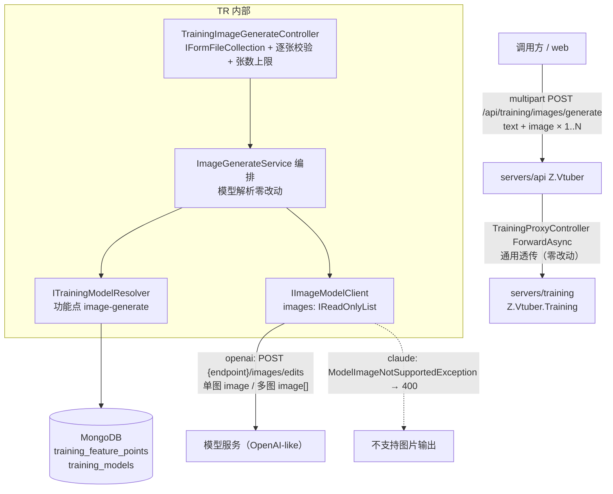
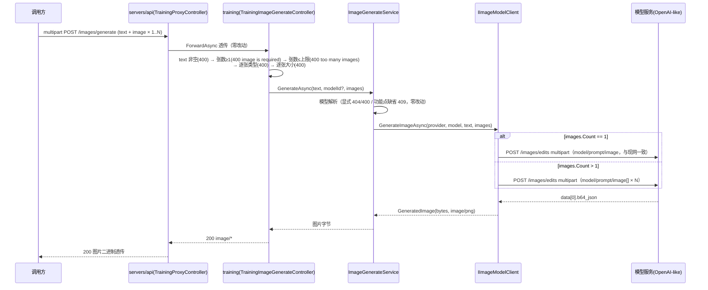

# AI 训练 - 绘图接口支持多张图片输入 - 技术提案

- 日期：2026-10-02
- 状态：待评审
- feat-branch：`prd/training-image-multi-input`（需求总分支；实现分支另切 `feat/training-image-multi-input`）
- 关联文档：[PRD](../../product/draft/20261002-training-image-multi-input-prd.md)

## 1. 概述

### 1.1 背景

依据 PRD「AI 训练 - 绘图接口支持多张图片输入」：既有 `POST /api/training/images/generate`（提案 [[20261001-proposal-training-image-generate]]，已上线）仅接受单张参考图（`[FromForm] IFormFile? image`），需升级为接受 1..N 张参考图片，单图调用行为完全不变。

现状勘察结论（均经读码确认）：

**① 入参收敛点唯一，升级面小。** 控制器 `servers/training/Controllers/TrainingImageGenerateController.cs` 是唯一的 inbound multipart 消费点：`text`/`image`/`modelId` 三个 `[FromForm]` 参数，校验顺序 text → image 存在 → 类型白名单 → 大小上限，随后封装 `GenerateImageInput(bytes, mime, fileName)` 单值传入编排。

**② 客户端单图假设集中在两处。** `IImageModelClient.GenerateImageAsync(..., GenerateImageInput image, ...)`（`servers/training/Ai/IImageModelClient.cs`）与 `OpenAiLikeImageClient.BuildForm(model, prompt, image)`（`servers/training/Ai/OpenAiLikeImageClient.cs:57`）的 multipart 只挂一个 `image` 文件字段。OpenAI `/images/edits` 契约多图以 `image[]` 重复字段表达（单图为 `image`）。

**③ 编排/模型选择/代理零改动可复用。** `ImageGenerateService`（`servers/training/ImageGeneration/ImageGenerateService.cs`）的模型解析（显式 `modelId` 404/400/能力校验、缺省功能点 `image-generate` 解析 409）与图片数量无关，仅需透传图片列表；`servers/api` `TrainingProxyController.ForwardAsync` 通用透传对 multipart 同名多 part 天然支持，零改动。

**④ 配置基建现成。** `ImageOptions`（节 `Image`，`ValidateOnStart`）已有 `MaxImageBytes`/`RequestTimeoutSeconds`，新增 `MaxImageCount` 同模式扩展即可。

### 1.2 目标

1. `POST /api/training/images/generate` 的 `image` 字段接受 **1..N 张**图片（multipart 同名字段重复提交），N 上限为 `Image:MaxImageCount`（默认 10），超限 400 `too many images`；
2. 每张图片独立做类型白名单与大小上限校验（错误码沿用 `unsupported image type`/`image too large`），全部校验在模型调用前完成；
3. `IImageModelClient` 签名升级为图片列表；OpenAI-like 客户端单图仍发 `image` 字段（与现网字节级一致，零回归），多图按 OpenAI 契约发 `image[]` 重复字段；
4. 单图调用的可观察行为（上游请求形态、响应、错误码）与升级前完全一致；契约先行，TDD 补齐测试。

### 1.3 范围

- **内**：`servers/training`（`TrainingImageGenerateController`、`IImageModelClient`+`OpenAiLikeImageClient`、`ImageGenerateService` 透传、`ImageOptions` +`MaxImageCount`）；`contracts/training.openapi.yaml`（`image` 字段描述/数组化）+ `contracts/bilibili-crawler.openapi.yaml`（镜像同步）；`tests/Z.Vtuber.Tests`（控制器/客户端/编排测试增改）。
- **外**：模型能力口径、功能点 `image-generate` 语义、Providers/Models 管理、`servers/api` 代理代码（通用透传零改动）、上游模型服务、生成结果入库/缓存、Web 绘图界面、每图独立标注（角色/权重）。

## 2. 技术架构

### 2.1 系统架构图



### 2.2 技术栈

| 层级 | 技术选型 | 说明 |
|------|---------|------|
| 后端 | C# (.NET 10) ASP.NET Core Controllers | 沿用既有控制器 + 编排 + DTO 模式，无新建服务 |
| inbound multipart | `[FromForm] IFormFileCollection image` | ASP.NET 同名多 part 标准绑定；替换现有 `IFormFile?` |
| 模型调用 | OpenAI-like `POST /images/edits` multipart | 单图字段名 `image`（与现网一致）；多图字段名 `image[]`（OpenAI 契约）；零新增 NuGet |
| 模型选择 | `ITrainingModelResolver` + 功能点 `image-generate` | 零改动 |
| 配置 | `ImageOptions` +`MaxImageCount` | 节 `Image`，`ValidateOnStart` 同模式 |
| 代理 | `servers/api` `ForwardAsync` 通用透传 | 同名多 part 与二进制响应天然透传，零改动 |
| 测试 | xUnit + Testcontainers（Mongo）+ 假 HTTP 服务 | 上游模型用假 `HttpMessageHandler` 契约测试，不打外网 |

### 2.3 模块划分

| 模块 | 职责 | 关键技术点 |
|------|------|-----------|
| `servers/training/Controllers/TrainingImageGenerateController.cs`（变更） | multipart 接入 + 校验 | `IFormFileCollection` 绑定；张数上限（400 `too many images`）；逐张类型/大小校验；错误映射不变 |
| `servers/training/ImageGeneration/ImageGenerateService.cs`（变更） | 生成编排 | 签名 `GenerateAsync(text, modelId?, IReadOnlyList<GenerateImageInput> images, ct)`；模型解析零改动；日志记录图片张数与总字节 |
| `servers/training/Ai/IImageModelClient.cs`（变更） | 客户端抽象 | `GenerateImageAsync(..., IReadOnlyList<GenerateImageInput> images, ...)`；`GenerateImageInput`/`GeneratedImage` 记录不变 |
| `servers/training/Ai/OpenAiLikeImageClient.cs`（变更） | multipart 组装 | `BuildForm(model, prompt, images)`：count==1 → `image` 字段（现状）；count>1 → `image[]` 重复字段 |
| `servers/training/Configuration/ImageOptions.cs`（变更） | +`MaxImageCount`（默认 10） | `ValidateOnStart` 范围校验 ≥1 |
| `contracts/`（变更） | training 契约 + api 镜像 | `image` 字段描述为多文件（数组 binary），错误码 +`too many images` |

## 3. API 设计

### 3.1 API 契约（`contracts/training.openapi.yaml`，变更既有端点）

端点路径、方法、响应形态、既有错误码全部不变；仅 `image` 字段由「单个文件」放宽为「1..N 个文件」，新增 1 个 400 错误码。

#### 接口 1: 绘图生成（images/generate，变更）

- **请求** POST `/api/training/images/generate`，`Content-Type: multipart/form-data`

  | 字段 | 类型 | 必填 | 说明 |
  |------|------|------|------|
  | `text` | string | 是 | 绘图提示文本（trim 后非空，否则 400 `text is required`） |
  | `image` | file[] | 是 | 参考图片 **1..N 张**（同名字段重复提交；每张 `image/png`/`image/jpeg`/`image/webp`、≤ `Image:MaxImageBytes` 默认 10MB；张数 ≤ `Image:MaxImageCount` 默认 10） |
  | `modelId` | string | 否 | 指定模型 id；缺省按功能点 `image-generate` 解析 |

- **响应**（既有项不变，加粗为新增）
  - `200 image/*`：生成图片二进制；
  - `400`：`text is required` / `image is required`（未提交任何图片）/ **`too many images`（张数超限）** / `unsupported image type` / `image too large` / `model disabled` / `model does not support image input` / `model does not support image output`；
  - `404`：`model not found`；`409`：`no image model available`；
  - `502`：`model service unavailable` / `invalid model output`。

#### schema 定义（变更）

```yaml
TrainingImageGenerateRequest:
  type: object
  required: [text, image]
  properties:
    text: { type: string, description: 绘图提示文本（必填） }
    image:
      type: array                                                  # 单文件 → 文件数组（同名重复提交）
      minItems: 1
      items: { type: string, format: binary, description: 参考图片（png/jpeg/webp，每张 ≤10MB，张数 ≤ Image:MaxImageCount 默认 10） }
    modelId: { type: string, nullable: true, description: 指定模型 id；缺省按功能点 image-generate 解析 }
```

#### 代理镜像（api 服务，`contracts/bilibili-crawler.openapi.yaml`）

镜像端点描述同步更新（`image` 为多文件 + `too many images`）；`ForwardAsync` 通用透传代码零改动。

### 3.2 内部接口

- **图片生成客户端**（`servers/training/Ai/IImageModelClient.cs`，签名变更）：

  ```csharp
  public interface IImageModelClient
  {
      /// <summary>images 至少 1 张；其余异常口径不变。</summary>
      Task<GeneratedImage> GenerateImageAsync(
          TrainingProviderRecord provider, TrainingModelRecord model,
          string prompt, IReadOnlyList<GenerateImageInput> images, CancellationToken ct = default);
  }
  ```

- **生成编排**（`ImageGeneration/ImageGenerateService.cs`）：`GenerateAsync(string text, string? modelId, IReadOnlyList<GenerateImageInput> images, CancellationToken ct)`；模型解析逻辑（`ResolveModelAsync`）零改动，仅透传列表；Info 日志由 `imageBytes` 单值改为 `imageCount` + `totalImageBytes`。

## 4. 数据模型

### 4.1 数据库设计

**无新增集合/字段，无迁移**。功能点 `image-generate` 能力要求（输入 `text,image` / 输出 `image`）与图片张数无关，登记记录不变。

### 4.2 缓存设计

无应用层缓存（同现状）。

## 5. 技术实现方案

### 5.1 核心流程



### 5.2 关键实现点

#### 实现点 1: 控制器（`Controllers/TrainingImageGenerateController.cs`）

- 签名 `Generate([FromForm] string? text, [FromForm] IFormFileCollection? image, [FromForm] string? modelId, CancellationToken ct)`（字段名仍为 `image`，同名多 part 自动收集；`IFormFileCollection` 对单个 part 同样兼容绑定）；
- 校验顺序：text（400 `text is required`）→ 张数 ≥1（400 `image is required`，含全部为空文件的场景：过滤 `Length == 0` 后为空集）→ 张数 ≤ `Image:MaxImageCount`（400 `too many images`）→ **逐张**类型白名单（400 `unsupported image type`）→ **逐张**大小上限（400 `image too large`，沿用 `Length` 前置 + 读后复核双保险）；
- 逐张读取字节封装 `GenerateImageInput` 列表传入编排；异常映射表完全不变。

#### 实现点 2: 生成编排（`ImageGeneration/ImageGenerateService.cs`）

- 签名改为图片列表，`ResolveModelAsync` 零改动；
- Info 日志：`training image-generate: modelSlug={} imageCount={} totalImageBytes={} elapsedMs={}`，仍不打文本/图片内容/apiKey。

#### 实现点 3: OpenAI-like 客户端（`Ai/OpenAiLikeImageClient.cs`）

- `BuildForm(string model, string prompt, IReadOnlyList<GenerateImageInput> images)`：
  - `images.Count == 1` → 挂 `image` 字段（文件名/Content-Type 处理与现状逐字节一致，**保证单图零回归**）；
  - `images.Count > 1` → 逐张挂 `image[]` 重复字段（OpenAI `/images/edits` 多图契约），文件名取原始 `FileName`（空则 `image-{i}`）；
- `response_format=b64_json` 声明、`data[0].b64_json` 解析、超时/异常口径全部不变。

#### 实现点 4: 配置（`Configuration/ImageOptions.cs`）

- 新增 `MaxImageCount`（默认 10，`[Range(1, int.MaxValue)]` + `ValidateOnStart`）；`MaxImageBytes`/`RequestTimeoutSeconds` 不变。

#### 实现点 5: 契约与代理

- `contracts/training.openapi.yaml`：`image` 字段数组化（`type: array` + `minItems: 1`）、description 更新、400 错误描述 +`too many images`；`contracts/bilibili-crawler.openapi.yaml` 镜像同步；
- `servers/api` 代理代码零改动（通用透传）；代理契约仅描述同步。

### 5.3 不在本期的事项

- 每张图片独立的角色/权重/顺序语义标注（仅按提交顺序透传）；
- 生成结果入库/缓存、批量生成、Web 绘图界面；`url` 形式生成结果回拉；Claude-like 图片输出（上游不支持）。

## 6. 技术决策

### 6.1 决策列表

| 决策 | 选项 A | 选项 B | 最终选择 | 原因 |
|------|--------|--------|---------|------|
| 多图表达方式 | multipart 同名 `image` 字段重复提交 | 新增 `images` 字段 / JSON base64 | **A** | 请求形态与路径不变，单图调用零改动；ASP.NET `IFormFileCollection` 标准绑定 |
| 上游多图字段名 | 单图 `image`、多图 `image[]` | 恒发 `image[]` / 恒发 `image` 重复 | **A** | OpenAI 契约多图为 `image[]`；恒发 `image[]` 会改变现网单图请求形态（兼容性风险），恒发 `image` 不符合标准契约；按张数分支出最小差异且单图零回归 |
| 张数上限 | 配置 `Image:MaxImageCount`（默认 10） | 不限制 / 固定硬编码 | **A** | 防异常大表单与资源滥用；可配置与 `MaxImageBytes` 同模式 |
| 张数超限错误 | 400 `too many images` | 400 `image too large` 复用 | **A** | 语义独立、可诊断；不影响既有错误码口径 |
| 校验粒度 | 逐张校验，任一非法整体拒绝 | 跳过非法图继续 | **A** | 失败前置、行为可预期；与单图校验口径一致 |
| 空文件（0 字节）part | 过滤后计入「无图片」400 | 视为非法类型 400 | **A** | 与现状 `image.Length == 0 → image is required` 口径一致 |
| 客户端签名 | `IReadOnlyList<GenerateImageInput>` | params 数组 / 保留单值重载 | **A** | 列表语义明确；内部接口同步改版，无需保留旧重载（仓库内唯一实现与调用） |

### 6.2 依赖与约束

| 类型 | 内容 | 说明 |
|------|------|------|
| 依赖 | 模型管理（Providers/Models）+ `ITrainingModelResolver` | 既有基建，零改动 |
| 依赖 | OpenAI-like 模型服务 `POST {endpoint}/images/edits` 支持 `image[]` 多图 | 上游能力前提；不支持多图的上游在 >1 张时将按其自身报错落 502/invalid model output，可诊断 |
| 约束 | 单图调用的上游请求形态与现网逐字节一致 | 零回归红线，客户端测试以字段名断言兜底 |
| 约束 | 契约先行、apiKey 不回显、日志不打密钥与内容、零新增 NuGet、.NET 10 TDD 覆盖率≥80% | 项目既有规范 |

## 7. 项目结构

```
contracts/（变更）
├── training.openapi.yaml                     # image 字段数组化 + 400 too many images
└── bilibili-crawler.openapi.yaml             # 镜像描述同步（代码零改动）

servers/training/（变更）
├── Controllers/TrainingImageGenerateController.cs  # IFormFileCollection + 张数上限 + 逐张校验
├── ImageGeneration/ImageGenerateService.cs         # 签名图片列表化；模型解析零改动
├── Ai/IImageModelClient.cs                         # GenerateImageAsync 签名图片列表化
├── Ai/OpenAiLikeImageClient.cs                     # BuildForm：单图 image / 多图 image[]
├── Configuration/ImageOptions.cs                   # + MaxImageCount（默认 10）
└── Program.cs                                      # 注册零改动（options 同节扩展）

servers/api/（零代码改动）

tests/Z.Vtuber.Tests/（变更）
├── TrainingImageGenerateApiTests.cs            # + 多图成功 / too many images / 逐张校验失败；单图用例保持
├── OpenAiLikeImageClientTests.cs               # + 单图字段名 image 断言（零回归）/ 多图 image[] 断言
└── TrainingProxyControllerTests.cs             # + 同名多 part multipart 透传用例
```

## 8. 测试策略

### 8.1 测试覆盖要求

- 核心逻辑（张数上限判定、逐张校验、multipart 字段名分支）覆盖率 ≥ 80%；
- TDD：契约先行后红-绿推进；上游模型用假 `HttpMessageHandler`/假 HTTP server，不打外网；Mongo 用 Testcontainers。

### 8.2 测试类型

| 类型 | 工具 | 覆盖范围 |
|------|------|---------|
| 单元测试 | xUnit | 张数上限/逐张类型大小判定、`BuildForm` 单图 `image` 与多图 `image[]` 字段名分支 |
| 接口测试 | xUnit + Testcontainers(Mongo) + WebApplicationFactory | images/generate 多图全链路（假模型服务）、`too many images`、单图回归 |
| 契约/客户端测试 | 假 HTTP server | training 契约一致、api 镜像同名多 part 透传 |

关键用例清单：

- **成功**：multipart text + 2 张图 → 上游收到 `model`/`prompt` + 2 个 `image[]` part → 200 图片二进制；
- **零回归**：单图请求上游收到字段名恰为 `image`（非 `image[]`），请求形态与升级前一致；
- **校验**：0 张 400 `image is required`；11 张 400 `too many images`（不发起上游调用）；第 2 张 `image/gif` 400 `unsupported image type`；第 2 张超限 400 `image too large`；
- **模型选择/失败**：显式 modelId 404/400、缺省 409、上游 502、输出非法 502、claude 400 —— 多图请求下口径不变；
- **代理**：同名多 part multipart 请求体（含 boundary）与图片响应透传；
- **回归**：既有单图全部用例不回退。

## 9. 部署方案

### 9.1 环境规划

| 环境 | 用途 | 部署方式 |
|------|------|---------|
| AppHost（Aspire）本地编排 | 开发联调 | training + api 现状即可 |
| 生产 | 随常规版本发布 | 先发 training，再 api 代理（代理代码零改动，仅契约描述同步）；无 DB 迁移 |

### 9.2 配置管理

- 配置增量：`Image:MaxImageCount`（默认 10），`ValidateOnStart`；缺省即生效，存量部署零配置变更；
- 回滚：回滚旧版本即恢复单图行为，无残留风险；
- 前置：若上游模型服务不支持 `image[]` 多图，>1 张请求将失败（502 可诊断），单图不受影响。

## 10. 验收标准

- [ ] 技术方案评审通过；契约评审通过（含 api 镜像）
- [ ] 一次提交 2 张及以上合法图片返回生成图片；只传 1 张时上游请求形态与响应行为与升级前一致
- [ ] 张数超限 400 `too many images`；任一图片类型/大小非法 400；全部校验失败不发起模型调用
- [ ] 模型选择与错误口径（404/400/409/502）在多图请求下与现状一致
- [ ] 客户端字段名分支（单图 `image` / 多图 `image[]`）与控制器/代理测试覆盖；核心逻辑覆盖率 ≥ 80%
- [ ] 既有功能回归不回退

## 11. 相关文档

- PRD：`docs/product/draft/20261002-training-image-multi-input-prd.md`
- 既有提案：`docs/engineering/proposals/20261001-proposal-training-image-generate.md`（绘图接口初版）
- 规范：`docs/engineering/common-rules.md`、`docs/engineering/backend-rules.md`
- 契约：`contracts/training.openapi.yaml`、`contracts/bilibili-crawler.openapi.yaml`
