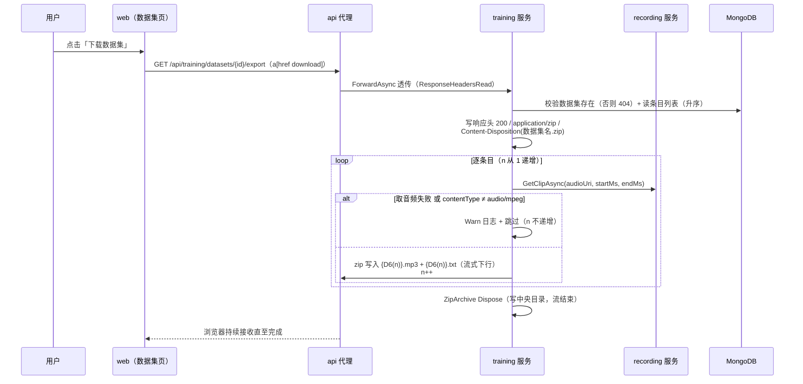

# 训练 - 数据集导出 ZIP - 技术提案

- 日期：2026-10-07
- 状态：待评审
- feat-branch：`feat/training-dataset-export-zip`
- 关联文档：[PRD](../../product/draft/20261007-training-dataset-export-zip-prd.md)

## 1. 概述

### 1.1 背景

依据 PRD「训练 - 数据集导出 ZIP」：「数据集」页面新增「下载数据集」按钮，将当前选中的数据集流式打包为 zip 下载；zip 内每条音频数据为一对 `6位数字.mp3`（该条音频，按起止时间与试听口径一致）+ `6位数字.txt`（该条文本，UTF-8），编号从 000001 连续；音频不可用的条目跳过、编号保持连续。

现状勘察结论（均经读码确认）：

**① 条目数据与取音频能力都在 training 服务，导出端点应落在这里。**

- 条目列表端点 `servers/training/Controllers/TrainingDatasetItemsController.cs:35-47`（`GET /api/training/datasets/{datasetId}/items`）返回 `TrainingDatasetItemListDto`，按 `CreatedAt`、`AudioKey` 升序——**导出顺序直接沿用该口径**；条目 DTO 含 `audioUri/audioKey/startMs/endMs/text`（`servers/training/Contracts/Dtos.cs:23-36`）；
- 音频获取已封装 `IRecordingAudioClient.GetClipAsync(audioUri, startMs, endMs?)`（`servers/training/Clients/RecordingAudioClient.cs:47-110`）：内部解析 `b/live/{roomId}/recordings/{file}` 调 recording 片段端点，`endMs` 为空按 `Ai:AudioClipDefaultDurationMs`（默认 300000）补齐，单段上限 `Ai:MaxAudioBytes`（默认 8 MiB，`servers/training/Configuration/TrainingOptions.cs:25,32`），返回 `AudioClip(bytes, contentType)`——**与页面试听同源，天然满足「与试听口径一致」**。

**② recording 片段端点即 mp3 音源，但有编码降级与时长上限两个既有约束。**

- `servers/recording/Controllers/RecordingController.cs:130-179`：`GET /api/{roomId}/recordings/{fileName}/audio?startMs=&endMs=`，ffmpeg 现切，正常返回 `audio/mpeg`，**缺 mp3 编码时降级 `audio/wav`**（L164 取 `extractor.ContentType`）；区间 ≤ 5 分钟硬约束（`servers/recording/Configuration/RecordingOptions.cs:57` `AudioClipMaxDurationMs = 300000`）——PRD 要求 `.mp3`，**contentType 非 `audio/mpeg` 的条目按「音频不可用」跳过**（见 §6.1 决策 5）。

**③ 网关代理已支持流式 + Content-Disposition 透传，只需加一个镜像 action。**

- `servers/api/Controllers/TrainingProxyController.cs:148-209` `ForwardAsync`：query/body 透传、`HttpCompletionOption.ResponseHeadersRead`（L167）、响应透传 StatusCode/ContentType/CacheControl/**Content-Disposition**（L181-193）、`CopyToAsync(Response.Body)` 流式回写（L206）；已有二进制透传测试先例（`tests/Z.Vtuber.Tests/TrainingProxyControllerTests.cs:815-831`，image/png 字节透传）；
- api 侧 `TrainingService` HttpClient 超时默认 180s（`servers/api/Program.cs:63-69`）——`ResponseHeadersRead` 下超时仅约束**首字节**，流式 zip 首字节即时产出，总时长不受其限（见 §6.1 决策 6）。

**④ 前端有现成下载模式与按钮位。**

- 下载先例 `apps/web/src/pages/transcripts/TaskListTab.tsx:478-504`：`<Typography.Link href={...} download>`（a 标签 + download 属性）；
- 「下载数据集」按钮位：`apps/web/src/pages/training/DatasetsPage.tsx:25-56` audioTab 顶部 `<Space>` 内（「从 Transcript 导入」按钮旁）；URL 生成器惯例见 `trainingAudioClipUrl`（`apps/web/src/api/client.ts:882`）。

**⑤ 全仓无 zip 代码/依赖，`System.IO.Compression.ZipArchive` 为 BCL 内置，零新增包。**

**⑥ 测试模式：controller 直测 + MongoDbFixture，外部依赖用接口桩。**

- `tests/Z.Vtuber.Tests/TrainingDatasetItemsApiTests.cs:20-38`：`IClassFixture<MongoDbFixture>` + 直接 `new Controller(...)` + `DefaultHttpContext`；外部 HttpClient 以接口桩注入（`StubTranscriptClient` L445-449）——导出测试可用 `StubRecordingAudioClient` 同法炮制，`Response.Body = new MemoryStream()` 后用 `ZipArchive` 读回断言。

### 1.2 目标

1. `servers/training` 新增导出端点 `GET /api/training/datasets/{datasetId}/export`：流式 zip 直写 `Response.Body`，逐条取音频、6 位编号成对写入 mp3/txt，失败条目跳过且编号连续；
2. `servers/api` 的 `TrainingProxyController` 增加镜像 action（复用 `ForwardAsync` 流式透传）；
3. `contracts/training.openapi.yaml` 与 `contracts/bilibili-crawler.openapi.yaml` 同步新增端点，web codegen 跟进；
4. `apps/web` 数据集页新增「下载数据集」按钮（未选定/空数据集禁用，下载期间进行中态）；
5. 契约先行 + TDD 补齐后端接口测试与前端组件测试。

### 1.3 范围

- **内**：`servers/training`（导出端点 + 打包逻辑）；`servers/api`（镜像 action）；`contracts/`（两份契约）；`apps/web`（按钮 + URL 生成器 + codegen）；`tests/Z.Vtuber.Tests` 与 `apps/web` Vitest。
- **外**：recording 片段端点零改动（5 分钟上限与 wav 降级口径不变）；条目数据结构零变更（无迁移）；情感标注等 `extensions` 加工信息不导出；断点续传与导出历史（PRD 明确不做）。

## 2. 技术架构

### 2.1 系统架构图

```mermaid
graph TD
    Web[apps/web<br/>数据集页「下载数据集」按钮<br/>a href download] -->|"GET /api/training/datasets/{id}/export"| API[servers/api Z.Vtuber<br/>TrainingProxyController 新增镜像 action]
    API -->|"ForwardAsync 流式透传<br/>ResponseHeadersRead + CopyToAsync"| TR[servers/training Z.Vtuber.Training<br/>Export 端点]
    TR -->|读条目列表 CreatedAt/AudioKey 升序| M[(MongoDB zvtuber<br/>training_dataset_items)]
    TR -->|"逐条 IRecordingAudioClient.GetClipAsync<br/>复用既有封装"| REC[servers/recording<br/>音频片段端点 ffmpeg 现切]
    TR -->|"ZipArchive 直写 Response.Body<br/>000001.mp3 / 000001.txt 流式产出"| API
```



### 2.2 技术栈

| 层级 | 技术选型 | 说明 |
|------|---------|------|
| 后端 | C# (.NET 10) ASP.NET Core Controllers | 导出端点落在既有 training 服务 |
| zip 打包 | `System.IO.Compression.ZipArchive`（BCL 内置） | `ZipArchiveMode.Create` 直写 `Response.Body`，流式、零新增依赖 |
| 数据库 | MongoDB（无变更） | 只读 `training_dataset_items`，无新集合/索引 |
| 前端 | React 19 + 既有 a[href download] 模式 | 无新增 npm 依赖 |
| 契约 | OpenAPI 契约先行 + openapi-typescript codegen | 两份契约同步 |
| 测试 | xUnit + Testcontainers（Mongo）、Vitest + RTL | 沿用既有设施 |

### 2.3 模块划分

| 模块 | 职责 | 关键技术点 |
|------|------|-----------|
| `servers/training`（变更） | 导出端点：读条目、逐条取音频、流式写 zip | ZipArchive 直写 Response.Body；失败跳过；编号连续 |
| `servers/api`（变更） | `/api/training/datasets/{id}/export` 镜像 | 复用 `ForwardAsync`（已透传 Content-Disposition、流式） |
| `apps/web`（变更） | 「下载数据集」按钮 + URL 生成器 | a[href download] 模式；禁用态 |
| `contracts/`（变更） | training 契约 + api 镜像契约 | 契约先行 |

## 3. API 设计

### 3.1 API 契约（`contracts/training.openapi.yaml` 变更）

#### 接口 1: 导出数据集为 zip（新增）

- **请求** GET `/api/training/datasets/{datasetId}/export`
  | 参数 | 位置 | 必填 | 说明 |
  |------|------|------|------|
  | `datasetId` | path | 是 | 数据集 id |
- **响应**
  - 200：`Content-Type: application/zip`；`Content-Disposition: attachment; filename*=UTF-8''{urlencoded 数据集名}.zip`；`Cache-Control: no-store`；body 为**流式 zip**（无 Content-Length，chunked）；
  - 404 `{"error": "dataset not found"}`。
- **zip 内容约定**：条目按 `CreatedAt`/`AudioKey` 升序（与条目列表一致）从 `000001` 连续编号；每条成功导出的条目写入 `{编号}.mp3`（`audio/mpeg` 字节流）与 `{编号}.txt`（条目文本，UTF-8 无 BOM）；音频获取失败或降级非 mp3 的条目跳过、不占编号。

#### 代理镜像（api 服务，`contracts/bilibili-crawler.openapi.yaml` 变更）

- `/api/training/datasets/{datasetId}/export` GET 镜像，与既有 training 镜像端点同口径；上游不可达 502 `{"error": "training service unavailable"}`。

### 3.2 内部接口

- **复用** `IRecordingAudioClient.GetClipAsync(string audioUri, long startMs, long? endMs)`（`servers/training/Clients/RecordingAudioClient.cs:47-110`）：`endMs` 空按 5 分钟默认补齐，返回 `AudioClip(byte[] Audio, string ContentType)`；**本期不新增流式取音频接口**（见 §6.1 决策 4）。
- 导出逻辑集中于 `TrainingDatasetItemsController` 新增的 export action（数据集存在性校验复用 `TrainingDatasetRepository`，条目读取复用 `TrainingDatasetItemRepository.ListAsync(datasetId)`）；打包/命名/跳过规则较内聚，抽为控制器私有方法即可，不新增服务层。

## 4. 数据模型

无变更：只读 `training_datasets` / `training_dataset_items`，无新集合、无新索引、无迁移。

## 5. 技术实现方案

### 5.1 核心流程

#### 流程 1: 流式导出 zip



### 5.2 关键实现点

#### 实现点 1: 导出端点（servers/training/Controllers/TrainingDatasetItemsController.cs）

- `[HttpGet("export")]` 挂在既有 `api/training/datasets/{datasetId}/items` 路由前缀下：完整路径 `/api/training/datasets/{datasetId}/items/export`？——否，契约定为 `/api/training/datasets/{datasetId}/export`（导出作用于数据集整体而非条目集合），故端点放在 `TrainingDatasetsController` 更贴切：`[HttpGet("{datasetId}/export")]`；
- 流程：`ObjectId.TryParse(datasetId)` 失败或数据集不存在 → 404；随后**先写响应头**（`Response.StatusCode=200`、`ContentType="application/zip"`、`Content-Disposition` 用 `filename*=UTF-8''{Uri.EscapeDataString(name)}.zip` 兼容非 ASCII 数据集名、`Cache-Control: no-store`），再 `using var zip = new ZipArchive(Response.Body, ZipArchiveMode.Create, leaveOpen: true)`；
- 循环条目：`GetClipAsync` 包 try/catch（含 HttpRequestException、音频超 8MiB 等），失败或 `ContentType != "audio/mpeg"` → `LogWarning("training dataset export skip: datasetId={} audioKey={} reason={}")` 并 `continue`；成功则 `zip.CreateEntry($"{n:D6}.mp3")` 写入字节、`zip.CreateEntry($"{n:D6}.txt")` 写入 `Encoding.UTF8`（无 BOM，`new UTF8Encoding(false)`）文本，`n++`；
- 单条写入后 `await Response.Body.FlushAsync(ct)` 保证流式即时下行；全程尊重 `HttpContext.RequestAborted`（用户中断下载即停）；
- Info 日志收尾：`training dataset export: datasetId={} exported={} skipped={}`。

#### 实现点 2: api 镜像（servers/api/Controllers/TrainingProxyController.cs）

- 新增 `[HttpGet("/api/training/datasets/{datasetId}/export")]` action → `ForwardAsync(HttpMethod.Get, $"api/training/datasets/{datasetId}/export", ct)`；`ForwardAsync` 已透传 Content-Disposition 与流式 body（`servers/api/Controllers/TrainingProxyController.cs:181-206`），零额外处理。

#### 实现点 3: 契约与 codegen

- `contracts/training.openapi.yaml` 加 `/api/training/datasets/{datasetId}/export`（200 响应 `content: application/zip: schema: {type: string, format: binary}` + 404）；`contracts/bilibili-crawler.openapi.yaml` 加镜像（同既有 training 镜像写法）；
- `apps/web` 跑 `npm run codegen` 重新生成 `schema-training.d.ts` 与 `schema.d.ts`。

#### 实现点 4: web 按钮（apps/web）

- `src/api/client.ts` 增加 URL 生成器 `trainingDatasetExportUrl(datasetId)`（纯拼接，参照 `trainingAudioClipUrl` L882）；
- `src/pages/training/DatasetsPage.tsx` audioTab 顶部 `<Space>` 内加「下载数据集」：复用 `TaskListTab.tsx:478-504` 的 `<Typography.Link href={trainingDatasetExportUrl(id)} download>` 模式；**禁用条件**：未选定数据集 或 当前数据集条目数为 0（条目列表已在页面状态内，直接取 `items.length`）；禁用态 `preventDefault`（同先例）。下载由浏览器接管，无需额外进行中态管理（链接点击即发起，PRD 的「进行中不可重复触发」由浏览器下载管理天然满足，页面不维护下载状态）；
- 无新增 npm 依赖。

### 5.3 不在本期的事项

- 情感标注等 `extensions` 加工信息导出；
- 导出断点续传、导出历史记录、异步导出任务（当前同步流式足够，见 §6.1 决策 6）；
- recording 片段端点 5 分钟上限与 wav 降级行为的调整；
- txt 附带时间轴等富格式（PRD 明确仅文本）。

## 6. 技术决策

### 6.1 决策列表

| 决策 | 选项 A | 选项 B | 选项 C | 最终选择 | 原因 |
|------|--------|--------|--------|---------|------|
| 导出端点归属 | training 服务 | api 网关直接做 | recording 服务 | **A** | 条目数据与取音频封装（`IRecordingAudioClient`）都在 training；api 保持纯网关；recording 不感知数据集 |
| zip 生成方式 | BCL `ZipArchive` 流式写 Response.Body | 第三方库（SharpZipLib 等） | 先打包落盘再返回文件 | **A** | BCL 内置零依赖；流式满足 PRD「流式返回」且内存 O(单条)；落盘方案引入临时文件生命周期管理，无收益 |
| 音频获取 | 复用 `IRecordingAudioClient.GetClipAsync`（整段 ≤8MiB 入内存） | 新增流式取音频接口 | 网关逐条代理 recording | **A** | 单条上限 8MiB、逐条处理后即释放，内存可控；与页面试听同源保证口径一致；新增流式接口收益小、改动面大 |
| 取音频失败/降级 wav 的条目 | 跳过不占编号 | 跳过但占编号（跳号） | 中断整个导出 | **A** | PRD 明确「不产生残缺文件、编号连续」；中断会让少量脏数据阻塞整体交付 |
| 编号口径 | 成功条目连续编号（000001 起） | 按原始顺序编号（失败留空号） | | **A** | 连续编号对外部训练 ingestion 最友好；跳号会暴露内部失败细节且无消费价值 |
| 代理超时（180s）与长导出 | 维持现状（ResponseHeadersRead 下仅约束首字节） | 为导出单独放宽超时 | 改异步任务导出 | **A** | 流式 zip 首字节即时产出（响应头先于首个条目写出），`HttpClient.Timeout` 在 `ResponseHeadersRead` 下只覆盖到响应头；总时长不受限，无需改动；若未来出现单条 clip 极慢导致长空闲，再评估空闲超时 |
| txt 编码 | UTF-8 无 BOM | UTF-8 带 BOM | | **A** | 训练流程消费 txt 普遍按 UTF-8 无 BOM；BOM 会污染首字符 |

### 6.2 依赖与约束

| 类型 | 内容 | 说明 |
|------|------|------|
| 依赖 | `IRecordingAudioClient.GetClipAsync` | 音源与试听口径一致；受 `Ai:MaxAudioBytes`（8MiB）与 5 分钟区间上限约束 |
| 依赖 | recording 片段端点 | 零改动；wav 降级条目按失败跳过 |
| 约束 | 契约先行 | 先改两份契约，再改实现（common-rules） |
| 约束 | 无新增 NuGet / npm 依赖 | zip 用 BCL；前端用 a[href download] |
| 约束 | .NET 10、TDD、核心逻辑覆盖率 ≥ 80% | 项目既有规范 |

## 7. 项目结构

```
contracts/（变更）
├── training.openapi.yaml                      # + GET /api/training/datasets/{datasetId}/export
└── bilibili-crawler.openapi.yaml              # + 镜像端点

servers/training/（变更）
└── Controllers/TrainingDatasetsController.cs  # + export action（流式 ZipArchive 打包）

servers/api/（变更）
└── Controllers/TrainingProxyController.cs     # + export 镜像 action

apps/web/src/（变更）
├── api/client.ts                              # + trainingDatasetExportUrl
├── api/schema-training.d.ts / schema.d.ts     # codegen 重新生成（勿手改）
└── pages/training/DatasetsPage.tsx            # + 「下载数据集」链接按钮（禁用态）

tests/Z.Vtuber.Tests/（变更）
├── TrainingDatasetExportApiTests.cs           # 新增：导出 zip 内容/命名/跳过/404
└── TrainingProxyControllerTests.cs            # + export 镜像透传（含 Content-Disposition/字节）

apps/web/src/pages/training/（新增测试）
└── DatasetsPage.test.tsx                      # + 按钮渲染/禁用态/URL
```

## 8. 测试策略

### 8.1 测试覆盖要求

- 核心逻辑（编号生成、失败跳过、文件名编码、zip 条目写入）覆盖率 ≥ 80%（common-rules）；
- TDD：契约先行后按红-绿推进。

### 8.2 测试类型

| 类型 | 工具 | 覆盖范围 |
|------|------|---------|
| 接口测试 | xUnit + Testcontainers（Mongo）+ controller 直测 | export 端点全链路（`MongoDbFixture` + `StubRecordingAudioClient` + `Response.Body = MemoryStream`，`ZipArchive` 读回断言） |
| 代理测试 | xUnit + StubHandler | 镜像透传（状态码/Content-Type/Content-Disposition/字节流，参考既有 L815-831 二进制用例） |
| 前端组件测试 | Vitest + RTL + jsdom | 按钮渲染、禁用态、href 拼接 |

关键用例清单：

- **导出成功**：多条条目 → zip 内 `000001.mp3/000001.txt...` 连续编号；mp3 字节与 stub 返回一致；txt 为 UTF-8 无 BOM 且与条目文本一致；顺序与 `CreatedAt/AudioKey` 升序一致；
- **失败跳过**：某条 GetClipAsync 抛异常 / 返回 `audio/wav` → 该条无文件、后续编号连续（无跳号）；全部失败 → zip 为空包（仅中央目录）仍 200；
- **边界**：datasetId 非法/不存在 → 404；数据集名为中文/特殊字符 → Content-Disposition `filename*=UTF-8''...` 正确编码；`endMs=null` 条目照常导出（stub 断言收到 null）；
- **代理**：200 透传 zip 字节与 Content-Disposition；404/502 透传；
- **web**：未选定数据集/空数据集时按钮禁用且点击不发起；正常态 href 为 `/api/training/datasets/{id}/export` 且带 download 属性。

## 9. 部署方案

### 9.1 环境规划

| 环境 | 用途 | 部署方式 |
|------|------|---------|
| AppHost（Aspire）本地编排 | 开发联调 | 无编排变更（training/api 均已注册） |
| 生产 | 随常规版本发布 | 先 training 后 api 再 web；均为纯新增面，旧版本无感知 |

### 9.2 配置管理

- 无新增配置；沿用 `ConnectionStrings:mongo`、`RecordingService:BaseUrl`、`Ai:MaxAudioBytes` 等既有配置；
- 无数据迁移；
- 回滚：按整体版本回退；无持久化副作用（导出纯只读）。

## 10. 验收标准

- [ ] 技术方案评审通过；契约评审通过
- [ ] 「数据集」页出现「下载数据集」按钮；未选定/空数据集时禁用
- [ ] 点击后浏览器即开始下载 `数据集名.zip`（流式，非等待全量打包）
- [ ] zip 内 `6位数字.mp3` 与 `6位数字.txt` 严格成对、从 000001 连续编号；音频区间与试听口径一致；txt 为 UTF-8 文本
- [ ] 音频不可用/降级 wav 的条目被跳过且不占编号，下载不中断
- [ ] 契约 codegen 一致；单测/接口测试通过，核心逻辑覆盖率 ≥ 80%；既有数据集功能回归不回退

## 11. 相关文档

- PRD：`docs/product/draft/20261007-training-dataset-export-zip-prd.md`
- 音频数据集技术提案：`docs/engineering/proposals/20260927-proposal-training-audio-dataset.md`
- 既有契约：`contracts/training.openapi.yaml`、`contracts/bilibili-crawler.openapi.yaml`
- 规范：`docs/engineering/common-rules.md`、`docs/engineering/backend-rules.md`、`docs/engineering/frontend-rules.md`
