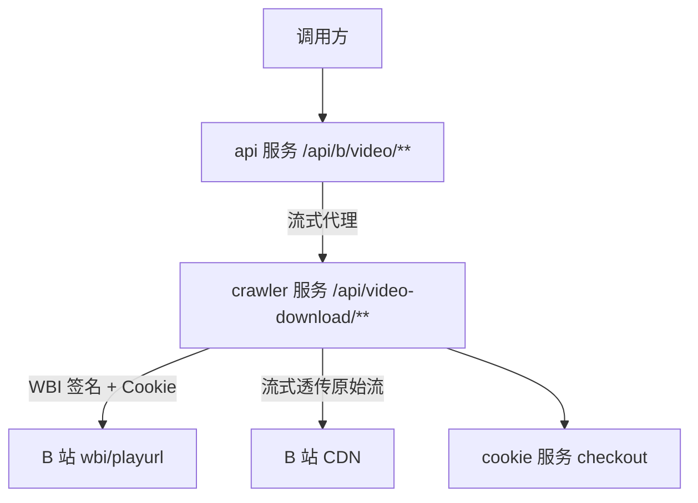
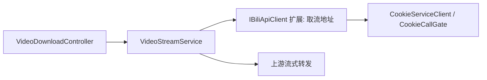
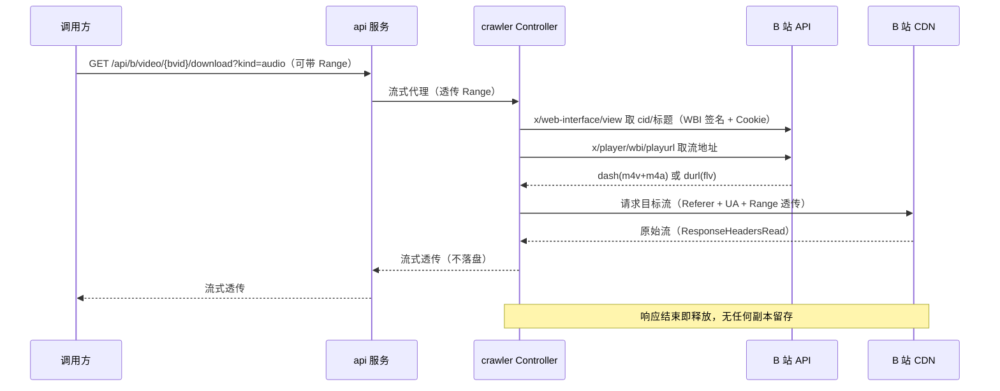

# B 站视频下载 - 技术提案

**功能名称**: B 站视频下载
**关联 PRD**: docs/product/draft/20261008-bilibili-video-download-prd.md
**技术提案版本**: v1.1
**创建日期**: 2026-10-08
**作者**: Z.Vtuber Workflow Agent
**feat-branch**: `feat/bilibili-video-download`

## 1. 概述

### 1.1 背景

PRD 要求新增「B 站视频下载」能力：输入 BV 号，支持仅视频流 / 仅音频流 / 两者都下三种模式，产物为原始流（m4v/m4a 或 flv），不转码。**v1.1 按评审意见调整：不落盘、不归档——平台实时取出原始流后经 API 直接透传给调用方，传输完成即弃，不留存任何副本**。调研结论：crawler 服务已具备全部 B 站访问基础设施（WBI 签名、Cookie checkout、风控通道切换），但当前是纯 Worker 无 HTTP 端点；api 服务已有成熟的下游流式代理范式（recording/transcript 代理 Controller）。

### 1.2 目标

- crawler 服务新增视频取流端点：`x/player/wbi/playurl` 取流地址，原始流实时透传返回，不落盘；
- api 服务以 `/api/b/video/**` 代理对外暴露下载端点，Range 语义端到端透传；
- 复用现有 Cookie、风控与代理范式，无新增存储（无磁盘归档、无 Mongo 集合）、无后台任务。

### 1.3 范围

- 做：单视频（BV 号 + 可选分 P）实时取流透传下载、三种下载模式、Range 断点续传、失败原因可读；
- 不做：转码/合并/重封装、落盘归档与任务管理、批量与合集下载、清晰度手动选择（默认账号可获取最高清晰度）、前端页面。

## 2. 技术架构

### 2.1 系统架构图



请求路径全程流式：B 站 CDN → crawler → api → 调用方，任何一跳都不把内容落盘，响应结束即释放。

### 2.2 技术栈

| 层级 | 技术选型 | 说明 |
|------|---------|------|
| 后端 | .NET 10 / ASP.NET Core | crawler 服务已引用 `Microsoft.AspNetCore.App`，新增 Controller 支持 |
| 数据库 | 无新增 | 不落库 |
| 存储 | 无 | 不落盘，内容随响应返回后抛弃 |
| 缓存 | 无新增 | playurl 地址每次实时取，不缓存 |
| 其他 | Mikibot.Crawler 1.0.9 | `BilibiliAccount.Sign` WBI 签名 |

### 2.3 模块划分



| 模块 | 职责 | 关键技术点 |
|------|------|-----------|
| crawler: `Video/VideoDownloadController` | 对内 REST：原始流透传下载 | 新增 `MapControllers`；`HttpCompletionOption.ResponseHeadersRead` 流式转发 |
| crawler: `Video/VideoStreamService` | 取流地址解析、模式过滤、上游流转发 | Range 头透传上游；错误码到可读原因的映射 |
| crawler: `Crawlers/BiliApiClient` 扩展 | `x/web-interface/view` 取 cid 与标题、`x/player/wbi/playurl` 取流地址 | 复用 `BilibiliAccount.Sign`、三层客户端（直连/拟真/Resilient） |
| api: `BilibiliVideoDownloadController` | 对外代理 `/api/b/video/**` | named HttpClient `ResponseHeadersRead + CopyToAsync`，透传 Range/Content-*，上游不可达→502 |

## 3. API 设计

### 3.1 API 契约

对外契约更新 `contracts/bilibili-crawler.openapi.yaml`（api 服务前缀 `/api/b`）；crawler 服务对内契约新增 `contracts/video-download.openapi.yaml`（前缀 `/api/video-download`）。先定契约再实现。

#### 接口 1: 下载视频原始流

- **请求**
  - Method: GET
  - Path: /api/b/video/{bvid}/download
  - Query:
    - `kind`（必填）：`video | audio` —— 只下载视频流或只下载音频流；「都下载」即分别用两种 kind 各请求一次；
    - `page`（可选，默认 1）：多 P 视频的分 P 序号。
  - Headers: 可选 `Range` / `If-Range`，端到端透传至 B 站 CDN。

- **响应**
  - Status:
    - 200：完整原始流，`Content-Type: video/mp4`（m4v）/ `audio/mp4`（m4a）/ `video/x-flv`（flv），`Content-Disposition: attachment`（文件名含视频标题与分 P）；
    - 206：分段内容，透传上游 `Content-Range` 与 `Accept-Ranges: bytes`；
    - 416：Range 区间越界；
    - 400：bvid 格式非法、kind 非法、page 越界、或当前视频仅提供整段 flv（无独立音频流）时请求 `kind=audio`；
    - 404：视频不存在或不可访问；
    - 502：crawler 服务不可达或 B 站取流失败（含风控受限，body 含可读中文原因）。
  - Body: 二进制原始流（200/206），或错误 JSON：
    ```json
    { "error": "视频不存在或不可访问" }
    ```

「都下载」不单独设端点：调用方以 `kind=video` 与 `kind=audio` 各请求一次，获得两份流内容。

### 3.2 内部接口

crawler 服务对内端点与对外一一对应：`GET /api/video-download/{bvid}?kind=&page=`，api 服务按现有代理模式（`ResponseHeadersRead + CopyToAsync`）流式转发并透传 Range/Content-* 头。

## 4. 数据模型

无。本需求不落盘、不落库：不新增 Mongo 集合、不新增存储目录、无任务状态。视频标题、cid、流地址均随请求实时解析，仅存在于请求生命周期内存中。

## 5. 技术实现方案

### 5.1 核心流程



### 5.2 关键实现点

#### 实现点 1: 视频取流（IBiliApiClient 扩展）

- **描述**: 新增 `GetVideoPlayInfoAsync(cookieId, cookie, bvid, page)`：先调 `x/web-interface/view?bvid=` 取 `pages[page-1].cid` 与标题（page 越界在此返回 400）；再调 `x/player/wbi/playurl?bvid=&cid=&qn=127&fnval=16&fourk=1`，优先 DASH（`dash.video[]` / `dash.audio[]`，各自取可获得的最高质量档）；DASH 不可用时回退 `fnval=0`（`durl[]` flv，此时 `kind=audio` 返回 400 并说明该视频无独立音频流）。
- **技术细节**: WBI 签名复用 `BilibiliAccount.Sign`；cookie 经 `CookieServiceClient.CheckoutAsync` + `CookieCallGate`；风控复用 `RiskControlHandler` / `ResilientBiliApiClient` 切换，`RiskControlException` 映射为 502 + 可读原因。
- **风险点**: 未登录/普通账号清晰度受限（qn 档位下调）、仅大会员可看视频取流失败——映射为 502/404 + 可读中文原因。

#### 实现点 2: 原始流流式透传（不落盘）

- **描述**: `VideoDownloadController` 用 `HttpClient.GetAsync(url, HttpCompletionOption.ResponseHeadersRead)` 打开 B 站 CDN 流，直接把上游 `Stream` 作为响应内容（`FileStreamResult` 或逐段 `CopyToAsync`）返回；响应结束释放连接，全程无磁盘写入、无内存整段缓冲。
- **技术细节**: 上游请求头携带 `Referer: https://www.bilibili.com` 与浏览器 UA（与拟真通道一致）；调用方 Range 头透传上游，上游 206 的 `Content-Range`/`Accept-Ranges`/`Content-Length` 原样回传；客户端断开时取消上游请求（`HttpContext.RequestAborted` 联动 CancellationToken），避免悬挂下载。
- **风险点**: 大文件长连接占用——设上游超时（按流式语义用读超时而非整体超时）；并发下载不加额外限制，复用现有 Cookie 调用门禁 `CookieCallGate`。

#### 实现点 3: 响应头与文件名

- **描述**: 成功响应设置 `Content-Disposition: attachment; filename*=UTF-8''<标题>.p<page>.<kind>.<ext>`（标题 Sanitize，复用 recording `RecordingFileName.Sanitize` 同款规则）与正确 `Content-Type`；错误响应统一 `{ "error": "<中文原因>" }`。
- **技术细节**: 扩展名由封装决定——DASH：video→`m4v`、audio→`m4a`；flv 回退→`flv`。

## 6. 技术决策

### 6.1 决策列表

| 决策 | 选项 A | 选项 B | 最终选择 | 原因 |
|------|--------|--------|---------|------|
| 能力归属 | crawler 服务加 Controller | recording 服务扩展 | A | 取流依赖的 WBI 签名/Cookie/风控基础设施全在 crawler；recording 只有精简直播客户端 |
| 交付形态 | 实时透传、不落盘 | 落盘归档 + 任务管理 | A | 评审明确：不落盘，内容经 API 返回后抛弃 |
| 「都下载」形态 | 两次独立请求（kind=video/audio） | 单请求打包（zip） | A | 不合并不封装是硬约束；两次请求最简单且各自支持断点续传 |
| 产物封装 | DASH 分离流（m4v+m4a） | 整段 flv | A 优先、B 回退 | DASH 天然支持仅视频/仅音频；flv 作为 DASH 不可用时的回退 |
| playurl 地址缓存 | 每次实时取 | 短期缓存 | A | 无状态设计最简单；地址时效短，缓存收益低 |

### 6.2 依赖与约束

| 类型 | 内容 | 说明 |
|------|------|------|
| 依赖 | cookie 服务 | 登录态取流必需 |
| 依赖 | Mikibot.Crawler | WBI 签名 |
| 约束 | 契约先行 | 先更新 `contracts/`，后端为契约生成源 |
| 约束 | TDD | 先写测试，核心逻辑覆盖率 ≥80%，单用例 ≤5s |
| 约束 | 不落盘 | 任何路径不得把流内容写入磁盘或数据库 |

## 7. 项目结构

```
servers/crawler/
├── Video/
│   ├── VideoDownloadController.cs      # 对内 REST：流式透传下载
│   ├── VideoStreamService.cs           # 取流地址解析、模式过滤、上游流转发
│   └── VideoDownloadFileName.cs        # Content-Disposition 文件名生成与 Sanitize（纯函数）
└── Crawlers/
    └── BiliApiClient.cs                # 扩展 GetVideoPlayInfoAsync

servers/api/Controllers/
└── BilibiliVideoDownloadController.cs  # /api/b/video/** 流式代理

contracts/
├── bilibili-crawler.openapi.yaml       # 新增 /api/b/video/{bvid}/download 端点
└── video-download.openapi.yaml         # 新增 crawler 对内契约

tests/Z.Vtuber.Tests/
├── VideoDownloadFileNameTests.cs
├── VideoStreamServiceTests.cs
├── BiliApiClientVideoTests.cs
└── VideoDownloadApiTests.cs
```

## 8. 测试策略

### 8.1 测试覆盖要求

- 单元测试覆盖率: >= 80%（核心逻辑：文件名生成、kind/page 校验、选流逻辑、错误码映射）
- API 测试覆盖的端点: 下载端点（合法/非法 bvid/kind/page、flv 回退下 kind=audio 的 400、404、风控 502、Range 200/206/416 透传、不落盘验证——临时目录无新增文件）

### 8.2 测试类型

| 类型 | 工具 | 覆盖范围 |
|------|------|---------|
| 单元测试 | xUnit + 内联 Stub（MockHttpMessageHandler） | 纯函数与服务逻辑 |
| API 测试 | Testcontainers（Mongo/Redis） | crawler 对内端点 + api 代理端点（上游用 Stub 流） |
| 冒烟 | 手动 | 真实 BV 号三种模式下载验证（不进 CI） |

## 9. 部署方案

### 9.1 环境规划

| 环境 | 用途 | 部署方式 |
|------|------|---------|
| 本地 | 开发调试 | Aspire 编排 |
| 生产 | 正式服务 | 现有容器化部署，无新增卷、无新增存储 |

### 9.2 配置管理

- api：`CrawlerService:BaseUrl`（新增 named HttpClient，指向 crawler 服务）；
- infra/apphost：注册 api → crawler 的服务发现；无存储卷变更。

## 10. 验收标准

- [ ] 技术方案评审通过
- [ ] Contract 评审通过（`contracts/bilibili-crawler.openapi.yaml` 与新增 `contracts/video-download.openapi.yaml`）
- [ ] 代码实现完成
- [ ] 单元测试覆盖达标（≥80%，单用例 ≤5s）
- [ ] API 测试通过（含不落盘验证）
- [ ] E2E 测试通过（真实 BV 号三种模式冒烟）

## 11. 相关文档

- 关联 PRD: docs/product/draft/20261008-bilibili-video-download-prd.md
- 关联 Contract: contracts/bilibili-crawler.openapi.yaml、contracts/video-download.openapi.yaml（待新增）
- 开发规范: docs/engineering/common-rules.md、docs/engineering/backend-rules.md
- 参考范式: docs/engineering/proposals/20260914-proposal-recording-download-range.md（Range 透传语义）
