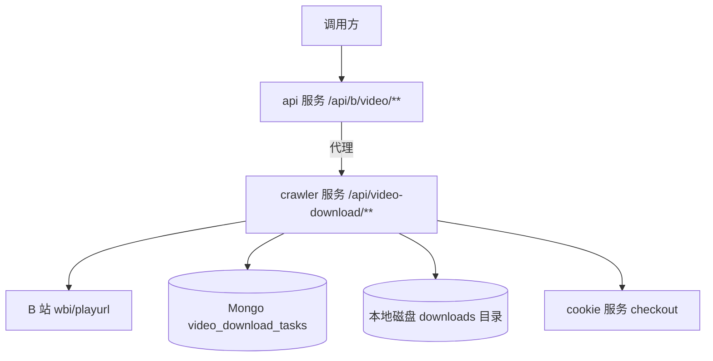
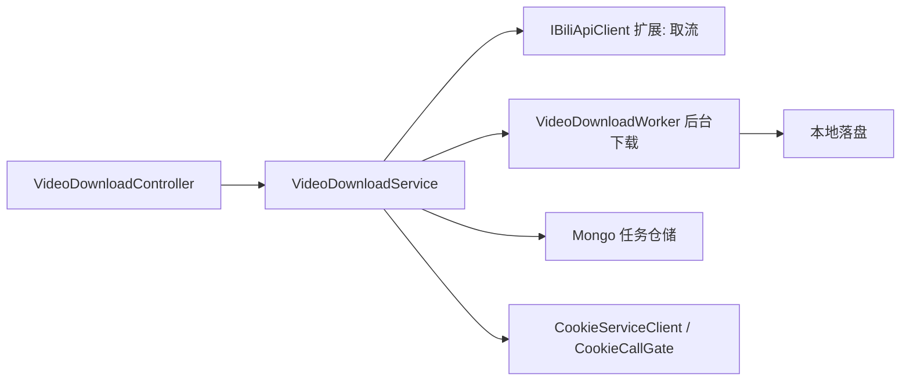
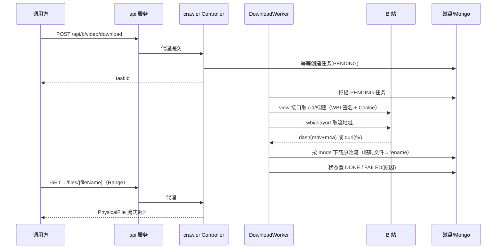

# B 站视频下载 - 技术提案

**功能名称**: B 站视频下载
**关联 PRD**: docs/product/draft/20261008-bilibili-video-download-prd.md
**技术提案版本**: v1.0
**创建日期**: 2026-10-08
**作者**: Z.Vtuber Workflow Agent
**feat-branch**: `feat/bilibili-video-download`

## 1. 概述

### 1.1 背景

PRD 要求新增「B 站视频下载」能力：输入 BV 号，支持仅视频流 / 仅音频流 / 两者都下三种模式，产物为原始流文件（m4v/m4a 或 flv），不转码。调研结论：crawler 服务已具备全部 B 站访问基础设施（WBI 签名、Cookie checkout、风控通道切换），但当前是纯 Worker 无 HTTP 端点；recording 服务则提供了「本地存储 + Mongo 归档 + Range 下载 Controller + api 代理」的成熟范式可复用。

### 1.2 目标

- crawler 服务新增视频下载域：`x/player/wbi/playurl` 取流、异步下载任务编排、原始流落盘归档；
- api 服务以 `/api/b/video/**` 代理对外暴露任务提交 / 查询 / 文件下载；
- 复用现有 Cookie、风控、存储与测试范式，最小侵入。

### 1.3 范围

- 做：单视频（BV 号 + 可选分 P）下载、三种下载模式、任务查询、产物文件 Range 下载、Mongo 任务归档；
- 不做：转码/合并/重封装、批量与合集下载、清晰度手动选择（默认账号可获取最高清晰度）、前端页面、对象存储抽象（沿用本地磁盘）。

## 2. 技术架构

### 2.1 系统架构图



### 2.2 技术栈

| 层级 | 技术选型 | 说明 |
|------|---------|------|
| 后端 | .NET 10 / ASP.NET Core | crawler 服务已引用 `Microsoft.AspNetCore.App`，新增 Controller 支持 |
| 数据库 | MongoDB（Aspire.MongoDB.Driver） | 任务归档集合 |
| 存储 | 本地磁盘 | 复用 recording 范式：`{StorageDir}/{bvid}/{fileName}` |
| 缓存/锁 | Redis | 下载任务去重锁（复用 `IDistributedLockProvider`） |
| 其他 | Mikibot.Crawler 1.0.9 | `BilibiliAccount.Sign` WBI 签名 |

### 2.3 模块划分



| 模块 | 职责 | 关键技术点 |
|------|------|-----------|
| crawler: `Video/VideoDownloadController` | 对内 REST：提交/查询/文件下载 | 新增 `MapControllers`；`PhysicalFile(enableRangeProcessing: true)` |
| crawler: `Video/VideoDownloadService` | 任务创建（幂等）、状态查询、文件解析 | Redis 锁去重；文件名防穿越 |
| crawler: `Video/VideoDownloadWorker` | 后台扫描 PENDING 任务执行下载 | HostedService；断点续传写临时文件后 rename |
| crawler: `Crawlers/BiliApiClient` 扩展 | `x/web-interface/view` 取 cid 与标题、`x/player/wbi/playurl` 取流地址 | 复用 `BilibiliAccount.Sign`、三层客户端（直连/拟真/Resilient） |
| crawler: `Video/Persistence` | `video_download_tasks` 集合读写 | 放 crawler 侧（抓取专用，遵循「仅被一方使用的代码归该方」） |
| api: `BilibiliVideoDownloadController` | 对外代理 `/api/b/video/**` | named HttpClient `ResponseHeadersRead + CopyToAsync`，透传 Range/Content-* |

## 3. API 设计

### 3.1 API 契约

对外契约更新 `contracts/bilibili-crawler.openapi.yaml`（api 服务前缀 `/api/b`）；crawler 服务对内契约新增 `contracts/video-download.openapi.yaml`（前缀 `/api/video-download`）。先定契约再实现。

#### 接口 1: 提交下载任务

- **请求**
  - Method: POST
  - Path: /api/b/video/download
  - Body:
    ```json
    {
      "bvid": "BV1xx411c7mD",
      "page": 1,
      "mode": "all"
    }
    ```
  - `page` 可选默认 1（多 P 视频的分 P 序号）；`mode` 枚举 `video | audio | all`。

- **响应**
  - Status: 200（新建或幂等返回已有任务） / 400（bvid 非法、page 越界、mode 非法）
  - Body:
    ```json
    {
      "taskId": "vdl_01J...",
      "bvid": "BV1xx411c7mD",
      "page": 1,
      "mode": "all",
      "status": "PENDING",
      "createdAt": "2026-10-08T12:00:00Z"
    }
    ```

#### 接口 2: 查询任务列表 / 详情

- **请求**
  - Method: GET
  - Path: /api/b/video/download（query: `limit`、`before`，按创建时间倒序）
  - Path: /api/b/video/download/{taskId}

- **响应**
  - Status: 200 / 404
  - Body（详情）:
    ```json
    {
      "taskId": "vdl_01J...",
      "bvid": "BV1xx411c7mD",
      "page": 1,
      "title": "视频标题",
      "mode": "all",
      "status": "DONE",
      "error": null,
      "files": [
        { "kind": "video", "fileName": "xxx.video.m4v", "size": 1234567, "qualityId": 127, "codec": "avc" },
        { "kind": "audio", "fileName": "xxx.audio.m4a", "size": 234567, "qualityId": 30280, "codec": "mp4a" }
      ],
      "createdAt": "2026-10-08T12:00:00Z",
      "finishedAt": "2026-10-08T12:01:30Z"
    }
    ```
  - `status` 枚举：`PENDING | RUNNING | DONE | FAILED`；`FAILED` 时 `error` 为可读中文原因。

#### 接口 3: 下载产物文件

- **请求**
  - Method: GET
  - Path: /api/b/video/download/{taskId}/files/{fileName}
  - 支持 `Range` / `If-Range` 头。

- **响应**
  - Status: 200（完整文件）/ 206（分段，带 Content-Range、Accept-Ranges: bytes）/ 416（区间越界）/ 400（fileName 非法或任务未完成）/ 404（任务或文件不存在）/ 502（crawler 服务不可达）
  - Body: `application/octet-stream` 二进制流。

### 3.2 内部接口

crawler 服务对内端点与对外一一对应（前缀 `/api/video-download`）：`POST /api/video-download/tasks`、`GET /api/video-download/tasks[/{taskId}]`、`GET /api/video-download/tasks/{taskId}/files/{fileName}`。api 服务按现有代理模式流式转发。

## 4. 数据模型

### 4.1 数据库设计

#### 集合: video_download_tasks

| 字段 | 类型 | 说明 |
|------|------|------|
| TaskId | string | 任务 ID（ULID，`vdl_` 前缀） |
| Bvid | string | 目标视频 BV 号 |
| Cid | long | 分 P 对应的 cid（取流时确定） |
| Page | int | 分 P 序号，默认 1 |
| Title | string | 视频标题（取流后回填） |
| Mode | string | video / audio / all |
| Status | string | PENDING / RUNNING / DONE / FAILED |
| Error | string? | 失败原因（中文可读） |
| Files | array | 产物清单：kind / fileName / size / qualityId / codec |
| CreatedAt | datetime | 创建时间 |
| FinishedAt | datetime? | 终态时间 |

幂等键：`(Bvid, Page, Mode)` 唯一索引；重复提交返回已有任务。

### 4.2 缓存设计

- 无新增缓存；任务提交去重使用 Redis 分布式锁（key: `video-download:{bvid}:{page}:{mode}`，TTL 30s），复用 `IDistributedLockProvider`。

## 5. 技术实现方案

### 5.1 核心流程



### 5.2 关键实现点

#### 实现点 1: 视频取流（IBiliApiClient 扩展）

- **描述**: 新增 `GetVideoPlayInfoAsync(cookieId, cookie, bvid, page)`：先调 `x/web-interface/view?bvid=` 取 `pages[page-1].cid` 与标题；再调 `x/player/wbi/playurl?bvid=&cid=&qn=127&fnval=16&fourk=1`，优先 DASH（`dash.video[]` / `dash.audio[]`，各自取可获得的最高质量档）；B 站对 DASH 不可用时回退 `fnval=0`（`durl[]` flv，此时 audio-only 模式无法单独取流，按 FAILED 提示原因）。
- **技术细节**: WBI 签名复用 `BilibiliAccount.Sign`；cookie 经 `CookieServiceClient.CheckoutAsync` + `CookieCallGate`；风控复用 `RiskControlHandler` / `ResilientBiliApiClient` 切换。
- **风险点**: 未登录/普通账号清晰度受限（qn 档位下调）、仅大会员可看视频取流失败——均在 `error` 中给出可读原因。

#### 实现点 2: 原始流下载与落盘

- **描述**: `VideoDownloadWorker`（HostedService）串行扫描 PENDING 任务；每个流文件先写入 `{fileName}.part` 临时文件（支持 `Range: bytes=N-` 断点续传），完成后 rename 为正式文件名，避免半成品被当完成品下载。
- **技术细节**: 存储根目录新增 `VideoDownloadOptions.StorageDir`（默认 `/data/video-downloads`），路径 `{StorageDir}/{bvid}/{sanitized-title}.p{page}.{kind}.{ext}`；文件名 Sanitize 复用 recording 的 `RecordingFileName.Sanitize` 同款规则；下载请求带 `Referer: https://www.bilibili.com` 与 UA。
- **风险点**: 大文件下载耗时——单任务下载设超时与失败重试上限，超限置 FAILED，不静默重试到死。

#### 实现点 3: 文件下载端点

- **描述**: Controller 按 taskId + fileName 解析文件，`PhysicalFile(enableRangeProcessing: true)` 支持 206/416；校验 fileName 为平文件名（拒绝 `..`、`/`）且属于该任务产物清单。
- **技术细节**: 与 recording `RecordingController` 下载端点同款实现范式。

## 6. 技术决策

### 6.1 决策列表

| 决策 | 选项 A | 选项 B | 最终选择 | 原因 |
|------|--------|--------|---------|------|
| 下载能力归属 | crawler 服务加 Controller | recording 服务扩展 | A | 取流依赖的 WBI 签名/Cookie/风控基础设施全在 crawler；recording 只有精简直播客户端 |
| 产物形态 | DASH 分离流（m4v+m4a） | 整段 flv | A 优先、B 回退 | DASH 天然支持仅视频/仅音频；flv 作为 DASH 不可用时的回退 |
| 任务执行 | 内存队列 + Worker | 外部消息队列 | A | 复用现有 HostedService + Mongo 轮询范式，不引入新中间件 |
| 存储 | 本地磁盘 | 对象存储 | A | 项目无对象存储抽象，沿用 recording 本地磁盘模式 |

### 6.2 依赖与约束

| 类型 | 内容 | 说明 |
|------|------|------|
| 依赖 | cookie 服务 | 登录态取流必需 |
| 依赖 | Mikibot.Crawler | WBI 签名 |
| 约束 | 契约先行 | 先更新 `contracts/`，后端为契约生成源 |
| 约束 | TDD | 先写测试，核心逻辑覆盖率 ≥80%，单用例 ≤5s |

## 7. 项目结构

```
servers/crawler/
├── Video/
│   ├── VideoDownloadController.cs      # 对内 REST
│   ├── VideoDownloadService.cs         # 任务创建/查询/文件解析
│   ├── VideoDownloadWorker.cs          # 后台下载执行
│   ├── VideoDownloadFileName.cs        # 文件名生成与 Sanitize（纯函数）
│   └── Persistence/
│       ├── VideoDownloadTask.cs        # 实体
│       └── VideoDownloadTaskStore.cs   # Mongo 仓储
├── Configuration/
│   └── VideoDownloadOptions.cs         # StorageDir 等
└── Crawlers/
    └── BiliApiClient.cs                # 扩展 GetVideoPlayInfoAsync

servers/api/Controllers/
└── BilibiliVideoDownloadController.cs  # /api/b/video/** 代理

contracts/
├── bilibili-crawler.openapi.yaml       # 新增 /api/b/video/** 端点
└── video-download.openapi.yaml         # 新增 crawler 对内契约

tests/Z.Vtuber.Tests/
├── VideoDownloadFileNameTests.cs
├── VideoDownloadServiceTests.cs
├── BiliApiClientVideoTests.cs
└── VideoDownloadApiTests.cs
```

## 8. 测试策略

### 8.1 测试覆盖要求

- 单元测试覆盖率: >= 80%（核心逻辑：文件名生成、模式过滤、选流逻辑、幂等判定）
- API 测试覆盖的端点: 提交任务（合法/非法 bvid/page/mode、幂等重复提交）、任务列表/详情、文件下载（200/206/416/400/404/502）

### 8.2 测试类型

| 类型 | 工具 | 覆盖范围 |
|------|------|---------|
| 单元测试 | xUnit + 内联 Stub（MockHttpMessageHandler） | 纯函数与服务逻辑 |
| API 测试 | Testcontainers（Mongo/Redis） | crawler 对内端点 + api 代理端点 |
| 冒烟 | 手动 | 真实 BV 号三种模式下载验证（不进 CI） |

## 9. 部署方案

### 9.1 环境规划

| 环境 | 用途 | 部署方式 |
|------|------|---------|
| 本地 | 开发调试 | Aspire 编排（crawler 挂载 downloads 卷） |
| 生产 | 正式服务 | 现有容器化部署，新增存储卷挂载 |

### 9.2 配置管理

- crawler：`VideoDownload:StorageDir`（默认 `/data/video-downloads`）、`VideoDownload:MaxRetries`、`VideoDownload:DownloadTimeoutMinutes`；
- api：`CrawlerService:BaseUrl`（新增 named HttpClient，指向 crawler 服务）；
- infra/apphost：为 crawler 挂载存储卷，注册 api → crawler 的服务发现。

## 10. 验收标准

- [ ] 技术方案评审通过
- [ ] Contract 评审通过（`contracts/bilibili-crawler.openapi.yaml` 与新增 `contracts/video-download.openapi.yaml`）
- [ ] 代码实现完成
- [ ] 单元测试覆盖达标（≥80%，单用例 ≤5s）
- [ ] API 测试通过
- [ ] E2E 测试通过（真实 BV 号三种模式冒烟）

## 11. 相关文档

- 关联 PRD: docs/product/draft/20261008-bilibili-video-download-prd.md
- 关联 Contract: contracts/bilibili-crawler.openapi.yaml、contracts/video-download.openapi.yaml（待新增）
- 开发规范: docs/engineering/common-rules.md、docs/engineering/backend-rules.md
- 参考范式: docs/engineering/proposals/20260913-proposal-live-recording.md、docs/engineering/proposals/20260914-proposal-recording-download-range.md
