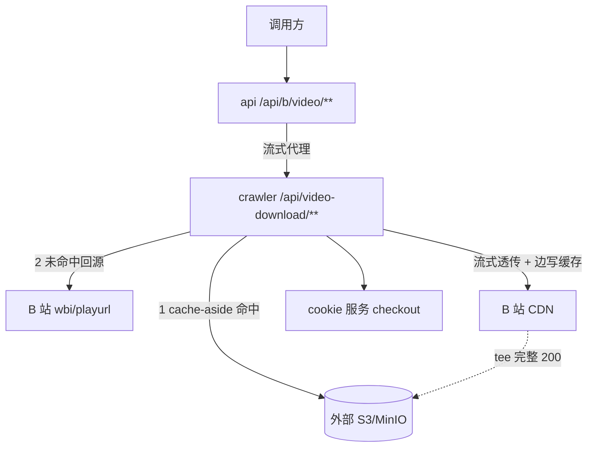
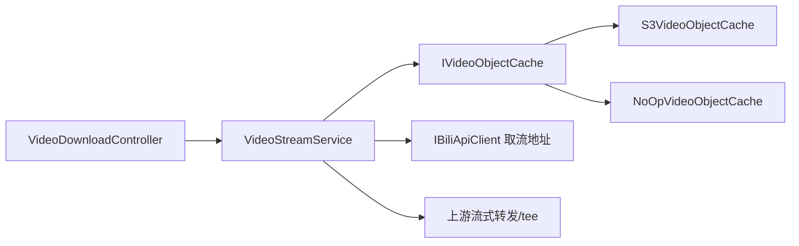
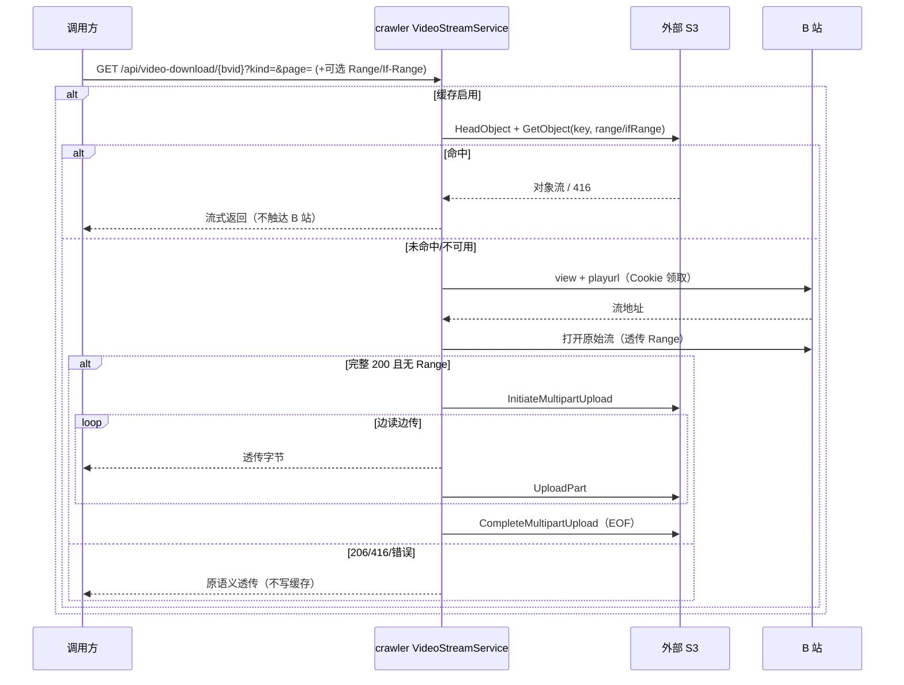

# crawler 视频下载 S3 缓存 - 技术提案

**功能名称**: crawler 视频下载 S3 缓存
**关联 PRD**: 无（在 [[20261008-bilibili-video-download-prd]] 基础上按增量需求补充，PRD 由本提案一并修订）
**技术提案版本**: v1.0
**创建日期**: 2026-10-09
**作者**: Z.Vtuber Workflow Agent
**feat-branch**: `feat/video-s3-cache`

## 1. 概述

### 1.1 背景

crawler 服务已具备 B 站投稿视频实时取流下载能力（见 [[20261008-proposal-bilibili-video-download]]）：`GET /api/video-download/{bvid}?kind=&page=` 由 crawler 直连 B 站 CDN，原始流实时透传给调用方，**不落盘、不归档、传输结束即弃**。

当前问题：同一视频（同一 `bvid + page + kind`）被重复请求时，crawler 每次都要重新领取 Cookie、调用 `view`/`playurl` 取流地址、再从 B 站 CDN 整段回源，成本高（风控压力、带宽占用、首字节延迟）且不必要——同一视频的原始流内容是稳定可复用的。

本次增量需求：为 crawler 增加**外部 S3 存储服务配置**，并在抓取视频时引入 **cache-aside 读缓存**：优先从 S3 取缓存直出，未命中再回源 B 站并顺带写入缓存。缓存为**尽力而为**：任何 S3 异常都不得影响下载主链路。

### 1.2 目标

- crawler 新增 `S3` 配置节（外部 S3/MinIO，S3 兼容协议），支持启用开关与凭据/端点/Bucket 配置；
- 视频下载采用 cache-aside：
  - **命中**：直接以 S3 对象流式返回（含 `Range`/`If-Range`/416 语义），不再访问 B 站；
  - **未命中**：沿用现有回源链路，**完整 200 且调用方未携带 Range** 时边透传给客户端边写入 S3（multipart），成功后对象可被后续请求命中；
  - **不缓存**：带 `Range` 的请求（上游 206）、416、错误响应一律不写缓存；
- 缓存读写失败（S3 不可达/超时/无权限）**只记日志、降级为无缓存**，下载仍按原语义成功；
- **启用缓存时启动前探测 S3 可用性**：`ListObjectsV2(MaxKeys=1)` 探测目标 Bucket，不可用则拒绝启动（进程非零退出），避免带病运行；
- 不引入本地磁盘落盘（沿用 crawler 视频链路「不落盘」硬约束，缓存只写远端 S3）。

### 1.3 范围

- 做：crawler 外部 S3 配置、S3 对象缓存的读/写（multipart）、cache-aside 接入 `VideoStreamService`、缓存元数据（`Content-Type`/`Content-Disposition`）服务于命中时响应头、单元/集成测试；
- 不做：本地 MinIO 编排（由部署环境提供外部 S3）、缓存 TTL/容量淘汰（由 S3 生命周期规则承担）、预取/后台预热、缓存失效主动清理（同 key 覆写即可）、对外契约新增响应头、前端页面。

## 2. 技术架构

### 2.1 系统架构图



命中路径不触达 B 站与 Cookie 服务；未命中路径在原有「B 站 CDN → crawler → api → 调用方」流式链路上叠加一条 S3 写入旁路，写入失败不阻断主流。

### 2.2 技术栈

| 层级 | 技术选型 | 说明 |
|------|---------|------|
| 后端 | .NET 10 / ASP.NET Core | crawler 现有 Worker + Controller |
| 存储 | S3 兼容对象存储（外部） | 新增 `AWSSDK.S3`，`AmazonS3Client` + `ServiceURL` + `ForcePathStyle` 兼容 MinIO |
| 缓存 | S3 cache-aside + multipart upload | 完整 200 边透传边写；失败 abort，不落本地盘 |
| 其他 | 现有 Mikibot.Crawler / Cookie / 风控通道 | 未命中回源链路不变 |

### 2.3 模块划分



| 模块 | 职责 | 关键技术点 |
|------|------|-----------|
| crawler: `Configuration/S3Options` | S3 配置节 `S3`：Enabled/ServiceUrl/Bucket/凭据/Region/ForcePathStyle/Prefix | `ValidateOnStart`；仅 Enabled=true 时校验必填项 |
| crawler: `Video/S3AvailabilityProbe` | 启动期可用性探测：`ListObjectsV2(MaxKeys=1)` 探测 Bucket | 不可用抛 `S3UnavailableException` → 拒绝启动 |
| crawler: `Video/IVideoObjectCache` | 缓存端口：`TryReadAsync` / `BeginUploadAsync` / `Enabled` | 与具体 S3 SDK 解耦，便于桩测 |
| crawler: `Video/S3VideoObjectCache` | S3 实现：Head+Get 读、multipart 写、abort | 全部异常降级；If-Range 匹配、416 由 Head 总长判定 |
| crawler: `Video/NoOpVideoObjectCache` | 未启用缓存时的空实现 | `Enabled=false`，方法不参与主链路 |
| crawler: `Video/CachingReadStream` | 边读上游边写缓存的上游流包装 | EOF 完成 multipart；异常/取消 abort；写失败仅告警不阻断 |
| crawler: `Video/VideoCacheKey` / `VideoCacheModels` | 缓存键与模型（含 If-Range 匹配纯函数） | 键 = `videos/{bvid}/p{page:D2}/{kind}` |
| crawler: `Video/VideoStreamService` | 接入 cache-aside 编排 | 命中直出；未命中完整 200 tee；带 Range 不缓存 |
| crawler: `Program.cs` | 绑定 `S3` 配置并注册 `IVideoObjectCache` | Enabled=true 构造 `AmazonS3Client`，否则 NoOp |

## 3. API 设计

### 3.1 API 契约

**不新增对外端点**。`GET /api/b/video/{bvid}/download`（api）与 `GET /api/video-download/{bvid}`（crawler 对内）的请求/响应结构保持不变；`contracts/video-download.openapi.yaml` 与 `contracts/bilibili-crawler.openapi.yaml` 仅更新行为描述，声明 cache-aside 语义（缓存命中时内容可能来自 S3；首次/未命中回源 B 站，两者对调用方字节一致）。

对外可见行为差异：

- 命中缓存时首字节更快、不再占用 Cookie 账号；
- `Range`/`If-Range`/416/400/404/502 状态码与响应头语义不变；
- 极端情况下（S3 对象为某次完整抓取的旧快照）返回内容仍为该视频对应 `bvid+page+kind` 的原始流，字节层面可播放；同一 key 被新完整抓取覆写后，`If-Range` 以新 ETag 判定，校验失败回退完整 200。

### 3.2 内部接口

```csharp
public interface IVideoObjectCache
{
    bool Enabled { get; }
    // 命中返回 VideoCacheRead（200/206/416），未命中/不可用返回 null
    Task<VideoCacheRead?> TryReadAsync(VideoCacheKey key, string? range, string? ifRange, CancellationToken ct);
    // 开启一次完整对象写入（S3 multipart）；失败抛异常由调用方降级
    Task<IVideoCacheUpload> BeginUploadAsync(VideoCacheKey key, VideoCacheObjectMetadata metadata, CancellationToken ct);
}

public interface IVideoCacheUpload : IAsyncDisposable
{
    ValueTask WriteAsync(ReadOnlyMemory<byte> buffer, CancellationToken ct);
    Task CompleteAsync(CancellationToken ct);
    Task AbortAsync(CancellationToken ct);
}
```

## 4. 数据模型

### 4.1 数据库设计

无新增 Mongo 集合。

### 4.2 缓存设计

| 项 | 设计 |
|----|------|
| 缓存介质 | 外部 S3 兼容对象存储 |
| 对象键 | `{Prefix}/videos/{bvid}/p{page:D2}/{video\|audio}`（`Prefix` 默认 `video-cache`；键不含扩展名，扩展名/类型存于对象元数据） |
| 对象元数据 | `ContentType`（m4v/m4a/flv 对应 MIME）；`content-disposition`（含标题、分 P、类型、扩展名） |
| 写入时机 | 仅「未命中 + 调用方无 Range + 上游 200 + 完整读取到 EOF」时完成对象写入 |
| 读命中语义 | S3 `HeadObject` 取总长/ETag/LastModified → 处理 `If-Range` → `GetObject(ByteRange)`；命中直出不触达 B 站 |
| TTL/淘汰 | 不在应用层实现；建议由 S3 Bucket 生命周期规则配置过期与清理未完成 multipart |

## 5. 技术实现方案

### 5.1 核心流程



### 5.2 关键实现点

#### 实现点 1: S3 外部配置与降级注册

- **描述**: 新增 `S3Options`（节 `S3`：`Enabled`/`ServiceUrl`/`Bucket`/`AccessKey`/`SecretKey`/`Region`/`ForcePathStyle`/`Prefix`）。`ValidateOnStart`，仅 `Enabled=true` 时要求 `ServiceUrl`/`Bucket`/`AccessKey`/`SecretKey` 非空。`Program.cs` 中 `Enabled=true` 时构造 `AmazonS3Client`（`ServiceURL` + `ForcePathStyle`）并注册 `S3VideoObjectCache`，否则注册 `NoOpVideoObjectCache`。
- **技术细节**: 默认 `Enabled=false`，保证未配置环境启动不受影响；凭据通过环境变量/Secrets 注入（对应 `S3__AccessKey` 等）。
- **风险点**: 端点/凭据错误导致缓存不可用——所有调用降级为 miss 并告警，不影响下载。

#### 实现点 2: cache-aside 接入取流编排

- **描述**: `PrepareAsync` 在参数校验后、领取 Cookie 前计算缓存键并 `TryReadAsync`；命中直接构造 `VideoDownloadResult`（`ContentType`/`ContentDisposition`/`ContentRange`/`ContentLength`/`AcceptRanges` 取自对象与请求语义）。未命中走原有回源；`OpenUpstreamAsync` 中当「无 Range 且上游 200 且缓存启用」时 `BeginUploadAsync` 并以 `CachingReadStream` 包装上游流。
- **技术细节**: 带 `Range` 的未命中请求透传后为 206，不写缓存；上游 416 不写；错误不写。缓存键在选流前即可确定（不含扩展名）。
- **风险点**: 同一 key 并发完整抓取会重复写入——S3 PUT 幂等覆写，接受（不做分布式去重，避免引入锁与复杂等待）。

#### 实现点 3: 流式 tee 与 S3 multipart

- **描述**: `S3VideoObjectCache.BeginUploadAsync` 发起 multipart；`CachingReadStream` 在每次读上游后把字节追加写入上传（内部按 5MB 分片 `UploadPart`）。读到 EOF 时 `CompleteAsync`；读异常/取消时 `AbortAsync`；写缓存抛错时仅告警并停止写入（`_completed=true`），客户端仍拿到完整内容。`VideoDownloadResult`/`CachingReadStream` 支持 `DisposeAsync`，未完成时 abort，避免残留未完成 multipart。
- **技术细节**: 全程不落本地磁盘（满足 `VideoDownloadApiTests` 的不落盘源码扫描与运行时校验）；`AbortMultipartUpload` 幂等；对象元数据在 `InitiateMultipartUpload` 时携带。
- **风险点**: 客户端中途断开产生未完成 multipart——`AbortAsync` 兜底，另建议 S3 生命周期规则清理历史残留。

#### 实现点 4: 命中路径 Range/If-Range/416

- **描述**: `TryReadAsync` 先 `HeadObject` 取 `ContentLength`/`ETag`/`LastModified`（404 → miss）。若带 `If-Range`，以 `VideoCacheRange.IfRangeMatches`（纯函数）判定：ETag 相等或 LastModified ≤ If-Range 日期视为匹配，否则丢弃 Range 返回完整 200。`Range` 起始 ≥ 总长 → 返回 416 且 `Content-Range: bytes */{total}`；否则 `GetObject(ByteRange)` 并回传 `Content-Range`。
- **技术细节**: `If-Range` 匹配、字节区间与 416 判定为纯函数，单测覆盖；S3 调用薄封装。
- **风险点**: S3 不支持原生 If-Range，故以 Head 元数据自行判定，语义与 HTTP 一致。

#### 实现点 5: 启动期 S3 可用性探测（不可用拒绝启动）

- **描述**: `Program.cs` 在构建宿主后、`app.Run()` 前，若 `S3:Enabled=true` 则调用 `IS3AvailabilityProbe.EnsureAvailableAsync`（`ListObjectsV2(MaxKeys=1)` 访问目标 Bucket）。任一异常（网络不可达、鉴权失败、Bucket 不存在）统一包装为 `S3UnavailableException` 抛出，使宿主启动失败、进程非零退出；`S3:Enabled=false` 时不探测。
- **技术细节**: S3 客户端为单例，缓存与探测共用；探测与运行时降级互补——启动要求 S3 就绪，运行中 S3 抖动仍降级不阻断下载。
- **风险点**: 编排环境 S3 与应用并发启动可能瞬时不可达导致启动失败——由编排的重启策略兜底（`WaitFor`/重启），保证最终一致。

## 6. 技术决策

### 6.1 决策列表

| 决策 | 选项 A | 选项 B | 最终选择 | 原因 |
|------|--------|--------|---------|------|
| 缓存行为 | cache-aside 读缓存 | 仅归档写入 | A | 用户指定；命中直出降低风控与带宽成本 |
| S3 接入 | 外部 S3 配置 | 本地 MinIO 编排 | A | 用户指定；不改变现有 Aspire 拓扑 |
| SDK | AWSSDK.S3（S3 兼容） | 手写 HTTP 签名 | A | 成熟、支持 multipart 与 Range，MinIO 兼容 |
| 未命中写入 | 边透传边 multipart | 先落本地文件再上传 | A | 维持「不落盘」硬约束 |
| 部分请求缓存 | 仅完整 200 缓存 | 206 也缓存 | A | 206 是分片，缓存会污染对象完整性 |
| 缓存键 | bvid+page+kind | bvid | A | 与下载粒度一致；不同 page/kind 内容不同 |
| 缓存失败处理 | 降级无缓存 | 让下载失败 | A | 缓存是旁路，不得影响主链路 |
| S3 启动可用性 | 探测不可用即拒绝启动 | 始终启动按需降级 | A | 启用缓存即声明依赖，避免带病运行；关闭缓存则不探测 |
| 淘汰策略 | S3 生命周期 | 应用层 TTL | A | 本提案不做应用层淘汰，交由运维配置 |

### 6.2 依赖与约束

| 类型 | 内容 | 说明 |
|------|------|------|
| 依赖 | `AWSSDK.S3`（NuGet） | 新增 crawler 依赖 |
| 依赖 | 外部 S3 兼容对象存储 | 由部署环境提供，应用只读配置 |
| 约束 | 契约先行 | 更新 `contracts/video-download.openapi.yaml`、`contracts/bilibili-crawler.openapi.yaml` 描述 |
| 约束 | TDD | 先写测试，核心逻辑覆盖率 ≥80%，单用例 ≤5s |
| 约束 | 不落盘 | 缓存只写远端 S3，Video 目录无本地磁盘写入 |

## 7. 项目结构

```
servers/crawler/
├── Configuration/
│   └── S3Options.cs                    # 新增：外部 S3 配置节与校验
├── Video/
│   ├── IVideoObjectCache.cs            # 新增：缓存端口 + IVideoCacheUpload
│   ├── VideoCacheModels.cs             # 新增：VideoCacheKey/VideoCacheRead/元数据/If-Range 纯函数
│   ├── S3VideoObjectCache.cs           # 新增：AWSSDK.S3 实现（GetObjectMetadata/GetObject/multipart）
│   ├── S3AvailabilityProbe.cs          # 新增：启动期 S3 可用性探测（不可用拒绝启动）
│   ├── NoOpVideoObjectCache.cs         # 新增：未启用时空实现
│   ├── CachingReadStream.cs            # 新增：边读边写缓存的流包装
│   ├── VideoStreamService.cs           # 修改：接入 cache-aside
│   └── VideoDownloadModels.cs          # 修改：结果支持异步释放（缓存写入收尾）
├── Program.cs                          # 修改：绑定 S3 配置并注册 IVideoObjectCache
├── appsettings.json                    # 修改：新增 S3 节（Enabled=false 占位）
└── Z.Vtuber.Crawler.csproj             # 修改：新增 AWSSDK.S3 依赖

contracts/
├── video-download.openapi.yaml         # 修改：描述声明 cache-aside
└── bilibili-crawler.openapi.yaml       # 修改：描述声明 cache-aside

tests/Z.Vtuber.Tests/
├── VideoCacheKeyTests.cs               # 新增：键与 If-Range/416 纯函数
├── VideoObjectCacheTests.cs            # 新增：cache-aside 命中/未命中/tee/降级（假缓存）
├── S3VideoObjectCacheTests.cs          # 新增：S3 实现（内存 S3 桩）
└── S3AvailabilityProbeTests.cs         # 新增：启动期探测成功/失败
```

## 8. 测试策略

### 8.1 测试覆盖要求

- 单元测试覆盖率: ≥80%（核心逻辑：缓存键生成、If-Range 匹配、Range/416 判定、cache-aside 编排、tee 写入/abort、降级、启动可用性探测）
- API 测试覆盖的端点: `/api/video-download/{bvid}` 在缓存命中/未命中/缓存不可用下的响应头与字节一致性

### 8.2 测试类型

| 类型 | 工具 | 覆盖范围 |
|------|------|---------|
| 单元测试 | xUnit + 内联 Stub（假 `IVideoObjectCache`、`StubHttpHandler`） | 纯函数与 `VideoStreamService` 编排 |
| 集成测试 | Testcontainers（Mongo/Redis，现有） | 现有视频下载 API 测试回归（缓存默认关闭） |
| 冒烟 | 手动（真实外部 S3 + 真实 BV 号） | 命中/回源/断点续传验证（不进 CI） |

## 9. 部署方案

### 9.1 环境规划

| 环境 | 用途 | 部署方式 |
|------|------|---------|
| 本地 | 开发调试 | 缓存默认关闭（`S3:Enabled=false`）或指向外部 S3 |
| 生产 | 正式服务 | 现有容器化部署 + 环境变量注入 S3 配置，无新增本地卷 |

### 9.2 配置管理

```jsonc
"S3": {
  "Enabled": false,
  "ServiceUrl": "",          // 如 http://minio:9000 或 https://s3.amazonaws.com
  "Bucket": "",
  "AccessKey": "",
  "SecretKey": "",
  "Region": "us-east-1",
  "ForcePathStyle": true,    // MinIO 兼容
  "Prefix": "video-cache"
}
```

裸部署环境变量映射：`S3__Enabled`/`S3__ServiceUrl`/`S3__Bucket`/`S3__AccessKey`/`S3__SecretKey` 等。

## 10. 验收标准

- [ ] 技术方案评审通过
- [ ] Contract 评审通过（`contracts/video-download.openapi.yaml`、`contracts/bilibili-crawler.openapi.yaml` 描述更新）
- [ ] 代码实现完成
- [ ] 单元测试覆盖达标（≥80%，单用例 ≤5s）
- [ ] API 测试通过（含缓存命中/未命中/降级与不落盘回归）
- [ ] E2E 测试通过（真实外部 S3 + 真实 BV 号冒烟）

## 11. 相关文档

- 关联 PRD: docs/product/draft/20261008-bilibili-video-download-prd.md（本提案附带行为修订）
- 关联 Contract: contracts/video-download.openapi.yaml、contracts/bilibili-crawler.openapi.yaml
- 前置提案: docs/engineering/proposals/20261008-proposal-bilibili-video-download.md
- 开发规范: docs/engineering/common-rules.md、docs/engineering/backend-rules.md
