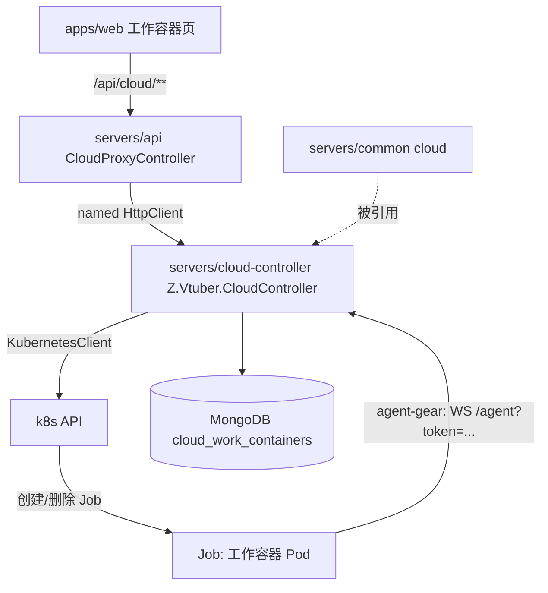
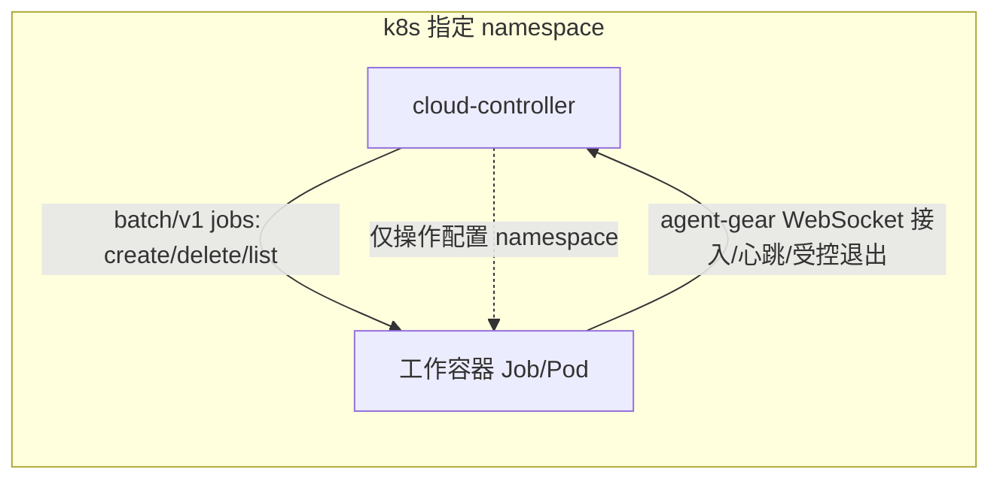
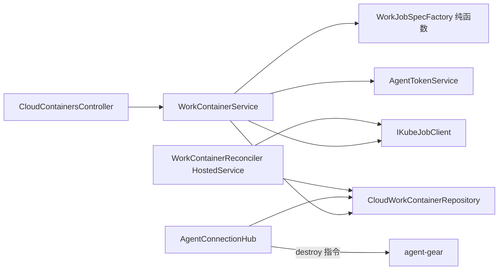
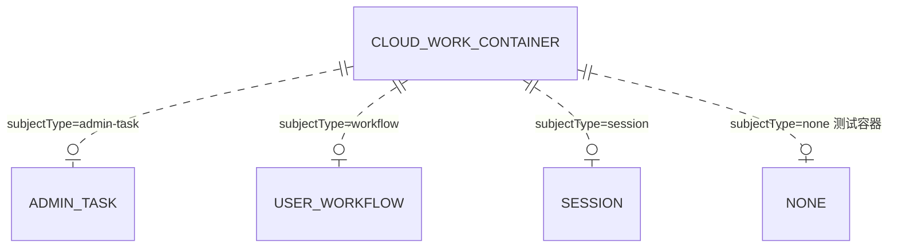
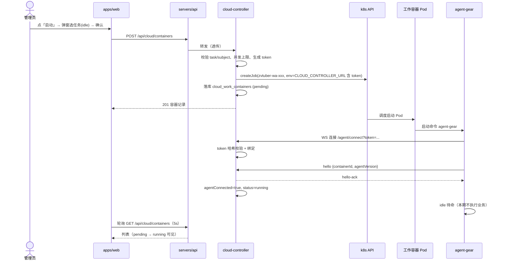
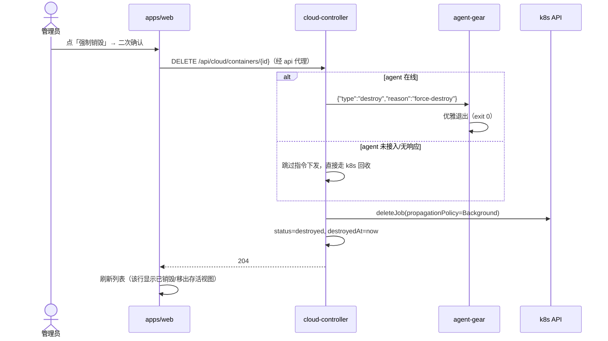
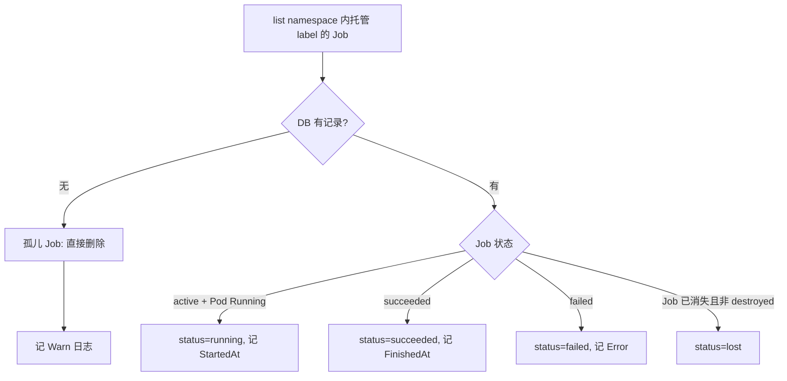

# 云Agent二期 - 技术提案

**功能名称**: 云Agent二期（云上工作容器托管与管控）
**关联 PRD**: docs/product/draft/20261014-cloud-agent-phase2-prd.md
**技术提案版本**: v1.0
**创建日期**: 2026-10-14
**作者**: Z.Vtuber Workflow Agent
**feat-branch**: `feat/cloud-agent-phase2`

## 1. 概述

### 1.1 背景

PRD 要求建立「工作容器」层的云端执行环境基础设施：部署在 k8s 的 **cloud-controller** 接入 k8s API 管理指定 namespace 下的工作容器；每个工作容器是一个 k8s Job，与管理后台用户任务（一般为构建）/ 前台用户工作流 / 独立会话之一建立关联；容器启动时经环境变量注入 cloud-controller 通讯地址（携带鉴权 token），由 **agent-gear**（云 Agent 项目的 agent-controller，npm 全局包）连接 cloud-controller 并受其控制；提供标准化默认工作容器镜像（内网源 + Node.js/git/gh/docker buildx/sysbox + 全局安装 agent-gear 等 agent 工具链）。本期工作容器启动后仅待命（idle），后台触发销毁后容器退出并销毁；管理后台展示全部容器（job）、可启动 idle 测试容器、可强制销毁。

本仓库现状：后端为 .NET 10 多服务 monorepo（`servers/*`，实体/仓储按域下沉 `servers/common/*`），前端 `apps/web`（React 19 + antd v6）一律经 `servers/api` 代理访问后端；契约先行放 `contracts/*.openapi.yaml` 并 codegen 到前端类型。本期按同一范式新增 cloud-controller 服务、cloud 领域与工作容器镜像。

### 1.2 目标

- 新增 `servers/cloud-controller`（Z.Vtuber.CloudController）：k8s Job 编排 + 工作容器注册/控制通道 + 状态对账，部署于 k8s，仅操作配置指定 namespace；
- 新增标准化工作容器镜像（`infra/work-container/Dockerfile`）：ubuntu 基础 + 内网 mirror + 工具链 + npm 全局 agent 工具（agent-gear 等），启动命令为 agent-gear 接入 cloud-controller；
- 工作容器与来源对象（`admin-task` / `workflow` / `session`）建立可追溯关联，测试容器允许 `none`；
- `servers/api` 代理 `/api/cloud/**`，`apps/web` 新增「工作容器」管理页（列表 / 启动 idle / 强制销毁）；
- 控制通道鉴权：每容器专属 token 经环境变量（地址携带 token）注入，接入即校验绑定。

### 1.3 范围

- **做**：cloud-controller 服务（Job 生命周期编排、agent 通道、对账回收）、默认工作容器镜像与构建流水线、容器-来源关联模型、api 代理、管理后台工作容器页（列表/启动 idle/强制销毁）、销毁指令下发与幂等销毁、单测/API 测试/前端测试与部署清单；
- **不做**：工作容器内的实际业务执行（构建、工作流、会话，均留待后续迭代，本期 idle）、任务类型扩展（仅 `idle`）、前台用户自助入口、跨 namespace 管理、容器内工作产物回传、管理后台鉴权、容器日志/终端在线查看。

## 2. 技术架构

### 2.1 系统架构图





### 2.2 技术栈

| 层级 | 技术选型 | 说明 |
|------|---------|------|
| 前端 | React 19 + Ant Design v6 + Vite | 与 `apps/web` 现有栈一致，页面测试 Vitest + RTL |
| 后端 | .NET 10 / ASP.NET Core Web API | cloud-controller 新服务；api 新增代理 Controller |
| k8s 客户端 | `KubernetesClient`（官方 C# 客户端） | Job/Pod 编排与状态查询；以 `IKubeJobClient` 抽象便于测试替换 |
| 控制通道 | ASP.NET Core 原生 WebSocket | `/agent/connect?token=`，JSON 消息协议（见 3.2） |
| 数据库 | MongoDB（`Aspire.MongoDB.Driver` + `MongoDB.Driver`） | 新增 cloud 域：`cloud_work_containers` |
| 工作容器 | Ubuntu 基础镜像 + Node.js 22 + git/gh/docker buildx/sysbox | `infra/work-container/Dockerfile`，依赖一律走内网源 |
| 工具链 | npm 全局包：agent-gear、@agentclientprotocol/*、@opencode/cli、@openai/codex、@anthropic-ai/claude-code、@google/gemini-cli | agent-gear 为云 Agent 项目 agent-controller（外部 npm 依赖） |
| 镜像仓库 | `core.harbor.internal.fffdan.com`（docker-hub-proxy / ghcr 代理） | 基础镜像与 FROM 一律经代理改写 |
| 软件源 | `nexus.internal.fffdan.com`（ubuntu-proxy / npm-proxy） | apt 与 npm 一律走内网代理 |

### 2.3 模块划分



| 模块 | 职责 | 关键技术点 |
|------|------|-----------|
| cloud-controller: `Controllers/CloudContainersController` | 对内 REST：容器列表/启动/强制销毁 | 状态码口径固定（200/201/204/400/404/409）；错误体 `{error: 中文/英文错误码}` |
| cloud-controller: `Services/WorkContainerService` | 启动/销毁编排、并发上限门控 | 幂等销毁；启动失败落库失败态与可读原因 |
| cloud-controller: `K8s/WorkJobSpecFactory` | Job 渲染纯函数 | label/env/TTL/资源；与 k8s 解耦可单测 |
| cloud-controller: `K8s/IKubeJobClient` | k8s 操作抽象（create/delete/list） | 实现 `KubeJobClient`（KubernetesClient）与 `FakeKubeJobClient`（测试/本地） |
| cloud-controller: `Agents/AgentConnectionHub` | WS 接入、token 校验、注册、心跳、destroy 下发 | 连接表 + Mongo 状态回写；断开置未接入 |
| cloud-controller: `Reconcile/WorkContainerReconciler` | 周期对账 Job 状态、孤儿回收 | 以 DB 为唯一事实源；启动全量对账一次 |
| common: `Z.Vtuber.Common.Cloud` | 容器实体/仓储/索引 | `CloudMongoSetup.EnsureIndexesAsync` 幂等 |
| api: `CloudProxyController` | `/api/cloud/**` 代理 | 沿用 TrainingProxyController 透传范式 |
| web: `pages/cloud/WorkContainersPage` | 列表 + 启动弹窗 + 强制销毁 | antd Table/Modal、轮询刷新、三态 |

## 3. API 设计

### 3.1 API 契约

契约文件 `contracts/cloud-controller.openapi.yaml`（统一前缀 `/api/cloud`）。cloud-controller 原生路径与 api 代理路径**完全一致**，代理零改路径透传；web 一律经 `/api/cloud/**` 访问。先定契约再实现，前端 `npm run codegen` 增产 `src/api/schema-cloud.d.ts`。

#### 接口 1: 列出全部工作容器

- **请求**
  - Method: GET
  - Path: `/api/cloud/containers`
  - Body: 无
- **响应**
  - Status: 200
  - Body:
    ```json
    {
      "items": [
        {
          "id": "wc-3f9a1c2b7d40",
          "task": "idle",
          "subjectType": "none",
          "subjectId": null,
          "jobName": "zvtuber-wa-3f9a1c2b7d40",
          "namespace": "cloud-agent",
          "image": "core.harbor.internal.fffdan.com/zero-tools/z-vtuber-work-container:latest",
          "status": "running",
          "agentConnected": true,
          "createdAt": "2026-10-14T13:00:00Z",
          "startedAt": "2026-10-14T13:00:20Z",
          "finishedAt": null,
          "destroyedAt": null,
          "error": null
        }
      ]
    }
    ```
  - `status` ∈ `pending`（已建 Job 未调度）/ `running`（Pod 运行中）/ `succeeded`（正常结束）/ `failed`（异常结束）/ `destroyed`（已销毁）/ `lost`（k8s 侧已消失且未走销毁流程）。

#### 接口 2: 启动一个工作容器

- **请求**
  - Method: POST
  - Path: `/api/cloud/containers`
  - Body:
    ```json
    {
      "task": "idle",
      "subjectType": "none",
      "subjectId": null
    }
    ```
  - `task` 本期仅接受 `idle`；`subjectType` ∈ `admin-task` / `workflow` / `session` / `none`（测试容器），`subjectId` 随类型可空。
- **响应**
  - Status: 201（创建成功，返回容器记录，`status=pending`）
  - Status: 400 `{"error":"task not supported"}`（task 非法）/ `{"error":"subjectId is required"}`（subjectType 非 none 但缺 subjectId）
  - Status: 409 `{"error":"too many containers"}`（存活容器数超过 `MaxActiveContainers`）
  - Status: 500 `{"error":"create job failed"}`（k8s 创建失败，错误详情落日志与记录 `error`）

#### 接口 3: 强制销毁一个工作容器

- **请求**
  - Method: DELETE
  - Path: `/api/cloud/containers/{containerId}`
- **响应**
  - Status: 204（销毁成功或幂等命中已销毁）
  - Status: 404 `{"error":"container not found"}`（Id 不存在/非法）
  - 销毁语义（双通道，见 5.2 实现点 4）：在线下发 destroy 指令使 agent-gear 优雅退出，同时删除 k8s Job（`propagationPolicy=Background`）回收 Pod；记录置 `destroyed` 并记 `destroyedAt`。对已退出/已销毁容器重复调用幂等 204。

#### 接口 4: 健康检查

- **请求**：GET `/health`
- **响应**：200 进程存活 + MongoDB 连通性（`MongoDbHealthCheck`，与既有服务同模式）

### 3.2 内部接口（cloud-controller ↔ agent-gear 控制通道）

容器启动时经环境变量注入通讯地址，**地址携带鉴权 token**（满足需求口径）：

```
CLOUD_CONTROLLER_URL=wss://cloud-controller.internal.fffdan.com/agent/connect?token=<token>
```

WebSocket 连接即会话，消息统一 JSON `{"type": "...", ...}`。协议是与 agent-gear（外部 npm 包，云 Agent 项目 agent-controller）的对接契约，本期最小集：

| 方向 | type | 载荷 | 说明 |
|------|------|------|------|
| Agent→CC | `hello` | `{"type":"hello","containerId":"wc-...","agentVersion":"1.0.0"}` | 连接建立后立即发送；`containerId` 须与 token 绑定记录一致，否则 `error` 并关闭 |
| CC→Agent | `hello-ack` | `{"type":"hello-ack","containerId":"wc-..."}` | 注册成功，记录 `agentConnected=true` |
| Agent→CC | `heartbeat` | `{"type":"heartbeat","ts":1760446800000}` | 每 `HeartbeatIntervalSeconds`（默认 30s）一次，刷新 `lastSeenAt` |
| CC→Agent | `pong` | `{"type":"pong"}` | 心跳应答 |
| CC→Agent | `destroy` | `{"type":"destroy","reason":"force-destroy"}` | 收到后 agent-gear 优雅退出进程（exit 0），Job 随之完成 |
| CC→Agent | `error` | `{"error":"invalid token"}` | 鉴权/协议错误后关闭连接 |

鉴权与绑定规则：

- token 为每容器随机 32 字节（base64url），仅存 **SHA-256 哈希**于容器记录（`agentTokenHash`，唯一索引）；连接 query 带明文 token，服务端哈希比对定位记录；
- 校验顺序：token 哈希命中 → 记录存在且非 `destroyed` → `hello.containerId` 与记录一致；任一失败回 `error` 并 401/403 关闭；
- 一个容器同一时刻仅一条有效连接，新连接建立即踢掉旧连接（防 token 泄漏重放）；
- 断开（含异常断开）→ `agentConnected=false`、刷新 `lastSeenAt`，不改变 Job 状态。

## 4. 数据模型

### 4.1 数据库设计

#### 集合: `cloud_work_containers`（`Z.Vtuber.Common.Cloud`）

| 字段 | 类型 | 说明 |
|------|------|------|
| `_id` / `Id` | string | 容器 ID `wc-<12位hex>`，全局唯一，同时作为 Job 名后缀 |
| `Task` | string | 任务标识，本期恒 `idle`（为后续构建/工作流/会话任务预留） |
| `SubjectType` | string | 来源类型：`admin-task`（管理后台任务）/ `workflow`（前台用户工作流）/ `session`（独立会话）/ `none`（测试容器） |
| `SubjectId` | string? | 来源对象标识（`none` 时为 null） |
| `JobName` | string | k8s Job 名 `zvtuber-wa-<id后缀>` |
| `Namespace` | string | 创建时所属 namespace（快照） |
| `Image` | string | 工作容器镜像（快照） |
| `Status` | string | `pending`/`running`/`succeeded`/`failed`/`destroyed`/`lost` |
| `AgentConnected` | bool | 控制通道是否已接入 |
| `AgentTokenHash` | string | 接入 token 的 SHA-256（十六进制），不存明文 |
| `CreatedAt` | DateTime | 记录创建时间 |
| `StartedAt` | DateTime? | Pod 进入 Running 时间 |
| `LastSeenAt` | DateTime? | 最近一次心跳/连接活动 |
| `FinishedAt` | DateTime? | Job 终态时间 |
| `DestroyedAt` | DateTime? | 销毁时间 |
| `Error` | string? | 失败/异常原因（可读，供列表展示） |

索引（`CloudMongoSetup.EnsureIndexesAsync` 幂等建立）：`AgentTokenHash` 唯一索引（接入鉴权查找）、`Status` 索引（存活容器门控计数）、`CreatedAt` 倒序索引（列表默认排序）。实体标注 `[BsonIgnoreExtraElements]` 容忍版本演进。

#### 关联模型（需求第 2 条「这里需要做关联」）

本期落地为 `SubjectType + SubjectId` 二元组并随容器记录全生命周期保留：



- 管理后台任务（一般为构建）：`admin-task` + 任务 ID；来源写入方本期为启动请求方（后台/调用方），后续构建任务上线后由任务系统写入；
- 前台用户工作流：`workflow` + 工作流 ID；独立会话：`session` + 会话 ID。二者本期仅**建模与展示**，不接自动分配；
- 关联对象后续删除不影响容器记录（无外键，纯快照 + 展示标注），满足「可追溯不静默丢失」。

### 4.2 缓存设计

无新增缓存。存活容器计数（并发上限门控）直接以 Mongo `Status ∈ {pending,running}` 计数实现（量级小，无需缓存）；k8s 状态以 15s 对账周期收敛，列表数据即 Mongo 记录 + `agentConnected` 实时位。

## 5. 技术实现方案

### 5.1 核心流程

#### 流程 1: 启动工作容器（管理后台「启动」→ idle）



#### 流程 2: 强制销毁



#### 流程 3: 状态对账与孤儿回收（WorkContainerReconciler，每 15s）



### 5.2 关键实现点

#### 实现点 1: cloud-controller 服务骨架与配置

- **描述**：新建 `servers/cloud-controller`（`Z.Vtuber.CloudController`，`Microsoft.NET.Sdk.Web`），结构与既有服务对齐：`Controllers/`、`Services/`、`K8s/`、`Agents/`、`Reconcile/`、`Configuration/`、`Program.cs`、`MongoDbHealthCheck.cs`、`Dockerfile`、`Properties/launchSettings.json`（本地 8087）。
- **技术细节**：配置节 `CloudController`（`ValidateOnStart`）——`Namespace`（必填）、`KubeProvider`（`kubernetes`|`fake`，默认 `kubernetes`，本地/测试切 fake）、`KubeConfig`（空=in-cluster，本地指向 kubeconfig）、`WorkImage`、`ImagePullSecret`（可空）、`AgentPublicBaseUrl`（注入容器的可达地址）、`MaxActiveContainers`(10)、`JobActiveDeadlineSeconds`(86400)、`JobTtlSecondsAfterFinished`(600)、`ReconcileIntervalSeconds`(15)、`HeartbeatIntervalSeconds`(30)、`JobCpuRequest`/`JobMemoryRequest`/`JobCpuLimit`/`JobMemoryLimit`。`Program.cs` 注册 Mongo/Options/仓储/`IKubeJobClient`/`WorkContainerService`/`AgentConnectionHub`/`WorkContainerReconciler`，`UseWebSockets()` 挂 `/agent/connect`，启动执行 `EnsureIndexesAsync` + 一次全量对账。
- **风险点**：in-cluster 与本地 kubeconfig 双形态需在实现期各验证一次；`KubeProvider=fake` 仅用于本地/测试，防误配需启动日志显式打印 provider 与 namespace。

#### 实现点 2: k8s Job 编排（工作容器 = Job）

- **描述**：`WorkJobSpecFactory` 纯函数渲染 `V1Job`；`IKubeJobClient` 抽象 `CreateJobAsync/DeleteJobAsync/ListManagedJobsAsync`，实现 `KubeJobClient`（`KubernetesClient`）与 `FakeKubeJobClient`。
- **技术细节**：
  - Job 命名 `zvtuber-wa-<id后缀>`（小写字数字，符合 k8s 命名约束）；label `app=z-vtuber-work-container`、`z-vtuber/managed=true`、`z-vtuber/container-id`、`z-vtuber/task`，对账与 RBAC 均按 label 过滤；
  - `spec.backoffLimit=0`、`restartPolicy=Never`（单次执行语义）、`activeDeadlineSeconds=JobActiveDeadlineSeconds`、`ttlSecondsAfterFinished=JobTtlSecondsAfterFinished`（结束自动回收兜底）；
  - Pod env：`CLOUD_CONTROLLER_URL`（**地址携带 token**，满足需求）、`WORK_CONTAINER_ID`、`WORK_TASK`、`WORK_SUBJECT_TYPE`、`WORK_SUBJECT_ID`；
  - `imagePullSecrets`、requests/limits 取自配置；删除走 `propagationPolicy=Background` 立即回收 Pod。
- **风险点**：namespace 资源配额与并发上限需与集群实际容量对齐；Job 名与 label 携带用户输入的部分须经白名单/编码防注入（subjectId 不进入 Job 名）。

#### 实现点 3: 接入鉴权 token

- **描述**：`AgentTokenService` 生成每容器 token（32 字节 RNG → base64url），仅落 SHA-256 哈希；URL 形态 `wss://<AgentPublicBaseUrl>/agent/connect?token=<token>` 注入 `CLOUD_CONTROLLER_URL`。
- **技术细节**：连接时对 query token 求哈希查 `agentTokenHash` 唯一索引；命中且记录非 `destroyed`、`hello.containerId` 与记录 Id 一致才接受；单连接约束（新连接踢旧连接）。
- **风险点**：token 经 env/URL 传递，会出现在进程环境与可能的错误日志中——日志禁止打印 `CLOUD_CONTROLLER_URL` 全文（统一打 containerId），k8s 侧 Job spec 属管理员可见范围，符合内网可信口径。

#### 实现点 4: agent 控制通道与销毁语义

- **描述**：`AgentConnectionHub` 承载 WS 生命周期（握手鉴权 → hello 注册 → 心跳 → 下发 destroy → 断开回写）。
- **技术细节**：销毁采用**双通道**：① agent 在线则下发 `destroy`，agent-gear 优雅退出（exit 0）使 Job 正常完成；② 同步调用 k8s 删除 Job（Background 传播）覆盖未接入/无响应/卡死场景；两步均幂等，记录置 `destroyed`。agent-gear 侧协议实现属云 Agent 项目（npm 包 `agent-gear`），本提案定义服务端契约与最小消息集（3.2）；`@agentclientprotocol/claude-agent-acp`、`@agentclientprotocol/codex-acp`、`@opencode/cli`、`@openai/codex`、`@anthropic-ai/claude-code`、`@google/gemini-cli` 本期仅预装不调用。
- **风险点**：agent-gear 的 CLI 参数/环境变量约定需与该包当前版本对齐（本期仅「按 `CLOUD_CONTROLLER_URL` 接入并受控退出」最小集）；后续任务执行协议扩展时向后兼容（消息 type 前向扩展，未知 type 忽略）。

#### 实现点 5: 状态对账与孤儿回收

- **描述**：`WorkContainerReconciler`（HostedService）周期（15s，启动带抖动）以 label list Job 同步状态；启动时全量对账并清理历史孤儿。
- **技术细节**：映射规则见流程 3；DB 有 Job 无且非 `destroyed` → `lost`；Job 有 DB 无 → 孤儿直接删除并 Warn；`agentConnected` 由 Hub 连接表维护（与 Job 状态解耦）；列表读 Mongo，不做实时 k8s 查询（读路径稳定、快）。
- **风险点**：对账周期内的状态滞后（≤15s）可接受，已在 PRD 刷新口径内；对账异常仅记日志不阻断服务。

#### 实现点 6: 默认工作容器镜像（`infra/work-container/Dockerfile`）

- **描述**：平台统一维护的标准工作环境镜像，全部依赖走内网代理。
- **技术细节**（要点）：

  ```dockerfile
  # 基础镜像走 harbor docker-hub-proxy：{image} → core.harbor.internal.fffdan.com/docker-hub-proxy/{image}
  FROM core.harbor.internal.fffdan.com/docker-hub-proxy/ubuntu:24.04

  # apt 走内网 mirror
  RUN sed -i 's|http://archive.ubuntu.com/ubuntu|https://nexus.internal.fffdan.com/repository/ubuntu-proxy|g' \
        /etc/apt/sources.list.d/ubuntu.sources \
   && apt-get update && apt-get install -y --no-install-recommends \
        ca-certificates curl gnupg git nodejs npm \
        docker-ce-cli docker-buildx-plugin sysbox ... \
   && rm -rf /var/lib/apt/lists/*

  # npm 走内网 npm-proxy
  RUN npm config set registry https://nexus.internal.fffdan.com/repository/npm-proxy/

  # 全局 agent 工具链
  RUN npm install -g \
        agent-gear \
        @agentclientprotocol/claude-agent-acp \
        @agentclientprotocol/codex-acp \
        @opencode/cli \
        @openai/codex \
        @anthropic-ai/claude-code \
        @google/gemini-cli

  # 启动命令：使用 agent-gear 连接 cloud-controller（读 CLOUD_CONTROLLER_URL，地址含 token）
  ENTRYPOINT ["agent-gear"]
  ```

  - Node.js 22 经 NodeSource（apt 源同样改写至 nexus ubuntu-proxy）安装；`github-cli`（gh）经官方 apt 源代理安装；
  - docker 构建能力：镜像内提供 docker CLI + buildx 插件；docker-in-docker 运行时按需求「sysbox（docker 容器内的运行时）」提供 sysbox 相关组件，Pod 可选 `runtimeClassName: sysbox`（见决策 6.1 与风险）；
  - ghcr.io 代理规则：`ghcr.io/{image}` → `core.harbor.internal.fffdan.com/ghcr/{image}`，供容器内 buildx 拉取 ghcr 基础镜像时改写（镜像内 docker daemon 配置 `registry-mirrors` / `insecure-registries` 规则实现期落地）；
  - 构建流水线 `.github/workflows/build-work-image.yml`（路径触发 `infra/work-container/**`），推送 `${DOCKER_ENDPOINT}/zero-tools/z-vtuber-work-container:{sha,latest}`。
- **风险点**：**sysbox 的安装形态**（宿主机 OCI runtime vs 镜像内组件）在实现期以实测可用形态为准，若镜像内不可安装则回退为「节点安装 sysbox runtime + Pod `runtimeClassName: sysbox`」，镜像内保证 docker CLI + buildx 不变；各 npm 包的 node 版本兼容性需在构建期冒烟（`node -e` + 各 CLI `--version` 断言）。

#### 实现点 7: api 代理与契约 codegen

- **描述**：`servers/api/Controllers/CloudProxyController.cs` 将 `/api/cloud/**` 代理至 cloud-controller（named HttpClient `CloudControllerService`，节 `CloudControllerService:BaseUrl` 默认 `http://cloud-controller`、`RequestTimeoutSeconds` 默认 30）。
- **技术细节**：透传口径沿用 `TrainingProxyController`：query 与 POST body/`Content-Type` 原样透传，200/201/204/400/404/409 状态码与响应体透传，上游不可达或超时 502 `{"error":"cloud-controller service unavailable"}`；web 只认 `/api`。契约 `contracts/cloud-controller.openapi.yaml` → `npm run codegen` 追加 `openapi-typescript ../../contracts/cloud-controller.openapi.yaml -o src/api/schema-cloud.d.ts`。
- **风险点**：DELETE 透传需确认 `ForwardAsync` 现状支持（TrainingProxy 已支持 POST/PUT，DELETE 为同类零逻辑扩展）。

#### 实现点 8: 管理后台工作容器页

- **描述**：`apps/web/src/pages/cloud/WorkContainersPage.tsx`（+ `StartContainerDialog.tsx`、各自测试），菜单新增分组「云 Agent」→「工作容器」（`PageKey` `cloud-work-containers`，`App.tsx` `menuGroups`）。
- **技术细节**：
  - 列表列：容器标识 / 任务类型 / 关联来源（类型 + 标识，`none` 显示「测试容器」）/ 状态 / 接入状态 / 启动时间 / 操作；`setInterval` 5s 轮询 `listCloudWorkContainers`，**load 请求序号比对**防慢响应覆盖新数据，卸载清理；
  - 「启动」→ `StartContainerDialog`：任务 Select 仅「idle（空闲）」，关联来源本期固定「测试容器（无关联）」；确认调 `startCloudWorkContainer({task:"idle", subjectType:"none"})`，提交中 loading 防重复，成功 message 反馈并刷新；
  - 每行「强制销毁」→ `modal.confirm` 二次确认 → `destroyCloudWorkContainer(id)`，成功刷新，幂等语义与服务端一致；
  - `api/client.ts` 新增 `listCloudWorkContainers`/`startCloudWorkContainer`/`destroyCloudWorkContainer`，`apiErrorMessage` 增补 `task not supported`/`too many containers`/`container not found`/`create job failed` 中文化；
  - UI 规范照 `docs/engineering/frontend-rules.md`：antd v6 组件、`App.useApp()` 的 `message`/`modal.confirm`、`Spin`/`Empty`/`Alert` 三态、`PageHeader`、禁止野生内联 style。
- **风险点**：销毁后行的展示口径（保留在列表显示「已销毁」，与 PRD「保留销毁记录」一致）需与产品确认后定稿。

## 6. 技术决策

### 6.1 决策列表

| 决策 | 选项 A | 选项 B | 最终选择 | 原因 |
|------|--------|--------|---------|------|
| cloud-controller 技术栈 | .NET 10（对齐仓库） | Node.js/TS | A | 与 monorepo 现有服务、测试基建（Testcontainers/TestReport）、镜像流水线一致 |
| 工作负载形态 | k8s Job | Deployment/裸 Pod | A | 一次性执行语义、`backoffLimit=0`/TTL 天然契合「任务-容器」模型，完成即可回收 |
| 状态事实源 | Mongo 为唯一事实源 + k8s 对账 | 只读 k8s 实时查询 | A | 关联数据必须持久化；列表读路径稳定；对账 15s 收敛满足刷新口径 |
| 接入鉴权 | 每容器随机 token（哈希存储） | 全局静态 token | A | 可区分容器、可撤销、可追溯；满足「地址携带 token」注入口径 |
| 控制通道 | WebSocket 长连接 | HTTP 轮询 | A | cloud-controller 需主动下发销毁指令，长连接即时可靠 |
| 销毁语义 | 仅删 k8s Job | 下发 destroy + 删 Job 双通道 | B | 双通道兼顾优雅退出（Job 正常完成）与强制回收（未接入/卡死不残留） |
| 镜像/软件源 | 内网代理改写（harbor docker-hub-proxy/ghcr、nexus ubuntu/npm） | 公网直连 | A | 内网环境无公网依赖、可复现；遵需求 3.1/3.2 明确规则 |
| sysbox 形态 | 镜像内安装 + 可选 runtimeClassName | 仅宿主机 runtime | A（实测兜底 B） | 按需求字面在工作环境提供；实测不可行时回退宿主机 runtime，docker CLI+buildx 保证不变 |
| 对外暴露 | api 代理 `/api/cloud/**` | 网关直连 cloud-controller | A | 与 training/recording-transcript 范式一致，web 只认 `/api` |
| 容器-来源关联 | 记录内二元组快照（SubjectType/SubjectId） | 独立关联表/外键 | A | 本期仅建模与展示，快照可追溯且无跨域耦合，后续任务系统可直接写入 |

### 6.2 依赖与约束

| 类型 | 内容 | 说明 |
|------|------|------|
| 依赖 | k8s 集群 + namespace 级 RBAC | `batch/v1 jobs` 的 get/list/watch/create/delete、`pods` 的 get/list/watch/delete（Role/RoleBinding 限定 `CloudController:Namespace`） |
| 依赖 | 内网 harbor（docker-hub-proxy / ghcr 代理）与 nexus（ubuntu-proxy / npm-proxy） | 基础镜像、apt、npm 依赖获取 |
| 依赖 | npm 包 `agent-gear`（云 Agent 项目 agent-controller） | 工作容器启动命令与受控退出；协议见 3.2 |
| 依赖 | MongoDB（`ConnectionStrings:mongo`） | `cloud_work_containers` |
| 依赖 | GitHub Actions secrets `DOCKER_ENDPOINT`/`DOCKER_USER`/`DOCKER_PASSWORD` | 两条新镜像流水线 |
| 约束 | 本期容器 idle | 不执行构建/工作流/会话业务；`task` 白名单仅 `idle` |
| 约束 | 仅操作配置指定 namespace | 越权操作一律拒绝（RBAC + 代码内 namespace 断言） |
| 约束 | 管理后台免鉴权（内网） | 控制通道必须 token 鉴权（已设计）；管理 API 依赖内网可信 |
| 约束 | 测试口径 | 单用例 ≤5s（`TimeoutExceptions.json` 例外登记）、核心逻辑覆盖 ≥80%、不打真实集群/外网 |

## 7. 项目结构

```
servers/
├── cloud-controller/                 # 新增 Z.Vtuber.CloudController
│   ├── Controllers/
│   │   └── CloudContainersController.cs   # GET/POST/DELETE /api/cloud/containers
│   ├── Agents/
│   │   └── AgentConnectionHub.cs          # WS /agent/connect：鉴权/注册/心跳/destroy
│   ├── K8s/
│   │   ├── IKubeJobClient.cs              # CreateJob/DeleteJob/ListManagedJobs
│   │   ├── KubeJobClient.cs               # KubernetesClient 实现
│   │   ├── FakeKubeJobClient.cs           # 测试/本地（KubeProvider=fake）
│   │   └── WorkJobSpecFactory.cs          # V1Job 渲染纯函数
│   ├── Services/
│   │   ├── WorkContainerService.cs        # 启动/销毁编排、并发门控
│   │   └── AgentTokenService.cs           # token 生成/哈希校验
│   ├── Reconcile/
│   │   └── WorkContainerReconciler.cs     # HostedService 状态对账/孤儿回收
│   ├── Configuration/CloudControllerOptions.cs
│   ├── Program.cs / MongoDbHealthCheck.cs / Dockerfile
│   └── Properties/launchSettings.json     # 本地 8087
├── common/cloud/                     # 新增 Z.Vtuber.Common.Cloud
│   ├── CloudWorkContainerRecord.cs
│   ├── CloudWorkContainerRepository.cs
│   ├── CloudMongoSetup.cs                 # EnsureIndexesAsync
│   └── CloudCollectionNames.cs            # cloud_work_containers
└── api/Controllers/CloudProxyController.cs  # /api/cloud/** 代理

contracts/cloud-controller.openapi.yaml     # 新增契约（/api/cloud）
infra/work-container/Dockerfile             # 默认工作容器镜像
.github/workflows/build-cloud-controller-image.yml
.github/workflows/build-work-image.yml

apps/web/src/
├── api/schema-cloud.d.ts                   # codegen 产出
├── api/client.ts                           # +list/start/destroyCloudWorkContainer
└── pages/cloud/
    ├── WorkContainersPage.tsx (+ .test.tsx)
    └── StartContainerDialog.tsx (+ .test.tsx)

tests/Z.Vtuber.Tests/                       # Cloud*/WorkContainer*/AgentHub* Tests
```

同步更新：`servers/cloud-controller/AGENTS.md`、`servers/common/AGENTS.md`（新增 cloud 域）、`servers/api/AGENTS.md`、`apps/web/AGENTS.md`、`ProjectReferenceGuardTests`（引用矩阵含 cloud）、`infra/apphost/AppHost.cs`（Aspire 注册 cloud-controller）、`apps/web/package.json` codegen 链。

## 8. 测试策略

### 8.1 测试覆盖要求

- 核心逻辑单元测试覆盖率 ≥ 80%（common-rules 口径）；
- API 测试覆盖端点：`GET/POST/DELETE /api/cloud/containers`、`/health`、api 代理三端点透传、WS 通道鉴权/注册/destroy 消息。

### 8.2 测试类型

| 类型 | 工具 | 覆盖范围 |
|------|------|---------|
| 单元测试（纯函数） | xUnit | `WorkJobSpecFactory`（命名/label/env 注入/TTL/资源）、`AgentTokenService`（生成/哈希/比对）、Job 状态映射与对账决策、WS 消息序列化 |
| 集成测试 | xUnit + Testcontainers MongoDB | `CloudWorkContainerRepository`（CRUD/索引/并发门控计数）、`WorkContainerService`（Fake `IKubeJobClient`：启动编排/失败落库/幂等销毁）、`AgentConnectionHub`（假连接：鉴权拒绝/单连接踢旧/断开回写） |
| API/契约测试 | 假 `HttpMessageHandler` 契约测试（不打外网/真实集群） | cloud-controller 控制器状态码与错误体、api `CloudProxyController` 透传与 502 兜底 |
| 前端测试 | Vitest + React Testing Library | 列表三态与轮询竞态（请求序号比对）、启动弹窗（仅 idle/提交防重复）、强制销毁二次确认、错误文案 |
| E2E | z-test（Aspire 编排 + `KubeProvider=fake`） | web → api → cloud-controller →（fake k8s）启动/列表/销毁全链路；真实集群冒烟为可选项（kind/测试集群人工验证） |

跑测口径统一走 `docs/engineering/common-rules.md`（trx + `tests/Z.Vtuber.TestReport --check`，单用例 ≤5s，例外进 `TimeoutExceptions.json`）。

## 9. 部署方案

### 9.1 环境规划

| 环境 | 用途 | 部署方式 |
|------|------|---------|
| 本地 | 开发/联调 | Aspire AppHost 注册 cloud-controller（`KubeProvider=fake` 或本地 kubeconfig 直连测试 namespace） |
| 测试 | 集成验证 | k8s 测试 namespace 部署 cloud-controller（in-cluster）+ 工作容器镜像 |
| 生产 | 对外服务 | k8s `cloud-agent` namespace：Deployment + Service + ServiceAccount/Role/RoleBinding；工作容器统一调度于同一 namespace |

### 9.2 配置管理

- `ConnectionStrings:mongo`：MongoDB 连接串；
- `CloudController` 节（`ValidateOnStart`）：`Namespace`、`KubeProvider`、`KubeConfig`、`WorkImage`（默认 `core.harbor.internal.fffdan.com/zero-tools/z-vtuber-work-container:latest`）、`ImagePullSecret`、`AgentPublicBaseUrl`（注入容器的可达地址，如 `wss://cloud-controller.internal.fffdan.com`，**下发 URL 自动拼 `/agent/connect?token=`**）、`MaxActiveContainers`(10)、`JobActiveDeadlineSeconds`(86400)、`JobTtlSecondsAfterFinished`(600)、`ReconcileIntervalSeconds`(15)、`HeartbeatIntervalSeconds`(30)、`JobCpuRequest`/`JobMemoryRequest`/`JobCpuLimit`/`JobMemoryLimit`；
- `CloudControllerService` 节（api 侧）：`BaseUrl`（默认 `http://cloud-controller`）、`RequestTimeoutSeconds`(30)；
- k8s 清单：ServiceAccount `z-vtuber-cloud-controller` + Role（namespace 级 jobs/pods 权限）+ RoleBinding + Deployment + Service；Ingress/内网域名承载 `AgentPublicBaseUrl` 与 `/api/cloud` 直连（可选）；
- 镜像流水线：`build-cloud-controller-image.yml`（触发路径 `servers/cloud-controller/**`、`servers/common/core/**`、`servers/common/cloud/**`）、`build-work-image.yml`（触发路径 `infra/work-container/**`），均推送 `${DOCKER_ENDPOINT}/zero-tools/...`；
- 回滚：cloud-controller 停机不影响既有功能；存量工作容器由 Job TTL / 后台强制销毁兜底回收；`cloud_work_containers` 仅新增集合，回滚无迁移风险（`[BsonIgnoreExtraElements]`）。

## 10. 验收标准

- [ ] 技术方案评审通过
- [ ] Contract 评审通过（`contracts/cloud-controller.openapi.yaml`）
- [ ] 代码实现完成（cloud-controller / common cloud / api 代理 / web 页面 / 工作容器镜像）
- [ ] 单元测试覆盖达标（核心 ≥80%，单用例 ≤5s 护栏通过）
- [ ] API 测试通过（三端点 + WS 通道鉴权/销毁）
- [ ] E2E 测试通过（启动 idle → 列表可见 → 强制销毁 → 已销毁）
- [ ] 工作容器内工具链验收：git/gh/nodejs/npm/docker buildx 与 7 个 npm 全局包可用，全程内网源
- [ ] 集群侧无残留验证：销毁后 Job/Pod 已回收，孤儿 Job 被对账清理

## 11. 相关文档

- 关联 PRD：`docs/product/draft/20261014-cloud-agent-phase2-prd.md`
- 项目 AGENTS.md：`servers/api/AGENTS.md`、`servers/common/AGENTS.md`、`apps/web/AGENTS.md` 及各服务 AGENTS.md
- 开发规范：`docs/engineering/common-rules.md`、`docs/engineering/backend-rules.md`、`docs/engineering/frontend-rules.md`
- 交互基线：`docs/product/draft/20260822-admin-console-prd.md`、`docs/product/draft/20261001-admin-console-ui-redesign-prd.md`
- 契约：`contracts/cloud-controller.openapi.yaml`（本期新增）
- 外部依赖：npm 包 `agent-gear`（云 Agent 项目 agent-controller）、`KubernetesClient`（k8s 官方 C# 客户端）
