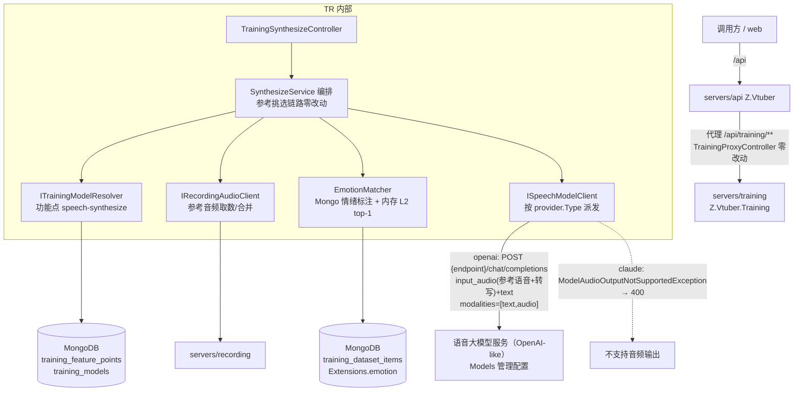
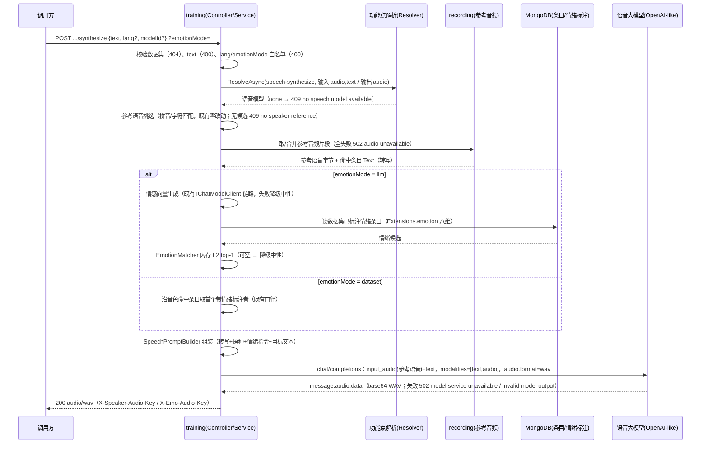

# AI 训练 - 音频生成（语音大模型推理改造） - 技术提案

- 日期：2026-10-14（修订：2026-10-14，按评审意见彻底移除 Milvus）
- 状态：待评审（返工修订）
- feat-branch：`prd/training-audio-synthesize-llm`（需求总分支；实现分支另切 `feat/training-audio-synthesize-llm`）
- 关联文档：[PRD](../../product/draft/20261014-training-audio-synthesize-llm-prd.md)

> **返工修订说明（2026-10-14，评审意见）**：彻底移除 Milvus——① 情绪参考匹配不再走 Milvus 向量检索，改为从 MongoDB 读取条目情绪标注（`Extensions.emotion` 八维）后**内存 L2 精确计算 top-1**（数据集千级规模、八维向量，成本可忽略且结果确定）；② `Vectors/` 全目录（含 Milvus 客户端/仓储、向量同步）、`POST .../vectors/rebuild` 端点、本地 Ollama embedding 依赖（仅供向量索引）、Aspire Milvus 资源与相关配置节一并删除。

## 1. 概述

### 1.1 背景

依据 PRD「AI 训练 - 音频生成（语音大模型推理改造）」：改造既有语音生成接口（`POST /api/training/datasets/{datasetId}/synthesize`），**不再支持原 TTS 上游**，改用支持「语音 + 文本输入、语音输出」的大模型推理并返回语音；传入的语音即既有链路挑选出的**参考语音**。

现状勘察结论（均经读码确认）：

**① 现有链路解耦良好，参考语音挑选与上游无关，可原样保留。**

- 链路：web（无合成调用方）→ `servers/api` `TrainingProxyController` 透传 → `servers/training` `TrainingSynthesizeController`（`servers/training/Controllers/TrainingSynthesizeController.cs:46`）→ `SynthesizeService`（`servers/training/Synthesis/SynthesizeService.cs`）→ `ITtsClient`/`IndexTtsClient`（multipart `POST {Tts:BaseUrl}/synthesize`）→ 内网 index-tts-api（IndexTTS-2.5）→ WAV；
- `SynthesizeService` 前半段（拼音断句多命中 → 按 ItemId 去重 → 条数/总时长上限截断 → `RecordingAudioClient.MergeClipsAsync` 合并；无候选回退字符相似单条）只产出参考音频字节 + ContentType，与上游协议零耦合——**本次改造不动该链路**；
- 参与命中的条目自带 `Text`（`TrainingDatasetItemRecord.Text`），可作为**参考语音转写**随参考音频一并提交大模型。

**② 原上游 index-tts-api 契约整体废弃，情绪链路需适配。**

- 被替换面：`IndexTtsClient`（multipart 字段 `text`/`lang`/`speaker_prompt`/`emo_prompt`/`emo_vector`/`emo_text`/`emo_alpha` 等）、`TtsOptions`（节 `Tts`）、AppHost `Tts__BaseUrl` 注入、502 `tts service unavailable` 错误口径；
- 现有情绪参考体系（`emotionMode` query `llm|dataset|none`）中，`llm` 模式的「情感向量 + Milvus top-1 检索」与上游 `emo_*` 字段均为 index-tts-api 定制；契约面（`emotionMode`）保留兼容，emo_* multipart 字段废弃，情绪倾向转为**自然语言指令**注入大模型（见 §5.2 实现点 3）。

**③ Milvus 仅剩情绪检索一个真实消费者，移除条件成立（评审意见）。**

- Milvus 当前承载：`item_emotion_vectors`（情绪 top-1 检索，`emotionMode=llm` 时由 `IVectorStore.SearchEmotionAsync` 消费）与 `item_text_embeddings`（文本向量派生索引——音色匹配已改为拼音/字符相似后**无任何消费者**，仅 `vectors/rebuild` 维护）；
- 配套维护面：`servers/training/Vectors/` 全目录（`IEmbeddingClient`/`LocalEmbeddingClient`（本地 Ollama）、`IVectorStore`/`MilvusVectorStore`/`MilvusRestClient`、`VectorSyncService`、`VectorExceptions`）、`Configuration/MilvusOptions.cs`/`EmbeddingOptions.cs`、`POST .../vectors/rebuild` 端点（`TrainingSynthesizeController`）、导入/编辑/情绪写入后的增量同步钩子（`TrainingDatasetItemsController`/`TrainingDatasetsController`）、`Program.cs` 注册与启动 `EnsureCollectionsAsync`、AppHost Milvus 资源与 `Milvus__Endpoint/Token`、`Embedding__BaseUrl` 注入；
- **移除依据**：数据集为千级规模，情绪向量为八维——从 MongoDB 读出该数据集已标注情绪的条目后**内存 L2 精确计算 top-1**，成本可忽略、结果确定（FLAT 等价的精确性），且消掉 Milvus 索引维护/同步/重建/漂移兜底的一整套复杂度；本地 Ollama embedding 的唯一消费者是文本向量派生索引，随 Milvus 一并移除。

**④ 语音大模型接入有同构先例可复用（image-generate）。**

- 能力白名单 `TrainingModelCapabilities` 四值 `audio`/`video`/`text`/`image`（`servers/common/training/Contracts/TrainingModelCapabilities.cs`），输入/输出均可标注 `audio`，**零 schema 变更**即可表达「输入 语音+文本 / 输出 语音」；
- 功能点解析 `ITrainingModelResolver.ResolveAsync(slug, name, input, output)`（指定优先 → 默认 → none）已上线，新功能点仅需 `FeaturePointIds` +1 常量（先例：`image-generate`，见 `docs/engineering/proposals/20261001-proposal-training-image-generate.md`）；
- Ai 客户端按 `provider.Type` 派发先例成熟：`IChatModelClient`（`OpenAiLikeChatClient` 已支持 `input_audio` base64 音频输入）与 `IImageModelClient`/`ImageModelClientFactory`（Claude-like 不支持对应模态直接抛 400 类异常）；
- 语音大模型调用可复用 named client `AiModel`（挂 `ModelSessionHeaderHandler` 的 `x-opencode-session` 头、`AllowAutoRedirect=false`、超时 `Ai:RequestTimeoutSeconds` 默认 120s；代理侧 180s 高于该预算，口径已对齐）。

**⑤ OpenAI-like 语音输出契约形态明确。**

- 支持音频输出的 OpenAI-like 模型（如 gpt-4o-audio 系、Qwen-Omni 系）通用形态：`POST {endpoint}/chat/completions`，messages 含 `input_audio`（base64 + format）与 `text` 内容段，请求携带 `modalities: ["text","audio"]` 与 `audio: {"format": "wav", ...}`，响应 `choices[0].message.audio.data` 为 base64 音频；
- Claude-like 无音频输出能力，按 image 先例直接抛不支持异常（→ 400）。

### 1.2 目标

1. `synthesize` 上游整体替换：删除 `ITtsClient`/`IndexTtsClient`/`TtsOptions`，新增 `ISpeechModelClient`/`SpeechModelClientFactory`/`OpenAiLikeSpeechClient`（chat/completions + `modalities` + `input_audio` → `audio.data` base64 → WAV）；
2. 语音模型选择走**新功能点 `speech-synthesize`**（输入 `audio,text` / 输出 `audio`，指定优先 → 默认），无可用模型 409 `no speech model available`；
3. **彻底移除 Milvus**：情绪匹配改为 MongoDB 情绪标注 + 内存 L2 top-1；`Vectors/` 全目录、`vectors/rebuild` 端点、Ollama embedding 依赖、Aspire Milvus 资源与配置一并删除；
4. 参考语音挑选链路**零改动**；参考语音转写（命中条目 `Text`）随参考音频一并提交；
5. `emotionMode` 契约保留：情绪参考（`EmotionResult` 描述 + 八维）转**情绪指令文本**注入，无情绪参考降级中性（口径不变）；
6. 契约先行（502 错误文案 `tts service unavailable` → `model service unavailable`；移除 `vectors/rebuild` 与 embedding/vector-store 错误码），TDD 补齐测试（上游模型假 `HttpMessageHandler` 契约测试，不打外网）。

### 1.3 范围

- **内**：`servers/training`（`Ai/` 新增语音模型客户端族、`Synthesis/SynthesizeService` 上游替换 + 情绪匹配改内存计算、`SpeechPromptBuilder` 新增、`Clients/ITtsClient.cs`/`IndexTtsClient.cs` 删除、**`Vectors/` 全目录删除**、`Configuration/TtsOptions.cs`/`MilvusOptions.cs`/`EmbeddingOptions.cs` 删除（`SupportedLangs`/`DefaultLang` 迁移至 `SpeechOptions`）、`FeaturePoints/FeaturePointIds` +1 常量、`Controllers/TrainingSynthesizeController.cs`（语音模型解析 + 错误映射 + **移除 `vectors/rebuild`**）、`Controllers/TrainingDatasetItemsController.cs`/`TrainingDatasetsController.cs`（**移除向量同步钩子**）、`Contracts/Dtos.cs`（移除 rebuild 响应 DTO）、`Program.cs` 注册调整）；`contracts/training.openapi.yaml`（错误文案修订 + **移除 vectors/rebuild 端点**）+ `contracts/bilibili-crawler.openapi.yaml`（镜像同步）；`infra/apphost/AppHost.cs`（**移除 Milvus 资源**与 `Milvus__*`、`Embedding__BaseUrl`、`Tts__BaseUrl` 注入）；`apps/web`（`npm run codegen` 重新生成 `schema-training.d.ts`/`schema.d.ts`，`vectors/rebuild` 类型随端点移除，无手工代码改动）；`tests/Z.Vtuber.Tests`（`IndexTtsClientTests` → `OpenAiLikeSpeechClientTests`、Milvus/向量同步测试删除、情绪匹配内存计算用例新增）。
- **外**：参考语音挑选（拼音/字符匹配、合并拼接，`segments/rebuild` 及其 Mongo 段存储**不在移除范围**）、情绪标注（`Extensions.emotion` 八维结构与识别任务）、数据集/导入/编辑/情绪识别/波形试听**零改动语义**；`servers/api` 代理零改动（通用透传已覆盖）；recording 服务零改动；流式输出、合成结果入库/缓存、批量合成、Web 合成界面（本期不做）；Claude-like 音频输出（上游不支持）。

## 2. 技术架构

### 2.1 系统架构图



### 2.2 技术栈

| 层级 | 技术选型 | 说明 |
|------|---------|------|
| 后端 | C# (.NET 10) ASP.NET Core Controllers（training 服务内改造） | 不新建服务；沿用控制器 + 编排 + 客户端派发模式 |
| 语音大模型调用 | `ISpeechModelClient` 按 `provider.Type` 派发；OpenAI-like `POST /chat/completions`（`modalities` + `input_audio`） | 复用 named client `AiModel`（`x-opencode-session` 头、禁重定向、120s 预算）；零新增 NuGet |
| 模型选择 | `ITrainingModelResolver` + 新功能点 `speech-synthesize`（输入 `audio,text` / 输出 `audio`） | 与 `image-generate` 先例同口径；能力白名单零变更 |
| 情绪参考 | **MongoDB 情绪标注 + 内存 L2 top-1**（`EmotionMatcher` 纯函数） | **Milvus 彻底移除**；千级 × 八维内存精确计算，结果确定 |
| 参考语音 | 既有挑选链路（拼音/字符匹配 + 合并）+ 条目 `Text` 转写 | 零改动，仅产出物增补转写字段 |
| 服务编排 | .NET Aspire（`infra/apphost`） | **移除 Milvus 资源**及 `Milvus__*`/`Embedding__BaseUrl`/`Tts__BaseUrl` 注入 |
| 测试 | xUnit + Testcontainers（Mongo）+ 假 HTTP 服务 | **不再使用 Testcontainers Milvus**；上游模型用假 `HttpMessageHandler` 契约测试 |

### 2.3 模块划分

| 模块 | 职责 | 关键技术点 |
|------|------|-----------|
| `servers/training/Ai/ISpeechModelClient.cs`（新增） | 语音合成客户端抽象 + 工厂 + 异常 | `SynthesizeSpeechAsync(provider, model, request)`；`SpeechModelClientFactory` 按 `provider.Type` 派发；`SpeechModelUnavailableException`（→502）/`ModelAudioOutputNotSupportedException`（→400） |
| `servers/training/Ai/OpenAiLikeSpeechClient.cs`（新增） | OpenAI-like 语音输出调用 | chat/completions + `modalities:["text","audio"]` + `audio:{format:"wav"}` + `input_audio`；解析 `message.audio.data` base64 |
| `servers/training/Synthesis/SynthesizeService.cs`（变更） | 编排：上游替换 + 情绪匹配改内存 | 参考挑选零改动；产出物携参考转写；情绪参考经 `EmotionMatcher` 内存匹配 → 指令文本；调 `ISpeechModelClient` |
| `servers/training/Synthesis/EmotionMatcher.cs`（新增） | 情绪参考内存匹配（纯函数） | 候选（条目 + 八维）× 查询向量 → L2 top-1，同分按 itemId 升序 tie-break |
| `servers/training/Synthesis/SpeechPromptBuilder.cs`（新增） | 语音合成 prompt 组装 | 参考转写 + 目标文本 + 语种提示 + 情绪指令 → user 文本段 |
| `servers/training/Controllers/TrainingSynthesizeController.cs`（变更） | 语音模型解析 + 错误映射；**移除 `vectors/rebuild`** | 功能点 `speech-synthesize` 解析（409 `no speech model available`）；502 文案 `model service unavailable` |
| `servers/training/FeaturePoints/FeaturePointIds.cs`（变更） | +`speech-synthesize` 功能点定义 | 输入 `audio,text` / 输出 `audio`，中文名「语音合成」 |
| `servers/training/Vectors/`（**整目录删除**） | Milvus 客户端/仓储/同步/embedding | `IEmbeddingClient`/`LocalEmbeddingClient`/`IVectorStore`/`MilvusVectorStore`/`MilvusRestClient`/`VectorSyncService`/`VectorExceptions` |
| `servers/training/Configuration/`（变更） | `TtsOptions`/`MilvusOptions`/`EmbeddingOptions` 删除；`SpeechOptions` 新增 | `SupportedLangs`/`DefaultLang` 迁入 `SpeechOptions`；残留 `Tts`/`Milvus`/`Embedding` 节 Warn 忽略 |
| `servers/training/Controllers/TrainingDatasetItemsController.cs`、`TrainingDatasetsController.cs`（变更） | **移除向量同步钩子** | 导入/编辑/情绪写入不再同步向量索引 |
| `servers/training/Clients/`（删除） | `ITtsClient.cs`/`IndexTtsClient.cs` | 原 TTS 上游整体移除 |
| `contracts/`（变更） | 错误文案与字段描述修订；**移除 `vectors/rebuild`** | 双侧镜像同步 |
| `infra/apphost/AppHost.cs`（变更） | **移除 Milvus 资源**与 `Milvus__*`/`Embedding__BaseUrl`/`Tts__BaseUrl` 注入 | 原 TTS / Milvus / Ollama embedding 依赖解除 |

## 3. API 设计

### 3.1 API 契约（`contracts/training.openapi.yaml`，修订）

#### 接口： 音频生成（synthesize，语义修订）

**端点、参数、成功响应形态全部保持不变**；仅错误文案与描述修订。

- **请求** `POST /api/training/datasets/{datasetId}/synthesize`（不变）
  ```json
  { "text": "要合成的文本", "lang": "ZH", "modelId": "66d8..." }
  ```
  | 字段 | 类型 | 必填 | 说明 |
  |------|------|------|------|
  | `text` | string | 是 | 待合成文本（trim 后非空） |
  | `lang` | string | 否 | 语种 `ZH/EN/JA/ES/AR`，缺省 `Speech:DefaultLang`（默认 `ZH`）；改造后作为语言提示注入模型 prompt |
  | `modelId` | string | 否 | **语义不变**：情绪推断所用模型（仅 `emotionMode=llm` 生效）；语音合成模型由功能点 `speech-synthesize` 解析，不经此字段 |

  query `emotionMode`（`llm|dataset|none`，缺省 `none`）**保持不变**。

- **响应**
  - `200 audio/wav`：合成音频（语音大模型输出 WAV 透传）；响应头 `X-Speaker-Audio-Key`、`X-Emo-Audio-Key` 不变；
  - `400 {"error":"text is required"}` / `{"error":"invalid lang"}` / `{"error":"invalid emotion mode"}` / `{"error":"model disabled"}` / **新增** `{"error":"model does not support audio output"}`（功能点指定模型为 Claude-like 等无音频输出能力的 provider）；
  - `404 {"error":"dataset not found"}` / `{"error":"model not found"}`；
  - `409 {"error":"no speaker reference"}` / **新增** `{"error":"no speech model available"}`（功能点解析无可用语音模型）；
  - `502`：`audio unavailable` 不变；**`tts service unavailable` → `model service unavailable`**；**`embedding service unavailable` / `vector store unavailable` 随 Milvus 移除而废止**；**新增** `invalid model output`（模型响应无音频段）。

#### 移除端点： 向量索引重建（vectors/rebuild）

- `POST /api/training/datasets/{datasetId}/vectors/rebuild` **整体移除**（其唯一职责是重建 Milvus 向量索引，Milvus 移除后无存在意义）；
- **破坏性变更说明**：该端点为内部维护端点（无前端调用方，web 无合成/重建 UI），移除影响面可控；api 镜像契约同步移除；
- `POST .../segments/rebuild`（拼音段重建，Mongo 段存储）**保留不动**——与 Milvus 无关。

#### schema 定义（修订点）

```yaml
TrainingSynthesizeRequest:
  properties:
    text: { type: string, description: 待合成文本（必填） }
    lang: { type: string, nullable: true, description: "语种 ZH/EN/JA/ES/AR，缺省 Speech:DefaultLang（默认 ZH）；作为语言提示注入语音模型" }
    modelId: { type: string, nullable: true, description: 生成情感向量所用可用模型 id（仅 emotionMode=llm 生效，语义不变） }

# 200 响应仍为 audio/wav + X-Speaker-Audio-Key / X-Emo-Audio-Key；
# 502 错误文案 tts service unavailable 废止，统一 model service unavailable；
# embedding/vector-store 类 502 与 vectors/rebuild 端点随 Milvus 移除而废止
```

#### 代理镜像（api 服务，`contracts/bilibili-crawler.openapi.yaml`）

`synthesize` 镜像同步修订错误文案；`vectors/rebuild` 镜像 action 从 `TrainingProxyController` 移除；其余**零改动**（通用 `ForwardAsync` 已透传二进制与 `X-*` 头；默认超时 180s 高于模型调用预算 120s，口径不变）。

### 3.2 内部接口

- **语音模型客户端**（`servers/training/Ai/ISpeechModelClient.cs`）：

  ```csharp
  /// <summary>语音合成请求：参考语音（必带，含转写）+ 目标文本 + 语种 + 可选情绪指令。</summary>
  public sealed record SpeechSynthesizeRequest(
      byte[] ReferenceAudio, string ReferenceContentType,
      string? ReferenceTranscript,
      string Text, string Lang,
      string? EmotionInstruction);

  /// <summary>语音大模型客户端：语音+文本输入 → 语音输出（WAV 字节）。</summary>
  public interface ISpeechModelClient
  {
      /// <summary>不可达/超时/非 2xx → SpeechModelUnavailableException（映射 502 model service unavailable）；
      /// 响应无音频段 → ModelOutputException（映射 502 invalid model output）。</summary>
      Task<byte[]> SynthesizeSpeechAsync(
          ModelProvider provider, ModelRecord model,
          SpeechSynthesizeRequest request, CancellationToken ct = default);
  }

  public interface ISpeechModelClientFactory
  {
      /// <summary>按 provider.Type 派发；无音频输出能力的类型抛 ModelAudioOutputNotSupportedException（映射 400）。</summary>
      ISpeechModelClient Create(string providerType);
  }
  ```

  类型签名对齐 `IImageModelClient` 先例（`provider`/`model` 具体类型以既有 Ai 层定义为准）。

- **情绪参考内存匹配**（`servers/training/Synthesis/EmotionMatcher.cs`，纯函数）：

  ```csharp
  public static class EmotionMatcher
  {
      /// <summary>候选（itemId/audioKey + 八维情绪向量）中按 L2 取 top-1；同分按 itemId 升序 tie-break；空候选返回 null。</summary>
      public static EmotionMatch? SelectTop1(
          IReadOnlyList<EmotionCandidate> candidates, float[] query);
  }
  ```

- **语音合成 prompt 组装**（`servers/training/Synthesis/SpeechPromptBuilder.cs`）：

  ```csharp
  public static class SpeechPromptBuilder
  {
      /// <summary>组装 user 文本段：角色指令 + 参考转写（可空）+ 语种提示 + 情绪指令（可空）+ 目标文本。</summary>
      public static string Build(SpeechSynthesizeRequest request);
  }
  ```

- **合成编排**（`servers/training/Synthesis/SynthesizeService.cs`）：`SynthesizeAsync(datasetId, text, lang, speechModel, emotionModel, emotionMode)` 签名扩展语音模型参数；返回 `SynthesizeResult`（不变：`Audio` + `SpeakerAudioKeys` + `EmoAudioKey`）。

## 4. 数据模型

### 4.1 数据模型

**无任何存储 schema 变更**（MongoDB 为唯一存储）：

- `training_models`：能力白名单四值不变，「输入 `audio,text` / 输出 `audio`」直接可标注；
- `training_feature_points`：新功能点 `speech-synthesize` 由 Resolver 登记 upsert（既有机制）；
- `training_dataset_items`：`Text`/`Extensions.emotion` 等照旧，情绪标注仍由既有情绪识别任务写入；
- **Milvus 集合（`item_text_embeddings`/`item_emotion_vectors`）随 Milvus 移除而废止**：情绪匹配直接读 MongoDB `Extensions.emotion`，文本向量派生索引无消费者，均无需数据迁移；
- 内部 DTO：`TtsSpeakerReference`/`TtsEmotionReference`/`TtsSynthesizeRequest` 随 `ITtsClient` 一并删除；`EmotionVector` 仅删除为 emo_* 服务的 `Format`/`NormalizeEmoAlpha`，`FromEmotion`/`Dimensions` **保留**（内存情绪匹配的查询/候选八维向量化仍依赖）；`vectors/rebuild` 响应 DTO 随端点删除；`SynthesizeService` 内部参考产物由「字节 + ContentType」扩为「字节 + ContentType + 参考转写（命中条目 `Text` 按序拼接，可空）」。

### 4.2 缓存设计

无应用层缓存（沿用既有口径）。

## 5. 技术实现方案

### 5.1 核心流程



### 5.2 关键实现点

#### 实现点 1: OpenAI-like 语音模型客户端（`Ai/OpenAiLikeSpeechClient.cs`）

- 复用 named client `AiModel`（`ModelSessionHeaderHandler` 挂 `x-opencode-session`、`AllowAutoRedirect=false`、超时 `Ai:RequestTimeoutSeconds` 默认 120s）；
- 请求：`POST {provider.BaseUrl}/chat/completions`，`Authorization: Bearer {apiKey}`，body：
  ```json
  {
    "model": "<model>",
    "modalities": ["text", "audio"],
    "audio": { "format": "wav" },
    "messages": [
      { "role": "user", "content": [
        { "type": "input_audio", "input_audio": { "data": "<base64 参考语音>", "format": "mp3" } },
        { "type": "text", "text": "<SpeechPromptBuilder 组装文本>" }
      ]}
    ]
  }
  ```
  `input_audio.format` 由 `ReferenceContentType` 映射（`audio/mpeg`→`mp3`、`audio/wav`→`wav`，未知按 `mp3`）；
- 响应解析：`choices[0].message.audio.data`（base64）→ 字节；缺失/空/非法 base64 → `ModelOutputException`（→ 502 `invalid model output`，与 image 先例同口径）；
- 非 2xx/超时/传输失败 → `SpeechModelUnavailableException`（→ 502 `model service unavailable`）；
- `SpeechModelClientFactory.Create`：`openai` → `OpenAiLikeSpeechClient`；`claude` 及未知类型 → `ModelAudioOutputNotSupportedException` / `ProviderTypeException`（先例：`ModelAudioNotSupportedException`/`ModelImageNotSupportedException`）；
- 日志口径沿用 Ai 层：不打 apiKey、不打印文本与音频内容。

#### 实现点 2: 合成编排改造（`Synthesis/SynthesizeService.cs`）

- **参考挑选零改动**：拼音断句多命中 → 去重 → 上限截断 → 合并；回退字符相似单条；无候选 409；
- 参考产物增补**转写**：参与片段对应条目的 `Text` 按序拼接（空文本条目跳过；全空则转写为 null 不传）；
- 情绪参考三模式口径不变，**检索实现替换**：
  - `none`：不传情绪（不变）；
  - `dataset`：沿音色命中条目取首个带 `Extensions.emotion` 者（不变，本就直读 Mongo）；
  - `llm`：既有链路生成八维情感向量（`EmotionPromptBuilder` + `IChatModelClient`，不变）→ **改由 `EmotionMatcher` 对该数据集已标注情绪条目做内存 L2 top-1**（候选从 Mongo `ListByDatasetAsync` 过滤 `Extensions.emotion` 非空者，查询/候选均经 `EmotionVector.FromEmotion` 向量化；千级 × 八维，成本可忽略）；无候选/生成失败 → 降级中性（不变）；
- 上游调用：`ITtsClient.SynthesizeAsync` → `ISpeechModelClient.SynthesizeSpeechAsync`；
- Info 日志保持既有口径（计数/key/lang/elapsedMs，不打内容）。

#### 实现点 3: 情绪指令与 prompt 组装（`Synthesis/SpeechPromptBuilder.cs`）

- user 文本段结构（纯函数、可单测）：
  1. 角色指令：要求以参考音频音色朗读目标文本；
  2. 参考转写（可空）：`参考音频的内容是：「...」`；
  3. 语种提示：`lang` 非默认时附加朗读语言要求；
  4. 情绪指令（可空）：由 `EmotionResult` 生成，如 `请以「生气」的情绪朗读`（描述优先；描述为空时按八维最强维度映射情绪名）；
  5. 目标文本：`待朗读的文本：「...」`；
- `emotionMode=none` 或无情绪命中 → 省略第 4 段（中性，口径不变）。

#### 实现点 4: 语音模型解析（Controller + 功能点）

- `FeaturePointIds` +1：`speech-synthesize`（输入 `audio,text` / 输出 `audio`，中文名「语音合成」）；
- `TrainingSynthesizeController`：校验链中插入语音模型解析——`ITrainingModelResolver.ResolveAsync("speech-synthesize", ...)`，`none` → 409 `no speech model available`；provider 无音频输出能力（Claude-like）→ 400 `model does not support audio output`；
- 既有 `modelId` 语义不变（仅 `emotionMode=llm` 的情绪推断模型，走功能点 `emotion-from-text`，不动）。

#### 实现点 5: Milvus 彻底移除

- **删除** `servers/training/Vectors/` 整目录（`IEmbeddingClient`/`LocalEmbeddingClient`/`IVectorStore`/`MilvusVectorStore`/`MilvusRestClient`/`VectorSyncService`/`VectorExceptions`）；
- **删除** `Configuration/MilvusOptions.cs`、`Configuration/EmbeddingOptions.cs`（本地 Ollama embedding 的唯一消费者是文本向量派生索引，一并移除）；
- **移除** `TrainingSynthesizeController` 的 `POST vectors/rebuild` action 与 `Dtos.cs` 中 rebuild 响应 DTO；契约双侧同步移除该端点；
- **移除** `TrainingDatasetItemsController`/`TrainingDatasetsController` 中导入/编辑/情绪写入后的向量同步调用（含 `VectorSyncService` 注入）；
- `Program.cs`：注销 `IEmbeddingClient`/`IVectorStore`/`MilvusRestClient`/`VectorSyncService` 及启动 `EnsureCollectionsAsync`；`Milvus`/`Embedding` 配置节残留非空则 Warn 一次并忽略（先例：`Synthesize:DefaultEmotionModelId` 移除口径）；
- `infra/apphost/AppHost.cs`：移除 Milvus 资源与 training 侧 `Milvus__Endpoint/Token`、`Embedding__BaseUrl` 注入；
- 测试侧：删除 Milvus fixture/向量同步/embedding 相关测试与 fake（`StubMilvusRestClient`/`InMemoryVectorStore`/`FakeEmbeddingClient` 等），同步精简 `TrainingSynthesizeFakes`；
- 契约修订后 `apps/web` 跑 `npm run codegen` 重新生成 `schema-training.d.ts`/`schema.d.ts`（`vectors/rebuild` 相关类型随端点移除；web 无合成/重建调用方，无手工代码改动）。

#### 实现点 6: 配置与编排调整

- **删除** `TtsOptions`（节 `Tts`）与 AppHost `Tts__BaseUrl` 注入；
- **新增** `SpeechOptions`（节 `Speech`，`ValidateOnStart`）：`DefaultLang`（默认 `ZH`）、`SupportedLangs`（`ZH/EN/JA/ES/AR`，自 `TtsOptions` 迁入）；`lang` 白名单校验改读此节；
- `Program.cs`：注销 `ITtsClient`/`IndexTtsClient`（named client `TtsService` 一并移除），注册 `ISpeechModelClientFactory`。

#### 实现点 7: 控制器错误映射

- `SpeechModelUnavailableException` → 502 `model service unavailable`；`ModelOutputException` → 502 `invalid model output`；`ModelAudioOutputNotSupportedException` → 400 `model does not support audio output`；`TtsUnavailableException`/`EmbeddingUnavailableException`/`VectorStoreUnavailableException` 映射随类删除；
- 其余错误码（400/404/409/502 audio）口径不变。

### 5.3 不在本期的事项

- 流式语音输出（SSE/WebSocket）、合成结果入库/缓存、批量合成、Web 合成界面；
- 情绪八维强度的细粒度表达（本期仅描述/最强维度映射为指令）；
- 参考转写的 ASR 兜底（条目 `Text` 为空时本期不传转写）；
- Claude-like 音频输出（上游不支持）、多音色混合、语速/音调参数化；
- 任何向量检索/ANN 基础设施的替代选型（Milvus 移除后无此需求；规模增长到内存计算不可行时再单独立项）。

## 6. 技术决策

### 6.1 决策列表

| 决策 | 选项 A | 选项 B | 最终选择 | 原因 |
|------|--------|--------|---------|------|
| 语音模型接入形态 | **新增 `ISpeechModelClient` 族走 Models 管理 + provider 派发** | 保留 `Tts` 节配置独立上游 | **A** | 需求「使用这个模型进行推理」且模型管理/功能点/能力白名单基建已就绪（`image-generate` 先例）；避免双配置体系 |
| 语音模型选择 | **新功能点 `speech-synthesize`（输入 `audio,text` / 输出 `audio`）解析** | 复用请求 `modelId` 指定 | **A** | `modelId` 既有语义为情绪模型（契约兼容）；功能点机制与 `image-generate` 同口径，运营侧可在界面指定/改默认 |
| OpenAI-like 语音调用 | **`chat/completions` + `modalities` + `input_audio`** | 各模型厂商私有 TTS 端点 | **A** | 需求即「语音+文本输入、语音输出的大模型」；`OpenAiLikeChatClient` 已有 `input_audio` 形态先例；复用 named client |
| 情绪链路处理 | **保留 `emotionMode` 契约，情绪参考转自然语言指令** | 移除情绪链路（破坏契约） | **A** | PRD 要求情绪能力不回退；指令注入是语音大模型下成本最低的等价语义 |
| **情绪参考匹配实现** | **MongoDB 情绪标注 + 内存 L2 top-1（`EmotionMatcher` 纯函数）** | 保留 Milvus 向量检索 | **A** | **评审意见：彻底移除 Milvus**；千级 × 八维内存精确计算成本可忽略、结果确定（等价 FLAT），消掉索引维护/同步/重建/漂移兜底整套复杂度 |
| **文本向量派生索引** | **随 Milvus 一并移除** | 保留兼容 | **A** | 音色匹配已改拼音/字符相似后该索引**无消费者**；评审意见明确去掉 Milvus 索引维护 |
| **本地 Ollama embedding 依赖** | **一并移除（`IEmbeddingClient`/`LocalEmbeddingClient`/`EmbeddingOptions`）** | 保留备用 | **A** | 唯一消费者是文本向量派生索引；移除后 training 不再依赖 Ollama |
| **`vectors/rebuild` 端点** | **整体移除（含 api 镜像）** | 保留为空实现 | **A** | 唯一职责是重建 Milvus 索引；无前端调用方，破坏性可控，契约中显式说明 |
| 参考转写 | **随参考音频传命中条目 `Text`（按序拼接，可空）** | 只传音频不传文本 | **A** | 需求「语音+文本输入」；转写提升克隆稳定性；数据已存在零成本 |
| `lang` 字段 | **保留契约，作为语种提示注入 prompt** | 忽略/移除 | **A** | 契约兼容；语音大模型无需强制语种参数 |
| 原 TTS 下线方式 | **代码+配置整体删除（`ITtsClient`/`IndexTtsClient`/`TtsOptions`/`Tts__BaseUrl`），残留配置 Warn 忽略** | 保留开关双上游并存 | **A** | 需求明确「不再支持之前的 tts api」；双上游徒增维护与口径分裂 |
| 502 错误文案 | **`model service unavailable`（替代 `tts service unavailable`）** | 保留原文案 | **A** | 与 recognize/image 端点同口径；契约修订中显式说明（前端无合成调用方，影响面可控） |
| 能力白名单 | **复用四值（输出 `audio` 直接可表达）** | 新增能力值 | **A** | `TrainingModelCapabilities` 输入/输出同词表，零 schema 变更 |
| 输出格式 | **请求 `audio.format=wav`，响应 `audio/wav` 透传** | 跟随上游默认格式 | **A** | 保持响应契约不变 |
| 超时预算 | **沿用 `Ai:RequestTimeoutSeconds`（120s）+ 代理 180s** | 新增独立超时配置 | **A** | 口径已对齐（代理 > 上游）；语音推理超时按 502 明确返回 |

### 6.2 依赖与约束

| 类型 | 内容 | 说明 |
|------|------|------|
| 依赖 | **语音大模型服务**（OpenAI-like，支持音频输入/输出） | 由 Models 管理配置 endpoint/key；功能点 `speech-synthesize` 指定/默认 |
| 依赖 | recording 片段/合并端点（`IRecordingAudioClient`） | 参考音频字节（既有，零改动） |
| 依赖 | 情感向量生成链路（`EmotionPromptBuilder` + `IChatModelClient`） | `emotionMode=llm` 查询向量（既有，不变） |
| 依赖 | MongoDB（条目/情绪标注/模型/功能点，唯一事实源） | 情绪匹配改为直读 `Extensions.emotion` |
| 约束 | **彻底移除 Milvus**：`Vectors/` 全目录、`vectors/rebuild`、同步钩子、Aspire Milvus 资源、`Milvus`/`Embedding` 配置节（评审意见） | 连带移除本地 Ollama embedding 依赖 |
| 约束 | **原 TTS 上游整体移除**（代码/配置/编排注入） | 需求明确「不再支持之前的 tts api」 |
| 约束 | 对外契约端点/参数/响应形态不变；`vectors/rebuild` 移除与错误文案修订显式公告 | 调用方零迁移（web 无合成/重建调用方） |
| 约束 | 契约先行、TDD、apiKey/日志不泄露、零新增重量级 NuGet、.NET 10 | 项目既有规范 |

## 7. 项目结构

```
contracts/（变更）
├── training.openapi.yaml                     # synthesize 错误文案/字段描述修订；移除 vectors/rebuild
└── bilibili-crawler.openapi.yaml             # 镜像同步（含 vectors/rebuild 移除）

servers/training/（变更）
├── Ai/ISpeechModelClient.cs                  # 新增：语音模型客户端抽象 + SpeechSynthesizeRequest + 工厂 + 异常
├── Ai/SpeechModelClientFactory.cs            # 新增：按 provider.Type 派发（openai → 语音客户端；claude → 不支持 400）
├── Ai/OpenAiLikeSpeechClient.cs              # 新增：chat/completions + modalities + input_audio → audio.data base64
├── Synthesis/SynthesizeService.cs            # 变更：上游替换 ITtsClient → ISpeechModelClient；情绪匹配改内存 L2；参考产物携转写
├── Synthesis/EmotionMatcher.cs               # 新增：情绪候选内存 L2 top-1（纯函数，稳定 tie-break）
├── Synthesis/EmotionVector.cs                # 变更：删 Format/NormalizeEmoAlpha（仅供 emo_*）；FromEmotion/Dimensions 保留
├── Synthesis/SpeechPromptBuilder.cs          # 新增：参考转写 + 语种 + 情绪指令 + 目标文本组装（纯函数）
├── Clients/ITtsClient.cs                     # 删除（含 TtsSpeakerReference/TtsEmotionReference/TtsSynthesizeRequest/TtsUnavailableException）
├── Clients/IndexTtsClient.cs                 # 删除
├── Vectors/                                  # 整目录删除（IEmbeddingClient/LocalEmbeddingClient/IVectorStore/
                                              #   MilvusVectorStore/MilvusRestClient/VectorSyncService/VectorExceptions）
├── Controllers/TrainingSynthesizeController.cs # 变更：语音模型功能点解析 + 新错误映射；移除 vectors/rebuild action
├── Controllers/TrainingDatasetItemsController.cs # 变更：移除向量同步钩子
├── Controllers/TrainingDatasetsController.cs # 变更：移除向量同步钩子
├── Contracts/Dtos.cs                         # 变更：移除 vectors/rebuild 响应 DTO
├── FeaturePoints/FeaturePointIds.cs          # +speech-synthesize（输入 audio,text / 输出 audio，中文名「语音合成」）
├── Configuration/TtsOptions.cs               # 删除（SupportedLangs/DefaultLang 迁出）
├── Configuration/MilvusOptions.cs            # 删除
├── Configuration/EmbeddingOptions.cs         # 删除
├── Configuration/SpeechOptions.cs            # 新增：节 Speech（DefaultLang/SupportedLangs；Tts/Milvus/Embedding 残留 Warn 忽略）
└── Program.cs                                # 注册调整（注销 ITtsClient/TtsService/Vectors 全系 + EnsureCollectionsAsync，注册 ISpeechModelClientFactory）

infra/apphost/（变更）
└── AppHost.cs                                # 移除 Milvus 资源与 Milvus__*/Embedding__BaseUrl/Tts__BaseUrl 注入

servers/api/（变更）
└── Controllers/TrainingProxyController.cs    # 移除 vectors/rebuild 镜像 action；synthesize 零改动

apps/web/（变更）
└── src/api/schema-training.d.ts、schema.d.ts # npm run codegen 重新生成（vectors/rebuild 类型移除；无手工代码改动）

tests/Z.Vtuber.Tests/（变更）
├── OpenAiLikeSpeechClientTests.cs            # 新增（替代 IndexTtsClientTests）：请求体组装/audio.data 解析/非 2xx·超时 502/无效输出
├── EmotionMatcherTests.cs                    # 新增：L2 top-1/同分 tie-break/空候选 null（纯函数）
├── SpeechPromptBuilderTests.cs               # 新增：转写/语种/情绪指令各组合纯函数用例
├── SynthesizeServiceTests.cs                 # 修订：StubTtsClient → StubSpeechClient；内存情绪匹配；转写传递/情绪指令断言
├── TrainingSynthesizeApiTests.cs             # 修订：409 no speech model available、400 audio output 不支持、502 model service unavailable；删 Milvus fixture 用例
├── TrainingSynthesizeProxyTests.cs           # 修订：错误文案断言同步；vectors/rebuild 代理用例删除
├── EmotionVectorTests.cs                     # 修订：删 Format/NormalizeEmoAlpha 用例（FromEmotion 用例保留）
└── （删除）Milvus fixture / 向量同步 / embedding 相关测试与 fake
```

## 8. 测试策略

### 8.1 测试覆盖要求

- 核心逻辑（`SpeechPromptBuilder`/`EmotionMatcher` 纯函数、`OpenAiLikeSpeechClient` 请求/解析、功能点解析、编排替换点）覆盖率 ≥ 80%；
- TDD：契约先行后红-绿推进；语音大模型用假 `HttpMessageHandler` 契约测试，不打外网；Mongo 用 Testcontainers（**不再使用 Testcontainers Milvus**）。

### 8.2 测试类型

| 类型 | 工具 | 覆盖范围 |
|------|------|---------|
| 单元测试 | xUnit | `SpeechPromptBuilder`（转写有无 × 语种 × 情绪指令全组合）、`EmotionMatcher`（L2 top-1/tie-break/空候选）、`input_audio.format` 映射 |
| 客户端契约测试 | 假 `HttpMessageHandler` | `OpenAiLikeSpeechClient`：请求体（modalities/audio.format/messages 两段）与鉴权头、`audio.data` base64 解析、缺失音频段 → `ModelOutputException`、非 2xx/超时 → `SpeechModelUnavailableException`；`SpeechModelClientFactory` 派发与 Claude-like 400 |
| 编排测试 | xUnit + 假客户端 | `SynthesizeService`：参考转写随音频传递、情绪三模式（llm 走内存匹配/dataset/none）与降级、模型不可用传播、既有挑选用例零回退 |
| 接口测试 | WebApplicationFactory + Testcontainers(Mongo) | 409 `no speech model available`、400 `model does not support audio output`、502 `model service unavailable`/`invalid model output`、既有 400/404/409/502 audio 口径不回退、命中头不变；`vectors/rebuild` 404（端点移除） |
| 代理测试 | 假上游 | 透传与错误文案同步；`vectors/rebuild` 镜像移除 |

关键用例清单：

- **替换正确性**：成功后训练侧不再发起任何对原 `Tts:BaseUrl` 的请求（假客户端计数断言）；链路中无 Milvus/embedding 调用（fake 移除后编译即保证）；
- **请求组装**：`input_audio` 携带参考语音字节（base64）与正确 `format`；文本段含参考转写/语种提示/情绪指令/目标文本；`modalities=["text","audio"]`、`audio.format="wav"`；
- **响应解析**：合法 `audio.data` → WAV 字节透传 + 命中头；缺失/非法 → 502 `invalid model output`；
- **模型解析**：功能点指定优先 → 默认；无可用 → 409；Claude-like provider → 400；
- **情绪口径**：`llm` 命中（内存 L2 top-1，确定性用例：同数据集同文本同命中）→ 指令含情绪描述；无命中/生成失败 → 无情绪段仍 200；`dataset` 沿音色命中条目取情绪；`none` 完全跳过；
- **Milvus 移除**：`vectors/rebuild` 返回 404；导入/编辑/情绪写入路径无向量同步副作用（回归）；启动无 Milvus/Embedding 配置不报错（残留 Warn 忽略）；
- **回归**：拼音/字符匹配、合并拼接、截断上限、tie-break、`segments/rebuild` 等既有用例全部保持绿色。

## 9. 部署方案

### 9.1 环境规划

| 环境 | 用途 | 部署方式 |
|------|------|---------|
| AppHost（Aspire）本地编排 | 开发联调 | **移除 Milvus 资源**；`Tts__BaseUrl`/`Milvus__*`/`Embedding__BaseUrl` 注入移除；语音模型经 Models 管理配置 |
| 生产 | 随常规版本发布 | 发 training 与 api（镜像 action 移除）即可；**前置**：Models 管理配置具备「输入 语音+文本 / 输出 语音」能力的可用模型，并在功能点 `speech-synthesize` 指定或默认可解析 |

### 9.2 配置管理

- 配置变更：`Tts`/`Milvus`/`Embedding` 节删除（残留 Warn 忽略）、新增 `Speech` 节（`DefaultLang`/`SupportedLangs`，`ValidateOnStart`）；AppHost 移除 Milvus 资源与三组注入；
- **上线前置**：功能点 `speech-synthesize` 有可解析模型，否则线上合成 409（部署检查清单项）；
- 数据初始化：无迁移（MongoDB 无 schema 变更；Milvus 向量为派生索引，直接弃置即可，无需清理脚本；功能点登记由 Resolver 自动 upsert）；
- 生产 Milvus/Ollama 实例的下线与资源回收由运维侧另行安排（应用侧本 PR 后即无引用）；
- 回滚：直接回退 training/api 镜像即恢复原 TTS + Milvus 链路（原上游均为无状态调用，无数据兼容问题）；
- 镜像流水线 `build-training-image.yml` 触发范围已含 `servers/training/**`，无需调整。

## 10. 验收标准

- [ ] 技术方案评审通过；契约修订评审通过（含 api 镜像与 `vectors/rebuild` 移除）
- [ ] `POST /api/training/datasets/{id}/synthesize` 传 `text` 返回 `audio/wav`，由语音大模型（功能点 `speech-synthesize` 解析的模型）推理生成；经 z-vtuber 代理同口径可访问
- [ ] 参考语音为既有挑选链路产出（口径零回退），参考语音 + 条目转写 + 目标文本提交模型（`input_audio` + `text`）
- [ ] `emotionMode` 三模式行为不变：命中情绪参考时指令注入、无命中降级中性仍 200；`llm` 模式情绪匹配为 Mongo 情绪标注 + 内存 L2 top-1（结果确定）
- [ ] **Milvus 彻底移除**：`Vectors/` 全目录、`vectors/rebuild` 端点（含 api 镜像）、同步钩子、Milvus/Embedding 配置节、AppHost Milvus 资源与注入全部删除；链路中无 Milvus/Ollama embedding 调用；残留配置 Warn 忽略不影响启动
- [ ] 原 TTS 上游整体移除：`ITtsClient`/`IndexTtsClient`/`TtsOptions`/`Tts__BaseUrl` 删除，链路中无对原 TTS 服务的请求
- [ ] 错误码：400 text 空/非法 lang/非法 emotionMode/模型不支持音频输出；404 数据集/模型；409 无音色参考/无语音模型；502 audio/`model service unavailable`/`invalid model output`
- [ ] 核心逻辑覆盖率 ≥ 80%；既有匹配/情绪/代理测试不回退
- [ ] 既有数据集/导入/情绪识别/波形/绘图生成回归不回退

## 11. 相关文档

- PRD：`docs/product/draft/20261014-training-audio-synthesize-llm-prd.md`
- 被改造的既有提案：`docs/engineering/proposals/20260929-proposal-training-audio-synthesize.md`
- 同构先例（模态客户端 + 功能点 + 能力白名单）：`docs/engineering/proposals/20261001-proposal-training-image-generate.md`、`docs/engineering/proposals/20261001-proposal-dataset-model-capability.md`
- 情绪链路：`docs/engineering/proposals/20260928-proposal-training-dataset-emotion.md`、`docs/engineering/proposals/20260930-proposal-training-synthesize-emotion-mode.md`
- 规范：`docs/engineering/common-rules.md`、`docs/engineering/backend-rules.md`、`servers/training/AGENTS.md`（实现期同步更新 Milvus/TTS 相关条目）
