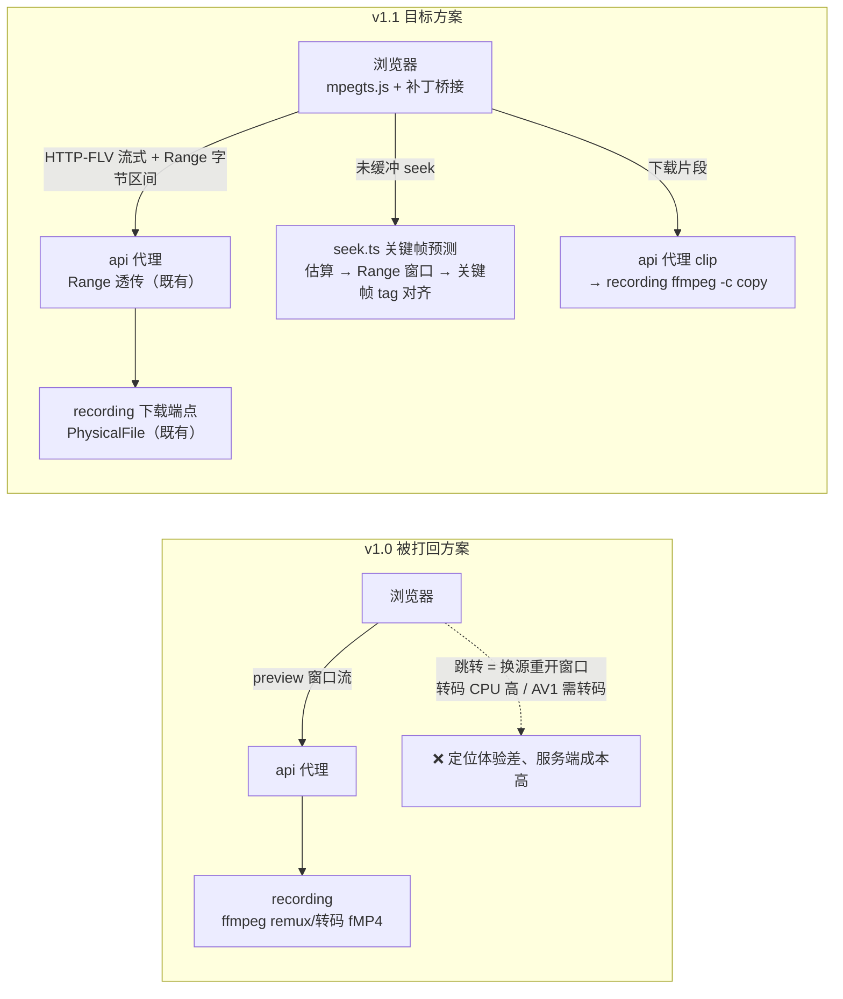
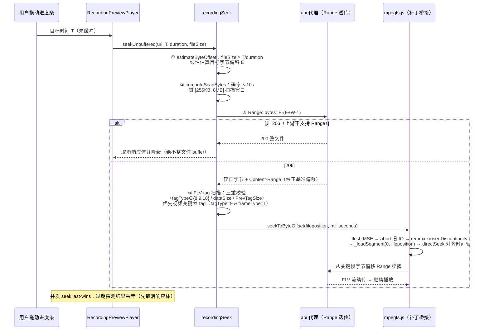
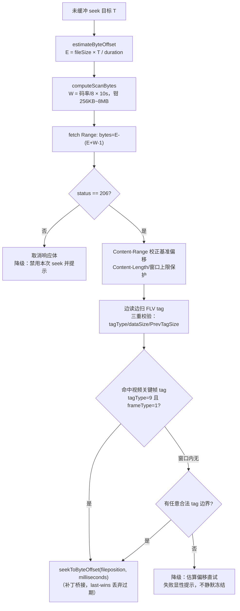

# 后台录播预览与切片下载 - 技术提案

- 日期：2026-10-21（v1.1 返工修订：定位播放改为 mpegts.js + 关键帧预测方案）
- 状态：待评审
- feat-branch：`feat/recording-preview-clip`
- 关联文档：[PRD](../product/draft/20261021-recording-preview-clip-prd.md)
- 参考实现：[Deliay/sumire](https://github.com/Deliay/sumire/) —— 同一录播上游的成熟播放实现（`apps/bookstore/features/recordings/`、`patches/mpegts.js@1.8.2.patch`）

> v1.1 修订说明：原方案以「服务端 ffmpeg 转码/remux 出 fMP4 窗口流 + 前端换源续播」实现预览与跳转，被评审打回。现改为 **前端 mpegts.js 直读 FLV + 关键帧预测定位播放**（对齐 sumire 的 `player.ts`/`seek.ts`/mpegts.js 补丁方案）：预览零服务端计算、原始画质、进度条任意拖动定位；服务端仅保留切片下载端点。

## 1. 概述

### 1.1 背景

录播消费链路现状（自外向内）：

- **文件形态**：`servers/recording` 录制产出 FLV 封装双文件——RAW（`-map 0 -c copy -f flv`，原流 H.264+AAC，文件名 `[RAW]…`）与 AV1（`av1_nvenc` 二压 + 音频 copy，文件名 `[AV1]…`），`FfmpegProcessBuilder`/`RecordingFileName`。浏览器 `<video>` 无法直接播放 FLV；
- **下载能力**：`GET /api/{roomId}/recordings/{fileName}` → `PhysicalFile(..., enableRangeProcessing: true)`，且 **Range 透传已在 api 代理层打通**（20260914「recording-download-range」：206/416、`Accept-Ranges`/`Content-Range`/`Content-Length` 全透传）——即「按字节区间读录播文件」的能力已具备且被前端可达（`/api/b/live/{roomId}/recordings/{fileName}`）；
- **区间抽取能力（仅音频）**：`GET /api/{roomId}/recordings/{fileName}/audio?startMs&endMs`（`AudioClipExtractor`）等，视频侧无任何区间抽取能力；
- **后台入口**：`apps/web` 录制状态页 `RecordingStatusPage` 历史录播列表只有下载链接（`recordingDownloadUrl`），无预览、无截取。

**参考实现（打回意见指定）**：[Deliay/sumire](https://github.com/Deliay/sumire/) 的录播页消费的就是本服务同一上游（`/api/b/live/:roomId/recordings/:fileName`），其在线播放方案已稳定运行，要点如下（细节见 5.2）：

- **mpegts.js（MSE）直读 FLV**：`features/recordings/player.ts` 单例播放器，HTTP-FLV 流式加载，零服务端转码；
- **FLV 无关键帧索引导致未缓冲 seek 死锁**：上游 FLV `onMetaData` 含 `duration/width/height` 但**不含 `keyframes` 索引** → mpegts `MediaInfo.isSeekable() === false` → `TransmuxingController.seek()` 首行 return（静默 no-op）→ 50ms 未缓冲 seek 校正无限重试、整体冻结；
- **补丁桥接绕过 `isSeekable()` 门**：`patches/mpegts.js@1.8.2.patch` 在播放器实例上暴露 `seekToByteOffset(fileposition, milliseconds)`（从指定字节偏移续播）与 `setBufferLimits(limits)`，并内置 lazyLoad 暂停死锁兜底；
- **关键帧预测（近似 seek）**：`features/recordings/seek.ts`——码率线性估算字节偏移 → Range 窗口探测（206 校验）→ FLV tag 扫描三重校验、**优先对齐视频关键帧 tag**（`tagType=9` 且 `frameType=1`）→ `seekToByteOffset` 续播。

结论：本需求 =「**预览与定位播放采用 sumire 同构方案（mpegts.js + 补丁桥接 + 客户端关键帧预测）** + 切片下载端点（服务端 ffmpeg `-c copy`）+ 后台预览/选段交互」。服务端零转码、零新预览端点；Range 能力与文件解析防护全部复用既有设施。

### 1.2 目标

1. web 录制状态页预览弹窗：mpegts.js 直读录播 FLV 在线播放（画面+声音、原始画质、秒开）；
2. 进度条/时间输入定位到任意位置（含未加载位置）：关键帧预测 + 字节偏移续播，约 1 秒起播、不卡死；
3. 选定起止点下载片段：recording 服务 `clip` 端点（ffmpeg `-c copy`，产物 fMP4），api 代理镜像；
4. 既有下载/Range/音频试听/录制流程零回归；两份契约同步、测试补齐。

### 1.3 范围

- **内**：`apps/web`（`mpegts.js` 依赖 + 补丁桥接模块 + 播放器封装 + 关键帧预测模块 + 预览弹窗）；`servers/recording` 切片下载端点；`contracts/recording.openapi.yaml`、`contracts/bilibili-crawler.openapi.yaml`（仅 clip）；测试；
- **外**：服务端转码/remux（明确放弃，见 6.1-1）；FLV 关键帧索引注入（录制端改造，列为后续建议）；逐帧精确剪切；AV1 在线预览（见 6.1-7）；切片持久化/任务队列；转写页/训练页复用；弹幕回放等 sumire 其余能力。

## 2. 技术架构

### 2.1 现状与目标对比



### 2.2 技术栈与归属

| 项 | 归属 | 说明 |
|---|---|---|
| FLV 在线播放 | `apps/web` | `mpegts.js@^1.8.2`（MSE，新增 npm 依赖，仓库第二个新增依赖） |
| 字节偏移续播/缓冲上限 | `apps/web` | vendored 桥接模块（移植 sumire `mpegts.js@1.8.2.patch`：`seekToByteOffset`/`setBufferLimits` + lazyLoad guard） |
| 关键帧预测（近似 seek） | `apps/web` | `recordingSeek.ts` 纯函数（估算/扫描/编排，last-wins） |
| 切片下载 | `servers/recording` | `clip` 端点：ffmpeg `-c copy` 窗口切片 → fMP4 attachment |
| 流式代理 | `servers/api` | 仅新增 `clip` 代理；预览复用既有下载端点（Range 已透传） |
| 契约 | `contracts/` | 两份 OpenAPI，仅补 clip |
| 测试 | `apps/web` Vitest / `tests/Z.Vtuber.Tests` | 纯函数 + 组件 + clip 接口测试 |

### 2.3 关键设计：mpegts.js 直读 FLV + 关键帧预测定位

**播放**：`mpegts.createPlayer({ type: 'flv', isLive: false, url }, bufferConfig)` 直接加载下载 URL（`/api/b/live/{roomId}/recordings/{fileName}`），MSE 边收边播；`seekType: 'range'`（本服务与代理仅支持 Range 语义，禁用 `param` 模式）。

**定位（未缓冲 seek）**——四步关键帧预测（sumire `seek.ts` 同构）：



**为什么必须补丁桥接**（sumire 源码级结论）：上游 FLV `onMetaData` 不含 `keyframes` 索引 → `MediaInfo.isSeekable() === false` → `TransmuxingController.seek()` 首行 `if (this._mediaInfo == null || !this._mediaInfo.isSeekable()) return;` 静默 no-op → 未缓冲 seek 校正循环每 50ms 重试、画面永久冻结。且 FLV demuxer（`parseChunks`）**无 mid-stream resync**，续播起点必须是 FLV 文件头或 tag 边界——这决定了「估算偏移直连」必须先扫描对齐到**视频关键帧 tag**（若续播起点为音频 tag，mpegts `LoadingController` 会在视频关键帧到达前按 `buffered_end >= currentTime + lazyLoadMaxDuration` 暂停 IO，而恢复条件永假 → 冻死；故优先视频关键帧 + 补丁内 lazyLoad guard 兜底）。

## 3. API 设计

### 3.1 契约变更（先行）

**预览零新增端点**：mpegts.js 经既有下载端点（`GET /api/{roomId}/recordings/{fileName}` / `GET /api/b/live/{roomId}/recordings/{fileName}`）流式加载与 Range 续播，Range/206/`Content-Range` 语义已由 20260914 需求打通，本期契约仅补 **clip**：

**`contracts/recording.openapi.yaml`**：

```yaml
/api/{roomId}/recordings/{fileName}/clip:
  get:
    summary: 录播切片下载
    description: >
      按 [startMs, endMs] 截取片段（ffmpeg -c copy 保留原始编码，输出 fragmented MP4），
      流式返回独立可播放片段文件。startMs/endMs 必填；区间 ≤ Recording:VideoClipMaxDurationMs。
      起点吸附最近关键帧（不晚于所选起点），与预览定位落点一致。
    operationId: downloadRecordingClip
    parameters:
      - $ref: "#/components/parameters/RoomId"
      - name: fileName
        in: path
        required: true
        schema: { type: string }
      - name: startMs
        in: query
        required: true
        schema: { type: integer, format: int64 }
      - name: endMs
        in: query
        required: true
        schema: { type: integer, format: int64 }
    responses:
      "200":
        headers:
          Content-Disposition:
            schema: { type: string }
            description: 'attachment; filename="<原文件名>-<start>-<end>.mp4"'
        content:
          video/mp4:
            schema: { type: string, format: binary }
      "400": { description: 'startMs and endMs are required / startMs must be >= 0 / endMs must be greater than startMs / clip duration must be <= N ms / 录制中或文件名非法' }
      "404": { description: 文件不存在 }
      "500": { description: '{"error": "video clip failed"}' }
```

**`contracts/bilibili-crawler.openapi.yaml`** — `/api/b/live/{roomId}/recordings/{fileName}/clip` 同步（代理端点，错误码与响应头同口径）。

### 3.2 端点行为矩阵

| 场景 | recording | api（代理后） | 前端 |
|---|---|---|---|
| 预览加载/续播（无 Range / 带 Range） | 200 / 206 + `Accept-Ranges`/`Content-Range`（既有） | 透传（既有） | mpegts.js 流式播放、按需 Range |
| `probeSeekable`（`Range: bytes=0-0`） | 206 + `Accept-Ranges: bytes` | 透传 | 进度条拖动可用；否则置灰降级顺序播放 |
| 关键帧预测窗口（`Range: bytes=E-…`） | 206 窗口字节 | 透传 | tag 扫描对齐关键帧 |
| 上游忽略 Range | 200 整文件 | 200 | 取消响应体、放弃未缓冲 seek（绝不整文件 buffer） |
| clip 合法窗口 | 200 `video/mp4` + `Content-Disposition: attachment` | 200 透传三头 | `<a download>` 浏览器下载 |
| clip 参数非法 / 超上限 | 400 `{"error":"..."}` | 400 透传响应体 | 提示（沿用 `apiErrorMessage` 口径） |
| 文件名非法 / 录制中 | 400（复用 `ResolveRecordingFileAsync`） | 400 透传 | 提示 |
| 文件不存在 | 404 | 404 | 提示 |
| 抽取失败（ffmpeg 非零且零字节） | 500 `{"error":"video clip failed"}` | 500 透传 | 「片段生成失败，请重试」 |
| recording 不可达 | — | 502（现状口径） | 提示 |
| 客户端断开 | ct 触发 kill ffmpeg 并回收 | 同左 | player.destroy 单例清理 |

## 4. 数据模型

无持久化模型变更、无新增集合、无迁移。运行时输入均已有来源：`fileSize` = `listRecordings` 返回的 `files[].size`；`duration` = 播放后 mpegts `onMetaData.duration`（`video.duration`），未知前禁止未缓冲 seek（进度条 max=0 天然门控）。

## 5. 技术实现方案

### 5.1 核心流程

见 2.3 时序图。关键帧预测扫描流程：



### 5.2 关键实现点

#### 实现点 1: mpegts.js 补丁桥接（`src/pages/recording/mpegtsByteOffsetSeek.ts`，vendored）

- 移植 sumire `patches/mpegts.js@1.8.2.patch` 的 `dist/mpegts-byte-offset-seek.js` 为仓库内 TS 模块（monkey-patch `mpegts.createPlayer`，返回实例附加）：
  - `seekToByteOffset(fileposition, milliseconds)`：flush MSE 旧缓冲 → `_internalAbort` → `remuxer.seek(ms) + insertDiscontinuity()` → `_loadSegment(0, fileposition)` → `_pendingResolveSeekPoint = ms` → `resumeTransmuxer()` 复位暂停态 → `_seeking_handler.directSeek(ms/1000)` 立即对齐时间轴；
  - **lazyLoad guard（防死锁，可重入）**：seek 期间置 `config.lazyLoad = false`，首个 `media_segment`/`recommend_seekpoint` 到达或 3s 超时恢复；连续 seek 仅续命、仅最外层捕获/恢复 previous；
  - **seek 对齐兜底**：DTS→PTS 偏移可能使 `currentTime` 落在新缓冲起点之前而永久 seeking，seek 后数秒周期性把 `currentTime` 夹到覆盖它的缓冲区间起点；
  - `setBufferLimits(limits)`：运行时调整 `lazyLoadMaxDuration`/`lazyLoadRecoverDuration`/`autoCleanupMaxBackwardDuration`/`autoCleanupMinBackwardDuration`；
- 内部结构不符（worker 模式/未打补丁构建）时**显性抛错/返回 false**，由 UI 提示「预览暂不可用」，绝不静默冻结；
- npm 无 `patchedDependencies`（sumire 为 pnpm），故采用 vendored 模块而非 pnpm patch；备选 `patch-package`（评审点 1）。

#### 实现点 2: 关键帧预测模块（`src/pages/recording/recordingSeek.ts`）

纯函数 + 编排（对齐 sumire `seek.ts`，全部可单测）：

- `estimateByteOffset(targetMs, durationMs, fileSize)`：线性估算，非法输入返回 0，钳 `[0, fileSize-1]`；
- `computeScanBytes(bitrateBps)`：`bitrate/8 × KEYFRAME_SCAN_SECONDS(10)`，钳 `[SEEK_WINDOW_BYTES=256KB, MAX_KEYFRAME_SCAN_BYTES=8MB]`；
- `findVideoKeyframeBoundary(window, baseOffset)` / `findNextTagBoundary(window, baseOffset)`：FLV tag 三重校验（`tagType ∈ {8,9,18}`、`0 < dataSize ≤ 8MB`、`PrevTagSize === 11 + dataSize`，不完整候选跳过、窗口增长后重扫），视频关键帧判定 `tagType=9` 且首字节 `frameType=1`；返回 `{ fileposition, milliseconds }`（毫秒取自 tag 时间戳）；
- `seekUnbuffered({ url, targetSeconds, durationSeconds, fileSize })`：按 5.1 流程编排；**非 206 一律取消响应体并放弃**（上游忽略 Range 时绝不整文件 buffer）；`Content-Range` 校正基准偏移；边读边扫、命中关键帧即取消剩余下载；**seek 代次 last-wins**（过期探测结果丢弃并 cancel body，避免过期落点覆盖最新意图）；
- 降级链：视频关键帧 tag → 任意合法 tag 边界（补丁 guard 兜底）→ 估算偏移直试 → 显性失败提示。

#### 实现点 3: 播放器封装（`src/pages/recording/recordingPlayer.ts`）

- 单例语义（任何时刻至多一路播放；`destroyPlayer(url?)` 按归属清理；代次防加载期被取代）；
- `isPlaybackSupported()`（`mpegts.isSupported()`，MSE 缺失降级提示）；
- `probeSeekable(url)`（`Range: bytes=0-0`，`206` 或 `accept-ranges: bytes`）门控进度条拖动；
- `computeBufferConfig(fileSize, durationSeconds)`（纯函数）：字节预算 `BUFFER_BUDGET_BYTES = 50MB`，前瞻 60% / 回退 40% 折算秒数（`秒数 × 码率 ≤ 预算`，钳 `[0.1s, 300s]`）；duration 未知按保守高码率 50Mbps 兜底，`onMetaData` 到手后 `setBufferLimits` 重算——避免 mpegts 默认 180s 前瞻把数 GB 录播缓冲进 MSE 配额（实测 ~160MB 上限）；
- `createPlayer` 配置：`{ type: 'flv', isLive: false, url }` + `seekType: 'range'`。

#### 实现点 4: 预览弹窗（`src/pages/recording/RecordingPreviewPlayer.tsx`）

- `Modal` + `<video>`（自定义控制条：播放/暂停、可拖动进度条、时间显示、音量、全屏）；
- **定位交互**：拖动/点击进度条或输入时间（复用 `parsePosition`/`formatPosition`）→ 目标在 `video.buffered` 内走原生 `currentTime`，否则走 `seekUnbuffered`；跳转落点为关键帧（UI 提示）；
- **AV1/能力门控**：文件名 `[AV1]` 前缀或 `!mpegts.isSupported()` 时预览入口 `aria-disabled` 置灰并提示「AV1 编码暂不支持在线预览」/「当前浏览器不支持在线预览」；`probeSeekable` 失败禁用拖动并提示「该文件暂不支持跳转」；
- **切片区间**：「设为起点」「设为终点」记录当前落点毫秒（即关键帧时间戳）；手输时间经 `parsePosition` 校验（非法或 `start >= end` 拦截提示）；「清空」重置；关键帧对齐提示文案；
- **下载片段**：`<a href={recordingClipUrl(roomId, fileName, startMs, endMs)} download>`（未选全 `aria-disabled` 置灰 + `preventDefault`，与训练页「下载数据集」同口径），浏览器接管流式下载；
- UI 规范沿用：antd v6、`App.useApp()` 的 `message`、三态、`aria-label`、禁止野生内联样式；测试用 `renderWithProviders`。

#### 实现点 5: 切片下载端点（`servers/recording` + `servers/api`）

- `RecordingController` 新增 `GET {roomId}/recordings/{fileName}/clip`（`long? startMs, long? endMs`）：校验顺序与音频片段一致（`startMs and endMs are required` → `startMs must be >= 0` → `endMs must be greater than startMs` → `clip duration must be <= {VideoClipMaxDurationMs} ms`）→ `ResolveRecordingFileAsync`（路径穿越防护/录制中 400/不存在 404 复用）；
- 抽取器 `Video/VideoClipExtractor`：`BuildArguments` 纯函数——`-ss <start> -t <end-start>`（输入 seek）`-i <file>` `-c copy` `-movflags frag_keyframe+empty_moov -f mp4 pipe:1`；沿用 `IRecordingProcessFactory`（stderr 泵、取消 kill 回收）；零字节且非零退出抛 `VideoClipFailedException` → 500 `{"error":"video clip failed"}`；
- **起点与预览一致**：前端传入预览定位落点的关键帧毫秒，`-c copy` 输入 seek 起点吸附关键帧（≤GOP 偏差），产物即预览所见；`endMs` 超文件长度自然输出到结尾；
- 响应 `video/mp4` + `Cache-Control: no-store` + `Content-Disposition: attachment; filename="{fileName}-{startMs}-{endMs}.mp4"`；
- `RecordingOptions` 新增 `VideoClipMaxDurationMs`（默认 `7_200_000` = 2 小时）；
- api `BilibiliLiveRecordingController` 新增 `ProxyRecordingClip`（照 `ProxyRecordingAudio`：`ResponseHeadersRead` + `CopyToAsync`、query 透传、`Content-Type`/`Content-Disposition`/`Cache-Control` 透传、400 透传响应体、404→404、不可达/超时→502；流式下载可达数十分钟，named client 超时按 `CrawlerService` 视频下载口径置 Infinite）。

### 5.3 不在本期的事项

- **FLV 关键帧索引注入**（录制端在 `onMetaData` 写 `keyframes` 索引）：可使 mpegts 原生 seekable、免预测扫描，但需改录制/存量迁移，列为后续建议；
- **服务端转码预览（AV1 回退）**、**逐帧精确剪切**、**切片持久化/缓存/续传**、**HLS 化**、**字节级 FLV 区间切片**（见 6.1-6）、**转写页/训练页复用**、**倍速/快捷键等播放增强**。

## 6. 技术决策

### 6.1 决策列表

1. **前端 mpegts.js 直读 FLV，放弃服务端 remux/转码窗口流**（v1.0 被打回点）：零服务端计算（原 AV1 源需 libx264 转码、CPU 不可控）、原始画质、秒开、任意拖动定位；与 sumire 同构——同一上游的成熟实现，风险已在真实环境验证；
2. **必须绕过 mpegts `isSeekable()` 门（补丁桥接）**：上游 FLV 无 `keyframes` 索引，原生 seek 静默 no-op + 50ms 校正死循环；`seekToByteOffset` 复用 mpegts 跨段加载机制从字节偏移续播，内置 lazyLoad guard/seek 对齐兜底（sumire 实测结论，逐条移植）；
3. **关键帧预测放客户端（估算 → Range 窗口 → FLV tag 三重校验 → 视频关键帧 tag）**：服务端无关键帧索引、Range 能力已打通、`fileSize`/`duration` 运行时可得；参考实现已验证（GOP≈8s，扫描窗口按码率 10s 覆盖）。续播起点必须 tag 边界（demuxer 无 mid-stream resync），优先视频关键帧 tag 防 lazyLoad 暂停死锁；
4. **续播/探测一律要求 206，非 206 放弃**：上游忽略 Range（或代理未透传）时绝不整文件 buffer，宁可降级提示也不冻死标签页；
5. **缓冲按字节预算（50MB：前瞻 60%/回退 40%）而非秒数**：数小时高码率录播下 mpegts 默认 180s 前瞻会击穿 MSE 配额（~160MB）；按 `size/duration` 估算码率折算秒数，duration 到手后重算；
6. **切片下载保留服务端 ffmpeg `-c copy` 出 fMP4**：产物通用可播（MP4 封装、原始编码）、RAW/AV1 源均可用、起点与预览关键帧落点一致；备选「FLV 字节区间拼接」（FLV header + tag 区间，零转码秒出）产物为 FLV、兼容性弱，列为评审点 3；
7. **AV1 录播不支持在线预览**（mpegts.js FLV 仅 H.264/AAC）：入口置灰 + 明确文案，切片/完整下载仍可用；服务端转码回退列评审点 2；
8. **补丁以 vendored TS 模块实现而非 npm patch**：npm 无 pnpm 的 `patchedDependencies`，`patch-package` 需 postinstall 钩子；vendored 桥接可直接单测 guard/降级逻辑，且对 `mpegts.js` 升级不敏感（内部字段访问集中一处、结构不符显性失败）；
9. **preview 不设时长上限、clip 设 `VideoClipMaxDurationMs`**：预览流量由用户观看时长与字节预算自然约束；clip 全速产出需上限防长时间占用。

### 6.2 依赖与约束

| 类型 | 内容 | 说明 |
|------|------|------|
| 依赖 | `mpegts.js@^1.8.2`（npm） | 仓库第二个新增 npm 依赖（wavesurfer.js 之后），评审点 4 |
| 依赖 | 既有 Range 下载链路 | 预览与关键帧预测的前提（20260914 已打通） |
| 依赖 | 既有 `ResolveRecordingFileAsync`/`IRecordingProcessFactory`/音频片段端点模式 | clip 端点复用，零新增防护逻辑 |
| 约束 | 契约先行 | 先提交两份 OpenAPI 的 clip 变更，再改实现 |
| 约束 | 服务端零转码、零新预览端点 | 预览全部成本在客户端 |
| 约束 | 不改录制流程、存储结构与既有端点 | 下载/Range/音频试听/合并行为不回归 |

## 7. 项目结构

```
contracts/（变更：仅 clip）
├── recording.openapi.yaml                 # 新增 clip 路径
└── bilibili-crawler.openapi.yaml          # /api/b/live 代理镜像 clip

apps/web/（主要变更）
├── package.json                           # 新增 mpegts.js@^1.8.2
├── src/pages/recording/
│   ├── mpegtsByteOffsetSeek.ts            # vendored 桥接（移植 sumire mpegts.js 补丁）：seekToByteOffset/setBufferLimits/lazyLoad guard/seek 对齐
│   ├── mpegtsByteOffsetSeek.test.ts       # guard 可重入/超时恢复/结构不符显性失败
│   ├── recordingPlayer.ts                 # 单例播放器封装：isSupported/probeSeekable/computeBufferConfig/destroy 归属
│   ├── recordingPlayer.test.ts            # 字节预算折算纯函数 + 单例/代次语义
│   ├── recordingSeek.ts                   # 关键帧预测：estimateByteOffset/computeScanBytes/tag 扫描/seekUnbuffered（last-wins）
│   ├── recordingSeek.test.ts              # 估算/扫描三重校验/非 206 降级/过期丢弃
│   ├── RecordingPreviewPlayer.tsx         # 预览弹窗：播放 + 定位 + 区间选择 + 下载片段
│   ├── RecordingPreviewPlayer.test.tsx    # 交互与降级行为
│   └── RecordingStatusPage.tsx            # 历史录播行「预览」入口（AV1/MSE 门控置灰）
└── src/api/client.ts                      # recordingClipUrl（下载片段 URL 构造器）

servers/recording/（变更）
├── Video/VideoClipExtractor.cs            # IVideoClipExtractor + BuildArguments 纯函数 + VideoClipFailedException
├── Controllers/RecordingController.cs     # 新增 clip 动作（复用 ResolveRecordingFileAsync）
└── Configuration/RecordingOptions.cs      # 新增 VideoClipMaxDurationMs

servers/api/（变更）
└── Controllers/BilibiliLiveRecordingController.cs  # ProxyRecordingClip

tests/Z.Vtuber.Tests/（变更）
├── VideoClipExtractorTests.cs             # 参数纯函数（-ss/-t/-c copy/fmp4 管道）
└── RecordingVideoClipTests.cs             # 真 ffmpeg 接口测试（lavfi 合成源，无 ffmpeg 跳过）
```

## 8. 测试策略

### 8.1 测试覆盖要求

核心逻辑覆盖率 ≥ 80%（common-rules）；TDD：先写失败测试再实现；单用例 ≤ 5s（`TimeoutExceptions.json` 护栏）。

### 8.2 测试类型

- **前端纯函数单测（Vitest）**：
  - `recordingSeek`：`estimateByteOffset`（线性/钳制/非法输入）、`computeScanBytes`（钳 `[256KB, 8MB]`）、`findVideoKeyframeBoundary`/`findNextTagBoundary`（合成 FLV tag 窗口：三重校验失败跳过、不完整窗口跳过后重扫、`frameType=1` 判定、毫秒时间戳解析）；
  - `recordingPlayer`：`computeBufferConfig`（字节预算折算、duration 未知保守码率、钳制）；
  - `mpegtsByteOffsetSeek`：lazyLoad guard（可重入续命、事件/3s 超时恢复、仅最外层恢复 previous）、内部结构不符显性抛错；
- **前端组件单测（`renderWithProviders` + mock player/seek）**：
  - 预览弹窗：设起点/终点、非法输入拦截、未选全区间下载置灰、clip URL 拼接、AV1/MSE 不支持置灰提示、`probeSeekable` 失败禁用拖动；
  - 定位：已缓冲走原生 `currentTime`、未缓冲走 `seekUnbuffered`、非 206 降级提示、并发 seek last-wins（过期结果丢弃）；
  - `RecordingStatusPage`：预览入口与门控；
- **服务端（`tests/Z.Vtuber.Tests`）**：
  - `VideoClipExtractorTests`：`BuildArguments` 纯函数断言（`-ss`/`-t` 前置、`-c copy`、`frag_keyframe+empty_moov`/`-f mp4`/`pipe:1`）；
  - `RecordingVideoClipTests`（真 ffmpeg，lavfi 合成带时间基准源，无环境跳过——`RecordingAudioClipTests` 模式）：200 + `Content-Disposition`、产物可解析 fMP4、时长 ≈ `end-start`（关键帧吸附断言）、参数矩阵 400、录制中 400、不存在 404、非法文件名 400、ffmpeg 失败 500（`FakeRecordingProcessFactory` 注入）；
  - `BilibiliLiveRecordingControllerTests`：clip 代理 query/响应头透传、400 透传响应体、404/502 映射；
  - 回归：既有下载 Range、音频试听/合并端点行为不变；
- **手工/验收**：真实数小时录播验证拖动定位流畅度、内存稳定（字节预算）、片段与预览一致性。

## 9. 部署方案

- 随常规版本发布：api 与 recording 同版本滚动更新，web 静态资源随前端流水线发布（含新增 `mpegts.js` 依赖，注意 bundle 体积与 license 告知——MIT/Apache-2.0 双许可）；
- **服务端资源零新增**：预览不产生服务端计算；clip 为 `-c copy`（I/O bound，无编码器依赖），recording 镜像无需变更（既有 mp3 构建断言保留，**不再需要 libx264 断言**——v1.0 转码方案的遗留需求一并移除）；
- **兼容性**：新 web + 旧 api → clip 入口 404（版本一致发布规避）、预览走既有下载端点不受影响；旧 web 不受影响；无数据迁移、无配置必填项（`VideoClipMaxDurationMs` 有默认值）；
- **回滚**：整体版本回退即可，无残留数据。

## 10. 验收标准

- [ ] 历史录播「预览」约 1 秒内起播（画面+声音、原始画质），无需下载完整文件、无服务端转码；
- [ ] 拖动进度条/输入时间定位到任意位置（含未加载位置）约 1 秒内继续播放，落点为最近关键帧，全程不卡死；内存占用不随观看时长无上限增长；
- [ ] 上游不支持 Range/MSE 缺失/AV1 源时按 PRD 边界降级提示，不冻结、不影响下载；
- [ ] 「设为起点/设为终点」与手动输入选定区间，非法输入拦截；未选全区间不可下载；
- [ ] 「下载片段」得到所选区间的独立可播放片段（含画面与声音、原始编码、MP4 封装），`Content-Disposition` 文件名正确，与预览所见一致（关键帧落点）；
- [ ] clip 参数非法 400（含超上限）、录制中 400、不存在 404、抽取失败 500、代理不可达 502 与契约一致；
- [ ] 既有完整下载/Range/音频试听/合并端点与录制流程零回归；
- [ ] 两份 OpenAPI 契约同步更新；前后端测试通过，核心逻辑覆盖率 ≥ 80%。

## 11. 评审要点

1. 补丁形态：vendored TS 桥接（推荐）vs `patch-package`（6.1-8）；
2. AV1 录播是否需要服务端转码回退预览（6.1-7）；
3. 切片是否需要「FLV 字节区间」零转码模式（产物 FLV）（6.1-6）；
4. `mpegts.js` 作为仓库第二个新增 npm 依赖的接受度（6.2）；
5. `VideoClipMaxDurationMs` 默认 2 小时是否合适（6.1-9）。

## 12. 相关文档

- PRD：`docs/product/draft/20261021-recording-preview-clip-prd.md`
- 参考实现 [Deliay/sumire](https://github.com/Deliay/sumire/)：
  - `apps/bookstore/features/recordings/player.ts`（mpegts.js 单例、字节预算缓冲、`probeSeekable`）
  - `apps/bookstore/features/recordings/seek.ts`（关键帧预测：估算 → Range 窗口 → FLV tag 扫描 → 字节偏移续播）
  - `patches/mpegts.js@1.8.2.patch`（`seekToByteOffset`/`setBufferLimits` 补丁与 lazyLoad 死锁兜底）
  - `docs/engineering/proposals/2026-09-15-recordings-seek-fullscreen-proposal.md`（未缓冲 seek 卡死根因分析）
  - `docs/engineering/proposals/2026-09-18-recordings-play-optimization-proposal.md`（播放优化与缓冲预算）
- 录播功能技术提案：`docs/engineering/proposals/20260913-proposal-live-recording.md`
- Range 分段下载提案：`docs/engineering/proposals/20260914-proposal-recording-download-range.md`
