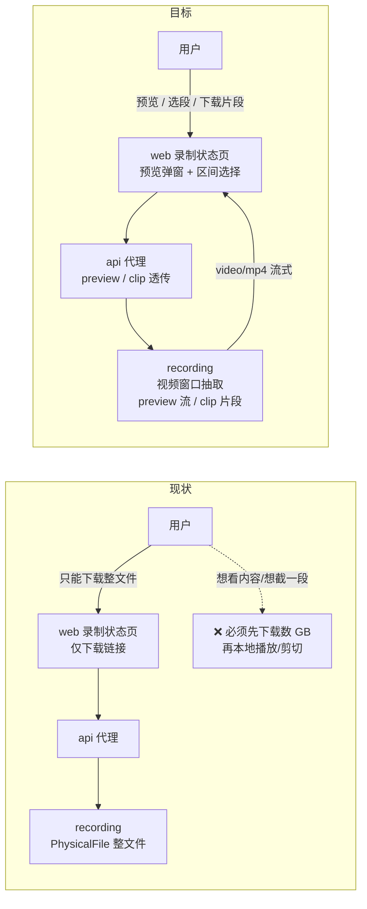
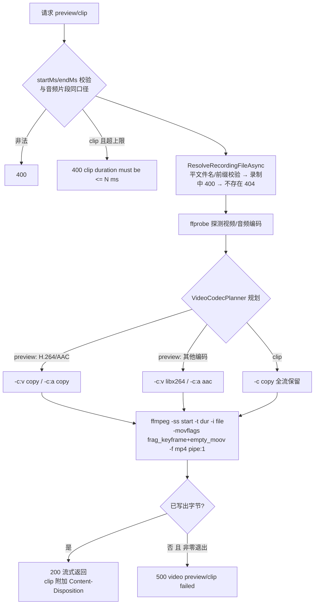

# 后台录播预览与切片下载 - 技术提案

- 日期：2026-10-21
- 状态：待评审
- feat-branch：`feat/recording-preview-clip`
- 关联文档：[PRD](../product/draft/20261021-recording-preview-clip-prd.md)

## 1. 概述

### 1.1 背景

录播消费链路现状（自外向内）：

- **文件形态**：`servers/recording` 录制产出 FLV 封装双文件——RAW（`-map 0 -c copy -f flv`，原流 H.264+AAC）与 AV1（`av1_nvenc` 二压 + 音频 copy），文件名模板 `[{encode}][{roomId}][{anchor}] {date}-{title}.flv`（`FfmpegProcessBuilder`/`RecordingFileName`）。**浏览器 `<video>` 无法直接播放 FLV**，无论 RAW 还是 AV1；
- **下载能力**：`GET /api/{roomId}/recordings/{fileName}` → `PhysicalFile(..., enableRangeProcessing: true)`（Range 分段下载已由「recording-download-range」打通 api 代理透传），只能整文件消费；
- **区间抽取能力（仅音频）**：`GET /api/{roomId}/recordings/{fileName}/audio?startMs&endMs`（`AudioClipExtractor`：`-ss`/`-t` 输入 seek + `-vn` + `pipe:1` 直写输出流，mp3/降级 wav），被转写页 `SegmentAudioPlayer` 与训练波形复用；另有 `POST /api/recordings/audio/merge` 多段合并。**视频侧无任何区间抽取能力**；
- **后台入口**：`apps/web` 录制状态页 `RecordingStatusPage` 历史录播列表只有「文件名下载」（`recordingDownloadUrl`），无预览、无截取；
- **代理层**：`servers/api` `BilibiliLiveRecordingController`（`DownloadRecording`/`ProxyRecordingAudio`）统一对外 `/api/b/live/**`，web 只认 `/api`。

结论：本需求是「**在既有 ffmpeg 区间抽取模式上补齐视频侧**（预览播放流 + 切片下载产物）+ 后台预览/选段交互」。服务端已有全部基础设施（文件解析防护、录制中判定、ffmpeg 进程封装、流式管道、api 流式代理），无新增服务、无存储结构变更。

### 1.2 目标

1. recording 服务提供录播**视频窗口**流式端点（在线预览）与**切片下载**端点（起止点 → 独立片段文件）；
2. api 服务镜像代理两端点，web 录制状态页提供「预览 → 选段 → 下载片段」闭环；
3. 既有下载/Range/音频试听/录制流程零回归；两份契约同步、测试补齐。

### 1.3 范围

- **内**：`contracts/recording.openapi.yaml`、`contracts/bilibili-crawler.openapi.yaml`；`servers/recording` 视频窗口抽取（预览/切片两端点 + 编码适配）；`servers/api` 两代理路由；`apps/web` 录制状态页预览弹窗（播放 + 选段 + 下载片段）；测试；
- **外**：录制流程与文件产出、存储/归档结构、既有下载与音频试听/合并端点、转写页与训练页复用（后续可复用本抽取器）、切片持久化与缓存（不落盘，见 6.1-5）、逐帧精确重编码剪切（见 6.1-4）、批量切片任务、多区间合并导出。

## 2. 技术架构

### 2.1 现状与目标对比



### 2.2 技术栈与归属

| 项 | 归属 | 说明 |
|---|---|---|
| 视频窗口抽取（ffmpeg） | `servers/recording` | 新增 `Video/`（抽取器 + 编码规划 + ffprobe 探测），沿用 `IRecordingProcessFactory` 进程封装 |
| 文件解析防护 / 录制中判定 | `servers/recording` | 复用 `RecordingController.ResolveRecordingFileAsync`（零改动） |
| 流式代理 | `servers/api` | `BilibiliLiveRecordingController` 新增两代理动作（照 `ProxyRecordingAudio` 模式） |
| 预览播放与选段交互 | `apps/web` | `RecordingPreviewPlayer`（Modal + `<video>` + 区间选择），复用 `formatPosition`/`parsePosition` |
| 契约 | `contracts/` | 两份 OpenAPI 先行 |
| 测试 | `tests/Z.Vtuber.Tests` | 纯函数单测 + 真 ffmpeg 接口测试（`RecordingAudioClipTests` 模式）+ api 代理测试 |

### 2.3 关键设计：一个抽取器，两种出口

预览与切片本质同一件事——「从录播文件取 `[startMs, endMs]` 视频窗口，流式写出」。差异只在**出口策略**：

| 维度 | 预览（preview） | 切片下载（clip） |
|---|---|---|
| 目的 | 一定播得出来（浏览器 `<video>`） | 原汁原味的片段（可归档/二次加工） |
| 视频编码 | H.264 → `-c copy`；其他（AV1 等）→ `libx264` 转码 | 恒 `-c copy`（保留原始编码，无损） |
| 音频编码 | AAC → `-c copy`；其他 → `aac` 转码 | 恒 `-c copy` |
| 封装 | fragmented MP4（`frag_keyframe+empty_moov`） | 同左 |
| 响应 | `video/mp4`，无 `Content-Disposition`（内联播放） | `video/mp4` + `Content-Disposition: attachment`（下载） |
| 时长上限 | 无（窗口流，客户端断开即回收） | `Recording:VideoClipMaxDurationMs`（默认 2 小时） |

两者共用同一 ffmpeg 参数纯函数与进程封装，仅编码规划与响应头不同。

```mermaid
sequenceDiagram
    participant U as 用户
    participant W as web 预览弹窗
    participant A as api 代理
    participant R as recording

    U->>W: 点击「预览」
    W->>A: GET .../preview?startMs=0
    A->>R: 代理（ResponseHeadersRead）
    R->>R: 文件名防护/录制中判定<br/>ffprobe 探测编码 → 规划 copy/转码
    R-->>W: 200 video/mp4（fMP4 流式）
    Note over W: &lt;video&gt; 边收边播<br/>拖动超出已缓冲 → 以新 startMs 重开请求
    U->>W: 播到起点点「设为起点」<br/>播到终点点「设为终点」
    U->>W: 点击「下载片段」
    W->>A: GET .../clip?startMs=120000&endMs=360000
    A->>R: 代理
    R->>R: 同上解析 + 时长上限校验<br/>ffmpeg -c copy 切窗口
    R-->>W: 200 video/mp4 + Content-Disposition: attachment
    W-->>U: 浏览器下载片段文件（生成即传输，不落盘）
```

## 3. API 设计

### 3.1 契约变更（先行）

**`contracts/recording.openapi.yaml`** 新增两条路径：

```yaml
/api/{roomId}/recordings/{fileName}/preview:
  get:
    summary: 录播窗口预览流
    description: >
      按 [startMs, endMs] 抽取视频窗口，输出 fragmented MP4 流式返回（inline 播放）。
      startMs 缺省 0；endMs 缺省到文件结尾。H.264/AAC 直接 copy，其他编码转码保证可播。
      忽略 Range 始终 200 整窗口；不缓存。
    operationId: previewRecording
    parameters:
      - $ref: "#/components/parameters/RoomId"
      - name: fileName
      - name: startMs
        in: query
        required: false
        schema: { type: integer, format: int64 }
      - name: endMs
        in: query
        required: false
        schema: { type: integer, format: int64 }
    responses:
      "200":
        content:
          video/mp4:
            schema: { type: string, format: binary }
      "400": { description: 'startMs/endMs 非法、文件名非法或录制中 {"error":"..."}' }
      "404": { description: 文件不存在 }
      "500": { description: '{"error": "video preview failed"}' }

/api/{roomId}/recordings/{fileName}/clip:
  get:
    summary: 录播切片下载
    description: >
      按 [startMs, endMs] 截取片段（-c copy 保留原始编码），流式返回独立可播放片段文件。
      startMs/endMs 必填；区间 ≤ Recording:VideoClipMaxDurationMs。起点吸附最近关键帧（不晚于所选起点）。
    operationId: downloadRecordingClip
    responses:
      "200":
        headers:
          Content-Disposition:
            schema: { type: string }
            description: 'attachment; filename="<原文件名>-<start>-<end>.mp4"'
        content:
          video/mp4:
            schema: { type: string, format: binary }
      "400": { description: '参数非法 / 区间超上限（clip duration must be <= N ms）/ 录制中' }
      "404": { description: 文件不存在 }
      "500": { description: '{"error": "video clip failed"}' }
```

**`contracts/bilibili-crawler.openapi.yaml`** — `/api/b/live/{roomId}/recordings/{fileName}/preview|clip` 同步上述语义（代理端点，错误码与响应头同口径）。

### 3.2 端点行为矩阵

| 场景 | recording | api（代理后） |
|---|---|---|
| preview 合法窗口 | 200 `video/mp4` fMP4 流 + `Cache-Control: no-store` | 200 透传 `Content-Type`/`Cache-Control`（不设 `Content-Disposition`，同音频试听口径） |
| preview 缺省参数 | `startMs` 默认 0、`endMs` 默认文件结尾 | 同左 |
| clip 合法窗口 | 200 `video/mp4` + `Content-Disposition: attachment` | 200 透传 `Content-Type`/`Content-Disposition`/`Cache-Control` |
| 参数非法（缺参/负数/endMs ≤ startMs） | 400 `{"error":"..."}` | 400 透传响应体（同音频试听口径） |
| clip 区间超上限 | 400 `{"error":"clip duration must be <= N ms"}` | 400 透传 |
| 文件名非法 / 录制中 | 400（复用 `ResolveRecordingFileAsync`） | 400 透传 |
| 文件不存在 | 404 | 404 |
| 抽取失败（ffmpeg 非零且零字节） | 500 `{"error":"video preview failed"/"video clip failed"}` | 500 透传 |
| recording 不可达 | — | 502（现状口径） |
| 请求带 `Range` | 忽略，始终 200 整窗口 | 不转发 Range（同音频试听口径） |
| 客户端断开 | ct 触发 kill ffmpeg 并回收 | 同左 |

## 4. 数据模型

无持久化模型变更、无新增 Mongo 集合、无迁移。片段按需生成、响应后即弃（不落盘、不缓存）。

## 5. 技术实现方案

### 5.1 核心流程（recording 抽取器）



### 5.2 关键实现点

#### 实现点 1: `Video/VideoWindowExtractor`（`servers/recording/Video/`）

- `IVideoWindowExtractor.ExtractAsync(fullPath, startMs, endMs, VideoExtractOptions, Stream output, CancellationToken ct)`；
- `BuildArguments(...)` 为**纯函数**（供单测断言参数顺序与降级形态，沿用 `AudioClipExtractor.BuildArguments` 口径）：
  - `-ss <start>`/`-t <end-start>` 前置（输入 seek，小时级文件秒开，与音频片段一致）；`-i <file>`；
  - 输出 `-movflags frag_keyframe+empty_moov -f mp4 pipe:1`——管道不可 seek，`faststart`（需二次写回）不可用；fMP4 首包即含 `moov`，可边生成边播放/边下载；
- 进程封装沿用 `IRecordingProcessFactory`（stderr 泵丢弃、取消/释放 kill 并回收）；`exitCode != 0` 且零字节抛 `VideoExtractFailedException`（与 `AudioClipFailedException` 同模式，控制器映射 500）；
- `endMs` 超文件长度由 ffmpeg 自然输出到结尾（与音频片段一致）。

#### 实现点 2: `Video/VideoCodecPlanner` + `Video/VideoCodecProbe`

- `VideoCodecProbe`：`ffprobe -v error -select_streams v:0 -show_entries stream=codec_name -of csv=p=0 <file>`（音频同理 `a:0`），复用 `RecordingOptions.FfprobePath`；探测失败按「未知编码」处理（preview 走转码保播放、clip 走 copy 保原样）；
- `VideoCodecPlanner.Plan(mode, videoCodec, audioCodec)` 纯函数 → 编码参数片段：
  - preview：`h264` → `-c:v copy`，否则 `-c:v libx264 -preset veryfast -crf 23`；`aac` → `-c:a copy`，否则 `-c:a aac -b:a 128k`；
  - clip：恒 `-c copy`（含 `-bsf:v dump_extra`? 不需要；AV1/H.264 直接 copy 进 fMP4）；
- **不以文件名 `[RAW]`/`[AV1]` 前缀推断编码**（存量回填文件命名不保证权威，见 6.1-6）。

#### 实现点 3: `RecordingController` 两动作

- `GET {roomId}/recordings/{fileName}/preview`（`long? startMs, long? endMs`）与 `GET {roomId}/recordings/{fileName}/clip`（`long? startMs, long? endMs`）；
- 校验顺序与音频片段完全一致（先参数后文件）：`startMs and endMs are required`（clip 必填、preview 仅在显式提供时校验）→ `startMs must be >= 0` → `endMs must be greater than startMs` → clip 增 `clip duration must be <= {VideoClipMaxDurationMs} ms`；
- `ResolveRecordingFileAsync` 复用（平文件名 → 前缀校验 → 录制中 400 → 不存在 404），路径穿越防护零新增；
- 响应：`Response.ContentType = "video/mp4"`、`Cache-Control: no-store`；clip 另设 `Content-Disposition`（`attachment; filename="{fileName}-{startMs}-{endMs}.mp4"`，文件名经 `ContentDispositionValue` 处理）；零字节失败清掉头信息后 500（照音频片段口径）。

#### 实现点 4: `RecordingOptions` 配置

- 新增 `VideoClipMaxDurationMs`（默认 `7_200_000` = 2 小时，`ValidateOnStart` 既有节）：仅约束 clip；preview 为窗口流不设上限，生命周期由请求取消令牌约束；
- 无新增密钥/外部依赖配置；`FfmpegPath`/`FfprobePath` 复用。

#### 实现点 5: api 代理两路由

- `BilibiliLiveRecordingController` 新增 `ProxyRecordingPreview`/`ProxyRecordingClip`，完全照 `ProxyRecordingAudio` 模式：显式 `HttpRequestMessage` + `HttpCompletionOption.ResponseHeadersRead` + `CopyToAsync` 流式转发、query 原样透传、不转发 `Range`、成功仅透传 `Content-Type`/`Cache-Control`（clip 多透传 `Content-Disposition`）、400 透传响应体、404→404、不可达/超时/其他非成功→502；
- 长耗时注意事项：clip 流式下载可持续数十分钟，named client `RecordingService` 超时需与 `CrawlerService`（视频下载）同口径置 `Timeout.InfiniteTimeSpan`（或 `ResponseHeadersRead` 后不受总超时约束，实现时按既有视频下载代理口径对齐）。

#### 实现点 6: web 预览弹窗与下载片段

- `api/client.ts` 新增 URL 构造器 `recordingPreviewUrl(roomId, fileName, startMs?, endMs?)`、`recordingClipUrl(roomId, fileName, startMs, endMs)`（`encodeURIComponent` + `URLSearchParams`，与 `recordingAudioClipUrl` 同风格）；
- 新增 `pages/recording/RecordingPreviewPlayer.tsx`：
  - `Modal` + `<video controls>`（`src` = `recordingPreviewUrl`）；
  - 区间选择：「设为起点」「设为终点」记录 `video.currentTime`（毫秒）；手动输入复用 `parsePosition`（`m:ss`/`m:ss.S` → ms）/`formatPosition` 展示；非法输入或起点 ≥ 终点提示且不接受；「清空」重置；
  - **窗口续播**：监听 `seeking`，若目标超出 `video.buffered` 末尾则以 `startMs=目标` 重开请求（换 `src` 并 `load()`/`play()`），实现任意拖动跳转；向后拖动在已缓冲范围内由浏览器原生完成；
  - 「下载片段」为 `<a href={recordingClipUrl(...)} download>`（未选全区间 `aria-disabled` 置灰 + `preventDefault`，与训练页「下载数据集」同口径），浏览器接管流式下载；
  - 关键帧提示文案：「起点将对齐到最近关键帧，实际片段可能比所选区间略早开始」；
- `RecordingStatusPage.tsx` 历史录播行（及录制状态展开行文件链接旁）新增「预览」按钮打开弹窗；录制中的文件不展示预览入口（历史列表本就排除录制中文件，状态行内文件链接处按同一判定禁用并提示）；
- UI 规范沿用：antd v6、`App.useApp()` 的 `message`/`modal.confirm`、三态、`aria-label`、禁止野生内联样式；测试用 `renderWithProviders`。

### 5.3 不在本期的事项

- **精确剪切（逐帧）**：需重编码（libx264）才能越过关键帧边界，CPU 成本与时长不可控；本期 `-c copy` 关键帧对齐（起点吸附最近关键帧，不晚于所选点），UI 明示。列为后续演进（见 6.1-4）；
- **片段落盘/缓存/续传**：流式产物无 `Range`（中断需重新下载）；若后续需要可改为临时文件 + `PhysicalFile(enableRangeProcessing: true)`（见 6.1-5）；
- **HLS / 预览多码率 / 进度条任意 seek 的毫秒级体验**：窗口续播已覆盖「跳转到任意时间点」，HLS 化收益低复杂度高；
- **转写页 / 训练页复用视频预览**：音频试听链路不变，视频预览本期只进录制状态页；
- **批量切片 / 切片任务队列 / 片段管理**：单次请求单片段，按需实时生成。

## 6. 技术决策

### 6.1 决策列表

1. **服务端 ffmpeg 抽取，而非前端 flv.js/MSE 直读 FLV**：FLV（尤其 AV1-in-FLV）浏览器兼容性差、flv.js 为新增前端依赖（现仅 wavesurfer.js 一个先例）且无法服务端截取；服务端方案复用 `AudioClipExtractor` 既有模式，编码适配集中在一处；
2. **预览输出 fMP4（`frag_keyframe+empty_moov`）而非整 MP4**：输出走 `pipe:1` 不可 seek，`faststart` 需二次写回不可行；fMP4 首包含 `moov` 即可边生成边播放，浏览器 `<video>` 原生可播；
3. **预览「兼容优先」、切片「原样优先」双策略**：预览必须在浏览器里播得出来（H.264 copy、其余转码）；切片是内容产物，`-c copy` 无损且零转码成本，AV1 源出 AV1 片段（PRD 已提示播放器要求）；
4. **切片默认关键帧对齐（`-c copy`），不做重编码精确剪切**：`-ss` 输入 seek + copy 的起点吸附最近关键帧（≤1~2 秒偏差），快、无损、CPU 近零；精确剪切需全量重编码，成本与片段时长线性相关，列为后续可选模式（评审点 1）；
5. **不落盘、按需实时生成、响应后即弃**：沿用「B 站视频下载」评审结论（`docs/engineering/proposals/20261008-proposal-bilibili-video-download.md`，评审后由落盘改实时透传）；片段为有界产物、重试成本低，无需任务队列与清理机制。代价是无断点续传（评审点 2）；
6. **编码判定用 ffprobe 而非文件名 `[RAW]`/`[AV1]` 推断**：`RecordingBackfillMigration` 回填的存量文件命名不保证含 encode 标记，ffprobe 权威且 `FfprobePath` 已在配置内；探测为纯解析函数可单测；
7. **任意拖动跳转由前端窗口续播实现，服务端保持无状态窗口语义**：seek 超出已缓冲区即以新 `startMs` 重开请求，服务端无需感知播放会话，横向扩展与回收都简单；
8. **preview 不设时长上限、clip 设 `VideoClipMaxDurationMs`**：preview 受客户端读取速率天然背压（管道写满即阻塞 ffmpeg），断开即 kill；clip 全速产出，需上限防长时间占用（评审点 3：默认 2 小时是否合适）。

### 6.2 依赖与约束

| 类型 | 内容 | 说明 |
|------|------|------|
| 依赖 | ffmpeg / ffprobe | recording 镜像已含（apt 安装）；转码路径需 `libx264`，构建期断言补齐（见 9） |
| 依赖 | 既有 `ResolveRecordingFileAsync`/`IRecordingProcessFactory`/音频片段端点模式 | 零改动复用 |
| 约束 | 契约先行 | 先提交两份 OpenAPI 变更，再改实现 |
| 约束 | 无新增 NuGet/npm 依赖 | flv.js/HLS.js 等明确不用 |
| 约束 | 不改录制流程、存储结构与既有端点 | 下载/Range/音频试听/合并行为不回归 |

## 7. 项目结构

```
contracts/（变更）
├── recording.openapi.yaml                 # 新增 preview / clip 两路径
└── bilibili-crawler.openapi.yaml          # /api/b/live 代理镜像同步

servers/recording/（变更）
├── Video/
│   ├── VideoWindowExtractor.cs            # IVideoWindowExtractor + 纯函数 BuildArguments + VideoExtractFailedException
│   ├── VideoCodecPlanner.cs               # copy/转码规划纯函数
│   └── VideoCodecProbe.cs                 # ffprobe 编码探测
├── Controllers/RecordingController.cs     # 新增 preview / clip 两动作（复用 ResolveRecordingFileAsync）
└── Configuration/RecordingOptions.cs      # 新增 VideoClipMaxDurationMs

servers/api/（变更）
└── Controllers/BilibiliLiveRecordingController.cs  # ProxyRecordingPreview / ProxyRecordingClip

apps/web/（变更）
├── src/api/client.ts                      # recordingPreviewUrl / recordingClipUrl
├── src/pages/recording/RecordingPreviewPlayer.tsx  # 预览弹窗：播放 + 窗口续播 + 区间选择 + 下载片段
├── src/pages/recording/RecordingStatusPage.tsx     # 历史录播行「预览」入口
└── src/pages/recording/RecordingPreviewPlayer.test.tsx

tests/Z.Vtuber.Tests/（变更）
├── VideoWindowExtractorTests.cs           # 参数纯函数：copy/转码/时长/降级
├── VideoCodecPlannerTests.cs              # 编码规划矩阵
├── RecordingVideoPreviewTests.cs          # 真 ffmpeg 接口测试（lavfi 合成源，无 ffmpeg 跳过）
├── RecordingVideoClipTests.cs             # 切片下载接口测试（时长/Content-Disposition/上限）
└── BilibiliLiveRecordingControllerTests.cs # 代理透传（200/400/404/502、Content-Disposition）
```

## 8. 测试策略

### 8.1 测试覆盖要求

核心逻辑覆盖率 ≥ 80%（common-rules）；TDD：先写失败测试再实现；单用例 ≤ 5s（`TimeoutExceptions.json` 护栏）。

### 8.2 测试类型

- **纯函数单测**：
  - `VideoWindowExtractor.BuildArguments`：`-ss`/`-t` 前置顺序、`frag_keyframe+empty_moov`/`-f mp4`/`pipe:1`、preview 转码分支、clip `-c copy` 分支；
  - `VideoCodecPlanner`：`h264+aac`/`h264+其他`/`av1+…`/未知编码 × preview|clip 全矩阵；
  - `VideoCodecProbe` 解析（stdout 形态 → codec 字符串，异常回退）；
- **接口测试（真 ffmpeg，`RecordingAudioClipTests` 模式：lavfi 合成带时间基准的视频源 → 端点请求 → 断言产物，无 ffmpeg/ffprobe 环境按既有模式跳过）**：
  - preview：200 `video/mp4`、响应头（`Cache-Control: no-store`、无 `Content-Disposition`）、产物为可解析 fMP4（首包 `ftyp`/`moov`）；
  - clip：200 + `Content-Disposition: attachment`，产物时长与区间一致（关键帧吸附断言：起点 ≤ 请求起点、时长 ≈ `end-start`），AV1 源（若环境有 `av1_nvenc` 则生成，否则用 H.264 源覆盖 copy 路径）；
  - 参数矩阵 400（缺参/负数/endMs ≤ startMs/超上限）、录制中 400、不存在 404、非法文件名 400、ffmpeg 失败 500（`FakeRecordingProcessFactory` 注入非零退出）；
  - 回归：既有下载 Range、音频试听/合并端点行为不变；
- **api 代理测试**（`BilibiliLiveRecordingControllerTests` 既有 fake HttpClient 设施）：query 透传、`Content-Type`/`Cache-Control`/`Content-Disposition` 透传、400 透传响应体、404/502 映射、不转发 `Range`；
- **前端 Vitest**：`RecordingPreviewPlayer`（设起点/终点、非法输入拦截与提示、未选全区间下载置灰、clip URL 拼接、seek 超窗重开窗口请求、清空重选）、`RecordingStatusPage`（历史录播「预览」入口、录制中不展示）；渲染用 `renderWithProviders`；
- **契约**：codegen 产物一致性由既有构建流程保证。

## 9. 部署方案

- 随常规版本发布：recording 与 api 同版本滚动更新；web 静态资源随前端流水线发布；
- **兼容性**：新 web + 旧 api → 新入口请求打到不存在的路由（404），入口灰度随版本一致发布即可；旧 web 不受影响；新 api + 旧 recording → 代理 502，同版本发布规避；无数据迁移、无配置必填项（`VideoClipMaxDurationMs` 有默认值）；
- **镜像**：recording Dockerfile 已 `apt-get install ffmpeg`；构建期断言扩展 `.github/workflows/build-recording-image.yml`（既有 `ffmpeg -encoders | grep -q mp3` 旁补 `grep -q libx264`），缺编码器即构建失败（与 mp3 断言同口径）；
- **资源**：AV1 源预览走 `libx264` 转码（CPU），由客户端读取速率背压、断开即回收；无 GPU 环境（`Recording__Av1__Enabled=false`）录播本就只有 RAW（H.264）源，预览全走 copy；
- **回滚**：整体版本回退即可，无残留数据。

## 10. 验收标准

- [ ] 后台历史录播「预览」可在弹窗内播放画面与声音，可跳转到任意时间点，无需下载完整文件；
- [ ] 「设为起点/设为终点」与手动输入时间可选定区间，非法输入被拦截并提示；未选全区间不可下载；
- [ ] 「下载片段」得到所选区间的独立可播放片段（含画面与声音、原始画质），`Content-Disposition` 文件名正确；起点关键帧对齐行为有界面提示；
- [ ] 参数非法 400（含 clip 超上限）、录制中 400、文件不存在 404、抽取失败 500、代理不可达 502 与契约一致；
- [ ] 既有完整下载/Range/音频试听/合并端点与录制流程零回归；
- [ ] 两份 OpenAPI 契约同步更新；单测/接口测试通过，核心逻辑覆盖率 ≥ 80%。

## 11. 评审要点

1. 切片精度：关键帧对齐（`-c copy`）是否满足使用预期，是否需要本期就提供「精确剪切（重编码）」模式（6.1-4）；
2. 片段不落盘 → 无断点续传，是否需要改为临时文件 + Range（6.1-5）；
3. `VideoClipMaxDurationMs` 默认 2 小时是否合适（6.1-8）；
4. AV1 源预览转码的 CPU 成本与并发预期是否可接受（9）。

## 12. 相关文档

- PRD：`docs/product/draft/20261021-recording-preview-clip-prd.md`
- 录播功能技术提案：`docs/engineering/proposals/20260913-proposal-live-recording.md`
- Range 分段下载提案：`docs/engineering/proposals/20260914-proposal-recording-download-range.md`
- B 站视频下载提案（不落盘实时透传先例）：`docs/engineering/proposals/20261008-proposal-bilibili-video-download.md`
