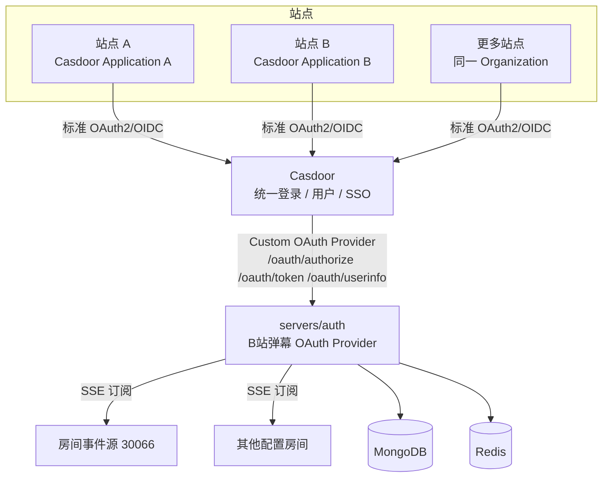
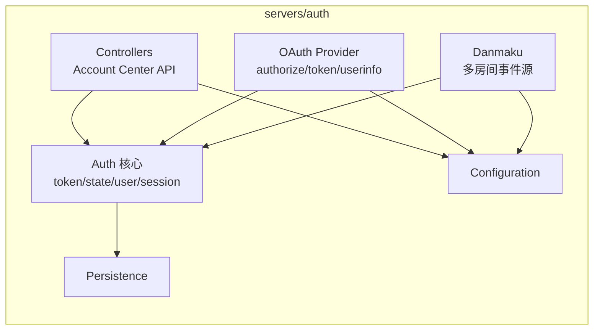
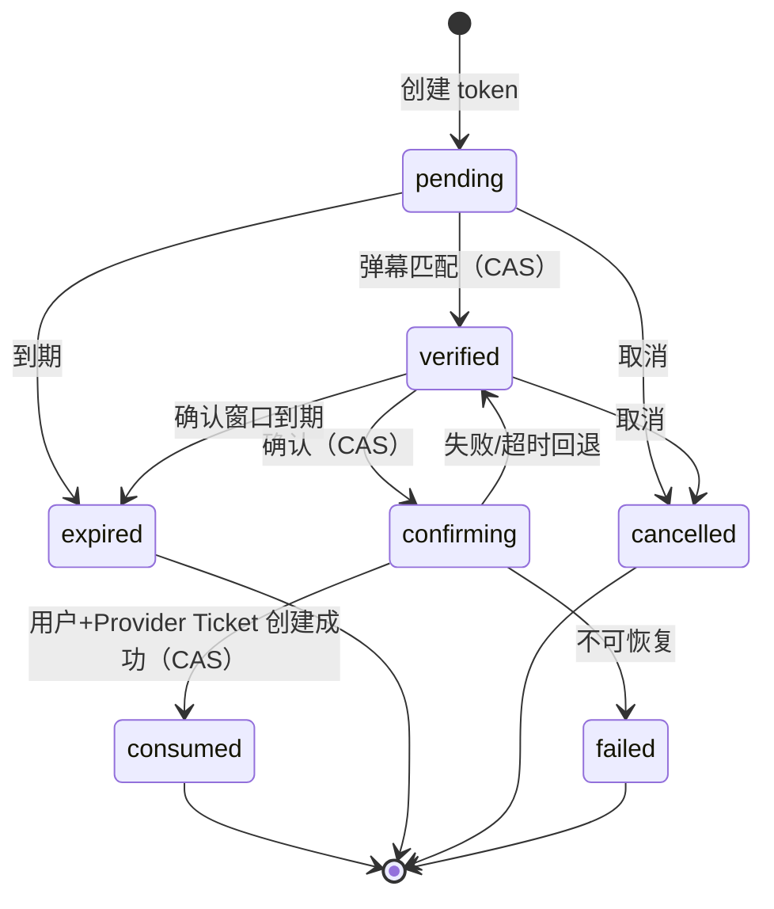
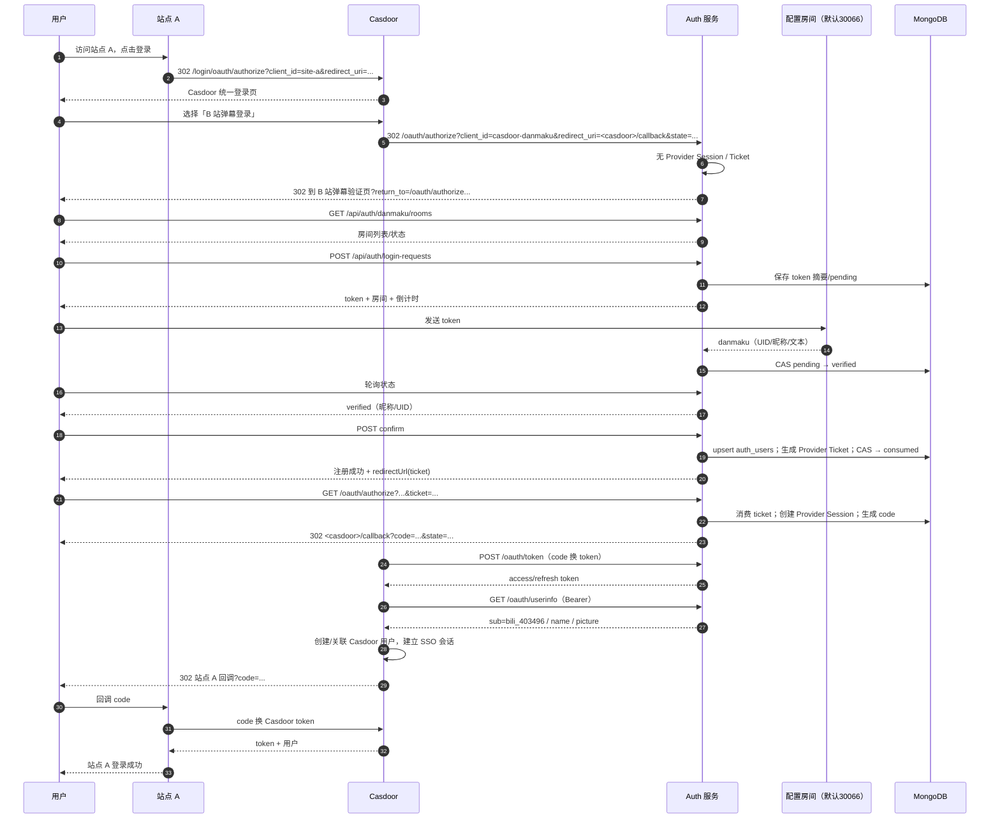
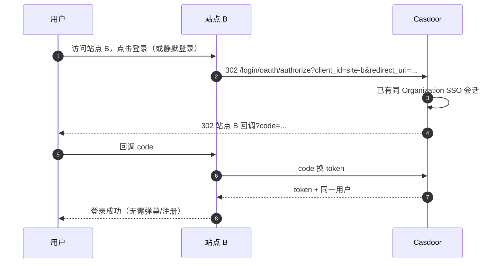
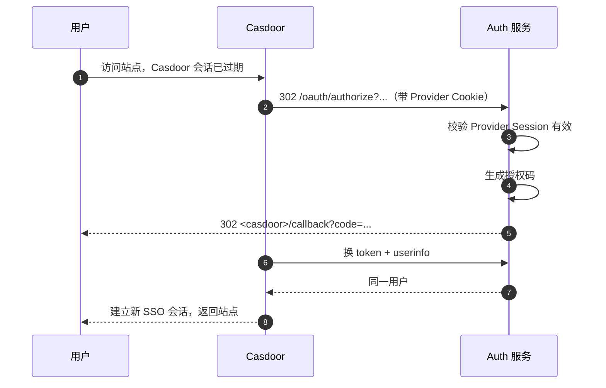
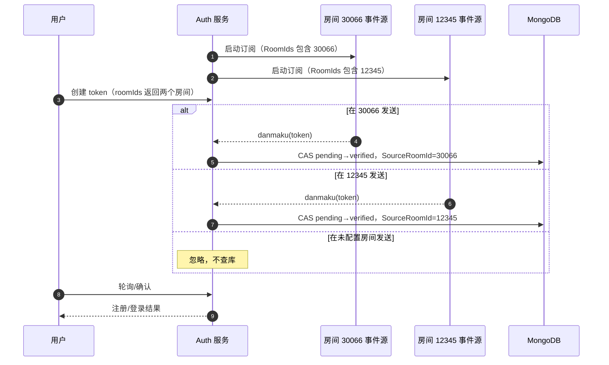
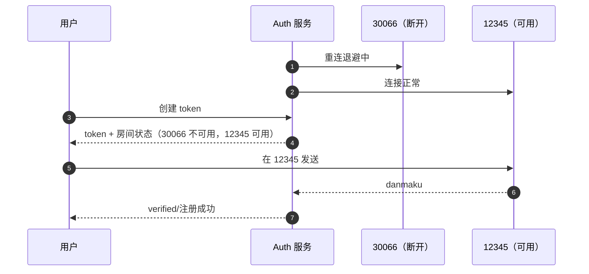

# B站弹幕帐号认证（多站点统一登录） - 技术提案

**功能名称**: B站弹幕帐号认证（多站点统一登录）
**关联 PRD**: `docs/product/draft/20261119-danmaku-account-auth-prd.md`（v2.1）
**技术提案版本**: v2.1（返工修订）
**创建日期**: 2026-11-19
**作者**: Z.Vtuber Workflow Agent
**feat-branch**: `feat/danmaku-account-auth`

> **v2.0 返工说明**
>
> v1.0 的两个问题：
>
> 1. **没有解决多站点共享登录**：v1.0 用 Casdoor Federated credentials 在服务端换 token，用户不进入 Casdoor 页面，也不建立 Casdoor 浏览器 SSO 会话；多个网站无法自然漫游同一账号。
> 2. **错误地修改了 crawler**：v1.0 给 crawler 增加 `DefaultDanmakuRoomIds` 常驻 30066，违反评审意见。
>
> v2.0 改为：
>
> - **不修改 crawler、不增加 crawler 默认常驻房间**。auth 服务新增 `Auth:Danmaku:RoomIds`（JSON `Array<string>`，默认 `["30066"]`），为每个配置房间建立独立事件源订阅，可从多个房间拿到登录 token。
> - **Casdoor 作为统一 IdP/SSO 中心**；把「B 站弹幕」实现为 Casdoor 的 **Custom OAuth Provider**。首次注册成功后页面跳转 Casdoor，由 Casdoor 创建/关联统一用户并建立浏览器 SSO 会话；同一 Casdoor 组织下的多个站点共用该用户，后续访问直接 SSO，不再发弹幕/注册。
> - **需要一个小页面，但不是 Casdoor 登录页**：由 **auth 服务内嵌托管**「B 站弹幕验证/注册页」（账号中心），或后续拆独立登录服务；`apps/web` 是后台管理前端、只有内部 endpoint，不作为互联网登录页，本需求对 `apps/web` 零改动；Casdoor 统一登录页仍由 Casdoor 提供；各站点只接 Casdoor 标准登录（跳转/回调/静默登录）。
>
> **v2.1 返工说明**：按 PR inline comment，登录/验证页不再放 `apps/web`，改为 **auth 服务内嵌**（`/connect/bilibili`、`/account` + `wwwroot` 静态资源），同源托管，Provider Session/Ticket 与 API 调用都不跨域；如果后续要做独立品牌/独立发布，可把同一套页面拆成独立 login 服务，接口不变。`apps/web` 零改动。

## 1. 概述

### 1.1 背景

需求方有多个网站，希望：

- 共享一套用户与登录；
- 只注册一次（例如直播间发送 token 后页面显示注册成功）；
- 注册成功后跳转 Casdoor 做统一登录；
- 之后所有网站都能漫游这个账号。

因此，本需求的本质是「**B 站弹幕作为注册/绑定方式 + Casdoor 作为统一 SSO 中心 + 多站点共享同一组织/用户**」，而不是单站点弹幕登录。

仓库现状核实（读码确认）：

- **无认证基础设施**：`servers/api/Program.cs` 只有 `app.UseAuthorization()` 占位，未注册 Authentication/Authorization；全仓库没有 JWT/OAuth/Casdoor 实现。
- **弹幕 SSE 已具备**：`servers/api/Controllers/BilibiliLiveController.cs` 的 `GET /api/b/live/{roomId}/event/subscribe` 提供 `text/event-stream`；连接建立即发 `event: heartbeat`，之后每 10 秒一次；`type=danmaku` 只推送弹幕；连接建立前的事件不补发。契约见 `contracts/bilibili-crawler.openapi.yaml` 的 `subscribeLiveEvents`。
- **发送者字段映射已存在**：`servers/common/live/Live/LiveEventTextExtractor.cs` 按 `payload.info[1]`（文本）、`payload.info[2][0]`（UID）、`payload.info[2][1]`（昵称）、`payload.info[3][1]`（粉丝牌）提取；头像从 `payload.info[0][15].user.base.face`（回退 `...user.base.origin_info.face`）可选提取。
- **历史事件可回补**：`GET /api/b/live/{roomId}/event/range?type=danmaku&startedAt=...` 可按时间范围分页查询已落库事件（`items[].occurredAt/payload`），用于 SSE 重连后的短窗口补投。
- **crawler 的订阅来源**：`servers/crawler/Live/LiveEventSource.cs` 的 `ReconcileAsync` 只从 `SubscriptionType.Danmaku` 的 mid 解析 roomId。**本方案不修改它**；auth 只负责按配置的房间列表消费事件源，事件源是否包含某个房间由部署/上游事件服务保证（见 2.5 与 11 风险）。
- **Casdoor 能力**：Casdoor 是 IAM/SSO 平台，支持 OAuth2/OIDC、托管登录页、组织/应用、自定义 OAuth Provider、同一组织下多应用 SSO。官方文档明确「同一组织的用户可以打开该组织所有应用而无需再次登录」；自定义 OAuth Provider 支持标准授权码流程、Token URL、UserInfo URL 与用户字段映射。

### 1.2 目标

1. 新增 `servers/auth`，按 `Auth:Danmaku:RoomIds`（`string[]`，默认 `["30066"]`）为每个房间建立独立事件源订阅；
2. 提供 10 位一次性 token 的创建、状态查询、确认、取消与账号中心 API；
3. 首次弹幕验证创建/复用 B 站账号；页面显示注册成功；
4. 把「B 站弹幕」实现为 Casdoor Custom OAuth Provider：`/oauth/authorize`、`/oauth/token`、`/oauth/userinfo`；
5. 首次注册成功后跳转 Casdoor，由 Casdoor 建立统一用户与浏览器 SSO 会话；
6. 多个站点作为同一 Casdoor 组织下的不同 Application，共享用户与 SSO；后续站点不再发弹幕/注册；
7. 不修改 crawler；不增加 crawler 默认常驻房间；
8. 安全、可观测、可部署、可测试，并提供多站点接入清单。

### 1.3 范围

- **做**：
  - `servers/auth` 服务骨架、Mongo/Redis、配置、健康检查；
  - 多房间事件源订阅（每个 `RoomId` 独立 SSE、重连、补投、去重、选主、健康）；
  - token 生成/摘要/校验、登录请求状态机、B 站账号绑定；
  - Casdoor Custom OAuth Provider（授权码 + PKCE + token + userinfo + refresh）；
  - 验证/注册页（账号中心）与注册成功后的 Casdoor 跳转；
  - 多站点接入文档与 Casdoor 配置核对清单；
  - `contracts/auth.openapi.yaml` 契约（用于 API 文档与外部接入方；**不做 `apps/web` codegen**）；
  - AppHost、Dockerfile、CI、测试。
- **不做**：
  - 修改 crawler 的订阅模型、增加 crawler 默认常驻房间；
  - 修改 Casdoor 源码或做 Casdoor 自定义登录页插件；
  - 密码/邮箱/手机号注册登录、找回密码；
  - B 站 OAuth/扫码登录；
  - 多平台（抖音/微博等）弹幕认证；
  - 账号合并/迁移/自助注销；
  - 完整管理后台与可视化报表；
  - 弹幕内容审核、抽奖、互动玩法。

## 2. 技术架构

### 2.1 系统架构图



### 2.2 为什么选择 Casdoor Custom OAuth Provider

| 方案 | 能否多站点 SSO | 用户是否跳 Casdoor | 说明 | 结论 |
|--|--|--|--|--|
| Casdoor Federated credentials + JWT Bearer | **否**（只换 token，不建立浏览器 SSO 会话） | 否 | 适合无头/API，不适合多网站漫游 | 不采用 |
| Casdoor 自定义登录页/插件 | 是 | 是 | 需改 Casdoor 前端/插件，升级耦合；弹幕事件源难放置 | 不采用 |
| Casdoor 管理 API 预创建用户 | 是 | 是 | 管理 API 不是登录/SSO 链路，易半登录 | 不采用 |
| **Casdoor Custom OAuth Provider** | **是** | **是（首次/会话失效时）** | 标准授权码流程；Casdoor 统一建用户/会话；同组织多应用 SSO | **采用** |
| 本服务本地 JWT | 否 | 否 | 只适合单站点/测试 | 降级模式 |

关键原因：

- 用户要求「注册成功后跳转 Casdoor 做统一登录，之后所有网站漫游」——这要求 Casdoor 建立**浏览器 SSO 会话**，而不只是给某个站点发 token。
- Casdoor 的 Custom OAuth Provider 正是「Casdoor 作为 OAuth 客户端、本服务作为 B 站弹幕 OAuth Provider」：Casdoor 登录页展示「B 站弹幕登录」，用户完成后 Casdoor 创建/关联用户并建立自己的会话。
- 同一 Casdoor Organization 下的多个 Application 共享用户；用户登录一个应用后，打开其他应用无需再次登录（Casdoor 官方 SSO 语义）。

### 2.3 技术栈

| 层级 | 技术选型 | 说明 |
|--|--|--|
| 语言/框架 | C# / .NET 10，ASP.NET Core Web API | 与 api/cookie 等服务一致 |
| 数据库 | MongoDB（`Aspire.MongoDB.Driver` + `MongoDB.Driver`） | 登录请求、用户、Provider 会话、授权码、Token、审计 |
| 缓存/协调 | Redis（`Aspire.StackExchange.Redis`，`ConnectionStrings:messaging`） | 频率限制、多实例房间消费者选主 |
| 房间事件源 | 既有 SSE（`HttpClient` + `ResponseHeadersRead` + `StreamReader`） | 每个 RoomId 独立连接 |
| 身份协议 | OAuth 2.0 授权码 + PKCE + Bearer Token + UserInfo | Casdoor Custom OAuth Provider 要求 |
| 加密 | `RandomNumberGenerator`、`HMACSHA256`、`AES-GCM`（可选） | token/授权码/token 摘要 |
| 契约 | OpenAPI `contracts/auth.openapi.yaml` | 账号中心 API 与 OAuth Provider 端点；供文档/外部接入，不生成 `apps/web` 类型 |
| 测试 | xUnit + Testcontainers MongoDB/Redis + 假房间事件源 + 假 Casdoor 调用 | 覆盖多房间/授权码/SSO 前置链路 |
| 编排 | .NET Aspire（`infra/apphost/AppHost.cs`） | 新增 auth 项目 |

### 2.4 模块划分



| 模块 | 职责 | 关键技术点 |
|--|--|--|
| `Controllers/` | 账号中心 API、健康检查、房间状态 | 参数校验、错误码、限流、CORS |
| `OAuth/` | Casdoor Custom OAuth Provider | 授权码、PKCE、Token、UserInfo、Refresh、Provider Session |
| `Auth/` | token 生成/摘要、登录请求状态机、用户绑定、Provider Ticket | 原子 CAS、HMAC、一次性票据 |
| `Danmaku/` | 多房间 SSE、帧解析、补投、去重、选主、健康 | `RoomIds` 字符串数组、每房间独立连接 |
| `Persistence/` | 集合实体/仓储、索引/TTL | 唯一索引、TTL、原子更新 |
| `Pages/` + `wwwroot/` | auth 服务内嵌的弹幕验证/注册页、账号中心 | 同源托管；静态 HTML/JS/CSS 或 Razor Pages；无 Node 构建依赖 |
| `Configuration/` | `AuthOptions`、`DanmakuOptions`、`OAuthProviderOptions`、`CasdoorOptions` | `ValidateOnStart`、密钥长度、RoomIds 非空 |

### 2.5 多房间事件源与 crawler 边界

评审明确：**不增加 crawler 默认常驻弹幕房间，不修改 crawler**。因此：

- auth 服务配置 `Auth:Danmaku:RoomIds`（JSON `Array<string>`，默认 `["30066"]`）；
- auth 为每个 RoomId 建立独立事件源（默认既有 SSE：`/api/b/live/{roomId}/event/subscribe?type=danmaku`）；
- auth 只负责「消费」；某个房间是否真的有事件，由部署/上游事件源保证。上线前必须确认事件源对 `RoomIds` 中每个房间都有数据；
- 每个房间独立健康状态：`connected / lastHeartbeatAt / lastEventAt`；
- 某房间无数据只影响该房间；全部房间无数据时，token 创建返回 `503 AUTH_DANMAKU_SOURCE_UNAVAILABLE`，不发放「注定收不到」的 token；
- 若某个部署的事件源不支持某房间，应调整 `RoomIds` 或上游事件源配置，而不是改 auth 代码。

> 这与「服务器启动时默认订阅 30066」并不矛盾：auth 启动即按 `RoomIds` 默认 `["30066"]` 建立订阅；只是不把这个常驻房间塞进 crawler。

## 3. API 设计

### 3.1 契约与分组

新增 `contracts/auth.openapi.yaml`（OpenAPI 3.1.0），分两组：

1. **账号中心 API**：`/api/auth/**`，供验证/注册页与账号中心使用；
2. **OAuth Provider API**：`/oauth/**`，供 Casdoor 作为 Custom OAuth Provider 调用；
3. **健康/房间状态**：`/health`、`/health/ready`、`/api/auth/danmaku/rooms`。

所有响应 camelCase；错误统一：

```json
{
  "error": {
    "code": "AUTH_LOGIN_REQUEST_EXPIRED",
    "message": "登录请求已过期，请重新获取 token。"
  }
}
```

### 3.2 接口列表

| 方法 | 路径 | 鉴权 | 说明 |
|--|--|--|--|
| GET | `/connect/bilibili` | 匿名（浏览器页面） | auth 服务内嵌的弹幕验证/注册页；支持 `return_to` |
| GET | `/account` | Provider Session | auth 服务内嵌的账号中心页 |
| GET | `/api/auth/danmaku/rooms` | 匿名 | 查询配置房间及连接状态 |
| POST | `/api/auth/login-requests` | 匿名 + 限流 | 创建一次性弹幕 token |
| GET | `/api/auth/login-requests/{requestId}` | `X-Poll-Token` | 查询状态 |
| POST | `/api/auth/login-requests/{requestId}/confirm` | `X-Poll-Token` | 确认是本人，创建/复用用户，返回 Casdoor 跳转 |
| POST | `/api/auth/login-requests/{requestId}/cancel` | `X-Poll-Token` | 取消，token 作废 |
| GET | `/api/auth/me` | Provider Session / Bearer | 当前账号中心用户 |
| POST | `/api/auth/provider-sessions/logout` | Provider Session | 退出本服务验证会话 |
| GET | `/oauth/authorize` | Casdoor 浏览器跳转 | OAuth 授权端点 |
| POST | `/oauth/token` | Casdoor Client | 授权码/刷新令牌换 token |
| GET | `/oauth/userinfo` | Bearer | 返回 Casdoor 映射的用户信息 |
| POST | `/oauth/logout` | Casdoor Client | 可选：注销 Provider 会话/token |
| GET | `/health` | 匿名 | 存活 |
| GET | `/health/ready` | 匿名 | Mongo/Redis/至少一个房间就绪 |

> `Auth:Mode=standalone` 时额外提供本地会话刷新/退出端点（见 3.3.5），`/oauth/*` 返回 404；`Auth:Mode=casdoor`（默认）时 `/oauth/*` 启用。

### 3.3 账号中心 API

#### 3.3.1 查询房间状态

`GET /api/auth/danmaku/rooms`

```json
{
  "rooms": [
    { "roomId": "30066", "connected": true, "lastHeartbeatAt": "2026-11-19T19:00:00Z", "lastEventAt": "2026-11-19T19:00:03Z" },
    { "roomId": "12345", "connected": false, "lastHeartbeatAt": null, "lastEventAt": null }
  ]
}
```

- `roomId` 为字符串；与配置 `RoomIds` 一致；
- 不返回事件内容、token、内部地址；
- 验证页据此展示「可发送房间」与状态；全部 `connected=false` 时禁用「获取 token」。

#### 3.3.2 创建登录请求

`POST /api/auth/login-requests`

```json
{
  "clientId": "account-center",
  "clientNonce": "optional-32-to-128-char-random-string",
  "returnTo": "/oauth/authorize?client_id=casdoor-client&redirect_uri=https%3A%2F%2Fcasdoor.example.com%2Fcallback&response_type=code&state=..."
}
```

- `returnTo` 可选；必须是本服务的相对路径（默认仅允许 `/oauth/authorize`），用于注册成功后跳回 Casdoor 授权流程；服务端校验，防开放重定向；
- `clientNonce` 可选；只存摘要，用于调用方设备绑定；
- 频率限制：按 IP + clientId（默认 10 次/分钟、100 次/天）。

响应 `201`：

```json
{
  "requestId": "0199a1b2-7c3d-7e4f-8a90-123456789abc",
  "token": "A1b2C3d4E5",
  "expiresAt": "2026-11-19T19:05:00Z",
  "pollToken": "p_7f3c...32bytes...",
  "pollAfterMs": 1500,
  "roomIds": ["30066"],
  "primaryRoomId": "30066",
  "confirmWindowSeconds": 120,
  "instruction": "请在配置的直播间发送上方 token；默认 30066"
}
```

- `token` 只返回一次；服务端只存 HMAC；
- 全部配置房间未就绪时返回 `503 AUTH_DANMAKU_SOURCE_UNAVAILABLE`；
- 部分房间未就绪仍可创建，`rooms` 状态由 3.3.1 查询。

#### 3.3.3 查询状态

`GET /api/auth/login-requests/{requestId}`，请求头 `X-Poll-Token: p_...`

```json
{ "status": "pending", "expiresAt": "...", "retryAfterMs": 1500 }
```

```json
{
  "status": "verified",
  "expiresAt": "...",
  "confirmExpiresAt": "...",
  "sourceRoomId": "30066",
  "user": {
    "platform": "bilibili",
    "uid": 403496,
    "name": "Zero_Ash",
    "avatarUrl": "https://..."
  }
}
```

```json
{ "status": "confirming" }
```

```json
{ "status": "consumed" }
```

- `pending/verified/confirming/consumed` → 200；
- 记录不存在/已清理 → 404 `AUTH_LOGIN_REQUEST_NOT_FOUND`；
- 已过期但记录还在 → 200 `{ "status": "expired" }`；
- `X-Poll-Token` 错误 → 403 `AUTH_POLL_TOKEN_INVALID`，不泄露请求是否存在；
- 同一 token 来自任意配置房间都可匹配；`sourceRoomId` 记录实际来源。

#### 3.3.4 确认（注册成功 + 跳转 Casdoor）

`POST /api/auth/login-requests/{requestId}/confirm`，请求头 `X-Poll-Token: p_...`

`Auth:Mode=casdoor` 响应：

```json
{
  "mode": "casdoor",
  "user": {
    "platform": "bilibili",
    "uid": 403496,
    "name": "Zero_Ash",
    "avatarUrl": "https://..."
  },
  "redirectUrl": "/oauth/authorize?client_id=casdoor-client&redirect_uri=https%3A%2F%2Fcasdoor.example.com%2Fcallback&response_type=code&state=...&ticket=t_...",
  "providerTicketExpiresAt": "2026-11-19T19:01:00Z"
}
```

- 服务端创建/复用 `auth_users`，生成一次性 **Provider Ticket**（绑定用户 + 原授权请求参数），返回带 `ticket` 的 `redirectUrl`；
- 页面收到后显示「注册成功」，然后 `window.location = redirectUrl`；
- `/oauth/authorize` 校验 ticket、设置 Provider Session Cookie、签发授权码给 Casdoor；
- 这样账号中心页可以跨域部署（不需要在 auth 域设置 Cookie），ticket 一次性、短有效期（默认 60 秒）。

`Auth:Mode=standalone` 响应：

```json
{
  "mode": "standalone",
  "user": { "...": "..." },
  "tokens": {
    "tokenType": "Bearer",
    "accessToken": "...",
    "expiresIn": 900,
    "refreshToken": "...",
    "refreshExpiresIn": 2592000
  }
}
```

错误：`403 AUTH_POLL_TOKEN_INVALID`、`409 AUTH_LOGIN_REQUEST_NOT_VERIFIED`、`409 AUTH_CONFIRM_RACE`、`409 AUTH_LOGIN_REQUEST_ALREADY_CONSUMED`、`410 AUTH_LOGIN_REQUEST_EXPIRED`、`500 AUTH_INTERNAL`。

#### 3.3.5 取消 / 当前用户 / 退出（standalone）

- `POST /api/auth/login-requests/{requestId}/cancel`：`pending/verified/confirming` 可取消，204；`consumed` 409；
- `GET /api/auth/me`：`Auth:Mode=casdoor` 读取 Provider Session Cookie；`standalone` 校验 Bearer JWT；
- `POST /api/auth/provider-sessions/logout`：撤销当前 Provider Session；
- `Auth:Mode=standalone` 额外：
  - `POST /api/auth/sessions/refresh`：刷新令牌轮换；
  - `POST /api/auth/sessions/logout`：撤销本地会话。

### 3.4 OAuth Provider API（Casdoor 调用）

#### 3.4.1 `GET /oauth/authorize`

Casdoor 将浏览器重定向到：

```text
GET /oauth/authorize?client_id={casdoor-provider-client-id}
  &redirect_uri=https%3A%2F%2Fcasdoor.example.com%2Fcallback
  &response_type=code
  &state={casdoor-state}
  &scope=openid%20profile
  [&code_challenge=...&code_challenge_method=S256]
  [&ticket=t_...]
```

处理顺序：

1. 校验 `client_id` 等于配置的 Casdoor Provider Client ID；
2. 校验 `redirect_uri` 精确等于配置的 Casdoor 回调地址（不支持通配）；
3. 校验 `response_type=code`；
4. `ticket` 存在且有效 → 消费 ticket（一次性），设置 Provider Session Cookie，签发授权码，302 到 `redirect_uri?code=...&state=...`；
5. `ticket` 不存在/失效，但 Provider Session Cookie 有效 → 直接签发授权码（静默重登）；
6. 两者都没有 → 302 到账号中心验证页：`Auth:AccountCenterUrl?return_to=<当前 /oauth/authorize 完整相对 URL>`；
7. 用户取消 → `redirect_uri?error=access_denied&state=...`（只允许 302 到已校验的 redirect_uri）。

Provider Session Cookie：

- 名称 `auth_provider_session`；
- 值：32 字节随机 base64url；服务端只存 HMAC；
- `HttpOnly; Secure; SameSite=Lax; Path=/`；
- 有效期 30 天（可配置）；`/oauth/authorize` 可刷新滑动过期；
- 仅用于「B 站弹幕」Provider，不是站点业务会话。

#### 3.4.2 `POST /oauth/token`

Casdoor 使用 Client ID/Secret 调用（Basic 或 form）：

```text
POST /oauth/token
Authorization: Basic base64(client_id:client_secret)
Content-Type: application/x-www-form-urlencoded

grant_type=authorization_code
&code={code}
&redirect_uri=https%3A%2F%2Fcasdoor.example.com%2Fcallback
[&code_verifier=...]
```

响应：

```json
{
  "access_token": "at_...",
  "refresh_token": "rt_...",
  "token_type": "Bearer",
  "expires_in": 3600,
  "scope": "openid profile"
}
```

- 校验 client、code 摘要、未消费、未过期、redirect_uri 一致、PKCE S256；
- 原子消费 code；签发 access token（opaque 32 字节，1 小时）与 refresh token（opaque 32 字节，30 天）；只存摘要；
- `grant_type=refresh_token`：校验 refresh token 摘要、未撤销/未过期，轮换 refresh token，返回新 access/refresh；
- 错误统一 `400` + `{ "error": "invalid_grant", "error_description": "..." }`（不泄露内部细节）。

#### 3.4.3 `GET /oauth/userinfo`

```text
GET /oauth/userinfo
Authorization: Bearer at_...
```

响应：

```json
{
  "sub": "bili_403496",
  "preferred_username": "bili_403496",
  "name": "Zero_Ash",
  "picture": "https://i2.hdslb.com/bfs/face/....jpg",
  "bilibili_uid": "403496",
  "bilibili_room_id": "30066"
}
```

- `sub` 稳定且唯一：`bili_{uid}`；
- `preferred_username` 与 `sub` 一致，便于 Casdoor 用户名映射；
- `name`/`picture` 为最近一次验证的 B 站昵称/头像；
- 不返回 token、手机号、邮箱等无关信息。

#### 3.4.4 `POST /oauth/logout`（可选）

Casdoor 注销时可能 POST `token`、`client_id`、`client_secret`；校验后撤销对应 access/refresh token 与 Provider Session。即使 Casdoor 不调用，也不影响 SSO 主流程。

### 3.5 错误码

| HTTP | code | 含义 |
|--|--|--|
| 400 | `AUTH_INVALID_REQUEST` | 参数非法/returnTo 非法/client 非法 |
| 403 | `AUTH_POLL_TOKEN_INVALID` | 轮询凭证错误 |
| 403 | `AUTH_USER_DISABLED` | 账号被禁用 |
| 404 | `AUTH_LOGIN_REQUEST_NOT_FOUND` | 请求不存在/已清理 |
| 409 | `AUTH_LOGIN_REQUEST_NOT_VERIFIED` | 尚未识别到弹幕 |
| 409 | `AUTH_LOGIN_REQUEST_ALREADY_CONSUMED` | 已确认/已使用 |
| 409 | `AUTH_CONFIRM_RACE` | 并发确认失败 |
| 410 | `AUTH_LOGIN_REQUEST_EXPIRED` | 已过期 |
| 429 | `AUTH_TOKEN_RATE_LIMITED` | 获取 token 超限 |
| 429 | `AUTH_DANMAKU_RATE_LIMITED` | 同账号发送 token 超限 |
| 503 | `AUTH_DANMAKU_SOURCE_UNAVAILABLE` | 全部配置房间未就绪 |
| 503 | `AUTH_CASDOOR_NOT_CONFIGURED` | Casdoor 模式但配置缺失（启动应已失败） |
| 500 | `AUTH_INTERNAL` | 未预期错误 |

OAuth 端点错误使用标准 `error/error_description`，与账号中心错误体分开。

## 4. 数据模型

### 4.1 集合

#### `auth_login_requests`

| 字段 | 类型 | 说明 |
|--|--|--|
| `_id` | ObjectId | 主键 |
| `RequestId` | string | UUIDv7，唯一索引 |
| `TokenHash` | string | HMAC-SHA256(pepper, token)，唯一索引 |
| `PollTokenHash` | string | 轮询凭证摘要 |
| `ClientNonceHash` | string? | 设备绑定摘要 |
| `ClientId` | string? | 调用方 |
| `ReturnTo` | string? | 仅允许本服务 `/oauth/authorize` 相对 URL |
| `Platform` | string | `bilibili` |
| `Status` | string | `pending/verified/confirming/consumed/expired/cancelled/failed` |
| `ExpiresAt` | DateTime(UTC) | token 过期（默认 +5 分钟） |
| `ConfirmExpiresAt` | DateTime(UTC)? | 识别后确认截止（默认 +120 秒） |
| `CreatedAt` / `VerifiedAt` / `ConfirmStartedAt` / `ConsumedAt` | DateTime(UTC)? | 时间线 |
| `SourceRoomId` | string? | 实际匹配的房间（字符串） |
| `SenderUid` | long? | B 站 UID |
| `SenderName` | string? | 昵称 |
| `SenderAvatar` | string? | 头像 |
| `SenderMedal` | string? | 粉丝牌（可选） |
| `FailureCode` | string? | 失败码 |
| `ClientIp` / `UserAgent` | string? | 审计 |
| `Version` | int | 并发诊断 |

索引：`RequestId` unique；`TokenHash` unique；`{Status, ExpiresAt}`；`ExpiresAt` TTL（+1 小时）；`{SenderUid, CreatedAt}`。

#### `auth_users`

| 字段 | 类型 | 说明 |
|--|--|--|
| `_id` | ObjectId | 主键 |
| `Platform` | string | `bilibili` |
| `PlatformUid` | long | B 站 UID |
| `DisplayName` | string | 最近昵称 |
| `AvatarUrl` | string? | 最近头像 |
| `Status` | string | `active/disabled` |
| `ProviderSubject` | string | `bili_{uid}`，用于 OAuth `sub` |
| `CreatedAt` / `LastLoginAt` | DateTime(UTC) | 首次/最近 |
| `LastLoginIp` | string? | 最近来源 |
| `LoginCount` | long | 登录次数 |

索引：`{Platform, PlatformUid}` unique；`ProviderSubject` unique；`{Status, LastLoginAt}`。

#### `auth_provider_sessions`

| 字段 | 类型 | 说明 |
|--|--|--|
| `_id` | ObjectId | 主键 |
| `SessionIdHash` | string | Cookie 值摘要，唯一索引 |
| `UserId` | ObjectId | `auth_users._id` |
| `CreatedAt` / `LastSeenAt` / `ExpiresAt` | DateTime(UTC) | 生命周期 |
| `RevokedAt` | DateTime(UTC)? | 撤销 |
| `ClientIp` / `UserAgent` | string? | 审计 |

索引：`SessionIdHash` unique；`{UserId, CreatedAt}`；`ExpiresAt` TTL；`{RevokedAt, ExpiresAt}`。

#### `auth_provider_tickets`

| 字段 | 类型 | 说明 |
|--|--|--|
| `_id` | ObjectId | 主键 |
| `TicketHash` | string | 一次性 ticket 摘要，唯一索引 |
| `UserId` | ObjectId | 用户 |
| `ClientId` | string | Casdoor Provider Client ID |
| `RedirectUri` | string | Casdoor 回调 |
| `State` | string | Casdoor state |
| `Scope` | string | scope |
| `CodeChallenge` / `CodeChallengeMethod` | string? | PKCE |
| `ExpiresAt` | DateTime(UTC) | 默认 +60 秒 |
| `ConsumedAt` | DateTime(UTC)? | 一次性 |
| `CreatedAt` | DateTime(UTC) | |

索引：`TicketHash` unique；`ExpiresAt` TTL。

#### `auth_oauth_codes`

| 字段 | 类型 | 说明 |
|--|--|--|
| `_id` | ObjectId | 主键 |
| `CodeHash` | string | 授权码摘要，唯一索引 |
| `ClientId` / `RedirectUri` | string | 校验 |
| `UserId` | ObjectId | 用户 |
| `ProviderSessionId` | ObjectId? | 关联 Provider Session |
| `Scope` | string | |
| `CodeChallenge` / `CodeChallengeMethod` | string? | PKCE |
| `ExpiresAt` | DateTime(UTC) | 默认 +5 分钟 |
| `ConsumedAt` | DateTime(UTC)? | 一次性 |
| `CreatedAt` | DateTime(UTC) | |

索引：`CodeHash` unique；`ExpiresAt` TTL；`ConsumedAt`。

#### `auth_provider_tokens`

| 字段 | 类型 | 说明 |
|--|--|--|
| `_id` | ObjectId | 主键 |
| `AccessTokenHash` | string | access token 摘要，唯一索引 |
| `RefreshTokenHash` | string? | refresh token 摘要，唯一索引 |
| `UserId` | ObjectId | 用户 |
| `ClientId` | string | Casdoor Provider Client |
| `Scope` | string | |
| `ExpiresAt` | DateTime(UTC) | access 1 小时 |
| `RefreshExpiresAt` | DateTime(UTC)? | refresh 30 天 |
| `RevokedAt` | DateTime(UTC)? | 撤销 |
| `CreatedAt` | DateTime(UTC) | |

索引：`AccessTokenHash` unique；`RefreshTokenHash` unique；`{UserId, CreatedAt}`；`ExpiresAt` TTL；`RefreshExpiresAt` TTL。

#### `auth_sessions`（standalone 模式）

本地 JWT 模式的会话表，字段同 v1：`SessionId`、`FamilyId`、`UserId`、`AccessTokenJti`、`RefreshTokenHash`、`RefreshTokenExpiresAt`、`RevokedAt`、`ClientIp/UserAgent`。仅在 `Auth:Mode=standalone` 使用。

#### `auth_audit_logs`

`RequestId`、`SessionId`、`Event`、`Platform`、`PlatformUid`、`SourceRoomId`、`ClientIp`、`UserAgent`、`OccurredAt`、`Detail`（脱敏）。TTL 90 天。

### 4.2 缓存键

| Key | TTL | 用途 |
|--|--|--|
| `auth:rl:token:ip:{ip}:{minute}` | 2 min | 创建 token 按 IP |
| `auth:rl:token:client:{clientId}:{hour}` | 2 h | 创建 token 按 client |
| `auth:rl:danmaku:uid:{uid}:{minute}` | 2 min | 同 UID 发送尝试 |
| `auth:danmaku:leader:{roomId}` | 15 s | 每房间消费者选主 |
| `auth:oauth:rl:client:{clientId}:{minute}` | 2 min | OAuth token 端点限流 |

### 4.3 数据安全

- token/授权码/access/refresh/provider session/ticket 只存带 pepper 的 HMAC 摘要；不存明文；
- OAuth Provider Client Secret 从密钥配置读取，恒定时间比较；不落库、不写日志；
- 审计不含 token/授权码/access/refresh/Authorization；
- 日志只记录 requestId、UID、roomId、状态、耗时；不打印 SSE 完整 `data`；
- 密钥（pepper、JWT 签名密钥、Client Secret）通过环境变量/密钥管理注入。

## 5. 技术实现方案

### 5.1 口令生成与摘要

- 字符集：`ABCDEFGHJKLMNPQRSTUVWXYZabcdefghijkmnopqrstuvwxyz23456789`（56 字符，去掉 `0O1lI`，仍属于 `[A-Za-z0-9]`）；
- 长度固定 10；`RandomNumberGenerator.GetInt32` 逐位生成（拒绝采样，无模偏差）；
- 熵约 `log2(56^10) ≈ 58.1 bit`；配合 5 分钟 TTL、一次性、限流与 HMAC，足以抵抗在线枚举；
- 摘要：`HMACSHA256(pepper, UTF8(token))`；
- 唯一索引 + 冲突重试 5 次；
- 轮询凭证：32 字节 base64url，前缀 `p_`；只存摘要；
- 请求 ID：`Guid.CreateVersion7()`。

### 5.2 多房间事件源

#### 5.2.1 配置

```json
{
  "Auth": {
    "Danmaku": {
      "RoomIds": ["30066"],
      "BaseUrl": "http://vtuber.internal.fffdan.com",
      "SubscribePath": "/api/b/live/{roomId}/event/subscribe?type=danmaku",
      "RangePath": "/api/b/live/{roomId}/event/range",
      "BackfillWindowSeconds": 600,
      "NotReadyGraceSeconds": 30,
      "ReadTimeoutSeconds": 60,
      "MaxBackfillPages": 10
    }
  }
}
```

- `RoomIds` 类型为 `string[]`；默认 `["30066"]`；启动时校验非空、去重、只允许数字字符串；
- `roomId` 全程以字符串处理；SSE/range 返回的 `roomId` 可能是数字或字符串，解析为 invariant string 后再比较；
- 每个 RoomId 对应一个 `RoomEventSource` 实例；互不共享连接、退避与健康状态。

#### 5.2.2 每房间连接

- 专用 named `HttpClient`：`Timeout=InfiniteTimeSpan`，`Accept=text/event-stream`，`ResponseHeadersRead`；
- `StreamReader.ReadLineAsync` 逐行；空行分帧；`:` 注释忽略；`event:`/多行 `data:`；
- `heartbeat` 只更新 `LastHeartbeatAt`；`danmaku` 交给处理器；
- 读超时（默认 60 秒无帧）视为断线；
- 重连退避 1s/2s/4s/8s/16s/30s + 抖动；稳定 60 秒后重置；
- 每个房间独立 `CancellationTokenSource`；停止/重启只影响该房间。

#### 5.2.3 补投

- SSE 无 replay；每个房间独立「先连后补」：
  1. 建立 SSE，收到的 danmaku 先入缓冲；
  2. 从 `max(LastOccurredAt-2s, now-BackfillWindow)` 调 `RangePath` 分页查询；
  3. 按 `occurredAt` 顺序处理历史事件；
  4. 合并缓冲实时事件，按 `(roomId, occurredAt, uid, text)` 去重；
- 补投失败不阻塞实时流；记录 warning 并退避重试；
- 首次启动 `LastOccurredAt = now - BackfillWindow`；
- 补投窗口默认 10 分钟，覆盖 token 5 分钟有效期。

#### 5.2.4 多实例选主

- 每个房间独立租约：`SET auth:danmaku:leader:{roomId} <instanceToken> NX PX 15000`；
- leader 运行该房间 SSE + 补投；每 5 秒续期；
- follower 每 5 秒重试；leader 失联最多 15 秒被接管；
- 续期失败立即停止该房间 SSE；不影响其他房间；
- 任意实例都能处理 token/确认/OAuth 请求；正确性由 Mongo 原子 CAS 保证，选主只减少重复消费；
- Redis 不可用：`Auth:AllowDegradedRedis=true` 时所有实例都订阅（依赖 CAS 去重）；生产建议 false。

#### 5.2.5 健康与就绪

- `/api/auth/danmaku/rooms` 返回每房间 `connected/lastHeartbeatAt/lastEventAt`；
- `/health/ready`：Mongo + Redis + 至少一个房间 `connected`（且最近心跳在 `NotReadyGraceSeconds` 内）；
- 创建 token 时：若所有房间未就绪 → 503；部分就绪 → 允许，页面展示房间状态；
- 不就绪不伪装成「等待中」，避免用户向收不到的房间发 token。

#### 5.2.6 发送者解析

复用 `Z.Vtuber.Common.Live.LiveEventTextExtractor.Extract("danmaku", payloadJson)`：

| 字段 | 路径 | 用途 |
|--|--|--|
| 文本 | `payload.info[1]` | token 匹配（`Trim()` 后精确匹配） |
| UID | `payload.info[2][0]` | 账号唯一键 |
| 昵称 | `payload.info[2][1]` | 展示/更新 |
| 粉丝牌 | `payload.info[3][1]` | 可选审计 |
| 头像 | `payload.info[0][15].user.base.face`，回退 `...user.base.origin_info.face` | 可选展示 |

- 只处理 `event=danmaku` 且 `roomId` 在 `RoomIds` 中；
- 文本 `Trim()` 后 `^[A-Za-z0-9]{10}$` 预过滤；大小写敏感；
- 非 10 位直接忽略，不查库；
- UID > 0；昵称为空用 `UID:{uid}` 兜底；
- 解析失败只 debug，不阻塞。

### 5.3 登录请求状态机



弹幕匹配原子更新：

```csharp
var filter = Builders<AuthLoginRequestRecord>.Filter.And(
    Builders<AuthLoginRequestRecord>.Filter.Eq(x => x.RequestId, requestId),
    Builders<AuthLoginRequestRecord>.Filter.Eq(x => x.Status, LoginStatus.Pending),
    Builders<AuthLoginRequestRecord>.Filter.Gt(x => x.ExpiresAt, now));

var update = Builders<AuthLoginRequestRecord>.Update
    .Set(x => x.Status, LoginStatus.Verified)
    .Set(x => x.VerifiedAt, now)
    .Set(x => x.ConfirmExpiresAt, now.AddSeconds(options.ConfirmWindowSeconds))
    .Set(x => x.SourceRoomId, roomId)     // string
    .Set(x => x.SenderUid, sender.Uid)
    .Set(x => x.SenderName, sender.Name)
    .Set(x => x.SenderAvatar, sender.AvatarUrl)
    .Set(x => x.SenderMedal, sender.Medal)
    .Inc(x => x.Version, 1);

var result = await collection.FindOneAndUpdateAsync(filter, update,
    new FindOneAndUpdateOptions<AuthLoginRequestRecord> { ReturnDocument = ReturnDocument.After }, ct);
```

- 同一 token 多房间/多用户同时发送：只有一个 CAS 成功；
- 后续重复弹幕返回 null，忽略；
- 过期由服务端 UTC 判断；后台扫描器每 30 秒迁移超时状态；
- TTL 索引最终清理。

### 5.4 确认、用户绑定与 Provider Ticket

确认使用 `verified → confirming → consumed` 两段 CAS：

1. **CAS 到 confirming**：`RequestId + Status=Verified + ConfirmExpiresAt > now`；写 `ConfirmStartedAt`、`ConfirmNonce`；失败 409。
2. **创建/复用用户**：
   - `(Platform, PlatformUid)` 唯一索引 upsert；
   - 首次插入 `DisplayName/AvatarUrl/Status=active/ProviderSubject=bili_{uid}`；
   - 后续更新昵称/头像/LastLoginAt/LastLoginIp/LoginCount++；
   - 禁用用户 → 403，回退 confirming → verified（或 failed）。
3. **生成 Provider Ticket**（casdoor 模式）：
   - 绑定 `UserId + ClientId + RedirectUri + State + Scope + PKCE + ExpiresAt(60s)`；
   - 只存 TicketHash；返回明文 ticket 一次；
   - **解析并校验 `ReturnTo`**：必须是本服务 `/oauth/authorize` 的相对 URL；从中取出 `client_id/redirect_uri/state/scope/code_challenge/code_challenge_method` 并逐项校验，写入 ticket；
   - casdoor 模式下 `ReturnTo` 必填；缺失/非法 → 400 `AUTH_INVALID_REQUEST`（账号中心必须从 `/oauth/authorize` 拿到完整 `return_to`）；
   - `redirectUrl` = 原 `ReturnTo` + `ticket`（ticket 追加为独立 query 参数）。
4. **CAS 到 consumed**：`RequestId + Status=Confirming + ConfirmNonce`；写 `ConsumedAt`；失败 → 撤销 ticket，返回 500。
5. **响应**：`{ mode, user, redirectUrl, providerTicketExpiresAt }`；页面显示「B 站账号绑定成功」，随后跳转 Casdoor 完成统一登录。
6. **审计**：`login_confirmed`，不含 token/ticket。

> 「注册成功」在本方案中表示 **B 站账号已在平台侧完成绑定/复用**；Casdoor 统一用户的首次创建发生在 Casdoor 回调并调用 `/oauth/token` + `/oauth/userinfo` 之后。若 Casdoor 暂不可用，本地绑定结果保留，用户可重试统一登录，不重复发弹幕。

standalone 模式在第 3 步生成本地 JWT/refresh + `auth_sessions`，第 5 步返回 `tokens`，不生成 Provider Ticket。

### 5.5 OAuth Provider 实现

#### 5.5.1 Provider Session

- `/oauth/authorize` 校验 ticket 后创建 `auth_provider_sessions`，设置 Cookie；
- Cookie 值随机 32 字节 base64url；只存 HMAC；
- `HttpOnly; Secure; SameSite=Lax; Path=/; Max-Age=2592000`；
- 滑动续期：每次 `/oauth/authorize` 成功使用可延长 `ExpiresAt`；
- 退出：`POST /api/auth/provider-sessions/logout` 撤销；`/oauth/logout` 撤销 token/session。

#### 5.5.2 授权码

- 32 字节随机 base64url；只存摘要；
- 绑定 `UserId/ClientId/RedirectUri/Scope/PKCE`；
- 5 分钟有效；一次性；
- 只有 `/oauth/token` 成功校验后才标记 consumed；
- 失败的 code 不消费（避免误伤），但记录审计。

#### 5.5.3 Token 端点

- Client 认证：Basic `client_id:client_secret` 或 form；恒定时间比较；
- `authorization_code`：校验 code/redirect_uri/PKCE；消费 code；签发 access/refresh；
- `refresh_token`：校验 refresh 摘要/未撤销/未过期；轮换 refresh；签发新 access；
- 限流：按 client + IP；
- access token 1 小时；refresh 30 天；
- 错误 `invalid_client` / `invalid_grant` / `unsupported_grant_type`，不泄露内部细节。

#### 5.5.4 UserInfo

- Bearer access token → 摘要查询 → 校验过期/撤销；
- 返回 `sub/preferred_username/name/picture/bilibili_uid/bilibili_room_id`；
- `sub` = `bili_{uid}`，稳定唯一；
- `name`/`picture` 取最近一次验证的 B 站资料；
- Casdoor 的 User mapping 设：ID=`sub`，Username=`preferred_username`，DisplayName=`name`，Avatar=`picture`。

#### 5.5.5 Provider Ticket 校验

- `/oauth/authorize?ticket=...`：
  - 校验 ticket 摘要、未消费、未过期、client_id/redirect_uri/state 与 ticket 记录一致；
  - 原子消费 ticket；
  - 创建 Provider Session + Cookie；
  - 签发授权码，302 到 Casdoor callback；
- ticket 只允许一次；重放返回 `access_denied` 或 400，不签发 code；
- ticket 不写日志；60 秒过期；
- 带 ticket 的 302 响应设置 `Referrer-Policy: no-referrer`，避免 ticket 通过 Referer 泄露；ticket 一次性/短 TTL 作为第二道保险。

### 5.6 Casdoor 配置

#### 5.6.1 创建 Custom OAuth Provider

在 Casdoor 管理后台 **Identity > Providers** 新增：

| 字段 | 值 |
|--|--|
| Category | `OAuth` |
| Type | `Custom`（或 Custom2...Custom10） |
| Client ID | 由本服务配置（如 `casdoor-danmaku`） |
| Client secret | 由本服务配置（与 `OAuthProvider:ClientSecret` 一致） |
| Auth URL | `https://auth.example.com/oauth/authorize` |
| Token URL | `https://auth.example.com/oauth/token` |
| UserInfo URL | `https://auth.example.com/oauth/userinfo` |
| Logout URL | 可选 `https://auth.example.com/oauth/logout` |
| Scope | `openid profile` |
| Enable PKCE | 建议开启（本服务支持 S256） |
| User mapping | ID=`sub`，Username=`preferred_username`，DisplayName=`name`，Avatar=`picture` |
| Favicon | 可选，B 站/弹幕图标 |

Casdoor 的 Custom OAuth Provider 使用标准授权码流程；它会：
- 浏览器跳 `Auth URL`，带 `client_id/redirect_uri=<casdoor>/callback/state/response_type=code/scope`；
- 用 Client ID/Secret 调 `Token URL` 换 access token；
- 用 Bearer 调 `UserInfo URL` 读用户；
- 按 User mapping 创建/关联 Casdoor 用户。

#### 5.6.2 组织与多站点应用

- 创建一个 Casdoor **Organization**（如 `z-vtuber`），所有站点共用；
- 每个站点创建一个 **Application**（如 `site-a`、`site-b`），归属同一 Organization；
- 每个 Application：
  - 配置自己的 Redirect URLs（站点回调）；
  - 在 **Providers** 中加入上面的 `B 站弹幕` Provider，允许 Sign in / Sign up；
  - 其他登录方式（密码/验证码/第三方）按需配置；
  - 若需要自动 SSO：设置 **Home**、开启 **Signin session** 与 **Auto signin**，站点实现 `silentSignin=1` 静默登录（Casdoor 官方 SSO 做法）；
- 同一 Organization 的用户可以打开该组织所有应用而无需再次登录（Casdoor 官方语义）；
- 站点后端使用 Casdoor 标准 OAuth2/OIDC：
  - 跳转 `https://<casdoor>/login/oauth/authorize?client_id=<site>&redirect_uri=<site-callback>&response_type=code&scope=openid profile&state=...`；
  - 回调后用 code 换 Casdoor token；
  - 建立站点自己的会话；用户资料从 Casdoor `/api/userinfo` 或 ID token 获取；
  - 不实现弹幕逻辑、不保存 B 站 token。
- 可选 UX：
  - 站点上的「B 站弹幕登录」按钮可在 Casdoor authorize URL 上加 `provider_hint=<B站弹幕 Provider 名称>`，让 Casdoor 直接跳到本服务验证页，少一次点击；
  - 已登录用户的静默 SSO 可用 `prompt=none` 或 Casdoor 的 `silentSignin=1`（Auto signin + 站点静默登录）；`provider_hint` 只用于「明确选择弹幕登录」的入口，不用于静默 SSO。

#### 5.6.3 首次/后续登录的用户匹配

- 首次：Casdoor 没有该 Provider 链接 → 按 `sub` 创建/绑定 Casdoor 用户，用户名 `bili_{uid}`；
- 后续：Casdoor 按 Provider 已链接身份找到同一用户，不重复创建；
- 若组织内已存在同名用户，可通过 Casdoor 的 Binding rule（Name/Username）兜底；本方案不使用 Email/Phone（不提供）；
- **资料更新注意**：Casdoor 的 User mapping 只填充空字段，不覆盖已有值（官方文档）。因此：
  - 首次注册写入昵称/头像；
  - 后续 B 站昵称/头像变化，账号中心/本服务展示最新值；Casdoor 统一资料是否同步为最新，作为后续增强（可通过 Casdoor Admin API 同步，或由站点从本服务读取最新资料）；
  - 本期不承诺 Casdoor 用户资料每次变化都自动覆盖，避免给出错误预期。

### 5.7 前端与多站点接入

#### 5.7.1 auth 服务内嵌：B 站弹幕验证/注册页

**位置结论：登录页放在 auth 服务内，不放入 `apps/web`。** 原因：

- `apps/web` 目前是**后台管理前端**，只有内部 endpoint，没有互联网 endpoint，不能作为面向公众的登录页；
- auth 服务本身已经被 Casdoor 通过 `Auth URL`/`Token URL`/`UserInfo URL` 访问，天然是互联网可达服务；
- 页面与 `/oauth/authorize`、`/api/auth/*` 同源，Provider Session Cookie、Provider Ticket、CSRF/CORS 最简单；
- 不引入新的前端构建/部署链路；页面用服务端静态 HTML/JS/CSS（`wwwroot`）或 Razor Pages 即可；
- 如果后续要做独立品牌/独立发布，可把同一套页面拆成独立 `login` 服务，接口与 URL 不变。

实现方式：

- 路由：
  - `GET /connect/bilibili?return_to=<相对URL>`：弹幕验证/注册页；
  - `GET /account`：账号中心页（Provider Session）；
- 资源：`servers/auth/wwwroot/connect/`（`index.html`、`connect.js`、`connect.css`）或 Razor Pages；不依赖 Node/npm；
- 安全头：`Content-Security-Policy` 仅允许同源脚本/样式；`Referrer-Policy: no-referrer`；`X-Content-Type-Options: nosniff`；
- 流程：
  1. 服务端校验 `return_to` 必须是本服务 `/oauth/authorize` 相对 URL；非法则回退到 `/account`；
  2. 页面调 `GET /api/auth/danmaku/rooms` 展示可发送房间；
  3. 调 `POST /api/auth/login-requests`（带 `returnTo`）获取 token；
  4. 展示 token、复制、倒计时、发送指引；
  5. 串行轮询；`verified` 展示昵称/UID/头像 + 「这是我」「不是我」；
  6. 确认 → 调 `confirm` → 展示「B 站账号绑定成功」→ `window.location = redirectUrl`（带 ticket 回 `/oauth/authorize`）；
  7. 失败/过期/房间不可用 → 明确提示 + 重新获取；
- 页面不展示 Casdoor 内部细节；注册成功后跳转 Casdoor 是明确步骤；
- 页面不读取/写入站点业务会话；只使用 auth 服务的 Provider Session/Ticket；
- 不在页面中引入第三方统计/广告脚本，避免 token/return_to 泄露。

#### 5.7.2 各站点

- 只接 Casdoor 标准登录：
  - 登录按钮 → Casdoor authorize；
  - 回调 → code 换 token → 站点会话；
  - 静默登录：页面检测 `silentSignin=1`，调 Casdoor SDK/接口自动登录；
  - 退出：Casdoor 单点退出（`/api/sso-logout`）或站点本地退出 + Casdoor 登出；
- 不在站点内实现弹幕 token、B 站 UID 解析、注册页；
- 新站点接入清单：
  1. Casdoor 创建 Application（同一 Organization）；
  2. 配置 Redirect URLs；
  3. 添加 `B 站弹幕` Provider，允许 Sign in/Sign up；
  4. 配置 Home/Auto signin/Silent signin（如需自动漫游）；
  5. 站点后端接入 Casdoor OIDC/OAuth；
  6. 联调：首次注册 → 站点 A 登录；站点 B 直接 SSO。

#### 5.7.3 前端职责总结

| 页面/能力 | 谁提供 | 说明 |
|--|--|--|
| Casdoor 统一登录页 | Casdoor | 展示登录方式、SSO、账号密码/验证码/第三方 |
| B 站弹幕验证/注册页 | **auth 服务内嵌**（或独立 login 服务） | 获取 token、发送指引、确认、注册成功、跳转 Casdoor；**不放入 `apps/web`** |
| 账号中心 | **auth 服务内嵌**（或独立 login 服务） | 查看绑定、重新验证、退出；**不放入 `apps/web`** |
| 站点登录入口/回调 | 各站点 | 只接 Casdoor 标准登录，不做弹幕逻辑 |
| 后台管理前端 `apps/web` | 既有系统 | 只有内部 endpoint，本需求零改动；不承担互联网登录页 |
| Casdoor 自定义登录页插件 | 不做 | 不修改 Casdoor 前端；避免升级耦合 |

### 5.8 安全与风控

| 风险 | 措施 |
|--|--|
| token 枚举 | 58 bit 熵 + 5 分钟 TTL + 一次性 + HMAC + 限流 |
| token 旁观抢发 | 识别后展示账号 + 用户确认；2 分钟确认窗口 |
| token 明文泄露 | 只存 HMAC；日志/审计不含明文；只返回一次 |
| 多房间洪泛 | 10 位预过滤；同 UID 限流；每房间独立健康；全局处理速率指标 |
| 授权码拦截 | 5 分钟、一次性、绑定 client/redirect/PKCE；HTTPS |
| Provider Ticket 重放 | 60 秒、一次性、绑定用户/授权参数；只存摘要 |
| Provider Session 被盗 | HttpOnly/Secure/SameSite=Lax；30 天；可撤销；不写日志 |
| Client Secret 泄露 | 密钥管理；恒定时间比较；不落库；可轮换 |
| 开放重定向 | `redirect_uri` 精确匹配；`returnTo` 仅允许本服务 `/oauth/authorize` |
| 跨站 SSO 配置错误 | Casdoor 同 Organization；上线核对清单；两站点联调 |
| Casdoor 资料不覆盖 | 明确「首次填充，后续不保证覆盖」；需要时后续 Admin API 同步 |
| 账号冒用/禁用 | UID 唯一；禁用状态在确认/OAuth 授权/UserInfo 校验；会话可撤销 |
| 多实例重复消费 | Mongo CAS；每房间选主只做优化 |
| 依赖故障 | 明确 503/错误；不产生半注册/半登录；审计 |

### 5.9 可观测性

- 指标：token 创建/验证/过期、确认成功/失败、每房间连接/重连/补投、OAuth authorize/token/userinfo 成功率、授权码/票据失败、Casdoor 回调失败；
- 日志：requestId、UID、roomId、状态、耗时；不打印 token/code/ticket/Authorization；
- 健康：`/health` 存活；`/health/ready` Mongo/Redis/至少一个房间；`/api/auth/danmaku/rooms` 每房间详情；
- 告警建议：全部房间未就绪 > 1 分钟；OAuth token 错误率 > 1%；Casdoor 登录失败率异常；token 创建量突增。

## 6. 时序图

### 6.1 首次注册 + Casdoor SSO（站点 A）



### 6.2 第二个站点 SSO（站点 B，不再发弹幕/注册）



> Casdoor 官方说明：同一组织的用户可以打开该组织所有应用而无需再次登录。若开启 Auto signin + Silent signin，站点 B 可自动完成，无需用户点击。

### 6.3 已有 Provider Session 的静默重登



- 用户不需要再发弹幕；Provider Session 默认 30 天；
- 若 Provider Session 也过期，才回到 6.1 的验证页，但仍复用原账号（不重复注册）。

### 6.4 多房间 token 验证



### 6.5 房间事件源部分不可用



> 全部房间不可用时，创建 token 返回 503；页面不展示「等待中」假状态。

## 7. 技术决策

| 决策 | 选项 A | 选项 B | 最终选择 | 原因 |
|--|--|--|--|--|
| 统一身份 | 本服务自签 JWT | Casdoor 统一 IdP | **Casdoor** | 多站点共享用户/SSO；标准 OAuth2/OIDC；组织/应用管理 |
| Casdoor 接入 | Federated credentials | Custom OAuth Provider | **Custom OAuth Provider** | 浏览器 SSO；首次注册跳 Casdoor；多站点漫游；官方标准 |
| 弹幕验证页位置 | 放 `apps/web` | auth 服务内嵌 / 独立 login 服务 | **auth 服务内嵌** | `apps/web` 是后台管理、只有内部 endpoint；auth 已互联网可达；同源 Cookie/Ticket 最简单；后续可拆独立服务 |
| 弹幕验证页实现 | 改 Casdoor 登录页 | 平台自建 | **平台自建（auth 内嵌）** | Casdoor 不能监听弹幕；避免改 Casdoor 前端/升级耦合 |
| 房间订阅 | 修改 crawler 常驻 30066 | auth 配置 `RoomIds` | **auth 配置** | 评审要求；支持多房间；不污染 crawler 订阅模型 |
| RoomId 类型 | long | string | **string** | 评审要求；配置 JSON `Array<string>`；事件源数字/字符串兼容 |
| token 字符集 | 62 字符 | 去混淆 56 字符 | **56 字符子集** | 仍是 `[A-Za-z0-9]`；降低 0/O、1/l/I 错误 |
| token 存储 | 明文/可逆 | HMAC + pepper | **HMAC** | 不存明文；DB 泄露不可离线穷举 |
| 确认步骤 | 识别即注册 | 用户确认 | **用户确认** | 防 token 旁观抢注 |
| 并发控制 | 分布式锁 | Mongo CAS | **Mongo CAS** | 无额外锁；多实例安全；幂等 |
| 跨域 Cookie | 账号中心直设 Cookie | Provider Ticket 回跳 | **Ticket** | 账号中心可跨域；ticket 一次性/60s；Cookie 在 auth 域设置 |
| 站点接入 | 各站点自研登录 | Casdoor 标准 OIDC | **Casdoor 标准** | 站点零弹幕逻辑；新站点只加 Application |
| 资料同步 | 每次覆盖 Casdoor | 首次填充 + 本地最新 | **首次填充 + 本地最新** | Casdoor mapping 不覆盖已有字段；避免错误承诺；后续可 Admin API 增强 |

## 8. 项目结构

```text
servers/
├── auth/
│   ├── Auth/
│   │   ├── TokenGenerator.cs
│   │   ├── TokenHasher.cs
│   │   ├── LoginRequestService.cs
│   │   ├── LoginStateMachine.cs
│   │   ├── UserService.cs
│   │   ├── ProviderTicketService.cs
│   │   ├── ProviderSessionService.cs
│   │   └── StandaloneSessionService.cs
│   ├── OAuth/
│   │   ├── OAuthAuthorizeController.cs
│   │   ├── OAuthTokenController.cs
│   │   ├── OAuthUserInfoController.cs
│   │   ├── OAuthLogoutController.cs
│   │   ├── AuthorizationCodeService.cs
│   │   ├── ProviderTokenService.cs
│   │   └── Pkce.cs
│   ├── Danmaku/
│   │   ├── RoomEventSourceHost.cs       # 按 RoomIds 管理多个订阅
│   │   ├── RoomEventSource.cs           # 单房间 SSE/补投/选主
│   │   ├── DanmakuFrameParser.cs
│   │   ├── DanmakuEventHandler.cs
│   │   └── DanmakuBackfillClient.cs
│   ├── Controllers/
│   │   ├── LoginRequestsController.cs
│   │   ├── DanmakuRoomsController.cs
│   │   ├── MeController.cs
│   │   ├── ProviderSessionsController.cs
│   │   ├── AccountCenterController.cs  # 托管 /connect/bilibili、/account 页面
│   │   └── HealthController.cs
│   ├── Pages/
│   │   ├── ConnectBilibili.cshtml      # 或 wwwroot/connect/index.html
│   │   └── Account.cshtml               # 账号中心
│   ├── wwwroot/
│   │   ├── connect/connect.js
│   │   ├── connect/connect.css
│   │   └── shared/site.css
│   ├── Persistence/
│   │   ├── AuthLoginRequestRecord.cs
│   │   ├── AuthUserRecord.cs
│   │   ├── AuthProviderSessionRecord.cs
│   │   ├── AuthProviderTicketRecord.cs
│   │   ├── AuthOAuthCodeRecord.cs
│   │   ├── AuthProviderTokenRecord.cs
│   │   ├── AuthSessionRecord.cs        # standalone
│   │   ├── AuthAuditLogRecord.cs
│   │   ├── *Repository.cs
│   │   └── AuthMongoSetup.cs
│   ├── Configuration/
│   │   ├── AuthOptions.cs
│   │   ├── DanmakuOptions.cs
│   │   ├── OAuthProviderOptions.cs
│   │   └── CasdoorOptions.cs
│   ├── Program.cs
│   ├── Dockerfile
│   ├── Properties/launchSettings.json    # http://localhost:8087
│   └── Z.Vtuber.Auth.csproj
├── Z.Vtuber.slnx                         # 新增 auth 项目
contracts/
└── auth.openapi.yaml                     # 新增契约（文档/外部接入；不生成 apps/web 类型）
infra/apphost/AppHost.cs                  # 新增 auth 编排
.github/workflows/build-auth-image.yml    # 新增镜像流水线
```

> **不修改** `servers/crawler/**`；auth 只消费配置房间的事件源。若事件源本身需要调整，由部署/上游服务负责。
>
> **不修改** `apps/web/**`：它是后台管理前端，只有内部 endpoint；登录/验证页、账号中心由 `servers/auth` 内嵌托管。

## 9. 测试策略

### 9.1 单元测试

| 对象 | 覆盖点 |
|--|--|
| `TokenGenerator` | 长度 10；字符集；抽样；碰撞重试 |
| `TokenHasher` | HMAC 稳定；不同 pepper；恒定时间 |
| `DanmakuFrameParser` | 多行 data；heartbeat；注释；坏帧；event 缺失 |
| `RoomEventSource` | 单房间重连退避；心跳；读超时；补投顺序/去重 |
| `RoomEventSourceHost` | `RoomIds` 默认/多值/去重/非法；每房间独立生命周期 |
| `LiveEventTextExtractor` 复用 | info[1]/info[2][0]/info[2][1] 映射；畸形 payload |
| `LoginStateMachine` | pending→verified→confirming→consumed；过期/取消/回退；CAS 并发 |
| `ProviderTicketService` | 60s；一次性；绑定参数；重放拒绝 |
| `OAuth AuthorizationCodeService` | 5 分钟；一次性；redirect/PKCE 校验 |
| `ProviderTokenService` | access/refresh；过期/撤销；轮换 |
| `Pkce` | S256 校验；plain 拒绝（若仅支持 S256） |
| `StandaloneSessionService` | 刷新轮换；复用撤销；多设备上限 |

### 9.2 集成测试

- Testcontainers MongoDB + Redis；
- **假房间事件源**：本地 Kestrel，按 RoomId 提供 `/event/subscribe`、`/event/range`，可脚本化发送 `heartbeat`/`danmaku`，可模拟断线/慢读/坏帧；
- **假 Casdoor**：模拟 Custom OAuth Provider 的调用序列（authorize → code → token → userinfo），验证回调参数/响应；
- 端到端：
  1. `RoomIds=["30066"]`：创建 token → 假 30066 发 token → verified → confirm → ticket → `/oauth/authorize` → code → `/oauth/token` → `/oauth/userinfo`；
  2. `RoomIds=["30066","12345"]`：在 12345 发 token 也能验证；未配置房间忽略；
  3. 某房间断线/恢复；补投 10 分钟窗口；重复事件不重复登录；
  4. 全部房间未就绪 → 创建 token 503；
  5. token 过期/已使用/错误/并发抢 token；确认窗口超时；用户取消；
  6. 并发 confirm 只有一个成功；Provider Ticket 重放拒绝；
  7. Provider Session 存在 → `/oauth/authorize` 直接 code；不存在 → 账号中心跳转；
  8. OAuth 授权码：错误 client/redirect/PKCE/过期/已消费；refresh 轮换；
  9. 用户 upsert 并发唯一；禁用后拒绝；昵称/头像更新；
  10. 多实例选主：leader 停止后 15s 内接管；非 leader 不订阅；
  11. 限流：IP/client/UID；429。
- 单用例 ≤ 5s；`TestWait.UntilAsync`；Mongo 共享 fixture 只建一次索引。

### 9.3 契约与内嵌登录页测试

- `contracts/auth.openapi.yaml` 可被 `openapi-typescript` 解析；账号中心 API 与 OAuth 端点字段/状态码一致；**不生成 `apps/web` 类型**；
- auth 内嵌页面（`/connect/bilibili`、`/account`）：
  - `WebApplicationFactory` 断言页面可访问、返回 `text/html`、包含 token/房间/确认/成功等关键元素；
  - 静态资源路径、CSP/Referrer-Policy/X-Content-Type-Options 头；
  - 页面 JS 通过浏览器 E2E（Playwright 或手工验收）覆盖：
    - 房间列表/状态；
    - 获取 token/复制/倒计时；
    - pending/verified/confirming/consumed/expired；
    - 确认/拒绝；
    - 注册成功 → 跳转 `redirectUrl`；
    - 429/503/410/403 文案；
    - 关闭/刷新页面停止轮询；
  - 不依赖 `apps/web` 构建产物；`apps/web` 零改动。

### 9.4 多站点 SSO 联调（手工/自动化混合）

- 在测试 Casdoor 创建 Organization + Application A/B，均添加 Custom Provider；
- 首次：站点 A 登录 → 验证页 → 注册成功 → Casdoor → 站点 A 登录；
- 站点 B：直接访问 → Casdoor 已有会话 → 站点 B 登录，**不出现验证页**；
- 清除 Casdoor 会话但保留 Provider Session → 站点 B 登录应静默通过，不出现验证页；
- 清除 Provider Session → 站点 B 登录出现验证页，确认后仍是同一 Casdoor 用户（不重复）；
- 退出：Casdoor SSO logout 后，两站点均失效。

### 9.5 安全测试

- DB/日志 grep：无 10 位 token 明文、无 pollToken、无 ticket、无 code、无 access/refresh token、无 Authorization；
- pepper/client secret 缺失时启动失败；
- 授权码/票据/Token 重放、篡改、过期、错误 client/redirect/PKCE 全部拒绝；
- 开放重定向：`redirect_uri`/`returnTo` 非白名单拒绝；
- CORS 非白名单来源拒绝；
- 管理端点未配置密钥时 404。

### 9.6 性能测试

- token 创建：200 QPS、P95 ≤ 300ms；
- 每房间弹幕处理：峰值 3 倍，无积压/内存增长；多房间并行；
- 状态轮询：1000 并发 P95 ≤ 200ms；
- OAuth authorize/token/userinfo：P95 ≤ 300ms（不含 Casdoor 网络）；
- 重连补投：10 分钟/1 万条事件 30 秒内处理完。

## 10. 部署方案

### 10.1 AppHost 编排

```csharp
var auth = builder.AddProject<Projects.Z_Vtuber_Auth>("auth")
    .WithReference(mongo).WaitFor(mongo)
    .WithReference(messaging).WaitFor(messaging)
    .WithReference(api).WaitFor(api)
    .WithEnvironment("Auth:Danmaku:BaseUrl", api.GetEndpoint("http"))
    .WithEnvironment("Auth:Danmaku:RoomIds:0", "30066")
    .WithEnvironment("Auth:PublicBaseUrl", "http://auth")
    .WithEnvironment("Auth:Mode", "standalone") // 本地开发先用 standalone；联调 Casdoor 时改 casdoor
    .WithExternalHttpEndpoints()                // 登录/验证页与 /oauth/* 需被浏览器/Casdoor 访问
    .WithHttpHealthCheck("/health");

api.WithReference(auth)
    .WaitFor(auth)
    .WithEnvironment("AuthService:BaseUrl", auth.GetEndpoint("http"));
```

- 生产 `Auth:Mode=casdoor`；`Auth:PublicBaseUrl` 必须是 Casdoor 与浏览器都能访问的 HTTPS 域名；
- **auth 服务必须暴露互联网 endpoint**：`/connect/bilibili`、`/account`、`/oauth/*` 由 auth 直接提供，经 Caddy/nginx 反代；不经 `apps/web`；
- `Auth:Danmaku:BaseUrl` 生产为 `http://vtuber.internal.fffdan.com`（或内网事件源地址）；
- 多房间用 `Auth:Danmaku:RoomIds:0/1/...` 或 JSON 配置；
- **不修改 crawler 编排**；事件源需对配置房间提供数据。

### 10.2 镜像与流水线

- `servers/auth/Dockerfile`：两阶段构建（aspnet 运行时，EXPOSE 8087）；复制 `Pages/` 与 `wwwroot/`（内嵌登录页/账号中心）；
- `.github/workflows/build-auth-image.yml`：镜像 `zero-tools/z-vtuber-auth`，触发 `servers/auth/**`、`servers/common/core/**`、`servers/common/live/**`（若复用 `LiveEventTextExtractor`）；
- 部署增加 auth 服务、Mongo/Redis 连接、环境变量/密钥；
- **不构建/不部署 `apps/web` 登录页**：`apps/web` 是后台管理前端，保持现状。

### 10.3 配置清单

| 配置 | 默认 | 说明 |
|--|--|--|
| `ConnectionStrings:mongo` | — | MongoDB |
| `ConnectionStrings:messaging` | — | Redis |
| `Auth:Mode` | `casdoor` | `casdoor` 或 `standalone` |
| `Auth:PublicBaseUrl` | — | 本服务对外 HTTPS 基址 |
| `Auth:AccountCenterUrl` | `/connect/bilibili` | auth 内嵌验证/注册页地址（相对；若拆独立 login 服务可配绝对地址） |
| `Auth:TokenPepper` | — | token HMAC pepper，≥32 字节；生产必填 |
| `Auth:LoginTokenTtlSeconds` | 300 | token 有效期 |
| `Auth:ConfirmWindowSeconds` | 120 | 识别后确认窗口 |
| `Auth:ProviderTicketSeconds` | 60 | Provider Ticket 有效期 |
| `Auth:ProviderSessionDays` | 30 | Provider Session 有效期 |
| `Auth:RateLimit:TokenPerMinutePerIp` | 10 | 创建 token |
| `Auth:RateLimit:TokenPerDayPerIp` | 100 | 创建 token 日限 |
| `Auth:RateLimit:DanmakuPerMinutePerUid` | 10 | 同 UID 发送尝试 |
| `Auth:AllowedOrigins` | 空 | CORS 白名单 |
| `Auth:AdminApiKey` | 空 | 可选管理端点；空则禁用 |
| `Auth:AllowDegradedRedis` | false | Redis 不可用时是否所有实例订阅 |
| `Auth:Jwt:SigningKeyPem` | — | standalone JWT 私钥；standalone 必填 |
| `Auth:Jwt:Issuer` / `Audience` | — | standalone JWT |
| `Auth:Jwt:AccessTokenSeconds` / `RefreshTokenDays` | 900 / 30 | standalone |
| `Auth:Danmaku:RoomIds` | `["30066"]` | `Array<string>`；房间列表 |
| `Auth:Danmaku:BaseUrl` | `http://vtuber.internal.fffdan.com` | 事件源基址 |
| `Auth:Danmaku:SubscribePath` | `/api/b/live/{roomId}/event/subscribe?type=danmaku` | SSE 路径 |
| `Auth:Danmaku:RangePath` | `/api/b/live/{roomId}/event/range` | 补投路径 |
| `Auth:Danmaku:BackfillWindowSeconds` | 600 | 补投窗口 |
| `Auth:Danmaku:NotReadyGraceSeconds` | 30 | 未就绪宽限 |
| `Auth:Danmaku:ReadTimeoutSeconds` | 60 | 无帧超时 |
| `Auth:Danmaku:LeaderLockTtlSeconds` | 15 | 每房间选主租约 |
| `OAuthProvider:ClientId` | — | Casdoor Provider Client ID |
| `OAuthProvider:ClientSecret` | — | Casdoor Provider Client Secret；生产必填 |
| `OAuthProvider:RedirectUri` | — | Casdoor 回调，精确匹配 |
| `OAuthProvider:Issuer` | `Auth:PublicBaseUrl` | 发现/审计用 |
| `OAuthProvider:AccessTokenSeconds` | 3600 | access token |
| `OAuthProvider:RefreshTokenDays` | 30 | refresh token |
| `Casdoor:Endpoint` | — | Casdoor 基址（可选，用于日志/管理跳转） |
| `Casdoor:Organization` | — | 统一组织 |
| `Casdoor:ApplicationName` | — | 默认站点应用（可选） |

### 10.4 Casdoor 配置核对

- [ ] Casdoor Organization 创建完成；所有站点 Application 归属同一 Organization；
- [ ] 创建 Custom OAuth Provider（Category=OAuth，Type=Custom），Client ID/Secret 与 `OAuthProvider:*` 一致；
- [ ] Auth URL/Token URL/UserInfo URL 可从 Casdoor 网络访问；
- [ ] Redirect URI 精确等于 Casdoor `<endpoint>/callback`；
- [ ] Provider 的 User mapping：ID=`sub`、Username=`preferred_username`、DisplayName=`name`、Avatar=`picture`；
- [ ] Provider 添加到每个站点 Application，允许 Sign in / Sign up；
- [ ] 站点 Application 配置 Redirect URLs；
- [ ] 如需自动 SSO：配置 Home、Signin session、Auto signin；站点实现 `silentSignin=1`；
- [ ] 首次注册后 Casdoor 用户名为 `bili_{uid}`，无重复；
- [ ] 站点 B 无需弹幕即可登录；
- [ ] 退出登录策略（Casdoor SSO logout / 站点本地退出）确认。

### 10.5 发布与回滚

1. 部署 auth，`Auth:Mode=standalone` 先验证多房间 token/账号中心；
2. 配置 Casdoor Custom Provider 与 Application A，切 `Auth:Mode=casdoor`，联调首次注册 + Casdoor 登录；
3. 配置 Application B，联调 SSO（不出现验证页）；
4. 逐步增加站点；
5. 回滚：Casdoor 侧停用 Provider/Application 即可；auth 数据保留；`Auth:Mode=standalone` 可作为本地降级；
6. 无存量数据迁移；集合/索引由 `AuthMongoSetup` 幂等创建；
7. 多实例滚动：每房间选主独立迁移，最多 15 秒；期间其他房间不受影响。

## 11. 风险与缓解

| 风险 | 影响 | 缓解 |
|--|--|--|
| 房间事件源不提供配置房间 | token 永远 pending | 上线前确认事件源支持 `RoomIds`；`/api/auth/danmaku/rooms`/`/health/ready` 暴露；无数据房间不发放 token；全部无数据 503 |
| 多房间事件重复 | 重复验证 | Mongo CAS；每房间去重；幂等 |
| SSE 断线/重启漏收 | 用户发 token 无响应 | 每房间 10 分钟补投；5 分钟 TTL；页面提示重试 |
| 某房间不可用 | 该房间用户无法登录 | 其他房间可用；页面展示状态；告警 |
| token 被旁观抢发 | 注册到他人账号 | 识别后展示账号 + 用户确认；2 分钟窗口 |
| token 枚举 | 账号冒用 | 58 bit 熵；5 分钟；一次性；HMAC；限流 |
| 授权码/票据重放 | 账号冒用 | 一次性/短 TTL/摘要/绑定参数/PKCE |
| Provider Session 被盗 | 静默重登 | HttpOnly/Secure/SameSite=Lax；30 天；可撤销；HTTPS |
| 开放重定向 | 钓鱼 | redirect_uri 精确匹配；returnTo 仅允许本服务路径 |
| Casdoor 配置错误 | 首次注册 5xx/无法 SSO | 配置核对清单；两站点联调；错误日志；不影响已建立会话 |
| Casdoor 资料不覆盖 | 各站点资料不一致 | 首次填充；本地展示最新；后续 Admin API 同步增强 |
| 多站点 SSO 未开启 Auto signin | 第二次仍显示 Casdoor 选择页 | 文档明确配置 Home/Signin session/Auto signin + silent signin |
| 新服务运维成本 | 部署/监控增加 | 复用既有镜像/CI/健康检查；单服务低资源 |
| 隐私合规 | 用户担忧 | 最小化收集；明示告知；审计脱敏；注销入口 |
| 依赖 `Common.Live` | 领域依赖争议 | 仅复用纯静态解析；必要时下沉/复制 |

## 12. 验收标准

- [ ] PRD v2.1 评审通过；
- [ ] 本技术提案 v2.1 评审通过；
- [ ] **未修改 crawler**，未增加 crawler 默认常驻房间；
- [ ] **未修改 `apps/web`**；登录/验证页、账号中心由 `servers/auth` 内嵌托管（或独立 login 服务）；
- [ ] auth 内嵌页面 `/connect/bilibili`、`/account` 可访问，同源调用 API，CSP/Referrer-Policy 头生效；
- [ ] `Auth:Danmaku:RoomIds` 为 JSON `Array<string>`，默认 `["30066"]`，roomId 全程字符串；
- [ ] auth 启动后按 RoomIds 建立多个房间事件源；每个房间独立健康/重连/补投；
- [ ] 在任意配置房间发送 token 都能验证；非配置房间忽略；全部房间不可用时 503；
- [ ] 10 位 `[A-Za-z0-9]` token 创建/复制/5 分钟倒计时/过期/一次性；
- [ ] 识别后展示昵称 + UID；确认后注册成功；拒绝后作废；
- [ ] 同一 B 站 UID 只创建一个平台用户；昵称/头像更新；
- [ ] `/oauth/authorize`、`/oauth/token`、`/oauth/userinfo` 与 Casdoor Custom OAuth Provider 联调通过；
- [ ] 首次注册成功后页面显示成功并跳转 Casdoor；回落站点登录成功；
- [ ] Casdoor 中同一 B 站 UID 只有一个用户；用户名为 `bili_{uid}`；
- [ ] 站点 B 在同一 Casdoor Organization 下无需弹幕/注册即可登录（SSO）；
- [ ] Provider Session 有效时可静默重登；失效后重新验证仍复用原账号；
- [ ] 授权码/票据/Token 一次性、短 TTL、PKCE/redirect/Client 校验通过；
- [ ] 安全审计：无 token/授权码/票据/Token 明文落库或日志；
- [ ] 单元/集成/契约/页面测试全绿；单用例 ≤5s；核心逻辑覆盖率 ≥80%；
- [ ] AppHost/Dockerfile/CI 可构建部署；Casdoor 配置核对清单全过；
- [ ] 既有直播/SSE/弹幕/录播能力零回归。

## 13. 相关文档

- PRD：`docs/product/draft/20261119-danmaku-account-auth-prd.md`
- 既有 SSE/事件契约：`contracts/bilibili-crawler.openapi.yaml`（`subscribeLiveEvents`、`listLiveEventsRange`）
- 既有 SSE 实现：`servers/api/Controllers/BilibiliLiveController.cs`、`servers/api/Live/LiveEventBus.cs`
- 弹幕归一化与发送者提取：`servers/crawler/Live/DanmakuEventNormalizer.cs`、`servers/common/live/Live/LiveEventTextExtractor.cs`
- 开发规范：`docs/engineering/common-rules.md`、`docs/engineering/backend-rules.md`、`docs/engineering/frontend-rules.md`
- Casdoor 概览：<https://casdoor.ai/docs/overview/>
- Casdoor 应用/组织：<https://casdoor.ai/docs/application/overview/>
- Casdoor SSO：<https://casdoor.ai/docs/session/single-sign-on/>
- Casdoor Custom OAuth Provider：<https://casdoor.ai/docs/provider/oauth/CustomProvider/>
- Casdoor OAuth 用户映射：<https://casdoor.ai/docs/provider/oauth/user-mapping/>
