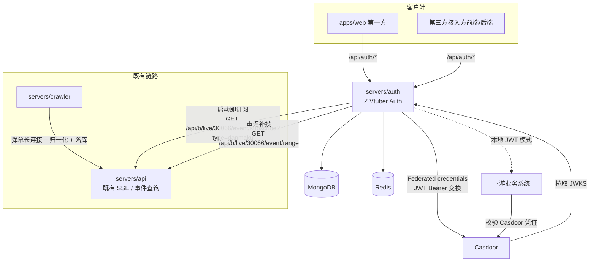
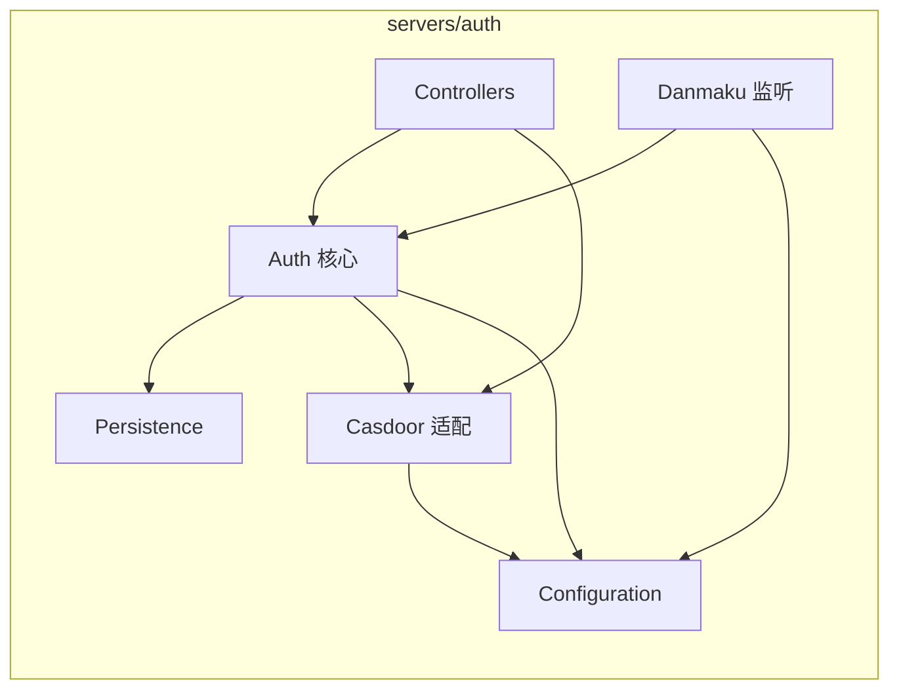
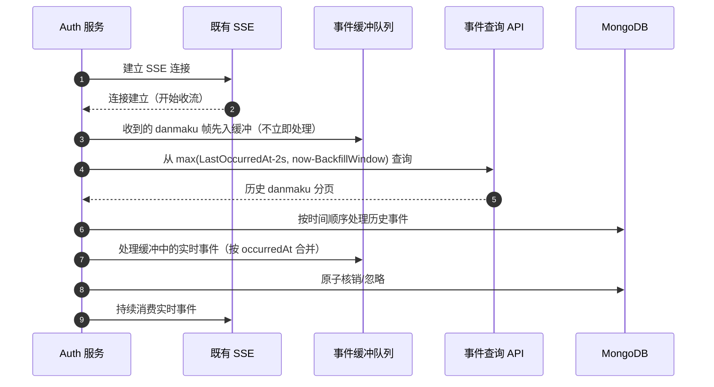
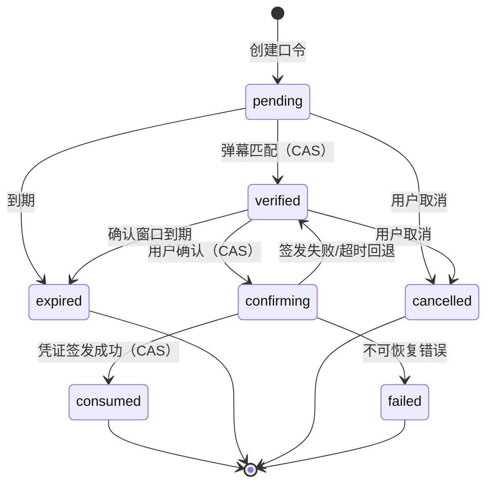
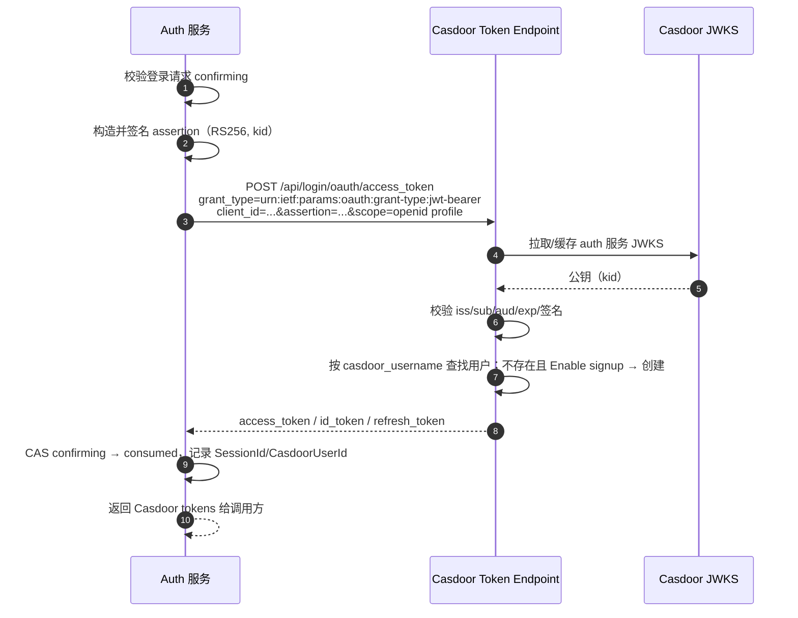
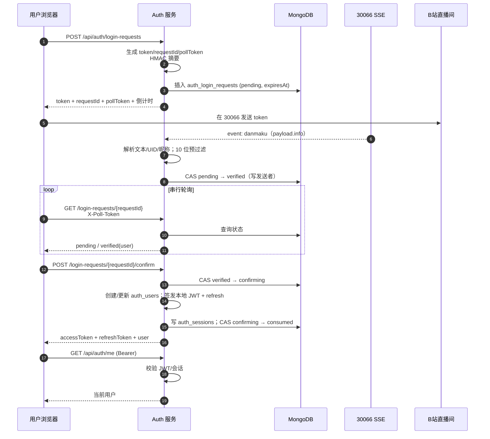
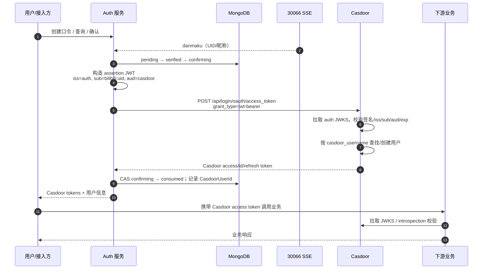
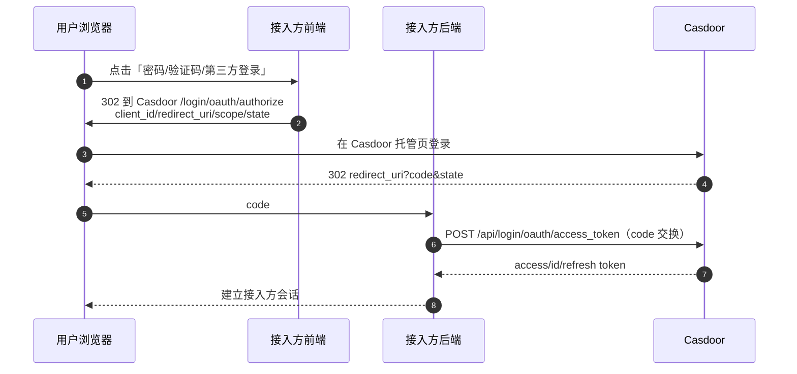
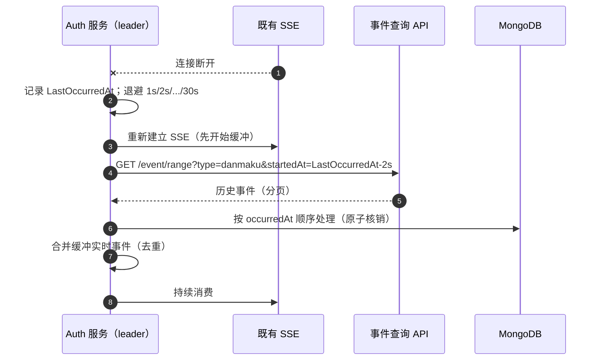

# B站弹幕帐号认证 - 技术提案

**功能名称**: B站弹幕帐号认证
**关联 PRD**: `docs/product/draft/20261119-danmaku-account-auth-prd.md`
**技术提案版本**: v1.0
**创建日期**: 2026-11-19
**作者**: Z.Vtuber Workflow Agent
**feat-branch**: `feat/danmaku-account-auth`

> **结论摘要**
>
> 1. 新增独立服务 `servers/auth`（`Z.Vtuber.Auth`，本地端口 8087），启动即订阅既有 30066 房间弹幕 SSE；同时为 `servers/crawler` 增加 `DefaultDanmakuRoomIds` 常驻房间配置（默认 `[30066]`），确保 30066 真的有弹幕长连接与事件落库；不改变既有订阅类型/API，也不在 api 中内嵌认证逻辑。
> 2. 口令为 10 位 `[A-Za-z0-9]`（实际使用去除易混淆字符的 56 字符子集），密码学随机生成；服务端只存带 pepper 的 HMAC 摘要，5 分钟有效、一次性、原子核销。
> 3. 弹幕识别后先展示发送者昵称/UID，用户确认后才签发会话；确认使用 `pending → verified → confirming → consumed` 单文档状态机，避免并发双发与半登录。
> 4. Casdoor **不能**作为「弹幕登录插件」直接验证 B 站弹幕；它是 IAM/SSO 身份平台。推荐用其 **Federated credentials（受信任外部身份源 / JWT Bearer grant）**：本服务签发短期身份断言，Casdoor 信任该断言并直接签发统一凭证，**不需要 Casdoor 登录跳转页**。
> 5. 弹幕登录的轻量验证界面由接入方前端实现；第一方 `apps/web` 提供可复用页面/组件，第三方接入方按 API 自行实现。Casdoor 托管登录页只用于密码/验证码/第三方账号等非弹幕方式。

## 1. 概述

### 1.1 背景

PRD 要求：服务启动时默认订阅 B 站 30066 房间弹幕，并基于弹幕流做账号认证：

1. 提供 API 生成 10 位 `[A-Za-z0-9]` 一次性 token；
2. 用户在 30066 房间发送 token，服务通过订阅的弹幕流获得「用户 → 弹幕」的唯一绑定信息，并取发送者 UID/昵称作为用户信息；
3. 调研 Casdoor 是否能作为第三方登录插件接入，是否需要额外登录跳转页，前端由谁做，并给出结论与时序图。

仓库现状核实（读码确认）：

- **无认证基础设施**：`servers/api/Program.cs` 仅有 `app.UseAuthorization()` 占位，未注册 Authentication/Authorization 方案；全仓库未发现 JWT/OAuth/Casdoor 实现（grep `authentication|authorization|jwt|oauth|casdoor` 仅命中第三方 API Key 调用与文档）。
- **弹幕 SSE 已具备**：`servers/api/Controllers/BilibiliLiveController.cs` 的 `GET /api/b/live/{roomId}/event/subscribe` 提供 `text/event-stream`；连接建立即发 `event: heartbeat`，之后每 10 秒一次；`type=danmaku` 可只推送弹幕；连接建立前的事件不补发。契约见 `contracts/bilibili-crawler.openapi.yaml` 的 `subscribeLiveEvents`。
- **30066 当前不一定有长连接**：`servers/crawler/Live/LiveEventSource.cs` 的 `ReconcileAsync` 只从 `SubscriptionService.GetMidsAsync(SubscriptionType.Danmaku)` 取 mid，再经主播资料解析 roomId；若 30066 不是某个已订阅主播的直播间，crawler 不会连接它，SSE 就没有数据。因此本需求必须增加「默认常驻弹幕房间」配置（见 2.5 与 5.2.0），否则仅让 auth 订阅 SSE 是空转。
- **事件 DTO 形状**：SSE 每条为 `{ roomId, type, occurredAt, liveSessionId, payload }`；`payload` 为 `BilibiliUserController.ParseRaw(liveEvent.Payload)` 后的原始对象。对弹幕即 B 站 `DANMU_MSG` 的 `info` 数组。
- **发送者字段映射已存在**：`servers/common/live/Live/LiveEventTextExtractor.cs` 已按 `payload.info[1]`（文本）、`payload.info[2][0]`（UID）、`payload.info[2][1]`（昵称）、`payload.info[3][1]`（粉丝牌）提取；本提案复用该口径，头像从 `payload.info[0][15].user.base.face`（回退 `payload.info[0][15].user.base.origin_info.face`）可选提取。
- **历史事件可回补**：`GET /api/b/live/{roomId}/event/range?type=danmaku&startedAt=...` 可按时间范围分页查询已落库事件（`items[].occurredAt/payload`），用于 SSE 重连后的短窗口补投。
- **服务拆分先例**：`servers/cookie`、`servers/recording`、`servers/training` 均为独立 ASP.NET Core 服务，拥有自己的 Dockerfile、CI 镜像流水线与 AppHost 编排；新增 `servers/auth` 与既有模式一致。

### 1.2 目标

1. 新服务 `servers/auth`：启动即建立 30066 房间弹幕 SSE 长连接，断线自动重连并短窗口补投；同时给 `servers/crawler` 增加 `DefaultDanmakuRoomIds` 常驻房间配置（默认 `[30066]`），确保 30066 有真实的弹幕长连接与事件落库；
2. 提供创建口令、查询状态、确认登录、取消、刷新、退出、当前用户等 API；
3. 口令 10 位、一次性、5 分钟有效、只存摘要、原子核销；
4. 以 `(platform=bilibili, uid)` 唯一绑定平台账号；昵称/头像可更新，UID 不变；
5. 登录确认后签发会话；支持本地 JWT 模式与 Casdoor 统一凭证模式；
6. 按 Casdoor Federated credentials 完成统一身份接入，给出可执行的配置与失败处理；
7. 明确前端职责：第一方提供可复用弹幕登录页/组件，第三方接入方自行实现，Casdoor 不为弹幕登录提供页面；
8. 安全、可观测、可部署、可测试，且不影响既有直播/SSE/弹幕链路。

### 1.3 范围

- **做**：
  - `servers/auth` 服务骨架、配置、Mongo 持久化、Redis 限流/选主、健康检查；
  - `servers/crawler` 新增 `DefaultDanmakuRoomIds`（默认 `[30066]`），并在 `LiveEventSource.ReconcileAsync` 并入常驻房间；
  - 30066 弹幕 SSE 客户端（连接、心跳、重连、补投、去重、选主）；
  - 口令生成/摘要/校验、登录请求状态机、账号绑定、会话签发/刷新/退出；
  - 本地 JWT 签发与 JWKS；Casdoor 断言签发、JWK 暴露、JWT Bearer 交换、失败重试；
  - `contracts/auth.openapi.yaml` 契约与 web codegen；
  - 第一方 `apps/web` 弹幕登录页/弹窗与 API 客户端；
  - AppHost、Dockerfile、CI 镜像流水线、测试。
- **不做**：
  - 密码/邮箱/手机号注册登录、找回密码；
  - B 站 OAuth/扫码登录；
  - 多平台弹幕认证；
  - 账号合并/迁移/自助注销；
  - 完整管理后台与可视化报表；
  - 修改 Casdoor 源码或做 Casdoor 自定义登录页插件；
  - 改变 crawler 既有订阅类型/API 语义（仅新增默认常驻房间配置，认证服务直接消费既有 SSE 契约）；
  - 弹幕内容审核、抽奖、互动玩法。

## 2. 技术架构

### 2.1 系统架构图



### 2.2 为什么新增独立 auth 服务，而不是塞进 api

| 方案 | 优点 | 缺点 | 结论 |
|--|--|--|--|
| 内嵌 `servers/api` | 复用 `ILiveEventBus`、零新服务、改动小 | 认证/会话/口令与公开数据 API 同进程，安全边界差；认证流量与数据查询互相影响；无法独立部署/扩缩容；不符合「认证服务」定位 | 不采用 |
| 新增 `servers/auth`（推荐） | 安全边界独立；启动即按需求订阅 SSE；可独立扩缩容与发布；可被多个产品复用；与 cookie/recording 等服务模式一致 | 新增一个服务/镜像/编排；SSE 重连需补投 | **采用** |
| 新增 auth 但只做库表、由 api 暴露 | 部署少 | 职责混乱、两处生命周期耦合 | 不采用 |

> 说明：auth 服务消费的是**既有 SSE 公共契约**，不是 crawler 的 Redis 内部频道；crawler 侧只新增「默认常驻房间」配置，不改变订阅类型/API，也不会与既有 SSE 订阅方互相影响。

### 2.3 技术栈

| 层级 | 技术选型 | 说明 |
|--|--|--|
| 语言/框架 | C# / .NET 10，ASP.NET Core Web API | 与 api/cookie 等服务一致 |
| 数据库 | MongoDB（`Aspire.MongoDB.Driver` + `MongoDB.Driver`） | 登录请求、账号、会话、审计 |
| 缓存/协调 | Redis（`Aspire.StackExchange.Redis`，`ConnectionStrings:messaging`） | 频率限制、弹幕消费者选主 |
| 弹幕来源 | 既有 SSE（`HttpClient` + `ResponseHeadersRead` + `StreamReader`） | 不引入额外消息库 |
| 令牌 | `System.IdentityModel.Tokens.Jwt` / `Microsoft.IdentityModel.JsonWebTokens` | 本地 JWT、Casdoor 断言、JWKS |
| 加密 | `System.Security.Cryptography`（`HMACSHA256`、`RandomNumberGenerator`、`AES-GCM`、`RSA`） | 口令摘要、随机、会话交付加密、断言签名 |
| 契约 | OpenAPI `contracts/auth.openapi.yaml` + web codegen | 与既有契约模式一致 |
| 测试 | xUnit + Testcontainers MongoDB/Redis + 假 SSE 服务 + stub `HttpMessageHandler` | 覆盖状态机/并发/失败矩阵 |
| 编排 | .NET Aspire（`infra/apphost/AppHost.cs`） | 新增 auth 项目并引用 mongo/messaging/api |

### 2.4 模块划分



| 模块 | 职责 | 关键技术点 |
|--|--|--|
| `Controllers/` | `/api/auth/*`、`/.well-known/*`、`/health` | 参数校验、错误码、限流、CORS |
| `Auth/` | 口令生成/摘要、登录请求状态机、账号绑定、会话、本地 JWT | 原子 CAS、HMAC、刷新轮换、JWKS |
| `Danmaku/` | SSE 连接、帧解析、事件处理、补投、去重、选主 | 重连退避、心跳健康、`occurredAt` 水位、Redis 租约 |
| `Casdoor/` | 配置、断言签发、JWKS、JWT Bearer 交换、凭证校验/撤销 | 外部身份源、`kid`、超时/重试、失败不半登录 |
| `Persistence/` | 4 个集合的实体/仓储、索引/TTL | 唯一索引、TTL、原子更新 |
| `Configuration/` | `AuthOptions`、`DanmakuOptions`、`CasdoorOptions` | `ValidateOnStart`、密钥长度校验 |

### 2.5 前置改动：让 crawler 真正连接 30066

这是本需求能否工作的关键前置条件。现有 `LiveEventSource.ReconcileAsync` 的 roomId 来源只有「Danmaku 订阅 mid → 主播资料最新 roomId」，没有「按 roomId 常驻」的通道。若 30066 未被任何订阅主播覆盖，则：

- crawler 不会为 30066 建立弹幕长连接；
- `live-event:30066` 无事件；
- auth 订阅 SSE 也收不到任何 danmaku，口令永远 `pending`。

改动（小、纯增量）：

1. `servers/crawler/Configuration/BilibiliCrawlerOptions.cs` 新增：
   ```csharp
   public long[] DefaultDanmakuRoomIds { get; set; } = [30066];
   ```
2. `servers/crawler/Live/LiveEventSource.cs` 注入 `BilibiliCrawlerOptions`，在 `ReconcileAsync` 解析完订阅房间后并入：
   ```csharp
   foreach (var roomId in options.DefaultDanmakuRoomIds)
   {
       if (roomId > 0) roomIds.Add(roomId);
   }
   ```
3. 不需要新增订阅记录、不改变 `SubscriptionType` 语义、不改变任何对外 API；`DefaultDanmakuRoomIds` 默认 `[30066]`，可通过配置覆盖。
4. 失败语义沿用既有：无可用 Cookie 时 `LiveEventSource` 记 warning 并按 30 秒重试；auth 的 `/health/ready` 会把「SSE 无心跳」暴露为未就绪。
5. 测试：`LiveEventSource` 的现有测试补一条「订阅房间为空 + DefaultDanmakuRoomIds=[30066] 时仍会建立连接」；配置测试覆盖默认值与覆盖值。

> 备选方案（不采用）：在 `bilibili_subscriptions` 里为 30066 对应主播插一条 Danmaku 订阅。问题是需要先解析主播 mid、会把「系统常驻房间」混进用户订阅列表，且取消订阅会误删常驻连接；配置化更干净。

## 3. API 设计

### 3.1 契约与版本

- 新增 `contracts/auth.openapi.yaml`（OpenAPI 3.1.0），服务前缀 `/api/auth`；`/.well-known/*` 与 `/health` 不在业务前缀下。
- web 通过既有 `npm run codegen` 生成 `schema-auth.d.ts`，不手写类型。
- 所有响应使用 camelCase；错误统一为：

```json
{
  "error": {
    "code": "AUTH_LOGIN_REQUEST_EXPIRED",
    "message": "登录请求已过期，请重新获取口令。"
  }
}
```

### 3.2 接口列表

| 方法 | 路径 | 鉴权 | 说明 |
|--|--|--|--|
| POST | `/api/auth/login-requests` | 匿名 + 限流 | 创建一次性弹幕口令 |
| GET | `/api/auth/login-requests/{requestId}` | `X-Poll-Token` | 查询登录请求状态 |
| POST | `/api/auth/login-requests/{requestId}/confirm` | `X-Poll-Token` | 确认是本人并领取会话 |
| POST | `/api/auth/login-requests/{requestId}/cancel` | `X-Poll-Token` | 取消登录，口令作废 |
| POST | `/api/auth/sessions/refresh` | refresh token | 刷新会话（轮换） |
| POST | `/api/auth/sessions/logout` | access/refresh token | 退出登录/撤销会话 |
| GET | `/api/auth/me` | Bearer | 当前用户信息 |
| GET | `/.well-known/openid-configuration` | 匿名 | 本服务作为外部身份源的发现文档（Casdoor 用） |
| GET | `/.well-known/jwks.json` | 匿名 | 本服务 JWT/断言公钥 |
| GET | `/health` | 匿名 | 存活 |
| GET | `/health/ready` | 匿名 | Mongo/Redis/SSE 就绪 |
| POST | `/api/auth/admin/users/{platform}/{uid}/disable` | 管理密钥 | 禁用账号（可选） |
| GET | `/api/auth/admin/audit` | 管理密钥 | 审计查询（可选） |

> 管理端点仅在配置 `Auth:AdminApiKey` 时启用；没有配置则 404，避免默认暴露。

### 3.3 详细接口

#### 3.3.1 创建登录请求

`POST /api/auth/login-requests`

请求：

```json
{
  "clientId": "z-vtuber-web",
  "clientNonce": "optional-32-to-128-char-random-string"
}
```

- `clientId` 可选；配置了允许列表时校验，用于区分第一方/第三方；
- `clientNonce` 可选；用于调用方把登录请求与本地设备绑定，服务端只存摘要；
- 频率限制：按 IP + clientId 固定窗口（默认 10 次/分钟、100 次/天），超限 429。

响应 `201 Created`：

```json
{
  "requestId": "0199a1b2-7c3d-7e4f-8a90-123456789abc",
  "token": "A1b2C3d4E5",
  "expiresAt": "2026-11-19T18:05:00Z",
  "pollToken": "p_7f3c...32bytes...",
  "pollAfterMs": 1500,
  "roomId": 30066,
  "confirmWindowSeconds": 120,
  "instruction": "请在 B 站直播间 30066 发送上方口令"
}
```

- `token` 只在此响应出现一次，服务端只存 HMAC 摘要；
- `pollToken` 只在此响应出现一次，后续查询/确认/取消都必须携带；
- `pollAfterMs` 建议轮询间隔；客户端应使用 `setTimeout` 串行轮询，避免堆积；
- 若弹幕通道未就绪（超过 `Danmaku:NotReadyGraceSeconds`），返回 `503 AUTH_DANMAKU_SOURCE_UNAVAILABLE`，避免用户向「听不到」的房间发口令。

错误：`400 AUTH_INVALID_REQUEST`、`429 AUTH_TOKEN_RATE_LIMITED`、`503 AUTH_DANMAKU_SOURCE_UNAVAILABLE`、`500 AUTH_INTERNAL`。

#### 3.3.2 查询登录请求状态

`GET /api/auth/login-requests/{requestId}`

请求头：`X-Poll-Token: p_...`

响应 `200 OK`（按状态二选一）：

```json
{
  "status": "pending",
  "expiresAt": "2026-11-19T18:05:00Z",
  "retryAfterMs": 1500
}
```

```json
{
  "status": "verified",
  "expiresAt": "2026-11-19T18:05:00Z",
  "confirmExpiresAt": "2026-11-19T18:03:30Z",
  "user": {
    "platform": "bilibili",
    "uid": 403496,
    "name": "Zero_Ash",
    "avatarUrl": "https://i2.hdslb.com/bfs/face/....jpg"
  }
}
```

```json
{ "status": "confirming" }
```

```json
{ "status": "consumed" }
```

- `consumed` 只表示已完成；会话 token 只能通过 `confirm` 响应获取（见 3.3.3 的短窗口幂等重取）；
- `expired` 返回 `200 { "status": "expired" }` 或 `410`？为便于前端状态机，统一返回 `200` + `status`，同时保留 `410` 用于直接访问已清理的请求；建议：
  - `pending/verified/confirming/consumed` → 200；
  - 记录不存在/已清理 → 404 `AUTH_LOGIN_REQUEST_NOT_FOUND`；
  - 已过期但记录还在 → 200 `{ "status": "expired" }`；
  - `X-Poll-Token` 错误 → 403 `AUTH_POLL_TOKEN_INVALID`，不泄露请求是否存在。

#### 3.3.3 确认登录

`POST /api/auth/login-requests/{requestId}/confirm`

请求头：`X-Poll-Token: p_...`；无 body。

响应 `200 OK`：

```json
{
  "user": {
    "platform": "bilibili",
    "uid": 403496,
    "name": "Zero_Ash",
    "avatarUrl": "https://i2.hdslb.com/bfs/face/....jpg"
  },
  "tokens": {
    "tokenType": "Bearer",
    "accessToken": "eyJhbGciOiJSUzI1NiIs...",
    "expiresIn": 900,
    "refreshToken": "r_...",
    "refreshExpiresIn": 2592000
  },
  "casdoor": {
    "enabled": true,
    "userId": "bili_403496"
  }
}
```

- 只有 `verified` 状态可确认；`pending` → 409 `AUTH_LOGIN_REQUEST_NOT_VERIFIED`；`consumed` → 409 `AUTH_LOGIN_REQUEST_ALREADY_CONSUMED`；
- 确认窗口默认 120 秒；超时后 `verified → expired`；
- 并发确认：只有一个请求能从 `verified` CAS 到 `confirming`，其余 409 `AUTH_CONFIRM_RACE`；
- **幂等重取**：确认成功后 `DeliveryWindowSeconds`（默认 60 秒）内，同一 `X-Poll-Token` 再次 confirm 且 `SessionId` 相同，可重新返回同一会话的 token（刷新令牌用服务端密钥加密暂存，首次成功下发后删除）；超过窗口返回 409；
- Casdoor 开启时，`tokens` 为 Casdoor 签发的 token；关闭时为本地 JWT。

错误：`403 AUTH_POLL_TOKEN_INVALID`、`409 AUTH_LOGIN_REQUEST_NOT_VERIFIED`、`409 AUTH_CONFIRM_RACE`、`409 AUTH_LOGIN_REQUEST_ALREADY_CONSUMED`、`410 AUTH_LOGIN_REQUEST_EXPIRED`、`503 AUTH_CASDOOR_UNAVAILABLE`、`500 AUTH_INTERNAL`。

#### 3.3.4 取消登录

`POST /api/auth/login-requests/{requestId}/cancel`

请求头：`X-Poll-Token: p_...`；响应 `204 No Content`。

- `pending/verified/confirming` 可取消；`consumed` 不能取消（409）；
- 取消后口令不可复用；已建立的账号不删除（账号是长期实体）。

#### 3.3.5 刷新会话

`POST /api/auth/sessions/refresh`

```json
{ "refreshToken": "r_..." }
```

响应 `200`：

```json
{
  "tokenType": "Bearer",
  "accessToken": "...",
  "expiresIn": 900,
  "refreshToken": "r_...",
  "refreshExpiresIn": 2592000
}
```

- 本地模式：刷新令牌轮换；旧令牌立即失效；检测到旧令牌复用则撤销整个会话族（`FamilyId`）并 401；
- Casdoor 模式：代理 Casdoor `/api/login/oauth/refresh_token`，返回 Casdoor 新 token；
- 失败：401 `AUTH_REFRESH_TOKEN_INVALID`、503 `AUTH_CASDOOR_UNAVAILABLE`。

#### 3.3.6 退出登录

`POST /api/auth/sessions/logout`

请求头：`Authorization: Bearer <accessToken>`；可选 body `{ "refreshToken": "r_..." }`。

- 本地模式：撤销会话/会话族；
- Casdoor 模式：调用 Casdoor `/api/login/oauth/revoke` 撤销 access/refresh token；失败仍撤销本地会话映射并记录；
- 响应 `204`；幂等。

#### 3.3.7 当前用户

`GET /api/auth/me`

请求头：`Authorization: Bearer <accessToken>`

```json
{
  "platform": "bilibili",
  "uid": 403496,
  "name": "Zero_Ash",
  "avatarUrl": "https://...",
  "createdAt": "2026-11-19T18:02:00Z",
  "lastLoginAt": "2026-11-19T18:02:00Z",
  "casdoorUserId": "bili_403496"
}
```

- 本地模式：校验本服务 JWT（JWKS/公钥）；
- Casdoor 模式：校验 Casdoor JWT（`iss`/`aud`/`exp`/签名，JWKS 缓存 1 小时）；
- 账号禁用 → 403 `AUTH_USER_DISABLED`。

#### 3.3.8 发现与 JWKS

`GET /.well-known/openid-configuration`：

```json
{
  "issuer": "https://auth.vtuber.internal",
  "jwks_uri": "https://auth.vtuber.internal/.well-known/jwks.json",
  "token_endpoint": "https://auth.vtuber.internal/api/auth/sessions/refresh",
  "grant_types_supported": ["refresh_token"],
  "subject_types_supported": ["public"],
  "id_token_signing_alg_values_supported": ["RS256"]
}
```

> 本服务不是完整的 OAuth 授权服务器；发现文档只用于 Casdoor 识别外部身份源的 `issuer`/`jwks_uri`。若 Casdoor 配置要求 `token_endpoint`，给出可用的刷新端点；不声明未实现的 authorize 端点。

`GET /.well-known/jwks.json`：返回 RSA 公钥 JWK（含 `kid`、`use=sig`、`alg=RS256`）。Casdoor 的 Federated credentials 直接使用该 URL。

#### 3.3.9 健康检查

- `GET /health`：进程存活；
- `GET /health/ready`：Mongo ping + Redis ping + 弹幕消费者状态（leader/connected/lastHeartbeatAt/lastDanmakuAt）；
- 未就绪返回 503，body 给出具体依赖；不包含密钥/口令。

### 3.4 错误码

| HTTP | code | 含义 |
|--|--|--|
| 400 | `AUTH_INVALID_REQUEST` | 参数非法（clientId 不允许、clientNonce 长度非法等） |
| 403 | `AUTH_POLL_TOKEN_INVALID` | 轮询凭证错误 |
| 403 | `AUTH_USER_DISABLED` | 账号被禁用 |
| 404 | `AUTH_LOGIN_REQUEST_NOT_FOUND` | 请求不存在/已清理 |
| 409 | `AUTH_LOGIN_REQUEST_NOT_VERIFIED` | 尚未识别到弹幕 |
| 409 | `AUTH_LOGIN_REQUEST_ALREADY_CONSUMED` | 已确认/已使用 |
| 409 | `AUTH_CONFIRM_RACE` | 并发确认失败 |
| 410 | `AUTH_LOGIN_REQUEST_EXPIRED` | 已过期 |
| 429 | `AUTH_TOKEN_RATE_LIMITED` | 获取口令超限 |
| 429 | `AUTH_DANMAKU_RATE_LIMITED` | 同账号发送口令超限 |
| 401 | `AUTH_SESSION_INVALID` | 会话无效/过期 |
| 401 | `AUTH_REFRESH_TOKEN_INVALID` | 刷新令牌无效/复用 |
| 503 | `AUTH_DANMAKU_SOURCE_UNAVAILABLE` | 弹幕 SSE 未就绪 |
| 503 | `AUTH_CASDOOR_UNAVAILABLE` | Casdoor 不可用/超时 |
| 500 | `AUTH_INTERNAL` | 未预期错误（不泄露内部细节） |

## 4. 数据模型

### 4.1 集合

#### `auth_login_requests`

| 字段 | 类型 | 说明 |
|--|--|--|
| `_id` | ObjectId | 主键 |
| `RequestId` | string | UUIDv7，唯一索引；对外只暴露该 ID |
| `TokenHash` | string | `HMAC-SHA256(pepper, token)` hex；唯一索引；不存明文 |
| `PollTokenHash` | string | 轮询凭证摘要；不存明文 |
| `ClientNonceHash` | string? | 调用方设备绑定摘要（可选） |
| `ClientId` | string? | 调用方标识 |
| `Platform` | string | 固定 `bilibili` |
| `RoomId` | long | 固定 `30066`（配置） |
| `Status` | string | `pending/verified/confirming/consumed/expired/cancelled/failed` |
| `ExpiresAt` | DateTime(UTC) | 口令过期时间（默认 +5 分钟） |
| `ConfirmExpiresAt` | DateTime(UTC)? | 识别后的确认截止（默认 +120 秒） |
| `CreatedAt` | DateTime(UTC) | 创建时间 |
| `VerifiedAt` | DateTime(UTC)? | 识别时间 |
| `ConfirmStartedAt` | DateTime(UTC)? | 进入 confirming 的时间；用于超时回退 |
| `ConsumedAt` | DateTime(UTC)? | 确认完成时间 |
| `SenderUid` | long? | 弹幕发送者 UID |
| `SenderName` | string? | 弹幕发送者昵称 |
| `SenderAvatar` | string? | 头像 URL（可选） |
| `SenderMedal` | string? | 粉丝牌（可选，审计/展示） |
| `SessionId` | string? | 确认后关联的会话 ID |
| `FailureCode` | string? | 失败原因码（不存敏感信息） |
| `ClientIp` | string? | 创建来源 IP（审计） |
| `UserAgent` | string? | 创建来源 UA（截断） |
| `Version` | int | 并发控制/诊断 |

索引：

- `{ RequestId: 1 }` unique；
- `{ TokenHash: 1 }` unique；
- `{ Status: 1, ExpiresAt: 1 }`（清理扫描）；
- `{ ExpiresAt: 1 }` TTL，`expireAfterSeconds = 3600`（过期后保留 1 小时便于排查，再自动删除）；
- `{ SenderUid: 1, CreatedAt: -1 }`（按 UID 审计）。

#### `auth_users`

| 字段 | 类型 | 说明 |
|--|--|--|
| `_id` | ObjectId | 主键 |
| `Platform` | string | `bilibili` |
| `PlatformUid` | long | B 站 UID |
| `DisplayName` | string | 最近一次登录的昵称 |
| `AvatarUrl` | string? | 最近一次头像 |
| `Status` | string | `active/disabled` |
| `CreatedAt` | DateTime(UTC) | 首次登录 |
| `LastLoginAt` | DateTime(UTC) | 最近登录 |
| `LastLoginIp` | string? | 最近登录来源 |
| `LoginCount` | long | 登录次数（原子 `$inc`） |
| `CasdoorUserId` | string? | Casdoor 用户 ID（`bili_{uid}`） |

索引：`{ Platform: 1, PlatformUid: 1 }` unique；`{ Status: 1, LastLoginAt: -1 }`。

#### `auth_sessions`

| 字段 | 类型 | 说明 |
|--|--|--|
| `_id` | ObjectId | 主键 |
| `SessionId` | string | UUIDv7，唯一索引 |
| `FamilyId` | string | 会话族（刷新轮换复用检测） |
| `UserId` | ObjectId | 关联 `auth_users._id` |
| `Platform` | string | `bilibili` |
| `PlatformUid` | long | 冗余，便于查询 |
| `AccessTokenJti` | string? | 本地 JWT 的 `jti` |
| `RefreshTokenHash` | string? | 本地刷新令牌摘要 |
| `RefreshTokenExpiresAt` | DateTime(UTC)? | 刷新令牌过期 |
| `CreatedAt` | DateTime(UTC) | 创建 |
| `LastRefreshedAt` | DateTime(UTC)? | 最近刷新 |
| `RevokedAt` | DateTime(UTC)? | 撤销时间 |
| `RevokeReason` | string? | `logout/rotated/reuse/disabled/admin` |
| `ClientIp` | string? | 登录来源 |
| `UserAgent` | string? | 登录来源（截断） |
| `CasdoorUserId` | string? | Casdoor 用户 |
| `DeliveredAt` | DateTime(UTC)? | token 首次下发时间 |
| `DeliveryExpiresAt` | DateTime(UTC)? | 允许幂等重取的截止 |
| `EncryptedRefreshToken` | string? | AES-GCM 加密的刷新令牌，仅短窗口暂存 |
| `DeliveryNonce` | string? | AES-GCM nonce |

索引：`{ SessionId: 1 }` unique；`{ UserId: 1, CreatedAt: -1 }`；`{ FamilyId: 1 }`；`{ RefreshTokenHash: 1 }`（稀疏/部分索引）；`{ RevokedAt: 1, RefreshTokenExpiresAt: 1 }`（清理）。

#### `auth_audit_logs`

| 字段 | 类型 | 说明 |
|--|--|--|
| `_id` | ObjectId | 主键 |
| `RequestId` | string? | 登录请求 |
| `SessionId` | string? | 会话 |
| `Event` | string | `token_created/token_verified/token_expired/login_confirmed/login_failed/session_refreshed/session_revoked/admin_disabled` |
| `Platform` | string | `bilibili` |
| `PlatformUid` | long? | B 站 UID |
| `ClientIp` | string? | 来源 |
| `UserAgent` | string? | 来源 |
| `OccurredAt` | DateTime(UTC) | 时间 |
| `Detail` | string? | 脱敏详情（不含 token/pollToken/refreshToken） |

索引：`{ OccurredAt: -1 }`；`{ PlatformUid: 1, OccurredAt: -1 }`；`{ Event: 1, OccurredAt: -1 }`；TTL `OccurredAt` 90 天。

### 4.2 缓存键

| Key | 类型 | TTL | 用途 |
|--|--|--|--|
| `auth:rl:token:ip:{ip}:{yyyyMMddHHmm}` | string counter | 2 min | 创建口令按 IP 限流 |
| `auth:rl:token:client:{clientId}:{yyyyMMddHH}` | string counter | 2 h | 创建口令按 client 限流 |
| `auth:rl:danmaku:uid:{uid}:{yyyyMMddHHmm}` | string counter | 2 min | 同 UID 发送口令尝试限流 |
| `auth:danmaku:leader:{roomId}` | string (lease) | 15 s | 弹幕消费者选主 |
| `auth:danmaku:watermark:{roomId}` | string (occurredAt) | 7 d | 补投水位（可选，Mongo 亦可） |

> 选主锁的 value 为实例 ID + 随机 token；每 5 秒续期；释放用 Lua 比对 value 删除，避免误删他人租约。

### 4.3 数据保留与安全

- 口令：只存 HMAC-SHA256(pepper, token)；pepper 从 `Auth:TokenPepper` 读取，至少 32 字节，生产环境缺失则启动失败；
- 轮询凭证：只存 HMAC 摘要；
- 刷新令牌：只存摘要；确认后的短窗口幂等重取使用 AES-GCM 加密暂存，`DeliveryExpiresAt` 到期或首次成功下发后立即清除；
- 会话访问令牌：本地模式为 JWT，服务端不存明文；Casdoor 模式由 Casdoor 管理；
- 审计：不含任何 token/pollToken/refreshToken 明文；IP/UA 可截断；
- 日志：禁止打印完整 SSE `data`（含用户信息）与 Authorization 头；只记录 `requestId`、UID、状态、耗时；
- 所有密钥通过环境变量/密钥管理注入，不写配置文件。

## 5. 技术实现方案

### 5.1 口令生成与摘要

- 字符集：`ABCDEFGHJKLMNPQRSTUVWXYZabcdefghijkmnopqrstuvwxyz23456789`（56 字符，去掉 `0O1lI`，仍完全属于 `[A-Za-z0-9]`，降低用户输入混淆）；
- 长度固定 10；使用 `RandomNumberGenerator.GetInt32(alphabet.Length)` 逐位生成（内部拒绝采样，无模偏差）；
- 熵约 `log2(56^10) ≈ 58.1 bit`；配合 5 分钟 TTL、一次性、限流与 HMAC，足以抵抗在线枚举；
- 摘要：`HMACSHA256(pepper, UTF8(token))`，hex 小写；
- 唯一性：`TokenHash` 唯一索引；插入冲突时重新生成，最多 5 次；仍冲突返回 500 并告警；
- 轮询凭证：32 字节 `RandomNumberGenerator.GetBytes(32)` → base64url，前缀 `p_`；只存 HMAC；
- 请求 ID：`Guid.CreateVersion7()`（时间有序，便于索引与排查）。

### 5.2 弹幕监听

#### 5.2.0 先决条件：crawler 常驻 30066

auth 的 SSE 只是「读端」；真正的「写端」仍是 crawler 的弹幕长连接。按 2.5 的前置改动，crawler 启动后会无条件并入 `DefaultDanmakuRoomIds`（默认 `[30066]`），为 30066 建立 `LiveEventSource` 连接、归一化并落库/发布 Redis；api 的 SSE 再按需订阅 `live-event:30066`。上线检查顺序：

1. crawler 日志出现 30066 的连接建立/重连记录；
2. `bilibili_live_event` 有 `RoomId=30066, Type=danmaku` 的新记录；
3. `GET /api/b/live/30066/event/subscribe?type=danmaku` 能收到 `heartbeat` 与 `danmaku`；
4. auth 的 `/health/ready` 为 200，`lastDanmakuAt` 在合理时间内更新。

任一环节不满足，auth 返回 `503 AUTH_DANMAKU_SOURCE_UNAVAILABLE`，不发放口令。

#### 5.2.1 SSE 连接

配置默认：

```text
Danmaku:BaseUrl = http://vtuber.internal.fffdan.com
Danmaku:RoomId = 30066
Danmaku:SsePath = /api/b/live/{roomId}/event/subscribe?type=danmaku
Danmaku:RangePath = /api/b/live/{roomId}/event/range
Danmaku:BackfillWindowSeconds = 600
Danmaku:NotReadyGraceSeconds = 30
Danmaku:ReadTimeoutSeconds = 60
```

连接要点：

- 专用 named `HttpClient`：`Timeout = Timeout.InfiniteTimeSpan`，`Accept: text/event-stream`，`ResponseHeadersRead`；
- 用 `StreamReader.ReadLineAsync(ct)` 逐行读取；空行分帧；`:` 开头为注释忽略；
- `event:` 记录事件名；`data:` 多行用 `\n` 拼接；分帧后分发；
- `heartbeat` 只更新 `LastHeartbeatAt`，不进入业务；
- `danmaku` 交给 `DanmakuEventHandler`；
- 读超时（默认 60 秒无任何帧）视为连接异常，主动断开重连；
- 断线重连退避：1s、2s、4s、8s、16s、30s（上限）+ 0~20% 抖动；连接稳定 60 秒后重置退避。

#### 5.2.2 启动与补投

SSE 端点只推送连接建立后的事件，因此重连/重启可能漏收。采用「先连后补」：



- 首次启动：`LastOccurredAt = now - BackfillWindowSeconds`（默认 10 分钟）；
- 补投分页：`pageSize=100`，最多 `MaxBackfillPages`（默认 10）；只取 `type=danmaku`；
- 去重指纹：`SHA256(roomId | occurredAtTicks | uid | text)`，内存 TTL 集合（默认 10 分钟）；即使重复处理，最终也由 `auth_login_requests` 的原子状态迁移兜底；
- 补投失败：不阻塞 SSE 实时流；记录 warning，按退避重试；补投窗口外的口令自然过期。

#### 5.2.3 多实例选主

- 每个实例启动后尝试 `SET auth:danmaku:leader:{roomId} <instanceToken> NX PX 15000`；
- 抢到租约的实例运行 SSE + 补投；每 5 秒续期；
- 未抢到的实例每 5 秒重试；leader 失联后最多 15 秒被接管；
- 续期失败立即停止当前 SSE、释放资源，回到 follower；
- 选主只影响「谁收弹幕」，不影响 API 处理；任意实例都能处理创建/查询/确认；
- Redis 不可用时：`Auth:AllowDegradedRedis=true` 时退化为「所有实例都收弹幕」，依赖 Mongo 原子核销保证只生效一次；生产建议 false，就绪检查失败。

#### 5.2.4 发送者解析

优先复用 `Z.Vtuber.Common.Live.LiveEventTextExtractor.Extract("danmaku", payloadJson)`：

| 字段 | 路径 | 用途 |
|--|--|--|
| 文本 | `payload.info[1]` | 口令匹配（`Trim()` 后精确匹配） |
| UID | `payload.info[2][0]` | 账号唯一键 |
| 昵称 | `payload.info[2][1]` | 展示/更新 |
| 粉丝牌 | `payload.info[3][1]` | 可选审计/展示 |
| 头像 | `payload.info[0][15].user.base.face`，回退 `...user.base.origin_info.face` | 可选展示 |

- 只处理 `roomId == Danmaku:RoomId` 且 `type == "danmaku"`；
- 文本先 `Trim()`；用 `^[A-Za-z0-9]{10}$` 预过滤；大小写敏感；
- 非 10 位、含空格/表情/其他字符的消息直接忽略，不查库；
- UID 必须 > 0；昵称为空时用 `UID:{uid}` 兜底展示；
- 解析失败只记 debug，不抛异常、不阻塞后续事件。

### 5.3 原子核销与状态机



弹幕匹配的原子操作：

```csharp
// 伪代码：只在 pending 且未过期时迁移到 verified
var filter = Builders<AuthLoginRequestRecord>.Filter.And(
    Builders<AuthLoginRequestRecord>.Filter.Eq(x => x.RequestId, requestId),
    Builders<AuthLoginRequestRecord>.Filter.Eq(x => x.Status, LoginStatus.Pending),
    Builders<AuthLoginRequestRecord>.Filter.Gt(x => x.ExpiresAt, now));

var update = Builders<AuthLoginRequestRecord>.Update
    .Set(x => x.Status, LoginStatus.Verified)
    .Set(x => x.VerifiedAt, now)
    .Set(x => x.ConfirmExpiresAt, now.AddSeconds(options.ConfirmWindowSeconds))
    .Set(x => x.SenderUid, sender.Uid)
    .Set(x => x.SenderName, sender.Name)
    .Set(x => x.SenderAvatar, sender.AvatarUrl)
    .Set(x => x.SenderMedal, sender.Medal)
    .Inc(x => x.Version, 1);

var result = await collection.FindOneAndUpdateAsync(filter, update,
    new FindOneAndUpdateOptions<AuthLoginRequestRecord> { ReturnDocument = ReturnDocument.After }, ct);
```

- 只有第一个匹配请求成功；同一 token 的后续弹幕返回 `null`，忽略；
- 不同用户抢同一 token：只有一个 UID 写入；用户确认时看到的就是实际写入的发送者；
- 过期判断以服务端 UTC 时间为准；客户端倒计时只作展示；
- 后台扫描器每 30 秒把 `pending/verified` 中超时的记录迁移到 `expired`（幂等）；TTL 索引负责最终清理。

### 5.4 确认登录与凭证签发

确认使用 `verified → confirming → consumed` 两段 CAS，避免并发双发：

1. **CAS 到 confirming**：条件 `RequestId + Status=Verified + ConfirmExpiresAt > now`；写入 `ConfirmStartedAt`、`ConfirmNonce`、`Version++`；失败返回 409。
2. **签发凭证**：
   - 本地模式：生成 `SessionId`、`FamilyId`、access JWT、refresh token；写入 `auth_sessions`；
   - Casdoor 模式：签发短期断言 → 调 Casdoor JWT Bearer 交换 → 得到 Casdoor token；写入 `auth_sessions` 仅保存映射与元数据；
   - 若失败：CAS `confirming → verified`（仅当 `ConfirmStartedAt` 在 30 秒内），返回 503；后台扫描器把超过 30 秒的 `confirming` 回退到 `verified` 或标记 `failed`。
3. **CAS 到 consumed**：条件 `RequestId + Status=Confirming + ConfirmNonce`；写入 `ConsumedAt`、`SessionId`；失败则尽力撤销刚签发的凭证（本地撤销会话 / Casdoor revoke），返回 500。
4. **下发**：响应返回 token；本地模式下把 refresh token 的 AES-GCM 密文与 `DeliveryExpiresAt`（+60 秒）写入会话，供短窗口幂等重取；首次成功下发后清除密文。
5. **审计**：写 `login_confirmed`，不含 token。

幂等重取：`status=consumed` 且同一 `X-Poll-Token`、`SessionId` 匹配、`DeliveryExpiresAt > now`、`DeliveredAt` 为空或未超窗口 → 解密 refresh token 再返回；否则 409。这样即使客户端在收到响应前断网，也能在 60 秒内重试拿到同一会话。

### 5.5 账号绑定

- 以 `(Platform="bilibili", PlatformUid)` 唯一索引 upsert；
- 首次登录：插入 `DisplayName`、`AvatarUrl`、`Status=active`、`CreatedAt/LastLoginAt`；
- 后续登录：更新 `DisplayName`、`AvatarUrl`、`LastLoginAt`、`LastLoginIp`，`LoginCount++`；
- 昵称变更不影响 UID 与账号；头像为空时保留旧值；
- 账号禁用：`Status=disabled`；登录确认时 403；已有会话在下次校验时 403，并可异步撤销；
- 同一 UID 并发首次登录：唯一索引冲突后重试读取，避免重复账号；
- 不提供「修改绑定 UID」；换 B 站账号即新平台账号。

### 5.6 会话与令牌

#### 5.6.1 本地模式

- 签名：RSA 2048（`Auth:Jwt:SigningKeyPem`），`RS256`，`kid` 为 JWK thumbprint；启动时加载，生产缺失则失败；
- access JWT：15 分钟；claims：`iss`（`Auth:PublicBaseUrl`）、`sub`（`auth_users._id`）、`aud`（`Auth:Jwt:Audience`，默认 `z-vtuber`）、`iat/exp/jti`、`platform`、`uid`、`name`、`session_id`；
- refresh token：32 字节随机 base64url，30 天；只存 HMAC；每次刷新轮换；
- 刷新复用检测：旧 refresh token 被再次使用 → 撤销 `FamilyId` 全部会话，返回 401；
- 多设备：默认最多 5 个活跃会话；超出时按 `CreatedAt` 淘汰最早会话（撤销并记审计）；
- 下游校验：`GET /.well-known/jwks.json` + 标准 JWT 校验；或调用 `/api/auth/me`。

#### 5.6.2 Casdoor 模式

- Casdoor 负责签发 access/id/refresh token；auth 服务不重复签发用户凭证；
- auth 服务保存 `CasdoorUserId`、`SessionId`、`FamilyId` 等映射，用于本地审计/退出；
- `/api/auth/me` 校验 Casdoor JWT：拉取 Casdoor JWKS（缓存 1 小时，未知 `kid` 最多 1 分钟重拉一次），校验 `iss/aud/exp/nbf`；
- 刷新代理 Casdoor `/api/login/oauth/refresh_token`；退出代理 `/api/login/oauth/revoke`；
- Casdoor token 不落库、不写日志。

### 5.7 Casdoor 接入

#### 5.7.1 调研结论

| 问题 | 结论 |
|--|--|
| Casdoor 能否作为「第三方登录插件」直接验证 B 站弹幕？ | **不能**。Casdoor 是 IAM/SSO 身份平台，不是任意自定义认证通道的插件；它没有 B 站弹幕监听能力，也没有「发弹幕即登录」的内置 provider。 |
| 是否需要额外做一个 Casdoor 登录跳转页？ | **弹幕登录不需要**。使用 Federated credentials 时，Casdoor 在服务端信任本服务签发的短期身份断言并直接签发凭证，用户不进入 Casdoor 页面。 |
| 前端由谁做？ | 弹幕验证界面由接入方前端实现；第一方 `apps/web` 由平台提供可复用页面/组件；第三方接入方按 API 自行实现。Casdoor 托管登录页只用于非弹幕方式。 |
| Casdoor 的哪种能力适配？ | **Federated credentials（受信任外部身份源）+ JWT Bearer grant**：本服务作为外部 OIDC issuer 提供 `issuer`/`jwks_uri`，Casdoor 按 `iss/sub/aud` 信任并映射用户，支持 `Enable signup` 首次自动建用户，**无需 Casdoor 页面**。 |
| 是否必须启用 Casdoor？ | 不必须。v1 可先本地 JWT 模式上线；Casdoor 就绪后切换，用户弹幕登录步骤不变。 |

Casdoor 官方文档依据：

- 概览：Casdoor 是 IAM/SSO 平台，通过 OAuth 2.0 / OIDC / SAML / CAS 把身份交回应用；标准授权码流程与托管登录页 —— <https://casdoor.ai/docs/overview/>
- 插件列表：官方插件/中间件覆盖 Spring Boot、WordPress、Odoo、Django、Kibana、Chrome、Terraform 等，**未提供 ASP.NET Core 弹幕登录插件** —— <https://casdoor.ai/docs/how-to-connect/plugin/>
- OAuth 2.0 端点与 grant types、PKCE、JWT Bearer、Token Exchange —— <https://casdoor.ai/docs/how-to-connect/oauth/>
- Federated credentials：外部 OIDC issuer + JWKS，`Enable signup`，JWT Bearer 交换，**"Sign users up and in without a Casdoor page"** —— <https://casdoor.ai/docs/how-to-connect/oauth/#federated-credentials>
- 应用配置：Redirect URLs、Organization、Sign-in methods —— <https://casdoor.ai/docs/application/config/>

#### 5.7.2 方案对比

| 方案 | 机制 | 用户是否跳 Casdoor | 适用性 | 结论 |
|--|--|--|--|--|
| Casdoor 作为 OAuth 提供方，B 站作为其 Provider | Casdoor 跳 B 站 OAuth | 是 | B 站无可用 OAuth 授权链路；弹幕不是 OAuth | 不可行 |
| Casdoor 自定义登录页/插件 | 在 Casdoor 前端嵌入弹幕流程 | 是 | 需改 Casdoor 前端/插件，升级耦合，弹幕 SSE 凭据难放置 | 不采用 |
| Casdoor Admin API 预创建用户 | 本服务建用户后调 Admin API | 否（但需另发凭证） | 管理 API 适合同步，不适合作为登录签发链路；易半登录 | 不作为主方案 |
| **Federated credentials + JWT Bearer** | 本服务签发断言，Casdoor 信任并签发 | **否** | 标准 OIDC/JWKS，支持首次自动建用户，用户流程不变 | **采用** |
| 本服务本地 JWT | 本服务自签自验 | 否 | 快速上线；多产品不统一 | 作为 Casdoor 未就绪的降级模式 |

#### 5.7.3 接入配置

Casdoor 侧（一次性配置）：

1. 创建/选择 Organization（如 `z-vtuber`）与 Application（如 `z-vtuber-web`）；
2. Application 的 **Grant types** 打开 **JWT Bearer**；
3. Application 的 **Federated credentials** 增加一行：
   - **Issuer**：`https://auth.vtuber.internal`（与断言 `iss` 完全一致）；
   - **JWKS URL**：`https://auth.vtuber.internal/.well-known/jwks.json`；
   - **Subject**：`bilibili:*`；
   - **Audience**：`casdoor`（与断言 `aud` 完全一致）；
   - **User**：`{casdoor_username}`（从断言 claim 取用户名）；
   - **Enable signup**：开启（首次登录自动创建 Casdoor 用户）；
4. 非弹幕登录方式继续配置密码/验证码/第三方 Provider 与 Redirect URLs（与弹幕链路无关）。

本服务侧：

- `Casdoor:Enabled=true`；
- `Casdoor:Endpoint`、`Casdoor:ClientId`、`Casdoor:ApplicationName`、`Casdoor:Organization`、`Casdoor:Audience=casdoor`；
- `Casdoor:AssertionLifetimeSeconds=60`；
- `Auth:PublicBaseUrl` 必须与 Casdoor 中 Issuer 完全一致；
- 用于签名的 RSA 私钥与 `kid` 必须稳定；`/.well-known/jwks.json` 必须可从 Casdoor 访问。

#### 5.7.4 身份断言

确认登录时，本服务为已验证的 B 站账号签发短期 JWT：

```json
{
  "iss": "https://auth.vtuber.internal",
  "sub": "bilibili:403496",
  "aud": "casdoor",
  "iat": 1795111200,
  "exp": 1795111260,
  "jti": "0199a1b2-...",
  "bilibili_uid": 403496,
  "bilibili_name": "Zero_Ash",
  "bilibili_avatar": "https://...",
  "casdoor_username": "bili_403496",
  "room_id": 30066
}
```

- `kid` 与 JWKS 中公钥对应；
- `exp` 默认 60 秒，一次性使用（`jti` 可写入审计；Casdoor 侧不保证 `jti` 防重放，短过期 + 仅服务端调用已足够）；
- 不包含 token/pollToken/refreshToken；
- 断言只在服务端内存中构造，不落库、不返回给前端。

#### 5.7.5 交换流程



- 请求体使用 `application/x-www-form-urlencoded`（Casdoor 文档示例为 form data）；
- 超时 5 秒；5xx/超时/网络错误 → `503 AUTH_CASDOOR_UNAVAILABLE`，`confirming → verified` 允许重试；
- `400 invalid_grant` 通常表示配置/断言不一致：记录 error（不含断言全文），返回 502/500 的可读错误，进入 `failed` 或保持 `verified` 由配置 `Casdoor:FailFast` 决定；默认保持 `verified` 便于修正配置后重试；
- 交换成功后若 `confirming → consumed` CAS 失败：调用 Casdoor revoke 撤销刚签发的 token（best effort），返回 500；
- 不把 Casdoor 的原始错误体直接返回给用户；对外统一文案，内部日志保留 trace id。

#### 5.7.6 凭证校验与退出

- `/api/auth/me`：Casdoor 模式下校验 Casdoor access token；本地模式下校验本服务 JWT；
- Casdoor JWKS 缓存 1 小时；未知 `kid` 时最多每分钟重拉一次；JWKS 拉取失败时，若缓存未过期继续用缓存，否则 503；
- 退出：调用 Casdoor `/api/login/oauth/revoke`（access/refresh token），随后撤销本地 `auth_sessions` 映射；Casdoor 调用失败仍完成本地撤销并记录 warning；
- 账号禁用：本地禁用后，`/me` 立即 403；Casdoor 侧用户状态可通过 Admin API 同步（可选，非本期必须）。

### 5.8 前端职责与实现

#### 5.8.1 第一方 `apps/web`

新增 `apps/web/src/pages/auth/DanmakuLoginPage.tsx`（或登录弹窗组件）：

- 步骤 1：点击获取口令 → 展示 10 位等宽口令、复制按钮、5 分钟倒计时、房间号 30066 与发送指引；
- 步骤 2：串行轮询（`pollAfterMs`），状态：`pending`（等待发送）、`verified`（展示检测到的昵称/UID/可选头像 + 「这是我」「不是我」）、`confirming`（处理中）、`consumed`（成功）、`expired`（重新获取）；
- 步骤 3：确认成功 → 保存会话（按现有 web 会话存储策略）→ 进入平台；
- 错误映射：`AUTH_DANMAKU_SOURCE_UNAVAILABLE`、`AUTH_TOKEN_RATE_LIMITED`、`AUTH_LOGIN_REQUEST_EXPIRED`、`AUTH_LOGIN_REQUEST_ALREADY_CONSUMED`、`AUTH_USER_DISABLED` 等中文文案；
- 组件测试使用 `renderWithProviders`；轮询用 fake timers；不引入新的 UI 原语，使用 antd `Modal/Button/Typography/Alert/Spin/Tag`；
- 关闭弹窗/离开页面时停止轮询；未完成口令不主动取消（用户可回来继续），过期后提示重新获取。

#### 5.8.2 第三方接入方

- 平台提供 `contracts/auth.openapi.yaml` 与状态语义文档；接入方自行实现 UI（可以是任意框架）；
- 接入方后端建议代理 `/api/auth/*`，避免把 `pollToken` 暴露给不可信浏览器上下文；若直接浏览器调用，必须使用 HTTPS 且限制 CORS 来源；
- 接入方不得把 `pollToken`、`refreshToken` 写入 URL/日志/埋点；
- 若接入方需要统一身份，使用 Casdoor 凭证；若只需要本平台登录，使用本地 JWT 模式。

#### 5.8.3 Casdoor 页面

- 弹幕登录**不跳转** Casdoor；不需要为弹幕做 Casdoor 自定义登录页；
- 密码/验证码/第三方账号等非弹幕登录：接入方 302 到 Casdoor `/login/oauth/authorize`，回跳后由接入方后端换 token；页面由 Casdoor 托管，接入方不做登录表单；
- 如果未来要在 Casdoor 页面内嵌弹幕登录，需要改 Casdoor 前端/插件，本期明确不做。

### 5.9 安全与风控

| 风险 | 措施 |
|--|--|
| 口令被枚举 | 58 bit 熵 + 5 分钟 TTL + 一次性 + HMAC + 按 IP/client 限流；失败不泄露存在性 |
| 口令被旁观抢发 | 识别后展示发送者账号并要求确认；确认窗口 2 分钟；用户可拒绝；会话只由发起端 pollToken 领取 |
| 口令明文泄露 | 只存 HMAC；日志/审计不含明文；创建响应只返回一次 |
| 弹幕洪泛导致查库压力 | 10 位字母数字预过滤；同 UID 限流；全局处理速率指标；必要时增加布隆过滤器（后续） |
| 刷新令牌被盗 | 轮换 + 复用检测撤销会话族；HTTPS；不落日志；短 access TTL |
| 会话固定/CSRF | 确认必须带 pollToken；CORS 白名单；SameSite Cookie（若用 Cookie）；不把 token 放 URL |
| Casdoor 配置漂移 | 启动时校验 `Auth:PublicBaseUrl`/Issuer/Audience；集成测试覆盖断言；健康检查暴露 Casdoor 可达性 |
| 账号冒用/禁用绕过 | UID 唯一；禁用状态在确认与 `/me` 双重校验；会话可撤销 |
| 多实例重复处理 | Mongo 原子 CAS；选主只减少重复，不依赖选主保证正确性 |
| 依赖故障 | 明确 503 与重试；不产生半登录；审计记录失败原因 |

## 6. 时序图

### 6.1 获取口令与弹幕验证（本地 JWT 模式）



### 6.2 Casdoor 联合登录（推荐模式）



### 6.3 Casdoor 托管登录（非弹幕方式，仅作对照）



> 对照结论：只有非弹幕方式需要这次跳转；弹幕登录走 6.1/6.2，不进入 Casdoor 页面。

### 6.4 断线重连与补投



## 7. 技术决策

| 决策 | 选项 A | 选项 B | 最终选择 | 原因 |
|--|--|--|--|--|
| 服务形态 | 内嵌 `servers/api` | 新增 `servers/auth` | **新增独立服务** | 安全边界、独立发布/扩缩容、符合「认证服务」定位；复用既有 SSE 公共契约；crawler 仅加默认常驻房间配置 |
| 30066 数据源 | 依赖既有订阅列表 | crawler 新增 `DefaultDanmakuRoomIds` | **默认常驻房间** | 现有订阅列表不保证包含 30066；配置化常驻最直接，不污染用户订阅 |
| 30066 接入方式 | 在 `bilibili_subscriptions` 插记录 | 配置 + `LiveEventSource` 并入 | **配置化** | 避免依赖主播 mid 解析；取消订阅不会误删；默认值即满足需求 |
| 弹幕来源 | 直连 crawler Redis 内部频道 | 既有 SSE + 事件查询补投 | **既有 SSE** | 需求明确给出 SSE；公共契约稳定；不耦合 crawler 内部实现；补投解决无 replay |
| 口令字符集 | 全量 62 字符 | 去混淆 56 字符子集 | **56 字符子集** | 仍满足 `[A-Za-z0-9]`；降低 0/O、1/l/I 输入错误；熵约 58 bit 足够 |
| 口令存储 | 明文/可逆加密 | HMAC-SHA256 + pepper | **HMAC** | 不存明文；DB 泄露也无法离线穷举 |
| 登录确认 | 识别即登录 | 识别后用户确认 | **用户确认** | 防口令被旁观抢发；用户可拒绝陌生账号 |
| 并发控制 | 分布式锁 | Mongo 单文档 CAS | **Mongo CAS** | 无需额外锁；天然幂等；多实例安全 |
| 会话签发 | 仅本地 JWT | 本地 JWT + Casdoor | **双模式** | 可先上线；Casdoor 就绪后切换；用户流程不变 |
| Casdoor 接入 | 自定义登录页/插件 | Federated credentials | **Federated credentials** | 不改 Casdoor；无跳转页；标准 OIDC/JWKS；支持首次自动建用户 |
| 多实例弹幕 | 所有实例都连 | Redis 选主单消费者 | **Redis 选主 + CAS 兜底** | 减少重复连接/处理；leader 故障 15s 内接管；正确性仍由 CAS 保证 |
| 前端 | 平台做 Casdoor 登录页 | 接入方实现弹幕验证 UI | **接入方实现；第一方提供组件** | Casdoor 无法托管弹幕验证；接入方最了解自己的品牌/流程 |

## 8. 项目结构

```text
servers/
├── auth/
│   ├── Auth/
│   │   ├── TokenGenerator.cs
│   │   ├── TokenHasher.cs
│   │   ├── LoginRequestService.cs
│   │   ├── LoginStateMachine.cs
│   │   ├── UserService.cs
│   │   ├── SessionService.cs
│   │   ├── IIdentityTokenIssuer.cs
│   │   ├── LocalTokenIssuer.cs
│   │   └── JwksProvider.cs
│   ├── Danmaku/
│   │   ├── DanmakuSseSource.cs          # BackgroundService + 选主
│   │   ├── DanmakuFrameParser.cs
│   │   ├── DanmakuEventHandler.cs
│   │   ├── DanmakuBackfillClient.cs
│   │   └── DanmakuLeaderLease.cs
│   ├── Casdoor/
│   │   ├── CasdoorOptions.cs
│   │   ├── CasdoorTokenClient.cs
│   │   ├── CasdoorAssertionIssuer.cs
│   │   ├── CasdoorJwtValidator.cs
│   │   └── CasdoorRevoker.cs
│   ├── Controllers/
│   │   ├── LoginRequestsController.cs
│   │   ├── SessionsController.cs
│   │   ├── MeController.cs
│   │   ├── WellKnownController.cs
│   │   ├── AdminAuthController.cs
│   │   └── HealthController.cs
│   ├── Persistence/
│   │   ├── AuthLoginRequestRecord.cs
│   │   ├── AuthUserRecord.cs
│   │   ├── AuthSessionRecord.cs
│   │   ├── AuthAuditLogRecord.cs
│   │   ├── AuthLoginRequestRepository.cs
│   │   ├── AuthUserRepository.cs
│   │   ├── AuthSessionRepository.cs
│   │   ├── AuthAuditLogRepository.cs
│   │   └── AuthMongoSetup.cs
│   ├── Configuration/
│   │   ├── AuthOptions.cs
│   │   ├── DanmakuOptions.cs
│   │   └── RateLimitOptions.cs
│   ├── Program.cs
│   ├── Dockerfile
│   ├── Properties/launchSettings.json    # http://localhost:8087
│   └── Z.Vtuber.Auth.csproj
├── Z.Vtuber.slnx                         # 新增 auth 项目
├── crawler/
│   ├── Configuration/BilibiliCrawlerOptions.cs   # 新增 DefaultDanmakuRoomIds = [30066]
│   └── Live/LiveEventSource.cs                  # ReconcileAsync 并入常驻房间
contracts/
└── auth.openapi.yaml                     # 新增契约
apps/web/
└── src/
    ├── pages/auth/DanmakuLoginPage.tsx
    ├── pages/auth/DanmakuLoginPage.test.tsx
    └── api/auth.ts                       # codegen 类型 + 客户端
infra/apphost/AppHost.cs                  # 新增 auth 编排
.github/workflows/build-auth-image.yml    # 新增镜像流水线
```

> 依赖方向：`servers/auth` 引用 `Z.Vtuber.Common.Core`（Mongo 基座/`MongoDbHealthCheck` 可复用）与 `Z.Vtuber.Common.Live`（仅复用 `LiveEventTextExtractor`）；不引用其他领域项目，遵守「领域项目只引用 Core、领域间零引用」的约定。若评审认为 auth 不应依赖 `Common.Live`，可把 `LiveEventTextExtractor` 的弹幕解析部分下沉到 `Common.Core` 或复制为 auth 内部纯函数；本提案默认复用，避免口径分叉。

## 9. 测试策略

### 9.1 单元测试

| 对象 | 覆盖点 |
|--|--|
| `TokenGenerator` | 长度 10；字符集；分布抽样；碰撞重试；随机源可注入 |
| `TokenHasher` | HMAC 稳定性；不同 pepper 不同结果；恒定时间比较 |
| `DanmakuFrameParser` | 多行 `data`；`heartbeat` 忽略；注释行；坏帧不抛；`event` 缺失 |
| `LiveEventTextExtractor` 复用 | `info[1]`/`info[2][0]`/`info[2][1]` 映射；空/畸形 payload |
| `LoginStateMachine` | pending→verified→confirming→consumed；过期/取消/回退；CAS 条件；并发 |
| `SessionService` | 刷新轮换；旧 token 复用撤销族；最多 5 会话淘汰；退出幂等 |
| `CasdoorAssertionIssuer` | claims；`kid`；RS256 签名；过期 60s；issuer/audience |
| `CasdoorJwtValidator` | JWKS 缓存；未知 kid 重拉；iss/aud/exp 校验；失败降级 |
| `RateLimiter` | IP/client/UID 窗口；超限 429；Redis 故障降级 |

### 9.2 集成测试

- Testcontainers MongoDB + Redis（复用现有 fixture 模式）；
- 假 SSE 服务：本地 Kestrel/`HttpListener`，按脚本发 `heartbeat`、`danmaku`，可模拟断线/慢读/坏帧；
- 端到端：
  1. 创建口令 → 假 SSE 发送同 token → 状态 `verified` → confirm → 拿到 token → `/me` 成功；
  2. 过期/已使用/错误 token/错误房间/重复弹幕/并发抢 token；
  3. 用户拒绝 → cancelled；确认窗口超时 → expired；
  4. 并发 confirm 只有一个成功；confirmation 中途 Casdoor 超时 → 回退 verified 可重试；
  5. 多实例选主：leader 停止后 follower 15s 内接管；非 leader 不发 SSE；
  6. 重连补投：断线期间的事件由 range 补回，且不重复登录；
  7. 账号 upsert 并发唯一；昵称更新；禁用后 403；
  8. 刷新轮换/复用检测/多设备上限；
  9. Casdoor 断言 → 假 Casdoor 校验 JWKS/claims → 返回 token；失败矩阵 5xx/超时/400；
  10. 限流：IP/client/UID 超限；429。
- 所有集成测试单用例 ≤ 5 秒；使用 `TestWait.UntilAsync` 轮询，不用固定 `Task.Delay`；Mongo 共享 fixture 只建一次索引。

### 9.3 契约与前端测试

- `contracts/auth.openapi.yaml` 可被 `openapi-typescript` 解析；状态码/错误码/字段与本文一致；
- web `npm run codegen` 生成类型；`DanmakuLoginPage.test.tsx` 覆盖：
  - 获取口令、复制、倒计时；
  - pending/verified/confirming/consumed/expired 状态渲染；
  - 确认/拒绝；
  - 429/503/410/403 文案；
  - 关闭弹窗停止轮询；
  - 使用 `renderWithProviders` 与 fake timers。

### 9.4 安全测试

- 数据库/日志 grep：无 10 位 token 明文、无 `pollToken`、无 `refreshToken`、无 Authorization；
- HMAC pepper 缺失时启动失败；
- 令牌复用/篡改/过期/错误 `kid` 全部拒绝；
- CORS 非白名单来源被拒；
- 管理端点未配置密钥时 404；
- Casdoor 断言不被前端获取；错误信息不泄露内部配置。

### 9.5 性能测试

- 口令创建：目标 200 QPS、P95 ≤ 300ms；
- 弹幕处理：模拟 30066 峰值 3 倍消息量，10 位预过滤后查库比例可观测；无积压/内存增长；
- 状态轮询：1000 并发轮询 P95 ≤ 200ms；
- 确认：本地模式 P95 ≤ 1s；Casdoor 模式 P95 ≤ 2s（不含 Casdoor 外部抖动）；
- 重连补投：10 分钟窗口、1 万条事件在 30 秒内处理完。

## 10. 部署方案

### 10.1 AppHost 编排

```csharp
var auth = builder.AddProject<Projects.Z_Vtuber_Auth>("auth")
    .WithReference(mongo).WaitFor(mongo)
    .WithReference(messaging).WaitFor(messaging)
    .WithReference(api).WaitFor(api)
    .WithEnvironment("Danmaku:BaseUrl", api.GetEndpoint("http"))
    .WithEnvironment("Auth:PublicBaseUrl", "http://auth")
    .WithEnvironment("Casdoor:Enabled", "false")
    .WithHttpHealthCheck("/health");

api.WithReference(auth)
    .WaitFor(auth)
    .WithEnvironment("AuthService:BaseUrl", auth.GetEndpoint("http"));

// crawler 常驻 30066：默认值已是 [30066]，这里显式写出便于部署审查
crawler.WithEnvironment("BilibiliCrawler:DefaultDanmakuRoomIds:0", "30066");
```

- 生产环境 `Auth:PublicBaseUrl` 必须是 Casdoor 可访问的 HTTPS 域名；
- `Danmaku:BaseUrl` 生产为 `http://vtuber.internal.fffdan.com`（或内网 api 地址）；
- web `VITE_AUTH_URL` 指向 auth 服务（或经 Caddy/nginx 同源代理 `/api/auth`）；
- crawler 必须实际连上 30066（见 2.5/5.2.0），否则 auth 的口令创建会因 SSE 未就绪返回 503。

### 10.2 镜像与流水线

- `servers/auth/Dockerfile`：两阶段构建（aspnet 运行时，EXPOSE 8087）；
- `.github/workflows/build-auth-image.yml`：镜像 `zero-tools/z-vtuber-auth`，触发路径包含 `servers/auth/**`、`servers/common/core/**`、`servers/common/live/**`（若复用 `LiveEventTextExtractor`）；
- AppHost 与生产部署增加 auth 服务、Mongo/Redis 连接、环境变量/密钥。

### 10.3 配置清单

| 配置 | 默认 | 说明 |
|--|--|--|
| `ConnectionStrings:mongo` | — | MongoDB |
| `ConnectionStrings:messaging` | — | Redis |
| `Auth:PublicBaseUrl` | — | 对外基址；必须等于 Casdoor Issuer |
| `Auth:TokenPepper` | — | 口令 HMAC pepper，≥32 字节；生产必填 |
| `Auth:LoginTokenTtlSeconds` | 300 | 口令有效期 |
| `Auth:ConfirmWindowSeconds` | 120 | 识别后确认窗口 |
| `Auth:DeliveryWindowSeconds` | 60 | 确认结果幂等重取窗口 |
| `Auth:SessionDeliveryKey` | — | AES-GCM 密钥，≥32 字节；生产必填 |
| `Auth:Jwt:Issuer` | `Auth:PublicBaseUrl` | 本地 JWT issuer |
| `Auth:Jwt:Audience` | `z-vtuber` | 本地 JWT audience |
| `Auth:Jwt:SigningKeyPem` | — | RSA 私钥 PEM；生产必填 |
| `Auth:Jwt:AccessTokenSeconds` | 900 | access 有效期 |
| `Auth:Jwt:RefreshTokenDays` | 30 | refresh 有效期 |
| `Auth:MaxSessionsPerUser` | 5 | 多设备上限 |
| `Auth:RateLimit:TokenPerMinutePerIp` | 10 | 获取口令限流 |
| `Auth:RateLimit:TokenPerDayPerIp` | 100 | 获取口令日限 |
| `Auth:RateLimit:DanmakuPerMinutePerUid` | 10 | 同 UID 发送尝试限流 |
| `Auth:AdminApiKey` | 空 | 管理端点密钥；空则禁用 |
| `Auth:AllowedOrigins` | 空 | CORS 白名单 |
| `BilibiliCrawler:DefaultDanmakuRoomIds` | `[30066]` | crawler 常驻弹幕房间（本需求新增） |
| `Danmaku:BaseUrl` | `http://vtuber.internal.fffdan.com` | 既有 api 基址 |
| `Danmaku:RoomId` | 30066 | 监听房间 |
| `Danmaku:BackfillWindowSeconds` | 600 | 重连补投窗口 |
| `Danmaku:NotReadyGraceSeconds` | 30 | 未就绪宽限 |
| `Danmaku:ReadTimeoutSeconds` | 60 | 无帧超时 |
| `Danmaku:LeaderLockTtlSeconds` | 15 | 选主租约 |
| `Casdoor:Enabled` | false | 是否使用 Casdoor |
| `Casdoor:Endpoint` | — | Casdoor 基址 |
| `Casdoor:ClientId` | — | Application Client ID |
| `Casdoor:ApplicationName` | — | Application 名称 |
| `Casdoor:Organization` | — | Organization |
| `Casdoor:Audience` | `casdoor` | 断言 audience |
| `Casdoor:Scope` | `openid profile` | 交换 scope |
| `Casdoor:AssertionLifetimeSeconds` | 60 | 断言有效期 |
| `Casdoor:ExchangeTimeoutSeconds` | 5 | 交换超时 |
| `Casdoor:FailFast` | false | 400 时是否直接失败 |

### 10.4 Casdoor 配置核对

上线前逐项核对：

- [ ] `Auth:PublicBaseUrl` == Casdoor Federated credentials 的 **Issuer**；
- [ ] `/.well-known/jwks.json` 可从 Casdoor 网络访问，`kid` 匹配；
- [ ] Federated credentials 的 **Subject** = `bilibili:*`；
- [ ] **Audience** = `Casdoor:Audience`（默认 `casdoor`）；
- [ ] **User** = `{casdoor_username}`；
- [ ] **Enable signup** 开启；
- [ ] Application **Grant types** 打开 **JWT Bearer**；
- [ ] 断言 `casdoor_username` 符合 Casdoor 用户名规则（`bili_{uid}`，仅字母数字下划线）；
- [ ] 非弹幕登录的 Redirect URLs 与 Provider 不受影响。

### 10.5 发布与回滚

1. 先部署 auth，`Casdoor:Enabled=false`，本地 JWT 模式；验证 SSE 连接、口令、确认、会话、审计；
2. 配置 Casdoor 并开启 `Casdoor:Enabled=true`；灰度第一批用户/接入方；
3. 观察 Casdoor 交换成功率、`/me` 校验失败率、登录成功率；
4. 回滚：`Casdoor:Enabled=false` 即回到本地 JWT 模式；已签发的 Casdoor token 在过期前仍可被 Casdoor 校验，不影响存量会话；
5. 数据迁移：无存量数据；集合/索引由 `AuthMongoSetup` 幂等创建；回滚不删数据；
6. 多实例滚动：先起新实例再加入/退出选主；leader 迁移最多 15 秒；期间 token API 仍可用，弹幕识别短暂由 follower 接管。

## 11. 风险与缓解

| 风险 | 影响 | 缓解 |
|--|--|--|
| crawler 未连接 30066 | SSE 无数据，口令永远 pending | `DefaultDanmakuRoomIds` 默认 30066；上线检查 5.2.0 四步；`/health/ready` 暴露 |
| SSE 断线/重启漏收 | 用户发口令后无响应 | 10 分钟补投窗口；5 分钟 TTL；页面提示重试；健康检查 |
| 30066 房间不可用/被限流 | 无法验证 | 健康检查暴露；明确 503；运营告警；必要时切换备用房间（后续） |
| 口令被旁观抢发 | 登录到他人账号 | 识别后展示账号 + 用户确认；2 分钟确认窗口；用户可拒绝 |
| 口令暴力枚举 | 账号冒用 | 58 bit 熵；5 分钟 TTL；一次性；HMAC；限流 |
| 多实例重复处理 | 重复登录/重复会话 | Mongo 原子 CAS；唯一索引；选主只做优化 |
| Casdoor 配置错误 | 登录确认 5xx | 启动校验 + 上线核对清单 + 集成测试；失败回退 verified 可重试 |
| Casdoor 不可用 | 无法签发统一凭证 | 503 + 重试；可切回本地 JWT 模式；不产生半登录 |
| 新服务运维成本 | 部署/监控增加 | 复用既有镜像/CI/健康检查模式；单服务低资源；AppHost 一键编排 |
| B 站用户信息变更 | 展示不一致 | 每次登录更新昵称/头像；UID 为唯一键 |
| 隐私合规 | 用户担忧 | 最小化收集；明示告知；审计脱敏；注销入口 |
| 依赖 `Common.Live` | 领域依赖争议 | 仅复用纯静态解析；必要时下沉/复制，避免领域间引用 |

## 12. 验收标准

- [ ] `docs/product/draft/20261119-danmaku-account-auth-prd.md` 评审通过；
- [ ] 本技术提案评审通过；
- [ ] `contracts/auth.openapi.yaml` 评审通过，web codegen 无 diff；
- [ ] crawler 启动即并入 `DefaultDanmakuRoomIds`（默认 30066），30066 有真实弹幕长连接与事件落库；
- [ ] auth 服务启动即连接 30066 SSE；`/health/ready` 可反映连接状态；
- [ ] 10 位 `[A-Za-z0-9]` 口令生成、复制、5 分钟倒计时、过期/重新获取可用；
- [ ] 正确口令在 P95 ≤ 3s 内被识别；错误房间/错误口令/普通弹幕不触发；
- [ ] 识别后展示昵称 + UID；确认后登录；拒绝后作废；
- [ ] 同一 UID 不重复建号；昵称/头像更新；账号禁用生效；
- [ ] 口令一次性、原子核销、并发只生效一次；DB/日志无明文；
- [ ] 会话刷新/退出/多设备上限/复用检测通过；
- [ ] 本地 JWT 模式与 Casdoor 模式均端到端通过；
- [ ] Casdoor Federated credentials 配置核对清单全部通过；弹幕登录无 Casdoor 跳转页；
- [ ] 断线重连 30s 内恢复；补投窗口内漏收口令可识别；
- [ ] 限流、审计、管理禁用端点按预期工作；
- [ ] 单元/集成/契约/前端测试全绿；单用例 ≤ 5s；覆盖率核心逻辑 ≥ 80%；
- [ ] AppHost/Dockerfile/CI 可构建部署；回滚开关可用；
- [ ] 既有直播/SSE/弹幕/录播能力零回归。

## 13. 相关文档

- PRD：`docs/product/draft/20261119-danmaku-account-auth-prd.md`
- 既有 SSE/事件契约：`contracts/bilibili-crawler.openapi.yaml`（`subscribeLiveEvents`、`listLiveEventsRange`）
- 既有 SSE 实现：`servers/api/Controllers/BilibiliLiveController.cs`、`servers/api/Live/LiveEventBus.cs`
- 弹幕归一化与发送者提取：`servers/crawler/Live/DanmakuEventNormalizer.cs`、`servers/common/live/Live/LiveEventTextExtractor.cs`
- 30066 常驻房间：`servers/crawler/Configuration/BilibiliCrawlerOptions.cs`、`servers/crawler/Live/LiveEventSource.cs`
- 开发规范：`docs/engineering/common-rules.md`、`docs/engineering/backend-rules.md`、`docs/engineering/frontend-rules.md`
- Casdoor 概览：<https://casdoor.ai/docs/overview/>
- Casdoor OAuth 2.0 / Federated credentials：<https://casdoor.ai/docs/how-to-connect/oauth/>
- Casdoor 插件与中间件：<https://casdoor.ai/docs/how-to-connect/plugin/>
- Casdoor 应用配置：<https://casdoor.ai/docs/application/config/>
