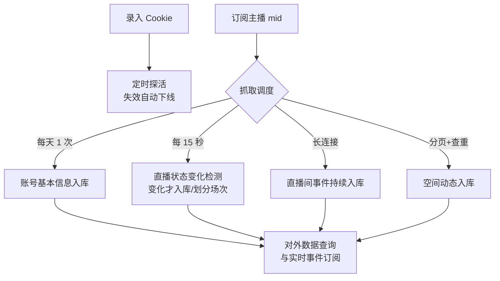

# B站主播数据抓取与订阅服务

**功能名称**: B站主播数据抓取与订阅服务
**PRD 版本**: v1.0
**创建日期**: 2026-08-13
**作者**: Deliay

## 背景与目标

### 1.1 背景

Z.Vtuber 需要持续跟踪指定 B 站主播的账号信息、直播状态、直播间互动事件（弹幕、礼物、SC 等）以及空间动态，为后续的直播分析、动态聚合等上层能力提供可靠的数据底座。目前系统没有任何 B 站数据采集能力，需要从零建设一套「订阅 → 抓取 → 持久化 → 对外服务」的完整链路。

### 1.2 目标

- 支持以 B 站用户 mid 为单位订阅/取消订阅主播，被订阅主播的数据被持续、自动地抓取与存储。
- 抓取过程具备账号（Cookie）池化与失效自动下线能力，保证抓取长期稳定运行。
- 直播状态变化（开播/下播/改标题）可被精确还原为带时间线的历史记录，并能划分出独立的「直播场次」。
- 直播间事件与空间动态完整入库、严格去重。
- 对外提供稳定的数据查询与实时事件订阅能力。

### 1.3 成功标准

- 订阅一个主播后：24 小时内完成其账号基本信息入库；其开播后直播状态记录延迟不超过 15 秒级抓取周期；直播期间事件持续入库。
- 直播状态记录无重复冗余（同一房间标题+状态未变化时不产生新记录），且每一场直播可被唯一标识。
- 空间动态多次抓取不产生重复数据，断档后能自动补齐。
- 失效 Cookie 在探测周期内被自动下线，不再参与抓取。
- 对外数据接口全部可用，实时事件订阅可即时收到调用时刻之后的直播间事件。

## 用户分析

### 2.1 目标用户

- 内部前端应用（apps/web）及后续内部服务：消费主播数据、直播状态与事件流。
- 运营/管理者：维护订阅主播列表与 Cookie 池。

### 2.2 用户场景

| 场景 | 用户角色 | 目标 | 痛点 |
|--|--|--|--|
| 追踪某主播直播情况 | 内部应用 | 获取主播当前是否在播、直播标题及历史场次 | B 站无推送，需要自行高频轮询 |
| 分析直播互动 | 内部应用 | 回放/实时接收直播间弹幕、礼物等事件 | 事件量大且需要长连接抓取 |
| 聚合主播动态 | 内部应用 | 获取主播发布的全部空间动态 | 动态接口分页线性，需查重与断点续抓 |
| 维护抓取账号 | 运营 | 添加 Cookie，失效账号自动下线 | 手工探活成本高 |

## 功能需求

### 3.1 功能概述

建设一套 B 站数据抓取与订阅服务：维护 Cookie 池与订阅主播列表，对被订阅主播按不同周期抓取账号基本信息、直播状态、直播间事件与空间动态并持久化，对外提供查询与实时事件订阅能力。

### 3.2 功能列表

#### 功能点 1: Cookie 池管理与自动探活
- **描述**: 系统维护一个 Cookie 列表作为抓取账号池。通过定时任务逐个探测 Cookie 有效性（以「获取导航信息」能力探测），失效的 Cookie 自动下线，不再参与任何抓取。
- **用户价值**: 抓取长期稳定，无需人工巡检账号有效性。
- **验收标准**:
  - [ ] Cookie 可被录入系统并参与抓取调度
  - [ ] 定时探活任务按周期执行，失效 Cookie 被标记下线且不再被选用
  - [ ] 抓取请求在多个有效 Cookie 间轮流（round-robin）分配

#### 功能点 2: 订阅主播列表管理
- **描述**: 支持查看订阅主播列表、按 mid 订阅主播、取消订阅。仅被订阅的主播进入抓取范围。
- **用户价值**: 按需控制抓取对象，避免无效抓取。
- **验收标准**:
  - [ ] 可获取当前全部订阅的 mid 列表
  - [ ] 可新增订阅（重复订阅不产生重复记录）
  - [ ] 可取消订阅，取消后不再新增抓取数据

#### 功能点 3: 主播账号基本信息抓取
- **描述**: 对每个被订阅主播，按天为周期抓取一次其账号空间信息，并将结果作为账号基本信息（bilibili_account_basic_info）持久化保存。
- **用户价值**: 提供主播昵称、头像、签名、等级等基础画像数据。
- **验收标准**:
  - [ ] 每个被订阅主播每天至少完成一次抓取
  - [ ] 抓取结果被持久化，可供查询

#### 功能点 4: 直播状态高频抓取与场次划分
- **描述**: 对每个被订阅主播的直播间，每 15 秒抓取一次直播间标题、房间 ID、直播状态。仅当同一房间的「标题 + 直播状态」相对最后一条记录发生变化时才新增一条持久化记录（bilibili_live_status）。当直播状态由「未开播」变为「开播」时生成一个新的直播场次标识（直播 UUID），同一场直播内的标题变化沿用同一场次标识，下播后再开播生成新标识。
- **用户价值**: 以最小冗余还原直播状态时间线，并可按场次聚合直播数据。
- **验收标准**:
  - [ ] 状态未变化时不产生新记录
  - [ ] 标题变化或直播状态变化时产生新记录
  - [ ] 未开播 → 开播生成新直播 UUID；开播 → 未开播、标题变化均不改变当前场次 UUID
  - [ ] 房间 ID 来源于该主播已入库的账号基本信息

#### 功能点 5: 直播间事件抓取
- **描述**: 对被订阅主播的直播间建立长连接，持续抓取直播间全部事件（弹幕、礼物、SC、进场等），每条事件连同其发生时间一并持久化。
- **用户价值**: 完整沉淀直播互动数据，支持回放与实时消费。
- **验收标准**:
  - [ ] 直播期间事件持续入库且携带时间
  - [ ] 事件类型覆盖弹幕、礼物、SC 等直播间主要事件

#### 功能点 6: 空间动态抓取与断点续抓
- **描述**: 每 30 秒抓取一次被订阅主播空间动态列表（bilibili_user_space_timeline）。动态为线性时间线：每抓一页后与库中已有数据比对——若整页动态均已入库（按动态 id 批量命中且数量相等），说明已与历史数据「接上」，停止向下翻页；否则继续向下抓取。入库严格按动态 id 去重。
- **用户价值**: 动态数据完整且不重复，抓取不过度翻页浪费配额。
- **验收标准**:
  - [ ] 每个被订阅主播每 30 秒完成一轮动态抓取
  - [ ] 同一动态多次抓取仅保留一条
  - [ ] 整页命中已入库数据时停止继续翻页
  - [ ] 存在断档时能持续向下翻页直至接上

#### 功能点 7: 对外数据服务
- **描述**: 对外提供以下数据能力：
  1. 查询指定主播的账号基本信息
  2. 分页查询指定直播间的全部直播状态历史
  3. 查询指定直播间最新一条直播状态
  4. 以事件流（EventSource）方式实时接收指定直播间自调用时刻起正在发生的事件
  5. 查询指定直播间在一段时间范围内的事件
  6. 分页查询指定主播的空间动态
- **用户价值**: 上层应用可消费全部沉淀数据。
- **验收标准**:
  - [ ] 六项数据能力全部可用
  - [ ] 历史状态与动态支持分页
  - [ ] 实时事件流仅推送建立连接之后发生的事件

### 3.3 用户操作流程

### 3.4 页面/界面描述

本需求为纯后端数据服务，无自有界面；数据经由 API 供 `apps/web` 等前端消费。

| 页面 | 描述 | 关键元素 |
|------|------|---------|
| （无） | 本期不交付前端页面 | — |

### 3.5 异常与边界情况

| 情况 | 预期行为 |
|------|---------|
| Cookie 全部失效 | 抓取暂停并产生可观测告警，探活任务继续运行 |
| 主播未开播 | 直播状态记录按规则入库（状态为未开播），事件抓取不产生数据 |
| 直播间长连接断开 | 自动重连，重连期间事件允许缺失，不阻塞其他抓取任务 |
| 动态接口翻页到末尾仍未接上 | 抓取到无更多数据为止，全部入库去重 |
| 单次抓取处理时间超过抓取周期 | 同一 mid/roomId 的下一轮抓取等待本轮完成后再开始，不并发重入；不同抓取对象之间互不影响 |
| 重复订阅同一 mid | 幂等处理，不产生重复订阅 |
| 取消订阅后 | 停止该主播全部抓取任务，历史数据保留可查 |

## 四、非功能需求

### 4.1 性能要求

- 直播状态抓取周期 15 秒，单次抓取与入库在周期内完成。
- 空间动态抓取周期 30 秒。
- 实时事件从接收到对外推送的延迟应控制在秒级。
- 同一抓取对象（按 mid / roomId 维度）的抓取任务串行执行：上一轮未处理完成时，下一轮等待其完成后再开始，不并发重入。

### 4.2 安全性要求

- Cookie 属于敏感凭据，存储与日志输出均需避免明文泄露。
- 对外接口本期面向内部应用，暂不引入鉴权，但需为后续接入鉴权预留空间。

### 4.3 兼容性要求

- 数据持久化需兼容后续字段扩展（B 站接口返回字段可能变化，原始报文应可完整留存）。

## 五、依赖与约束

### 5.1 依赖

- B 站公开接口与直播长连接协议的可用性。
- 有效的 B 站账号 Cookie（由运营录入）。

### 5.2 约束

- 抓取频率需遵守本需求定义的周期（账号信息 1 天 1 次、直播状态 15 秒 1 次），不得随意提高频率触发风控。
- 遵循 `docs/engineering/common-rules.md` 的 TDD、契约式开发与评审要求。

## 六、相关文档

- 技术提案：`docs/engineering/proposals/20260813-proposal-bilibili-live-crawler.md`
- 开发规范：`docs/engineering/common-rules.md`
