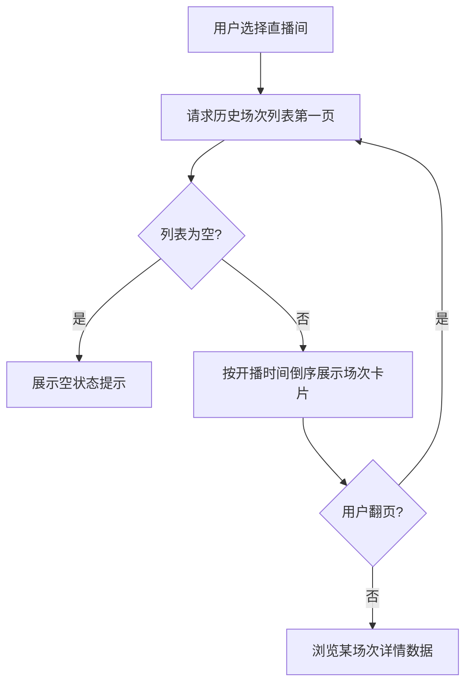

# 直播场次历史查询与分页排序统一

**功能名称**: 直播场次历史查询与分页排序统一
**PRD 版本**: v1.0
**创建日期**: 2026-08-15
**作者**: Deliay

## 背景与目标

### 1.1 背景

Z.Vtuber 已具备 B 站主播数据采集能力：系统持续抓取主播的账号信息、直播状态、直播事件与空间动态，并已在抓取过程中还原出一场场独立的「直播场次」数据（含开播时间、下播时间、弹幕数、收益、观看数等汇总指标）。但这些场次数据目前仅沉淀在系统内部，上层无法查询某个直播间的历史直播记录。

同时，系统对外的多个分页列表在排序规则上不一致：部分列表按数据被抓取入库的时间排序，用户看到的"最新"并不一定是业务意义上"最新发生"的内容，浏览体验不一致。

### 1.2 目标

- 用户可按直播间查询其历史直播场次列表，每场直播的关键指标一目了然。
- 系统内所有分页列表统一按"业务创建时间倒序"展示——最新发生的内容永远排在最前面，排序语义清晰、一致。

### 1.3 成功标准

- 指定任意一个直播间，可分页查询到该直播间的全部历史场次，且列表按开播时间从新到旧排列。
- 系统内所有分页列表的排序规则统一为创建时间倒序，无遗漏、无例外。
- 分页查询在数据量增长后仍保持稳定响应（翻页查询不随总数据量线性变慢）。

## 用户分析

### 2.1 目标用户

- 直播数据消费者（运营、粉丝、数据分析人员）：关心主播的历史直播表现。
- 上层功能开发者：依赖一致、可预期的分页排序语义来构建列表类页面。

### 2.2 用户场景

| 场景 | 用户角色 | 目标 | 痛点 |
|--|--|--|--|
| 回顾主播最近的直播 | 数据消费者 | 看到该直播间最近几场直播的时间与数据 | 无法查询历史场次，只能看到当前直播状态 |
| 浏览动态/状态等分页列表 | 数据消费者 | 最新内容排在最前 | 部分列表按入库时间排序，内容顺序与业务时间线不符 |
| 构建列表页 | 上层开发者 | 分页排序语义统一 | 不同列表排序规则不同，需分别适配 |

## 功能需求

### 3.1 功能概述

新增"直播间历史场次"分页查询能力，并将系统内所有分页列表的排序统一为创建时间倒序。

### 3.2 功能列表

#### 功能点 1: 直播间历史场次分页查询

- **描述**: 针对指定直播间，提供其历史直播场次的分页列表查询。每场直播展示：直播标题、封面、分区、开播时间、下播时间（未下播时标识为进行中）、弹幕数、总收益、观看数、点赞数、付费数、最高在线人数。列表按开播时间从新到旧排列。
- **用户价值**: 让历史直播数据可被消费，支撑直播回顾、场次对比等上层场景。
- **验收标准**:
  - [ ] 查询一个有多场历史直播的直播间，返回的场次按开播时间倒序排列，且分页翻页后不重复、不遗漏。
  - [ ] 进行中的场次（未下播）也能在列表中正确展示，并带有明确的进行中标识。
  - [ ] 查询不存在或无历史场次的直播间时，返回空列表而非错误。
  - [ ] 分页参数（页码、每页条数）有合理的默认值与边界保护（非法输入被纠正或拒绝）。

#### 功能点 2: 分页列表排序统一为创建时间倒序

- **描述**: 系统内所有分页列表统一按"业务创建时间"倒序返回，即最新创建/发生的记录排在最前面。对仅有入库时间、没有独立业务创建时间的列表，需补齐业务时间语义后按业务时间排序，确保"最新发生的内容在最前"这一体验在所有列表中一致。
- **用户价值**: 列表排序行为可预期、跨页面一致，用户总能第一时间看到最新内容。
- **验收标准**:
  - [ ] 逐一核查系统内全部分页列表，排序均为创建时间倒序。
  - [ ] 每个分页列表都有对应验证，确认翻页后的顺序严格倒序、无乱序。
  - [ ] 排序调整不影响既有分页参数语义（页码、每页条数、总数）。

### 3.3 用户操作流程

### 3.4 页面/界面描述

| 页面 | 描述 | 关键元素 |
|------|------|---------|
| 直播间历史场次列表 | 展示指定直播间的历史直播场次 | 场次卡片（标题、封面、开播/下播时间、弹幕数、收益、观看数）、进行中标识、分页控件 |

### 3.5 异常与边界情况

| 情况 | 预期行为 |
|------|---------|
| 直播间无任何历史场次 | 返回空列表，总数为 0，页面展示空状态 |
| 请求页码超出总页数 | 返回空列表，总数保持真实值 |
| 分页参数非法（负数、0、超大每页条数） | 纠正到合法范围或按边界值处理，不产生错误响应 |
| 场次仍在进行中（无下播时间） | 正常返回，下播时间为空并标识为进行中 |

## 四、非功能需求

### 4.1 性能要求

- 历史场次分页查询在单场直播数据量达到万级时，响应时间保持在百毫秒量级。
- 翻页查询代价不随总数据量线性增长。

### 4.2 安全性要求

- 与系统现有数据查询能力保持一致，本期不新增鉴权要求。

### 4.3 兼容性要求

- 分页排序调整为行为修正，不改变既有分页参数与响应结构，已有调用方无需修改代码，仅需知悉排序变化。

## 五、依赖与约束

### 5.1 依赖

- 依赖既有抓取链路产出的直播场次数据（抓取周期内持续累积）。

### 5.2 约束

- 不改变既有抓取链路与数据写入逻辑，本需求仅涉及查询侧能力。
- 分页排序统一范围以系统当前全部分页列表为准，后续新增分页列表必须遵循同一规则。

## 六、相关文档

- 技术提案：`docs/engineering/proposals/20260815-proposal-bilibili-live-history.md`
- 既有 PRD：`docs/product/draft/20260813-bilibili-live-crawler-prd.md`
