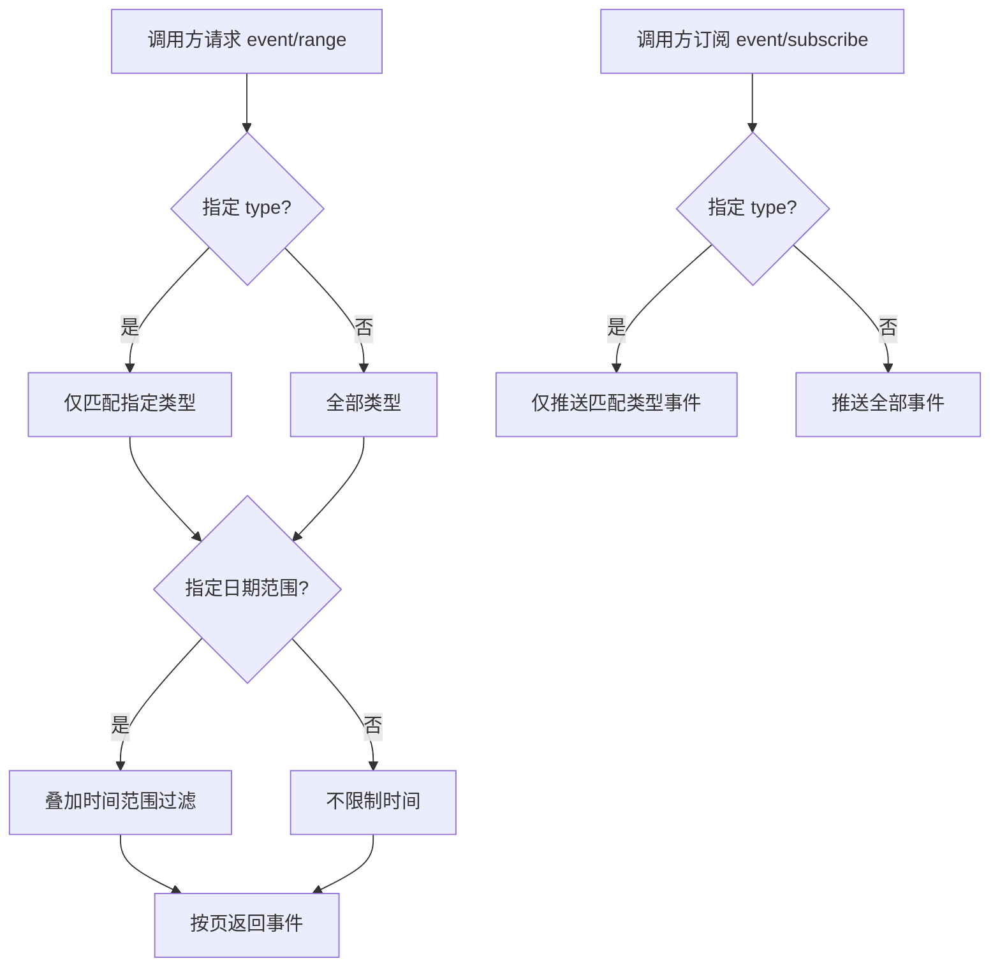

# 直播事件查询与订阅筛选

**功能名称**: 直播事件查询与订阅筛选
**PRD 版本**: v1.0
**创建日期**: 2026-08-15
**作者**: Deliay

## 背景与目标

### 1.1 背景

Z.Vtuber 通过弹幕长连接持续沉淀直播间实时事件（弹幕、礼物、醒目留言、上舰等），并对外提供两类消费方式：

- 历史查询：`GET /api/b/live/{roomId}/event/range` 按时间段拉取历史事件。当前实现一次性返回范围内**全部**事件，既不支持分页，也不支持按事件类型筛选；日期范围参数为必填，调用方即使只想看最近的某类事件也必须圈定一个时间范围。一场热门直播的事件量可达数万条，全量返回响应体巨大，调用方只能自行在客户端翻找，效率极低。
- 实时订阅：`GET /api/b/live/{roomId}/event/subscribe` 以 SSE 推送直播间实时事件。当前实现推送该直播间的**所有**类型事件，调用方只关心弹幕或礼物时也必须全量接收再自行过滤，白白消耗带宽与处理成本。

### 1.2 目标

- `event/range` 支持分页（页码 + 每页条数 + 总数），与系统内其他分页列表行为一致。
- `event/range` 支持按事件类型筛选（可指定一个或多个类型），日期范围筛选保留但改为可选。
- `event/subscribe` 支持传入多个 `type` 参数，只推送订阅方感兴趣的事件类型。

### 1.3 成功标准

- `event/range` 可按页拉取事件，翻页结果不重复、不遗漏，`total` 为筛选条件下的真实条数。
- `event/range` 传入一个或多个 `type` 时，仅返回对应类型的事件；不传时返回全部类型。
- `event/range` 的日期范围参数可选，传入时筛选语义与现状一致（含起止边界）。
- `event/subscribe` 传入多个 `type` 时，仅推送匹配类型的事件；不传时行为与现状完全一致。

## 用户分析

### 2.1 目标用户

- 直播数据消费者（运营、粉丝、数据分析人员）：需要回溯或实时跟踪直播间的特定类型事件。
- 上层功能开发者：需要在弹幕回放、礼物统计、实时弹幕流等功能上接入事件数据，依赖可分页、可筛选的查询与订阅语义。

### 2.2 用户场景

| 场景 | 用户角色 | 目标 | 痛点 |
|--|--|--|--|
| 回放某场直播的弹幕 | 数据消费者 | 分页浏览该场直播的全部弹幕 | 一次返回数万条，无法分页浏览 |
| 统计某场直播的礼物与醒目留言 | 数据分析人员 | 只拉取 gift/super_chat 类型事件 | 无法按类型筛选，需全量拉取后自行过滤 |
| 实时展示直播间弹幕流 | 上层开发者 | 只接收 danmaku 类型推送 | SSE 全量推送，无关事件占用带宽与解析成本 |
| 查看直播间最近的互动事件（不限时间） | 数据消费者 | 不圈定时间范围直接看最近事件 | startedAt/endedAt 必填，必须先猜一个范围 |

## 功能需求

### 3.1 功能概述

增强直播事件的历史查询与实时订阅两个端点：`event/range` 增加分页能力与事件类型筛选，日期范围改为可选；`event/subscribe` 增加多事件类型过滤。事件类型以系统归一化后的类型名为准（如 `danmaku`、`gift`、`super_chat`、`guard_buy`、`interact` 等）。

### 3.2 功能列表

#### 功能点 1: event/range 支持分页

- **描述**: `GET /api/b/live/{roomId}/event/range` 新增 `page`、`pageSize` 参数，返回结构调整为分页结构（`total`、`page`、`pageSize`、`items`），与系统内其他分页列表一致。事件仍按发生时间（occurredAt）升序返回。
- **用户价值**: 调用方可逐页浏览海量历史事件，响应体大小可控。
- **验收标准**:
  - [ ] 传入 `page`/`pageSize` 时按页返回，`total` 为筛选条件下的真实总条数。
  - [ ] 在筛选条件不变的前提下翻页，结果不重复、不遗漏。
  - [ ] `pageSize` 超出上限时按系统统一规则钳制（1-100）。
  - [ ] 请求页码超出总页数时返回空列表，`total` 保持真实值。

#### 功能点 2: event/range 支持事件类型筛选与可选日期范围

- **描述**: `event/range` 新增可重复的 `type` 参数（如 `type=danmaku&type=gift`），传入时仅返回指定类型的事件；不传时返回全部类型。日期范围参数 `startedAt`/`endedAt` 由必填改为可选，均可单独传入（单侧边界），均不传则不限制时间；传入时含起止边界，语义与现状一致。
- **用户价值**: 调用方可精确圈定关心的事件类型与时间段，避免全量拉取。
- **验收标准**:
  - [ ] 传入单个 `type` 时仅返回该类型事件。
  - [ ] 传入多个 `type` 时返回这些类型事件的合集。
  - [ ] 传入不存在的事件类型时返回空列表，不报错。
  - [ ] 只传 `startedAt` 或只传 `endedAt` 时按单侧边界正确过滤；均不传时不限制时间。
  - [ ] `startedAt` 晚于 `endedAt` 时返回明确的参数错误（400）。

#### 功能点 3: event/subscribe 支持多事件类型过滤

- **描述**: `GET /api/b/live/{roomId}/event/subscribe` 新增可重复的 `type` 参数，订阅方仅接收类型匹配的事件推送；不传 `type` 时推送全部事件，行为与现状完全一致。过滤在服务端完成，不匹配的事件不下发。
- **用户价值**: 订阅方只接收感兴趣的事件，显著降低带宽与客户端过滤成本。
- **验收标准**:
  - [ ] 传入一个 `type` 时仅推送该类型事件。
  - [ ] 传入多个 `type` 时推送这些类型事件的合集。
  - [ ] 不传 `type` 时推送全部事件，与现状一致。
  - [ ] SSE 推送格式（`event:`/`data:` 字段）不变。

### 3.3 用户操作流程

### 3.4 页面/界面描述

本需求为数据查询与订阅能力增强，不涉及新页面。上层页面（弹幕回放、实时弹幕流等）可基于此能力接入，不在本期范围。

### 3.5 异常与边界情况

| 情况 | 预期行为 |
|------|---------|
| 筛选条件下无任何事件 | 返回空列表，总数为 0 |
| 传入不存在的事件类型 | 返回空列表（查询）/无推送（订阅），不报错 |
| 只传 startedAt 或只传 endedAt | 按单侧边界过滤（含边界），照常分页 |
| startedAt 晚于 endedAt | 返回明确的参数错误（400），不返回数据 |
| 时间格式非法 | 返回明确的参数错误（400） |
| 请求页码超出范围内总页数 | 返回空列表，总数保持真实值 |
| 同一 type 参数重复传入 | 去重后按合集处理 |
| type 参数值为空字符串 | 视为未传入该值（忽略） |

## 四、非功能需求

### 4.1 性能要求

- 带类型与时间范围的分页查询在单直播间事件量达到十万级时，响应时间保持在百毫秒量级。
- 分页与筛选不得退化为全量扫描后内存过滤，翻页代价不随总数据量线性增长。
- `event/subscribe` 的类型过滤为常量级开销，不影响既有推送时延。

### 4.2 安全性要求

- 与系统现有数据查询能力保持一致，本期不新增鉴权要求。

### 4.3 兼容性要求

- `event/subscribe` 不传 `type` 时行为与现状完全一致，已有订阅方无需修改。
- `event/range` 响应结构由简单列表调整为分页结构（新增 `total`/`page`/`pageSize` 字段，`items` 内字段不变），属于本需求明确要求的分页改造，调用方需按新结构适配；日期参数由必填放宽为可选，对既有传参的调用方保持兼容。

## 五、依赖与约束

### 5.1 依赖

- 依赖既有弹幕长连接链路持续产出并落库的直播事件数据。
- 事件类型以 `DanmakuEventNormalizer` 归一化后的类型名为准，本期不改变归一化规则。

### 5.2 约束

- 分页参数命名、取值范围与系统内其他分页列表保持统一（`page`/`pageSize`，pageSize 上限 100）。
- 时间参数命名与语义与系统内既有规范一致（`startedAt`/`endedAt`，含边界，UTC）。
- 事件排序维持按发生时间升序，不改变既有排序语义。

## 六、相关文档

- 技术提案：`docs/engineering/proposals/20260815-proposal-live-event-filter.md`
- 既有 PRD：`docs/product/draft/20260815-pagination-time-range-prd.md`
