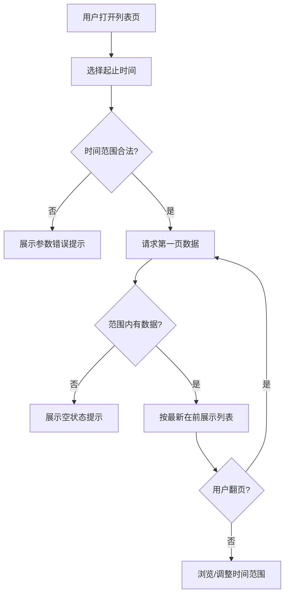

# 分页列表时间范围筛选

**功能名称**: 分页列表时间范围筛选
**PRD 版本**: v1.0
**创建日期**: 2026-08-15
**作者**: Deliay

## 背景与目标

### 1.1 背景

Z.Vtuber 持续沉淀主播的空间动态、直播状态、直播场次等历史数据，并对外提供分页列表查询能力。随着数据量增长，用户只能按页码顺序翻阅列表，无法定位到某一时间段内的内容——例如想看某位主播"上个月发的动态"、"上周的直播状态变化"，目前只能一页页翻找，效率极低。

其中动态列表的时间语义需要特别说明：动态的"业务时间"是动态的**发布时间**（原始数据中的 `pub_ts` 字段，嵌套在动态数据内部），而不是数据被抓取入库的时间。用户关心的是"什么时候发的"，不是"什么时候被抓到的"。

### 1.2 目标

- 系统内**所有**分页列表均支持按时间范围检索，用户可指定起止时间，只返回该时间段内的内容。
- 动态列表的时间范围以动态的**发布时间**为准，与用户在 B 站看到的发布时间一致。
- 时间范围检索与既有分页能力（页码、每页条数、总数）无缝组合使用。

### 1.3 成功标准

- 全部分页列表均可传入起止时间进行筛选，无一遗漏。
- 在动态列表中按某时间范围检索，返回的每条动态的发布时间均落在该范围内，且翻页后不重复、不遗漏。
- 不传时间范围时，各列表行为与现状完全一致（向后兼容）。

## 用户分析

### 2.1 目标用户

- 直播数据消费者（运营、粉丝、数据分析人员）：需要按时间段回溯主播的动态与直播历史。
- 上层功能开发者：需要在列表类页面上提供时间段筛选能力，依赖统一、可预期的筛选语义。

### 2.2 用户场景

| 场景 | 用户角色 | 目标 | 痛点 |
|--|--|--|--|
| 回溯主播某月发布的动态 | 数据消费者 | 只看该时间段内的动态 | 只能按页翻找，数据量大时几乎不可行 |
| 查看直播间上周的直播状态变化 | 数据消费者 | 限定时间段浏览状态历史 | 无法按时间过滤，需人工翻页定位 |
| 汇总主播某季度的直播场次 | 数据分析人员 | 拉取该季度全部场次做统计 | 无法按开播时间圈定范围 |
| 在列表页提供时间段筛选 | 上层开发者 | 各列表筛选语义一致 | 若各列表规则不一，需分别适配 |

## 功能需求

### 3.1 功能概述

为系统内所有分页列表增加可选的时间范围检索能力：调用方传入起始时间与截止时间（均可选），列表只返回业务时间落在该范围内的记录，并照常支持分页。动态列表的业务时间为动态的发布时间。

### 3.2 功能列表

#### 功能点 1: 动态列表按发布时间范围检索

- **描述**: 主播空间动态的分页列表支持按时间范围筛选，时间以动态的**发布时间**为准（原始动态数据中的发布时间字段，非入库时间）。传入起止时间后，仅返回发布于该范围内的动态；列表仍按既有规则（最新在前）排序。
- **用户价值**: 用户可直接定位任意时间段内主播发布的动态，与 B 站上看到的发布时间口径一致。
- **验收标准**:
  - [ ] 指定起止时间查询动态列表，返回动态的发布时间全部落在范围内。
  - [ ] 时间范围内翻页，结果不重复、不遗漏，总数为范围内真实条数。
  - [ ] 只传起始时间或只传截止时间时，按单侧边界正确过滤。
  - [ ] 不传时间参数时，返回结果与现状完全一致。

#### 功能点 2: 其余分页列表统一支持时间范围检索

- **描述**: 系统内除动态列表外的所有分页列表（如直播状态历史、直播场次历史）同样支持按时间范围筛选，各列表以各自的业务时间为准：直播状态历史按状态记录时间，直播场次历史按开播时间。
- **用户价值**: 所有列表的时间筛选行为一致、可预期，上层可统一接入。
- **验收标准**:
  - [ ] 逐一核查系统内全部分页列表，均支持时间范围检索，无遗漏。
  - [ ] 每个列表的时间字段语义明确文档化，筛选结果均落在传入范围内。
  - [ ] 时间范围筛选与各列表既有排序规则兼容（范围内仍按最新在前）。

#### 功能点 3: 时间范围参数的统一规范与边界处理

- **描述**: 所有分页列表的时间范围参数名称、格式、边界行为保持统一：起止时间均可选；起始时间含边界、截止时间含边界；起始时间晚于截止时间时给出明确的错误提示而非静默返回异常数据。
- **用户价值**: 调用方一次理解、处处适用；非法输入有明确反馈，便于排查。
- **验收标准**:
  - [ ] 所有分页列表的时间范围参数命名与格式一致。
  - [ ] 起始时间晚于截止时间时，返回明确的参数错误提示。
  - [ ] 时间格式非法时，返回明确的参数错误提示。

### 3.3 用户操作流程

### 3.4 页面/界面描述

本需求为数据查询能力增强，不涉及新页面。上层列表页可基于此能力增加时间段筛选控件（起止时间选择器），不在本期范围。

### 3.5 异常与边界情况

| 情况 | 预期行为 |
|------|---------|
| 时间范围内无任何数据 | 返回空列表，总数为 0 |
| 只传起始时间 | 返回该时间之后（含）的全部数据，照常分页 |
| 只传截止时间 | 返回该时间之前（含）的全部数据，照常分页 |
| 起始时间晚于截止时间 | 返回明确的参数错误，不返回数据 |
| 时间格式非法 | 返回明确的参数错误 |
| 动态原始数据中缺失发布时间 | 该条动态不参与时间范围筛选（仅在不限时间的完整列表中可见） |
| 请求页码超出范围内总页数 | 返回空列表，总数保持范围内真实值 |

## 四、非功能需求

### 4.1 性能要求

- 带时间范围的分页查询在单主播/单直播间数据量达到万级时，响应时间保持在百毫秒量级。
- 时间范围筛选不得退化为全量扫描后内存过滤，翻页代价不随总数据量线性增长。

### 4.2 安全性要求

- 与系统现有数据查询能力保持一致，本期不新增鉴权要求。

### 4.3 兼容性要求

- 时间范围参数为可选参数，不传时各列表行为与现状完全一致，已有调用方无需修改。
- 既有分页参数（页码、每页条数）与响应结构不变。

## 五、依赖与约束

### 5.1 依赖

- 依赖既有抓取链路持续产出的动态、直播状态与直播场次数据。

### 5.2 约束

- 时间范围筛选范围以系统当前全部分页列表为准，后续新增分页列表必须遵循同一规范。
- 动态发布时间以原始动态数据中的发布时间字段为准，不得用入库时间替代。

## 六、相关文档

- 技术提案：`docs/engineering/proposals/20260815-proposal-pagination-time-range.md`
- 既有 PRD：`docs/product/draft/20260815-bilibili-live-history-prd.md`
