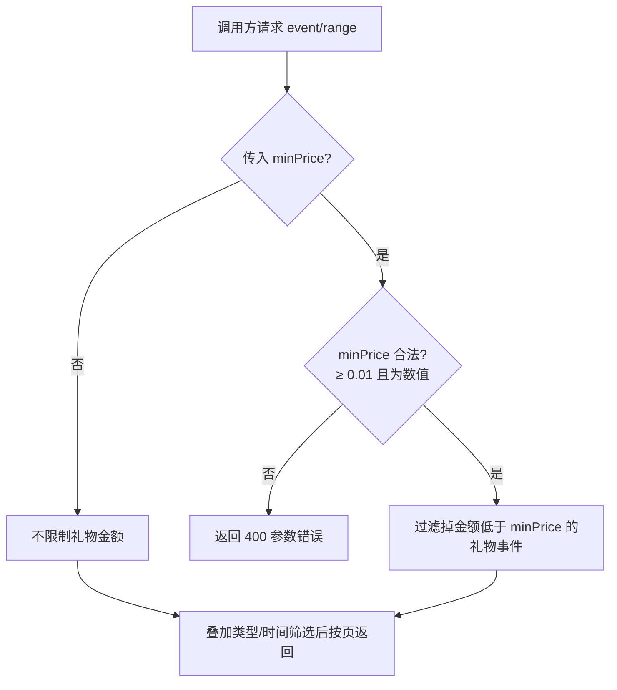

# 礼物事件金额筛选

**功能名称**: 礼物事件金额筛选
**PRD 版本**: v1.0
**创建日期**: 2026-08-17
**作者**: Deliay

## 背景与目标

### 1.1 背景

Z.Vtuber 通过弹幕长连接持续沉淀直播间实时事件（弹幕、礼物、醒目留言、上舰等），并通过 `GET /api/b/live/{roomId}/event/range` 对外提供历史事件查询，已支持分页、事件类型筛选与可选时间范围。

礼物（`gift`）是直播间数量最多的事件类型之一。一场热门直播的礼物事件可达数千条，其中大量是辣条、小心心等低价值礼物。数据消费者关心的是有实际付费价值的高额礼物（如提督贺礼、大额连击），当前只能把全部礼物事件拉回来再自行按金额过滤，效率低、体验差。

### 1.2 目标

- `event/range` 查询礼物事件时，支持传入最低金额 `minPrice`，仅返回金额不低于该值的礼物事件。
- `minPrice` 最小可取 0.01（元），不传则不限制金额，行为与现状完全一致。

### 1.3 成功标准

- 传入 `minPrice` 时，返回的礼物事件金额均不低于该值，`total` 为筛选后的真实条数。
- 不传 `minPrice` 时，查询行为与现状完全一致，既有调用方无需修改。
- `minPrice` 小于 0.01 或格式非法时，返回明确的参数错误。

## 用户分析

### 2.1 目标用户

- 直播数据消费者（运营、粉丝、数据分析人员）：需要回溯某场直播的高价值礼物，评估付费互动质量。
- 上层功能开发者：需要在礼物榜单、付费统计、大额礼物播报等功能上接入礼物数据，依赖按金额圈定范围的能力。

### 2.2 用户场景

| 场景 | 用户角色 | 目标 | 痛点 |
|--|--|--|--|
| 统计某场直播的大额礼物 | 数据分析人员 | 只看金额 ≥ 10 元的礼物事件 | 需全量拉取礼物事件后自行过滤 |
| 制作直播间礼物贡献榜 | 上层开发者 | 按金额阈值圈定有效付费礼物 | 低价值免费/低价礼物淹没有效数据 |
| 回放任一直播间全部礼物 | 数据消费者 | 不传金额条件浏览全部礼物 | 现状可用，需保持不变 |

## 功能需求

### 3.1 功能概述

增强直播事件历史查询端点 `GET /api/b/live/{roomId}/event/range`：新增可选金额筛选参数 `minPrice`（单位：元），传入时仅返回金额不低于该值的礼物事件；不传时不限制金额。金额筛选只作用于礼物（`gift`）类型事件，不影响其他类型事件的返回。

### 3.2 功能列表

#### 功能点 1: 礼物事件按最低金额筛选

- **描述**: `event/range` 新增可选参数 `minPrice`，含义为「礼物金额下限（元）」。传入时，金额低于该值的礼物事件不出现在结果中；金额等于该值的礼物事件正常返回（含边界）。礼物金额以礼物事件本身携带的付费金额为准，免费礼物（银瓜子等）金额视为 0。
- **用户价值**: 调用方可直接圈定关心的礼物金额区间，避免全量拉取后客户端自行过滤。
- **验收标准**:
  - [ ] 传入 `minPrice` 时，返回的 `gift` 类型事件金额均不低于该值（含边界）。
  - [ ] `minPrice` 与其他筛选条件（类型、时间范围）叠加生效，`total` 为叠加后的真实条数。
  - [ ] 筛选条件下翻页结果不重复、不遗漏。

#### 功能点 2: 不传 minPrice 时不限制金额

- **描述**: `minPrice` 为可选参数，不传时不做任何金额过滤，返回全部礼物事件，行为与现状完全一致。
- **用户价值**: 既有调用方零改动兼容。
- **验收标准**:
  - [ ] 不传 `minPrice` 时返回结果与现状一致（含免费礼物与任意金额礼物）。
  - [ ] 不传 `minPrice` 时其他参数（分页、类型、时间）行为不变。

#### 功能点 3: minPrice 参数校验

- **描述**: `minPrice` 最小可取值为 0.01（元），支持任意精度小数；小于 0.01 或无法解析为数值时，返回明确的参数错误（400）。
- **用户价值**: 非法输入有清晰反馈，避免歧义结果。
- **验收标准**:
  - [ ] `minPrice=0.01` 合法并生效。
  - [ ] `minPrice` 小于 0.01（如 0、0.001、负数）时返回 400 及明确错误信息。
  - [ ] `minPrice` 为非数值（如 `abc`）时返回 400。

### 3.3 用户操作流程

### 3.4 页面/界面描述

本需求为数据查询能力增强，不涉及新页面。上层页面（礼物榜单、付费统计等）可基于此能力接入，不在本期范围。

### 3.5 异常与边界情况

| 情况 | 预期行为 |
|------|---------|
| 不传 minPrice | 不限制金额，行为与现状一致 |
| minPrice 小于 0.01（含 0、负数） | 返回明确的参数错误（400），不返回数据 |
| minPrice 为非数值 | 返回明确的参数错误（400） |
| minPrice 恰好为 0.01 | 合法，仅过滤掉免费（金额为 0）礼物 |
| 筛选条件下无满足金额的礼物 | 返回空列表，总数为 0 |
| minPrice 与非 gift 类型筛选组合（如 type=danmaku&minPrice=10） | 金额筛选只作用于礼物事件；非礼物事件不受 minPrice 影响照常返回 |
| 历史礼物事件缺少金额信息 | 视为金额为 0，传入 minPrice 时不返回 |
| 请求页码超出范围内总页数 | 返回空列表，总数保持真实值 |

## 四、非功能需求

### 4.1 性能要求

- 叠加金额筛选的分页查询在单直播间事件量达到十万级时，响应时间保持在百毫秒量级。
- 金额筛选不得退化为查出全部礼物事件后内存过滤，`total` 必须反映筛选后的真实条数。

### 4.2 安全性要求

- 与系统现有数据查询能力保持一致，本期不新增鉴权要求。

### 4.3 兼容性要求

- `minPrice` 为新增可选参数，不传时行为与现状完全一致，既有调用方无需修改。
- 事件响应结构不变，不新增、不删除既有字段。

## 五、依赖与约束

### 5.1 依赖

- 依赖既有弹幕长连接链路持续产出并落库的礼物事件数据。
- 礼物金额以礼物事件原始数据中携带的付费金额为准；免费礼物金额按 0 处理。

### 5.2 约束

- 金额筛选参数命名为 `minPrice`，最小值 0.01，与需求约定一致。
- 分页、时间范围等既有筛选语义不变。
- 事件排序维持既有语义，不改变。

## 六、相关文档

- 技术提案：`docs/engineering/proposals/20260817-proposal-gift-min-price-filter.md`
- 既有 PRD：`docs/product/draft/20260815-live-event-filter-prd.md`
