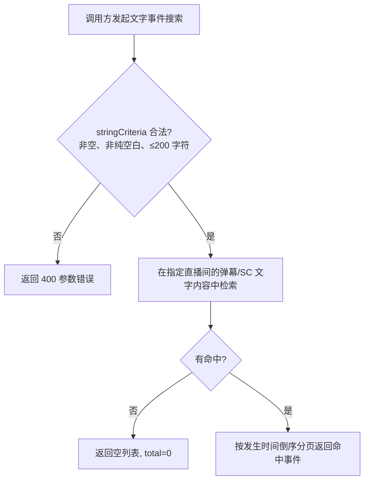

# 直播文字事件搜索

**功能名称**: 直播文字事件搜索
**PRD 版本**: v1.0
**创建日期**: 2026-08-19
**作者**: Deliay

## 背景与目标

### 1.1 背景

Z.Vtuber 持续沉淀直播间实时事件（弹幕、礼物、醒目留言、上舰等），并已提供按类型、时间范围、金额等维度的历史事件分页查询。

弹幕（danmaku）与醒目留言（super_chat，下称 SC）是直播间最核心的文字内容载体，一场热门直播可产生数万至数十万条文字内容。数据消费者经常需要回溯「谁在某个时间点讨论了什么」——例如搜索某个梗、某件商品、某位嘉宾被提及的所有弹幕与 SC。当前只能按类型与时间范围拉取全部事件后自行逐条匹配，数据量大、效率低，无法满足检索诉求。

此外，随着事件数据量增长，同时筛选多个事件类型的查询性能需要保障，避免数据消费者为控制响应时间而被迫拆分多次单类型查询。

### 1.2 目标

- 提供直播文字事件搜索能力：指定直播间，按关键词搜索弹幕与 SC 的文字内容，返回匹配的文字事件，支持分页。
- 搜索范围覆盖弹幕纯文本与 SC 纯文本；命中任一即返回对应事件。
- 多类型事件筛选查询在数据量增长后仍保持可接受的响应速度。

### 1.3 成功标准

- 输入直播间与关键词，返回包含该关键词的弹幕/SC 事件列表，支持翻页浏览，总数为命中的真实条数。
- 关键词为空或非法时返回明确的参数错误。
- 搜索不遗漏已落库的弹幕/SC 文字内容（含搜索能力上线前的历史事件）。
- 多类型筛选的事件分页查询在单直播间十万级事件量下响应时间保持在百毫秒量级。

## 用户分析

### 2.1 目标用户

- 直播数据消费者（运营、粉丝、数据分析人员）：需要回溯直播间内特定话题、梗、商品名的讨论内容。
- 上层功能开发者：需要在切片辅助、舆情分析、内容检索等功能上接入文字检索能力。

### 2.2 用户场景

| 场景 | 用户角色 | 目标 | 痛点 |
|--|--|--|--|
| 回溯某话题在直播中的讨论 | 数据分析人员 | 搜索关键词命中的全部弹幕与 SC | 需按类型拉全量事件后自行逐条匹配 |
| 切片辅助定位高能片段 | 上层开发者 | 按关键词定位事件发生时间点 | 无检索能力，定位成本高 |
| 一次查询多种类型事件 | 上层开发者 | 单次查询拉回弹幕+礼物+SC | 数据量大时响应变慢，被迫拆成多次查询 |

## 功能需求

### 3.1 功能概述

新增直播文字事件搜索能力：调用方指定直播间与搜索关键词，系统在弹幕与 SC 的文字内容中做全文检索，分页返回命中的事件；同时优化多类型事件筛选查询的性能。

### 3.2 功能列表

#### 功能点 1: 按关键词搜索文字事件

- **描述**: 指定直播间（roomId）与搜索关键词（stringCriteria），在该直播间的弹幕纯文本与 SC 纯文本内容中检索，返回文字内容命中关键词的事件。返回结果为完整事件（与现有事件查询一致的结构），按发生时间倒序排列，支持分页（page/pageSize），`total` 为命中的真实条数。
- **用户价值**: 调用方可直接定位包含指定内容的弹幕与 SC，无需全量拉取后自行匹配。
- **验收标准**:
  - [ ] 传入 roomId 与 stringCriteria 后，返回事件的文字内容均命中关键词。
  - [ ] 弹幕与 SC 均在搜索范围内，命中任一类型即返回对应事件。
  - [ ] 结果按事件发生时间倒序返回，翻页不重复、不遗漏。
  - [ ] `total` 为命中的真实条数，与翻页累加结果一致。

#### 功能点 2: 搜索关键词校验

- **描述**: stringCriteria 为必填参数；为空、仅空白字符或超出长度上限（200 字符）时返回明确的参数错误（400），不返回数据。
- **用户价值**: 非法输入有清晰反馈，避免歧义结果与无意义的全表扫描。
- **验收标准**:
  - [ ] stringCriteria 缺失、为空串或仅空白字符时返回 400 及明确错误信息。
  - [ ] stringCriteria 超过 200 字符时返回 400。
  - [ ] 合法关键词正常返回结果（含无命中时返回空列表、总数为 0）。

#### 功能点 3: 历史事件可搜索

- **描述**: 搜索能力上线前已落库的弹幕与 SC 事件同样可被搜索命中，不做「仅新数据可搜」的限制。
- **用户价值**: 检索范围完整覆盖存量数据，结果可信。
- **验收标准**:
  - [ ] 上线前落库的弹幕/SC 事件，其文字内容命中关键词时可被搜出。

#### 功能点 4: 多类型事件查询性能保障

- **描述**: 事件分页查询同时筛选多个事件类型时，查询性能不随数据量增长而明显劣化；单直播间十万级事件量下响应保持在百毫秒量级。
- **用户价值**: 调用方可放心地在一次查询中组合多种类型，无需拆分请求。
- **验收标准**:
  - [ ] 传入多个类型筛选的分页查询响应时间在数据量增长后仍满足性能要求。
  - [ ] 查询语义（筛选、排序、分页、total）与现状完全一致。

### 3.3 用户操作流程

### 3.4 页面/界面描述

本需求为数据检索能力增强，不涉及新页面。上层页面（内容检索、切片辅助等）可基于此能力接入，不在本期范围。

### 3.5 异常与边界情况

| 情况 | 预期行为 |
|------|---------|
| 不传 stringCriteria / 空串 / 仅空白字符 | 返回明确的参数错误（400），不返回数据 |
| stringCriteria 超过 200 字符 | 返回明确的参数错误（400） |
| 关键词无命中 | 返回空列表，总数为 0 |
| 请求页码超出命中结果总页数 | 返回空列表，总数保持真实值 |
| 关键词含特殊符号或表情 | 按可读文本语义检索，不报错 |
| 非文字类型事件（礼物、上舰等） | 不参与文字搜索，不会被命中返回 |
| 搜索能力上线前落库的弹幕/SC | 与上线后数据同等可被搜索 |

## 四、非功能需求

### 4.1 性能要求

- 文字搜索分页查询在单直播间十万级文字事件量下，响应时间保持在百毫秒量级。
- 多类型筛选的事件分页查询性能不随数据量增长而明显劣化。
- 搜索不得退化为全量拉取后内存匹配，`total` 必须反映命中的真实条数。

### 4.2 安全性要求

- 与系统现有数据查询能力保持一致，本期不新增鉴权要求。

### 4.3 兼容性要求

- 新增搜索能力为独立入口，不改变既有事件查询接口的行为与返回结构。
- 既有事件查询的筛选、排序、分页语义保持不变。

## 五、依赖与约束

### 5.1 依赖

- 依赖既有弹幕长连接链路持续产出并落库的弹幕与 SC 事件数据。
- 弹幕与 SC 的文字内容以事件原始数据中携带的纯文本为准。

### 5.2 约束

- 搜索入参为 roomId + stringCriteria，stringCriteria 长度上限 200 字符。
- 搜索范围限定为弹幕与 SC 两类文字事件，本期不支持其他类型。
- 分页、排序（按发生时间倒序）等查询语义与既有事件查询保持一致。

## 六、相关文档

- 技术提案：`docs/engineering/proposals/20260819-proposal-live-event-text-search.md`
- 既有 PRD：`docs/product/draft/20260815-live-event-filter-prd.md`
