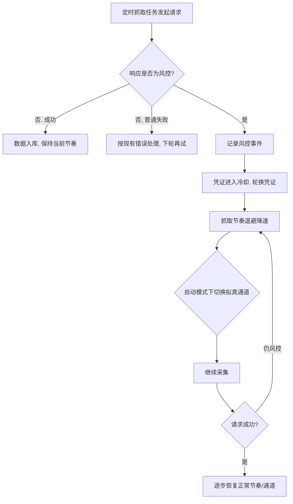

# B 站抓取 412 风控修复

**功能名称**: B 站抓取 412 风控修复
**PRD 版本**: v1.0
**创建日期**: 2026-08-20
**作者**: Deliay

## 背景与目标

### 1.1 背景

近期服务端对 B 站的数据抓取（直播间状态、空间动态、Cookie 探活等）频繁出现 **HTTP 412** 错误，返回「由于触发哔哩哔哩安全风控策略，该次访问请求被拒绝」，导致数据采集中断。

参考社区同类问题的修复实践（[lidaxiao issue #2](https://github.com/worldhello-bj/lidaxiao/issues/2) / [PR #3](https://github.com/worldhello-bj/lidaxiao/pull/3)），412 风控的典型诱因包括：

- 抓取请求特征与真实浏览器差异明显，被风控识别为机器行为；
- 抓取频率过高、访问节奏机械，触发频率类风控；
- 触发风控后无识别与应对机制：当前抓取链路对 412 与普通网络错误一视同仁，无退避、无降速、无备用手段，同一节奏反复重试进一步加剧风控，需要人工介入才能恢复。

### 1.2 目标

- 抓取链路能够**识别**风控响应（HTTP 412 及风控特征），与普通错误区分开；
- 触发风控时能够**自动应对**：降速退避、切换抓取方式、轮换凭证，无需人工介入即可恢复采集；
- 平时主动**降低**触发风控的概率：请求节奏拟人化、频率可控；
- 风控事件**可观测**：能感知风控发生频率、当前抓取通道状态，便于运维判断。

### 1.3 成功标准

- 触发 412 风控后，数据采集可在无人工干预的情况下自动恢复，单次中断时长不超过 30 分钟；
- 风控自动恢复成功率 ≥ 90%（剩余情况可定位到凭证/网络等需人工处理的原因）；
- 修复上线后，因风控导致的数据缺口（应有数据缺失的时间区间）相比修复前下降 ≥ 80%；
- 每次风控触发及应对动作（退避、切通道、换凭证）均有日志可查。

## 用户分析

### 2.1 目标用户

- **站点访问者**：浏览直播间状态、动态时间线等聚合数据，依赖抓取链路持续供数；
- **运营/管理员（Deliay）**：维护 Cookie 池、监控抓取健康度，风控发生时目前是唯一的「人工恢复手段」。

### 2.2 用户场景

| 场景 | 用户角色 | 目标 | 痛点 |
|--|--|--|--|
| 浏览直播间状态/动态 | 站点访问者 | 看到持续更新的数据 | 风控导致数据长时间停更，页面数据陈旧 |
| 抓取触发 412 风控 | 运营/管理员 | 尽快恢复采集 | 当前无自动恢复机制，需人工发现并重启/等待 |
| 判断抓取是否健康 | 运营/管理员 | 快速确认抓取链路状态 | 风控淹没在普通错误日志中，无法量化频率与影响 |

## 功能需求

### 3.1 功能概述

为抓取链路增加风控治理能力：识别风控响应、自动退避降速、在多抓取通道间自动切换、联动 Cookie 凭证轮换，并提供风控事件的可观测性，使 412 风控从「人工处理的故障」变为「自动消化的常态波动」。

### 3.2 功能列表

#### 功能点 1: 风控识别与分类

- **描述**: 抓取请求返回失败时，识别其是否属于 B 站安全风控（如 HTTP 412 及响应中的风控特征），与普通网络错误、业务错误区分处理。
- **用户价值**: 只有正确识别风控，后续退避、切换等动作才能对症执行；也让风控事件可以被单独统计。
- **验收标准**:
  - [ ] 返回 HTTP 412 或风控特征响应时，被明确识别为风控类失败，日志中可区分；
  - [ ] 普通超时、5xx、业务错误码不会被误判为风控；
  - [ ] 识别结果对抓取任务透明，任务无需各自实现风控判断逻辑。

#### 功能点 2: 风控退避与降速

- **描述**: 识别到风控后，抓取链路自动进入退避：指数级拉长重试间隔并叠加随机抖动，避免机械节奏；连续触发时进入冷却期，暂停对该来源的抓取一段时间；恢复成功后逐步回到正常节奏。
- **用户价值**: 风控期内的机械重试只会延长封禁；自动退避让采集以最小代价等待风控解除。
- **验收标准**:
  - [ ] 触发风控后重试间隔逐级拉长且带随机抖动，节奏不固定；
  - [ ] 达到退避上限后进入冷却期，冷却期间不再对同一目标发起请求；
  - [ ] 冷却结束或请求成功后自动恢复正常抓取节奏；
  - [ ] 日常抓取频率可配置，支持整体下调以降低触发风控概率。

#### 功能点 3: 多抓取通道与自动切换

- **描述**: 抓取链路支持两种数据获取通道：直连通道（现有官方 API 调用方式，速度快）与拟真访问通道（模拟真实浏览器访问特征，触发风控概率显著更低）。默认自动模式：优先直连通道，识别到风控后自动降级到拟真通道，风控解除后自动回升。
- **用户价值**: 平时享受直连通道的速度与数据准确性；风控期自动切换到更稳的通道保证数据不中断，兼顾速度与可用性。
- **验收标准**:
  - [ ] 可配置抓取通道模式：直连 / 拟真 / 自动（默认）；
  - [ ] 自动模式下直连通道触发风控后，无需人工介入即可切换至拟真通道继续采集；
  - [ ] 拟真通道获取的数据字段与直连通道一致，消费方无感知；
  - [ ] 通道切换动作有明确日志记录。

#### 功能点 4: 风控与凭证池联动

- **描述**: 某一 Cookie 凭证抓取时触发风控，该凭证自动进入冷却（暂停使用一段时间），抓取自动轮换到其他可用凭证；冷却结束后凭证自动回到可用池。
- **用户价值**: 风控常与单账号访问画像绑定，轮换凭证可分散风控压力，也避免单个凭证被持续施压导致封号。
- **验收标准**:
  - [ ] 凭证触发风控后自动冷却，冷却期内不再被分配抓取任务；
  - [ ] 冷却中的凭证在探活机制下不误判为永久失效，冷却结束自动恢复；
  - [ ] 全部凭证处于冷却时，抓取进入整体退避并产生明显告警日志。

#### 功能点 5: 风控可观测性

- **描述**: 提供风控事件的可观测能力：每次风控触发、退避、通道切换、凭证冷却均有结构化日志；可通过日志或状态端点查看当前各抓取任务的通道状态与风控触发统计。
- **用户价值**: 运营可量化风控频率与影响范围，判断是否需要人工干预（如补充凭证、调整频率）。
- **验收标准**:
  - [ ] 风控触发、退避开始/结束、通道切换、凭证冷却/恢复均产生可检索的日志；
  - [ ] 日志包含目标、通道、凭证标识（脱敏）、退避时长等关键上下文；
  - [ ] 可通过现有服务接口或日志快速确认抓取链路当前是否处于风控应对状态。

### 3.3 用户操作流程

### 3.4 页面/界面描述

本需求为服务端抓取链路治理，不新增用户界面。运维侧通过服务日志与既有健康检查手段观察风控状态。

| 页面 | 描述 | 关键元素 |
|------|------|---------|
| 无新增页面 | 风控状态经日志/状态信息透出 | 结构化日志中的风控事件字段 |

### 3.5 异常与边界情况

| 情况 | 预期行为 |
|------|---------|
| 直连与拟真通道同时被风控 | 进入整体冷却退避，持续告警日志，等待风控解除后自动恢复 |
| Cookie 池全部凭证冷却/离线 | 抓取暂停进入退避，告警提示需要补充凭证；有新凭证录入后自动恢复 |
| 拟真通道因 B 站页面结构变化解析失败 | 按普通失败处理并记录明确日志，不无限重试；提示需要人工跟进适配 |
| 风控解除 | 自动回升直连通道与正常节奏，无需人工操作 |
| 抓取目标本身不存在/无权限（非风控） | 不进入风控应对流程，按现有业务错误处理 |

## 四、非功能需求

### 4.1 性能要求

- 风控未触发时，抓取周期与数据时效性不劣于现状；
- 拟真通道允许比直连通道慢（含拟人化延迟），但单任务单轮采集耗时应控制在分钟级以内；
- 退避与冷却不得阻塞其他抓取任务的正常调度。

### 4.2 安全性要求

- Cookie 等凭证信息不出现在风控事件日志中（仅输出脱敏标识）；
- 抓取行为遵守目标站点的访问礼仪，频率配置默认采取保守值。

### 4.3 兼容性要求

- 不改变对外 API 契约与已入库数据的格式，前端与数据消费方无感知；
- 不触发风控时行为与现状一致，修复可灰度、可回退（配置开关）。

## 五、依赖与约束

### 5.1 依赖

- 现有 Cookie 池与凭证探活机制（凭证轮换、冷却能力在此基础上扩展）；
- 现有定时抓取任务框架（直播状态、空间动态、账号信息、探活）。

### 5.2 约束

- 风控策略由 B 站侧控制且可能变化，方案需保留可配置的调整空间（频率、退避参数、通道模式）；
- 拟真通道的数据可得性受 B 站页面结构约束，需接受其稳定性低于官方 API 的事实并以自动切换兜底。

## 六、相关文档

- 技术提案: `docs/engineering/proposals/20260820-proposal-bilibili-412-fix.md`
- 参考问题: [lidaxiao issue #2 — Bilibili 412 错误](https://github.com/worldhello-bj/lidaxiao/issues/2)
- 参考修复: [lidaxiao PR #3 — 双模式（API/浏览器模拟）支持](https://github.com/worldhello-bj/lidaxiao/pull/3)
