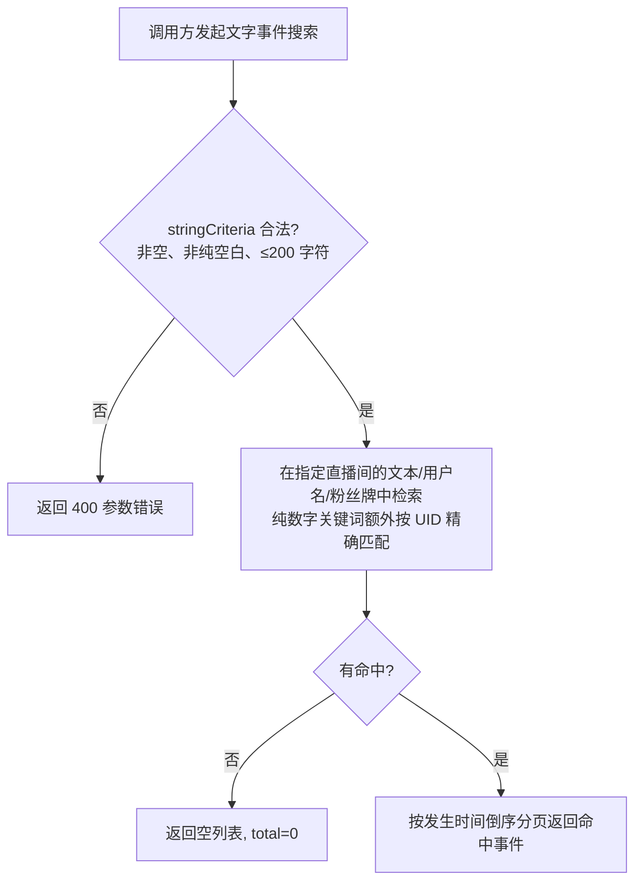

# 直播事件发送者信息搜索

**功能名称**: 直播事件发送者信息搜索
**PRD 版本**: v1.0
**创建日期**: 2026-08-20
**作者**: Deliay

## 背景与目标

### 1.1 背景

Z.Vtuber 已上线直播文字事件搜索能力：弹幕与醒目留言（SC）落库时提取纯文本写入搜索索引集合，调用方可按关键词检索文字内容。

但当前搜索索引只沉淀了文本内容一个维度，丢失了「谁发的」这一关键信息。数据消费者的检索诉求中，按人检索与按内容检索同样高频：例如回溯某位观众在某场直播中的所有弹幕与 SC、检索某个粉丝牌群体在直播中的发言、按 UID 精确定位某位用户的互动记录。当前这些诉求只能全量拉取事件后自行解析 payload 匹配，成本高、效率低。

### 1.2 目标

- 弹幕与 SC 落库写搜索索引时，在纯文本之外再提取并沉淀发送者的三个元素：用户名、UID、粉丝牌（勋章名称）。
- 搜索能力覆盖上述三个元素：关键词命中文本内容、发送者用户名或粉丝牌任一即返回对应事件；关键词为纯数字时额外支持按 UID 精确匹配。
- 搜索能力上线前已沉淀的索引记录补齐发送者元素，存量数据同等可检索。

### 1.3 成功标准

- 按用户名/粉丝牌关键词搜索，返回对应发送者的弹幕/SC 事件，分页语义与现有搜索一致。
- 按纯数字 UID 搜索，精确返回该 UID 发送者的弹幕/SC 事件。
- 新落库与历史弹幕/SC 事件的发送者元素均沉淀完整、可被搜索命中。
- 既有按文本内容搜索的行为与结果不回退。

## 用户分析

### 2.1 目标用户

- 直播数据消费者（运营、粉丝、数据分析人员）：需要按发送者维度回溯直播互动内容。
- 上层功能开发者：需要在观众画像、粉丝牌群体分析、切片辅助等功能上接入按人检索能力。

### 2.2 用户场景

| 场景 | 用户角色 | 目标 | 痛点 |
|--|--|--|--|
| 回溯某位观众的全部发言 | 数据分析人员 | 按用户名或 UID 找出该观众的弹幕与 SC | 索引无发送者信息，需全量拉取后解析 payload 匹配 |
| 分析粉丝牌群体发言 | 运营 | 检索佩戴某粉丝牌用户的发言内容 | 粉丝牌信息未沉淀，无法按牌检索 |
| 按内容搜索 | 上层开发者 | 关键词命中文本即返回（既有能力） | 已支持，需保持不回退 |

## 功能需求

### 3.1 功能概述

扩展文字事件搜索索引的沉淀维度：弹幕/SC 落库写索引时同步提取发送者用户名、UID、粉丝牌；搜索时将关键词与文本内容、发送者用户名、粉丝牌做匹配（任一命中即返回），纯数字关键词额外按 UID 精确匹配；历史索引记录幂等补齐发送者元素。

### 3.2 功能列表

#### 功能点 1: 沉淀发送者三元素

- **描述**: 弹幕/SC 事件写入搜索索引时，从原始 payload 中提取发送者用户名、UID、粉丝牌（勋章名称），与纯文本一并沉淀。未佩戴粉丝牌的发送者，粉丝牌元素为空。
- **用户价值**: 搜索索引具备完整的发送者维度，支撑按人检索。
- **验收标准**:
  - [ ] 新落库的弹幕/SC 索引记录包含正确的发送者用户名、UID。
  - [ ] 发送者佩戴粉丝牌时，索引记录包含粉丝牌名称；未佩戴时该元素为空。

#### 功能点 2: 搜索覆盖发送者元素

- **描述**: 既有搜索接口（入参 roomId + stringCriteria）的匹配范围从「仅文本内容」扩展为「文本内容、发送者用户名、粉丝牌」任一命中即返回对应事件；stringCriteria 为纯数字时，额外对发送者 UID 做精确匹配。排序（发生时间倒序）、分页、total 语义与现状完全一致。
- **用户价值**: 一个关键词即可按内容或按人检索，无需新增接口。
- **验收标准**:
  - [ ] 关键词命中发送者用户名（子串、不区分大小写）时返回该发送者的弹幕/SC 事件。
  - [ ] 关键词命中粉丝牌名称时返回佩戴该牌发送者的弹幕/SC 事件。
  - [ ] 关键词为纯数字时，返回 UID 等于该数字的发送者的弹幕/SC 事件。
  - [ ] 关键词命中文本内容的既有行为保持不变。
  - [ ] 结果按发生时间倒序返回，翻页不重复、不遗漏，`total` 为命中的真实条数。

#### 功能点 3: 历史数据补齐

- **描述**: 搜索能力上线前已沉淀的弹幕/SC 索引记录，补齐发送者三元素，存量数据与增量数据同等可检索；补齐过程幂等可重入。
- **用户价值**: 检索范围完整覆盖存量数据，结果可信。
- **验收标准**:
  - [ ] 上线前沉淀的索引记录补齐用户名、UID、粉丝牌后可被对应关键词搜出。
  - [ ] 补齐逻辑重复执行不产生重复或错误数据。

### 3.3 用户操作流程

### 3.4 页面/界面描述

本需求为数据检索能力增强，不涉及新页面与返回结构变更；命中事件仍以完整事件结构返回（发送者信息可从事件 payload 中获取）。

### 3.5 异常与边界情况

| 情况 | 预期行为 |
|------|---------|
| 不传 stringCriteria / 空串 / 仅空白字符 / 超 200 字符 | 与现状一致：返回 400，不返回数据 |
| 关键词无命中 | 返回空列表，总数为 0 |
| 发送者未佩戴粉丝牌 | 粉丝牌元素为空，不参与粉丝牌匹配，其余维度正常 |
| 关键词为纯数字 | 同时做文本/用户名/粉丝牌子串匹配与 UID 精确匹配，合集返回 |
| 关键词含特殊符号或表情 | 按可读文本语义检索，不报错 |
| 非文字类型事件（礼物、上舰等） | 不参与搜索，不会被命中返回 |
| 历史索引记录（未补齐前） | 补齐完成后与增量数据同等可检索 |

## 四、非功能需求

### 4.1 性能要求

- 扩展匹配维度后，搜索分页查询在单直播间十万级文字事件量下响应时间保持在百毫秒量级，不得退化为全量拉取后内存匹配。
- 发送者元素的提取不阻塞事件落库与索引写入主链路。

### 4.2 安全性要求

- 与系统现有数据查询能力保持一致，本期不新增鉴权要求。

### 4.3 兼容性要求

- 搜索接口路径、入参、分页与返回结构不变，仅匹配范围扩大。
- 既有按文本内容搜索的结果不回退。

## 五、依赖与约束

### 5.1 依赖

- 依赖既有弹幕长连接链路持续产出并落库的弹幕与 SC 事件数据。
- 发送者元素以事件原始 payload 中携带的信息为准。

### 5.2 约束

- 搜索入参维持 roomId + stringCriteria，stringCriteria 长度上限 200 字符。
- 搜索范围仍限定为弹幕与 SC 两类文字事件，本期不支持其他类型。
- 分页、排序（按发生时间倒序）等查询语义与既有搜索保持一致。

## 六、相关文档

- 技术提案：`docs/engineering/proposals/20260820-proposal-live-event-sender-search.md`
- 既有 PRD：`docs/product/draft/20260819-live-event-text-search-prd.md`
