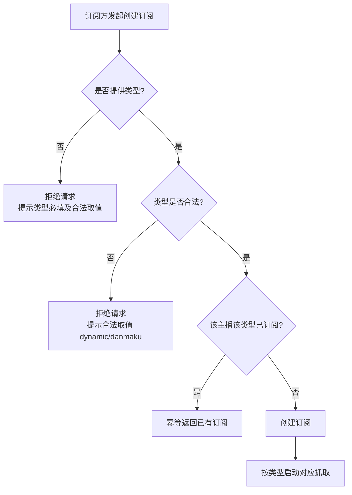

# 订阅抓取类型独立控制

**功能名称**: 订阅抓取类型独立控制
**PRD 版本**: v1.0
**创建日期**: 2026-08-20
**作者**: Deliay

## 背景与目标

### 1.1 背景

目前订阅一个主播后，系统会同时抓取该主播的**空间动态**与**直播弹幕**两类数据，订阅方无法选择。随着接入的订阅方增多，不同订阅方对数据的需求出现分化：

- 有的订阅方只关心主播的直播弹幕/直播事件，不需要空间动态；
- 有的订阅方只关心主播的空间动态时间线，不需要直播数据；
- 全量抓取对双方都是浪费：抓取频率越高越容易触发目标站点风控，无用的抓取挤占了有限的风控额度与凭证资源。

### 1.2 目标

- 订阅主播时可以**按类型独立控制**抓取行为，当前支持的类型为：动态（dynamic）、弹幕（danmaku）；
- 创建订阅时**必须显式指定抓取类型**，不允许缺省（缺省即拒绝并提示），避免订阅方在不知情的情况下开通全量抓取；
- 存量已配置的订阅，统一清洗为「动态 + 弹幕」两者都抓取，保证升级前后抓取行为不发生变化。

### 1.3 成功标准

- 订阅方可以仅订阅动态、仅订阅弹幕，或两者都订阅，系统抓取行为与订阅类型严格一致：未订阅的类型不产生任何抓取请求与数据写入；
- 创建订阅未指定类型时请求被拒绝并返回明确错误提示，错误响应可指导订阅方修正；
- 存量订阅清洗完成后，其动态与弹幕抓取持续正常，无数据缺口（清洗后 24 小时内两类数据均持续入库）；
- 同一主播同一类型重复订阅幂等，不产生重复抓取。

## 用户分析

### 2.1 目标用户

- **数据订阅方（调用方）**：通过订阅管理接口配置抓取目标的接入方，是本次功能的主要使用者；
- **运营/管理员（Deliay）**：维护订阅配置与抓取健康度，关注抓取资源的有效利用。

### 2.2 用户场景

| 场景 | 用户角色 | 目标 | 痛点 |
|--|--|--|--|
| 只想要某主播的直播弹幕 | 数据订阅方 | 仅开通弹幕抓取 | 当前订阅即全量抓取，动态抓取白白消耗风控额度 |
| 只想要某主播的空间动态 | 数据订阅方 | 仅开通动态抓取 | 同上，弹幕长连接与事件落库纯属浪费 |
| 升级存量订阅配置 | 运营/管理员 | 存量订阅行为不变 | 担心引入类型后存量订阅抓取中断或漏抓 |

## 功能需求

### 3.1 功能概述

为订阅增加「抓取类型」维度：创建订阅时必须指定类型（动态或弹幕），系统仅按已订阅的类型抓取对应数据；存量订阅统一清洗为全类型订阅，行为与现状一致。

### 3.2 功能列表

#### 功能点 1: 按类型创建订阅

- **描述**: 创建订阅时需同时提供主播标识与抓取类型。当前支持的类型为 `dynamic`（空间动态）与 `danmaku`（弹幕/直播事件）。同一主播可以分别创建两种类型的订阅，彼此独立。
- **用户价值**: 订阅方按需开通抓取，减少无效抓取带来的风控压力与资源浪费。
- **验收标准**:
  - [ ] 指定 `dynamic` 创建订阅后，该主播的空间动态持续抓取入库；
  - [ ] 指定 `danmaku` 创建订阅后，该主播的直播弹幕/事件持续抓取入库；
  - [ ] 同一主播同一类型重复创建订阅幂等，不产生重复配置；
  - [ ] 类型取值不在支持列表内时请求被拒绝并提示合法取值。

#### 功能点 2: 创建订阅类型必填校验

- **描述**: 创建订阅时类型为必填项；未提供类型时请求被拒绝，返回明确的参数错误提示，不产生任何订阅记录。
- **用户价值**: 杜绝「默认全量抓取」的隐式行为，订阅方必须显式表达自己的抓取意图，配置可追溯。
- **验收标准**:
  - [ ] 未传类型的创建请求被拒绝，错误提示明确指出类型必填及合法取值；
  - [ ] 被拒绝的请求不产生订阅记录，不触发任何抓取；
  - [ ] 主播标识非法（缺失、非正数）时同样被拒绝，与类型校验并存。

#### 功能点 3: 按类型控制抓取行为

- **描述**: 各类抓取严格以对应类型的订阅为准：空间动态抓取只处理拥有 `dynamic` 订阅的主播；直播弹幕/事件抓取只处理拥有 `danmaku` 订阅的主播。取消某类型订阅后，该类型抓取停止，另一类型不受影响。
- **用户价值**: 抓取行为与订阅配置严格一致，订阅方对抓取范围有完全的控制力。
- **验收标准**:
  - [ ] 仅订阅 `dynamic` 的主播不产生弹幕长连接与直播事件写入；
  - [ ] 仅订阅 `danmaku` 的主播不产生空间动态抓取请求；
  - [ ] 取消某一类型订阅后该类型抓取停止，同主播另一类型抓取不受影响；
  - [ ] 查询订阅列表时可以看到每条订阅的类型。

#### 功能点 4: 存量订阅数据清洗

- **描述**: 对功能上线前已存在的订阅记录进行一次性清洗：每条存量订阅转换为「动态 + 弹幕」两者都订阅的状态，保证升级后抓取行为与升级前完全一致。
- **用户价值**: 存量订阅方无感知、无中断，升级安全。
- **验收标准**:
  - [ ] 清洗完成后，每个存量主播同时持有 `dynamic` 与 `danmaku` 两类订阅；
  - [ ] 清洗过程幂等，重复执行不产生重复订阅；
  - [ ] 清洗后存量主播的动态与弹幕抓取持续正常，无数据缺口。

### 3.3 用户操作流程

存量清洗流程：

### 3.4 页面/界面描述

本需求为订阅管理能力的语义变更，不新增用户界面。订阅方通过既有订阅管理接口感知类型维度。

| 页面 | 描述 | 关键元素 |
|------|------|---------|
| 无新增页面 | 订阅记录增加类型维度，列表查询结果中可见 | 订阅条目上的类型标识 |

### 3.5 异常与边界情况

| 情况 | 预期行为 |
|------|---------|
| 创建订阅未传类型 | 拒绝并提示类型必填，不产生订阅记录 |
| 类型取值非法 | 拒绝并提示合法取值列表，不产生订阅记录 |
| 同主播同类型重复订阅 | 幂等成功，不产生重复配置与重复抓取 |
| 同主播先后订阅两种类型 | 两类订阅独立生效，两类抓取互不影响 |
| 取消某一类型订阅 | 该类型抓取停止；另一类型（如已订阅）不受影响 |
| 清洗期间恰好新增订阅 | 清洗与新增按同一幂等规则合并，不产生重复订阅 |
| 清洗重复执行/中断重跑 | 幂等，最终状态一致 |

## 四、非功能需求

### 4.1 性能要求

- 引入类型维度后，单主播抓取时效不劣于现状；
- 存量清洗在服务启动后的短时间内完成，不阻塞正常抓取调度。

### 4.2 安全性要求

- 不涉及凭证、隐私数据处理变更。

### 4.3 兼容性要求

- 存量订阅经清洗后行为与升级前完全一致，存量订阅方无感知；
- 创建订阅的「类型必填」为破坏性变更，需在本次需求范围内确认所有现存调用方同步改造。

## 五、依赖与约束

### 5.1 依赖

- 现有空间动态抓取与直播弹幕/事件抓取链路（本需求在其上增加类型过滤，不重构抓取本身）；
- 现有订阅存储（本需求扩展其数据维度）。

### 5.2 约束

- 当前仅支持 `dynamic` 与 `danmaku` 两种类型，类型集合需可扩展（未来可能新增账号信息等类型）；
- 清洗必须幂等，支持服务重启后安全重跑。

## 六、相关文档

- 技术提案: `docs/engineering/proposals/20260820-proposal-subscription-crawl-type.md`
