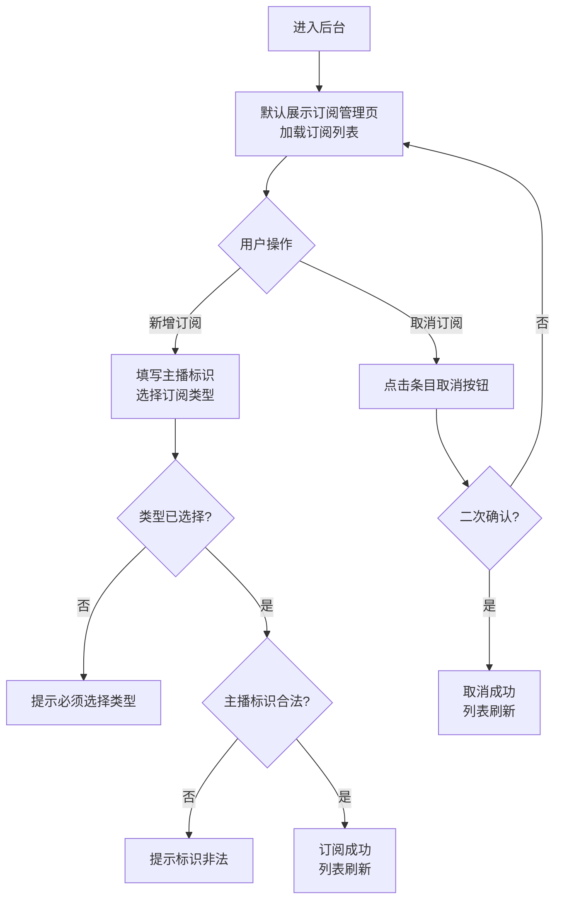
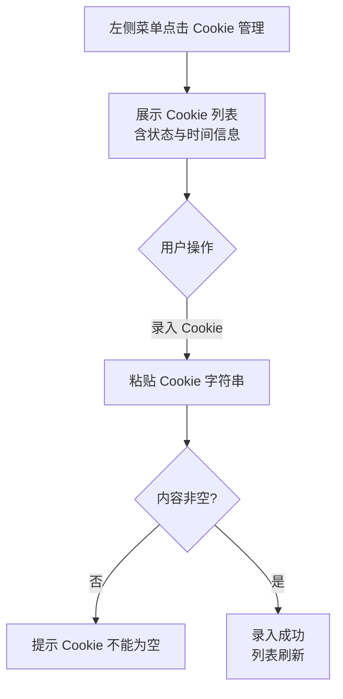

# 管理后台初版（订阅管理 + Cookie 管理）

**功能名称**: 管理后台初版（订阅管理 + Cookie 管理）
**PRD 版本**: v1.0
**创建日期**: 2026-08-22
**作者**: Deliay

## 背景与目标

### 1.1 背景

平台当前已具备订阅管理与 Cookie 管理能力，但只面向接口调用方开放，没有可视化界面。运营/管理员日常维护订阅与凭证时，需要手工构造请求、自行记录返回结果，存在以下问题：

- 操作门槛高：需要熟悉接口参数与调用方式，非开发同事无法参与；
- 易出错：手工拼参数容易写错主播标识或订阅类型，错误排查成本高；
- 状态不可见：当前订阅了哪些主播、各类型的订阅情况、Cookie 的可用状态，没有统一的查看入口。

### 1.2 目标

- 提供一个内网使用的 Web 管理后台，采用典型的「左菜单、右内容」布局；
- 提供「订阅管理」页面，可视化完成订阅的查看、新增（含订阅类型）与取消，能力与现有订阅管理能力一致；
- 提供「Cookie 管理」页面，可视化完成 Cookie 的查看（含状态）与录入，能力与现有 Cookie 管理能力一致；
- 内网环境使用，本期不需要任何登录/鉴权机制。

### 1.3 成功标准

- 运营/管理员不借助任何接口调试工具，仅通过后台页面即可完成订阅与 Cookie 的全部日常管理操作；
- 后台展示的订阅列表、Cookie 列表与实际生效的配置一致，页面操作（新增/取消/录入）即时生效并在列表中可见；
- 非法输入（如非法主播标识、空 Cookie）在页面上有明确错误提示，不产生脏数据。

## 用户分析

### 2.1 目标用户

- **运营/管理员（Deliay）**：负责维护订阅主播列表与抓取凭证，是本后台的唯一目标用户群体；
- 使用环境为内网，使用者均为可信人员。

### 2.2 用户场景

| 场景 | 用户角色 | 目标 | 痛点 |
|--|--|--|--|
| 新增一个主播的弹幕订阅 | 运营/管理员 | 输入主播标识、选择类型即可完成订阅 | 当前需手工调用接口，参数易错、无操作反馈 |
| 查看当前全部订阅及类型 | 运营/管理员 | 一眼看清订阅了哪些主播、各是什么类型 | 当前无统一视图，需自行查询并解读数据 |
| 取消某个主播的某类订阅 | 运营/管理员 | 在列表中直接取消，另一类型不受影响 | 手工调用取消接口，需确认参数组合 |
| 抓取异常时补充 Cookie | 运营/管理员 | 查看现有 Cookie 状态并录入新 Cookie | 无法直观看到哪些 Cookie 可用/失效 |

## 功能需求

### 3.1 功能概述

搭建一个内网 Web 管理后台：左侧为功能菜单，右侧为内容区；首期包含「订阅管理」与「Cookie 管理」两个页面，分别承载订阅与 Cookie 的可视化管理能力；后台免鉴权直接可用。

### 3.2 功能列表

#### 功能点 1: 后台整体布局与导航

- **描述**: 后台采用典型的左菜单、右内容布局。左侧菜单列出功能入口（本期为「订阅管理」「Cookie 管理」），点击菜单项后右侧内容区切换至对应页面；当前选中的菜单项有明确的视觉高亮。进入后台默认展示「订阅管理」页面。
- **用户价值**: 形成统一的后台骨架，后续新增管理功能时只需在菜单中扩展入口，用户操作路径一致。
- **验收标准**:
  - [ ] 页面呈现左菜单、右内容的布局，菜单包含「订阅管理」「Cookie 管理」两个入口；
  - [ ] 点击菜单项右侧内容区正确切换，且当前菜单项高亮；
  - [ ] 直接访问后台时默认进入「订阅管理」页面；
  - [ ] 访问后台无需任何登录或凭证输入。

#### 功能点 2: 订阅管理——订阅列表

- **描述**: 「订阅管理」页面展示当前全部订阅，每条订阅包含主播标识、订阅类型（弹幕/动态）、订阅时间。同一主播的不同类型订阅作为独立条目展示。
- **用户价值**: 订阅配置一目了然，作为新增与取消操作的基础视图。
- **验收标准**:
  - [ ] 列表完整展示全部订阅的主播标识、类型、订阅时间；
  - [ ] 同一主播的弹幕与动态订阅分别展示为两条独立条目；
  - [ ] 无任何订阅时展示空状态提示而非空白或报错。

#### 功能点 3: 订阅管理——新增订阅

- **描述**: 在「订阅管理」页面可发起新增订阅：填写主播标识、选择订阅类型（弹幕或动态）后提交。类型为必选项，未选择类型不允许提交。重复订阅同一主播同一类型时幂等成功，不产生重复条目。
- **用户价值**: 无需了解接口细节即可完成订阅配置，显式选择类型避免误开全量抓取。
- **验收标准**:
  - [ ] 填写合法主播标识并选择类型后提交，订阅创建成功并即时出现在列表中；
  - [ ] 未选择类型时无法提交，并给出明确提示；
  - [ ] 主播标识为空或非法（非正整数）时提交被拒绝并提示；
  - [ ] 重复订阅同一主播同一类型幂等，列表不出现重复条目。

#### 功能点 4: 订阅管理——取消订阅

- **描述**: 在订阅列表的每条条目上可执行取消操作，取消该主播对应类型的订阅；取消前需二次确认。取消某一条目不影响同一主播的其他类型订阅。
- **用户价值**: 取消操作可视化、可确认，避免误操作导致抓取中断。
- **验收标准**:
  - [ ] 取消操作弹出确认，确认后该条目从列表消失；
  - [ ] 取消某一类型后，同一主播的另一类型订阅保留且不受影响；
  - [ ] 取消不存在的订阅时给出明确提示，页面状态不产生异常。

#### 功能点 5: Cookie 管理——Cookie 列表

- **描述**: 「Cookie 管理」页面展示当前 Cookie 列表，每条包含标识、状态（可用/离线）、最近校验时间、最近使用时间。不展示 Cookie 明文内容。
- **用户价值**: 凭证健康度可视化，抓取异常时可快速判断是否是凭证问题。
- **验收标准**:
  - [ ] 列表完整展示全部 Cookie 的标识、状态、最近校验时间与最近使用时间；
  - [ ] 任何位置不展示 Cookie 明文；
  - [ ] 无 Cookie 时展示空状态提示。

#### 功能点 6: Cookie 管理——录入 Cookie

- **描述**: 在「Cookie 管理」页面可录入新 Cookie：粘贴 Cookie 字符串后提交。录入为幂等操作，重复录入同一 Cookie 不产生重复条目。空内容不允许提交。
- **用户价值**: 凭证补给操作可视化，降低运维门槛。
- **验收标准**:
  - [ ] 粘贴合法 Cookie 提交后录入成功，并即时出现在列表中；
  - [ ] Cookie 内容为空或纯空白时无法提交，并给出明确提示；
  - [ ] 重复录入同一 Cookie 幂等，列表不出现重复条目。

### 3.3 用户操作流程

订阅管理操作流程：

Cookie 管理操作流程：

### 3.4 页面/界面描述

| 页面 | 描述 | 关键元素 |
|------|------|---------|
| 后台骨架 | 左菜单右内容布局，全后台通用 | 左侧菜单（订阅管理 / Cookie 管理）、菜单选中高亮、右侧内容区 |
| 订阅管理 | 订阅的查看、新增、取消 | 订阅列表（主播标识、类型、订阅时间、取消按钮）、新增表单（主播标识输入框、类型选择、提交按钮）、操作反馈提示 |
| Cookie 管理 | Cookie 的查看、录入 | Cookie 列表（标识、状态、最近校验时间、最近使用时间）、录入表单（Cookie 输入框、提交按钮）、操作反馈提示 |

### 3.5 异常与边界情况

| 情况 | 预期行为 |
|------|---------|
| 后台服务不可达 | 页面展示明确的错误提示（服务不可用），不出现白屏 |
| 订阅列表为空 | 展示空状态提示，引导用户新增订阅 |
| 新增订阅未选类型 | 阻止提交并提示必须选择类型 |
| 新增订阅主播标识非法 | 阻止提交或服务端拒绝后提示非法，列表不产生脏数据 |
| 重复订阅同主播同类型 | 幂等成功，列表无重复条目 |
| 取消订阅时服务拒绝（如已不存在） | 提示取消失败原因，列表保持真实状态 |
| Cookie 列表为空 | 展示空状态提示，引导用户录入 |
| 录入空 Cookie | 阻止提交并提示不能为空 |
| 重复录入同一 Cookie | 幂等成功，列表无重复条目 |

## 四、非功能需求

### 4.1 性能要求

- 内网使用场景，页面常规操作（打开页面、列表加载、提交操作）应在 2 秒内给出反馈；
- 订阅与 Cookie 数量在百级规模内列表展示流畅，无需分页。

### 4.2 安全性要求

- 后台仅部署于内网，本期不实现登录/鉴权；上线前需确认部署环境确为内网可达范围；
- 任何界面不展示 Cookie 明文内容。

### 4.3 兼容性要求

- 支持主流现代浏览器（Chrome / Edge 最新两个大版本）；
- 不影响现有接口调用方的任何既有能力，后台仅为既有管理能力增加可视化入口。

## 五、依赖与约束

### 5.1 依赖

- 现有订阅管理能力（订阅的查看、按类型新增、按类型取消）；
- 现有 Cookie 管理能力（Cookie 列表查看、Cookie 录入）。

### 5.2 约束

- 本期仅覆盖「订阅管理」与「Cookie 管理」两个页面，其他数据（直播事件、动态等）的可视化不在本期范围；
- 不引入鉴权机制，部署侧需保证仅内网可达；
- 后台管理能力与现有能力严格一致，不在本期对后端能力提出变更需求。

## 六、相关文档

- 技术提案: `docs/engineering/proposals/20260822-proposal-admin-console.md`
