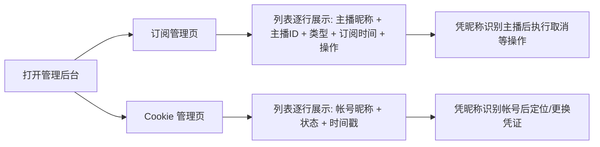

# 管理后台数据聚合（订阅主播信息 + Cookie 帐号信息）

**功能名称**: 管理后台数据聚合（订阅主播信息 + Cookie 帐号信息）
**PRD 版本**: v1.0
**创建日期**: 2026-08-28
**作者**: Deliay

## 背景与目标

### 1.1 背景

管理后台初版已上线「订阅管理」与「Cookie 管理」两个页面，但列表只展示标识类字段：

- 订阅列表只有主播 ID、订阅类型与订阅时间，运营需要记住或另行查询每个 ID 对应的主播是谁；
- Cookie 列表只有脱敏后的凭证 ID、状态与时间戳，无法直观看出每条 Cookie 对应哪个 B 站帐号。

平台日常抓取过程中其实已经沉淀了两类信息：主播的基础资料（随帐号信息抓取周期落库），以及 Cookie 凭证周期性探测时拿到的帐号信息。将这些信息聚合进后台列表，可以显著降低运营的识读成本。

### 1.2 目标

- 订阅管理页在列表中直接展示已入库的主播昵称，让运营一眼认出每个订阅对应的主播；
- Cookie 管理页在列表中直接展示每条 Cookie 对应的 B 站帐号昵称，让运营一眼认出每条凭证归属的帐号；
- 两个页面均通过新增的后台聚合接口一次性取回展示所需的全部数据，页面无需多次请求拼装。

### 1.3 成功标准

- 运营在订阅管理页无需跳转或另查，即可识别每一条订阅的主播身份；已抓取过资料的主播展示其昵称，未抓取到的有明确的「暂无资料」占位；
- 运营在 Cookie 管理页无需跳转或另查，即可识别每一条 Cookie 归属的帐号；帐号信息获取失败或尚未获取时，列表正常展示其余字段并有明确占位，不阻塞页面；
- 聚合信息与其来源数据保持一致，来源数据更新后随页面刷新体现最新结果。

## 用户分析

### 2.1 目标用户

- **运营/管理员（Deliay）**：管理后台的唯一目标用户，负责维护订阅主播列表与抓取凭证；
- 使用环境为内网，使用者均为可信人员。

### 2.2 用户场景

| 场景 | 用户角色 | 目标 | 痛点 |
|--|--|--|--|
| 浏览订阅列表确认订阅了哪些主播 | 运营/管理员 | 直接看到主播昵称，而非一串数字 ID | 主播 ID 不可读，需手工逐个查询确认 |
| 取消订阅前确认目标主播 | 运营/管理员 | 通过昵称确认要取消的对象，避免误操作 | 只有 ID，取消时心里没底、容易误删 |
| 排查抓取异常时定位失效凭证 | 运营/管理员 | 看到失效 Cookie 对应的帐号昵称，快速定位并重新登录获取新凭证 | 只有脱敏 ID，对不上号，需翻记录比对 |
| 录入新 Cookie 后确认归属帐号 | 运营/管理员 | 录入后立即看到该 Cookie 对应的帐号信息，确认没贴错 | 录入后无法确认凭证属于哪个帐号 |

## 功能需求

### 3.1 功能概述

在管理后台的「订阅管理」与「Cookie 管理」两个页面中，将列表升级为聚合视图：订阅列表附带库中已存储的主播昵称，Cookie 列表附带凭证对应的 B 站帐号昵称；两个页面分别由一个新的后台聚合接口提供数据。本期展示字段从简，两个列表各自只新增一个「昵称」列。

### 3.2 功能列表

#### 功能点 1: 订阅列表展示主播昵称

- **描述**: 订阅管理页列表在现有「主播 ID、类型、订阅时间、操作」基础上，增加「主播昵称」列；无法获取昵称时展示占位。昵称来源于平台已落库的主播资料，页面不做额外查询。
- **用户价值**: 运营无需记忆或另查 ID，即可识别每条订阅的主播身份，降低误操作风险。
- **验收标准**:
  - [ ] 已抓取过资料的主播，订阅列表中展示其昵称；
  - [ ] 同一主播的弹幕/动态两条订阅均正确关联同一个昵称；
  - [ ] 未抓取到资料的主播，昵称列展示「暂无资料」占位，其余列正常显示；
  - [ ] 新增订阅后刷新列表，新订阅行展示规则与存量一致。

#### 功能点 2: Cookie 列表展示帐号昵称

- **描述**: Cookie 管理页列表在现有「ID、状态、最近校验时间、最近使用时间」基础上，增加「帐号昵称」列。昵称来源于凭证周期性探测时获得并落库的帐号数据。
- **用户价值**: 运营可以直观把每条 Cookie 与具体 B 站帐号对应起来，排查失效凭证、确认新录入凭证归属时不再需要翻记录比对。
- **验收标准**:
  - [ ] 已完成过探测的 Cookie，列表展示其帐号昵称；
  - [ ] 尚未探测或探测失败的 Cookie，昵称列展示占位，状态等其余列正常显示；
  - [ ] 新录入的 Cookie 在完成首次探测后，刷新列表即可看到帐号昵称；
  - [ ] Cookie 状态变化（可用/离线）与昵称互不影响，各自如实展示。

#### 功能点 3: 后台聚合数据接口

- **描述**: 为上述两个页面分别提供一个后台专用的聚合数据接口，一次请求返回列表展示所需的全部字段，页面无需自行拼装多次请求。聚合接口只读，不改变现有管理操作（订阅增删、Cookie 录入）的行为。
- **用户价值**: 页面加载一次取齐数据，展示稳定、加载快；后续后台页面扩展可复用同一聚合模式。
- **验收标准**:
  - [ ] 订阅聚合接口返回的数据与订阅列表页展示完全一致；
  - [ ] Cookie 聚合接口返回的数据与 Cookie 列表页展示完全一致；
  - [ ] 现有订阅增删、Cookie 录入功能行为不变。

### 3.3 用户操作流程

### 3.4 页面/界面描述

| 页面 | 描述 | 关键元素 |
|------|------|---------|
| 订阅管理 | 订阅列表升级为聚合视图，新增主播昵称列 | 主播昵称、主播 ID、订阅类型、订阅时间、操作按钮、「暂无资料」占位 |
| Cookie 管理 | Cookie 列表升级为聚合视图，新增帐号昵称列 | 帐号昵称、凭证 ID、状态、最近校验时间、最近使用时间、占位 |

### 3.5 异常与边界情况

| 情况 | 预期行为 |
|------|---------|
| 主播资料尚未抓取入库 | 昵称列展示「暂无资料」占位，订阅信息正常展示 |
| 主播资料已抓取但无昵称字段 | 昵称列展示占位，其余列正常展示 |
| Cookie 尚未完成探测或探测失败 | 昵称列展示占位，状态如实展示 |
| 帐号已注销或返回信息异常 | 昵称列展示占位，不影响列表其余内容 |
| 聚合数据服务不可用 | 页面展示加载失败提示，可刷新重试，与现有错误处理一致 |
| 同一帐号存在多条 Cookie | 各条 Cookie 独立成行，均正确关联同一帐号信息 |

## 四、非功能需求

### 4.1 性能要求

- 后台列表为低频内网使用，聚合接口在常规数据量（百级以内订阅/凭证）下应快速返回，页面加载无明显卡顿；
- 聚合读取应复用平台已沉淀的数据，页面加载不额外触发对 B 站的实时请求。

### 4.2 安全性要求

- Cookie 凭证内容本身不得在列表或接口返回中出现，沿用现有脱敏 ID 的展示方式；
- 后台沿用内网免鉴权约定，本期不新增鉴权机制。

### 4.3 兼容性要求

- 现有订阅增删、Cookie 录入与管理操作行为不变；
- 旧数据（历史订阅、历史 Cookie）无需人工处理即可在新列表中正常展示。

## 五、依赖与约束

### 5.1 依赖

- 管理后台初版（订阅管理 + Cookie 管理）页面已上线；
- 平台帐号信息抓取与凭证周期性探测能力已在运行，可持续沉淀主播资料与帐号信息。

### 5.2 约束

- 聚合展示只读，不在本期新增对主播资料或帐号信息的编辑能力；
- 主播资料与帐号信息均为周期性沉淀的数据，允许存在与实时数据的合理延迟，不做实时刷新承诺。

## 六、相关文档

- `docs/product/draft/20260822-admin-console-prd.md`（管理后台初版 PRD）
- 技术提案：`docs/engineering/proposals/20260828-proposal-backstage-data-aggregation.md`
