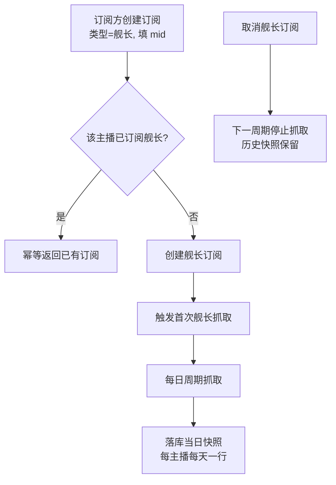
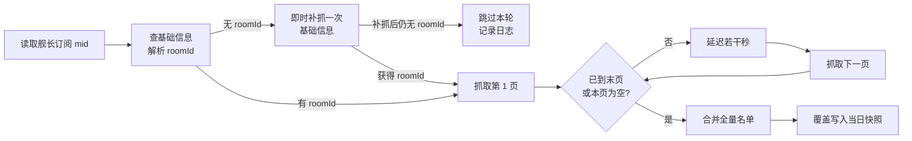

# 舰长数据抓取

**功能名称**: 舰长数据抓取
**PRD 版本**: v1.0
**创建日期**: 2026-08-31
**作者**: Deliay

## 背景与目标

### 1.1 背景

目前订阅主播支持「动态」与「弹幕」两种抓取类型，订阅方可以拿到主播的空间动态时间线与直播弹幕/事件数据。随着数据分析需求深化，订阅方提出新的数据诉求：持续跟踪主播直播间的**舰长（大航海）名单**——谁在舰、舰长规模随时间的变化，是衡量主播商业价值与粉丝黏性的核心指标之一，现有两类数据无法回答这类问题。

### 1.2 目标

- 订阅类型新增「舰长」：订阅方按主播 mid（即 bId）开通后，系统持续抓取该主播直播间的舰长名单；
- 舰长名单以**每日快照**形式沉淀：每个主播每天一行记录，包含 mid、roomId 与当日完整舰长名单（guard_list）；
- 抓取行为对目标站点友好：分页遍历抓取，页间增加延迟，避免触发风控。

### 1.3 成功标准

- 开通「舰长」订阅的主播，其舰长名单每日至少成功落库一次快照，快照包含完整的当日舰长名单；
- 同一主播同一天多次抓取只保留一行记录（当日覆盖），不产生重复行；
- 未订阅「舰长」类型的主播不产生任何舰长抓取请求与数据写入；
- 取消「舰长」订阅后抓取停止，其他类型（动态/弹幕）抓取不受影响；
- 抓取过程不引发目标站点风控导致其他既有抓取链路（动态/弹幕/直播状态）大面积退避。

## 用户分析

### 2.1 目标用户

- **数据订阅方（调用方）**：需要主播舰长名单及其变化趋势数据的接入方，是本次功能的主要使用者；
- **运营/管理员（Deliay）**：维护订阅配置与抓取健康度，关注风控额度消耗。

### 2.2 用户场景

| 场景 | 用户角色 | 目标 | 痛点 |
|--|--|--|--|
| 追踪主播舰长规模变化 | 数据订阅方 | 每日获得主播完整舰长名单快照 | 现有数据类型不含舰长名单，无法分析 |
| 对比多名主播的大航海构成 | 数据订阅方 | 批量订阅多名主播的舰长数据 | 逐主播手工查看不可持续 |
| 控制抓取成本 | 运营/管理员 | 舰长抓取按订阅精确开启，频率可控 | 担心高频抓取触发风控，波及其他链路 |

## 功能需求

### 3.1 功能概述

订阅体系新增「舰长」抓取类型：订阅方按 mid 订阅后，系统解析该主播的直播间 roomId，周期性分页抓取其直播间舰长名单（遍历全部页，页间延迟防反爬），并按「每主播每天一行」的粒度落库当日快照（mid + roomId + guard_list）。

### 3.2 功能列表

#### 功能点 1: 新增订阅类型「舰长」

- **描述**: 订阅类型在现有「动态」「弹幕」之外新增「舰长」。创建订阅时指定类型为「舰长」并填写主播 mid（即 bId），订阅规则与既有类型一致：类型必填、同主播同类型重复订阅幂等。
- **用户价值**: 订阅方按需开通舰长数据抓取，不波及其他类型的抓取范围。
- **验收标准**:
  - [ ] 指定「舰长」类型创建订阅成功，订阅列表中可见该类型；
  - [ ] 同一主播重复订阅「舰长」幂等，不产生重复配置；
  - [ ] 同一主播的「舰长」订阅与「动态」「弹幕」订阅彼此独立，互不影响；
  - [ ] 后台管理界面创建/筛选订阅时可以选择「舰长」类型。

#### 功能点 2: 舰长名单全量分页抓取

- **描述**: 对已订阅「舰长」的主播，系统先查询其基础信息获得直播间 roomId（基础信息缺失时即时补抓一次），再对舰长名单接口进行分页遍历抓取：从第 1 页开始，直到取完全部页（分页信息指示已到末页）或某页名单为空为止；每次翻页之间增加若干秒延迟，避免触发反爬。
- **用户价值**: 获得完整、准确的当日舰长名单，同时保护抓取凭证与风控额度。
- **验收标准**:
  - [ ] 舰长人数跨多页的主播，抓取的名单为全部页合并后的完整名单，无漏页；
  - [ ] 名单为空的主播当日仍落一条快照（名单为空列表），语义为「当日无舰长」；
  - [ ] 页间存在可观测的抓取延迟，不出现短时间密集请求；
  - [ ] 单主播抓取失败（网络错误、风控退避）时不阻塞其他主播的抓取，失败主播在下一周期重试。

#### 功能点 3: 每日快照存储

- **描述**: 抓取完成后按「每主播每天一行」落库：记录 mid、roomId、当日舰长名单（guard_list）与抓取时间。同一天内对同一主播的重复抓取覆盖当日已有快照，保证每天最多一行。
- **用户价值**: 数据粒度整齐（按天对齐），订阅方可以直接按日期序列做趋势分析，无需自行去重。
- **验收标准**:
  - [ ] 每个订阅主播每天最多一行快照记录；
  - [ ] 快照包含 mid、roomId、完整舰长名单与抓取时间；
  - [ ] 同日重复抓取覆盖更新而非新增行；
  - [ ] 连续多日抓取形成可按天追溯的历史序列。

#### 功能点 4: 按订阅精确控制抓取范围

- **描述**: 舰长抓取严格以「舰长」类型的订阅为准：未订阅该类型的主播不产生舰长抓取请求；取消「舰长」订阅后，该主播的舰长抓取在下一周期停止。
- **用户价值**: 抓取范围与订阅配置严格一致，风控额度只花在订阅方需要的数据上。
- **验收标准**:
  - [ ] 未订阅「舰长」的主播不产生任何舰长抓取请求与数据写入；
  - [ ] 取消「舰长」订阅后该主播不再产生新的舰长快照，既有历史快照保留；
  - [ ] 新订阅「舰长」的主播在合理时间内产生首次快照，无需等待整天。

### 3.3 用户操作流程

单主播单次抓取流程：

### 3.4 页面/界面描述

本需求不新增独立页面。后台管理的订阅管理界面中，订阅类型的可选值与列表展示需包含「舰长」。

| 页面 | 描述 | 关键元素 |
|------|------|---------|
| 订阅管理（既有） | 创建订阅的类型选项增加「舰长」；订阅列表的类型列可展示并筛选「舰长」 | 类型下拉选项、类型标识 |

### 3.5 异常与边界情况

| 情况 | 预期行为 |
|------|---------|
| 主播基础信息缺失（无 roomId） | 系统先即时补抓一次该主播的基础信息；补抓成功则继续本轮抓取，补抓后仍无 roomId 才跳过本轮并记录日志，下一周期重试；不产生快照 |
| 抓取中途触发风控/退避 | 中止该主播本轮抓取，不写半成品快照，待退避结束后重试 |
| 舰长名单为空 | 当日落一条空名单快照 |
| 名单跨页抓取中某页失败 | 本轮抓取整体失败，不落半成品快照，下一周期重试 |
| 同日服务重启/重复调度 | 当日快照被覆盖更新，仍保持一行 |
| 取消订阅当天已落快照 | 历史快照保留，后续日期不再产生新快照 |
| 同主播同时订阅多种类型 | 各类型抓取独立运行，互不影响 |

## 四、非功能需求

### 4.1 性能要求

- 舰长抓取为日级周期任务，页间延迟若干秒，单主播抓取耗时不影响其他主播的调度；
- 舰长抓取引入后，既有动态/弹幕/直播状态抓取的时效不劣于现状。

### 4.2 安全性要求

- 抓取使用既有凭证池与风控治理机制，不引入新的凭证处理逻辑；
- 舰长名单为公开直播间数据，不涉及隐私数据新增处理。

### 4.3 兼容性要求

- 订阅类型集合新增「舰长」为增量变更，既有「动态」「弹幕」订阅行为不变；
- 前端/调用方基于更新后的契约重新生成客户端即可识别新类型。

## 五、依赖与约束

### 5.1 依赖

- 既有订阅体系（类型化订阅、订阅事件）——本需求在其上新增一个类型；
- 既有主播基础信息维护链路——舰长抓取依赖其中的 roomId；
- 既有凭证池、风控退避与抓取治理机制。

### 5.2 约束

- 抓取必须分页全量遍历且页间带延迟，不得为求快并发翻页；
- 每日快照粒度固定为「每主播每天一行」，存储设计需以覆盖写保证该粒度；
- 类型集合保持可扩展（本次新增后共三种：动态/弹幕/舰长）。

## 六、相关文档

- 技术提案: `docs/engineering/proposals/20260831-proposal-live-guard-crawl.md`
- 关联 PRD: `docs/product/draft/20260820-subscription-crawl-type-prd.md`（订阅类型化）
