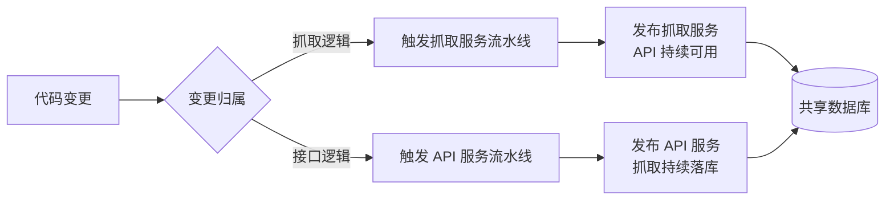

# 抓取与 API 服务拆分

**功能名称**: 抓取与 API 服务拆分
**PRD 版本**: v1.0
**创建日期**: 2026-09-01
**作者**: Deliay

## 背景与目标

### 1.1 背景

目前平台的 B 站数据抓取能力（周期性抓取任务、弹幕长连接、风控退避等）与对外 API 能力（订阅管理、直播事件查询、后台聚合等）运行在同一个代码库、同一个服务进程中。随着抓取规模扩大，这种单体形态带来越来越明显的问题：

- **互相影响**：抓取任务触发风控退避、长连接重连风暴或抓取高峰期资源占用升高时，会直接拖累同进程的 API 响应，运营使用管理后台和查询接口时感受到卡顿；
- **发布耦合**：改动抓取逻辑需要连同 API 一起发布，改动 API 也需要带着抓取任务一起重启，任何一边的小变更都会中断另一边的运行（抓取中断导致数据空洞，API 重启导致查询不可用）；
- **伸缩受限**：抓取与 API 的资源特征完全不同（抓取是持续后台负载，API 是低频查询），无法按需独立扩缩容与独立配置运行参数；
- **职责不清**：抓取、API、公共类型混在一个工程中，边界模糊，后续迭代容易互相侵入。

### 1.2 目标

- 将现有单体服务拆分为两个可独立构建、独立部署、独立运行的服务：**抓取服务**与 **API 服务**；
- 两个服务共享的公共类型与数据访问定义只维护一份，避免重复实现导致口径不一致；
- 抓取服务拥有独立的镜像构建与发布流水线，与 API 服务的发布互不牵连；
- 拆分后对外行为完全不变：现有全部 API 接口、抓取任务、数据落库行为与拆分前一致。

### 1.3 成功标准

- 抓取服务与 API 服务可以作为两个独立进程/容器分别启动、分别停止、分别发布，互不影响；
- 重启或发布抓取服务期间，API 查询与管理后台仍可正常使用（基于已落库数据）；重启或发布 API 服务期间，抓取任务与数据落库不中断；
- 现有 API 接口的契约与行为回归全部通过，既有数据无需迁移即可被两个服务正常读写；
- 抓取服务镜像可由独立的流水线构建发布，命名与现有镜像体系一致。

## 用户分析

### 2.1 目标用户

- **平台维护者（Deliay）**：负责部署、发布与运维平台，是拆分的直接受益人；
- **运营/管理员**：管理后台与查询接口的使用者，间接受益于更稳定的 API 可用性。

### 2.2 用户场景

| 场景 | 用户角色 | 目标 | 痛点 |
|--|--|--|--|
| 发布抓取逻辑修复 | 平台维护者 | 只重启抓取服务，不影响在线查询 | 单体发布必须整体重启，API 短暂不可用 |
| 抓取触发风控退避 | 平台维护者 | 退避期间 API 仍稳定可用 | 同进程资源互相拖累，API 卡顿 |
| 调整抓取周期/并发 | 平台维护者 | 独立调整抓取服务运行参数 | 配置与 API 混在一起，调整顾虑大 |
| 日常使用管理后台 | 运营/管理员 | 页面与接口随时可用 | 抓取侧抖动会传导到后台体验 |

## 功能需求

### 3.1 功能概述

将现有单体服务按职责拆分为两个独立服务：抓取服务专职数据抓取与落库，API 服务专职对外接口与数据查询；两者共享同一份公共类型与数据定义，通过同一个数据库交换数据，各自独立构建、部署与发布。

### 3.2 功能列表

#### 功能点 1: 抓取服务独立运行

- **描述**: 将周期性抓取任务（Cookie 探测、帐号信息、直播状态、空间动态）、弹幕长连接与事件归一化、风控退避等抓取相关能力从现有服务中拆出，组成一个可独立启动、独立停止的抓取服务，持续向数据库写入数据。
- **用户价值**: 抓取逻辑可以独立发布与运维，抓取侧的问题不再传导到 API 使用体验。
- **验收标准**:
  - [ ] 抓取服务可独立启动并执行全部既有抓取任务与弹幕长连接；
  - [ ] 抓取服务停止期间不影响 API 服务运行；
  - [ ] 拆分后各抓取任务的抓取周期、退避、落库行为与拆分前一致。

#### 功能点 2: API 服务独立运行

- **描述**: 将对外接口（健康检查、订阅管理、Cookie 管理、直播事件查询/搜索/订阅推送、后台聚合）拆出为独立的 API 服务，从数据库读取数据对外提供，不再承载任何抓取任务。
- **用户价值**: API 可用性不再受抓取负载影响，接口变更可独立发布。
- **验收标准**:
  - [ ] API 服务可独立启动，全部既有接口对外提供且行为不变；
  - [ ] API 服务停止期间不影响抓取服务的数据抓取与落库；
  - [ ] API 服务进程内不再运行任何周期性抓取任务。

#### 功能点 3: 公共能力单一来源复用

- **描述**: 两个服务共同依赖的公共类型（数据实体定义、共享模型、公共配置等）抽取为一份公共实现，两个服务共同引用，不允许在两边的代码库中各自重复维护。
- **用户价值**: 数据结构口径永远一致，修改公共定义只需改一处，避免双份维护产生漂移。
- **验收标准**:
  - [ ] 公共类型只有一份实现，被两个服务共同引用；
  - [ ] 两个服务对同一份数据的读写口径一致，既有数据无需迁移。

#### 功能点 4: 抓取服务独立构建发布

- **描述**: 为抓取服务建立独立的镜像构建与发布流水线，与现有 API 镜像流水线同级、命名体系一致，镜像名称为 `z-vtuber-crawler`。
- **用户价值**: 抓取服务可以独立构建镜像、独立发布版本，发布节奏与 API 解耦。
- **验收标准**:
  - [ ] 抓取服务可由流水线独立构建出镜像并推送，镜像命名与现有 API 镜像同一命名空间、名称为 `z-vtuber-crawler`；
  - [ ] 抓取相关代码变更可单独触发抓取镜像构建，不影响 API 镜像流水线。

### 3.3 用户操作流程

### 3.4 页面/界面描述

本需求不涉及页面与界面变更，管理后台及各查询界面保持现状。

### 3.5 异常与边界情况

| 情况 | 预期行为 |
|------|---------|
| 抓取服务未启动或异常退出 | API 服务正常提供查询，数据停留在最近一次落库状态，不报错 |
| API 服务未启动或异常退出 | 抓取服务正常抓取与落库，数据不丢失 |
| 两服务同时启动 | 各自独立运行，共享数据库读写不冲突，与拆分前并发行为一致 |
| 拆分后首次部署 | 沿用既有数据库与数据，无需迁移、无需人工处理历史数据 |
| 抓取服务滚动重启 | 重启窗口内抓取暂停，恢复后按既有周期继续，不产生重复落库 |

## 四、非功能需求

### 4.1 性能要求

- 拆分不引入额外的跨进程调用开销：两个服务各自直连数据库，不互相依赖对方的运行时可用性；
- API 服务在抓取服务高负载期间的响应表现与抓取服务停止时一致。

### 4.2 安全性要求

- 凭证（Cookie）的写入与读取仍按现有脱敏与存储约定执行，拆分不改变凭证的存储与暴露面；
- 后台沿用内网免鉴权约定，本期不新增鉴权机制。

### 4.3 兼容性要求

- 现有全部 API 契约与行为不变，前端与管理后台无需配合改造；
- 既有数据库集合、索引与历史数据完全沿用，不做任何迁移；
- 本地开发编排（Aspire）可同时拉起两个服务，开发体验不劣于拆分前。

## 五、依赖与约束

### 5.1 依赖

- 现有单体服务的抓取任务、弹幕长连接、API 接口与数据落库能力均在正常运行；
- 现有 API 镜像构建流水线可作为抓取服务流水线的参照。

### 5.2 约束

- 本期为纯结构性拆分，不新增业务功能、不改变任何对外行为；
- 拆分过程中保持主干可随时构建、测试全绿；
- 两个服务之间不引入新的同步调用依赖；实时事件可经异步消息通道分发，持久数据以共享数据库为准。

## 六、相关文档

- 技术提案：`docs/engineering/proposals/20260901-proposal-api-crawler-split.md`
- 现有契约：`contracts/bilibili-crawler.openapi.yaml`（本期不变更）
