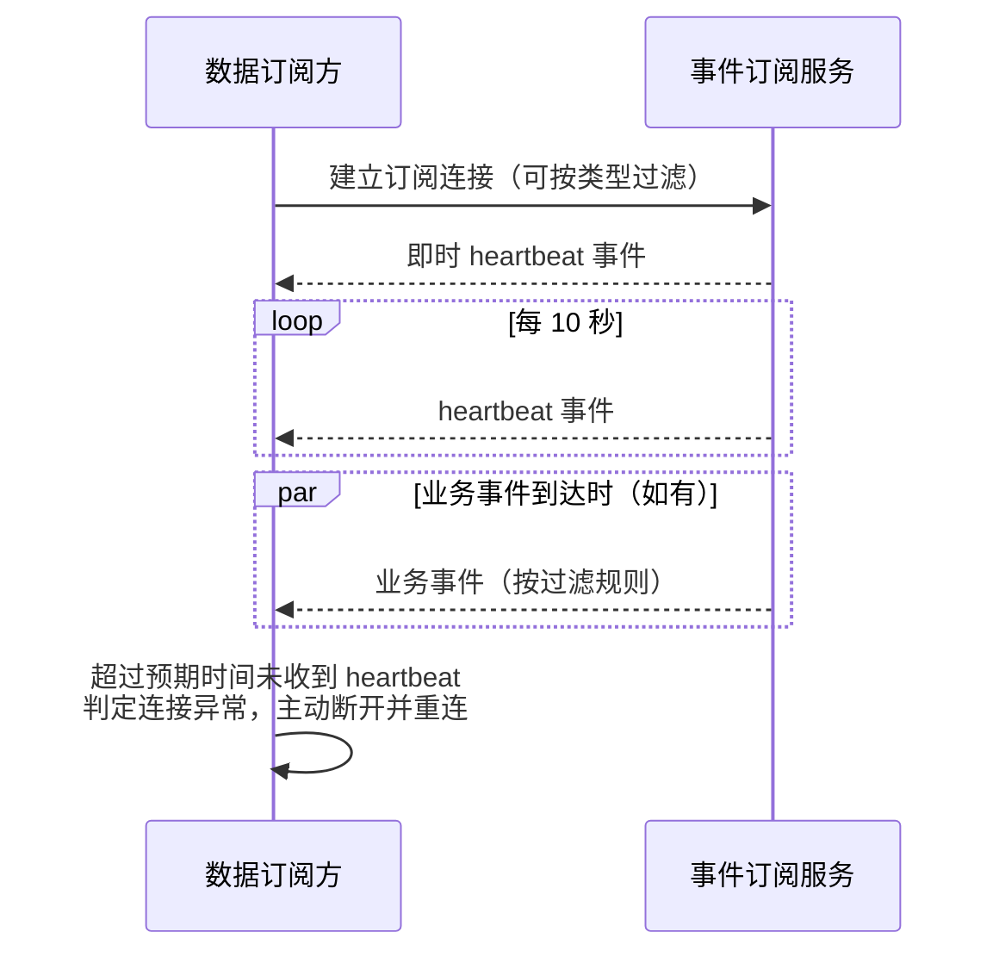

# 直播间实时事件订阅心跳

**功能名称**: 直播间实时事件订阅心跳
**PRD 版本**: v1.0
**创建日期**: 2026-09-03
**作者**: Deliay

## 背景与目标

### 1.1 背景

数据订阅方通过直播间实时事件订阅接口（`/api/b/live/{roomId}/event/subscribe`）以长连接方式接收弹幕、礼物等实时事件。当主播未开播或直播间事件稀疏时，连接可能长时间没有任何输出，订阅方无法区分「当前确实没有事件」与「连接已经断开/中间链路断流」，只能凭超时猜测，容易误判导致重复重连或长时间漏收事件。

### 1.2 目标

- 订阅连接建立成功后，**立即**向订阅方发送一次心跳事件；
- 之后**每 10 秒**发送一次心跳事件，事件类型固定为 `heartbeat`，不携带任何额外业务数据；
- 订阅方可依据心跳的稳定到达确认连接存活，长时间收不到心跳即可判定连接异常并主动重连。

### 1.3 成功标准

- 任意订阅连接建立后立即可收到一条 `heartbeat` 事件，无需等待首个业务事件；
- 连接存续期间，`heartbeat` 事件以约 10 秒的间隔持续到达（允许轻微的调度抖动）；
- 心跳事件不携带业务数据，不包含弹幕、礼物等任何事件内容；
- 引入心跳后，既有事件的推送内容、顺序与类型过滤行为不发生变化。

## 用户分析

### 2.1 目标用户

- **数据订阅方（调用方）**：通过实时事件订阅接口持续接收直播间事件的接入方，是本次功能的唯一使用者。

### 2.2 用户场景

| 场景 | 用户角色 | 目标 | 痛点 |
|--|--|--|--|
| 确认订阅连接存活 | 数据订阅方 | 长时间无业务事件时仍能确认连接正常 | 连接静默时无法区分「无事件」与「连接断开」 |
| 及时发现断连并重连 | 数据订阅方 | 心跳中断即判定连接异常并主动重建 | 被动等待业务事件才发现断连，漏收数据 |
| 防止中间链路断开空闲连接 | 数据订阅方 | 长连接期间保持有数据流动 | 部分网络中间设备会回收长时间无数据的连接 |

## 功能需求

### 3.1 功能概述

在直播间实时事件订阅接口上增加心跳事件：连接建立后立即发送一次类型为 `heartbeat` 的事件，之后每 10 秒发送一次；心跳事件不携带任何业务数据；心跳由连接本身产生，与该直播间是否有业务事件无关。

### 3.2 功能列表

#### 功能点 1: 连接建立即时心跳

- **描述**: 订阅连接建立成功、开始推送事件之前，立即向订阅方发送一条类型为 `heartbeat` 的事件。
- **用户价值**: 订阅方在第一时间确认连接已就绪，无需等待首个业务事件。
- **验收标准**:
  - [ ] 连接建立后立即收到一条 `heartbeat` 事件，到达时间不晚于连接建立后 1 秒；
  - [ ] 该即时心跳在任何时候建立连接都会发送，与直播间是否开播、是否有事件无关。

#### 功能点 2: 周期心跳

- **描述**: 连接存续期间，每 10 秒发送一条类型为 `heartbeat` 的事件；心跳事件不携带弹幕、礼物等业务数据。
- **用户价值**: 订阅方以固定节奏确认连接存活；心跳中断即可判定连接异常并主动重连。
- **验收标准**:
  - [ ] 连接存续期间 `heartbeat` 事件以约 10 秒间隔持续到达；
  - [ ] 直播间无业务事件（主播未开播、无人互动）时，心跳仍按节奏正常到达；
  - [ ] 心跳事件不携带任何业务数据，类型仅为 `heartbeat`；
  - [ ] 同一连接上的多条心跳按时间顺序依次到达，不丢失、不重复（正常网络条件下）。

#### 功能点 3: 心跳与事件过滤的关系

- **描述**: 订阅方在建立连接时可按事件类型过滤推送内容（既有能力）；心跳事件作为连接存活信号，**不受类型过滤影响**——无论订阅方是否指定类型过滤，心跳都照常发送。
- **用户价值**: 订阅方按类型过滤接收业务事件的同时，仍能持续获得连接存活信号。
- **验收标准**:
  - [ ] 指定类型过滤（如仅接收弹幕）时，`heartbeat` 事件仍按节奏到达；
  - [ ] 未指定类型过滤时，心跳与业务事件按各自节奏到达，业务事件的推送内容与顺序不受心跳影响；
  - [ ] 心跳不产生任何持久化记录，不出现在历史事件查询接口的结果中。

### 3.3 用户操作流程

### 3.4 页面/界面描述

本需求不涉及页面/界面变更，仅影响实时事件订阅接口的输出内容。

### 3.5 异常与边界情况

| 情况 | 预期行为 |
|------|---------|
| 直播间长时间无业务事件 | 心跳仍按 10 秒节奏正常发送 |
| 订阅方指定了类型过滤 | 心跳照常发送，不受过滤影响；被过滤掉的业务事件仍不推送 |
| 订阅方主动断开连接 | 心跳随连接终止，不再产生 |
| 同一客户端对同一直播间建立多条连接 | 每条连接各自独立发送心跳，互不影响 |
| 连接因网络原因中断 | 服务端清理该连接，心跳停止；订阅方依据心跳缺失自行重连 |

## 四、非功能需求

### 4.1 性能要求

- 心跳为极小负载的固定节奏输出，单连接每 10 秒一条，不得对既有事件推送的实时性产生可感知影响；
- 心跳发送失败（连接已断开）时应自然终止该连接的心跳，不产生异常风暴。

### 4.2 安全性要求

- 心跳不携带任何业务数据与敏感信息，无新增安全风险。

### 4.3 兼容性要求

- 心跳为新增的推送事件类型，既有业务事件的格式、内容与顺序不变；
- 订阅方若未识别 `heartbeat` 类型，可安全忽略该事件，不影响既有处理逻辑；
- 历史事件查询等既有接口结果中不包含心跳记录，查询行为不变。

## 五、依赖与约束

### 5.1 依赖

- 既有直播间实时事件订阅能力（长连接推送、类型过滤）——本需求在其上新增心跳输出。

### 5.2 约束

- 心跳间隔固定为 10 秒，类型固定为 `heartbeat`，不携带额外数据；
- 心跳为连接级信号，不持久化、不进入历史事件数据；
- 心跳不受订阅方的类型过滤参数影响。

## 六、相关文档

- 技术提案: `docs/engineering/proposals/20260903-proposal-live-event-subscribe-heartbeat.md`
- 关联 PRD: `docs/product/draft/20260815-live-event-filter-prd.md`（事件类型过滤）
