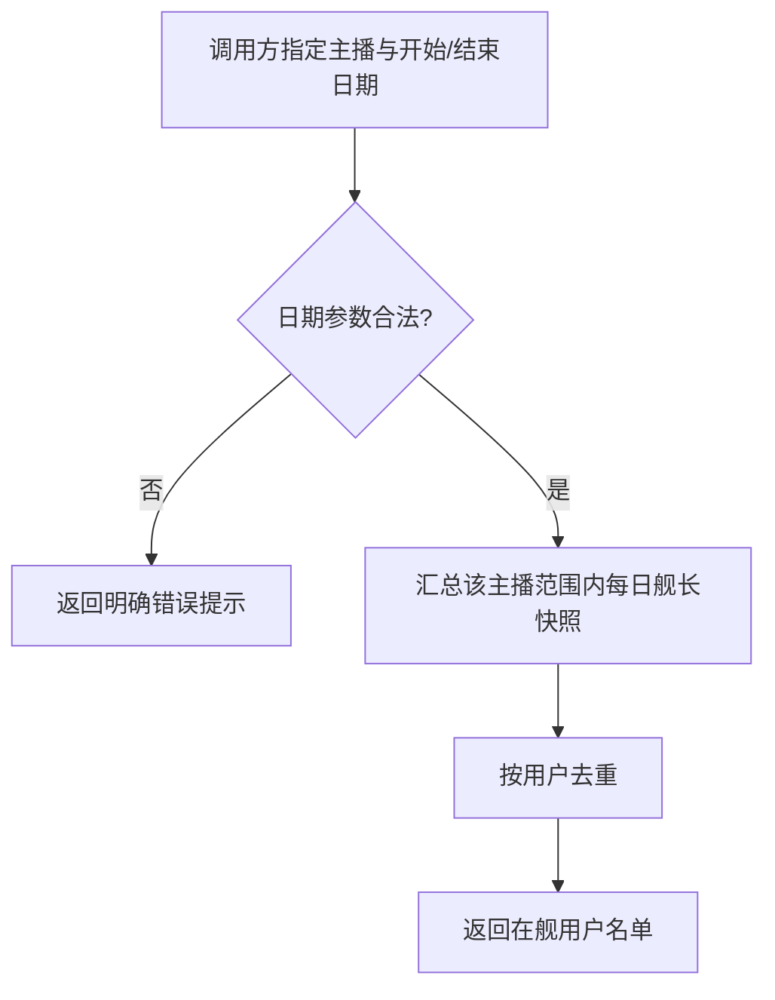

# 在舰查询

**功能名称**: 在舰查询
**PRD 版本**: v1.1
**创建日期**: 2026-09-03
**作者**: Deliay

## 背景与目标

### 1.1 背景

「舰长数据抓取」功能（见 [[20260831-live-guard-crawl-prd]]）上线后，系统已按订阅持续沉淀各主播直播间的舰长每日快照。但数据目前只进不出：订阅方没有任何途径取回这些名单，「谁在舰」这一核心诉求仍未闭环。本次需求为舰长数据补齐查询出口。

### 1.2 目标

- 订阅方可以指定一名主播与一个日期范围（开始日期与结束日期），查询该主播直播间在该范围内所有「在舰」用户的名单；
- 名单按用户去重：同一用户在范围内任意一天在舰即视为命中，结果中只出现一次；
- 日期语义明确无歧义：开始日期覆盖当天从开始起，结束日期覆盖到当天结束为止（即首尾两天均按全天计入）。

### 1.3 成功标准

- 给定主播与日期范围，查询结果完整覆盖范围内每一天该主播直播间的在舰用户，不漏日期、不漏用户；
- 同一用户无论命中多少天，结果中仅出现一次；
- 其他主播的在舰数据不进入查询结果；
- 范围之外日期的在舰记录不影响结果；
- 日期参数非法（格式错误、开始晚于结束）时，调用方能得到明确的错误提示而非错误数据。

## 用户分析

### 2.1 目标用户

- **数据订阅方（调用方）**：需要取回舰长名单做留存、转化与粉丝构成分析的接入方，是本功能的唯一使用者。

### 2.2 用户场景

| 场景 | 用户角色 | 目标 | 痛点 |
|--|--|--|--|
| 统计某主播某月的在舰用户 | 数据订阅方 | 拿到该主播当月所有在舰用户的去重名单 | 舰长数据只能沉淀无法取出 |
| 对比某主播两个时间段的在舰规模 | 数据订阅方 | 分别查询该主播两个日期范围并对比名单 | 无法按自定义范围取数 |
| 核对某主播某天之后的新增在舰用户 | 数据订阅方 | 查询该主播指定起止日期内的在舰名单 | 缺少按主播按日期过滤的手段 |

## 功能需求

### 3.1 功能概述

提供一个「在舰查询」能力：调用方指定一名主播，并传入开始日期与结束日期（精确到天），系统汇总该主播直播间在该日期范围内已沉淀的舰长每日快照，返回范围内所有在舰用户的去重名单。

### 3.2 功能列表

#### 功能点 1: 按日期范围查询在舰用户

- **描述**: 调用方指定一名主播，并指定开始日期（startedAt）与结束日期（endedAt），两者均为「年-月-日」的日期。开始日期从当天开始计入，结束日期到当天结束为止（首尾两天均按全天覆盖）。系统返回该主播直播间在该范围内所有曾出现在舰长每日快照中的用户名单，按用户去重。
- **用户价值**: 订阅方以最小成本取回任意主播、任意时间段的「谁在舰」答案，直接支撑留存与构成分析。
- **验收标准**:
  - [ ] 查询单日（开始日期等于结束日期）时，返回该主播当天所有在舰用户的去重名单；
  - [ ] 查询多日范围时，结果覆盖范围内每一天该主播的在舰用户；
  - [ ] 同一用户在范围内多天在舰，结果中仅出现一次；
  - [ ] 结果仅来自指定主播的舰长快照，其他主播的在舰数据不进入结果；
  - [ ] 范围边界日期按全天计入：开始日期的当天与结束日期的当天的在舰记录均纳入统计；
  - [ ] 范围内某天该主播没有舰长快照数据时，该天不产生结果但不影响其他天；
  - [ ] 范围内全部无数据（含该主播从未产生过快照）时，返回空名单而非报错。

#### 功能点 2: 日期参数校验与错误提示

- **描述**: 对日期入参做严格校验：必须符合「年-月-日」的日期格式，且开始日期不得晚于结束日期。校验失败时向调用方返回明确的错误说明。
- **用户价值**: 调用方在参数写错时能立即定位问题，避免基于错误口径的数据做决策。
- **验收标准**:
  - [ ] 日期格式非法（如缺少年月日、包含时间以外的非法字符）时拒绝请求并说明原因；
  - [ ] 开始日期晚于结束日期时拒绝请求并说明原因；
  - [ ] 缺少开始日期或结束日期时拒绝请求并说明原因。

### 3.3 用户操作流程

### 3.4 页面/界面描述

本功能为纯数据查询能力，无页面界面。

### 3.5 异常与边界情况

| 情况 | 预期行为 |
|------|---------|
| 开始日期等于结束日期 | 视为单日查询，返回该主播当天去重名单 |
| 日期格式非法 | 拒绝请求，提示日期格式要求 |
| 开始日期晚于结束日期 | 拒绝请求，提示日期范围颠倒 |
| 范围内部分日期无快照数据 | 跳过无数据日期，正常返回其余日期的结果 |
| 范围内全部无快照数据 | 返回空名单 |
| 指定主播从未产生过舰长快照（未订阅舰长抓取） | 返回空名单而非报错 |
| 查询范围包含今天 | 今天的在舰数据以今日已产生的快照为准，正常参与统计 |

## 四、非功能需求

### 4.1 性能要求

- 常规日期范围（如一个月）的查询应在秒级内返回；
- 结果规模随范围线性增长时（如跨数月），查询仍应可用，不因名单过大而超时。

### 4.2 安全性要求

- 查询为只读操作，不得对沉淀数据产生任何写副作用。

### 4.3 兼容性要求

- 不影响既有舰长抓取链路与其它查询能力；
- 结果只包含用户标识本身，不包含用户隐私信息之外的额外画像数据。

## 五、依赖与约束

### 5.1 依赖

- 依赖「舰长数据抓取」已沉淀的每日快照数据（见 [[20260831-live-guard-crawl-prd]]）；未订阅舰长抓取的主播没有快照数据，查询其结果为空名单。

### 5.2 约束

- 查询范围以「天」为最小粒度，不支持按小时级起止时间过滤；
- 日期口径与快照落库口径保持一致（同一时区基准），调用方无需关心时区换算。

## 六、相关文档

- [[20260831-live-guard-crawl-prd]]
