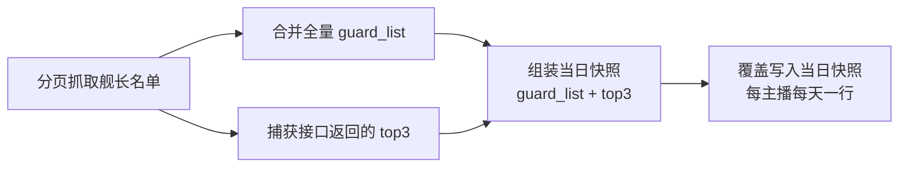

# 舰长 Top3 落库

**功能名称**: 舰长 Top3 落库
**PRD 版本**: v1.0
**创建日期**: 2026-09-03
**作者**: Deliay

## 背景与目标

### 1.1 背景

「舰长数据抓取」功能（`docs/product/draft/20260831-live-guard-crawl-prd.md`）已上线：订阅「舰长」类型的主播每日 23:00（北京时间）抓取直播间舰长名单，按「每主播每天一行」落库快照（mid + roomId + guard_list）。

但舰长名单接口的响应中除了分页名单（list）外，还包含 **top3**——该直播间大航海贡献前三的用户（含其大航海等级与粉丝勋章信息，可能包含已下船的历史高贡献用户）。当前抓取逻辑只合并分页名单落库，**top3 被丢弃未写入数据库**。top3 是衡量主播核心付费用户构成的重要数据，订阅方明确提出这部分数据也需要沉淀。

### 1.2 目标

- 舰长每日快照在现有 guard_list 之外，**同时保存当次抓取接口返回的 top3**，与名单同一条快照记录落库；
- top3 与 guard_list 共用同一快照粒度（每主播每天一行），同日重复抓取一并覆盖更新；
- 不新增抓取请求：top3 复用既有舰长名单接口的响应数据，抓取频率、风控行为完全不变。

### 1.3 成功标准

- 每个「舰长」订阅主播的每日快照中可查到当日 top3 数据（接口返回非空时）；
- top3 与 guard_list 同属一行快照，数据口径一致（同一次抓取、同一 Date）；
- 快照粒度不变：同一主播同一天仍最多一行记录；
- 既有抓取链路（翻页、延迟、补抓、失败策略）行为无回归。

## 用户分析

### 2.1 目标用户

- **数据订阅方（调用方）**：需要主播大航海头部付费用户数据的接入方，是本次功能的主要使用者；
- **运营/管理员（Deliay）**：关注快照数据完整性。

### 2.2 用户场景

| 场景 | 用户角色 | 目标 | 痛点 |
|--|--|--|--|
| 分析主播头部付费用户 | 数据订阅方 | 每日获得主播大航海 top3 及其变化 | 接口已返回 top3 但未落库，数据白白丢失 |
| 追溯 top3 历史变化 | 数据订阅方 | 按日期序列回看 top3 变迁 | 无历史沉淀，无法回溯 |

## 功能需求

### 3.1 功能概述

舰长每日快照新增 top3 数据：抓取舰长名单时，将接口响应中的 top3（大航海贡献前三）与分页合并的 guard_list 一并写入当日快照的同一行记录。top3 数据直接来自既有抓取响应，不引入任何新增请求。

### 3.2 功能列表

#### 功能点 1: 快照记录新增 top3 字段

- **描述**: 舰长每日快照在 mid、roomId、guard_list、抓取时间之外，新增 top3 字段，保存当次抓取接口返回的大航海贡献前三用户（uid、昵称、大航海等级、粉丝勋章信息），数组顺序即排名（第 1 名至第 3 名）。top3 与 guard_list 相互独立存储：top3 可能包含已下船的高贡献用户，不计入 guard_list，也不影响 GuardCount。
- **用户价值**: 头部付费用户数据完整沉淀，可按天追溯变化；语义上「在舰名单」与「贡献前三」分开，分析时不混淆。
- **验收标准**:
  - [ ] 每日快照包含 top3 字段，保存接口返回的贡献前三（最多 3 条），顺序与接口返回一致（即排名顺序）；
  - [ ] top3 条目包含 uid、昵称、大航海等级、粉丝勋章名与等级（与 guard_list 条目字段一致）；
  - [ ] top3 不并入 guard_list，GuardCount 仍只统计在舰名单人数；
  - [ ] 接口返回 top3 为空时，快照 top3 为空列表，快照正常落库。

#### 功能点 2: 同日重复抓取覆盖更新

- **描述**: 同日对同一主播的重复抓取（定时、补抓、凌晨补抓）覆盖当日快照时，top3 与 guard_list 一并整体替换，不产生增量残留。
- **用户价值**: 每天一行的数据粒度不变，top3 与名单始终来自同一次成功抓取，口径一致。
- **验收标准**:
  - [ ] 同日重复抓取后快照仍为一行，top3 与 guard_list 均为最新一次成功抓取的数据；
  - [ ] 抓取失败时不写半成品快照，既有快照（含 top3）不被破坏。

#### 功能点 3: 历史数据处理

- **描述**: 本功能上线前已落库的历史快照不含 top3，**不做回填**（top3 为实时榜单数据，历史值无法通过现接口还原）；历史快照的 top3 按缺失处理。
- **用户价值**: 明确数据可用范围，订阅方按上线日期开始使用 top3 序列。
- **验收标准**:
  - [ ] 历史快照不被修改；
  - [ ] 读取历史快照时 top3 缺失不导致查询/反序列化异常。

### 3.3 用户操作流程

本需求不改变任何用户操作流程。抓取流程中仅「组装快照」一步新增 top3：

### 3.4 页面/界面描述

本需求不涉及页面/界面变更。舰长快照暂无对外查询接口与后台展示（沉淀先行，消费留待后续需求），top3 随快照一并可供后续消费接口使用。

### 3.5 异常与边界情况

| 情况 | 预期行为 |
|------|---------|
| 接口返回 top3 为空 | 快照 top3 为空列表，正常落库，不视为失败 |
| top3 用户同时出现在 guard_list 中 | 两处各自保留，不去重、不合并（语义不同：在舰 vs 贡献前三） |
| top3 用户已下船（不在 guard_list 中） | 照常保存到 top3，不要求其在舰 |
| 抓取中途失败 | 整轮不落库，top3 与名单都不写半成品 |
| 历史快照无 top3 字段 | 读取时按空列表处理，不报错、不回填 |

## 四、非功能需求

### 4.1 性能要求

- top3 复用既有抓取响应，不新增任何外部请求，抓取耗时与风控消耗不变；
- 单条快照文档体积增加约 3 条用户记录，存储影响可忽略。

### 4.2 安全性要求

- 无新增凭证/权限处理；top3 与舰长名单同为公开直播间数据。

### 4.3 兼容性要求

- 快照实体新增字段为增量变更，既有快照读取兼容（缺省为空）；
- 不改变订阅、抓取调度、补抓等既有行为。

## 五、依赖与约束

### 5.1 依赖

- 既有「舰长数据抓取」链路（`docs/product/draft/20260831-live-guard-crawl-prd.md`）——本需求在其快照上补充一个字段；
- 舰长名单接口响应中的 top3 数据（抓取库 Mikibot.Crawler 已解析该字段）。

### 5.2 约束

- 不新增抓取请求，top3 只能来自既有名单接口响应；
- 快照粒度保持「每主播每天一行」，top3 不单独建集合/建行；
- 历史快照不回填。

## 六、相关文档

- 技术提案: `docs/engineering/proposals/20260903-proposal-live-guard-top3.md`
- 关联 PRD: `docs/product/draft/20260831-live-guard-crawl-prd.md`（舰长数据抓取）
